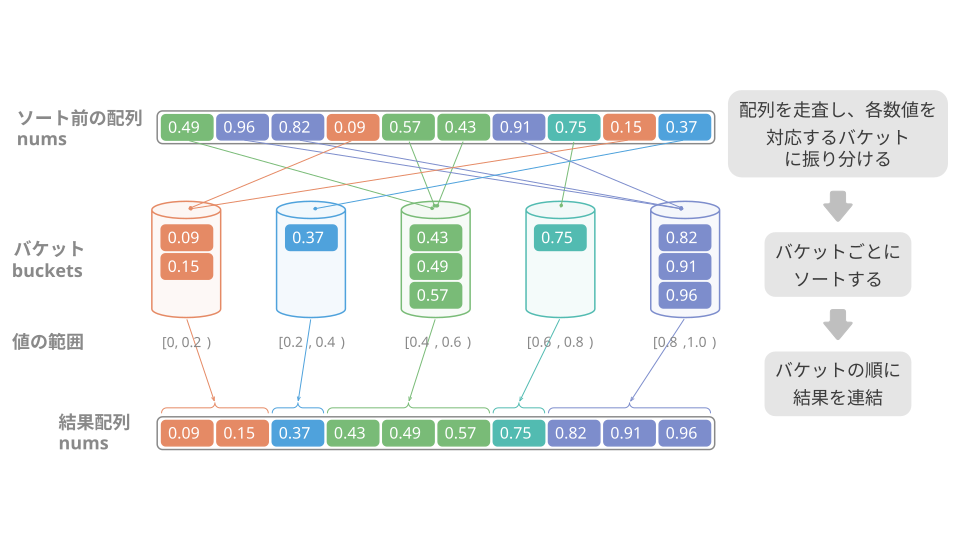
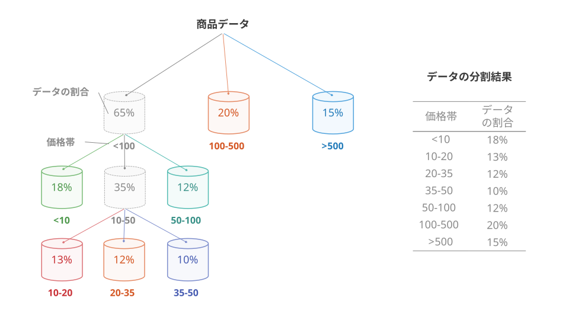

# 11.8 &nbsp; バケットソート

これまでに見たのは、要素同士の大小を比較して並べ替える「比較ソート」です。この種のアルゴリズムでは、最悪時間計算量の下界は $\Omega(n \log n)$ です。次に取り上げる「非比較ソート」には、線形時間で実行できるものがあります。

<u>バケットソート（bucket sort）</u>は、分割統治の典型的な応用例です。大小順に並んだ値の範囲に対応するバケットを用意し、それぞれにデータを均等に振り分けます。次に各バケット内でソートし、最後にバケットの順にデータをすべて連結します。

## 11.8.1 &nbsp; アルゴリズムの手順

長さ $n$ の配列を考えます。要素は範囲 $[0, 1)$ の浮動小数点数です。図 11-13 にバケットソートの手順を示します。

1. $k$ 個のバケットを初期化し、$n$ 個の要素を $k$ 個のバケットに振り分けます。
2. 各バケットを個別にソートします（ここではプログラミング言語の組み込みソート関数を使います）。
3. バケットの値の範囲が小さい順に結果を連結します。

{ class="animation-figure" }

<p align="center"> 図 11-13 &nbsp; バケットソートの手順 </p>

コードを次に示します。

=== "Python"

    ```python title="bucket_sort.py"
    def bucket_sort(nums: list[float]):
        """バケットソート"""
        # k = n/2 個のバケットを初期化。各バケットには平均 2 要素が入る想定
        k = len(nums) // 2
        buckets = [[] for _ in range(k)]
        # 1. 配列の要素を各バケットに振り分ける
        for num in nums:
            # 入力範囲は [0, 1)。num * k でインデックスの範囲 [0, k-1] に写す
            i = int(num * k)
            # num をバケット i に追加
            buckets[i].append(num)
        # 2. 各バケットをソートする
        for bucket in buckets:
            # 組み込みのソート関数を使用。他のソートアルゴリズムでもよい
            bucket.sort()
        # 3. バケットを順に連結
        i = 0
        for bucket in buckets:
            for num in bucket:
                nums[i] = num
                i += 1
    ```

=== "C++"

    ```cpp title="bucket_sort.cpp"
    /* バケットソート */
    void bucketSort(vector<float> &nums) {
        // k = n/2 個のバケットを初期化。各バケットには平均 2 要素が入る想定
        int k = nums.size() / 2;
        vector<vector<float>> buckets(k);
        // 1. 配列の要素を各バケットに振り分ける
        for (float num : nums) {
            // 入力範囲は [0, 1)。num * k でインデックスの範囲 [0, k-1] に写す
            int i = num * k;
            // num をバケット bucket_idx に追加
            buckets[i].push_back(num);
        }
        // 2. 各バケットをソートする
        for (vector<float> &bucket : buckets) {
            // 組み込みのソート関数を使用。他のソートアルゴリズムでもよい
            sort(bucket.begin(), bucket.end());
        }
        // 3. バケットを順に連結
        int i = 0;
        for (vector<float> &bucket : buckets) {
            for (float num : bucket) {
                nums[i++] = num;
            }
        }
    }
    ```

=== "Java"

    ```java title="bucket_sort.java"
    /* バケットソート */
    void bucketSort(float[] nums) {
        // k = n/2 個のバケットを初期化。各バケットには平均 2 要素が入る想定
        int k = nums.length / 2;
        List<List<Float>> buckets = new ArrayList<>();
        for (int i = 0; i < k; i++) {
            buckets.add(new ArrayList<>());
        }
        // 1. 配列の要素を各バケットに振り分ける
        for (float num : nums) {
            // 入力範囲は [0, 1)。num * k でインデックスの範囲 [0, k-1] に写す
            int i = (int) (num * k);
            // num をバケット i に追加
            buckets.get(i).add(num);
        }
        // 2. 各バケットをソートする
        for (List<Float> bucket : buckets) {
            // 組み込みのソート関数を使用。他のソートアルゴリズムでもよい
            Collections.sort(bucket);
        }
        // 3. バケットを順に連結
        int i = 0;
        for (List<Float> bucket : buckets) {
            for (float num : bucket) {
                nums[i++] = num;
            }
        }
    }
    ```

=== "C#"

    ```csharp title="bucket_sort.cs"
    /* バケットソート */
    void BucketSort(float[] nums) {
        // k = n/2 個のバケットを初期化。各バケットには平均 2 要素が入る想定
        int k = nums.Length / 2;
        List<List<float>> buckets = [];
        for (int i = 0; i < k; i++) {
            buckets.Add([]);
        }
        // 1. 配列の要素を各バケットに振り分ける
        foreach (float num in nums) {
            // 入力範囲は [0, 1)。num * k でインデックスの範囲 [0, k-1] に写す
            int i = (int)(num * k);
            // num をバケット i に追加
            buckets[i].Add(num);
        }
        // 2. 各バケットをソートする
        foreach (List<float> bucket in buckets) {
            // 組み込みのソート関数を使用。他のソートアルゴリズムでもよい
            bucket.Sort();
        }
        // 3. バケットを順に連結
        int j = 0;
        foreach (List<float> bucket in buckets) {
            foreach (float num in bucket) {
                nums[j++] = num;
            }
        }
    }
    ```

=== "Go"

    ```go title="bucket_sort.go"
    /* バケットソート */
    func bucketSort(nums []float64) {
        // k = n/2 個のバケットを初期化。各バケットには平均 2 要素が入る想定
        k := len(nums) / 2
        buckets := make([][]float64, k)
        for i := 0; i < k; i++ {
            buckets[i] = make([]float64, 0)
        }
        // 1. 配列の要素を各バケットに振り分ける
        for _, num := range nums {
            // 入力範囲は [0, 1)。num * k でインデックスの範囲 [0, k-1] に写す
            i := int(num * float64(k))
            // num をバケット i に追加
            buckets[i] = append(buckets[i], num)
        }
        // 2. 各バケットをソートする
        for i := 0; i < k; i++ {
            // 組み込みのスライス用ソート関数を使用。他のソートアルゴリズムでもよい
            sort.Float64s(buckets[i])
        }
        // 3. バケットを順に連結
        i := 0
        for _, bucket := range buckets {
            for _, num := range bucket {
                nums[i] = num
                i++
            }
        }
    }
    ```

=== "Swift"

    ```swift title="bucket_sort.swift"
    /* バケットソート */
    func bucketSort(nums: inout [Double]) {
        // k = n/2 個のバケットを初期化。各バケットには平均 2 要素が入る想定
        let k = nums.count / 2
        var buckets = (0 ..< k).map { _ in [Double]() }
        // 1. 配列の要素を各バケットに振り分ける
        for num in nums {
            // 入力範囲は [0, 1)。num * k でインデックスの範囲 [0, k-1] に写す
            let i = Int(num * Double(k))
            // num をバケット i に追加
            buckets[i].append(num)
        }
        // 2. 各バケットをソートする
        for i in buckets.indices {
            // 組み込みのソート関数を使用。他のソートアルゴリズムでもよい
            buckets[i].sort()
        }
        // 3. バケットを順に連結
        var i = nums.startIndex
        for bucket in buckets {
            for num in bucket {
                nums[i] = num
                i += 1
            }
        }
    }
    ```

=== "JS"

    ```javascript title="bucket_sort.js"
    /* バケットソート */
    function bucketSort(nums) {
        // k = n/2 個のバケットを初期化。各バケットには平均 2 要素が入る想定
        const k = nums.length / 2;
        const buckets = [];
        for (let i = 0; i < k; i++) {
            buckets.push([]);
        }
        // 1. 配列の要素を各バケットに振り分ける
        for (const num of nums) {
            // 入力範囲は [0, 1)。num * k でインデックスの範囲 [0, k-1] に写す
            const i = Math.floor(num * k);
            // num をバケット i に追加
            buckets[i].push(num);
        }
        // 2. 各バケットをソートする
        for (const bucket of buckets) {
            // 組み込みのソート関数を使用。他のソートアルゴリズムでもよい
            bucket.sort((a, b) => a - b);
        }
        // 3. バケットを順に連結
        let i = 0;
        for (const bucket of buckets) {
            for (const num of bucket) {
                nums[i++] = num;
            }
        }
    }
    ```

=== "TS"

    ```typescript title="bucket_sort.ts"
    /* バケットソート */
    function bucketSort(nums: number[]): void {
        // k = n/2 個のバケットを初期化。各バケットには平均 2 要素が入る想定
        const k = nums.length / 2;
        const buckets: number[][] = [];
        for (let i = 0; i < k; i++) {
            buckets.push([]);
        }
        // 1. 配列の要素を各バケットに振り分ける
        for (const num of nums) {
            // 入力範囲は [0, 1)。num * k でインデックスの範囲 [0, k-1] に写す
            const i = Math.floor(num * k);
            // num をバケット i に追加
            buckets[i].push(num);
        }
        // 2. 各バケットをソートする
        for (const bucket of buckets) {
            // 組み込みのソート関数を使用。他のソートアルゴリズムでもよい
            bucket.sort((a, b) => a - b);
        }
        // 3. バケットを順に連結
        let i = 0;
        for (const bucket of buckets) {
            for (const num of bucket) {
                nums[i++] = num;
            }
        }
    }
    ```

=== "Dart"

    ```dart title="bucket_sort.dart"
    /* バケットソート */
    void bucketSort(List<double> nums) {
      // k = n/2 個のバケットを初期化。各バケットには平均 2 要素が入る想定
      int k = nums.length ~/ 2;
      List<List<double>> buckets = List.generate(k, (index) => []);

      // 1. 配列の要素を各バケットに振り分ける
      for (double _num in nums) {
        // 入力範囲は [0, 1)。_num * k でインデックスの範囲 [0, k-1] に写す
        int i = (_num * k).toInt();
        // _num をバケット bucket_idx に追加
        buckets[i].add(_num);
      }
      // 2. 各バケットをソートする
      for (List<double> bucket in buckets) {
        bucket.sort();
      }
      // 3. バケットを順に連結
      int i = 0;
      for (List<double> bucket in buckets) {
        for (double _num in bucket) {
          nums[i++] = _num;
        }
      }
    }
    ```

=== "Rust"

    ```rust title="bucket_sort.rs"
    /* バケットソート */
    fn bucket_sort(nums: &mut [f64]) {
        // k = n/2 個のバケットを初期化。各バケットには平均 2 要素が入る想定
        let k = nums.len() / 2;
        let mut buckets = vec![vec![]; k];
        // 1. 配列の要素を各バケットに振り分ける
        for &num in nums.iter() {
            // 入力範囲は [0, 1)。num * k でインデックスの範囲 [0, k-1] に写す
            let i = (num * k as f64) as usize;
            // num をバケット i に追加
            buckets[i].push(num);
        }
        // 2. 各バケットをソートする
        for bucket in &mut buckets {
            // 組み込みのソート関数を使用。他のソートアルゴリズムでもよい
            bucket.sort_by(|a, b| a.partial_cmp(b).unwrap());
        }
        // 3. バケットを順に連結
        let mut i = 0;
        for bucket in buckets.iter() {
            for &num in bucket.iter() {
                nums[i] = num;
                i += 1;
            }
        }
    }
    ```

=== "C"

    ```c title="bucket_sort.c"
    /* バケットソート */
    void bucketSort(float nums[], int n) {
        int k = n / 2;                                 // k = n/2 個のバケットを初期化
        int *sizes = malloc(k * sizeof(int));          // 各バケットのサイズを記録
        float **buckets = malloc(k * sizeof(float *)); // 動的配列の配列（バケット）
        // 各バケットに十分な領域をあらかじめ確保
        for (int i = 0; i < k; ++i) {
            buckets[i] = (float *)malloc(n * sizeof(float));
            sizes[i] = 0;
        }
        // 1. 配列の要素を各バケットに振り分ける
        for (int i = 0; i < n; ++i) {
            int idx = (int)(nums[i] * k);
            buckets[idx][sizes[idx]++] = nums[i];
        }
        // 2. 各バケットをソートする
        for (int i = 0; i < k; ++i) {
            qsort(buckets[i], sizes[i], sizeof(float), compare);
        }
        // 3. ソート済みのバケットを連結する
        int idx = 0;
        for (int i = 0; i < k; ++i) {
            for (int j = 0; j < sizes[i]; ++j) {
                nums[idx++] = buckets[i][j];
            }
            // メモリを解放
            free(buckets[i]);
        }
    }
    ```

=== "Kotlin"

    ```kotlin title="bucket_sort.kt"
    /* バケットソート */
    fun bucketSort(nums: FloatArray) {
        // k = n/2 個のバケットを初期化。各バケットには平均 2 要素が入る想定
        val k = nums.size / 2
        val buckets = mutableListOf<MutableList<Float>>()
        for (i in 0..<k) {
            buckets.add(mutableListOf())
        }
        // 1. 配列の要素を各バケットに振り分ける
        for (num in nums) {
            // 入力範囲は [0, 1)。num * k でインデックスの範囲 [0, k-1] に写す
            val i = (num * k).toInt()
            // num をバケット i に追加
            buckets[i].add(num)
        }
        // 2. 各バケットをソートする
        for (bucket in buckets) {
            // 組み込みのソート関数を使用。他のソートアルゴリズムでもよい
            bucket.sort()
        }
        // 3. バケットを順に連結
        var i = 0
        for (bucket in buckets) {
            for (num in bucket) {
                nums[i++] = num
            }
        }
    }
    ```

=== "Ruby"

    ```ruby title="bucket_sort.rb"
    ### バケットソート ###
    def bucket_sort(nums)
      # k = n/2 個のバケットを初期化。各バケットには平均 2 要素が入る想定
      k = nums.length / 2
      buckets = Array.new(k) { [] }
      
      # 1. 配列の要素を各バケットに振り分ける
      nums.each do |num|
        # 入力範囲は [0, 1)。num * k でインデックスの範囲 [0, k-1] に写す
        i = (num * k).to_i
        # num をバケット i に追加
        buckets[i] << num
      end

      # 2. 各バケットをソートする
      buckets.each do |bucket|
        # 組み込みのソート関数を使用。他のソートアルゴリズムでもよい
        bucket.sort!
      end

      # 3. バケットを順に連結
      i = 0
      buckets.each do |bucket|
        bucket.each do |num|
          nums[i] = num
          i += 1
        end
      end
    end
    ```

??? pythontutor "実行の様子を見る"

    <div style="height: 549px; width: 100%;"><iframe class="pythontutor-iframe" title="実行の様子を見る" src="https://pythontutor.com/iframe-embed.html#code=def%20bucket_sort%28nums%3A%20list%5Bfloat%5D%29%3A%0A%20%20%20%20%22%22%22%E3%83%90%E3%82%B1%E3%83%83%E3%83%88%E3%82%BD%E3%83%BC%E3%83%88%22%22%22%0A%20%20%20%20%23%20k%20%3D%20n/2%20%E5%80%8B%E3%81%AE%E3%83%90%E3%82%B1%E3%83%83%E3%83%88%E3%82%92%E5%88%9D%E6%9C%9F%E5%8C%96%E3%80%82%E5%90%84%E3%83%90%E3%82%B1%E3%83%83%E3%83%88%E3%81%AB%E3%81%AF%E5%B9%B3%E5%9D%87%202%20%E8%A6%81%E7%B4%A0%E3%81%8C%E5%85%A5%E3%82%8B%E6%83%B3%E5%AE%9A%0A%20%20%20%20k%20%3D%20len%28nums%29%20//%202%0A%20%20%20%20buckets%20%3D%20%5B%5B%5D%20for%20_%20in%20range%28k%29%5D%0A%20%20%20%20%23%201.%20%E9%85%8D%E5%88%97%E3%81%AE%E8%A6%81%E7%B4%A0%E3%82%92%E5%90%84%E3%83%90%E3%82%B1%E3%83%83%E3%83%88%E3%81%AB%E6%8C%AF%E3%82%8A%E5%88%86%E3%81%91%E3%82%8B%0A%20%20%20%20for%20num%20in%20nums%3A%0A%20%20%20%20%20%20%20%20%23%20%E5%85%A5%E5%8A%9B%E7%AF%84%E5%9B%B2%E3%81%AF%20%5B0,%201%29%E3%80%82num%20%2A%20k%20%E3%81%A7%E3%82%A4%E3%83%B3%E3%83%87%E3%83%83%E3%82%AF%E3%82%B9%E3%81%AE%E7%AF%84%E5%9B%B2%20%5B0,%20k-1%5D%20%E3%81%AB%E5%86%99%E3%81%99%0A%20%20%20%20%20%20%20%20i%20%3D%20int%28num%20%2A%20k%29%0A%20%20%20%20%20%20%20%20%23%20num%20%E3%82%92%E3%83%90%E3%82%B1%E3%83%83%E3%83%88%20i%20%E3%81%AB%E8%BF%BD%E5%8A%A0%0A%20%20%20%20%20%20%20%20buckets%5Bi%5D.append%28num%29%0A%20%20%20%20%23%202.%20%E5%90%84%E3%83%90%E3%82%B1%E3%83%83%E3%83%88%E3%82%92%E3%82%BD%E3%83%BC%E3%83%88%E3%81%99%E3%82%8B%0A%20%20%20%20for%20bucket%20in%20buckets%3A%0A%20%20%20%20%20%20%20%20%23%20%E7%B5%84%E3%81%BF%E8%BE%BC%E3%81%BF%E3%81%AE%E3%82%BD%E3%83%BC%E3%83%88%E9%96%A2%E6%95%B0%E3%82%92%E4%BD%BF%E7%94%A8%E3%80%82%E4%BB%96%E3%81%AE%E3%82%BD%E3%83%BC%E3%83%88%E3%82%A2%E3%83%AB%E3%82%B4%E3%83%AA%E3%82%BA%E3%83%A0%E3%81%A7%E3%82%82%E3%82%88%E3%81%84%0A%20%20%20%20%20%20%20%20bucket.sort%28%29%0A%20%20%20%20%23%203.%20%E3%83%90%E3%82%B1%E3%83%83%E3%83%88%E3%82%92%E9%A0%86%E3%81%AB%E9%80%A3%E7%B5%90%0A%20%20%20%20i%20%3D%200%0A%20%20%20%20for%20bucket%20in%20buckets%3A%0A%20%20%20%20%20%20%20%20for%20num%20in%20bucket%3A%0A%20%20%20%20%20%20%20%20%20%20%20%20nums%5Bi%5D%20%3D%20num%0A%20%20%20%20%20%20%20%20%20%20%20%20i%20%2B%3D%201%0A%0Aif%20__name__%20%3D%3D%20%22__main__%22%3A%0A%20%20%20%20%23%20%E5%85%A5%E5%8A%9B%E3%81%AF%20%5B0,%201%29%20%E3%81%AE%E7%AF%84%E5%9B%B2%E3%81%AE%E6%B5%AE%E5%8B%95%E5%B0%8F%E6%95%B0%E7%82%B9%E6%95%B0%E3%81%A8%E3%81%99%E3%82%8B%0A%20%20%20%20nums%20%3D%20%5B0.49,%200.96,%200.82,%200.09,%200.57,%200.43,%200.91,%200.75,%200.15,%200.37%5D%0A%20%20%20%20bucket_sort%28nums%29%0A%20%20%20%20print%28%22%E3%83%90%E3%82%B1%E3%83%83%E3%83%88%E3%82%BD%E3%83%BC%E3%83%88%E5%BE%8C%E3%81%AE%20nums%20%3D%22,%20nums%29&codeDivHeight=472&codeDivWidth=350&cumulative=false&curInstr=3&heapPrimitives=nevernest&origin=opt-frontend.js&py=311&rawInputLstJSON=%5B%5D&textReferences=false"> </iframe></div>
    <div style="margin-top: 5px;"><a href="https://pythontutor.com/iframe-embed.html#code=def%20bucket_sort%28nums%3A%20list%5Bfloat%5D%29%3A%0A%20%20%20%20%22%22%22%E3%83%90%E3%82%B1%E3%83%83%E3%83%88%E3%82%BD%E3%83%BC%E3%83%88%22%22%22%0A%20%20%20%20%23%20k%20%3D%20n/2%20%E5%80%8B%E3%81%AE%E3%83%90%E3%82%B1%E3%83%83%E3%83%88%E3%82%92%E5%88%9D%E6%9C%9F%E5%8C%96%E3%80%82%E5%90%84%E3%83%90%E3%82%B1%E3%83%83%E3%83%88%E3%81%AB%E3%81%AF%E5%B9%B3%E5%9D%87%202%20%E8%A6%81%E7%B4%A0%E3%81%8C%E5%85%A5%E3%82%8B%E6%83%B3%E5%AE%9A%0A%20%20%20%20k%20%3D%20len%28nums%29%20//%202%0A%20%20%20%20buckets%20%3D%20%5B%5B%5D%20for%20_%20in%20range%28k%29%5D%0A%20%20%20%20%23%201.%20%E9%85%8D%E5%88%97%E3%81%AE%E8%A6%81%E7%B4%A0%E3%82%92%E5%90%84%E3%83%90%E3%82%B1%E3%83%83%E3%83%88%E3%81%AB%E6%8C%AF%E3%82%8A%E5%88%86%E3%81%91%E3%82%8B%0A%20%20%20%20for%20num%20in%20nums%3A%0A%20%20%20%20%20%20%20%20%23%20%E5%85%A5%E5%8A%9B%E7%AF%84%E5%9B%B2%E3%81%AF%20%5B0,%201%29%E3%80%82num%20%2A%20k%20%E3%81%A7%E3%82%A4%E3%83%B3%E3%83%87%E3%83%83%E3%82%AF%E3%82%B9%E3%81%AE%E7%AF%84%E5%9B%B2%20%5B0,%20k-1%5D%20%E3%81%AB%E5%86%99%E3%81%99%0A%20%20%20%20%20%20%20%20i%20%3D%20int%28num%20%2A%20k%29%0A%20%20%20%20%20%20%20%20%23%20num%20%E3%82%92%E3%83%90%E3%82%B1%E3%83%83%E3%83%88%20i%20%E3%81%AB%E8%BF%BD%E5%8A%A0%0A%20%20%20%20%20%20%20%20buckets%5Bi%5D.append%28num%29%0A%20%20%20%20%23%202.%20%E5%90%84%E3%83%90%E3%82%B1%E3%83%83%E3%83%88%E3%82%92%E3%82%BD%E3%83%BC%E3%83%88%E3%81%99%E3%82%8B%0A%20%20%20%20for%20bucket%20in%20buckets%3A%0A%20%20%20%20%20%20%20%20%23%20%E7%B5%84%E3%81%BF%E8%BE%BC%E3%81%BF%E3%81%AE%E3%82%BD%E3%83%BC%E3%83%88%E9%96%A2%E6%95%B0%E3%82%92%E4%BD%BF%E7%94%A8%E3%80%82%E4%BB%96%E3%81%AE%E3%82%BD%E3%83%BC%E3%83%88%E3%82%A2%E3%83%AB%E3%82%B4%E3%83%AA%E3%82%BA%E3%83%A0%E3%81%A7%E3%82%82%E3%82%88%E3%81%84%0A%20%20%20%20%20%20%20%20bucket.sort%28%29%0A%20%20%20%20%23%203.%20%E3%83%90%E3%82%B1%E3%83%83%E3%83%88%E3%82%92%E9%A0%86%E3%81%AB%E9%80%A3%E7%B5%90%0A%20%20%20%20i%20%3D%200%0A%20%20%20%20for%20bucket%20in%20buckets%3A%0A%20%20%20%20%20%20%20%20for%20num%20in%20bucket%3A%0A%20%20%20%20%20%20%20%20%20%20%20%20nums%5Bi%5D%20%3D%20num%0A%20%20%20%20%20%20%20%20%20%20%20%20i%20%2B%3D%201%0A%0Aif%20__name__%20%3D%3D%20%22__main__%22%3A%0A%20%20%20%20%23%20%E5%85%A5%E5%8A%9B%E3%81%AF%20%5B0,%201%29%20%E3%81%AE%E7%AF%84%E5%9B%B2%E3%81%AE%E6%B5%AE%E5%8B%95%E5%B0%8F%E6%95%B0%E7%82%B9%E6%95%B0%E3%81%A8%E3%81%99%E3%82%8B%0A%20%20%20%20nums%20%3D%20%5B0.49,%200.96,%200.82,%200.09,%200.57,%200.43,%200.91,%200.75,%200.15,%200.37%5D%0A%20%20%20%20bucket_sort%28nums%29%0A%20%20%20%20print%28%22%E3%83%90%E3%82%B1%E3%83%83%E3%83%88%E3%82%BD%E3%83%BC%E3%83%88%E5%BE%8C%E3%81%AE%20nums%20%3D%22,%20nums%29&codeDivHeight=800&codeDivWidth=600&cumulative=false&curInstr=3&heapPrimitives=nevernest&origin=opt-frontend.js&py=311&rawInputLstJSON=%5B%5D&textReferences=false" target="_blank" rel="noopener noreferrer">全画面で表示 ></a></div>

## 11.8.2 &nbsp; アルゴリズムの特性

バケットソートは大量のデータの処理に適しています。たとえば入力が 100 万要素あり、メモリ容量の制約から一度にすべてを読み込めない場合、データを 1000 個のバケットに分け、バケットごとにソートしてから結果を連結できます。

- **時間計算量は $O(n + k)$**。要素が均等に分布していれば、各バケットの要素数は $\frac{n}{k}$ です。1 個のバケットのソートに $O(\frac{n}{k} \log\frac{n}{k})$ の時間がかかるとすると、全バケットでは $O(n \log\frac{n}{k})$ です。**バケット数 $k$ が十分大きいと、時間計算量は $O(n)$ に近づきます**。結果の連結にはすべてのバケットと要素を走査するので $O(n + k)$ の時間がかかります。最悪の場合はすべてのデータが 1 個のバケットに入り、そのソートに $O(n^2)$ の時間がかかります。
- **空間計算量は $O(n + k)$、インプレースではないソート**。$k$ 個のバケットと、合計 $n$ 個の要素を格納する追加領域が必要です。
- バケットソートが安定かどうかは、バケット内のソートに使うアルゴリズムが安定かどうかで決まります。

## 11.8.3 &nbsp; データを均等に振り分けるには

バケットソートの時間計算量は理論上 $O(n)$ に達します。**そのためには、各バケットの要素数をそろえることが重要です**。実際のデータの値は一様に分布するとは限りません。たとえば淘宝（タオバオ）の全商品を価格帯によって 10 個のバケットに均等に分けたいとします。100 元未満の商品は非常に多く、1000 元を超える商品はごくわずかです。価格帯を等幅に 10 分割すると、バケットごとの商品数に大きな差が生じます。

均等に分けるには、まず大まかな境界を決め、データを 3 個のバケットに振り分けます。**次に商品が多いバケットをさらに 3 個に分け、すべてのバケットの要素数がほぼ等しくなるまで繰り返します**。

図 11-14 のように、この方法では実質的に再帰木を作り、葉に集まるデータの数をできるだけそろえます。毎回 3 個ずつに分ける必要はなく、データの特徴に応じて分割方法を選べます。

{ class="animation-figure" }

<p align="center"> 図 11-14 &nbsp; バケットの再帰的な分割 </p>

商品価格の確率分布があらかじめわかっていれば、**その分布に基づいてバケットごとの価格の境界を決められます**。データ分布を求めるために必ずしも個別に集計する必要はなく、データの特徴に合う確率モデルで近似することもできます。

図 11-15 では商品価格が正規分布に従うと仮定します。この分布に合わせて価格帯を設定すれば、商品を各バケットに均等に振り分けられます。

{ class="animation-figure" }

<p align="center"> 図 11-15 &nbsp; 確率分布に基づくバケットの分割 </p>
