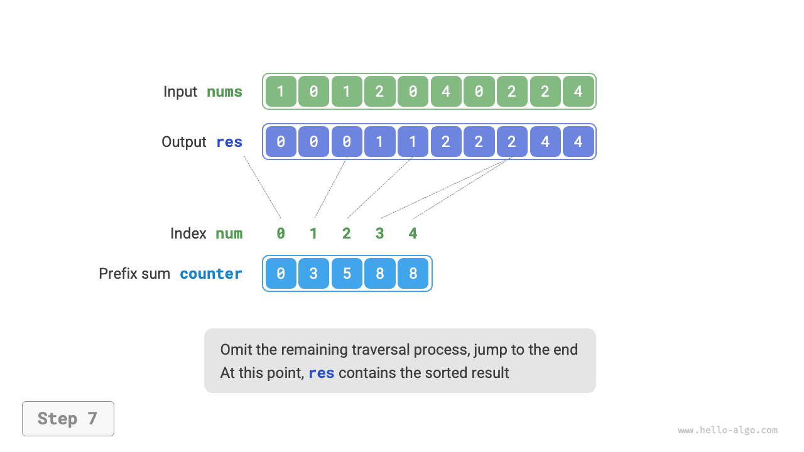

# カウントソート

<u>カウントソート（counting sort）</u>は要素の個数を数えてソートする方法で、通常は整数配列に使います。

## 単純な実装

まず簡単な例を見ましょう。長さ $n$ の配列 `nums` があり、要素はすべて非負整数です。カウントソート全体の流れを下図に示します。

1. 配列を走査して最大の数値 $m$ を求め、長さ $m + 1$ の補助配列 `counter` を作ります。
2. **`counter` を使って、`nums` 内の各数値の出現回数を数えます**。`counter[num]` は数値 `num` の出現回数です。数え方は簡単で、`nums` を走査し、現在の数値を `num` として、毎回 `counter[num]` を $1$ 増やすだけです。
3. **`counter` のインデックスはもともと順に並んでいるので、すべての数値がすでにソートされたのと同じです**。あとは `counter` を走査し、各数値の出現回数に従って、小さい順に `nums` へ書き込めば完了です。


コードは次のとおりです。

```src
[file]{counting_sort}-[class]{}-[func]{counting_sort_naive}
```

!!! note "カウントソートとバケットソートの関係"

    バケットソートの視点では、カウント配列 `counter` の各インデックスを一つのバケット、個数を数える過程を各要素を対応するバケットに入れる過程と見なせます。本質的に、カウントソートは整数データにおけるバケットソートの特殊な場合です。

## 完全な実装

注意深い読者は、**入力がオブジェクトの場合、上の手順 `3.` が使えない**ことに気付いたかもしれません。例えば、商品のオブジェクトを価格（クラスのメンバー変数）でソートしたくても、上の方法で得られるのは価格を並べた結果だけです。

では、元のデータをソートした結果を得るにはどうすればよいでしょうか。まず、`counter` の「累積和」を計算します。名前のとおり、インデックス `i` の累積和 `prefix[i]` は、配列の先頭から `i` 個の要素の和です。

$$
\text{prefix}[i] = \sum_{j=0}^i \text{counter[j]}
$$

**累積和には明確な意味があります。`prefix[num] - 1` は、結果配列 `res` に要素 `num` が最後に現れるインデックスを表します**。これは各要素を結果配列のどこに置くかを示す重要な情報です。続いて、元の配列 `nums` の各要素 `num` を逆順に走査し、各反復で次の二つを行います。

1. 配列 `res` のインデックス `prefix[num] - 1` に `num` を入れます。
2. 累積和 `prefix[num]` を $1$ 減らし、次に `num` を置くインデックスを得ます。

走査が終わると、配列 `res` がソート済みの結果になります。最後に `res` で元の配列 `nums` を上書きします。下図にカウントソートの全手順を示します。

=== "<1>"
    

=== "<2>"
    

=== "<3>"
    

=== "<4>"
    

=== "<5>"
    

=== "<6>"
    

=== "<7>"
    

=== "<8>"
    

カウントソートの実装は次のとおりです。

```src
[file]{counting_sort}-[class]{}-[func]{counting_sort}
```

## アルゴリズムの特徴

- **時間計算量は $O(n + m)$、非適応的ソート**：`nums` と `counter` の走査はいずれも線形時間です。通常は $n \gg m$ なので、時間計算量は $O(n)$ に近づきます。
- **空間計算量は $O(n + m)$、非インプレースソート**：それぞれ長さ $n$ と $m$ の配列 `res` と `counter` を使います。
- **安定ソート**：`res` には右から左へ要素を入れるため、`nums` を逆順に走査すれば、等しい要素の相対的な位置を変えずに済みます。実際には `nums` を順方向に走査しても大小の順序は正しくなりますが、安定性は失われます。

## 制約

ここまで読むと、個数を数えるだけで効率よくソートできるカウントソートを巧妙だと感じるかもしれません。ただし、利用の前提条件は比較的厳しいものです。

**カウントソートは非負整数にしか適用できません**。ほかの型に使うには、要素間の大小関係を変えずに非負整数へ変換できる必要があります。例えば、負数を含む整数配列では、すべての数に同じ定数を加えて正数にし、ソート後に元へ戻せます。

**カウントソートは、データ量は多くても値の範囲が狭い場合に適しています**。例えば、上の例で $m$ が大きすぎると、領域を使いすぎます。また、$n \ll m$ の場合は $O(m)$ 時間がかかり、$O(n \log n)$ のソートより遅くなる可能性があります。
