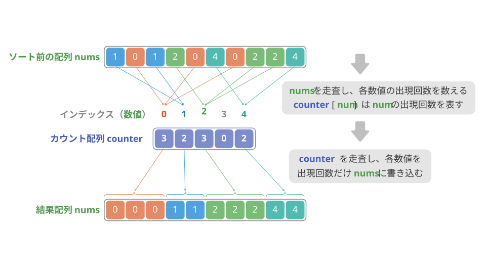
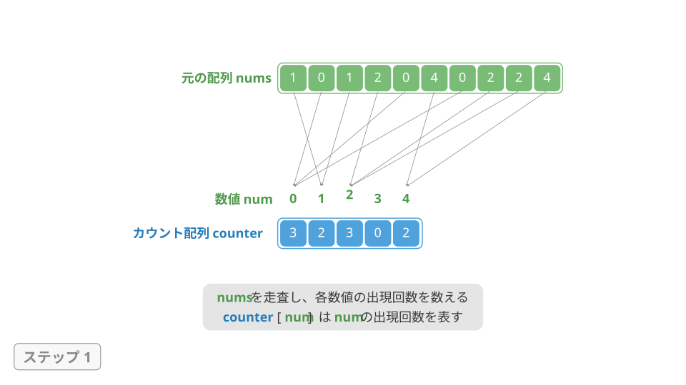
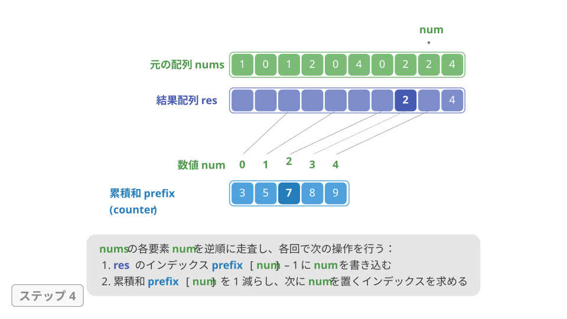
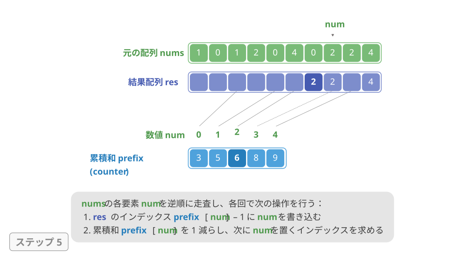

# カウントソート

<u>カウントソート（counting sort）</u>は要素の出現回数を数えて並べ替える方法で、通常は整数の配列に使います。

## 簡易版の実装

簡単な例を見てみましょう。長さ $n$ の配列 `nums` があり、要素はすべて非負整数とします。下図にカウントソートの流れを示します。

1. 配列を走査して最大値 $m$ を求め、長さ $m + 1$ の補助配列 `counter` を作成します。
2. **`counter` を使って `nums` の各数値の出現回数を数えます**。`counter[num]` は数値 `num` の出現回数です。数え方は簡単です。`nums` を走査し（現在の値を `num` とします）、各回で `counter[num]` を $1$ 増やすだけです。
3. **`counter` のインデックスは初めから順に並んでいるため、すべての値はすでに整列したも同然です**。あとは `counter` を走査し、小さい値から順に、出現回数だけ `nums` に書き込みます。



コードを次に示します。

```src
[file]{counting_sort}-[class]{}-[func]{counting_sort_naive}
```

!!! note "カウントソートとバケットソートの関係"

    バケットソートの観点から見ると、カウント配列 `counter` の各インデックスが 1 個のバケットにあたり、出現回数を数える操作は各要素を対応するバケットに振り分けることにあたります。つまり、カウントソートは整数データに対するバケットソートの特殊な場合です。

## 完全版の実装

お気づきかもしれませんが、**入力データがオブジェクトの場合、先ほどのステップ `3.` は使えません**。たとえば商品オブジェクトを価格（クラスのメンバー変数）で並べ替えたいとします。先ほどのアルゴリズムで得られるのは、価格だけを並べ替えた結果です。

元のデータそのものを並べ替えるにはどうすればよいでしょうか。まず `counter` の「累積和」を求めます。インデックス `i` の累積和 `prefix[i]` は、配列の先頭から `i + 1` 個の要素を足したものです。

$$
\text{prefix}[i] = \sum_{j=0}^i \text{counter[j]}
$$

**この累積和から、要素 `num` が結果配列 `res` 内で最後に現れるインデックスは `prefix[num] - 1` だとわかります**。これで各要素の書き込み先が決まります。次に元の配列 `nums` の要素 `num` を逆順に走査し、各回で次の 2 つの操作を行います。

1. `num` を配列 `res` のインデックス `prefix[num] - 1` に書き込みます。
2. 累積和 `prefix[num]` を $1$ 減らして、次に `num` を置くインデックスを求めます。

走査が終わると、配列 `res` に整列済みの結果が入っています。最後に `res` で元の配列 `nums` を上書きします。下図にカウントソートの手順全体を示します。

=== "<1>"
    

=== "<2>"
    

=== "<3>"
    

=== "<4>"
    

=== "<5>"
    

=== "<6>"
    

=== "<7>"
    

=== "<8>"
    

カウントソートの実装を次に示します。

```src
[file]{counting_sort}-[class]{}-[func]{counting_sort}
```

## アルゴリズムの特性

- **時間計算量は $O(n + m)$、非適応的なソート**。`nums` の走査にも `counter` の走査にも線形時間がかかります。通常は $n \gg m$ なので、時間計算量は $O(n)$ に近づきます。
- **空間計算量は $O(n + m)$、インプレースではないソート**。長さがそれぞれ $n$ と $m$ の配列 `res` と `counter` を使います。
- **安定ソート**。`res` には右から左へ要素を書き込むため、`nums` を逆順に走査すれば値が等しい要素の相対順序を保てます。`nums` を先頭から走査しても値は正しい順に並びますが、その場合は安定性が失われます。

## 制約

カウントソートでは、出現回数を数えるだけで効率よくソートできます。ただし、利用できる条件は比較的限られています。

**カウントソートを直接適用できるのは非負整数だけです**。他の種類のデータに使うには、要素間の大小関係を変えずに非負整数に変換できることが必要です。たとえば負数を含む整数配列なら、すべての値に同じ定数を加えて正の数にし、ソート後に元に戻せます。

**カウントソートは、データ数が多く、値の範囲が狭い場合に適しています**。先ほどの例では、$m$ が大きすぎると領域を使いすぎます。また $n \ll m$ のときは $O(m)$ の時間がかかり、$O(n \log n)$ のソートアルゴリズムより遅くなることもあります。
