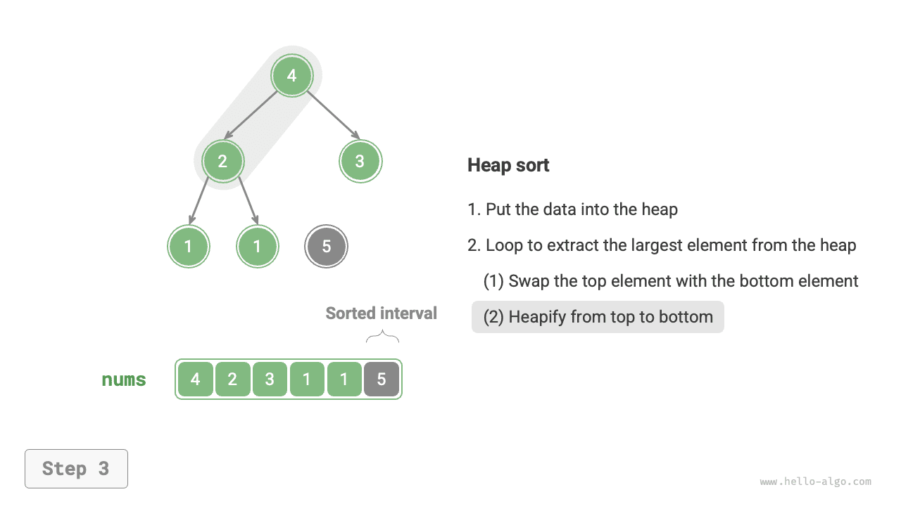
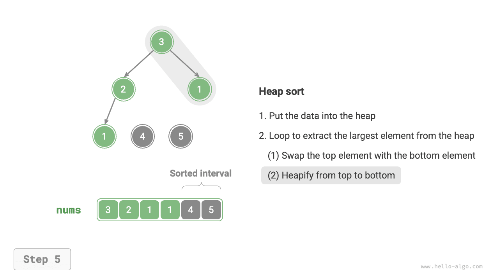
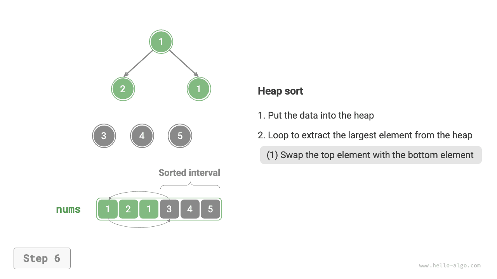

# 11.7 &nbsp; ヒープソート

!!! tip "ヒント"

    この節を読む前に、「ヒープ」の章を学習しておいてください。

<u>ヒープソート（heap sort）</u>は、ヒープというデータ構造に基づく効率的なソートアルゴリズムです。すでに学んだヒープの構築と要素の取り出しを使って実装できます。

1. 配列を入力して最小ヒープを構築します。この時点で最小要素がヒープの先頭にあります。
2. 取り出しを繰り返し、取り出した要素を順に記録すると、昇順に並んだ列が得られます。

この方法でも実現できますが、取り出した要素を保存する追加の配列が必要で、領域を多く使います。実際には、通常、よりすっきりした実装方法を使います。

## 11.7.1 &nbsp; アルゴリズムの流れ

配列の長さを $n$ とすると、ヒープソートの流れは図 11-12 のとおりです。

1. 配列を入力して最大ヒープを構築します。すると、最大要素がヒープの先頭にあります。
2. ヒープの先頭要素（最初の要素）と末尾要素（最後の要素）を交換します。その後、ヒープの長さを $1$ 減らし、整列済み要素数を $1$ 増やします。
3. 先頭要素から下向きにヒープ化（sift down）します。これにより、ヒープの性質が復元されます。
4. 手順 `2.` と `3.` を繰り返します。$n - 1$ 回反復すると、配列のソートが完了します。

!!! tip "ヒント"

    実は、ヒープから要素を取り出す操作にも手順 `2.` と `3.` が含まれています。違いは、要素を取り除く手順が追加されるだけです。

=== "<1>"
    { class="animation-figure" }

=== "<2>"
    { class="animation-figure" }

=== "<3>"
    { class="animation-figure" }

=== "<4>"
    { class="animation-figure" }

=== "<5>"
    { class="animation-figure" }

=== "<6>"
    { class="animation-figure" }

=== "<7>"
    { class="animation-figure" }

=== "<8>"
    { class="animation-figure" }

=== "<9>"
    { class="animation-figure" }

=== "<10>"
    { class="animation-figure" }

=== "<11>"
    { class="animation-figure" }

=== "<12>"
    { class="animation-figure" }

<p align="center"> 図 11-12 &nbsp; ヒープソートの手順 </p>

実装では「ヒープ」の章と同じ、下向きにヒープ化する関数 `sift_down()` を使います。ただし、最大要素を取り出すたびにヒープの長さが縮むので、現在の有効な長さを指定する引数 $n$ を `sift_down()` に追加する必要があります。コードは次のとおりです。

=== "Python"

    ```python title="heap_sort.py"
    def sift_down(nums: list[int], n: int, i: int):
        """長さ n のヒープを、ノード i から下向きにヒープ化する"""
        while True:
            # ノード i, l, r のうち値が最大のノードを求め、ma とする
            l = 2 * i + 1
            r = 2 * i + 2
            ma = i
            if l < n and nums[l] > nums[ma]:
                ma = l
            if r < n and nums[r] > nums[ma]:
                ma = r
            # ノード i が最大か添字 l, r が範囲外なら、ヒープ化は不要なので終了
            if ma == i:
                break
            # 2 つのノードを交換する
            nums[i], nums[ma] = nums[ma], nums[i]
            # 下向きのヒープ化を繰り返す
            i = ma

    def heap_sort(nums: list[int]):
        """ヒープソート"""
        # ヒープの構築：葉ノード以外の全ノードをヒープ化する
        for i in range(len(nums) // 2 - 1, -1, -1):
            sift_down(nums, len(nums), i)
        # ヒープから最大要素を取り出す処理を n-1 回繰り返す
        for i in range(len(nums) - 1, 0, -1):
            # 根と最右の葉を交換（先頭要素と末尾要素を交換）
            nums[0], nums[i] = nums[i], nums[0]
            # 根ノードから下向きにヒープ化する
            sift_down(nums, i, 0)
    ```

=== "C++"

    ```cpp title="heap_sort.cpp"
    /* 長さ n のヒープを、ノード i から下向きにヒープ化する */
    void siftDown(vector<int> &nums, int n, int i) {
        while (true) {
            // ノード i, l, r のうち値が最大のノードを求め、ma とする
            int l = 2 * i + 1;
            int r = 2 * i + 2;
            int ma = i;
            if (l < n && nums[l] > nums[ma])
                ma = l;
            if (r < n && nums[r] > nums[ma])
                ma = r;
            // ノード i が最大か添字 l, r が範囲外なら、ヒープ化は不要なので終了
            if (ma == i) {
                break;
            }
            // 2 つのノードを交換する
            swap(nums[i], nums[ma]);
            // 下向きのヒープ化を繰り返す
            i = ma;
        }
    }

    /* ヒープソート */
    void heapSort(vector<int> &nums) {
        // ヒープの構築：葉ノード以外の全ノードをヒープ化する
        for (int i = nums.size() / 2 - 1; i >= 0; --i) {
            siftDown(nums, nums.size(), i);
        }
        // ヒープから最大要素を取り出す処理を n-1 回繰り返す
        for (int i = nums.size() - 1; i > 0; --i) {
            // 根と最右の葉を交換（先頭要素と末尾要素を交換）
            swap(nums[0], nums[i]);
            // 根ノードから下向きにヒープ化する
            siftDown(nums, i, 0);
        }
    }
    ```

=== "Java"

    ```java title="heap_sort.java"
    /* 長さ n のヒープを、ノード i から下向きにヒープ化する */
    void siftDown(int[] nums, int n, int i) {
        while (true) {
            // ノード i, l, r のうち値が最大のノードを求め、ma とする
            int l = 2 * i + 1;
            int r = 2 * i + 2;
            int ma = i;
            if (l < n && nums[l] > nums[ma])
                ma = l;
            if (r < n && nums[r] > nums[ma])
                ma = r;
            // ノード i が最大か添字 l, r が範囲外なら、ヒープ化は不要なので終了
            if (ma == i)
                break;
            // 2 つのノードを交換する
            int temp = nums[i];
            nums[i] = nums[ma];
            nums[ma] = temp;
            // 下向きのヒープ化を繰り返す
            i = ma;
        }
    }

    /* ヒープソート */
    void heapSort(int[] nums) {
        // ヒープの構築：葉ノード以外の全ノードをヒープ化する
        for (int i = nums.length / 2 - 1; i >= 0; i--) {
            siftDown(nums, nums.length, i);
        }
        // ヒープから最大要素を取り出す処理を n-1 回繰り返す
        for (int i = nums.length - 1; i > 0; i--) {
            // 根と最右の葉を交換（先頭要素と末尾要素を交換）
            int tmp = nums[0];
            nums[0] = nums[i];
            nums[i] = tmp;
            // 根ノードから下向きにヒープ化する
            siftDown(nums, i, 0);
        }
    }
    ```

=== "C#"

    ```csharp title="heap_sort.cs"
    /* 長さ n のヒープを、ノード i から下向きにヒープ化する */
    void SiftDown(int[] nums, int n, int i) {
        while (true) {
            // ノード i, l, r のうち値が最大のノードを求め、ma とする
            int l = 2 * i + 1;
            int r = 2 * i + 2;
            int ma = i;
            if (l < n && nums[l] > nums[ma])
                ma = l;
            if (r < n && nums[r] > nums[ma])
                ma = r;
            // ノード i が最大か添字 l, r が範囲外なら、ヒープ化は不要なので終了
            if (ma == i)
                break;
            // 2 つのノードを交換する
            (nums[ma], nums[i]) = (nums[i], nums[ma]);
            // 下向きのヒープ化を繰り返す
            i = ma;
        }
    }

    /* ヒープソート */
    void HeapSort(int[] nums) {
        // ヒープの構築：葉ノード以外の全ノードをヒープ化する
        for (int i = nums.Length / 2 - 1; i >= 0; i--) {
            SiftDown(nums, nums.Length, i);
        }
        // ヒープから最大要素を取り出す処理を n-1 回繰り返す
        for (int i = nums.Length - 1; i > 0; i--) {
            // 根と最右の葉を交換（先頭要素と末尾要素を交換）
            (nums[i], nums[0]) = (nums[0], nums[i]);
            // 根ノードから下向きにヒープ化する
            SiftDown(nums, i, 0);
        }
    }
    ```

=== "Go"

    ```go title="heap_sort.go"
    /* 長さ n のヒープを、ノード i から下向きにヒープ化する */
    func siftDown(nums *[]int, n, i int) {
        for true {
            // ノード i, l, r のうち値が最大のノードを求め、ma とする
            l := 2*i + 1
            r := 2*i + 2
            ma := i
            if l < n && (*nums)[l] > (*nums)[ma] {
                ma = l
            }
            if r < n && (*nums)[r] > (*nums)[ma] {
                ma = r
            }
            // ノード i が最大か添字 l, r が範囲外なら、ヒープ化は不要なので終了
            if ma == i {
                break
            }
            // 2 つのノードを交換する
            (*nums)[i], (*nums)[ma] = (*nums)[ma], (*nums)[i]
            // 下向きのヒープ化を繰り返す
            i = ma
        }
    }

    /* ヒープソート */
    func heapSort(nums *[]int) {
        // ヒープの構築：葉ノード以外の全ノードをヒープ化する
        for i := len(*nums)/2 - 1; i >= 0; i-- {
            siftDown(nums, len(*nums), i)
        }
        // ヒープから最大要素を取り出す処理を n-1 回繰り返す
        for i := len(*nums) - 1; i > 0; i-- {
            // 根と最右の葉を交換（先頭要素と末尾要素を交換）
            (*nums)[0], (*nums)[i] = (*nums)[i], (*nums)[0]
            // 根ノードから下向きにヒープ化する
            siftDown(nums, i, 0)
        }
    }
    ```

=== "Swift"

    ```swift title="heap_sort.swift"
    /* 長さ n のヒープを、ノード i から下向きにヒープ化する */
    func siftDown(nums: inout [Int], n: Int, i: Int) {
        var i = i
        while true {
            // ノード i, l, r のうち値が最大のノードを求め、ma とする
            let l = 2 * i + 1
            let r = 2 * i + 2
            var ma = i
            if l < n, nums[l] > nums[ma] {
                ma = l
            }
            if r < n, nums[r] > nums[ma] {
                ma = r
            }
            // ノード i が最大か添字 l, r が範囲外なら、ヒープ化は不要なので終了
            if ma == i {
                break
            }
            // 2 つのノードを交換する
            nums.swapAt(i, ma)
            // 下向きのヒープ化を繰り返す
            i = ma
        }
    }

    /* ヒープソート */
    func heapSort(nums: inout [Int]) {
        // ヒープの構築：葉ノード以外の全ノードをヒープ化する
        for i in stride(from: nums.count / 2 - 1, through: 0, by: -1) {
            siftDown(nums: &nums, n: nums.count, i: i)
        }
        // ヒープから最大要素を取り出す処理を n-1 回繰り返す
        for i in nums.indices.dropFirst().reversed() {
            // 根と最右の葉を交換（先頭要素と末尾要素を交換）
            nums.swapAt(0, i)
            // 根ノードから下向きにヒープ化する
            siftDown(nums: &nums, n: i, i: 0)
        }
    }
    ```

=== "JS"

    ```javascript title="heap_sort.js"
    /* 長さ n のヒープを、ノード i から下向きにヒープ化する */
    function siftDown(nums, n, i) {
        while (true) {
            // ノード i, l, r のうち値が最大のノードを求め、ma とする
            let l = 2 * i + 1;
            let r = 2 * i + 2;
            let ma = i;
            if (l < n && nums[l] > nums[ma]) {
                ma = l;
            }
            if (r < n && nums[r] > nums[ma]) {
                ma = r;
            }
            // ノード i が最大か添字 l, r が範囲外なら、ヒープ化は不要なので終了
            if (ma === i) {
                break;
            }
            // 2 つのノードを交換する
            [nums[i], nums[ma]] = [nums[ma], nums[i]];
            // 下向きのヒープ化を繰り返す
            i = ma;
        }
    }

    /* ヒープソート */
    function heapSort(nums) {
        // ヒープの構築：葉ノード以外の全ノードをヒープ化する
        for (let i = Math.floor(nums.length / 2) - 1; i >= 0; i--) {
            siftDown(nums, nums.length, i);
        }
        // ヒープから最大要素を取り出す処理を n-1 回繰り返す
        for (let i = nums.length - 1; i > 0; i--) {
            // 根と最右の葉を交換（先頭要素と末尾要素を交換）
            [nums[0], nums[i]] = [nums[i], nums[0]];
            // 根ノードから下向きにヒープ化する
            siftDown(nums, i, 0);
        }
    }
    ```

=== "TS"

    ```typescript title="heap_sort.ts"
    /* 長さ n のヒープを、ノード i から下向きにヒープ化する */
    function siftDown(nums: number[], n: number, i: number): void {
        while (true) {
            // ノード i, l, r のうち値が最大のノードを求め、ma とする
            let l = 2 * i + 1;
            let r = 2 * i + 2;
            let ma = i;
            if (l < n && nums[l] > nums[ma]) {
                ma = l;
            }
            if (r < n && nums[r] > nums[ma]) {
                ma = r;
            }
            // ノード i が最大か添字 l, r が範囲外なら、ヒープ化は不要なので終了
            if (ma === i) {
                break;
            }
            // 2 つのノードを交換する
            [nums[i], nums[ma]] = [nums[ma], nums[i]];
            // 下向きのヒープ化を繰り返す
            i = ma;
        }
    }

    /* ヒープソート */
    function heapSort(nums: number[]): void {
        // ヒープの構築：葉ノード以外の全ノードをヒープ化する
        for (let i = Math.floor(nums.length / 2) - 1; i >= 0; i--) {
            siftDown(nums, nums.length, i);
        }
        // ヒープから最大要素を取り出す処理を n-1 回繰り返す
        for (let i = nums.length - 1; i > 0; i--) {
            // 根と最右の葉を交換（先頭要素と末尾要素を交換）
            [nums[0], nums[i]] = [nums[i], nums[0]];
            // 根ノードから下向きにヒープ化する
            siftDown(nums, i, 0);
        }
    }
    ```

=== "Dart"

    ```dart title="heap_sort.dart"
    /* 長さ n のヒープを、ノード i から下向きにヒープ化する */
    void siftDown(List<int> nums, int n, int i) {
      while (true) {
        // ノード i, l, r のうち値が最大のノードを求め、ma とする
        int l = 2 * i + 1;
        int r = 2 * i + 2;
        int ma = i;
        if (l < n && nums[l] > nums[ma]) ma = l;
        if (r < n && nums[r] > nums[ma]) ma = r;
        // ノード i が最大か添字 l, r が範囲外なら、ヒープ化は不要なので終了
        if (ma == i) break;
        // 2 つのノードを交換する
        int temp = nums[i];
        nums[i] = nums[ma];
        nums[ma] = temp;
        // 下向きのヒープ化を繰り返す
        i = ma;
      }
    }

    /* ヒープソート */
    void heapSort(List<int> nums) {
      // ヒープの構築：葉ノード以外の全ノードをヒープ化する
      for (int i = nums.length ~/ 2 - 1; i >= 0; i--) {
        siftDown(nums, nums.length, i);
      }
      // ヒープから最大要素を取り出す処理を n-1 回繰り返す
      for (int i = nums.length - 1; i > 0; i--) {
        // 根と最右の葉を交換（先頭要素と末尾要素を交換）
        int tmp = nums[0];
        nums[0] = nums[i];
        nums[i] = tmp;
        // 根ノードから下向きにヒープ化する
        siftDown(nums, i, 0);
      }
    }
    ```

=== "Rust"

    ```rust title="heap_sort.rs"
    /* 長さ n のヒープを、ノード i から下向きにヒープ化する */
    fn sift_down(nums: &mut [i32], n: usize, mut i: usize) {
        loop {
            // ノード i, l, r のうち値が最大のノードを求め、ma とする
            let l = 2 * i + 1;
            let r = 2 * i + 2;
            let mut ma = i;
            if l < n && nums[l] > nums[ma] {
                ma = l;
            }
            if r < n && nums[r] > nums[ma] {
                ma = r;
            }
            // ノード i が最大か添字 l, r が範囲外なら、ヒープ化は不要なので終了
            if ma == i {
                break;
            }
            // 2 つのノードを交換する
            nums.swap(i, ma);
            // 下向きのヒープ化を繰り返す
            i = ma;
        }
    }

    /* ヒープソート */
    fn heap_sort(nums: &mut [i32]) {
        // ヒープの構築：葉ノード以外の全ノードをヒープ化する
        for i in (0..nums.len() / 2).rev() {
            sift_down(nums, nums.len(), i);
        }
        // ヒープから最大要素を取り出す処理を n-1 回繰り返す
        for i in (1..nums.len()).rev() {
            // 根と最右の葉を交換（先頭要素と末尾要素を交換）
            nums.swap(0, i);
            // 根ノードから下向きにヒープ化する
            sift_down(nums, i, 0);
        }
    }
    ```

=== "C"

    ```c title="heap_sort.c"
    /* 長さ n のヒープを、ノード i から下向きにヒープ化する */
    void siftDown(int nums[], int n, int i) {
        while (1) {
            // ノード i, l, r のうち値が最大のノードを求め、ma とする
            int l = 2 * i + 1;
            int r = 2 * i + 2;
            int ma = i;
            if (l < n && nums[l] > nums[ma])
                ma = l;
            if (r < n && nums[r] > nums[ma])
                ma = r;
            // ノード i が最大か添字 l, r が範囲外なら、ヒープ化は不要なので終了
            if (ma == i) {
                break;
            }
            // 2 つのノードを交換する
            int temp = nums[i];
            nums[i] = nums[ma];
            nums[ma] = temp;
            // 下向きのヒープ化を繰り返す
            i = ma;
        }
    }

    /* ヒープソート */
    void heapSort(int nums[], int n) {
        // ヒープの構築：葉ノード以外の全ノードをヒープ化する
        for (int i = n / 2 - 1; i >= 0; --i) {
            siftDown(nums, n, i);
        }
        // ヒープから最大要素を取り出す処理を n-1 回繰り返す
        for (int i = n - 1; i > 0; --i) {
            // 根と最右の葉を交換（先頭要素と末尾要素を交換）
            int tmp = nums[0];
            nums[0] = nums[i];
            nums[i] = tmp;
            // 根ノードから下向きにヒープ化する
            siftDown(nums, i, 0);
        }
    }
    ```

=== "Kotlin"

    ```kotlin title="heap_sort.kt"
    /* 長さ n のヒープを、ノード i から下向きにヒープ化する */
    fun siftDown(nums: IntArray, n: Int, li: Int) {
        var i = li
        while (true) {
            // ノード i, l, r のうち値が最大のノードを求め、ma とする
            val l = 2 * i + 1
            val r = 2 * i + 2
            var ma = i
            if (l < n && nums[l] > nums[ma]) 
                ma = l
            if (r < n && nums[r] > nums[ma]) 
                ma = r
            // ノード i が最大か添字 l, r が範囲外なら、ヒープ化は不要なので終了
            if (ma == i) 
                break
            // 2 つのノードを交換する
            val temp = nums[i]
            nums[i] = nums[ma]
            nums[ma] = temp
            // 下向きのヒープ化を繰り返す
            i = ma
        }
    }

    /* ヒープソート */
    fun heapSort(nums: IntArray) {
        // ヒープの構築：葉ノード以外の全ノードをヒープ化する
        for (i in nums.size / 2 - 1 downTo 0) {
            siftDown(nums, nums.size, i)
        }
        // ヒープから最大要素を取り出す処理を n-1 回繰り返す
        for (i in nums.size - 1 downTo 1) {
            // 根と最右の葉を交換（先頭要素と末尾要素を交換）
            val temp = nums[0]
            nums[0] = nums[i]
            nums[i] = temp
            // 根ノードから下向きにヒープ化する
            siftDown(nums, i, 0)
        }
    }
    ```

=== "Ruby"

    ```ruby title="heap_sort.rb"
    ### 長さ n のヒープを、ノード i から下向きにヒープ化する ###
    def sift_down(nums, n, i)
      while true
        # ノード i, l, r のうち値が最大のノードを求め、ma とする
        l = 2 * i + 1
        r = 2 * i + 2
        ma = i
        ma = l if l < n && nums[l] > nums[ma]
        ma = r if r < n && nums[r] > nums[ma]
        # ノード i が最大か添字 l, r が範囲外なら、ヒープ化は不要なので終了
        break if ma == i
        # 2 つのノードを交換する
        nums[i], nums[ma] = nums[ma], nums[i]
        # 下向きのヒープ化を繰り返す
        i = ma
      end
    end

    ### ヒープソート ###
    def heap_sort(nums)
      # ヒープの構築：葉ノード以外の全ノードをヒープ化する
      (nums.length / 2 - 1).downto(0) do |i|
        sift_down(nums, nums.length, i)
      end
      # ヒープから最大要素を取り出す処理を n-1 回繰り返す
      (nums.length - 1).downto(1) do |i|
        # 根と最右の葉を交換（先頭要素と末尾要素を交換）
        nums[0], nums[i] = nums[i], nums[0]
        # 根ノードから下向きにヒープ化する
        sift_down(nums, i, 0)
      end
    end
    ```

??? pythontutor "実行の可視化"

    <div style="height: 549px; width: 100%;"><iframe class="pythontutor-iframe" title="実行の可視化" src="https://pythontutor.com/iframe-embed.html#code=def%20sift_down%28nums%3A%20list%5Bint%5D,%20n%3A%20int,%20i%3A%20int%29%3A%0A%20%20%20%20%22%22%22%E9%95%B7%E3%81%95%20n%20%E3%81%AE%E3%83%92%E3%83%BC%E3%83%97%E3%82%92%E3%80%81%E3%83%8E%E3%83%BC%E3%83%89%20i%20%E3%81%8B%E3%82%89%E4%B8%8B%E5%90%91%E3%81%8D%E3%81%AB%E3%83%92%E3%83%BC%E3%83%97%E5%8C%96%E3%81%99%E3%82%8B%22%22%22%0A%20%20%20%20while%20True%3A%0A%20%20%20%20%20%20%20%20%23%20%E3%83%8E%E3%83%BC%E3%83%89%20i,%20l,%20r%20%E3%81%AE%E3%81%86%E3%81%A1%E5%80%A4%E3%81%8C%E6%9C%80%E5%A4%A7%E3%81%AE%E3%83%8E%E3%83%BC%E3%83%89%E3%82%92%E6%B1%82%E3%82%81%E3%80%81ma%20%E3%81%A8%E3%81%99%E3%82%8B%0A%20%20%20%20%20%20%20%20l%20%3D%202%20%2A%20i%20%2B%201%0A%20%20%20%20%20%20%20%20r%20%3D%202%20%2A%20i%20%2B%202%0A%20%20%20%20%20%20%20%20ma%20%3D%20i%0A%20%20%20%20%20%20%20%20if%20l%20%3C%20n%20and%20nums%5Bl%5D%20%3E%20nums%5Bma%5D%3A%0A%20%20%20%20%20%20%20%20%20%20%20%20ma%20%3D%20l%0A%20%20%20%20%20%20%20%20if%20r%20%3C%20n%20and%20nums%5Br%5D%20%3E%20nums%5Bma%5D%3A%0A%20%20%20%20%20%20%20%20%20%20%20%20ma%20%3D%20r%0A%20%20%20%20%20%20%20%20%23%20%E3%83%8E%E3%83%BC%E3%83%89%20i%20%E3%81%8C%E6%9C%80%E5%A4%A7%E3%81%8B%E6%B7%BB%E5%AD%97%20l,%20r%20%E3%81%8C%E7%AF%84%E5%9B%B2%E5%A4%96%E3%81%AA%E3%82%89%E3%80%81%E3%83%92%E3%83%BC%E3%83%97%E5%8C%96%E3%81%AF%E4%B8%8D%E8%A6%81%E3%81%AA%E3%81%AE%E3%81%A7%E7%B5%82%E4%BA%86%0A%20%20%20%20%20%20%20%20if%20ma%20%3D%3D%20i%3A%0A%20%20%20%20%20%20%20%20%20%20%20%20break%0A%20%20%20%20%20%20%20%20%23%202%20%E3%81%A4%E3%81%AE%E3%83%8E%E3%83%BC%E3%83%89%E3%82%92%E4%BA%A4%E6%8F%9B%E3%81%99%E3%82%8B%0A%20%20%20%20%20%20%20%20nums%5Bi%5D,%20nums%5Bma%5D%20%3D%20nums%5Bma%5D,%20nums%5Bi%5D%0A%20%20%20%20%20%20%20%20%23%20%E4%B8%8B%E5%90%91%E3%81%8D%E3%81%AE%E3%83%92%E3%83%BC%E3%83%97%E5%8C%96%E3%82%92%E7%B9%B0%E3%82%8A%E8%BF%94%E3%81%99%0A%20%20%20%20%20%20%20%20i%20%3D%20ma%0A%0Adef%20heap_sort%28nums%3A%20list%5Bint%5D%29%3A%0A%20%20%20%20%22%22%22%E3%83%92%E3%83%BC%E3%83%97%E3%82%BD%E3%83%BC%E3%83%88%22%22%22%0A%20%20%20%20%23%20%E3%83%92%E3%83%BC%E3%83%97%E3%81%AE%E6%A7%8B%E7%AF%89%EF%BC%9A%E8%91%89%E3%83%8E%E3%83%BC%E3%83%89%E4%BB%A5%E5%A4%96%E3%81%AE%E5%85%A8%E3%83%8E%E3%83%BC%E3%83%89%E3%82%92%E3%83%92%E3%83%BC%E3%83%97%E5%8C%96%E3%81%99%E3%82%8B%0A%20%20%20%20for%20i%20in%20range%28len%28nums%29%20//%202%20-%201,%20-1,%20-1%29%3A%0A%20%20%20%20%20%20%20%20sift_down%28nums,%20len%28nums%29,%20i%29%0A%20%20%20%20%23%20%E3%83%92%E3%83%BC%E3%83%97%E3%81%8B%E3%82%89%E6%9C%80%E5%A4%A7%E8%A6%81%E7%B4%A0%E3%82%92%E5%8F%96%E3%82%8A%E5%87%BA%E3%81%99%E5%87%A6%E7%90%86%E3%82%92%20n-1%20%E5%9B%9E%E7%B9%B0%E3%82%8A%E8%BF%94%E3%81%99%0A%20%20%20%20for%20i%20in%20range%28len%28nums%29%20-%201,%200,%20-1%29%3A%0A%20%20%20%20%20%20%20%20%23%20%E6%A0%B9%E3%81%A8%E6%9C%80%E5%8F%B3%E3%81%AE%E8%91%89%E3%82%92%E4%BA%A4%E6%8F%9B%EF%BC%88%E5%85%88%E9%A0%AD%E8%A6%81%E7%B4%A0%E3%81%A8%E6%9C%AB%E5%B0%BE%E8%A6%81%E7%B4%A0%E3%82%92%E4%BA%A4%E6%8F%9B%EF%BC%89%0A%20%20%20%20%20%20%20%20nums%5B0%5D,%20nums%5Bi%5D%20%3D%20nums%5Bi%5D,%20nums%5B0%5D%0A%20%20%20%20%20%20%20%20%23%20%E6%A0%B9%E3%83%8E%E3%83%BC%E3%83%89%E3%81%8B%E3%82%89%E4%B8%8B%E5%90%91%E3%81%8D%E3%81%AB%E3%83%92%E3%83%BC%E3%83%97%E5%8C%96%E3%81%99%E3%82%8B%0A%20%20%20%20%20%20%20%20sift_down%28nums,%20i,%200%29%0A%0A%22%22%22%E5%AE%9F%E8%A1%8C%E7%94%A8%E3%82%B3%E3%83%BC%E3%83%89%22%22%22%0Aif%20__name__%20%3D%3D%20%22__main__%22%3A%0A%20%20%20%20nums%20%3D%20%5B4,%201,%203,%201,%205,%202%5D%0A%20%20%20%20heap_sort%28nums%29%0A%20%20%20%20print%28%22%E3%83%92%E3%83%BC%E3%83%97%E3%82%BD%E3%83%BC%E3%83%88%E5%AE%8C%E4%BA%86%E5%BE%8C%20nums%20%3D%22,%20nums%29&codeDivHeight=472&codeDivWidth=350&cumulative=false&curInstr=5&heapPrimitives=nevernest&origin=opt-frontend.js&py=311&rawInputLstJSON=%5B%5D&textReferences=false"> </iframe></div>
    <div style="margin-top: 5px;"><a href="https://pythontutor.com/iframe-embed.html#code=def%20sift_down%28nums%3A%20list%5Bint%5D,%20n%3A%20int,%20i%3A%20int%29%3A%0A%20%20%20%20%22%22%22%E9%95%B7%E3%81%95%20n%20%E3%81%AE%E3%83%92%E3%83%BC%E3%83%97%E3%82%92%E3%80%81%E3%83%8E%E3%83%BC%E3%83%89%20i%20%E3%81%8B%E3%82%89%E4%B8%8B%E5%90%91%E3%81%8D%E3%81%AB%E3%83%92%E3%83%BC%E3%83%97%E5%8C%96%E3%81%99%E3%82%8B%22%22%22%0A%20%20%20%20while%20True%3A%0A%20%20%20%20%20%20%20%20%23%20%E3%83%8E%E3%83%BC%E3%83%89%20i,%20l,%20r%20%E3%81%AE%E3%81%86%E3%81%A1%E5%80%A4%E3%81%8C%E6%9C%80%E5%A4%A7%E3%81%AE%E3%83%8E%E3%83%BC%E3%83%89%E3%82%92%E6%B1%82%E3%82%81%E3%80%81ma%20%E3%81%A8%E3%81%99%E3%82%8B%0A%20%20%20%20%20%20%20%20l%20%3D%202%20%2A%20i%20%2B%201%0A%20%20%20%20%20%20%20%20r%20%3D%202%20%2A%20i%20%2B%202%0A%20%20%20%20%20%20%20%20ma%20%3D%20i%0A%20%20%20%20%20%20%20%20if%20l%20%3C%20n%20and%20nums%5Bl%5D%20%3E%20nums%5Bma%5D%3A%0A%20%20%20%20%20%20%20%20%20%20%20%20ma%20%3D%20l%0A%20%20%20%20%20%20%20%20if%20r%20%3C%20n%20and%20nums%5Br%5D%20%3E%20nums%5Bma%5D%3A%0A%20%20%20%20%20%20%20%20%20%20%20%20ma%20%3D%20r%0A%20%20%20%20%20%20%20%20%23%20%E3%83%8E%E3%83%BC%E3%83%89%20i%20%E3%81%8C%E6%9C%80%E5%A4%A7%E3%81%8B%E6%B7%BB%E5%AD%97%20l,%20r%20%E3%81%8C%E7%AF%84%E5%9B%B2%E5%A4%96%E3%81%AA%E3%82%89%E3%80%81%E3%83%92%E3%83%BC%E3%83%97%E5%8C%96%E3%81%AF%E4%B8%8D%E8%A6%81%E3%81%AA%E3%81%AE%E3%81%A7%E7%B5%82%E4%BA%86%0A%20%20%20%20%20%20%20%20if%20ma%20%3D%3D%20i%3A%0A%20%20%20%20%20%20%20%20%20%20%20%20break%0A%20%20%20%20%20%20%20%20%23%202%20%E3%81%A4%E3%81%AE%E3%83%8E%E3%83%BC%E3%83%89%E3%82%92%E4%BA%A4%E6%8F%9B%E3%81%99%E3%82%8B%0A%20%20%20%20%20%20%20%20nums%5Bi%5D,%20nums%5Bma%5D%20%3D%20nums%5Bma%5D,%20nums%5Bi%5D%0A%20%20%20%20%20%20%20%20%23%20%E4%B8%8B%E5%90%91%E3%81%8D%E3%81%AE%E3%83%92%E3%83%BC%E3%83%97%E5%8C%96%E3%82%92%E7%B9%B0%E3%82%8A%E8%BF%94%E3%81%99%0A%20%20%20%20%20%20%20%20i%20%3D%20ma%0A%0Adef%20heap_sort%28nums%3A%20list%5Bint%5D%29%3A%0A%20%20%20%20%22%22%22%E3%83%92%E3%83%BC%E3%83%97%E3%82%BD%E3%83%BC%E3%83%88%22%22%22%0A%20%20%20%20%23%20%E3%83%92%E3%83%BC%E3%83%97%E3%81%AE%E6%A7%8B%E7%AF%89%EF%BC%9A%E8%91%89%E3%83%8E%E3%83%BC%E3%83%89%E4%BB%A5%E5%A4%96%E3%81%AE%E5%85%A8%E3%83%8E%E3%83%BC%E3%83%89%E3%82%92%E3%83%92%E3%83%BC%E3%83%97%E5%8C%96%E3%81%99%E3%82%8B%0A%20%20%20%20for%20i%20in%20range%28len%28nums%29%20//%202%20-%201,%20-1,%20-1%29%3A%0A%20%20%20%20%20%20%20%20sift_down%28nums,%20len%28nums%29,%20i%29%0A%20%20%20%20%23%20%E3%83%92%E3%83%BC%E3%83%97%E3%81%8B%E3%82%89%E6%9C%80%E5%A4%A7%E8%A6%81%E7%B4%A0%E3%82%92%E5%8F%96%E3%82%8A%E5%87%BA%E3%81%99%E5%87%A6%E7%90%86%E3%82%92%20n-1%20%E5%9B%9E%E7%B9%B0%E3%82%8A%E8%BF%94%E3%81%99%0A%20%20%20%20for%20i%20in%20range%28len%28nums%29%20-%201,%200,%20-1%29%3A%0A%20%20%20%20%20%20%20%20%23%20%E6%A0%B9%E3%81%A8%E6%9C%80%E5%8F%B3%E3%81%AE%E8%91%89%E3%82%92%E4%BA%A4%E6%8F%9B%EF%BC%88%E5%85%88%E9%A0%AD%E8%A6%81%E7%B4%A0%E3%81%A8%E6%9C%AB%E5%B0%BE%E8%A6%81%E7%B4%A0%E3%82%92%E4%BA%A4%E6%8F%9B%EF%BC%89%0A%20%20%20%20%20%20%20%20nums%5B0%5D,%20nums%5Bi%5D%20%3D%20nums%5Bi%5D,%20nums%5B0%5D%0A%20%20%20%20%20%20%20%20%23%20%E6%A0%B9%E3%83%8E%E3%83%BC%E3%83%89%E3%81%8B%E3%82%89%E4%B8%8B%E5%90%91%E3%81%8D%E3%81%AB%E3%83%92%E3%83%BC%E3%83%97%E5%8C%96%E3%81%99%E3%82%8B%0A%20%20%20%20%20%20%20%20sift_down%28nums,%20i,%200%29%0A%0A%22%22%22%E5%AE%9F%E8%A1%8C%E7%94%A8%E3%82%B3%E3%83%BC%E3%83%89%22%22%22%0Aif%20__name__%20%3D%3D%20%22__main__%22%3A%0A%20%20%20%20nums%20%3D%20%5B4,%201,%203,%201,%205,%202%5D%0A%20%20%20%20heap_sort%28nums%29%0A%20%20%20%20print%28%22%E3%83%92%E3%83%BC%E3%83%97%E3%82%BD%E3%83%BC%E3%83%88%E5%AE%8C%E4%BA%86%E5%BE%8C%20nums%20%3D%22,%20nums%29&codeDivHeight=800&codeDivWidth=600&cumulative=false&curInstr=5&heapPrimitives=nevernest&origin=opt-frontend.js&py=311&rawInputLstJSON=%5B%5D&textReferences=false" target="_blank" rel="noopener noreferrer">全画面で表示 ></a></div>

## 11.7.2 &nbsp; アルゴリズムの特徴

- **時間計算量は $O(n \log n)$、非適応的ソート**：ヒープの構築に $O(n)$ 時間かかります。最大要素の取り出しは $O(\log n)$ で、これを $n - 1$ 回繰り返します。
- **空間計算量は $O(1)$、インプレースソート**：いくつかのポインタ変数が $O(1)$ の領域を使います。要素の交換もヒープ化も、元の配列上で行います。
- **不安定ソート**：先頭要素と末尾要素を交換する際、等しい要素の相対的な位置が変わる可能性があります。
