# ヒープソート

!!! tip

    この節を読む前に「ヒープ」の章を学習しておいてください。

<u>ヒープソート（heap sort）</u>は、ヒープというデータ構造を使った効率のよいソートアルゴリズムです。すでに学んだ「ヒープの構築」と「ヒープからの要素の取り出し」を組み合わせて実装できます。

1. 入力配列から最小ヒープを構築します。すると、根に最小要素が来ます。
2. ヒープから要素を繰り返し取り出し、その順に記録すると、昇順に並んだ列が得られます。

この方法でもソートできますが、取り出した要素の保存に別の配列が必要で、領域を余分に使います。実際には、次のように配列自体を活用する方法がよく使われます。

## アルゴリズムの手順

配列の長さを $n$ とします。下図にヒープソートの手順を示します。

1. 入力配列から最大ヒープを構築します。構築が終わると根に最大要素が来ます。
2. 根の要素（先頭要素）とヒープの末尾の要素（最後の要素）を交換します。交換後はヒープの長さを $1$ 減らし、整列済みの要素数を $1$ 増やします。
3. 根から下向きにヒープ化（sift down）します。これでヒープの性質が回復します。
4. ステップ `2.` と `3.` を繰り返します。$n - 1$ 回繰り返すと配列のソートが完了します。

!!! tip

    ヒープから要素を取り出す操作にもステップ `2.` と `3.` が含まれます。違いは最後に要素を取り除く手順が加わることです。

=== "<1>"
    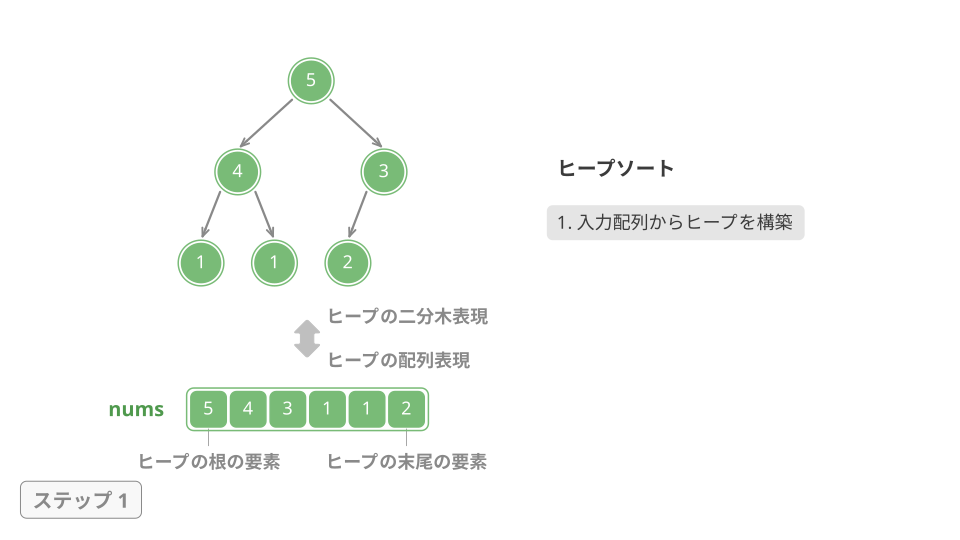

=== "<2>"
    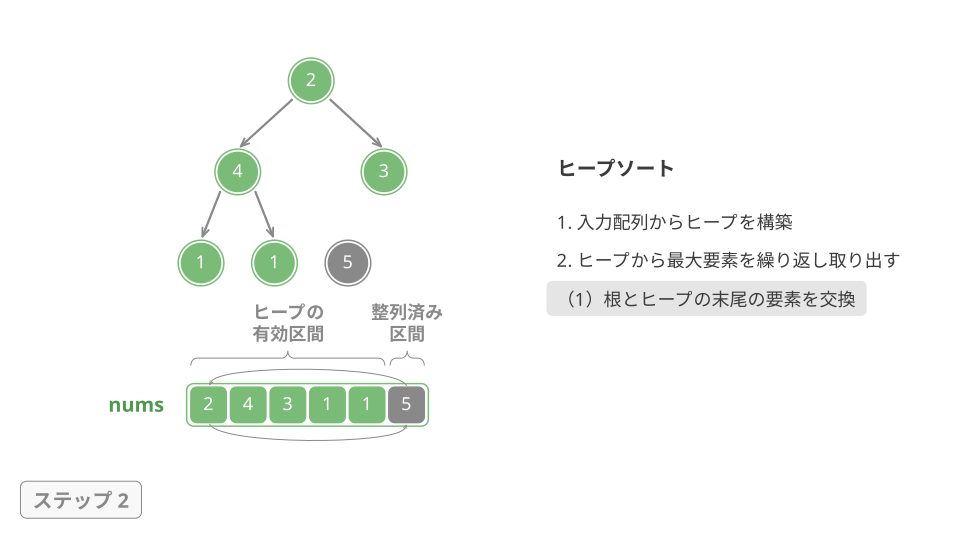

=== "<3>"
    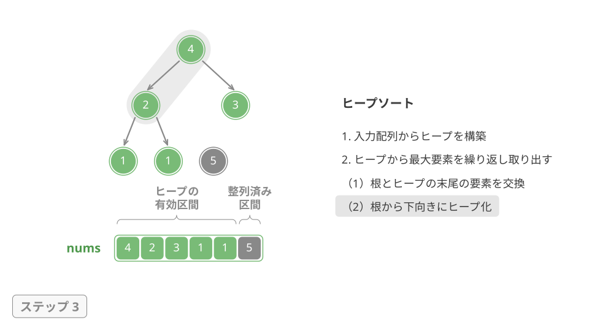

=== "<4>"
    

=== "<5>"
    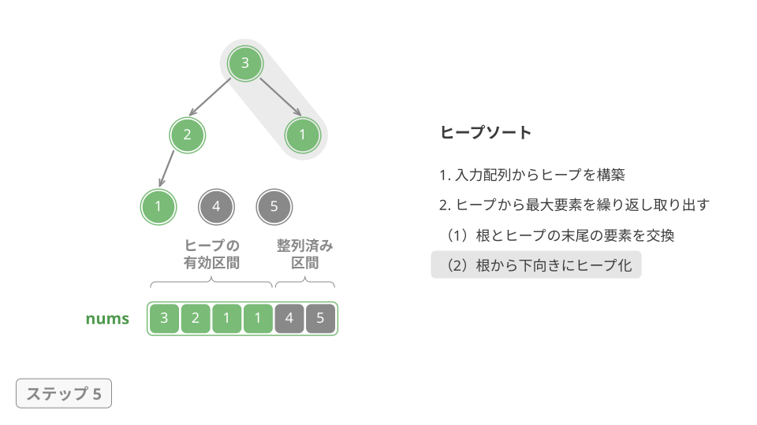

=== "<6>"
    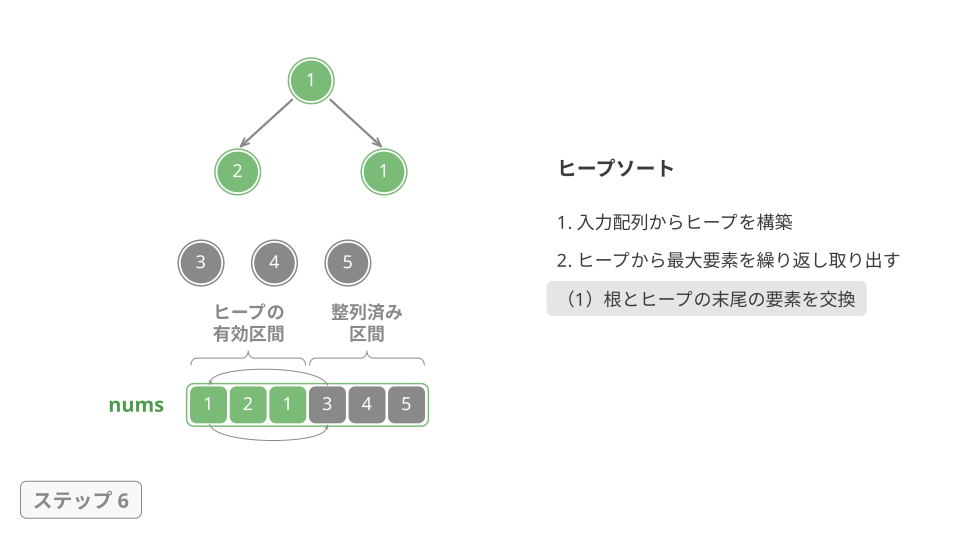

=== "<7>"
    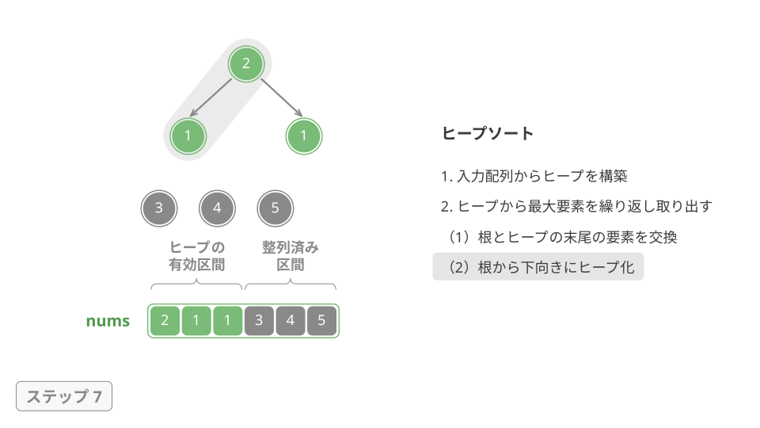

=== "<8>"
    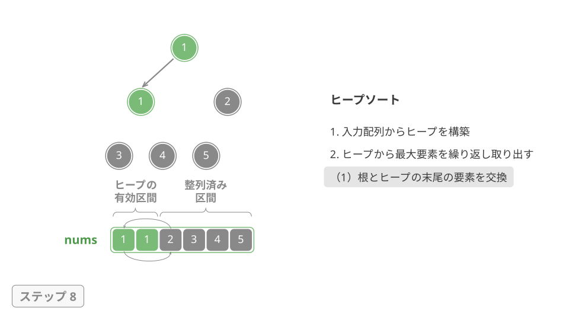

=== "<9>"
    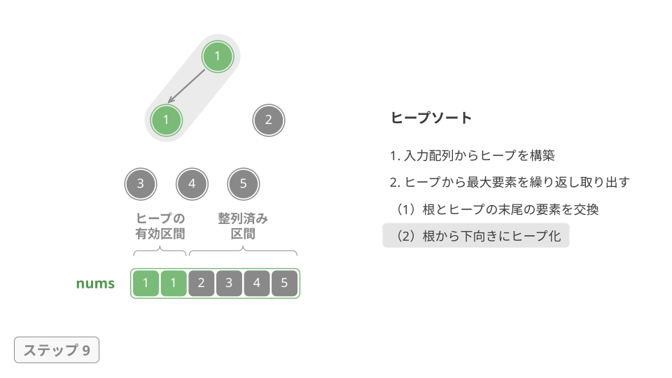

=== "<10>"
    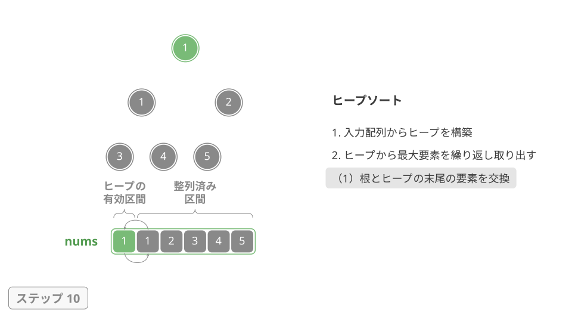

=== "<11>"
    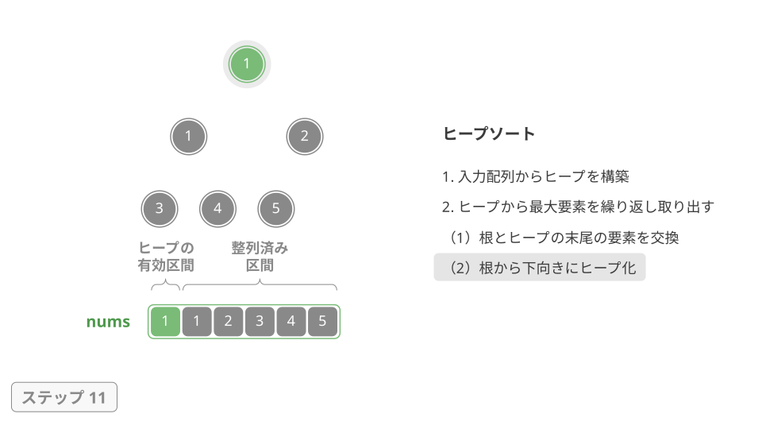

=== "<12>"
    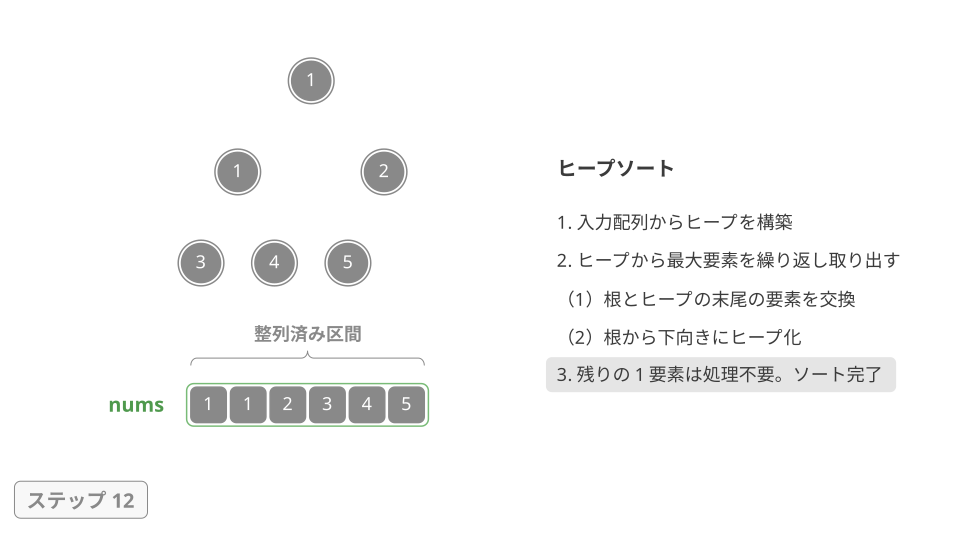

実装では「ヒープ」の章と同じ、下向きにヒープ化する関数 `sift_down()` を使います。最大要素を取り出すたびにヒープが縮むため、関数 `sift_down()` には、現在の有効な長さを指定する引数 $n$ を追加します。コードを次に示します。

```src
[file]{heap_sort}-[class]{}-[func]{heap_sort}
```

## アルゴリズムの特性

- **時間計算量は $O(n \log n)$、非適応的なソート**。ヒープ構築には $O(n)$ の時間がかかります。最大要素の取り出しの時間計算量は $O(\log n)$ で、これを $n - 1$ 回繰り返します。
- **空間計算量は $O(1)$、インプレースソート**。いくつかのポインタ変数が $O(1)$ の領域を使います。交換とヒープ化はどちらも元の配列上で行います。
- **不安定なソート**。根とヒープの末尾の要素を交換するとき、値が等しい要素の相対順序が変わることがあります。
