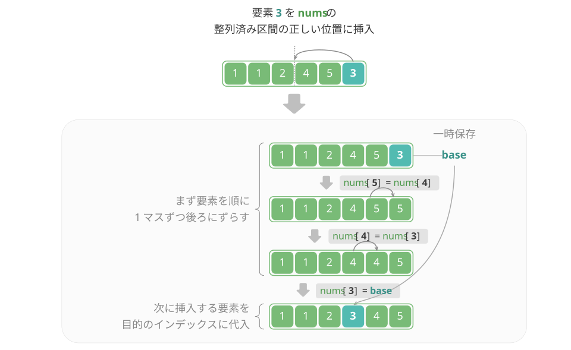
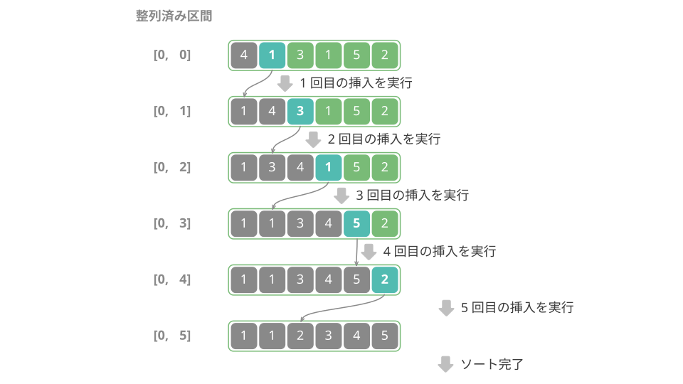

# 11.4 &nbsp; 挿入ソート

<u>挿入ソート（insertion sort）</u>は、手札を手で並べ替えるのによく似た仕組みの簡単なソートアルゴリズムです。

未整列区間から挿入する要素を選び、その左の整列済み区間の要素と順に大小を比較し、正しい位置に挿入します。

図 11-6 に配列へ要素を挿入する手順を示します。挿入する要素を `base` とします。挿入先のインデックスから `base` までの要素をすべて 1 つずつ右にずらし、挿入先に `base` を代入します。

{ class="animation-figure" }

<p align="center"> 図 11-6 &nbsp; 1 要素の挿入操作 </p>

## 11.4.1 &nbsp; アルゴリズムの手順

挿入ソート全体の流れを図 11-7 に示します。

1. 初期状態では、配列の先頭の 1 要素はすでに整列しています。
2. 配列の 2 番目の要素を `base` として正しい位置に挿入すると、**先頭の 2 要素が整列します**。
3. 3 番目の要素を `base` として正しい位置に挿入すると、**先頭の 3 要素が整列します**。
4. これを繰り返し、最後の回で末尾の要素を `base` として正しい位置に挿入すると、**すべての要素が整列します**。

{ class="animation-figure" }

<p align="center"> 図 11-7 &nbsp; 挿入ソートの流れ </p>

実装例を示します。

=== "Python"

    ```python title="insertion_sort.py"
    def insertion_sort(nums: list[int]):
        """挿入ソート"""
        # 外側のループ：整列済み区間は [0, i-1]
        for i in range(1, len(nums)):
            base = nums[i]
            j = i - 1
            # 内側のループ：整列済み区間 [0, i-1] の正しい位置に base を挿入
            while j >= 0 and nums[j] > base:
                nums[j + 1] = nums[j]  # nums[j] を 1 つ右に移動
                j -= 1
            nums[j + 1] = base  # 正しい位置に base を代入
    ```

=== "C++"

    ```cpp title="insertion_sort.cpp"
    /* 挿入ソート */
    void insertionSort(vector<int> &nums) {
        // 外側のループ：整列済み区間は [0, i-1]
        for (int i = 1; i < nums.size(); i++) {
            int base = nums[i], j = i - 1;
            // 内側のループ：整列済み区間 [0, i-1] の正しい位置に base を挿入
            while (j >= 0 && nums[j] > base) {
                nums[j + 1] = nums[j]; // nums[j] を 1 つ右に移動
                j--;
            }
            nums[j + 1] = base; // 正しい位置に base を代入
        }
    }
    ```

=== "Java"

    ```java title="insertion_sort.java"
    /* 挿入ソート */
    void insertionSort(int[] nums) {
        // 外側のループ：整列済み区間は [0, i-1]
        for (int i = 1; i < nums.length; i++) {
            int base = nums[i], j = i - 1;
            // 内側のループ：整列済み区間 [0, i-1] の正しい位置に base を挿入
            while (j >= 0 && nums[j] > base) {
                nums[j + 1] = nums[j]; // nums[j] を 1 つ右に移動
                j--;
            }
            nums[j + 1] = base;        // 正しい位置に base を代入
        }
    }
    ```

=== "C#"

    ```csharp title="insertion_sort.cs"
    /* 挿入ソート */
    void InsertionSort(int[] nums) {
        // 外側のループ：整列済み区間は [0, i-1]
        for (int i = 1; i < nums.Length; i++) {
            int bas = nums[i], j = i - 1;
            // 内側のループ：整列済み区間 [0, i-1] の正しい位置に base を挿入
            while (j >= 0 && nums[j] > bas) {
                nums[j + 1] = nums[j]; // nums[j] を 1 つ右に移動
                j--;
            }
            nums[j + 1] = bas;         // 正しい位置に base を代入
        }
    }
    ```

=== "Go"

    ```go title="insertion_sort.go"
    /* 挿入ソート */
    func insertionSort(nums []int) {
        // 外側のループ：整列済み区間は [0, i-1]
        for i := 1; i < len(nums); i++ {
            base := nums[i]
            j := i - 1
            // 内側のループ：整列済み区間 [0, i-1] の正しい位置に base を挿入
            for j >= 0 && nums[j] > base {
                nums[j+1] = nums[j] // nums[j] を 1 つ右に移動
                j--
            }
            nums[j+1] = base // 正しい位置に base を代入
        }
    }
    ```

=== "Swift"

    ```swift title="insertion_sort.swift"
    /* 挿入ソート */
    func insertionSort(nums: inout [Int]) {
        // 外側のループ：整列済み区間は [0, i-1]
        for i in nums.indices.dropFirst() {
            let base = nums[i]
            var j = i - 1
            // 内側のループ：整列済み区間 [0, i-1] の正しい位置に base を挿入
            while j >= 0, nums[j] > base {
                nums[j + 1] = nums[j] // nums[j] を 1 つ右に移動
                j -= 1
            }
            nums[j + 1] = base // 正しい位置に base を代入
        }
    }
    ```

=== "JS"

    ```javascript title="insertion_sort.js"
    /* 挿入ソート */
    function insertionSort(nums) {
        // 外側のループ：整列済み区間は [0, i-1]
        for (let i = 1; i < nums.length; i++) {
            let base = nums[i],
                j = i - 1;
            // 内側のループ：整列済み区間 [0, i-1] の正しい位置に base を挿入
            while (j >= 0 && nums[j] > base) {
                nums[j + 1] = nums[j]; // nums[j] を 1 つ右に移動
                j--;
            }
            nums[j + 1] = base; // 正しい位置に base を代入
        }
    }
    ```

=== "TS"

    ```typescript title="insertion_sort.ts"
    /* 挿入ソート */
    function insertionSort(nums: number[]): void {
        // 外側のループ：整列済み区間は [0, i-1]
        for (let i = 1; i < nums.length; i++) {
            const base = nums[i];
            let j = i - 1;
            // 内側のループ：整列済み区間 [0, i-1] の正しい位置に base を挿入
            while (j >= 0 && nums[j] > base) {
                nums[j + 1] = nums[j]; // nums[j] を 1 つ右に移動
                j--;
            }
            nums[j + 1] = base; // 正しい位置に base を代入
        }
    }
    ```

=== "Dart"

    ```dart title="insertion_sort.dart"
    /* 挿入ソート */
    void insertionSort(List<int> nums) {
      // 外側のループ：整列済み区間は [0, i-1]
      for (int i = 1; i < nums.length; i++) {
        int base = nums[i], j = i - 1;
        // 内側のループ：整列済み区間 [0, i-1] の正しい位置に base を挿入
        while (j >= 0 && nums[j] > base) {
          nums[j + 1] = nums[j]; // nums[j] を 1 つ右に移動
          j--;
        }
        nums[j + 1] = base; // 正しい位置に base を代入
      }
    }
    ```

=== "Rust"

    ```rust title="insertion_sort.rs"
    /* 挿入ソート */
    fn insertion_sort(nums: &mut [i32]) {
        // 外側のループ：整列済み区間は [0, i-1]
        for i in 1..nums.len() {
            let (base, mut j) = (nums[i], (i - 1) as i32);
            // 内側のループ：整列済み区間 [0, i-1] の正しい位置に base を挿入
            while j >= 0 && nums[j as usize] > base {
                nums[(j + 1) as usize] = nums[j as usize]; // nums[j] を 1 つ右に移動
                j -= 1;
            }
            nums[(j + 1) as usize] = base; // 正しい位置に base を代入
        }
    }
    ```

=== "C"

    ```c title="insertion_sort.c"
    /* 挿入ソート */
    void insertionSort(int nums[], int size) {
        // 外側のループ：整列済み区間は [0, i-1]
        for (int i = 1; i < size; i++) {
            int base = nums[i], j = i - 1;
            // 内側のループ：整列済み区間 [0, i-1] の正しい位置に base を挿入
            while (j >= 0 && nums[j] > base) {
                // nums[j] を 1 つ右に移動
                nums[j + 1] = nums[j];
                j--;
            }
            // 正しい位置に base を代入
            nums[j + 1] = base;
        }
    }
    ```

=== "Kotlin"

    ```kotlin title="insertion_sort.kt"
    /* 挿入ソート */
    fun insertionSort(nums: IntArray) {
        //外側のループ：整列済みの要素数は 1, 2, ..., n と増える
        for (i in nums.indices) {
            val base = nums[i]
            var j = i - 1
            // 内側のループ：整列済み区間 [0, i-1] の正しい位置に base を挿入
            while (j >= 0 && nums[j] > base) {
                nums[j + 1] = nums[j] // nums[j] を 1 つ右に移動
                j--
            }
            nums[j + 1] = base        // 正しい位置に base を代入
        }
    }
    ```

=== "Ruby"

    ```ruby title="insertion_sort.rb"
    ### 挿入ソート ###
    def insertion_sort(nums)
      n = nums.length
      # 外側のループ：整列済み区間は [0, i-1]
      for i in 1...n
        base = nums[i]
        j = i - 1
        # 内側のループ：整列済み区間 [0, i-1] の正しい位置に base を挿入
        while j >= 0 && nums[j] > base
          nums[j + 1] = nums[j] # nums[j] を 1 つ右に移動
          j -= 1
        end
        nums[j + 1] = base # 正しい位置に base を代入
      end
    end
    ```

??? pythontutor "実行の様子を見る"

    <div style="height: 513px; width: 100%;"><iframe class="pythontutor-iframe" title="実行の様子を見る" src="https://pythontutor.com/iframe-embed.html#code=def%20insertion_sort%28nums%3A%20list%5Bint%5D%29%3A%0A%20%20%20%20%22%22%22%E6%8C%BF%E5%85%A5%E3%82%BD%E3%83%BC%E3%83%88%22%22%22%0A%20%20%20%20%23%20%E5%A4%96%E5%81%B4%E3%81%AE%E3%83%AB%E3%83%BC%E3%83%97%EF%BC%9A%E6%95%B4%E5%88%97%E6%B8%88%E3%81%BF%E5%8C%BA%E9%96%93%E3%81%AF%20%5B0,%20i-1%5D%0A%20%20%20%20for%20i%20in%20range%281,%20len%28nums%29%29%3A%0A%20%20%20%20%20%20%20%20base%20%3D%20nums%5Bi%5D%0A%20%20%20%20%20%20%20%20j%20%3D%20i%20-%201%0A%20%20%20%20%20%20%20%20%23%20%E5%86%85%E5%81%B4%E3%81%AE%E3%83%AB%E3%83%BC%E3%83%97%EF%BC%9A%E6%95%B4%E5%88%97%E6%B8%88%E3%81%BF%E5%8C%BA%E9%96%93%20%5B0,%20i-1%5D%20%E3%81%AE%E6%AD%A3%E3%81%97%E3%81%84%E4%BD%8D%E7%BD%AE%E3%81%AB%20base%20%E3%82%92%E6%8C%BF%E5%85%A5%0A%20%20%20%20%20%20%20%20while%20j%20%3E%3D%200%20and%20nums%5Bj%5D%20%3E%20base%3A%0A%20%20%20%20%20%20%20%20%20%20%20%20nums%5Bj%20%2B%201%5D%20%3D%20nums%5Bj%5D%20%20%23%20nums%5Bj%5D%20%E3%82%92%201%20%E3%81%A4%E5%8F%B3%E3%81%AB%E7%A7%BB%E5%8B%95%0A%20%20%20%20%20%20%20%20%20%20%20%20j%20-%3D%201%0A%20%20%20%20%20%20%20%20nums%5Bj%20%2B%201%5D%20%3D%20base%20%20%23%20%E6%AD%A3%E3%81%97%E3%81%84%E4%BD%8D%E7%BD%AE%E3%81%AB%20base%20%E3%82%92%E4%BB%A3%E5%85%A5%0A%0A%0A%22%22%22Driver%20Code%22%22%22%0Aif%20__name__%20%3D%3D%20%22__main__%22%3A%0A%20%20%20%20nums%20%3D%20%5B4,%201,%203,%201,%205,%202%5D%0A%20%20%20%20insertion_sort%28nums%29%0A%20%20%20%20print%28%22%E6%8C%BF%E5%85%A5%E3%82%BD%E3%83%BC%E3%83%88%E5%BE%8C%E3%81%AE%20nums%20%3D%22,%20nums%29&codeDivHeight=472&codeDivWidth=350&cumulative=false&curInstr=4&heapPrimitives=nevernest&origin=opt-frontend.js&py=311&rawInputLstJSON=%5B%5D&textReferences=false"> </iframe></div>
    <div style="margin-top: 5px;"><a href="https://pythontutor.com/iframe-embed.html#code=def%20insertion_sort%28nums%3A%20list%5Bint%5D%29%3A%0A%20%20%20%20%22%22%22%E6%8C%BF%E5%85%A5%E3%82%BD%E3%83%BC%E3%83%88%22%22%22%0A%20%20%20%20%23%20%E5%A4%96%E5%81%B4%E3%81%AE%E3%83%AB%E3%83%BC%E3%83%97%EF%BC%9A%E6%95%B4%E5%88%97%E6%B8%88%E3%81%BF%E5%8C%BA%E9%96%93%E3%81%AF%20%5B0,%20i-1%5D%0A%20%20%20%20for%20i%20in%20range%281,%20len%28nums%29%29%3A%0A%20%20%20%20%20%20%20%20base%20%3D%20nums%5Bi%5D%0A%20%20%20%20%20%20%20%20j%20%3D%20i%20-%201%0A%20%20%20%20%20%20%20%20%23%20%E5%86%85%E5%81%B4%E3%81%AE%E3%83%AB%E3%83%BC%E3%83%97%EF%BC%9A%E6%95%B4%E5%88%97%E6%B8%88%E3%81%BF%E5%8C%BA%E9%96%93%20%5B0,%20i-1%5D%20%E3%81%AE%E6%AD%A3%E3%81%97%E3%81%84%E4%BD%8D%E7%BD%AE%E3%81%AB%20base%20%E3%82%92%E6%8C%BF%E5%85%A5%0A%20%20%20%20%20%20%20%20while%20j%20%3E%3D%200%20and%20nums%5Bj%5D%20%3E%20base%3A%0A%20%20%20%20%20%20%20%20%20%20%20%20nums%5Bj%20%2B%201%5D%20%3D%20nums%5Bj%5D%20%20%23%20nums%5Bj%5D%20%E3%82%92%201%20%E3%81%A4%E5%8F%B3%E3%81%AB%E7%A7%BB%E5%8B%95%0A%20%20%20%20%20%20%20%20%20%20%20%20j%20-%3D%201%0A%20%20%20%20%20%20%20%20nums%5Bj%20%2B%201%5D%20%3D%20base%20%20%23%20%E6%AD%A3%E3%81%97%E3%81%84%E4%BD%8D%E7%BD%AE%E3%81%AB%20base%20%E3%82%92%E4%BB%A3%E5%85%A5%0A%0A%0A%22%22%22Driver%20Code%22%22%22%0Aif%20__name__%20%3D%3D%20%22__main__%22%3A%0A%20%20%20%20nums%20%3D%20%5B4,%201,%203,%201,%205,%202%5D%0A%20%20%20%20insertion_sort%28nums%29%0A%20%20%20%20print%28%22%E6%8C%BF%E5%85%A5%E3%82%BD%E3%83%BC%E3%83%88%E5%BE%8C%E3%81%AE%20nums%20%3D%22,%20nums%29&codeDivHeight=800&codeDivWidth=600&cumulative=false&curInstr=4&heapPrimitives=nevernest&origin=opt-frontend.js&py=311&rawInputLstJSON=%5B%5D&textReferences=false" target="_blank" rel="noopener noreferrer">全画面で表示 ></a></div>

## 11.4.2 &nbsp; アルゴリズムの特性

- **時間計算量は $O(n^2)$、適応的なソート**。最悪の場合、各挿入でのループ回数は順に $n - 1$、$n-2$、$\dots$、$2$、$1$ です。合計は $(n - 1) n / 2$ なので時間計算量は $O(n^2)$ です。データが整列していれば挿入操作は早く終わり、入力配列全体が整列していれば最良時間計算量 $O(n)$ に達します。
- **空間計算量は $O(1)$、インプレースソート**。ポインタ $i$ と $j$ が使う追加領域は一定です。
- **安定ソート**。挿入するときは等しい要素の右側に置くため、それらの順序は変わりません。

## 11.4.3 &nbsp; 挿入ソートの利点

挿入ソートの時間計算量は $O(n^2)$、これから学ぶクイックソートの時間計算量は $O(n \log n)$ です。挿入ソートのほうが計算量は大きいものの、**データが少ないときは挿入ソートのほうが速いのが普通です**。

これは線形探索と二分探索の使い分けと似ています。クイックソートのような $O(n \log n)$ のソートは分割統治に基づいており、1 回の処理に含まれる基本操作が多くなりがちです。データが少ないと $n^2$ と $n \log n$ の値は近いため、計算量の増え方よりも、各回の基本操作の数が速度を左右します。

実際、Java をはじめ多くのプログラミング言語の組み込みソート関数は挿入ソートを取り入れています。大まかには、長い配列にはクイックソートなどの分割統治に基づくソートを使い、短い配列には直接挿入ソートを使います。

バブルソート、選択ソート、挿入ソートの時間計算量はいずれも $O(n^2)$ ですが、実際には**挿入ソートのほうが他の 2 つよりはるかによく使われます**。主な理由は次のとおりです。

- バブルソートは一時変数を使って要素を交換するため、交換には 3 回の基本操作が必要です。挿入ソートで要素をずらすには代入 1 回で済みます。そのため、**通常はバブルソートのほうが計算の負担が大きくなります**。
- 選択ソートの時間計算量は、どの場合も $O(n^2)$ です。**部分的に整列したデータなら、通常は挿入ソートのほうが選択ソートより効率よく処理できます**。
- 選択ソートは安定性を欠くため、複数のキーを順に使う多段階ソートには使えません。
