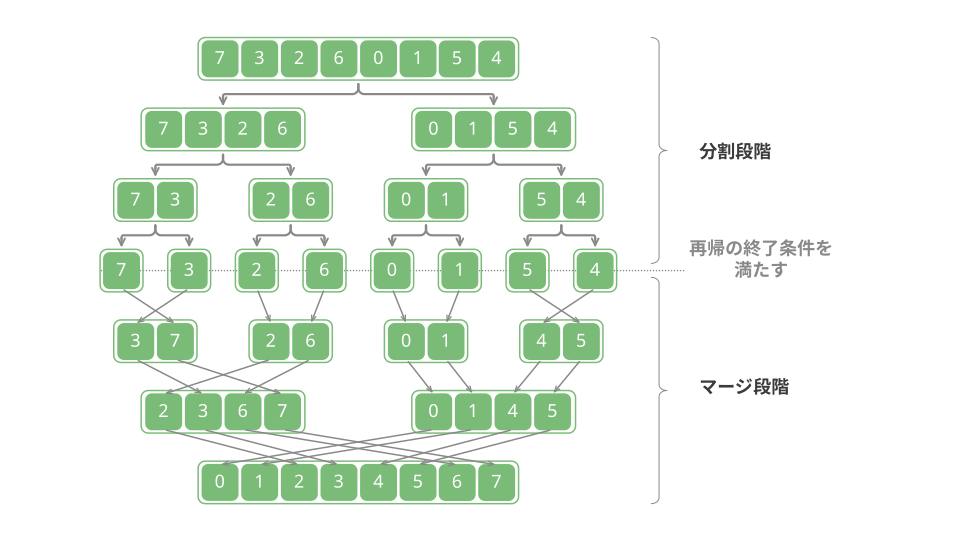
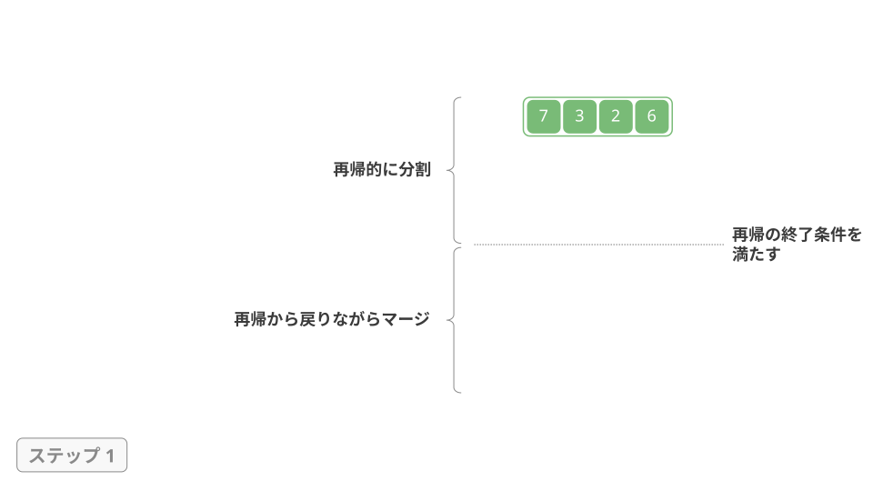
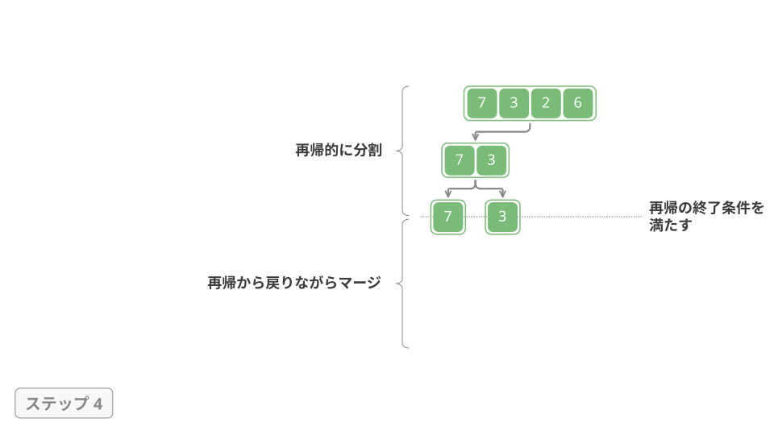
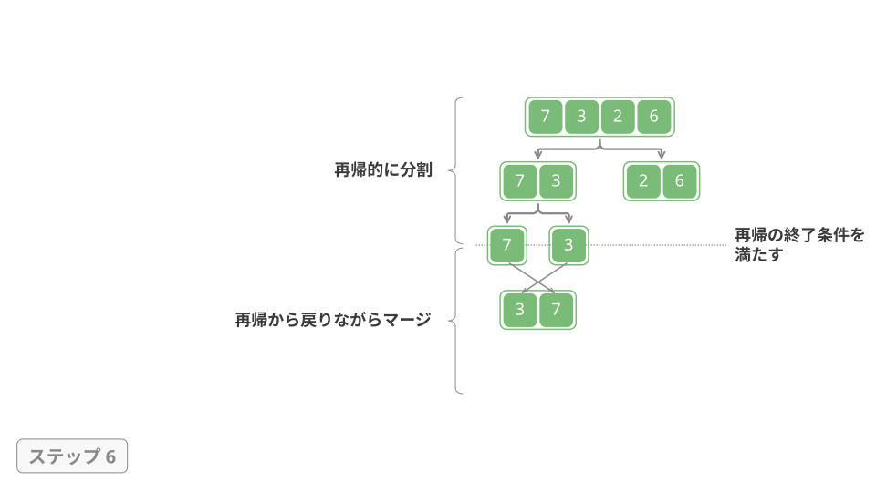
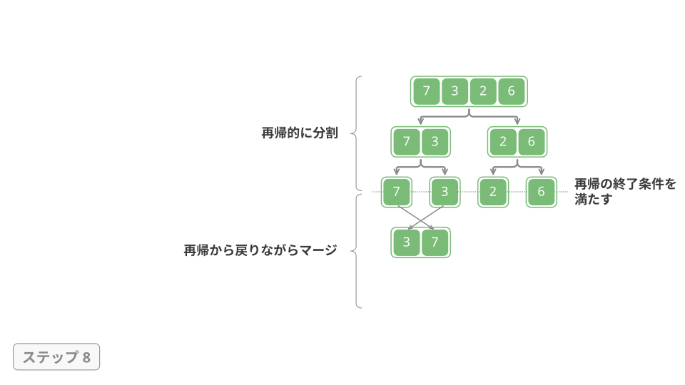

# 11.6 &nbsp; マージソート

<u>マージソート（merge sort）</u>は分割統治に基づくソートアルゴリズムで、図 11-10 のように「分割」と「マージ」の段階があります。

1. **分割段階**では配列を中央で再帰的に分け続け、長い配列をソートする問題を、短い配列をソートする問題に変えます。
2. **マージ段階**では部分配列の長さが 1 になったところで分割を終え、左右の短い整列済み配列を 1 つの長い整列済み配列にまとめる操作を、全体が整列するまで繰り返します。

{ class="animation-figure" }

<p align="center"> 図 11-10 &nbsp; マージソートの分割段階とマージ段階 </p>

## 11.6.1 &nbsp; アルゴリズムの手順

図 11-11 のように、分割段階では上から下へ、配列を中央で 2 つの部分配列に再帰的に分けます。

1. 配列の中央のインデックス `mid` を求め、左の部分配列（区間 `[left, mid]`）と右の部分配列（区間 `[mid + 1, right]`）を再帰的に分割します。
2. ステップ `1.` を再帰的に繰り返し、部分配列の区間長が 1 になったら終了します。

マージ段階では下から上へ、左右の部分配列を 1 つの整列済み配列にまとめます。長さ 1 の部分配列から始めるので、マージする各部分配列は常に整列しています。

=== "<1>"
    { class="animation-figure" }

=== "<2>"
    { class="animation-figure" }

=== "<3>"
    { class="animation-figure" }

=== "<4>"
    { class="animation-figure" }

=== "<5>"
    { class="animation-figure" }

=== "<6>"
    { class="animation-figure" }

=== "<7>"
    { class="animation-figure" }

=== "<8>"
    { class="animation-figure" }

=== "<9>"
    { class="animation-figure" }

=== "<10>"
    { class="animation-figure" }

<p align="center"> 図 11-11 &nbsp; マージソートの手順 </p>

マージソートの再帰の順序は、二分木の帰りがけ順（後順）走査と同じです。

- **帰りがけ順走査**では左部分木、右部分木の順に再帰し、最後に根を処理します。
- **マージソート**では左の部分配列、右の部分配列の順に再帰し、最後にマージします。

マージソートの実装を次に示します。`nums` でマージする区間は `[left, right]` で、それに対応する `tmp` の区間は `[0, right - left]` です。

=== "Python"

    ```python title="merge_sort.py"
    def merge(nums: list[int], left: int, mid: int, right: int):
        """左右の部分配列をマージ"""
        # 左の部分配列は [left, mid]、右の部分配列は [mid+1, right]
        # マージ結果を格納する一時配列 tmp を作成
        tmp = [0] * (right - left + 1)
        # 左右の部分配列の開始インデックスを初期化
        i, j, k = left, mid + 1, 0
        # 両方の部分配列に要素が残っている間、値を比較し、小さいほうを一時配列にコピー
        while i <= mid and j <= right:
            if nums[i] <= nums[j]:
                tmp[k] = nums[i]
                i += 1
            else:
                tmp[k] = nums[j]
                j += 1
            k += 1
        # 左右の部分配列に残った要素を一時配列にコピー
        while i <= mid:
            tmp[k] = nums[i]
            i += 1
            k += 1
        while j <= right:
            tmp[k] = nums[j]
            j += 1
            k += 1
        # 一時配列 tmp の要素を元の配列 nums の対応区間に書き戻す
        for k in range(0, len(tmp)):
            nums[left + k] = tmp[k]

    def merge_sort(nums: list[int], left: int, right: int):
        """マージソート"""
        # 終了条件
        if left >= right:
            return  # 部分配列の長さが 1 になったら再帰を終了
        # 分割段階
        mid = (left + right) // 2 # 中央のインデックスを求める
        merge_sort(nums, left, mid)  # 左の部分配列を再帰的に処理
        merge_sort(nums, mid + 1, right)  # 右の部分配列を再帰的に処理
        # マージ段階
        merge(nums, left, mid, right)
    ```

=== "C++"

    ```cpp title="merge_sort.cpp"
    /* 左右の部分配列をマージ */
    void merge(vector<int> &nums, int left, int mid, int right) {
        // 左の部分配列は [left, mid]、右の部分配列は [mid+1, right]
        // マージ結果を格納する一時配列 tmp を作成
        vector<int> tmp(right - left + 1);
        // 左右の部分配列の開始インデックスを初期化
        int i = left, j = mid + 1, k = 0;
        // 両方の部分配列に要素が残っている間、値を比較し、小さいほうを一時配列にコピー
        while (i <= mid && j <= right) {
            if (nums[i] <= nums[j])
                tmp[k++] = nums[i++];
            else
                tmp[k++] = nums[j++];
        }
        // 左右の部分配列に残った要素を一時配列にコピー
        while (i <= mid) {
            tmp[k++] = nums[i++];
        }
        while (j <= right) {
            tmp[k++] = nums[j++];
        }
        // 一時配列 tmp の要素を元の配列 nums の対応区間に書き戻す
        for (k = 0; k < tmp.size(); k++) {
            nums[left + k] = tmp[k];
        }
    }

    /* マージソート */
    void mergeSort(vector<int> &nums, int left, int right) {
        // 終了条件
        if (left >= right)
            return; // 部分配列の長さが 1 になったら再帰を終了
        // 分割段階
        int mid = left + (right - left) / 2;    // 中央のインデックスを求める
        mergeSort(nums, left, mid);      // 左の部分配列を再帰的に処理
        mergeSort(nums, mid + 1, right); // 右の部分配列を再帰的に処理
        // マージ段階
        merge(nums, left, mid, right);
    }
    ```

=== "Java"

    ```java title="merge_sort.java"
    /* 左右の部分配列をマージ */
    void merge(int[] nums, int left, int mid, int right) {
        // 左の部分配列は [left, mid]、右の部分配列は [mid+1, right]
        // マージ結果を格納する一時配列 tmp を作成
        int[] tmp = new int[right - left + 1];
        // 左右の部分配列の開始インデックスを初期化
        int i = left, j = mid + 1, k = 0;
        // 両方の部分配列に要素が残っている間、値を比較し、小さいほうを一時配列にコピー
        while (i <= mid && j <= right) {
            if (nums[i] <= nums[j])
                tmp[k++] = nums[i++];
            else
                tmp[k++] = nums[j++];
        }
        // 左右の部分配列に残った要素を一時配列にコピー
        while (i <= mid) {
            tmp[k++] = nums[i++];
        }
        while (j <= right) {
            tmp[k++] = nums[j++];
        }
        // 一時配列 tmp の要素を元の配列 nums の対応区間に書き戻す
        for (k = 0; k < tmp.length; k++) {
            nums[left + k] = tmp[k];
        }
    }

    /* マージソート */
    void mergeSort(int[] nums, int left, int right) {
        // 終了条件
        if (left >= right)
            return; // 部分配列の長さが 1 になったら再帰を終了
        // 分割段階
        int mid = left + (right - left) / 2; // 中央のインデックスを求める
        mergeSort(nums, left, mid); // 左の部分配列を再帰的に処理
        mergeSort(nums, mid + 1, right); // 右の部分配列を再帰的に処理
        // マージ段階
        merge(nums, left, mid, right);
    }
    ```

=== "C#"

    ```csharp title="merge_sort.cs"
    /* 左右の部分配列をマージ */
    void Merge(int[] nums, int left, int mid, int right) {
        // 左の部分配列は [left, mid]、右の部分配列は [mid+1, right]
        // マージ結果を格納する一時配列 tmp を作成
        int[] tmp = new int[right - left + 1];
        // 左右の部分配列の開始インデックスを初期化
        int i = left, j = mid + 1, k = 0;
        // 両方の部分配列に要素が残っている間、値を比較し、小さいほうを一時配列にコピー
        while (i <= mid && j <= right) {
            if (nums[i] <= nums[j])
                tmp[k++] = nums[i++];
            else
                tmp[k++] = nums[j++];
        }
        // 左右の部分配列に残った要素を一時配列にコピー
        while (i <= mid) {
            tmp[k++] = nums[i++];
        }
        while (j <= right) {
            tmp[k++] = nums[j++];
        }
        // 一時配列 tmp の要素を元の配列 nums の対応区間に書き戻す
        for (k = 0; k < tmp.Length; ++k) {
            nums[left + k] = tmp[k];
        }
    }

    /* マージソート */
    void MergeSort(int[] nums, int left, int right) {
        // 終了条件
        if (left >= right) return;       // 部分配列の長さが 1 になったら再帰を終了
        // 分割段階
        int mid = left + (right - left) / 2;    // 中央のインデックスを求める
        MergeSort(nums, left, mid);      // 左の部分配列を再帰的に処理
        MergeSort(nums, mid + 1, right); // 右の部分配列を再帰的に処理
        // マージ段階
        Merge(nums, left, mid, right);
    }
    ```

=== "Go"

    ```go title="merge_sort.go"
    /* 左右の部分配列をマージ */
    func merge(nums []int, left, mid, right int) {
        // 左の部分配列は [left, mid]、右の部分配列は [mid+1, right]
        // マージ結果を格納する一時配列 tmp を作成
        tmp := make([]int, right-left+1)
        // 左右の部分配列の開始インデックスを初期化
        i, j, k := left, mid+1, 0
        // 両方の部分配列に要素が残っている間、値を比較し、小さいほうを一時配列にコピー
        for i <= mid && j <= right {
            if nums[i] <= nums[j] {
                tmp[k] = nums[i]
                i++
            } else {
                tmp[k] = nums[j]
                j++
            }
            k++
        }
        // 左右の部分配列に残った要素を一時配列にコピー
        for i <= mid {
            tmp[k] = nums[i]
            i++
            k++
        }
        for j <= right {
            tmp[k] = nums[j]
            j++
            k++
        }
        // 一時配列 tmp の要素を元の配列 nums の対応区間に書き戻す
        for k := 0; k < len(tmp); k++ {
            nums[left+k] = tmp[k]
        }
    }

    /* マージソート */
    func mergeSort(nums []int, left, right int) {
        // 終了条件
        if left >= right {
            return
        }
        // 分割段階
        mid := left + (right - left) / 2
        mergeSort(nums, left, mid)
        mergeSort(nums, mid+1, right)
        // マージ段階
        merge(nums, left, mid, right)
    }
    ```

=== "Swift"

    ```swift title="merge_sort.swift"
    /* 左右の部分配列をマージ */
    func merge(nums: inout [Int], left: Int, mid: Int, right: Int) {
        // 左の部分配列は [left, mid]、右の部分配列は [mid+1, right]
        // マージ結果を格納する一時配列 tmp を作成
        var tmp = Array(repeating: 0, count: right - left + 1)
        // 左右の部分配列の開始インデックスを初期化
        var i = left, j = mid + 1, k = 0
        // 両方の部分配列に要素が残っている間、値を比較し、小さいほうを一時配列にコピー
        while i <= mid, j <= right {
            if nums[i] <= nums[j] {
                tmp[k] = nums[i]
                i += 1
            } else {
                tmp[k] = nums[j]
                j += 1
            }
            k += 1
        }
        // 左右の部分配列に残った要素を一時配列にコピー
        while i <= mid {
            tmp[k] = nums[i]
            i += 1
            k += 1
        }
        while j <= right {
            tmp[k] = nums[j]
            j += 1
            k += 1
        }
        // 一時配列 tmp の要素を元の配列 nums の対応区間に書き戻す
        for k in tmp.indices {
            nums[left + k] = tmp[k]
        }
    }

    /* マージソート */
    func mergeSort(nums: inout [Int], left: Int, right: Int) {
        // 終了条件
        if left >= right { // 部分配列の長さが 1 になったら再帰を終了
            return
        }
        // 分割段階
        let mid = left + (right - left) / 2 // 中央のインデックスを求める
        mergeSort(nums: &nums, left: left, right: mid) // 左の部分配列を再帰的に処理
        mergeSort(nums: &nums, left: mid + 1, right: right) // 右の部分配列を再帰的に処理
        // マージ段階
        merge(nums: &nums, left: left, mid: mid, right: right)
    }
    ```

=== "JS"

    ```javascript title="merge_sort.js"
    /* 左右の部分配列をマージ */
    function merge(nums, left, mid, right) {
        // 左の部分配列は [left, mid]、右の部分配列は [mid+1, right]
        // マージ結果を格納する一時配列 tmp を作成
        const tmp = new Array(right - left + 1);
        // 左右の部分配列の開始インデックスを初期化
        let i = left,
            j = mid + 1,
            k = 0;
        // 両方の部分配列に要素が残っている間、値を比較し、小さいほうを一時配列にコピー
        while (i <= mid && j <= right) {
            if (nums[i] <= nums[j]) {
                tmp[k++] = nums[i++];
            } else {
                tmp[k++] = nums[j++];
            }
        }
        // 左右の部分配列に残った要素を一時配列にコピー
        while (i <= mid) {
            tmp[k++] = nums[i++];
        }
        while (j <= right) {
            tmp[k++] = nums[j++];
        }
        // 一時配列 tmp の要素を元の配列 nums の対応区間に書き戻す
        for (k = 0; k < tmp.length; k++) {
            nums[left + k] = tmp[k];
        }
    }

    /* マージソート */
    function mergeSort(nums, left, right) {
        // 終了条件
        if (left >= right) return; // 部分配列の長さが 1 になったら再帰を終了
        // 分割段階
        let mid = Math.floor(left + (right - left) / 2); // 中央のインデックスを求める
        mergeSort(nums, left, mid); // 左の部分配列を再帰的に処理
        mergeSort(nums, mid + 1, right); // 右の部分配列を再帰的に処理
        // マージ段階
        merge(nums, left, mid, right);
    }
    ```

=== "TS"

    ```typescript title="merge_sort.ts"
    /* 左右の部分配列をマージ */
    function merge(nums: number[], left: number, mid: number, right: number): void {
        // 左の部分配列は [left, mid]、右の部分配列は [mid+1, right]
        // マージ結果を格納する一時配列 tmp を作成
        const tmp = new Array(right - left + 1);
        // 左右の部分配列の開始インデックスを初期化
        let i = left,
            j = mid + 1,
            k = 0;
        // 両方の部分配列に要素が残っている間、値を比較し、小さいほうを一時配列にコピー
        while (i <= mid && j <= right) {
            if (nums[i] <= nums[j]) {
                tmp[k++] = nums[i++];
            } else {
                tmp[k++] = nums[j++];
            }
        }
        // 左右の部分配列に残った要素を一時配列にコピー
        while (i <= mid) {
            tmp[k++] = nums[i++];
        }
        while (j <= right) {
            tmp[k++] = nums[j++];
        }
        // 一時配列 tmp の要素を元の配列 nums の対応区間に書き戻す
        for (k = 0; k < tmp.length; k++) {
            nums[left + k] = tmp[k];
        }
    }

    /* マージソート */
    function mergeSort(nums: number[], left: number, right: number): void {
        // 終了条件
        if (left >= right) return; // 部分配列の長さが 1 になったら再帰を終了
        // 分割段階
        let mid = Math.floor(left + (right - left) / 2); // 中央のインデックスを求める
        mergeSort(nums, left, mid); // 左の部分配列を再帰的に処理
        mergeSort(nums, mid + 1, right); // 右の部分配列を再帰的に処理
        // マージ段階
        merge(nums, left, mid, right);
    }
    ```

=== "Dart"

    ```dart title="merge_sort.dart"
    /* 左右の部分配列をマージ */
    void merge(List<int> nums, int left, int mid, int right) {
      // 左の部分配列は [left, mid]、右の部分配列は [mid+1, right]
      // マージ結果を格納する一時配列 tmp を作成
      List<int> tmp = List.filled(right - left + 1, 0);
      // 左右の部分配列の開始インデックスを初期化
      int i = left, j = mid + 1, k = 0;
      // 両方の部分配列に要素が残っている間、値を比較し、小さいほうを一時配列にコピー
      while (i <= mid && j <= right) {
        if (nums[i] <= nums[j])
          tmp[k++] = nums[i++];
        else
          tmp[k++] = nums[j++];
      }
      // 左右の部分配列に残った要素を一時配列にコピー
      while (i <= mid) {
        tmp[k++] = nums[i++];
      }
      while (j <= right) {
        tmp[k++] = nums[j++];
      }
      // 一時配列 tmp の要素を元の配列 nums の対応区間に書き戻す
      for (k = 0; k < tmp.length; k++) {
        nums[left + k] = tmp[k];
      }
    }

    /* マージソート */
    void mergeSort(List<int> nums, int left, int right) {
      // 終了条件
      if (left >= right) return; // 部分配列の長さが 1 になったら再帰を終了
      // 分割段階
      int mid = left + (right - left) ~/ 2; // 中央のインデックスを求める
      mergeSort(nums, left, mid); // 左の部分配列を再帰的に処理
      mergeSort(nums, mid + 1, right); // 右の部分配列を再帰的に処理
      // マージ段階
      merge(nums, left, mid, right);
    }
    ```

=== "Rust"

    ```rust title="merge_sort.rs"
    /* 左右の部分配列をマージ */
    fn merge(nums: &mut [i32], left: usize, mid: usize, right: usize) {
        // 左の部分配列は [left, mid]、右の部分配列は [mid+1, right]
        // マージ結果を格納する一時配列 tmp を作成
        let tmp_size = right - left + 1;
        let mut tmp = vec![0; tmp_size];
        // 左右の部分配列の開始インデックスを初期化
        let (mut i, mut j, mut k) = (left, mid + 1, 0);
        // 両方の部分配列に要素が残っている間、値を比較し、小さいほうを一時配列にコピー
        while i <= mid && j <= right {
            if nums[i] <= nums[j] {
                tmp[k] = nums[i];
                i += 1;
            } else {
                tmp[k] = nums[j];
                j += 1;
            }
            k += 1;
        }
        // 左右の部分配列に残った要素を一時配列にコピー
        while i <= mid {
            tmp[k] = nums[i];
            k += 1;
            i += 1;
        }
        while j <= right {
            tmp[k] = nums[j];
            k += 1;
            j += 1;
        }
        // 一時配列 tmp の要素を元の配列 nums の対応区間に書き戻す
        for k in 0..tmp_size {
            nums[left + k] = tmp[k];
        }
    }

    /* マージソート */
    fn merge_sort(nums: &mut [i32], left: usize, right: usize) {
        // 終了条件
        if left >= right {
            return; // 部分配列の長さが 1 になったら再帰を終了
        }

        // 分割段階
        let mid = left + (right - left) / 2; // 中央のインデックスを求める
        merge_sort(nums, left, mid); // 左の部分配列を再帰的に処理
        merge_sort(nums, mid + 1, right); // 右の部分配列を再帰的に処理

        // マージ段階
        merge(nums, left, mid, right);
    }
    ```

=== "C"

    ```c title="merge_sort.c"
    /* 左右の部分配列をマージ */
    void merge(int *nums, int left, int mid, int right) {
        // 左の部分配列は [left, mid]、右の部分配列は [mid+1, right]
        // マージ結果を格納する一時配列 tmp を作成
        int tmpSize = right - left + 1;
        int *tmp = (int *)malloc(tmpSize * sizeof(int));
        // 左右の部分配列の開始インデックスを初期化
        int i = left, j = mid + 1, k = 0;
        // 両方の部分配列に要素が残っている間、値を比較し、小さいほうを一時配列にコピー
        while (i <= mid && j <= right) {
            if (nums[i] <= nums[j]) {
                tmp[k++] = nums[i++];
            } else {
                tmp[k++] = nums[j++];
            }
        }
        // 左右の部分配列に残った要素を一時配列にコピー
        while (i <= mid) {
            tmp[k++] = nums[i++];
        }
        while (j <= right) {
            tmp[k++] = nums[j++];
        }
        // 一時配列 tmp の要素を元の配列 nums の対応区間に書き戻す
        for (k = 0; k < tmpSize; ++k) {
            nums[left + k] = tmp[k];
        }
        // メモリを解放
        free(tmp);
    }

    /* マージソート */
    void mergeSort(int *nums, int left, int right) {
        // 終了条件
        if (left >= right)
            return; // 部分配列の長さが 1 になったら再帰を終了
        // 分割段階
        int mid = left + (right - left) / 2;    // 中央のインデックスを求める
        mergeSort(nums, left, mid);      // 左の部分配列を再帰的に処理
        mergeSort(nums, mid + 1, right); // 右の部分配列を再帰的に処理
        // マージ段階
        merge(nums, left, mid, right);
    }
    ```

=== "Kotlin"

    ```kotlin title="merge_sort.kt"
    /* 左右の部分配列をマージ */
    fun merge(nums: IntArray, left: Int, mid: Int, right: Int) {
        // 左の部分配列は [left, mid]、右の部分配列は [mid+1, right]
        // マージ結果を格納する一時配列 tmp を作成
        val tmp = IntArray(right - left + 1)
        // 左右の部分配列の開始インデックスを初期化
        var i = left
        var j = mid + 1
        var k = 0
        // 両方の部分配列に要素が残っている間、値を比較し、小さいほうを一時配列にコピー
        while (i <= mid && j <= right) {
            if (nums[i] <= nums[j])
                tmp[k++] = nums[i++]
            else
                tmp[k++] = nums[j++]
        }
        // 左右の部分配列に残った要素を一時配列にコピー
        while (i <= mid) {
            tmp[k++] = nums[i++]
        }
        while (j <= right) {
            tmp[k++] = nums[j++]
        }
        // 一時配列 tmp の要素を元の配列 nums の対応区間に書き戻す
        for (l in tmp.indices) {
            nums[left + l] = tmp[l]
        }
    }

    /* マージソート */
    fun mergeSort(nums: IntArray, left: Int, right: Int) {
        // 終了条件
        if (left >= right) return  // 部分配列の長さが 1 になったら再帰を終了
        // 分割段階
        val mid = left + (right - left) / 2 // 中央のインデックスを求める
        mergeSort(nums, left, mid) // 左の部分配列を再帰的に処理
        mergeSort(nums, mid + 1, right) // 右の部分配列を再帰的に処理
        // マージ段階
        merge(nums, left, mid, right)
    }
    ```

=== "Ruby"

    ```ruby title="merge_sort.rb"
    ### 左右の部分配列をマージ ###
    def merge(nums, left, mid, right)
      # 左の部分配列は [left, mid]、右の部分配列は [mid+1, right]
      # マージ結果を格納する一時配列 tmp を作成
      tmp = Array.new(right - left + 1, 0)
      # 左右の部分配列の開始インデックスを初期化
      i, j, k = left, mid + 1, 0
      # 両方の部分配列に要素が残っている間、値を比較し、小さいほうを一時配列にコピー
      while i <= mid && j <= right
        if nums[i] <= nums[j]
          tmp[k] = nums[i]
          i += 1
        else
          tmp[k] = nums[j]
          j += 1
        end
        k += 1
      end
      # 左右の部分配列に残った要素を一時配列にコピー
      while i <= mid
        tmp[k] = nums[i]
        i += 1
        k += 1
      end
      while j <= right
        tmp[k] = nums[j]
        j += 1
        k += 1
      end
      # 一時配列 tmp の要素を元の配列 nums の対応区間に書き戻す
      (0...tmp.length).each do |k|
        nums[left + k] = tmp[k]
      end
    end

    ### マージソート ###
    def merge_sort(nums, left, right)
      # 終了条件
      # 部分配列の長さが 1 になったら再帰を終了
      return if left >= right
      # 分割段階
      mid = left + (right - left) / 2 # 中央のインデックスを求める
      merge_sort(nums, left, mid) # 左の部分配列を再帰的に処理
      merge_sort(nums, mid + 1, right) # 右の部分配列を再帰的に処理
      # マージ段階
      merge(nums, left, mid, right)
    end
    ```

??? pythontutor "実行の様子を見る"

    <div style="height: 549px; width: 100%;"><iframe class="pythontutor-iframe" title="実行の様子を見る" src="https://pythontutor.com/iframe-embed.html#code=def%20merge%28nums%3A%20list%5Bint%5D,%20left%3A%20int,%20mid%3A%20int,%20right%3A%20int%29%3A%0A%20%20%20%20%22%22%22%E5%B7%A6%E5%8F%B3%E3%81%AE%E9%83%A8%E5%88%86%E9%85%8D%E5%88%97%E3%82%92%E3%83%9E%E3%83%BC%E3%82%B8%22%22%22%0A%20%20%20%20%23%20%E5%B7%A6%E3%81%AE%E9%83%A8%E5%88%86%E9%85%8D%E5%88%97%E3%81%AF%20%5Bleft,%20mid%5D%E3%80%81%E5%8F%B3%E3%81%AE%E9%83%A8%E5%88%86%E9%85%8D%E5%88%97%E3%81%AF%20%5Bmid%2B1,%20right%5D%0A%20%20%20%20%23%20%E3%83%9E%E3%83%BC%E3%82%B8%E7%B5%90%E6%9E%9C%E3%82%92%E6%A0%BC%E7%B4%8D%E3%81%99%E3%82%8B%E4%B8%80%E6%99%82%E9%85%8D%E5%88%97%20tmp%20%E3%82%92%E4%BD%9C%E6%88%90%0A%20%20%20%20tmp%20%3D%20%5B0%5D%20%2A%20%28right%20-%20left%20%2B%201%29%0A%20%20%20%20%23%20%E5%B7%A6%E5%8F%B3%E3%81%AE%E9%83%A8%E5%88%86%E9%85%8D%E5%88%97%E3%81%AE%E9%96%8B%E5%A7%8B%E3%82%A4%E3%83%B3%E3%83%87%E3%83%83%E3%82%AF%E3%82%B9%E3%82%92%E5%88%9D%E6%9C%9F%E5%8C%96%0A%20%20%20%20i,%20j,%20k%20%3D%20left,%20mid%20%2B%201,%200%0A%20%20%20%20%23%20%E4%B8%A1%E6%96%B9%E3%81%AE%E9%83%A8%E5%88%86%E9%85%8D%E5%88%97%E3%81%AB%E8%A6%81%E7%B4%A0%E3%81%8C%E6%AE%8B%E3%81%A3%E3%81%A6%E3%81%84%E3%82%8B%E9%96%93%E3%80%81%E5%80%A4%E3%82%92%E6%AF%94%E8%BC%83%E3%81%97%E3%80%81%E5%B0%8F%E3%81%95%E3%81%84%E3%81%BB%E3%81%86%E3%82%92%E4%B8%80%E6%99%82%E9%85%8D%E5%88%97%E3%81%AB%E3%82%B3%E3%83%94%E3%83%BC%0A%20%20%20%20while%20i%20%3C%3D%20mid%20and%20j%20%3C%3D%20right%3A%0A%20%20%20%20%20%20%20%20if%20nums%5Bi%5D%20%3C%3D%20nums%5Bj%5D%3A%0A%20%20%20%20%20%20%20%20%20%20%20%20tmp%5Bk%5D%20%3D%20nums%5Bi%5D%0A%20%20%20%20%20%20%20%20%20%20%20%20i%20%2B%3D%201%0A%20%20%20%20%20%20%20%20else%3A%0A%20%20%20%20%20%20%20%20%20%20%20%20tmp%5Bk%5D%20%3D%20nums%5Bj%5D%0A%20%20%20%20%20%20%20%20%20%20%20%20j%20%2B%3D%201%0A%20%20%20%20%20%20%20%20k%20%2B%3D%201%0A%20%20%20%20%23%20%E5%B7%A6%E5%8F%B3%E3%81%AE%E9%83%A8%E5%88%86%E9%85%8D%E5%88%97%E3%81%AB%E6%AE%8B%E3%81%A3%E3%81%9F%E8%A6%81%E7%B4%A0%E3%82%92%E4%B8%80%E6%99%82%E9%85%8D%E5%88%97%E3%81%AB%E3%82%B3%E3%83%94%E3%83%BC%0A%20%20%20%20while%20i%20%3C%3D%20mid%3A%0A%20%20%20%20%20%20%20%20tmp%5Bk%5D%20%3D%20nums%5Bi%5D%0A%20%20%20%20%20%20%20%20i%20%2B%3D%201%0A%20%20%20%20%20%20%20%20k%20%2B%3D%201%0A%20%20%20%20while%20j%20%3C%3D%20right%3A%0A%20%20%20%20%20%20%20%20tmp%5Bk%5D%20%3D%20nums%5Bj%5D%0A%20%20%20%20%20%20%20%20j%20%2B%3D%201%0A%20%20%20%20%20%20%20%20k%20%2B%3D%201%0A%20%20%20%20%23%20%E4%B8%80%E6%99%82%E9%85%8D%E5%88%97%20tmp%20%E3%81%AE%E8%A6%81%E7%B4%A0%E3%82%92%E5%85%83%E3%81%AE%E9%85%8D%E5%88%97%20nums%20%E3%81%AE%E5%AF%BE%E5%BF%9C%E5%8C%BA%E9%96%93%E3%81%AB%E6%9B%B8%E3%81%8D%E6%88%BB%E3%81%99%0A%20%20%20%20for%20k%20in%20range%280,%20len%28tmp%29%29%3A%0A%20%20%20%20%20%20%20%20nums%5Bleft%20%2B%20k%5D%20%3D%20tmp%5Bk%5D%0A%0A%0Adef%20merge_sort%28nums%3A%20list%5Bint%5D,%20left%3A%20int,%20right%3A%20int%29%3A%0A%20%20%20%20%22%22%22%E3%83%9E%E3%83%BC%E3%82%B8%E3%82%BD%E3%83%BC%E3%83%88%22%22%22%0A%20%20%20%20%23%20%E7%B5%82%E4%BA%86%E6%9D%A1%E4%BB%B6%0A%20%20%20%20if%20left%20%3E%3D%20right%3A%0A%20%20%20%20%20%20%20%20return%20%20%23%20%E9%83%A8%E5%88%86%E9%85%8D%E5%88%97%E3%81%AE%E9%95%B7%E3%81%95%E3%81%8C%201%20%E3%81%AB%E3%81%AA%E3%81%A3%E3%81%9F%E3%82%89%E5%86%8D%E5%B8%B0%E3%82%92%E7%B5%82%E4%BA%86%0A%20%20%20%20%23%20%E5%88%86%E5%89%B2%E6%AE%B5%E9%9A%8E%0A%20%20%20%20mid%20%3D%20%28left%20%2B%20right%29%20//%202%20%20%23%20%E4%B8%AD%E5%A4%AE%E3%81%AE%E3%82%A4%E3%83%B3%E3%83%87%E3%83%83%E3%82%AF%E3%82%B9%E3%82%92%E6%B1%82%E3%82%81%E3%82%8B%0A%20%20%20%20merge_sort%28nums,%20left,%20mid%29%20%20%23%20%E5%B7%A6%E3%81%AE%E9%83%A8%E5%88%86%E9%85%8D%E5%88%97%E3%82%92%E5%86%8D%E5%B8%B0%E7%9A%84%E3%81%AB%E5%87%A6%E7%90%86%0A%20%20%20%20merge_sort%28nums,%20mid%20%2B%201,%20right%29%20%20%23%20%E5%8F%B3%E3%81%AE%E9%83%A8%E5%88%86%E9%85%8D%E5%88%97%E3%82%92%E5%86%8D%E5%B8%B0%E7%9A%84%E3%81%AB%E5%87%A6%E7%90%86%0A%20%20%20%20%23%20%E3%83%9E%E3%83%BC%E3%82%B8%E6%AE%B5%E9%9A%8E%0A%20%20%20%20merge%28nums,%20left,%20mid,%20right%29%0A%0A%0A%22%22%22Driver%20Code%22%22%22%0Aif%20__name__%20%3D%3D%20%22__main__%22%3A%0A%20%20%20%20nums%20%3D%20%5B7,%203,%202,%206,%200,%201,%205,%204%5D%0A%20%20%20%20merge_sort%28nums,%200,%20len%28nums%29%20-%201%29%0A%20%20%20%20print%28%22%E3%83%9E%E3%83%BC%E3%82%B8%E3%82%BD%E3%83%BC%E3%83%88%E5%BE%8C%E3%81%AE%20nums%20%3D%22,%20nums%29&codeDivHeight=472&codeDivWidth=350&cumulative=false&curInstr=5&heapPrimitives=nevernest&origin=opt-frontend.js&py=311&rawInputLstJSON=%5B%5D&textReferences=false"> </iframe></div>
    <div style="margin-top: 5px;"><a href="https://pythontutor.com/iframe-embed.html#code=def%20merge%28nums%3A%20list%5Bint%5D,%20left%3A%20int,%20mid%3A%20int,%20right%3A%20int%29%3A%0A%20%20%20%20%22%22%22%E5%B7%A6%E5%8F%B3%E3%81%AE%E9%83%A8%E5%88%86%E9%85%8D%E5%88%97%E3%82%92%E3%83%9E%E3%83%BC%E3%82%B8%22%22%22%0A%20%20%20%20%23%20%E5%B7%A6%E3%81%AE%E9%83%A8%E5%88%86%E9%85%8D%E5%88%97%E3%81%AF%20%5Bleft,%20mid%5D%E3%80%81%E5%8F%B3%E3%81%AE%E9%83%A8%E5%88%86%E9%85%8D%E5%88%97%E3%81%AF%20%5Bmid%2B1,%20right%5D%0A%20%20%20%20%23%20%E3%83%9E%E3%83%BC%E3%82%B8%E7%B5%90%E6%9E%9C%E3%82%92%E6%A0%BC%E7%B4%8D%E3%81%99%E3%82%8B%E4%B8%80%E6%99%82%E9%85%8D%E5%88%97%20tmp%20%E3%82%92%E4%BD%9C%E6%88%90%0A%20%20%20%20tmp%20%3D%20%5B0%5D%20%2A%20%28right%20-%20left%20%2B%201%29%0A%20%20%20%20%23%20%E5%B7%A6%E5%8F%B3%E3%81%AE%E9%83%A8%E5%88%86%E9%85%8D%E5%88%97%E3%81%AE%E9%96%8B%E5%A7%8B%E3%82%A4%E3%83%B3%E3%83%87%E3%83%83%E3%82%AF%E3%82%B9%E3%82%92%E5%88%9D%E6%9C%9F%E5%8C%96%0A%20%20%20%20i,%20j,%20k%20%3D%20left,%20mid%20%2B%201,%200%0A%20%20%20%20%23%20%E4%B8%A1%E6%96%B9%E3%81%AE%E9%83%A8%E5%88%86%E9%85%8D%E5%88%97%E3%81%AB%E8%A6%81%E7%B4%A0%E3%81%8C%E6%AE%8B%E3%81%A3%E3%81%A6%E3%81%84%E3%82%8B%E9%96%93%E3%80%81%E5%80%A4%E3%82%92%E6%AF%94%E8%BC%83%E3%81%97%E3%80%81%E5%B0%8F%E3%81%95%E3%81%84%E3%81%BB%E3%81%86%E3%82%92%E4%B8%80%E6%99%82%E9%85%8D%E5%88%97%E3%81%AB%E3%82%B3%E3%83%94%E3%83%BC%0A%20%20%20%20while%20i%20%3C%3D%20mid%20and%20j%20%3C%3D%20right%3A%0A%20%20%20%20%20%20%20%20if%20nums%5Bi%5D%20%3C%3D%20nums%5Bj%5D%3A%0A%20%20%20%20%20%20%20%20%20%20%20%20tmp%5Bk%5D%20%3D%20nums%5Bi%5D%0A%20%20%20%20%20%20%20%20%20%20%20%20i%20%2B%3D%201%0A%20%20%20%20%20%20%20%20else%3A%0A%20%20%20%20%20%20%20%20%20%20%20%20tmp%5Bk%5D%20%3D%20nums%5Bj%5D%0A%20%20%20%20%20%20%20%20%20%20%20%20j%20%2B%3D%201%0A%20%20%20%20%20%20%20%20k%20%2B%3D%201%0A%20%20%20%20%23%20%E5%B7%A6%E5%8F%B3%E3%81%AE%E9%83%A8%E5%88%86%E9%85%8D%E5%88%97%E3%81%AB%E6%AE%8B%E3%81%A3%E3%81%9F%E8%A6%81%E7%B4%A0%E3%82%92%E4%B8%80%E6%99%82%E9%85%8D%E5%88%97%E3%81%AB%E3%82%B3%E3%83%94%E3%83%BC%0A%20%20%20%20while%20i%20%3C%3D%20mid%3A%0A%20%20%20%20%20%20%20%20tmp%5Bk%5D%20%3D%20nums%5Bi%5D%0A%20%20%20%20%20%20%20%20i%20%2B%3D%201%0A%20%20%20%20%20%20%20%20k%20%2B%3D%201%0A%20%20%20%20while%20j%20%3C%3D%20right%3A%0A%20%20%20%20%20%20%20%20tmp%5Bk%5D%20%3D%20nums%5Bj%5D%0A%20%20%20%20%20%20%20%20j%20%2B%3D%201%0A%20%20%20%20%20%20%20%20k%20%2B%3D%201%0A%20%20%20%20%23%20%E4%B8%80%E6%99%82%E9%85%8D%E5%88%97%20tmp%20%E3%81%AE%E8%A6%81%E7%B4%A0%E3%82%92%E5%85%83%E3%81%AE%E9%85%8D%E5%88%97%20nums%20%E3%81%AE%E5%AF%BE%E5%BF%9C%E5%8C%BA%E9%96%93%E3%81%AB%E6%9B%B8%E3%81%8D%E6%88%BB%E3%81%99%0A%20%20%20%20for%20k%20in%20range%280,%20len%28tmp%29%29%3A%0A%20%20%20%20%20%20%20%20nums%5Bleft%20%2B%20k%5D%20%3D%20tmp%5Bk%5D%0A%0A%0Adef%20merge_sort%28nums%3A%20list%5Bint%5D,%20left%3A%20int,%20right%3A%20int%29%3A%0A%20%20%20%20%22%22%22%E3%83%9E%E3%83%BC%E3%82%B8%E3%82%BD%E3%83%BC%E3%83%88%22%22%22%0A%20%20%20%20%23%20%E7%B5%82%E4%BA%86%E6%9D%A1%E4%BB%B6%0A%20%20%20%20if%20left%20%3E%3D%20right%3A%0A%20%20%20%20%20%20%20%20return%20%20%23%20%E9%83%A8%E5%88%86%E9%85%8D%E5%88%97%E3%81%AE%E9%95%B7%E3%81%95%E3%81%8C%201%20%E3%81%AB%E3%81%AA%E3%81%A3%E3%81%9F%E3%82%89%E5%86%8D%E5%B8%B0%E3%82%92%E7%B5%82%E4%BA%86%0A%20%20%20%20%23%20%E5%88%86%E5%89%B2%E6%AE%B5%E9%9A%8E%0A%20%20%20%20mid%20%3D%20%28left%20%2B%20right%29%20//%202%20%20%23%20%E4%B8%AD%E5%A4%AE%E3%81%AE%E3%82%A4%E3%83%B3%E3%83%87%E3%83%83%E3%82%AF%E3%82%B9%E3%82%92%E6%B1%82%E3%82%81%E3%82%8B%0A%20%20%20%20merge_sort%28nums,%20left,%20mid%29%20%20%23%20%E5%B7%A6%E3%81%AE%E9%83%A8%E5%88%86%E9%85%8D%E5%88%97%E3%82%92%E5%86%8D%E5%B8%B0%E7%9A%84%E3%81%AB%E5%87%A6%E7%90%86%0A%20%20%20%20merge_sort%28nums,%20mid%20%2B%201,%20right%29%20%20%23%20%E5%8F%B3%E3%81%AE%E9%83%A8%E5%88%86%E9%85%8D%E5%88%97%E3%82%92%E5%86%8D%E5%B8%B0%E7%9A%84%E3%81%AB%E5%87%A6%E7%90%86%0A%20%20%20%20%23%20%E3%83%9E%E3%83%BC%E3%82%B8%E6%AE%B5%E9%9A%8E%0A%20%20%20%20merge%28nums,%20left,%20mid,%20right%29%0A%0A%0A%22%22%22Driver%20Code%22%22%22%0Aif%20__name__%20%3D%3D%20%22__main__%22%3A%0A%20%20%20%20nums%20%3D%20%5B7,%203,%202,%206,%200,%201,%205,%204%5D%0A%20%20%20%20merge_sort%28nums,%200,%20len%28nums%29%20-%201%29%0A%20%20%20%20print%28%22%E3%83%9E%E3%83%BC%E3%82%B8%E3%82%BD%E3%83%BC%E3%83%88%E5%BE%8C%E3%81%AE%20nums%20%3D%22,%20nums%29&codeDivHeight=800&codeDivWidth=600&cumulative=false&curInstr=5&heapPrimitives=nevernest&origin=opt-frontend.js&py=311&rawInputLstJSON=%5B%5D&textReferences=false" target="_blank" rel="noopener noreferrer">全画面で表示 ></a></div>

## 11.6.2 &nbsp; アルゴリズムの特性

- **時間計算量は $O(n \log n)$、非適応的なソート**。分割で高さ $\log n$ の再帰木ができ、各段のマージの操作数は合計 $n$ なので、全体の時間計算量は $O(n \log n)$ です。
- **空間計算量は $O(n)$、インプレースではないソート**。再帰の深さは $\log n$ で、スタックフレームに $O(\log n)$ の領域を使います。また、マージのための補助配列に $O(n)$ の追加領域を使います。
- **安定ソート**。マージするとき、値が等しい要素の元の順序が保たれます。

## 11.6.3 &nbsp; 連結リストのソート

連結リストでは、マージソートには他のソートに比べて大きな利点があります。**リストをソートする際の空間計算量を $O(1)$ まで抑えられます**。

- **分割段階**では、再帰の代わりに反復を使ってリストを分割すれば、再帰のスタックフレームが不要になります。
- **マージ段階**では、リストのノードの追加や削除は参照（ポインタ）の変更だけで行えます。このため、2 本の短い整列済みリストを 1 本の長い整列済みリストにまとめる際に、別のリストを作る必要がありません。

実装の詳細はやや複雑です。興味があれば関連資料を調べてみてください。
