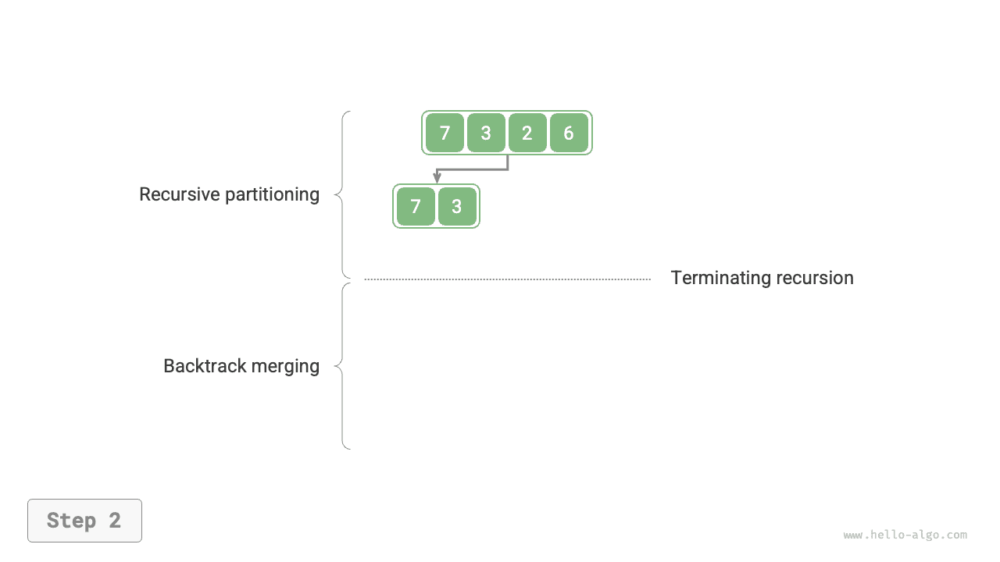

# マージソート

<u>マージソート（merge sort）</u>は分割統治法に基づくソートアルゴリズムで、下図の「分割」と「結合」の段階からなります。

1. **分割の段階**：再帰的に配列を中点で分け続け、長い配列のソート問題を短い配列のソート問題へ変換します。
2. **結合の段階**：部分配列の長さが 1 になったら分割を終了して結合を始めます。左右の短い整列済み配列を一つの長い整列済み配列へ結合し、最後まで続けます。


## アルゴリズムの流れ

下図のように、分割の段階では上から下へ再帰しながら、配列を中点で二つの部分配列に分けます。

1. 中点 `mid` を計算し、左の部分配列（区間 `[left, mid]`）と右の部分配列（区間 `[mid + 1, right]`）を再帰的に分割します。
2. 手順 `1.` を再帰的に繰り返し、部分配列の区間の長さが 1 になったら終了します。

結合の段階では、下から上へ左右の部分配列を一つの整列済み配列に結合します。長さ 1 の部分配列から結合を始めるので、この段階の各部分配列はすべて整列済みであることに注意してください。

=== "<1>"
    

=== "<2>"
    

=== "<3>"
    

=== "<4>"
    

=== "<5>"
    

=== "<6>"
    

=== "<7>"
    

=== "<8>"
    

=== "<9>"
    

=== "<10>"
    

マージソートの再帰の順序は、二分木の帰りがけ順走査と同じです。

- **帰りがけ順走査**：まず左の部分木を再帰的に処理し、次に右の部分木を処理して、最後に根ノードを処理します。
- **マージソート**：まず左の部分配列を再帰的に処理し、次に右の部分配列を処理して、最後に結合します。

実装は次のとおりです。結合する `nums` の区間は `[left, right]` ですが、`tmp` の対応する区間は `[0, right - left]` である点に注意してください。

```src
[file]{merge_sort}-[class]{}-[func]{merge_sort}
```

## アルゴリズムの特徴

- **時間計算量は $O(n \log n)$、非適応的ソート**：分割によって高さ $\log n$ の再帰木ができ、各層の結合操作の総数は $n$ なので、全体の時間計算量は $O(n \log n)$ です。
- **空間計算量は $O(n)$、非インプレースソート**：再帰の深さは $\log n$ で、スタックフレームに $O(\log n)$ の領域を使います。結合には補助配列が必要で、$O(n)$ の追加領域を使います。
- **安定ソート**：結合の過程で等しい要素の順序は変わりません。

## 連結リストのソート

連結リストでは、マージソートはほかのソートアルゴリズムより大きな利点があります。**連結リストをソートする空間計算量を $O(1)$ に改善できるためです**。

- **分割の段階**：再帰の代わりに反復を使って連結リストを分割すれば、再帰のスタックフレーム領域を省けます。
- **結合の段階**：連結リストのノードの追加や削除は、参照（ポインタ）の変更だけで行えます。そのため、二つの短い整列済みリストを一つの長い整列済みリストに結合する際、追加のリストを作る必要はありません。

具体的な実装はやや複雑なので、興味があれば関連資料で学んでみてください。
