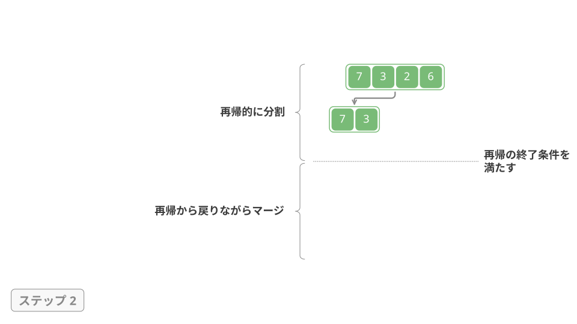
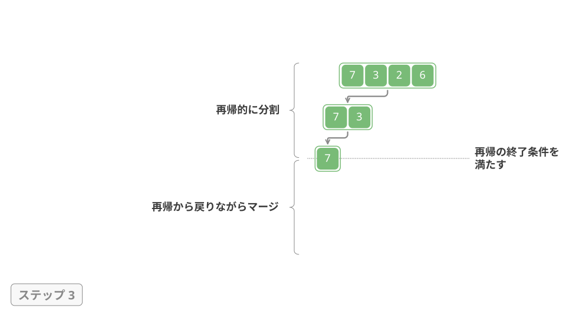
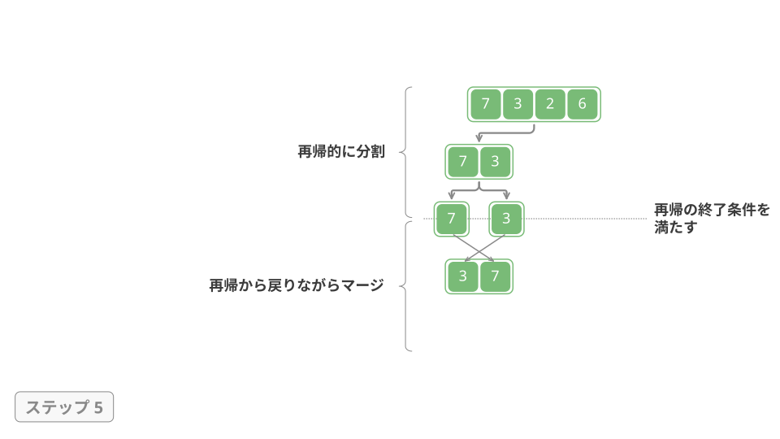
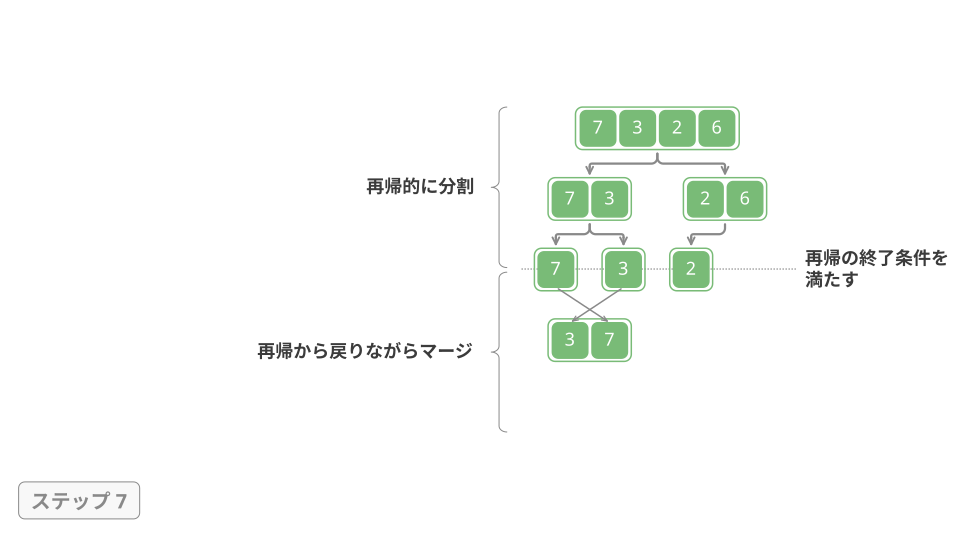
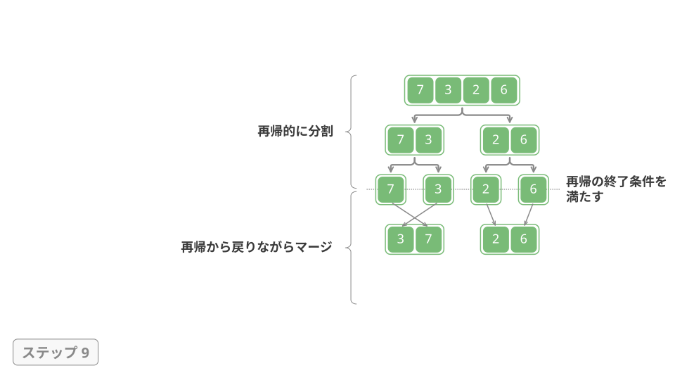
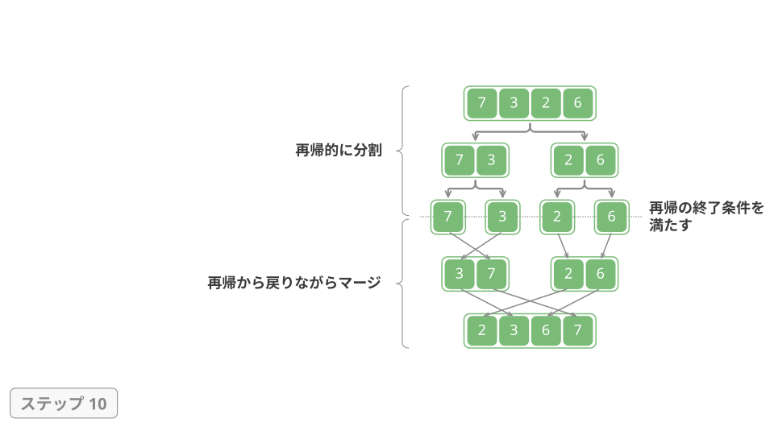

# マージソート

<u>マージソート（merge sort）</u>は分割統治に基づくソートアルゴリズムで、下図のように「分割」と「マージ」の段階があります。

1. **分割段階**では配列を中央で再帰的に分け続け、長い配列をソートする問題を、短い配列をソートする問題に変えます。
2. **マージ段階**では部分配列の長さが 1 になったところで分割を終え、左右の短い整列済み配列を 1 つの長い整列済み配列にまとめる操作を、全体が整列するまで繰り返します。


## アルゴリズムの手順

下図のように、分割段階では上から下へ、配列を中央で 2 つの部分配列に再帰的に分けます。

1. 配列の中央のインデックス `mid` を求め、左の部分配列（区間 `[left, mid]`）と右の部分配列（区間 `[mid + 1, right]`）を再帰的に分割します。
2. ステップ `1.` を再帰的に繰り返し、部分配列の区間長が 1 になったら終了します。

マージ段階では下から上へ、左右の部分配列を 1 つの整列済み配列にまとめます。長さ 1 の部分配列から始めるので、マージする各部分配列は常に整列しています。

=== "<1>"
    

=== "<2>"
    

=== "<3>"
    

=== "<4>"
    

=== "<5>"
    

=== "<6>"
    

=== "<7>"
    

=== "<8>"
    

=== "<9>"
    

=== "<10>"
    

マージソートの再帰の順序は、二分木の帰りがけ順（後順）走査と同じです。

- **帰りがけ順走査**では左部分木、右部分木の順に再帰し、最後に根を処理します。
- **マージソート**では左の部分配列、右の部分配列の順に再帰し、最後にマージします。

マージソートの実装を次に示します。`nums` でマージする区間は `[left, right]` で、それに対応する `tmp` の区間は `[0, right - left]` です。

```src
[file]{merge_sort}-[class]{}-[func]{merge_sort}
```

## アルゴリズムの特性

- **時間計算量は $O(n \log n)$、非適応的なソート**。分割で高さ $\log n$ の再帰木ができ、各段のマージの操作数は合計 $n$ なので、全体の時間計算量は $O(n \log n)$ です。
- **空間計算量は $O(n)$、インプレースではないソート**。再帰の深さは $\log n$ で、スタックフレームに $O(\log n)$ の領域を使います。また、マージのための補助配列に $O(n)$ の追加領域を使います。
- **安定ソート**。マージするとき、値が等しい要素の元の順序が保たれます。

## 連結リストのソート

連結リストでは、マージソートには他のソートに比べて大きな利点があります。**リストをソートする際の空間計算量を $O(1)$ まで抑えられます**。

- **分割段階**では、再帰の代わりに反復を使ってリストを分割すれば、再帰のスタックフレームが不要になります。
- **マージ段階**では、リストのノードの追加や削除は参照（ポインタ）の変更だけで行えます。このため、2 本の短い整列済みリストを 1 本の長い整列済みリストにまとめる際に、別のリストを作る必要がありません。

実装の詳細はやや複雑です。興味があれば関連資料を調べてみてください。
