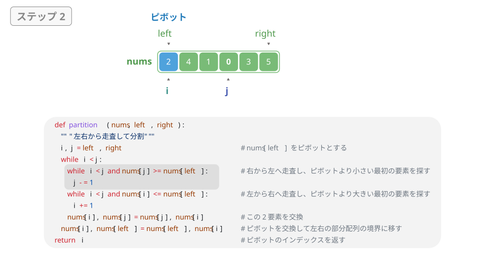
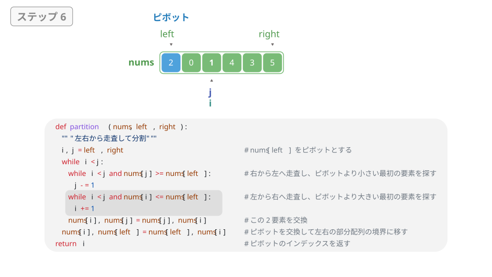
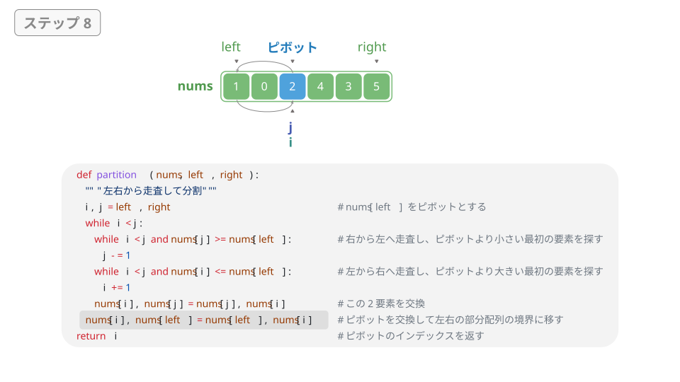
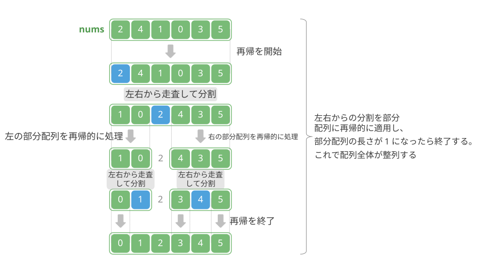

# クイックソート

<u>クイックソート（quick sort）</u>は、分割統治に基づく効率のよいソートアルゴリズムで、広く使われています。

クイックソートの中心となるのは「左右からの分割」です。配列から「ピボット」となる要素を選び、それより小さい要素をすべて左へ、大きい要素をすべて右へ移します。下図に手順を示します。

1. 配列の左端の要素をピボットに選び、2 本のポインタ `i` と `j` がそれぞれ配列の左端と右端を指すように初期化します。
2. ループの各回で、`i` でピボットより大きい最初の要素を、`j` でピボットより小さい最初の要素を探し、両者を交換します。
3. ステップ `2.` を繰り返し、`i` と `j` が出会ったら止めます。最後にピボットを交換して 2 つの部分配列の境界に移します。

=== "<1>"
    

=== "<2>"
    

=== "<3>"
    

=== "<4>"
    

=== "<5>"
    

=== "<6>"
    

=== "<7>"
    

=== "<8>"
    

=== "<9>"
    

分割後の配列は左の部分配列、ピボット、右の部分配列の 3 つに分かれ、「左の任意の要素 $\leq$ ピボット $\leq$ 右の任意の要素」を満たします。あとは左右の部分配列をそれぞれソートすればよいことになります。

!!! note "クイックソートの分割統治"

    左右からの分割によって、長い配列のソート問題を、短い 2 つの配列のソート問題に分けられます。

```src
[file]{quick_sort}-[class]{quick_sort}-[func]{partition}
```

## アルゴリズムの手順

クイックソートの全体の流れを下図に示します。

1. まず元の配列を左右から 1 回分割し、未整列の左右の部分配列を得ます。
2. 次に左右の部分配列をそれぞれ再帰的に同じ方法で分割します。
3. 部分配列の長さが 1 になるまで再帰を繰り返すと、配列全体が整列します。



```src
[file]{quick_sort}-[class]{quick_sort}-[func]{quick_sort}
```

## アルゴリズムの特性

- **時間計算量は $O(n \log n)$、非適応的なソート**。平均すると分割の再帰の段数は $\log n$、各段のループ回数の合計は $n$ で、全体で $O(n \log n)$ の時間がかかります。最悪の場合は各回で長さ $n$ の配列が長さ $0$ と $n - 1$ の部分配列に分かれます。このとき再帰の段数は $n$、各段のループ回数は $n$ で、全体で $O(n^2)$ の時間がかかります。
- **空間計算量は $O(n)$、インプレースソート**。入力が完全な逆順のとき、再帰の深さは最悪の $n$ に達し、スタックフレームに $O(n)$ の領域を使います。並べ替えは元の配列上で行い、追加の配列は使いません。
- **不安定なソート**。分割の最後の交換で、ピボットがそれと等しい要素の右側に移ることがあります。

## クイックソートが速い理由

その名のとおり、クイックソートには速度の面で利点があります。平均時間計算量はマージソートやヒープソートと同じですが、通常はクイックソートのほうが速くなります。主な理由は次のとおりです。

- **最悪の場合が起こる確率が非常に低い**。最悪時間計算量は $O(n^2)$ で、実行時間はマージソートほど一定していませんが、ほとんどの場合は時間計算量 $O(n \log n)$ で動作します。
- **キャッシュを効率よく使える**。左右から分割する際にシステムが部分配列全体をキャッシュに読み込めるため、要素へのアクセスが効率的です。ヒープソートのように離れた位置を飛び飛びに参照するアルゴリズムには、この特性がありません。
- **計算量の定数係数が小さい**。この 3 種類の中ではクイックソートが比較、代入、交換などの操作の合計数が最も少なくなります。挿入ソートがバブルソートより速い理由と似ています。

## ピボット選択の最適化

**クイックソートは入力によって遅くなることがあります**。極端な例として、入力配列が完全に逆順だとします。左端の要素をピボットに選ぶと、分割後にピボットが右端へ移り、左の部分配列の長さが $n - 1$、右の長さが $0$ になります。このまま再帰すると毎回片方の長さが $0$ になり、分割統治の効果が失われ、クイックソートはバブルソートに近い処理に退化します。

こうした場合をできるだけ避けるには、**分割時のピボットの選び方を工夫します**。たとえば無作為に 1 要素を選べます。ただし、運悪く毎回偏ったピボットを選べば、やはり効率は上がりません。

プログラミング言語が通常生成するのは「疑似乱数」です。その数列に合わせて特定のテストケースを作れば、クイックソートの効率が低下することがあります。

さらに改善するには、配列から 3 要素（通常は先頭、末尾、中央）を候補に選び、**その中央値をピボットにします**。こうすると、ピボットが小さすぎず大きすぎない確率が大幅に高まります。候補を増やせば、入力の偏りにもさらに強くなります。この方法で時間計算量が $O(n^2)$ に悪化する確率を大幅に下げられます。

実装例を示します。

```src
[file]{quick_sort}-[class]{quick_sort_median}-[func]{partition}
```

## 再帰の深さの最適化

**入力によってはクイックソートが多くの領域を使うことがあります**。たとえば入力が完全に整列済みで、再帰中の部分配列の長さが $m$ の場合、各回の分割で左の長さは $0$、右の長さは $m - 1$ になります。再帰を 1 段進めても問題はわずか 1 要素分しか小さくならず、再帰木の高さが $n - 1$ に達し、スタックフレームに $O(n)$ の領域が必要になります。

スタックフレームが積み重なるのを防ぐには、分割のたびに左右の部分配列の長さを比較し、**短いほうだけを再帰的に処理します**。短いほうの長さは $n / 2$ 以下なので、再帰の深さを $\log n$ 以下に抑えられ、最悪空間計算量を $O(\log n)$ に改善できます。コードを次に示します。

```src
[file]{quick_sort}-[class]{quick_sort_tail_call}-[func]{quick_sort}
```
