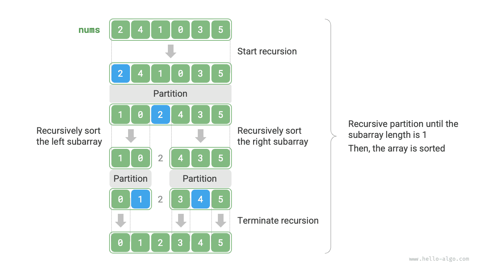

# 11.5 &nbsp; クイックソート

<u>クイックソート（quick sort）</u>は分割統治法に基づくソートアルゴリズムで、実行効率が高く、広く使われています。

中心となる操作は「番兵を用いた分割」です。配列の要素を一つ「ピボット」として選び、それより小さい要素を左へ、大きい要素を右へ移すことを目指します。具体的な流れを図 11-8 に示します。

1. 配列の左端の要素をピボットとして選び、ポインタ `i` と `j` を配列の両端に初期化します。
2. ループの各反復で、`i`（`j`）を使ってピボットより大きい（小さい）最初の要素を探し、その二つを交換します。
3. 手順 `2.` を繰り返し、`i` と `j` が出会ったら停止します。最後に、ピボットを二つの部分配列の境目へ交換して移します。

=== "<1>"
    { class="animation-figure" }

=== "<2>"
    { class="animation-figure" }

=== "<3>"
    { class="animation-figure" }

=== "<4>"
    { class="animation-figure" }

=== "<5>"
    { class="animation-figure" }

=== "<6>"
    { class="animation-figure" }

=== "<7>"
    { class="animation-figure" }

=== "<8>"
    { class="animation-figure" }

=== "<9>"
    { class="animation-figure" }

<p align="center"> 図 11-8 &nbsp; 番兵を用いた分割の手順 </p>

分割後、元の配列は左の部分配列、ピボット、右の部分配列の三つに分かれ、「左の部分配列の任意の要素 $\leq$ ピボット $\leq$ 右の部分配列の任意の要素」を満たします。したがって、あとは二つの部分配列をソートするだけです。

!!! note "クイックソートの分割統治法"

    番兵を用いた分割は、長い配列のソート問題を、二つの短い配列のソート問題へと単純化します。

=== "Python"

    ```python title="quick_sort.py"
    def partition(self, nums: list[int], left: int, right: int) -> int:
        """番兵を用いた分割"""
        # nums[left] をピボットとする
        i, j = left, right
        while i < j:
            while i < j and nums[j] >= nums[left]:
                j -= 1  # 右から左へ、ピボットより小さい最初の要素を探す
            while i < j and nums[i] <= nums[left]:
                i += 1  # 左から右へ、ピボットより大きい最初の要素を探す
            # 要素の交換
            nums[i], nums[j] = nums[j], nums[i]
        # ピボットを 2 つの部分配列の境界に移す
        nums[i], nums[left] = nums[left], nums[i]
        return i  # ピボットのインデックスを返す
    ```

=== "C++"

    ```cpp title="quick_sort.cpp"
    /* 番兵を用いた分割 */
    int partition(vector<int> &nums, int left, int right) {
        // nums[left] をピボットとする
        int i = left, j = right;
        while (i < j) {
            while (i < j && nums[j] >= nums[left])
                j--;                // 右から左へ、ピボットより小さい最初の要素を探す
            while (i < j && nums[i] <= nums[left])
                i++;                // 左から右へ、ピボットより大きい最初の要素を探す
            swap(nums[i], nums[j]); // この 2 つの要素を交換する
        }
        swap(nums[i], nums[left]);  // ピボットを 2 つの部分配列の境界に移す
        return i;                   // ピボットのインデックスを返す
    }
    ```

=== "Java"

    ```java title="quick_sort.java"
    /* 要素の交換 */
    void swap(int[] nums, int i, int j) {
        int tmp = nums[i];
        nums[i] = nums[j];
        nums[j] = tmp;
    }

    /* 番兵を用いた分割 */
    int partition(int[] nums, int left, int right) {
        // nums[left] をピボットとする
        int i = left, j = right;
        while (i < j) {
            while (i < j && nums[j] >= nums[left])
                j--;          // 右から左へ、ピボットより小さい最初の要素を探す
            while (i < j && nums[i] <= nums[left])
                i++;          // 左から右へ、ピボットより大きい最初の要素を探す
            swap(nums, i, j); // この 2 つの要素を交換する
        }
        swap(nums, i, left);  // ピボットを 2 つの部分配列の境界に移す
        return i;             // ピボットのインデックスを返す
    }
    ```

=== "C#"

    ```csharp title="quick_sort.cs"
    /* 要素の交換 */
    void Swap(int[] nums, int i, int j) {
        (nums[j], nums[i]) = (nums[i], nums[j]);
    }

    /* 番兵を用いた分割 */
    int Partition(int[] nums, int left, int right) {
        // nums[left] をピボットとする
        int i = left, j = right;
        while (i < j) {
            while (i < j && nums[j] >= nums[left])
                j--;          // 右から左へ、ピボットより小さい最初の要素を探す
            while (i < j && nums[i] <= nums[left])
                i++;          // 左から右へ、ピボットより大きい最初の要素を探す
            Swap(nums, i, j); // この 2 つの要素を交換する
        }
        Swap(nums, i, left);  // ピボットを 2 つの部分配列の境界に移す
        return i;             // ピボットのインデックスを返す
    }
    ```

=== "Go"

    ```go title="quick_sort.go"
    /* 番兵を用いた分割 */
    func (q *quickSort) partition(nums []int, left, right int) int {
        // nums[left] をピボットとする
        i, j := left, right
        for i < j {
            for i < j && nums[j] >= nums[left] {
                j-- // 右から左へ、ピボットより小さい最初の要素を探す
            }
            for i < j && nums[i] <= nums[left] {
                i++ // 左から右へ、ピボットより大きい最初の要素を探す
            }
            // 要素の交換
            nums[i], nums[j] = nums[j], nums[i]
        }
        // ピボットを 2 つの部分配列の境界に移す
        nums[i], nums[left] = nums[left], nums[i]
        return i // ピボットのインデックスを返す
    }
    ```

=== "Swift"

    ```swift title="quick_sort.swift"
    /* 番兵を用いた分割 */
    func partition(nums: inout [Int], left: Int, right: Int) -> Int {
        // nums[left] をピボットとする
        var i = left
        var j = right
        while i < j {
            while i < j, nums[j] >= nums[left] {
                j -= 1 // 右から左へ、ピボットより小さい最初の要素を探す
            }
            while i < j, nums[i] <= nums[left] {
                i += 1 // 左から右へ、ピボットより大きい最初の要素を探す
            }
            nums.swapAt(i, j) // この 2 つの要素を交換する
        }
        nums.swapAt(i, left) // ピボットを 2 つの部分配列の境界に移す
        return i // ピボットのインデックスを返す
    }
    ```

=== "JS"

    ```javascript title="quick_sort.js"
    /* 要素の交換 */
    swap(nums, i, j) {
        let tmp = nums[i];
        nums[i] = nums[j];
        nums[j] = tmp;
    }

    /* 番兵を用いた分割 */
    partition(nums, left, right) {
        // nums[left] をピボットとする
        let i = left,
            j = right;
        while (i < j) {
            while (i < j && nums[j] >= nums[left]) {
                j -= 1; // 右から左へ、ピボットより小さい最初の要素を探す
            }
            while (i < j && nums[i] <= nums[left]) {
                i += 1; // 左から右へ、ピボットより大きい最初の要素を探す
            }
            // 要素の交換
            this.swap(nums, i, j); // この 2 つの要素を交換する
        }
        this.swap(nums, i, left); // ピボットを 2 つの部分配列の境界に移す
        return i; // ピボットのインデックスを返す
    }
    ```

=== "TS"

    ```typescript title="quick_sort.ts"
    /* 要素の交換 */
    swap(nums: number[], i: number, j: number): void {
        let tmp = nums[i];
        nums[i] = nums[j];
        nums[j] = tmp;
    }

    /* 番兵を用いた分割 */
    partition(nums: number[], left: number, right: number): number {
        // nums[left] をピボットとする
        let i = left,
            j = right;
        while (i < j) {
            while (i < j && nums[j] >= nums[left]) {
                j -= 1; // 右から左へ、ピボットより小さい最初の要素を探す
            }
            while (i < j && nums[i] <= nums[left]) {
                i += 1; // 左から右へ、ピボットより大きい最初の要素を探す
            }
            // 要素の交換
            this.swap(nums, i, j); // この 2 つの要素を交換する
        }
        this.swap(nums, i, left); // ピボットを 2 つの部分配列の境界に移す
        return i; // ピボットのインデックスを返す
    }
    ```

=== "Dart"

    ```dart title="quick_sort.dart"
    /* 要素の交換 */
    void _swap(List<int> nums, int i, int j) {
      int tmp = nums[i];
      nums[i] = nums[j];
      nums[j] = tmp;
    }

    /* 番兵を用いた分割 */
    int _partition(List<int> nums, int left, int right) {
      // nums[left] をピボットとする
      int i = left, j = right;
      while (i < j) {
        while (i < j && nums[j] >= nums[left]) j--; // 右から左へ、ピボットより小さい最初の要素を探す
        while (i < j && nums[i] <= nums[left]) i++; // 左から右へ、ピボットより大きい最初の要素を探す
        _swap(nums, i, j); // この 2 つの要素を交換する
      }
      _swap(nums, i, left); // ピボットを 2 つの部分配列の境界に移す
      return i; // ピボットのインデックスを返す
    }
    ```

=== "Rust"

    ```rust title="quick_sort.rs"
    /* 番兵を用いた分割 */
    fn partition(nums: &mut [i32], left: usize, right: usize) -> usize {
        // nums[left] をピボットとする
        let (mut i, mut j) = (left, right);
        while i < j {
            while i < j && nums[j] >= nums[left] {
                j -= 1; // 右から左へ、ピボットより小さい最初の要素を探す
            }
            while i < j && nums[i] <= nums[left] {
                i += 1; // 左から右へ、ピボットより大きい最初の要素を探す
            }
            nums.swap(i, j); // この 2 つの要素を交換する
        }
        nums.swap(i, left); // ピボットを 2 つの部分配列の境界に移す
        i // ピボットのインデックスを返す
    }
    ```

=== "C"

    ```c title="quick_sort.c"
    /* 要素の交換 */
    void swap(int nums[], int i, int j) {
        int tmp = nums[i];
        nums[i] = nums[j];
        nums[j] = tmp;
    }

    /* 番兵を用いた分割 */
    int partition(int nums[], int left, int right) {
        // nums[left] をピボットとする
        int i = left, j = right;
        while (i < j) {
            while (i < j && nums[j] >= nums[left]) {
                j--; // 右から左へ、ピボットより小さい最初の要素を探す
            }
            while (i < j && nums[i] <= nums[left]) {
                i++; // 左から右へ、ピボットより大きい最初の要素を探す
            }
            // この 2 つの要素を交換する
            swap(nums, i, j);
        }
        // ピボットを 2 つの部分配列の境界に移す
        swap(nums, i, left);
        // ピボットのインデックスを返す
        return i;
    }
    ```

=== "Kotlin"

    ```kotlin title="quick_sort.kt"
    /* 要素の交換 */
    fun swap(nums: IntArray, i: Int, j: Int) {
        val temp = nums[i]
        nums[i] = nums[j]
        nums[j] = temp
    }

    /* 番兵を用いた分割 */
    fun partition(nums: IntArray, left: Int, right: Int): Int {
        // nums[left] をピボットとする
        var i = left
        var j = right
        while (i < j) {
            while (i < j && nums[j] >= nums[left])
                j--           // 右から左へ、ピボットより小さい最初の要素を探す
            while (i < j && nums[i] <= nums[left])
                i++           // 左から右へ、ピボットより大きい最初の要素を探す
            swap(nums, i, j)  // この 2 つの要素を交換する
        }
        swap(nums, i, left)   // ピボットを 2 つの部分配列の境界に移す
        return i              // ピボットのインデックスを返す
    }
    ```

=== "Ruby"

    ```ruby title="quick_sort.rb"
    ### 番兵を用いた分割 ###
    def partition(nums, left, right)
      # nums[left] をピボットとする
      i, j = left, right
      while i < j
        while i < j && nums[j] >= nums[left]
          j -= 1 # 右から左へ、ピボットより小さい最初の要素を探す
        end
        while i < j && nums[i] <= nums[left]
          i += 1 # 左から右へ、ピボットより大きい最初の要素を探す
        end
        # 要素の交換
        nums[i], nums[j] = nums[j], nums[i]
      end
      # ピボットを 2 つの部分配列の境界に移す
      nums[i], nums[left] = nums[left], nums[i]
      i # ピボットのインデックスを返す
    end
    ```

??? pythontutor "実行の可視化"

    <div style="height: 549px; width: 100%;"><iframe class="pythontutor-iframe" title="実行の可視化" src="https://pythontutor.com/iframe-embed.html#code=def%20partition%28nums%3A%20list%5Bint%5D,%20left%3A%20int,%20right%3A%20int%29%20-%3E%20int%3A%0A%20%20%20%20%22%22%22%E7%95%AA%E5%85%B5%E3%82%92%E7%94%A8%E3%81%84%E3%81%9F%E5%88%86%E5%89%B2%22%22%22%0A%20%20%20%20%23%20nums%5Bleft%5D%20%E3%82%92%E3%83%94%E3%83%9C%E3%83%83%E3%83%88%E3%81%A8%E3%81%99%E3%82%8B%0A%20%20%20%20i,%20j%20%3D%20left,%20right%0A%20%20%20%20while%20i%20%3C%20j%3A%0A%20%20%20%20%20%20%20%20while%20i%20%3C%20j%20and%20nums%5Bj%5D%20%3E%3D%20nums%5Bleft%5D%3A%0A%20%20%20%20%20%20%20%20%20%20%20%20j%20-%3D%201%20%20%23%20%E5%8F%B3%E3%81%8B%E3%82%89%E5%B7%A6%E3%81%B8%E3%80%81%E3%83%94%E3%83%9C%E3%83%83%E3%83%88%E3%82%88%E3%82%8A%E5%B0%8F%E3%81%95%E3%81%84%E6%9C%80%E5%88%9D%E3%81%AE%E8%A6%81%E7%B4%A0%E3%82%92%E6%8E%A2%E3%81%99%0A%20%20%20%20%20%20%20%20while%20i%20%3C%20j%20and%20nums%5Bi%5D%20%3C%3D%20nums%5Bleft%5D%3A%0A%20%20%20%20%20%20%20%20%20%20%20%20i%20%2B%3D%201%20%20%23%20%E5%B7%A6%E3%81%8B%E3%82%89%E5%8F%B3%E3%81%B8%E3%80%81%E3%83%94%E3%83%9C%E3%83%83%E3%83%88%E3%82%88%E3%82%8A%E5%A4%A7%E3%81%8D%E3%81%84%E6%9C%80%E5%88%9D%E3%81%AE%E8%A6%81%E7%B4%A0%E3%82%92%E6%8E%A2%E3%81%99%0A%20%20%20%20%20%20%20%20%23%20%E8%A6%81%E7%B4%A0%E3%81%AE%E4%BA%A4%E6%8F%9B%0A%20%20%20%20%20%20%20%20nums%5Bi%5D,%20nums%5Bj%5D%20%3D%20nums%5Bj%5D,%20nums%5Bi%5D%0A%20%20%20%20%23%20%E3%83%94%E3%83%9C%E3%83%83%E3%83%88%E3%82%92%202%20%E3%81%A4%E3%81%AE%E9%83%A8%E5%88%86%E9%85%8D%E5%88%97%E3%81%AE%E5%A2%83%E7%95%8C%E3%81%AB%E7%A7%BB%E3%81%99%0A%20%20%20%20nums%5Bi%5D,%20nums%5Bleft%5D%20%3D%20nums%5Bleft%5D,%20nums%5Bi%5D%0A%20%20%20%20return%20i%20%20%23%20%E3%83%94%E3%83%9C%E3%83%83%E3%83%88%E3%81%AE%E3%82%A4%E3%83%B3%E3%83%87%E3%83%83%E3%82%AF%E3%82%B9%E3%82%92%E8%BF%94%E3%81%99%0A%0A%0A%22%22%22%E5%AE%9F%E8%A1%8C%E7%94%A8%E3%82%B3%E3%83%BC%E3%83%89%22%22%22%0Aif%20__name__%20%3D%3D%20%22__main__%22%3A%0A%20%20%20%20nums%20%3D%20%5B2,%204,%201,%200,%203,%205%5D%0A%20%20%20%20partition%28nums,%200,%20len%28nums%29%20-%201%29%0A%20%20%20%20print%28%22%E7%95%AA%E5%85%B5%E3%82%92%E7%94%A8%E3%81%84%E3%81%9F%E5%88%86%E5%89%B2%E3%81%AE%E5%AE%8C%E4%BA%86%E5%BE%8C%20nums%20%3D%22,%20nums%29&codeDivHeight=472&codeDivWidth=350&cumulative=false&curInstr=4&heapPrimitives=nevernest&origin=opt-frontend.js&py=311&rawInputLstJSON=%5B%5D&textReferences=false"> </iframe></div>
    <div style="margin-top: 5px;"><a href="https://pythontutor.com/iframe-embed.html#code=def%20partition%28nums%3A%20list%5Bint%5D,%20left%3A%20int,%20right%3A%20int%29%20-%3E%20int%3A%0A%20%20%20%20%22%22%22%E7%95%AA%E5%85%B5%E3%82%92%E7%94%A8%E3%81%84%E3%81%9F%E5%88%86%E5%89%B2%22%22%22%0A%20%20%20%20%23%20nums%5Bleft%5D%20%E3%82%92%E3%83%94%E3%83%9C%E3%83%83%E3%83%88%E3%81%A8%E3%81%99%E3%82%8B%0A%20%20%20%20i,%20j%20%3D%20left,%20right%0A%20%20%20%20while%20i%20%3C%20j%3A%0A%20%20%20%20%20%20%20%20while%20i%20%3C%20j%20and%20nums%5Bj%5D%20%3E%3D%20nums%5Bleft%5D%3A%0A%20%20%20%20%20%20%20%20%20%20%20%20j%20-%3D%201%20%20%23%20%E5%8F%B3%E3%81%8B%E3%82%89%E5%B7%A6%E3%81%B8%E3%80%81%E3%83%94%E3%83%9C%E3%83%83%E3%83%88%E3%82%88%E3%82%8A%E5%B0%8F%E3%81%95%E3%81%84%E6%9C%80%E5%88%9D%E3%81%AE%E8%A6%81%E7%B4%A0%E3%82%92%E6%8E%A2%E3%81%99%0A%20%20%20%20%20%20%20%20while%20i%20%3C%20j%20and%20nums%5Bi%5D%20%3C%3D%20nums%5Bleft%5D%3A%0A%20%20%20%20%20%20%20%20%20%20%20%20i%20%2B%3D%201%20%20%23%20%E5%B7%A6%E3%81%8B%E3%82%89%E5%8F%B3%E3%81%B8%E3%80%81%E3%83%94%E3%83%9C%E3%83%83%E3%83%88%E3%82%88%E3%82%8A%E5%A4%A7%E3%81%8D%E3%81%84%E6%9C%80%E5%88%9D%E3%81%AE%E8%A6%81%E7%B4%A0%E3%82%92%E6%8E%A2%E3%81%99%0A%20%20%20%20%20%20%20%20%23%20%E8%A6%81%E7%B4%A0%E3%81%AE%E4%BA%A4%E6%8F%9B%0A%20%20%20%20%20%20%20%20nums%5Bi%5D,%20nums%5Bj%5D%20%3D%20nums%5Bj%5D,%20nums%5Bi%5D%0A%20%20%20%20%23%20%E3%83%94%E3%83%9C%E3%83%83%E3%83%88%E3%82%92%202%20%E3%81%A4%E3%81%AE%E9%83%A8%E5%88%86%E9%85%8D%E5%88%97%E3%81%AE%E5%A2%83%E7%95%8C%E3%81%AB%E7%A7%BB%E3%81%99%0A%20%20%20%20nums%5Bi%5D,%20nums%5Bleft%5D%20%3D%20nums%5Bleft%5D,%20nums%5Bi%5D%0A%20%20%20%20return%20i%20%20%23%20%E3%83%94%E3%83%9C%E3%83%83%E3%83%88%E3%81%AE%E3%82%A4%E3%83%B3%E3%83%87%E3%83%83%E3%82%AF%E3%82%B9%E3%82%92%E8%BF%94%E3%81%99%0A%0A%0A%22%22%22%E5%AE%9F%E8%A1%8C%E7%94%A8%E3%82%B3%E3%83%BC%E3%83%89%22%22%22%0Aif%20__name__%20%3D%3D%20%22__main__%22%3A%0A%20%20%20%20nums%20%3D%20%5B2,%204,%201,%200,%203,%205%5D%0A%20%20%20%20partition%28nums,%200,%20len%28nums%29%20-%201%29%0A%20%20%20%20print%28%22%E7%95%AA%E5%85%B5%E3%82%92%E7%94%A8%E3%81%84%E3%81%9F%E5%88%86%E5%89%B2%E3%81%AE%E5%AE%8C%E4%BA%86%E5%BE%8C%20nums%20%3D%22,%20nums%29&codeDivHeight=800&codeDivWidth=600&cumulative=false&curInstr=4&heapPrimitives=nevernest&origin=opt-frontend.js&py=311&rawInputLstJSON=%5B%5D&textReferences=false" target="_blank" rel="noopener noreferrer">全画面で表示 ></a></div>

## 11.5.1 &nbsp; アルゴリズムの流れ

クイックソート全体の流れを図 11-9 に示します。

1. まず、元の配列に番兵を用いた分割を一回行い、未整列の左右の部分配列を得ます。
2. 続いて、左右それぞれの部分配列に対して、再帰的に同じ分割を行います。
3. 部分配列の長さが 1 になるまで再帰を続けると、配列全体のソートが完了します。

{ class="animation-figure" }

<p align="center"> 図 11-9 &nbsp; クイックソートの流れ </p>

=== "Python"

    ```python title="quick_sort.py"
    def quick_sort(self, nums: list[int], left: int, right: int):
        """クイックソート"""
        # 部分配列の長さが 1 になったら再帰を終了する
        if left >= right:
            return
        # 番兵を用いた分割
        pivot = self.partition(nums, left, right)
        # 左部分配列と右部分配列を再帰的に処理する
        self.quick_sort(nums, left, pivot - 1)
        self.quick_sort(nums, pivot + 1, right)
    ```

=== "C++"

    ```cpp title="quick_sort.cpp"
    /* クイックソート */
    void quickSort(vector<int> &nums, int left, int right) {
        // 部分配列の長さが 1 になったら再帰を終了する
        if (left >= right)
            return;
        // 番兵を用いた分割
        int pivot = partition(nums, left, right);
        // 左部分配列と右部分配列を再帰的に処理する
        quickSort(nums, left, pivot - 1);
        quickSort(nums, pivot + 1, right);
    }
    ```

=== "Java"

    ```java title="quick_sort.java"
    /* クイックソート */
    void quickSort(int[] nums, int left, int right) {
        // 部分配列の長さが 1 になったら再帰を終了する
        if (left >= right)
            return;
        // 番兵を用いた分割
        int pivot = partition(nums, left, right);
        // 左部分配列と右部分配列を再帰的に処理する
        quickSort(nums, left, pivot - 1);
        quickSort(nums, pivot + 1, right);
    }
    ```

=== "C#"

    ```csharp title="quick_sort.cs"
    /* クイックソート */
    void QuickSort(int[] nums, int left, int right) {
        // 部分配列の長さが 1 になったら再帰を終了する
        if (left >= right)
            return;
        // 番兵を用いた分割
        int pivot = Partition(nums, left, right);
        // 左部分配列と右部分配列を再帰的に処理する
        QuickSort(nums, left, pivot - 1);
        QuickSort(nums, pivot + 1, right);
    }
    ```

=== "Go"

    ```go title="quick_sort.go"
    /* クイックソート */
    func (q *quickSort) quickSort(nums []int, left, right int) {
        // 部分配列の長さが 1 になったら再帰を終了する
        if left >= right {
            return
        }
        // 番兵を用いた分割
        pivot := q.partition(nums, left, right)
        // 左部分配列と右部分配列を再帰的に処理する
        q.quickSort(nums, left, pivot-1)
        q.quickSort(nums, pivot+1, right)
    }
    ```

=== "Swift"

    ```swift title="quick_sort.swift"
    /* クイックソート */
    func quickSort(nums: inout [Int], left: Int, right: Int) {
        // 部分配列の長さが 1 になったら再帰を終了する
        if left >= right {
            return
        }
        // 番兵を用いた分割
        let pivot = partition(nums: &nums, left: left, right: right)
        // 左部分配列と右部分配列を再帰的に処理する
        quickSort(nums: &nums, left: left, right: pivot - 1)
        quickSort(nums: &nums, left: pivot + 1, right: right)
    }
    ```

=== "JS"

    ```javascript title="quick_sort.js"
    /* クイックソート */
    quickSort(nums, left, right) {
        // 部分配列の長さが 1 になったら再帰を終了する
        if (left >= right) return;
        // 番兵を用いた分割
        const pivot = this.partition(nums, left, right);
        // 左部分配列と右部分配列を再帰的に処理する
        this.quickSort(nums, left, pivot - 1);
        this.quickSort(nums, pivot + 1, right);
    }
    ```

=== "TS"

    ```typescript title="quick_sort.ts"
    /* クイックソート */
    quickSort(nums: number[], left: number, right: number): void {
        // 部分配列の長さが 1 になったら再帰を終了する
        if (left >= right) {
            return;
        }
        // 番兵を用いた分割
        const pivot = this.partition(nums, left, right);
        // 左部分配列と右部分配列を再帰的に処理する
        this.quickSort(nums, left, pivot - 1);
        this.quickSort(nums, pivot + 1, right);
    }
    ```

=== "Dart"

    ```dart title="quick_sort.dart"
    /* クイックソート */
    void quickSort(List<int> nums, int left, int right) {
      // 部分配列の長さが 1 になったら再帰を終了する
      if (left >= right) return;
      // 番兵を用いた分割
      int pivot = _partition(nums, left, right);
      // 左部分配列と右部分配列を再帰的に処理する
      quickSort(nums, left, pivot - 1);
      quickSort(nums, pivot + 1, right);
    }
    ```

=== "Rust"

    ```rust title="quick_sort.rs"
    /* クイックソート */
    pub fn quick_sort(left: i32, right: i32, nums: &mut [i32]) {
        // 部分配列の長さが 1 になったら再帰を終了する
        if left >= right {
            return;
        }
        // 番兵を用いた分割
        let pivot = Self::partition(nums, left as usize, right as usize) as i32;
        // 左部分配列と右部分配列を再帰的に処理する
        Self::quick_sort(left, pivot - 1, nums);
        Self::quick_sort(pivot + 1, right, nums);
    }
    ```

=== "C"

    ```c title="quick_sort.c"
    /* クイックソート */
    void quickSort(int nums[], int left, int right) {
        // 部分配列の長さが 1 になったら再帰を終了する
        if (left >= right) {
            return;
        }
        // 番兵を用いた分割
        int pivot = partition(nums, left, right);
        // 左部分配列と右部分配列を再帰的に処理する
        quickSort(nums, left, pivot - 1);
        quickSort(nums, pivot + 1, right);
    }
    ```

=== "Kotlin"

    ```kotlin title="quick_sort.kt"
    /* クイックソート */
    fun quickSort(nums: IntArray, left: Int, right: Int) {
        // 部分配列の長さが 1 になったら再帰を終了する
        if (left >= right) return
        // 番兵を用いた分割
        val pivot = partition(nums, left, right)
        // 左部分配列と右部分配列を再帰的に処理する
        quickSort(nums, left, pivot - 1)
        quickSort(nums, pivot + 1, right)
    }
    ```

=== "Ruby"

    ```ruby title="quick_sort.rb"
    ### クイックソートクラス ###
    def quick_sort(nums, left, right)
      # 部分配列の長さが 1 でない場合、再帰する
      if left < right
        # 番兵を用いた分割
        pivot = partition(nums, left, right)
        # 左部分配列と右部分配列を再帰的に処理する
        quick_sort(nums, left, pivot - 1)
        quick_sort(nums, pivot + 1, right)
      end
      nums
    end
    ```

??? pythontutor "実行の可視化"

    <div style="height: 549px; width: 100%;"><iframe class="pythontutor-iframe" title="実行の可視化" src="https://pythontutor.com/iframe-embed.html#code=def%20partition%28nums%3A%20list%5Bint%5D,%20left%3A%20int,%20right%3A%20int%29%20-%3E%20int%3A%0A%20%20%20%20%22%22%22%E7%95%AA%E5%85%B5%E3%82%92%E7%94%A8%E3%81%84%E3%81%9F%E5%88%86%E5%89%B2%22%22%22%0A%20%20%20%20%23%20nums%5Bleft%5D%20%E3%82%92%E3%83%94%E3%83%9C%E3%83%83%E3%83%88%E3%81%A8%E3%81%99%E3%82%8B%0A%20%20%20%20i,%20j%20%3D%20left,%20right%0A%20%20%20%20while%20i%20%3C%20j%3A%0A%20%20%20%20%20%20%20%20while%20i%20%3C%20j%20and%20nums%5Bj%5D%20%3E%3D%20nums%5Bleft%5D%3A%0A%20%20%20%20%20%20%20%20%20%20%20%20j%20-%3D%201%20%20%23%20%E5%8F%B3%E3%81%8B%E3%82%89%E5%B7%A6%E3%81%B8%E3%80%81%E3%83%94%E3%83%9C%E3%83%83%E3%83%88%E3%82%88%E3%82%8A%E5%B0%8F%E3%81%95%E3%81%84%E6%9C%80%E5%88%9D%E3%81%AE%E8%A6%81%E7%B4%A0%E3%82%92%E6%8E%A2%E3%81%99%0A%20%20%20%20%20%20%20%20while%20i%20%3C%20j%20and%20nums%5Bi%5D%20%3C%3D%20nums%5Bleft%5D%3A%0A%20%20%20%20%20%20%20%20%20%20%20%20i%20%2B%3D%201%20%20%23%20%E5%B7%A6%E3%81%8B%E3%82%89%E5%8F%B3%E3%81%B8%E3%80%81%E3%83%94%E3%83%9C%E3%83%83%E3%83%88%E3%82%88%E3%82%8A%E5%A4%A7%E3%81%8D%E3%81%84%E6%9C%80%E5%88%9D%E3%81%AE%E8%A6%81%E7%B4%A0%E3%82%92%E6%8E%A2%E3%81%99%0A%20%20%20%20%20%20%20%20%23%20%E8%A6%81%E7%B4%A0%E3%81%AE%E4%BA%A4%E6%8F%9B%0A%20%20%20%20%20%20%20%20nums%5Bi%5D,%20nums%5Bj%5D%20%3D%20nums%5Bj%5D,%20nums%5Bi%5D%0A%20%20%20%20%23%20%E3%83%94%E3%83%9C%E3%83%83%E3%83%88%E3%82%92%202%20%E3%81%A4%E3%81%AE%E9%83%A8%E5%88%86%E9%85%8D%E5%88%97%E3%81%AE%E5%A2%83%E7%95%8C%E3%81%AB%E7%A7%BB%E3%81%99%0A%20%20%20%20nums%5Bi%5D,%20nums%5Bleft%5D%20%3D%20nums%5Bleft%5D,%20nums%5Bi%5D%0A%20%20%20%20return%20i%20%20%23%20%E3%83%94%E3%83%9C%E3%83%83%E3%83%88%E3%81%AE%E3%82%A4%E3%83%B3%E3%83%87%E3%83%83%E3%82%AF%E3%82%B9%E3%82%92%E8%BF%94%E3%81%99%0A%0Adef%20quick_sort%28nums%3A%20list%5Bint%5D,%20left%3A%20int,%20right%3A%20int%29%3A%0A%20%20%20%20%22%22%22%E3%82%AF%E3%82%A4%E3%83%83%E3%82%AF%E3%82%BD%E3%83%BC%E3%83%88%22%22%22%0A%20%20%20%20%23%20%E9%83%A8%E5%88%86%E9%85%8D%E5%88%97%E3%81%AE%E9%95%B7%E3%81%95%E3%81%8C%201%20%E3%81%AB%E3%81%AA%E3%81%A3%E3%81%9F%E3%82%89%E5%86%8D%E5%B8%B0%E3%82%92%E7%B5%82%E4%BA%86%E3%81%99%E3%82%8B%0A%20%20%20%20if%20left%20%3E%3D%20right%3A%0A%20%20%20%20%20%20%20%20return%0A%20%20%20%20%23%20%E7%95%AA%E5%85%B5%E3%82%92%E7%94%A8%E3%81%84%E3%81%9F%E5%88%86%E5%89%B2%0A%20%20%20%20pivot%20%3D%20partition%28nums,%20left,%20right%29%0A%20%20%20%20%23%20%E5%B7%A6%E9%83%A8%E5%88%86%E9%85%8D%E5%88%97%E3%81%A8%E5%8F%B3%E9%83%A8%E5%88%86%E9%85%8D%E5%88%97%E3%82%92%E5%86%8D%E5%B8%B0%E7%9A%84%E3%81%AB%E5%87%A6%E7%90%86%E3%81%99%E3%82%8B%0A%20%20%20%20quick_sort%28nums,%20left,%20pivot%20-%201%29%0A%20%20%20%20quick_sort%28nums,%20pivot%20%2B%201,%20right%29%0A%0A%0A%22%22%22%E5%AE%9F%E8%A1%8C%E7%94%A8%E3%82%B3%E3%83%BC%E3%83%89%22%22%22%0Aif%20__name__%20%3D%3D%20%22__main__%22%3A%0A%20%20%20%20%23%20%E3%82%AF%E3%82%A4%E3%83%83%E3%82%AF%E3%82%BD%E3%83%BC%E3%83%88%0A%20%20%20%20nums%20%3D%20%5B2,%204,%201,%200,%203,%205%5D%0A%20%20%20%20quick_sort%28nums,%200,%20len%28nums%29%20-%201%29%0A%20%20%20%20print%28%22%E3%82%AF%E3%82%A4%E3%83%83%E3%82%AF%E3%82%BD%E3%83%BC%E3%83%88%E5%AE%8C%E4%BA%86%E5%BE%8C%20nums%20%3D%22,%20nums%29&codeDivHeight=472&codeDivWidth=350&cumulative=false&curInstr=5&heapPrimitives=nevernest&origin=opt-frontend.js&py=311&rawInputLstJSON=%5B%5D&textReferences=false"> </iframe></div>
    <div style="margin-top: 5px;"><a href="https://pythontutor.com/iframe-embed.html#code=def%20partition%28nums%3A%20list%5Bint%5D,%20left%3A%20int,%20right%3A%20int%29%20-%3E%20int%3A%0A%20%20%20%20%22%22%22%E7%95%AA%E5%85%B5%E3%82%92%E7%94%A8%E3%81%84%E3%81%9F%E5%88%86%E5%89%B2%22%22%22%0A%20%20%20%20%23%20nums%5Bleft%5D%20%E3%82%92%E3%83%94%E3%83%9C%E3%83%83%E3%83%88%E3%81%A8%E3%81%99%E3%82%8B%0A%20%20%20%20i,%20j%20%3D%20left,%20right%0A%20%20%20%20while%20i%20%3C%20j%3A%0A%20%20%20%20%20%20%20%20while%20i%20%3C%20j%20and%20nums%5Bj%5D%20%3E%3D%20nums%5Bleft%5D%3A%0A%20%20%20%20%20%20%20%20%20%20%20%20j%20-%3D%201%20%20%23%20%E5%8F%B3%E3%81%8B%E3%82%89%E5%B7%A6%E3%81%B8%E3%80%81%E3%83%94%E3%83%9C%E3%83%83%E3%83%88%E3%82%88%E3%82%8A%E5%B0%8F%E3%81%95%E3%81%84%E6%9C%80%E5%88%9D%E3%81%AE%E8%A6%81%E7%B4%A0%E3%82%92%E6%8E%A2%E3%81%99%0A%20%20%20%20%20%20%20%20while%20i%20%3C%20j%20and%20nums%5Bi%5D%20%3C%3D%20nums%5Bleft%5D%3A%0A%20%20%20%20%20%20%20%20%20%20%20%20i%20%2B%3D%201%20%20%23%20%E5%B7%A6%E3%81%8B%E3%82%89%E5%8F%B3%E3%81%B8%E3%80%81%E3%83%94%E3%83%9C%E3%83%83%E3%83%88%E3%82%88%E3%82%8A%E5%A4%A7%E3%81%8D%E3%81%84%E6%9C%80%E5%88%9D%E3%81%AE%E8%A6%81%E7%B4%A0%E3%82%92%E6%8E%A2%E3%81%99%0A%20%20%20%20%20%20%20%20%23%20%E8%A6%81%E7%B4%A0%E3%81%AE%E4%BA%A4%E6%8F%9B%0A%20%20%20%20%20%20%20%20nums%5Bi%5D,%20nums%5Bj%5D%20%3D%20nums%5Bj%5D,%20nums%5Bi%5D%0A%20%20%20%20%23%20%E3%83%94%E3%83%9C%E3%83%83%E3%83%88%E3%82%92%202%20%E3%81%A4%E3%81%AE%E9%83%A8%E5%88%86%E9%85%8D%E5%88%97%E3%81%AE%E5%A2%83%E7%95%8C%E3%81%AB%E7%A7%BB%E3%81%99%0A%20%20%20%20nums%5Bi%5D,%20nums%5Bleft%5D%20%3D%20nums%5Bleft%5D,%20nums%5Bi%5D%0A%20%20%20%20return%20i%20%20%23%20%E3%83%94%E3%83%9C%E3%83%83%E3%83%88%E3%81%AE%E3%82%A4%E3%83%B3%E3%83%87%E3%83%83%E3%82%AF%E3%82%B9%E3%82%92%E8%BF%94%E3%81%99%0A%0Adef%20quick_sort%28nums%3A%20list%5Bint%5D,%20left%3A%20int,%20right%3A%20int%29%3A%0A%20%20%20%20%22%22%22%E3%82%AF%E3%82%A4%E3%83%83%E3%82%AF%E3%82%BD%E3%83%BC%E3%83%88%22%22%22%0A%20%20%20%20%23%20%E9%83%A8%E5%88%86%E9%85%8D%E5%88%97%E3%81%AE%E9%95%B7%E3%81%95%E3%81%8C%201%20%E3%81%AB%E3%81%AA%E3%81%A3%E3%81%9F%E3%82%89%E5%86%8D%E5%B8%B0%E3%82%92%E7%B5%82%E4%BA%86%E3%81%99%E3%82%8B%0A%20%20%20%20if%20left%20%3E%3D%20right%3A%0A%20%20%20%20%20%20%20%20return%0A%20%20%20%20%23%20%E7%95%AA%E5%85%B5%E3%82%92%E7%94%A8%E3%81%84%E3%81%9F%E5%88%86%E5%89%B2%0A%20%20%20%20pivot%20%3D%20partition%28nums,%20left,%20right%29%0A%20%20%20%20%23%20%E5%B7%A6%E9%83%A8%E5%88%86%E9%85%8D%E5%88%97%E3%81%A8%E5%8F%B3%E9%83%A8%E5%88%86%E9%85%8D%E5%88%97%E3%82%92%E5%86%8D%E5%B8%B0%E7%9A%84%E3%81%AB%E5%87%A6%E7%90%86%E3%81%99%E3%82%8B%0A%20%20%20%20quick_sort%28nums,%20left,%20pivot%20-%201%29%0A%20%20%20%20quick_sort%28nums,%20pivot%20%2B%201,%20right%29%0A%0A%0A%22%22%22%E5%AE%9F%E8%A1%8C%E7%94%A8%E3%82%B3%E3%83%BC%E3%83%89%22%22%22%0Aif%20__name__%20%3D%3D%20%22__main__%22%3A%0A%20%20%20%20%23%20%E3%82%AF%E3%82%A4%E3%83%83%E3%82%AF%E3%82%BD%E3%83%BC%E3%83%88%0A%20%20%20%20nums%20%3D%20%5B2,%204,%201,%200,%203,%205%5D%0A%20%20%20%20quick_sort%28nums,%200,%20len%28nums%29%20-%201%29%0A%20%20%20%20print%28%22%E3%82%AF%E3%82%A4%E3%83%83%E3%82%AF%E3%82%BD%E3%83%BC%E3%83%88%E5%AE%8C%E4%BA%86%E5%BE%8C%20nums%20%3D%22,%20nums%29&codeDivHeight=800&codeDivWidth=600&cumulative=false&curInstr=5&heapPrimitives=nevernest&origin=opt-frontend.js&py=311&rawInputLstJSON=%5B%5D&textReferences=false" target="_blank" rel="noopener noreferrer">全画面で表示 ></a></div>

## 11.5.2 &nbsp; アルゴリズムの特徴

- **時間計算量は $O(n \log n)$、非適応的ソート**：平均的な場合、分割の再帰の層数は $\log n$、各層の反復回数の合計は $n$ なので、全体で $O(n \log n)$ 時間です。最悪の場合、毎回、長さ $n$ の配列が長さ $0$ と $n - 1$ の部分配列に分かれます。このとき再帰の層数は $n$、各層の反復回数は $n$ となり、全体で $O(n^2)$ 時間かかります。
- **空間計算量は $O(n)$、インプレースソート**：入力配列が完全に逆順の場合、再帰の深さは最悪の $n$ となり、スタックフレームに $O(n)$ の領域を使います。ソート自体は元の配列上で行い、追加の配列は使いません。
- **不安定ソート**：分割の最後の手順で、ピボットが等しい要素の右側に交換される可能性があります。

## 11.5.3 &nbsp; クイックソートが速い理由

名前からも、クイックソートには効率上の利点があることがうかがえます。平均時間計算量はマージソートやヒープソートと同じですが、通常はクイックソートのほうが効率的です。主な理由は次のとおりです。

- **最悪の場合になる確率が低い**：最悪時間計算量は $O(n^2)$ で、マージソートほど安定していませんが、大多数の場合は $O(n \log n)$ 時間で実行できます。
- **キャッシュを効率よく使える**：分割時には部分配列全体をキャッシュに読み込めるため、要素へのアクセスが効率的です。ヒープソートのように要素へ飛び飛びにアクセスするアルゴリズムには、この特徴がありません。
- **計算量の定数係数が小さい**：この三つのアルゴリズムの中で、比較、代入、交換などの操作の総数が最も少なくなります。挿入ソートがバブルソートより速い理由と似ています。

## 11.5.4 &nbsp; ピボットの選び方の改善

**入力によっては、クイックソートの時間効率が下がります**。極端な例として、完全に逆順の配列を考えます。左端をピボットにすると、分割後にはピボットが右端に移り、左の部分配列の長さは $n - 1$、右は $0$ になります。このまま再帰を続けると、毎回どちらかの部分配列の長さが $0$ となり、分割統治法が機能せず、バブルソートに近い形へと退化します。

この状況をできるだけ避けるため、**分割時のピボットの選択方法を改善できます**。例えば、要素をランダムに選ぶ方法があります。ただし、運悪く毎回不適切なピボットを選べば、効率は依然としてよくありません。

プログラミング言語が通常生成するのは「疑似乱数」であることにも注意が必要です。その疑似乱数列に合わせた特定のテストケースを作れば、クイックソートの効率はやはり悪化する可能性があります。

さらに改善するには、配列から三つの候補（通常は先頭、末尾、中点の要素）を選び、**それらの中央値をピボットにします**。これにより、ピボットが小さすぎず大きすぎない確率が大幅に上がります。候補をさらに増やして、頑健性を高めることもできます。この方法では、時間計算量が $O(n^2)$ に悪化する確率が大きく下がります。

コード例は次のとおりです。

=== "Python"

    ```python title="quick_sort.py"
    def median_three(self, nums: list[int], left: int, mid: int, right: int) -> int:
        """候補となる 3 要素の中央値を選ぶ"""
        l, m, r = nums[left], nums[mid], nums[right]
        if (l <= m <= r) or (r <= m <= l):
            return mid  # m が l と r の間にある
        if (m <= l <= r) or (r <= l <= m):
            return left  # l が m と r の間にある
        return right

    def partition(self, nums: list[int], left: int, right: int) -> int:
        """番兵を用いた分割（3 値の中央値を選択）"""
        # nums[left] をピボットとする
        med = self.median_three(nums, left, (left + right) // 2, right)
        # 中央値を配列の左端に移す
        nums[left], nums[med] = nums[med], nums[left]
        # nums[left] をピボットとする
        i, j = left, right
        while i < j:
            while i < j and nums[j] >= nums[left]:
                j -= 1  # 右から左へ、ピボットより小さい最初の要素を探す
            while i < j and nums[i] <= nums[left]:
                i += 1  # 左から右へ、ピボットより大きい最初の要素を探す
            # 要素の交換
            nums[i], nums[j] = nums[j], nums[i]
        # ピボットを 2 つの部分配列の境界に移す
        nums[i], nums[left] = nums[left], nums[i]
        return i  # ピボットのインデックスを返す
    ```

=== "C++"

    ```cpp title="quick_sort.cpp"
    /* 候補となる 3 要素の中央値を選ぶ */
    int medianThree(vector<int> &nums, int left, int mid, int right) {
        int l = nums[left], m = nums[mid], r = nums[right];
        if ((l <= m && m <= r) || (r <= m && m <= l))
            return mid; // m が l と r の間にある
        if ((m <= l && l <= r) || (r <= l && l <= m))
            return left; // l が m と r の間にある
        return right;
    }

    /* 番兵を用いた分割（3 値の中央値を選択） */
    int partition(vector<int> &nums, int left, int right) {
        // 候補となる 3 要素の中央値を選ぶ
        int med = medianThree(nums, left, (left + right) / 2, right);
        // 中央値を配列の左端に移す
        swap(nums[left], nums[med]);
        // nums[left] をピボットとする
        int i = left, j = right;
        while (i < j) {
            while (i < j && nums[j] >= nums[left])
                j--;                // 右から左へ、ピボットより小さい最初の要素を探す
            while (i < j && nums[i] <= nums[left])
                i++;                // 左から右へ、ピボットより大きい最初の要素を探す
            swap(nums[i], nums[j]); // この 2 つの要素を交換する
        }
        swap(nums[i], nums[left]);  // ピボットを 2 つの部分配列の境界に移す
        return i;                   // ピボットのインデックスを返す
    }
    ```

=== "Java"

    ```java title="quick_sort.java"
    /* 候補となる 3 要素の中央値を選ぶ */
    int medianThree(int[] nums, int left, int mid, int right) {
        int l = nums[left], m = nums[mid], r = nums[right];
        if ((l <= m && m <= r) || (r <= m && m <= l))
            return mid; // m が l と r の間にある
        if ((m <= l && l <= r) || (r <= l && l <= m))
            return left; // l が m と r の間にある
        return right;
    }

    /* 番兵を用いた分割（3 値の中央値を選択） */
    int partition(int[] nums, int left, int right) {
        // 候補となる 3 要素の中央値を選ぶ
        int med = medianThree(nums, left, (left + right) / 2, right);
        // 中央値を配列の左端に移す
        swap(nums, left, med);
        // nums[left] をピボットとする
        int i = left, j = right;
        while (i < j) {
            while (i < j && nums[j] >= nums[left])
                j--;          // 右から左へ、ピボットより小さい最初の要素を探す
            while (i < j && nums[i] <= nums[left])
                i++;          // 左から右へ、ピボットより大きい最初の要素を探す
            swap(nums, i, j); // この 2 つの要素を交換する
        }
        swap(nums, i, left);  // ピボットを 2 つの部分配列の境界に移す
        return i;             // ピボットのインデックスを返す
    }
    ```

=== "C#"

    ```csharp title="quick_sort.cs"
    /* 候補となる 3 要素の中央値を選ぶ */
    int MedianThree(int[] nums, int left, int mid, int right) {
        int l = nums[left], m = nums[mid], r = nums[right];
        if ((l <= m && m <= r) || (r <= m && m <= l))
            return mid; // m が l と r の間にある
        if ((m <= l && l <= r) || (r <= l && l <= m))
            return left; // l が m と r の間にある
        return right;
    }

    /* 番兵を用いた分割（3 値の中央値を選択） */
    int Partition(int[] nums, int left, int right) {
        // 候補となる 3 要素の中央値を選ぶ
        int med = MedianThree(nums, left, (left + right) / 2, right);
        // 中央値を配列の左端に移す
        Swap(nums, left, med);
        // nums[left] をピボットとする
        int i = left, j = right;
        while (i < j) {
            while (i < j && nums[j] >= nums[left])
                j--;          // 右から左へ、ピボットより小さい最初の要素を探す
            while (i < j && nums[i] <= nums[left])
                i++;          // 左から右へ、ピボットより大きい最初の要素を探す
            Swap(nums, i, j); // この 2 つの要素を交換する
        }
        Swap(nums, i, left);  // ピボットを 2 つの部分配列の境界に移す
        return i;             // ピボットのインデックスを返す
    }
    ```

=== "Go"

    ```go title="quick_sort.go"
    /* 候補となる 3 要素の中央値を選ぶ */
    func (q *quickSortMedian) medianThree(nums []int, left, mid, right int) int {
        l, m, r := nums[left], nums[mid], nums[right]
        if (l <= m && m <= r) || (r <= m && m <= l) {
            return mid // m が l と r の間にある
        }
        if (m <= l && l <= r) || (r <= l && l <= m) {
            return left // l が m と r の間にある
        }
        return right
    }

    /* 番兵を用いた分割（3 値の中央値を選択）*/
    func (q *quickSortMedian) partition(nums []int, left, right int) int {
        // nums[left] をピボットとする
        med := q.medianThree(nums, left, (left+right)/2, right)
        // 中央値を配列の左端に移す
        nums[left], nums[med] = nums[med], nums[left]
        // nums[left] をピボットとする
        i, j := left, right
        for i < j {
            for i < j && nums[j] >= nums[left] {
                j-- //右から左へ、ピボットより小さい最初の要素を探す
            }
            for i < j && nums[i] <= nums[left] {
                i++ //左から右へ、ピボットより大きい最初の要素を探す
            }
            //要素の交換
            nums[i], nums[j] = nums[j], nums[i]
        }
        //ピボットを 2 つの部分配列の境界に移す
        nums[i], nums[left] = nums[left], nums[i]
        return i //ピボットのインデックスを返す
    }
    ```

=== "Swift"

    ```swift title="quick_sort.swift"
    /* 候補となる 3 要素の中央値を選ぶ */
    func medianThree(nums: [Int], left: Int, mid: Int, right: Int) -> Int {
        let l = nums[left]
        let m = nums[mid]
        let r = nums[right]
        if (l <= m && m <= r) || (r <= m && m <= l) {
            return mid // m が l と r の間にある
        }
        if (m <= l && l <= r) || (r <= l && l <= m) {
            return left // l が m と r の間にある
        }
        return right
    }

    /* 番兵を用いた分割（3 値の中央値を選択） */
    func partitionMedian(nums: inout [Int], left: Int, right: Int) -> Int {
        // 候補となる 3 要素の中央値を選ぶ
        let med = medianThree(nums: nums, left: left, mid: left + (right - left) / 2, right: right)
        // 中央値を配列の左端に移す
        nums.swapAt(left, med)
        return partition(nums: &nums, left: left, right: right)
    }
    ```

=== "JS"

    ```javascript title="quick_sort.js"
    /* 候補となる 3 要素の中央値を選ぶ */
    medianThree(nums, left, mid, right) {
        let l = nums[left],
            m = nums[mid],
            r = nums[right];
        // m が l と r の間にある
        if ((l <= m && m <= r) || (r <= m && m <= l)) return mid;
        // l が m と r の間にある
        if ((m <= l && l <= r) || (r <= l && l <= m)) return left;
        return right;
    }

    /* 番兵を用いた分割（3 値の中央値を選択） */
    partition(nums, left, right) {
        // 候補となる 3 要素の中央値を選ぶ
        let med = this.medianThree(
            nums,
            left,
            Math.floor((left + right) / 2),
            right
        );
        // 中央値を配列の左端に移す
        this.swap(nums, left, med);
        // nums[left] をピボットとする
        let i = left,
            j = right;
        while (i < j) {
            while (i < j && nums[j] >= nums[left]) j--; // 右から左へ、ピボットより小さい最初の要素を探す
            while (i < j && nums[i] <= nums[left]) i++; // 左から右へ、ピボットより大きい最初の要素を探す
            this.swap(nums, i, j); // この 2 つの要素を交換する
        }
        this.swap(nums, i, left); // ピボットを 2 つの部分配列の境界に移す
        return i; // ピボットのインデックスを返す
    }
    ```

=== "TS"

    ```typescript title="quick_sort.ts"
    /* 候補となる 3 要素の中央値を選ぶ */
    medianThree(
        nums: number[],
        left: number,
        mid: number,
        right: number
    ): number {
        let l = nums[left],
            m = nums[mid],
            r = nums[right];
        // m が l と r の間にある
        if ((l <= m && m <= r) || (r <= m && m <= l)) return mid;
        // l が m と r の間にある
        if ((m <= l && l <= r) || (r <= l && l <= m)) return left;
        return right;
    }

    /* 番兵を用いた分割（3 値の中央値を選択） */
    partition(nums: number[], left: number, right: number): number {
        // 候補となる 3 要素の中央値を選ぶ
        let med = this.medianThree(
            nums,
            left,
            Math.floor((left + right) / 2),
            right
        );
        // 中央値を配列の左端に移す
        this.swap(nums, left, med);
        // nums[left] をピボットとする
        let i = left,
            j = right;
        while (i < j) {
            while (i < j && nums[j] >= nums[left]) {
                j--; // 右から左へ、ピボットより小さい最初の要素を探す
            }
            while (i < j && nums[i] <= nums[left]) {
                i++; // 左から右へ、ピボットより大きい最初の要素を探す
            }
            this.swap(nums, i, j); // この 2 つの要素を交換する
        }
        this.swap(nums, i, left); // ピボットを 2 つの部分配列の境界に移す
        return i; // ピボットのインデックスを返す
    }
    ```

=== "Dart"

    ```dart title="quick_sort.dart"
    /* 候補となる 3 要素の中央値を選ぶ */
    int _medianThree(List<int> nums, int left, int mid, int right) {
      int l = nums[left], m = nums[mid], r = nums[right];
      if ((l <= m && m <= r) || (r <= m && m <= l))
        return mid; // m が l と r の間にある
      if ((m <= l && l <= r) || (r <= l && l <= m))
        return left; // l が m と r の間にある
      return right;
    }

    /* 番兵を用いた分割（3 値の中央値を選択） */
    int _partition(List<int> nums, int left, int right) {
      // 候補となる 3 要素の中央値を選ぶ
      int med = _medianThree(nums, left, (left + right) ~/ 2, right);
      // 中央値を配列の左端に移す
      _swap(nums, left, med);
      // nums[left] をピボットとする
      int i = left, j = right;
      while (i < j) {
        while (i < j && nums[j] >= nums[left]) j--; // 右から左へ、ピボットより小さい最初の要素を探す
        while (i < j && nums[i] <= nums[left]) i++; // 左から右へ、ピボットより大きい最初の要素を探す
        _swap(nums, i, j); // この 2 つの要素を交換する
      }
      _swap(nums, i, left); // ピボットを 2 つの部分配列の境界に移す
      return i; // ピボットのインデックスを返す
    }
    ```

=== "Rust"

    ```rust title="quick_sort.rs"
    /* 候補となる 3 要素の中央値を選ぶ */
    fn median_three(nums: &mut [i32], left: usize, mid: usize, right: usize) -> usize {
        let (l, m, r) = (nums[left], nums[mid], nums[right]);
        if (l <= m && m <= r) || (r <= m && m <= l) {
            return mid; // m が l と r の間にある
        }
        if (m <= l && l <= r) || (r <= l && l <= m) {
            return left; // l が m と r の間にある
        }
        right
    }

    /* 番兵を用いた分割（3 値の中央値を選択） */
    fn partition(nums: &mut [i32], left: usize, right: usize) -> usize {
        // 候補となる 3 要素の中央値を選ぶ
        let med = Self::median_three(nums, left, (left + right) / 2, right);
        // 中央値を配列の左端に移す
        nums.swap(left, med);
        // nums[left] をピボットとする
        let (mut i, mut j) = (left, right);
        while i < j {
            while i < j && nums[j] >= nums[left] {
                j -= 1; // 右から左へ、ピボットより小さい最初の要素を探す
            }
            while i < j && nums[i] <= nums[left] {
                i += 1; // 左から右へ、ピボットより大きい最初の要素を探す
            }
            nums.swap(i, j); // この 2 つの要素を交換する
        }
        nums.swap(i, left); // ピボットを 2 つの部分配列の境界に移す
        i // ピボットのインデックスを返す
    }
    ```

=== "C"

    ```c title="quick_sort.c"
    /* 候補となる 3 要素の中央値を選ぶ */
    int medianThree(int nums[], int left, int mid, int right) {
        int l = nums[left], m = nums[mid], r = nums[right];
        if ((l <= m && m <= r) || (r <= m && m <= l))
            return mid; // m が l と r の間にある
        if ((m <= l && l <= r) || (r <= l && l <= m))
            return left; // l が m と r の間にある
        return right;
    }

    /* 番兵を用いた分割（3 値の中央値を選択） */
    int partitionMedian(int nums[], int left, int right) {
        // 候補となる 3 要素の中央値を選ぶ
        int med = medianThree(nums, left, (left + right) / 2, right);
        // 中央値を配列の左端に移す
        swap(nums, left, med);
        // nums[left] をピボットとする
        int i = left, j = right;
        while (i < j) {
            while (i < j && nums[j] >= nums[left])
                j--; // 右から左へ、ピボットより小さい最初の要素を探す
            while (i < j && nums[i] <= nums[left])
                i++;          // 左から右へ、ピボットより大きい最初の要素を探す
            swap(nums, i, j); // この 2 つの要素を交換する
        }
        swap(nums, i, left); // ピボットを 2 つの部分配列の境界に移す
        return i;            // ピボットのインデックスを返す
    }
    ```

=== "Kotlin"

    ```kotlin title="quick_sort.kt"
    /* 候補となる 3 要素の中央値を選ぶ */
    fun medianThree(nums: IntArray, left: Int, mid: Int, right: Int): Int {
        val l = nums[left]
        val m = nums[mid]
        val r = nums[right]
        if ((m in l..r) || (m in r..l))
            return mid  // m が l と r の間にある
        if ((l in m..r) || (l in r..m))
            return left // l が m と r の間にある
        return right
    }

    /* 番兵を用いた分割（3 値の中央値を選択） */
    fun partitionMedian(nums: IntArray, left: Int, right: Int): Int {
        // 候補となる 3 要素の中央値を選ぶ
        val med = medianThree(nums, left, (left + right) / 2, right)
        // 中央値を配列の左端に移す
        swap(nums, left, med)
        // nums[left] をピボットとする
        var i = left
        var j = right
        while (i < j) {
            while (i < j && nums[j] >= nums[left])
                j--                      // 右から左へ、ピボットより小さい最初の要素を探す
            while (i < j && nums[i] <= nums[left])
                i++                      // 左から右へ、ピボットより大きい最初の要素を探す
            swap(nums, i, j)             // この 2 つの要素を交換する
        }
        swap(nums, i, left)              // ピボットを 2 つの部分配列の境界に移す
        return i                         // ピボットのインデックスを返す
    }
    ```

=== "Ruby"

    ```ruby title="quick_sort.rb"
    ### 候補となる 3 要素の中央値を選ぶ ###
    def median_three(nums, left, mid, right)
      # 候補となる 3 要素の中央値を選ぶ
      _l, _m, _r = nums[left], nums[mid], nums[right]
      # m が l と r の間にある
      return mid if (_l <= _m && _m <= _r) || (_r <= _m && _m <= _l)
      # l が m と r の間にある
      return left if (_m <= _l && _l <= _r) || (_r <= _l && _l <= _m)
      return right
    end

    ### 番兵を用いた分割（3 値の中央値を選択）###
    def partition(nums, left, right)
      ### nums[left] をピボットとする
      med = median_three(nums, left, (left + right) / 2, right)
      # 中央値を配列の左端に移す
      nums[left], nums[med] = nums[med], nums[left]
      i, j = left, right
      while i < j
        while i < j && nums[j] >= nums[left]
          j -= 1 # 右から左へ、ピボットより小さい最初の要素を探す
        end
        while i < j && nums[i] <= nums[left]
          i += 1 # 左から右へ、ピボットより大きい最初の要素を探す
        end
        # 要素の交換
        nums[i], nums[j] = nums[j], nums[i]
      end
      # ピボットを 2 つの部分配列の境界に移す
      nums[i], nums[left] = nums[left], nums[i]
      i # ピボットのインデックスを返す
    end
    ```

??? pythontutor "実行の可視化"

    <div style="height: 549px; width: 100%;"><iframe class="pythontutor-iframe" title="実行の可視化" src="https://pythontutor.com/iframe-embed.html#code=def%20median_three%28nums%3A%20list%5Bint%5D,%20left%3A%20int,%20mid%3A%20int,%20right%3A%20int%29%20-%3E%20int%3A%0A%20%20%20%20%22%22%22%E5%80%99%E8%A3%9C%E3%81%A8%E3%81%AA%E3%82%8B%203%20%E8%A6%81%E7%B4%A0%E3%81%AE%E4%B8%AD%E5%A4%AE%E5%80%A4%E3%82%92%E9%81%B8%E3%81%B6%22%22%22%0A%20%20%20%20l,%20m,%20r%20%3D%20nums%5Bleft%5D,%20nums%5Bmid%5D,%20nums%5Bright%5D%0A%20%20%20%20if%20%28l%20%3C%3D%20m%20%3C%3D%20r%29%20or%20%28r%20%3C%3D%20m%20%3C%3D%20l%29%3A%0A%20%20%20%20%20%20%20%20return%20mid%20%20%23%20m%20%E3%81%8C%20l%20%E3%81%A8%20r%20%E3%81%AE%E9%96%93%E3%81%AB%E3%81%82%E3%82%8B%0A%20%20%20%20if%20%28m%20%3C%3D%20l%20%3C%3D%20r%29%20or%20%28r%20%3C%3D%20l%20%3C%3D%20m%29%3A%0A%20%20%20%20%20%20%20%20return%20left%20%20%23%20l%20%E3%81%8C%20m%20%E3%81%A8%20r%20%E3%81%AE%E9%96%93%E3%81%AB%E3%81%82%E3%82%8B%0A%20%20%20%20return%20right%0A%0Adef%20partition%28nums%3A%20list%5Bint%5D,%20left%3A%20int,%20right%3A%20int%29%20-%3E%20int%3A%0A%20%20%20%20%22%22%22%E7%95%AA%E5%85%B5%E3%82%92%E7%94%A8%E3%81%84%E3%81%9F%E5%88%86%E5%89%B2%EF%BC%883%20%E5%80%A4%E3%81%AE%E4%B8%AD%E5%A4%AE%E5%80%A4%E3%82%92%E9%81%B8%E6%8A%9E%EF%BC%89%22%22%22%0A%20%20%20%20%23%20nums%5Bleft%5D%20%E3%82%92%E3%83%94%E3%83%9C%E3%83%83%E3%83%88%E3%81%A8%E3%81%99%E3%82%8B%0A%20%20%20%20med%20%3D%20median_three%28nums,%20left,%20%28left%20%2B%20right%29%20//%202,%20right%29%0A%20%20%20%20%23%20%E4%B8%AD%E5%A4%AE%E5%80%A4%E3%82%92%E9%85%8D%E5%88%97%E3%81%AE%E5%B7%A6%E7%AB%AF%E3%81%AB%E7%A7%BB%E3%81%99%0A%20%20%20%20nums%5Bleft%5D,%20nums%5Bmed%5D%20%3D%20nums%5Bmed%5D,%20nums%5Bleft%5D%0A%20%20%20%20%23%20nums%5Bleft%5D%20%E3%82%92%E3%83%94%E3%83%9C%E3%83%83%E3%83%88%E3%81%A8%E3%81%99%E3%82%8B%0A%20%20%20%20i,%20j%20%3D%20left,%20right%0A%20%20%20%20while%20i%20%3C%20j%3A%0A%20%20%20%20%20%20%20%20while%20i%20%3C%20j%20and%20nums%5Bj%5D%20%3E%3D%20nums%5Bleft%5D%3A%0A%20%20%20%20%20%20%20%20%20%20%20%20j%20-%3D%201%20%20%23%20%E5%8F%B3%E3%81%8B%E3%82%89%E5%B7%A6%E3%81%B8%E3%80%81%E3%83%94%E3%83%9C%E3%83%83%E3%83%88%E3%82%88%E3%82%8A%E5%B0%8F%E3%81%95%E3%81%84%E6%9C%80%E5%88%9D%E3%81%AE%E8%A6%81%E7%B4%A0%E3%82%92%E6%8E%A2%E3%81%99%0A%20%20%20%20%20%20%20%20while%20i%20%3C%20j%20and%20nums%5Bi%5D%20%3C%3D%20nums%5Bleft%5D%3A%0A%20%20%20%20%20%20%20%20%20%20%20%20i%20%2B%3D%201%20%20%23%20%E5%B7%A6%E3%81%8B%E3%82%89%E5%8F%B3%E3%81%B8%E3%80%81%E3%83%94%E3%83%9C%E3%83%83%E3%83%88%E3%82%88%E3%82%8A%E5%A4%A7%E3%81%8D%E3%81%84%E6%9C%80%E5%88%9D%E3%81%AE%E8%A6%81%E7%B4%A0%E3%82%92%E6%8E%A2%E3%81%99%0A%20%20%20%20%20%20%20%20%23%20%E8%A6%81%E7%B4%A0%E3%81%AE%E4%BA%A4%E6%8F%9B%0A%20%20%20%20%20%20%20%20nums%5Bi%5D,%20nums%5Bj%5D%20%3D%20nums%5Bj%5D,%20nums%5Bi%5D%0A%20%20%20%20%23%20%E3%83%94%E3%83%9C%E3%83%83%E3%83%88%E3%82%92%202%20%E3%81%A4%E3%81%AE%E9%83%A8%E5%88%86%E9%85%8D%E5%88%97%E3%81%AE%E5%A2%83%E7%95%8C%E3%81%AB%E7%A7%BB%E3%81%99%0A%20%20%20%20nums%5Bi%5D,%20nums%5Bleft%5D%20%3D%20nums%5Bleft%5D,%20nums%5Bi%5D%0A%20%20%20%20return%20i%20%20%23%20%E3%83%94%E3%83%9C%E3%83%83%E3%83%88%E3%81%AE%E3%82%A4%E3%83%B3%E3%83%87%E3%83%83%E3%82%AF%E3%82%B9%E3%82%92%E8%BF%94%E3%81%99%0A%0A%0A%22%22%22%E5%AE%9F%E8%A1%8C%E7%94%A8%E3%82%B3%E3%83%BC%E3%83%89%22%22%22%0Aif%20__name__%20%3D%3D%20%22__main__%22%3A%0A%20%20%20%20%23%20%E4%B8%AD%E5%A4%AE%E5%80%A4%E3%83%94%E3%83%9C%E3%83%83%E3%83%88%E3%81%AB%E3%82%88%E3%82%8B%E6%9C%80%E9%81%A9%E5%8C%96%0A%20%20%20%20nums%20%3D%20%5B2,%204,%201,%200,%203,%205%5D%0A%20%20%20%20partition%28nums,%200,%20len%28nums%29%20-%201%29%0A%20%20%20%20print%28%22%E7%95%AA%E5%85%B5%E3%82%92%E7%94%A8%E3%81%84%E3%81%9F%E5%88%86%E5%89%B2%EF%BC%88%E4%B8%AD%E5%A4%AE%E5%80%A4%E3%83%94%E3%83%9C%E3%83%83%E3%83%88%E3%81%AB%E3%82%88%E3%82%8B%E6%9C%80%E9%81%A9%E5%8C%96%EF%BC%89%E3%81%AE%E5%AE%8C%E4%BA%86%E5%BE%8C%20nums%20%3D%22,%20nums%29&codeDivHeight=472&codeDivWidth=350&cumulative=false&curInstr=5&heapPrimitives=nevernest&origin=opt-frontend.js&py=311&rawInputLstJSON=%5B%5D&textReferences=false"> </iframe></div>
    <div style="margin-top: 5px;"><a href="https://pythontutor.com/iframe-embed.html#code=def%20median_three%28nums%3A%20list%5Bint%5D,%20left%3A%20int,%20mid%3A%20int,%20right%3A%20int%29%20-%3E%20int%3A%0A%20%20%20%20%22%22%22%E5%80%99%E8%A3%9C%E3%81%A8%E3%81%AA%E3%82%8B%203%20%E8%A6%81%E7%B4%A0%E3%81%AE%E4%B8%AD%E5%A4%AE%E5%80%A4%E3%82%92%E9%81%B8%E3%81%B6%22%22%22%0A%20%20%20%20l,%20m,%20r%20%3D%20nums%5Bleft%5D,%20nums%5Bmid%5D,%20nums%5Bright%5D%0A%20%20%20%20if%20%28l%20%3C%3D%20m%20%3C%3D%20r%29%20or%20%28r%20%3C%3D%20m%20%3C%3D%20l%29%3A%0A%20%20%20%20%20%20%20%20return%20mid%20%20%23%20m%20%E3%81%8C%20l%20%E3%81%A8%20r%20%E3%81%AE%E9%96%93%E3%81%AB%E3%81%82%E3%82%8B%0A%20%20%20%20if%20%28m%20%3C%3D%20l%20%3C%3D%20r%29%20or%20%28r%20%3C%3D%20l%20%3C%3D%20m%29%3A%0A%20%20%20%20%20%20%20%20return%20left%20%20%23%20l%20%E3%81%8C%20m%20%E3%81%A8%20r%20%E3%81%AE%E9%96%93%E3%81%AB%E3%81%82%E3%82%8B%0A%20%20%20%20return%20right%0A%0Adef%20partition%28nums%3A%20list%5Bint%5D,%20left%3A%20int,%20right%3A%20int%29%20-%3E%20int%3A%0A%20%20%20%20%22%22%22%E7%95%AA%E5%85%B5%E3%82%92%E7%94%A8%E3%81%84%E3%81%9F%E5%88%86%E5%89%B2%EF%BC%883%20%E5%80%A4%E3%81%AE%E4%B8%AD%E5%A4%AE%E5%80%A4%E3%82%92%E9%81%B8%E6%8A%9E%EF%BC%89%22%22%22%0A%20%20%20%20%23%20nums%5Bleft%5D%20%E3%82%92%E3%83%94%E3%83%9C%E3%83%83%E3%83%88%E3%81%A8%E3%81%99%E3%82%8B%0A%20%20%20%20med%20%3D%20median_three%28nums,%20left,%20%28left%20%2B%20right%29%20//%202,%20right%29%0A%20%20%20%20%23%20%E4%B8%AD%E5%A4%AE%E5%80%A4%E3%82%92%E9%85%8D%E5%88%97%E3%81%AE%E5%B7%A6%E7%AB%AF%E3%81%AB%E7%A7%BB%E3%81%99%0A%20%20%20%20nums%5Bleft%5D,%20nums%5Bmed%5D%20%3D%20nums%5Bmed%5D,%20nums%5Bleft%5D%0A%20%20%20%20%23%20nums%5Bleft%5D%20%E3%82%92%E3%83%94%E3%83%9C%E3%83%83%E3%83%88%E3%81%A8%E3%81%99%E3%82%8B%0A%20%20%20%20i,%20j%20%3D%20left,%20right%0A%20%20%20%20while%20i%20%3C%20j%3A%0A%20%20%20%20%20%20%20%20while%20i%20%3C%20j%20and%20nums%5Bj%5D%20%3E%3D%20nums%5Bleft%5D%3A%0A%20%20%20%20%20%20%20%20%20%20%20%20j%20-%3D%201%20%20%23%20%E5%8F%B3%E3%81%8B%E3%82%89%E5%B7%A6%E3%81%B8%E3%80%81%E3%83%94%E3%83%9C%E3%83%83%E3%83%88%E3%82%88%E3%82%8A%E5%B0%8F%E3%81%95%E3%81%84%E6%9C%80%E5%88%9D%E3%81%AE%E8%A6%81%E7%B4%A0%E3%82%92%E6%8E%A2%E3%81%99%0A%20%20%20%20%20%20%20%20while%20i%20%3C%20j%20and%20nums%5Bi%5D%20%3C%3D%20nums%5Bleft%5D%3A%0A%20%20%20%20%20%20%20%20%20%20%20%20i%20%2B%3D%201%20%20%23%20%E5%B7%A6%E3%81%8B%E3%82%89%E5%8F%B3%E3%81%B8%E3%80%81%E3%83%94%E3%83%9C%E3%83%83%E3%83%88%E3%82%88%E3%82%8A%E5%A4%A7%E3%81%8D%E3%81%84%E6%9C%80%E5%88%9D%E3%81%AE%E8%A6%81%E7%B4%A0%E3%82%92%E6%8E%A2%E3%81%99%0A%20%20%20%20%20%20%20%20%23%20%E8%A6%81%E7%B4%A0%E3%81%AE%E4%BA%A4%E6%8F%9B%0A%20%20%20%20%20%20%20%20nums%5Bi%5D,%20nums%5Bj%5D%20%3D%20nums%5Bj%5D,%20nums%5Bi%5D%0A%20%20%20%20%23%20%E3%83%94%E3%83%9C%E3%83%83%E3%83%88%E3%82%92%202%20%E3%81%A4%E3%81%AE%E9%83%A8%E5%88%86%E9%85%8D%E5%88%97%E3%81%AE%E5%A2%83%E7%95%8C%E3%81%AB%E7%A7%BB%E3%81%99%0A%20%20%20%20nums%5Bi%5D,%20nums%5Bleft%5D%20%3D%20nums%5Bleft%5D,%20nums%5Bi%5D%0A%20%20%20%20return%20i%20%20%23%20%E3%83%94%E3%83%9C%E3%83%83%E3%83%88%E3%81%AE%E3%82%A4%E3%83%B3%E3%83%87%E3%83%83%E3%82%AF%E3%82%B9%E3%82%92%E8%BF%94%E3%81%99%0A%0A%0A%22%22%22%E5%AE%9F%E8%A1%8C%E7%94%A8%E3%82%B3%E3%83%BC%E3%83%89%22%22%22%0Aif%20__name__%20%3D%3D%20%22__main__%22%3A%0A%20%20%20%20%23%20%E4%B8%AD%E5%A4%AE%E5%80%A4%E3%83%94%E3%83%9C%E3%83%83%E3%83%88%E3%81%AB%E3%82%88%E3%82%8B%E6%9C%80%E9%81%A9%E5%8C%96%0A%20%20%20%20nums%20%3D%20%5B2,%204,%201,%200,%203,%205%5D%0A%20%20%20%20partition%28nums,%200,%20len%28nums%29%20-%201%29%0A%20%20%20%20print%28%22%E7%95%AA%E5%85%B5%E3%82%92%E7%94%A8%E3%81%84%E3%81%9F%E5%88%86%E5%89%B2%EF%BC%88%E4%B8%AD%E5%A4%AE%E5%80%A4%E3%83%94%E3%83%9C%E3%83%83%E3%83%88%E3%81%AB%E3%82%88%E3%82%8B%E6%9C%80%E9%81%A9%E5%8C%96%EF%BC%89%E3%81%AE%E5%AE%8C%E4%BA%86%E5%BE%8C%20nums%20%3D%22,%20nums%29&codeDivHeight=800&codeDivWidth=600&cumulative=false&curInstr=5&heapPrimitives=nevernest&origin=opt-frontend.js&py=311&rawInputLstJSON=%5B%5D&textReferences=false" target="_blank" rel="noopener noreferrer">全画面で表示 ></a></div>

## 11.5.5 &nbsp; 再帰の深さの改善

**入力によっては、クイックソートが多くの領域を使うことがあります**。完全に整列済みの入力配列を例に、再帰中の部分配列の長さを $m$ とします。毎回の分割で、長さ $0$ の左の部分配列と、長さ $m - 1$ の右の部分配列が生まれます。つまり、一段の再帰で問題が 1 要素分しか小さくならず、再帰木の高さは $n - 1$ に達し、スタックフレームに $O(n)$ の領域が必要となります。

スタックフレームの蓄積を防ぐには、毎回の分割後に二つの部分配列の長さを比べ、**短いほうだけを再帰的に処理します**。短いほうの長さは $n / 2$ を超えないため、再帰の深さを $\log n$ 以下に抑えられ、最悪空間計算量を $O(\log n)$ に改善できます。コードは次のとおりです。

=== "Python"

    ```python title="quick_sort.py"
    def quick_sort(self, nums: list[int], left: int, right: int):
        """クイックソート（再帰の深さの最適化）"""
        # 部分配列の長さが 1 になったら終了する
        while left < right:
            # 番兵を用いた分割操作
            pivot = self.partition(nums, left, right)
            # 2 つの部分配列のうち短いほうにクイックソートを適用する
            if pivot - left < right - pivot:
                self.quick_sort(nums, left, pivot - 1)  # 左部分配列を再帰的にソートする
                left = pivot + 1  # 残りの未ソート区間は [pivot + 1, right]
            else:
                self.quick_sort(nums, pivot + 1, right)  # 右部分配列を再帰的にソートする
                right = pivot - 1  # 残りの未ソート区間は [left, pivot - 1]
    ```

=== "C++"

    ```cpp title="quick_sort.cpp"
    /* クイックソート（再帰の深さの最適化） */
    void quickSort(vector<int> &nums, int left, int right) {
        // 部分配列の長さが 1 になったら終了する
        while (left < right) {
            // 番兵を用いた分割操作
            int pivot = partition(nums, left, right);
            // 2 つの部分配列のうち短いほうにクイックソートを適用する
            if (pivot - left < right - pivot) {
                quickSort(nums, left, pivot - 1); // 左部分配列を再帰的にソートする
                left = pivot + 1;                 // 残りの未ソート区間は [pivot + 1, right]
            } else {
                quickSort(nums, pivot + 1, right); // 右部分配列を再帰的にソートする
                right = pivot - 1;                 // 残りの未ソート区間は [left, pivot - 1]
            }
        }
    }
    ```

=== "Java"

    ```java title="quick_sort.java"
    /* クイックソート（再帰の深さの最適化） */
    void quickSort(int[] nums, int left, int right) {
        // 部分配列の長さが 1 になったら終了する
        while (left < right) {
            // 番兵を用いた分割操作
            int pivot = partition(nums, left, right);
            // 2 つの部分配列のうち短いほうにクイックソートを適用する
            if (pivot - left < right - pivot) {
                quickSort(nums, left, pivot - 1); // 左部分配列を再帰的にソートする
                left = pivot + 1; // 残りの未ソート区間は [pivot + 1, right]
            } else {
                quickSort(nums, pivot + 1, right); // 右部分配列を再帰的にソートする
                right = pivot - 1; // 残りの未ソート区間は [left, pivot - 1]
            }
        }
    }
    ```

=== "C#"

    ```csharp title="quick_sort.cs"
    /* クイックソート（再帰の深さの最適化） */
    void QuickSort(int[] nums, int left, int right) {
        // 部分配列の長さが 1 になったら終了する
        while (left < right) {
            // 番兵を用いた分割操作
            int pivot = Partition(nums, left, right);
            // 2 つの部分配列のうち短いほうにクイックソートを適用する
            if (pivot - left < right - pivot) {
                QuickSort(nums, left, pivot - 1);  // 左部分配列を再帰的にソートする
                left = pivot + 1;  // 残りの未ソート区間は [pivot + 1, right]
            } else {
                QuickSort(nums, pivot + 1, right); // 右部分配列を再帰的にソートする
                right = pivot - 1; // 残りの未ソート区間は [left, pivot - 1]
            }
        }
    }
    ```

=== "Go"

    ```go title="quick_sort.go"
    /* クイックソート（再帰の深さの最適化）*/
    func (q *quickSortTailCall) quickSort(nums []int, left, right int) {
        // 部分配列の長さが 1 になったら終了する
        for left < right {
            // 番兵を用いた分割操作
            pivot := q.partition(nums, left, right)
            // 2 つの部分配列のうち短いほうにクイックソートを適用する
            if pivot-left < right-pivot {
                q.quickSort(nums, left, pivot-1) // 左部分配列を再帰的にソートする
                left = pivot + 1                 // 残りの未ソート区間は [pivot + 1, right]
            } else {
                q.quickSort(nums, pivot+1, right) // 右部分配列を再帰的にソートする
                right = pivot - 1                 // 残りの未ソート区間は [left, pivot - 1]
            }
        }
    }
    ```

=== "Swift"

    ```swift title="quick_sort.swift"
    /* クイックソート（再帰の深さの最適化） */
    func quickSortTailCall(nums: inout [Int], left: Int, right: Int) {
        var left = left
        var right = right
        // 部分配列の長さが 1 になったら終了する
        while left < right {
            // 番兵を用いた分割操作
            let pivot = partition(nums: &nums, left: left, right: right)
            // 2 つの部分配列のうち短いほうにクイックソートを適用する
            if (pivot - left) < (right - pivot) {
                quickSortTailCall(nums: &nums, left: left, right: pivot - 1) // 左部分配列を再帰的にソートする
                left = pivot + 1 // 残りの未ソート区間は [pivot + 1, right]
            } else {
                quickSortTailCall(nums: &nums, left: pivot + 1, right: right) // 右部分配列を再帰的にソートする
                right = pivot - 1 // 残りの未ソート区間は [left, pivot - 1]
            }
        }
    }
    ```

=== "JS"

    ```javascript title="quick_sort.js"
    /* クイックソート（再帰の深さの最適化） */
    quickSort(nums, left, right) {
        // 部分配列の長さが 1 になったら終了する
        while (left < right) {
            // 番兵を用いた分割操作
            let pivot = this.partition(nums, left, right);
            // 2 つの部分配列のうち短いほうにクイックソートを適用する
            if (pivot - left < right - pivot) {
                this.quickSort(nums, left, pivot - 1); // 左部分配列を再帰的にソートする
                left = pivot + 1; // 残りの未ソート区間は [pivot + 1, right]
            } else {
                this.quickSort(nums, pivot + 1, right); // 右部分配列を再帰的にソートする
                right = pivot - 1; // 残りの未ソート区間は [left, pivot - 1]
            }
        }
    }
    ```

=== "TS"

    ```typescript title="quick_sort.ts"
    /* クイックソート（再帰の深さの最適化） */
    quickSort(nums: number[], left: number, right: number): void {
        // 部分配列の長さが 1 になったら終了する
        while (left < right) {
            // 番兵を用いた分割操作
            let pivot = this.partition(nums, left, right);
            // 2 つの部分配列のうち短いほうにクイックソートを適用する
            if (pivot - left < right - pivot) {
                this.quickSort(nums, left, pivot - 1); // 左部分配列を再帰的にソートする
                left = pivot + 1; // 残りの未ソート区間は [pivot + 1, right]
            } else {
                this.quickSort(nums, pivot + 1, right); // 右部分配列を再帰的にソートする
                right = pivot - 1; // 残りの未ソート区間は [left, pivot - 1]
            }
        }
    }
    ```

=== "Dart"

    ```dart title="quick_sort.dart"
    /* クイックソート（再帰の深さの最適化） */
    void quickSort(List<int> nums, int left, int right) {
      // 部分配列の長さが 1 になったら終了する
      while (left < right) {
        // 番兵を用いた分割操作
        int pivot = _partition(nums, left, right);
        // 2 つの部分配列のうち短いほうにクイックソートを適用する
        if (pivot - left < right - pivot) {
          quickSort(nums, left, pivot - 1); // 左部分配列を再帰的にソートする
          left = pivot + 1; // 残りの未ソート区間は [pivot + 1, right]
        } else {
          quickSort(nums, pivot + 1, right); // 右部分配列を再帰的にソートする
          right = pivot - 1; // 残りの未ソート区間は [left, pivot - 1]
        }
      }
    }
    ```

=== "Rust"

    ```rust title="quick_sort.rs"
    /* クイックソート（再帰の深さの最適化） */
    pub fn quick_sort(mut left: i32, mut right: i32, nums: &mut [i32]) {
        // 部分配列の長さが 1 になったら終了する
        while left < right {
            // 番兵を用いた分割操作
            let pivot = Self::partition(nums, left as usize, right as usize) as i32;
            // 2 つの部分配列のうち短いほうにクイックソートを適用する
            if pivot - left < right - pivot {
                Self::quick_sort(left, pivot - 1, nums); // 左部分配列を再帰的にソートする
                left = pivot + 1; // 残りの未ソート区間は [pivot + 1, right]
            } else {
                Self::quick_sort(pivot + 1, right, nums); // 右部分配列を再帰的にソートする
                right = pivot - 1; // 残りの未ソート区間は [left, pivot - 1]
            }
        }
    }
    ```

=== "C"

    ```c title="quick_sort.c"
    /* クイックソート（再帰の深さの最適化） */
    void quickSortTailCall(int nums[], int left, int right) {
        // 部分配列の長さが 1 になったら終了する
        while (left < right) {
            // 番兵を用いた分割操作
            int pivot = partition(nums, left, right);
            // 2 つの部分配列のうち短いほうにクイックソートを適用する
            if (pivot - left < right - pivot) {
                // 左部分配列を再帰的にソートする
                quickSortTailCall(nums, left, pivot - 1);
                // 残りの未ソート区間は [pivot + 1, right]
                left = pivot + 1;
            } else {
                // 右部分配列を再帰的にソートする
                quickSortTailCall(nums, pivot + 1, right);
                // 残りの未ソート区間は [left, pivot - 1]
                right = pivot - 1;
            }
        }
    }
    ```

=== "Kotlin"

    ```kotlin title="quick_sort.kt"
    /* クイックソート（再帰の深さの最適化） */
    fun quickSortTailCall(nums: IntArray, left: Int, right: Int) {
        // 部分配列の長さが 1 になったら終了する
        var l = left
        var r = right
        while (l < r) {
            // 番兵を用いた分割操作
            val pivot = partition(nums, l, r)
            // 2 つの部分配列のうち短いほうにクイックソートを適用する
            if (pivot - l < r - pivot) {
                quickSort(nums, l, pivot - 1) // 左部分配列を再帰的にソートする
                l = pivot + 1 // 残りの未ソート区間は [pivot + 1, right]
            } else {
                quickSort(nums, pivot + 1, r) // 右部分配列を再帰的にソートする
                r = pivot - 1 // 残りの未ソート区間は [left, pivot - 1]
            }
        }
    }
    ```

=== "Ruby"

    ```ruby title="quick_sort.rb"
    ### クイックソート（再帰の深さの最適化）###
    def quick_sort(nums, left, right)
      # 部分配列の長さが 1 でない場合、再帰する
      while left < right
        # 番兵を用いた分割
        pivot = partition(nums, left, right)
        # 2 つの部分配列のうち短いほうにクイックソートを適用する
        if pivot - left < right - pivot
          quick_sort(nums, left, pivot - 1)
          left = pivot + 1 # 残りの未ソート区間は [pivot + 1, right]
        else
          quick_sort(nums, pivot + 1, right)
          right = pivot - 1 # 残りの未ソート区間は [left, pivot - 1]
        end
      end
    end
    ```

??? pythontutor "実行の可視化"

    <div style="height: 549px; width: 100%;"><iframe class="pythontutor-iframe" title="実行の可視化" src="https://pythontutor.com/iframe-embed.html#code=def%20partition%28nums%3A%20list%5Bint%5D,%20left%3A%20int,%20right%3A%20int%29%20-%3E%20int%3A%0A%20%20%20%20%22%22%22%E7%95%AA%E5%85%B5%E3%82%92%E7%94%A8%E3%81%84%E3%81%9F%E5%88%86%E5%89%B2%22%22%22%0A%20%20%20%20%23%20nums%5Bleft%5D%20%E3%82%92%E3%83%94%E3%83%9C%E3%83%83%E3%83%88%E3%81%A8%E3%81%99%E3%82%8B%0A%20%20%20%20i,%20j%20%3D%20left,%20right%0A%20%20%20%20while%20i%20%3C%20j%3A%0A%20%20%20%20%20%20%20%20while%20i%20%3C%20j%20and%20nums%5Bj%5D%20%3E%3D%20nums%5Bleft%5D%3A%0A%20%20%20%20%20%20%20%20%20%20%20%20j%20-%3D%201%20%20%23%20%E5%8F%B3%E3%81%8B%E3%82%89%E5%B7%A6%E3%81%B8%E3%80%81%E3%83%94%E3%83%9C%E3%83%83%E3%83%88%E3%82%88%E3%82%8A%E5%B0%8F%E3%81%95%E3%81%84%E6%9C%80%E5%88%9D%E3%81%AE%E8%A6%81%E7%B4%A0%E3%82%92%E6%8E%A2%E3%81%99%0A%20%20%20%20%20%20%20%20while%20i%20%3C%20j%20and%20nums%5Bi%5D%20%3C%3D%20nums%5Bleft%5D%3A%0A%20%20%20%20%20%20%20%20%20%20%20%20i%20%2B%3D%201%20%20%23%20%E5%B7%A6%E3%81%8B%E3%82%89%E5%8F%B3%E3%81%B8%E3%80%81%E3%83%94%E3%83%9C%E3%83%83%E3%83%88%E3%82%88%E3%82%8A%E5%A4%A7%E3%81%8D%E3%81%84%E6%9C%80%E5%88%9D%E3%81%AE%E8%A6%81%E7%B4%A0%E3%82%92%E6%8E%A2%E3%81%99%0A%20%20%20%20%20%20%20%20%23%20%E8%A6%81%E7%B4%A0%E3%81%AE%E4%BA%A4%E6%8F%9B%0A%20%20%20%20%20%20%20%20nums%5Bi%5D,%20nums%5Bj%5D%20%3D%20nums%5Bj%5D,%20nums%5Bi%5D%0A%20%20%20%20%23%20%E3%83%94%E3%83%9C%E3%83%83%E3%83%88%E3%82%92%202%20%E3%81%A4%E3%81%AE%E9%83%A8%E5%88%86%E9%85%8D%E5%88%97%E3%81%AE%E5%A2%83%E7%95%8C%E3%81%AB%E7%A7%BB%E3%81%99%0A%20%20%20%20nums%5Bi%5D,%20nums%5Bleft%5D%20%3D%20nums%5Bleft%5D,%20nums%5Bi%5D%0A%20%20%20%20return%20i%20%20%23%20%E3%83%94%E3%83%9C%E3%83%83%E3%83%88%E3%81%AE%E3%82%A4%E3%83%B3%E3%83%87%E3%83%83%E3%82%AF%E3%82%B9%E3%82%92%E8%BF%94%E3%81%99%0A%0Adef%20quick_sort%28nums%3A%20list%5Bint%5D,%20left%3A%20int,%20right%3A%20int%29%3A%0A%20%20%20%20%22%22%22%E3%82%AF%E3%82%A4%E3%83%83%E3%82%AF%E3%82%BD%E3%83%BC%E3%83%88%EF%BC%88%E6%9C%AB%E5%B0%BE%E5%86%8D%E5%B8%B0%E3%81%AE%E6%9C%80%E9%81%A9%E5%8C%96%EF%BC%89%22%22%22%0A%20%20%20%20%23%20%E9%83%A8%E5%88%86%E9%85%8D%E5%88%97%E3%81%AE%E9%95%B7%E3%81%95%E3%81%8C%201%20%E3%81%AB%E3%81%AA%E3%81%A3%E3%81%9F%E3%82%89%E7%B5%82%E4%BA%86%E3%81%99%E3%82%8B%0A%20%20%20%20while%20left%20%3C%20right%3A%0A%20%20%20%20%20%20%20%20%23%20%E7%95%AA%E5%85%B5%E3%82%92%E7%94%A8%E3%81%84%E3%81%9F%E5%88%86%E5%89%B2%E6%93%8D%E4%BD%9C%0A%20%20%20%20%20%20%20%20pivot%20%3D%20partition%28nums,%20left,%20right%29%0A%20%20%20%20%20%20%20%20%23%202%20%E3%81%A4%E3%81%AE%E9%83%A8%E5%88%86%E9%85%8D%E5%88%97%E3%81%AE%E3%81%86%E3%81%A1%E7%9F%AD%E3%81%84%E3%81%BB%E3%81%86%E3%81%AB%E3%82%AF%E3%82%A4%E3%83%83%E3%82%AF%E3%82%BD%E3%83%BC%E3%83%88%E3%82%92%E9%81%A9%E7%94%A8%E3%81%99%E3%82%8B%0A%20%20%20%20%20%20%20%20if%20pivot%20-%20left%20%3C%20right%20-%20pivot%3A%0A%20%20%20%20%20%20%20%20%20%20%20%20quick_sort%28nums,%20left,%20pivot%20-%201%29%20%20%23%20%E5%B7%A6%E9%83%A8%E5%88%86%E9%85%8D%E5%88%97%E3%82%92%E5%86%8D%E5%B8%B0%E7%9A%84%E3%81%AB%E3%82%BD%E3%83%BC%E3%83%88%E3%81%99%E3%82%8B%0A%20%20%20%20%20%20%20%20%20%20%20%20left%20%3D%20pivot%20%2B%201%20%20%23%20%E6%AE%8B%E3%82%8A%E3%81%AE%E6%9C%AA%E3%82%BD%E3%83%BC%E3%83%88%E5%8C%BA%E9%96%93%E3%81%AF%20%5Bpivot%20%2B%201,%20right%5D%0A%20%20%20%20%20%20%20%20else%3A%0A%20%20%20%20%20%20%20%20%20%20%20%20quick_sort%28nums,%20pivot%20%2B%201,%20right%29%20%20%23%20%E5%8F%B3%E9%83%A8%E5%88%86%E9%85%8D%E5%88%97%E3%82%92%E5%86%8D%E5%B8%B0%E7%9A%84%E3%81%AB%E3%82%BD%E3%83%BC%E3%83%88%E3%81%99%E3%82%8B%0A%20%20%20%20%20%20%20%20%20%20%20%20right%20%3D%20pivot%20-%201%20%20%23%20%E6%AE%8B%E3%82%8A%E3%81%AE%E6%9C%AA%E3%82%BD%E3%83%BC%E3%83%88%E5%8C%BA%E9%96%93%E3%81%AF%20%5Bleft,%20pivot%20-%201%5D%0A%0A%22%22%22%E5%AE%9F%E8%A1%8C%E7%94%A8%E3%82%B3%E3%83%BC%E3%83%89%22%22%22%0Aif%20__name__%20%3D%3D%20%22__main__%22%3A%0A%20%20%20%20%23%20%E3%82%AF%E3%82%A4%E3%83%83%E3%82%AF%E3%82%BD%E3%83%BC%E3%83%88%EF%BC%88%E6%9C%AB%E5%B0%BE%E5%86%8D%E5%B8%B0%E3%81%AE%E6%9C%80%E9%81%A9%E5%8C%96%EF%BC%89%0A%20%20%20%20nums%20%3D%20%5B2,%204,%201,%200,%203,%205%5D%0A%20%20%20%20quick_sort%28nums,%200,%20len%28nums%29%20-%201%29%0A%20%20%20%20print%28%22%E3%82%AF%E3%82%A4%E3%83%83%E3%82%AF%E3%82%BD%E3%83%BC%E3%83%88%EF%BC%88%E6%9C%AB%E5%B0%BE%E5%86%8D%E5%B8%B0%E3%81%AE%E6%9C%80%E9%81%A9%E5%8C%96%EF%BC%89%E3%81%AE%E5%AE%8C%E4%BA%86%E5%BE%8C%20nums%20%3D%22,%20nums%29&codeDivHeight=472&codeDivWidth=350&cumulative=false&curInstr=5&heapPrimitives=nevernest&origin=opt-frontend.js&py=311&rawInputLstJSON=%5B%5D&textReferences=false"> </iframe></div>
    <div style="margin-top: 5px;"><a href="https://pythontutor.com/iframe-embed.html#code=def%20partition%28nums%3A%20list%5Bint%5D,%20left%3A%20int,%20right%3A%20int%29%20-%3E%20int%3A%0A%20%20%20%20%22%22%22%E7%95%AA%E5%85%B5%E3%82%92%E7%94%A8%E3%81%84%E3%81%9F%E5%88%86%E5%89%B2%22%22%22%0A%20%20%20%20%23%20nums%5Bleft%5D%20%E3%82%92%E3%83%94%E3%83%9C%E3%83%83%E3%83%88%E3%81%A8%E3%81%99%E3%82%8B%0A%20%20%20%20i,%20j%20%3D%20left,%20right%0A%20%20%20%20while%20i%20%3C%20j%3A%0A%20%20%20%20%20%20%20%20while%20i%20%3C%20j%20and%20nums%5Bj%5D%20%3E%3D%20nums%5Bleft%5D%3A%0A%20%20%20%20%20%20%20%20%20%20%20%20j%20-%3D%201%20%20%23%20%E5%8F%B3%E3%81%8B%E3%82%89%E5%B7%A6%E3%81%B8%E3%80%81%E3%83%94%E3%83%9C%E3%83%83%E3%83%88%E3%82%88%E3%82%8A%E5%B0%8F%E3%81%95%E3%81%84%E6%9C%80%E5%88%9D%E3%81%AE%E8%A6%81%E7%B4%A0%E3%82%92%E6%8E%A2%E3%81%99%0A%20%20%20%20%20%20%20%20while%20i%20%3C%20j%20and%20nums%5Bi%5D%20%3C%3D%20nums%5Bleft%5D%3A%0A%20%20%20%20%20%20%20%20%20%20%20%20i%20%2B%3D%201%20%20%23%20%E5%B7%A6%E3%81%8B%E3%82%89%E5%8F%B3%E3%81%B8%E3%80%81%E3%83%94%E3%83%9C%E3%83%83%E3%83%88%E3%82%88%E3%82%8A%E5%A4%A7%E3%81%8D%E3%81%84%E6%9C%80%E5%88%9D%E3%81%AE%E8%A6%81%E7%B4%A0%E3%82%92%E6%8E%A2%E3%81%99%0A%20%20%20%20%20%20%20%20%23%20%E8%A6%81%E7%B4%A0%E3%81%AE%E4%BA%A4%E6%8F%9B%0A%20%20%20%20%20%20%20%20nums%5Bi%5D,%20nums%5Bj%5D%20%3D%20nums%5Bj%5D,%20nums%5Bi%5D%0A%20%20%20%20%23%20%E3%83%94%E3%83%9C%E3%83%83%E3%83%88%E3%82%92%202%20%E3%81%A4%E3%81%AE%E9%83%A8%E5%88%86%E9%85%8D%E5%88%97%E3%81%AE%E5%A2%83%E7%95%8C%E3%81%AB%E7%A7%BB%E3%81%99%0A%20%20%20%20nums%5Bi%5D,%20nums%5Bleft%5D%20%3D%20nums%5Bleft%5D,%20nums%5Bi%5D%0A%20%20%20%20return%20i%20%20%23%20%E3%83%94%E3%83%9C%E3%83%83%E3%83%88%E3%81%AE%E3%82%A4%E3%83%B3%E3%83%87%E3%83%83%E3%82%AF%E3%82%B9%E3%82%92%E8%BF%94%E3%81%99%0A%0Adef%20quick_sort%28nums%3A%20list%5Bint%5D,%20left%3A%20int,%20right%3A%20int%29%3A%0A%20%20%20%20%22%22%22%E3%82%AF%E3%82%A4%E3%83%83%E3%82%AF%E3%82%BD%E3%83%BC%E3%83%88%EF%BC%88%E6%9C%AB%E5%B0%BE%E5%86%8D%E5%B8%B0%E3%81%AE%E6%9C%80%E9%81%A9%E5%8C%96%EF%BC%89%22%22%22%0A%20%20%20%20%23%20%E9%83%A8%E5%88%86%E9%85%8D%E5%88%97%E3%81%AE%E9%95%B7%E3%81%95%E3%81%8C%201%20%E3%81%AB%E3%81%AA%E3%81%A3%E3%81%9F%E3%82%89%E7%B5%82%E4%BA%86%E3%81%99%E3%82%8B%0A%20%20%20%20while%20left%20%3C%20right%3A%0A%20%20%20%20%20%20%20%20%23%20%E7%95%AA%E5%85%B5%E3%82%92%E7%94%A8%E3%81%84%E3%81%9F%E5%88%86%E5%89%B2%E6%93%8D%E4%BD%9C%0A%20%20%20%20%20%20%20%20pivot%20%3D%20partition%28nums,%20left,%20right%29%0A%20%20%20%20%20%20%20%20%23%202%20%E3%81%A4%E3%81%AE%E9%83%A8%E5%88%86%E9%85%8D%E5%88%97%E3%81%AE%E3%81%86%E3%81%A1%E7%9F%AD%E3%81%84%E3%81%BB%E3%81%86%E3%81%AB%E3%82%AF%E3%82%A4%E3%83%83%E3%82%AF%E3%82%BD%E3%83%BC%E3%83%88%E3%82%92%E9%81%A9%E7%94%A8%E3%81%99%E3%82%8B%0A%20%20%20%20%20%20%20%20if%20pivot%20-%20left%20%3C%20right%20-%20pivot%3A%0A%20%20%20%20%20%20%20%20%20%20%20%20quick_sort%28nums,%20left,%20pivot%20-%201%29%20%20%23%20%E5%B7%A6%E9%83%A8%E5%88%86%E9%85%8D%E5%88%97%E3%82%92%E5%86%8D%E5%B8%B0%E7%9A%84%E3%81%AB%E3%82%BD%E3%83%BC%E3%83%88%E3%81%99%E3%82%8B%0A%20%20%20%20%20%20%20%20%20%20%20%20left%20%3D%20pivot%20%2B%201%20%20%23%20%E6%AE%8B%E3%82%8A%E3%81%AE%E6%9C%AA%E3%82%BD%E3%83%BC%E3%83%88%E5%8C%BA%E9%96%93%E3%81%AF%20%5Bpivot%20%2B%201,%20right%5D%0A%20%20%20%20%20%20%20%20else%3A%0A%20%20%20%20%20%20%20%20%20%20%20%20quick_sort%28nums,%20pivot%20%2B%201,%20right%29%20%20%23%20%E5%8F%B3%E9%83%A8%E5%88%86%E9%85%8D%E5%88%97%E3%82%92%E5%86%8D%E5%B8%B0%E7%9A%84%E3%81%AB%E3%82%BD%E3%83%BC%E3%83%88%E3%81%99%E3%82%8B%0A%20%20%20%20%20%20%20%20%20%20%20%20right%20%3D%20pivot%20-%201%20%20%23%20%E6%AE%8B%E3%82%8A%E3%81%AE%E6%9C%AA%E3%82%BD%E3%83%BC%E3%83%88%E5%8C%BA%E9%96%93%E3%81%AF%20%5Bleft,%20pivot%20-%201%5D%0A%0A%22%22%22%E5%AE%9F%E8%A1%8C%E7%94%A8%E3%82%B3%E3%83%BC%E3%83%89%22%22%22%0Aif%20__name__%20%3D%3D%20%22__main__%22%3A%0A%20%20%20%20%23%20%E3%82%AF%E3%82%A4%E3%83%83%E3%82%AF%E3%82%BD%E3%83%BC%E3%83%88%EF%BC%88%E6%9C%AB%E5%B0%BE%E5%86%8D%E5%B8%B0%E3%81%AE%E6%9C%80%E9%81%A9%E5%8C%96%EF%BC%89%0A%20%20%20%20nums%20%3D%20%5B2,%204,%201,%200,%203,%205%5D%0A%20%20%20%20quick_sort%28nums,%200,%20len%28nums%29%20-%201%29%0A%20%20%20%20print%28%22%E3%82%AF%E3%82%A4%E3%83%83%E3%82%AF%E3%82%BD%E3%83%BC%E3%83%88%EF%BC%88%E6%9C%AB%E5%B0%BE%E5%86%8D%E5%B8%B0%E3%81%AE%E6%9C%80%E9%81%A9%E5%8C%96%EF%BC%89%E3%81%AE%E5%AE%8C%E4%BA%86%E5%BE%8C%20nums%20%3D%22,%20nums%29&codeDivHeight=800&codeDivWidth=600&cumulative=false&curInstr=5&heapPrimitives=nevernest&origin=opt-frontend.js&py=311&rawInputLstJSON=%5B%5D&textReferences=false" target="_blank" rel="noopener noreferrer">全画面で表示 ></a></div>
