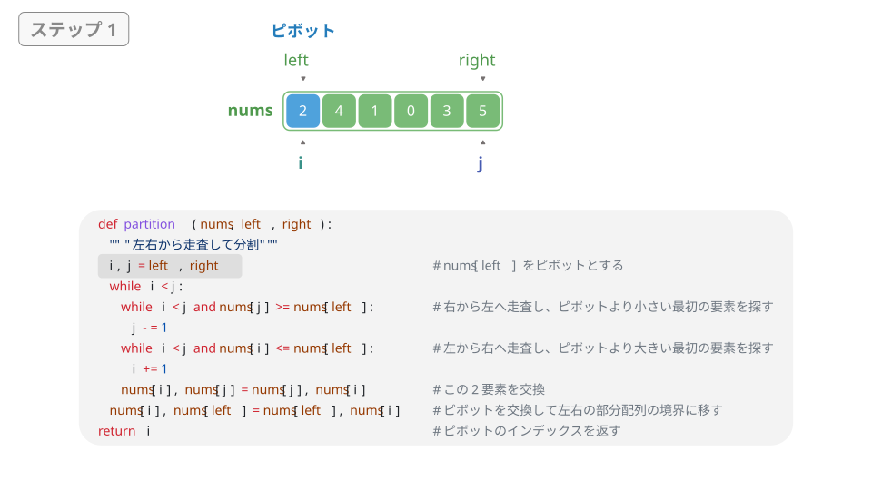
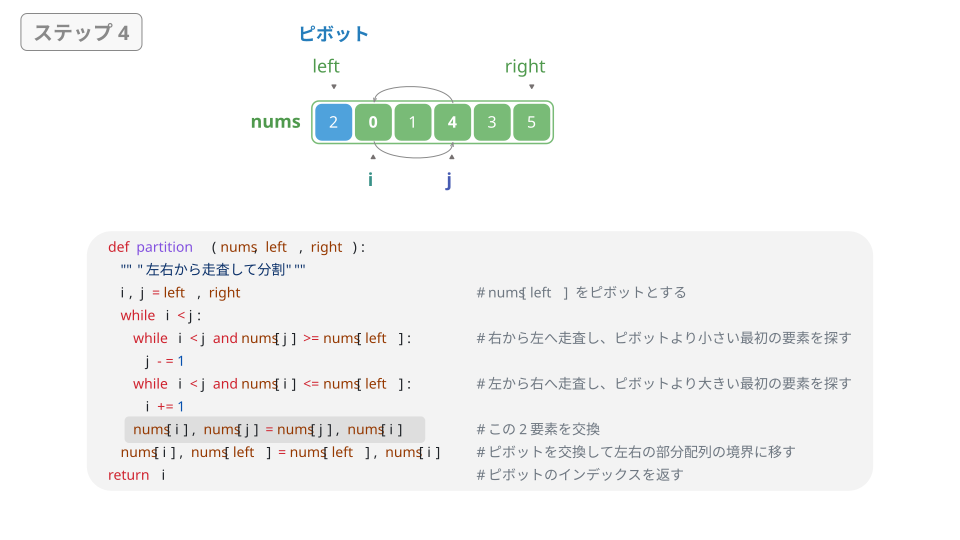
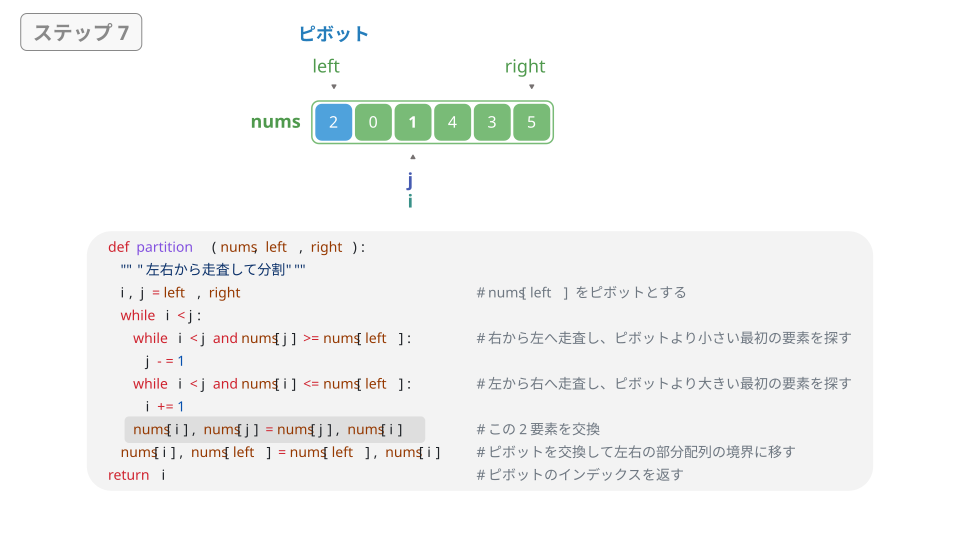
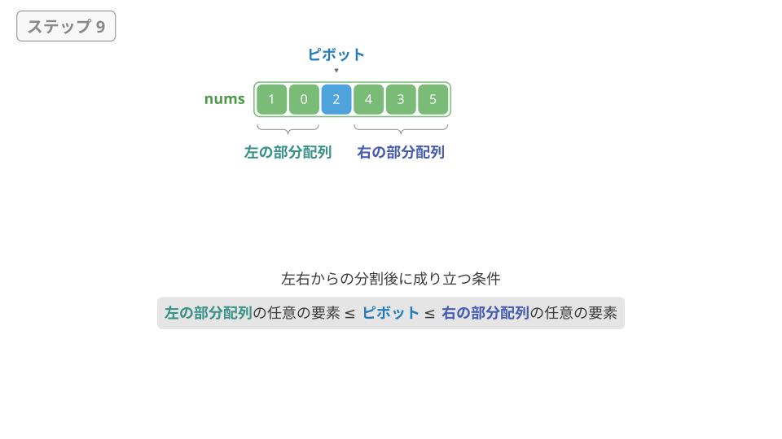

# 11.5 &nbsp; クイックソート

<u>クイックソート（quick sort）</u>は、分割統治に基づく効率のよいソートアルゴリズムで、広く使われています。

クイックソートの中心となるのは「左右からの分割」です。配列から「ピボット」となる要素を選び、それより小さい要素をすべて左へ、大きい要素をすべて右へ移します。図 11-8 に手順を示します。

1. 配列の左端の要素をピボットに選び、2 本のポインタ `i` と `j` がそれぞれ配列の左端と右端を指すように初期化します。
2. ループの各回で、`i` でピボットより大きい最初の要素を、`j` でピボットより小さい最初の要素を探し、両者を交換します。
3. ステップ `2.` を繰り返し、`i` と `j` が出会ったら止めます。最後にピボットを交換して 2 つの部分配列の境界に移します。

=== "<1>"
    { class="animation-figure" }

=== "<2>"
    { class="animation-figure" }

=== "<3>"
    { class="animation-figure" }

=== "<4>"
    { class="animation-figure" }

=== "<5>"
    { class="animation-figure" }

=== "<6>"
    { class="animation-figure" }

=== "<7>"
    { class="animation-figure" }

=== "<8>"
    { class="animation-figure" }

=== "<9>"
    { class="animation-figure" }

<p align="center"> 図 11-8 &nbsp; 左右からの分割の手順 </p>

分割後の配列は左の部分配列、ピボット、右の部分配列の 3 つに分かれ、「左の任意の要素 $\leq$ ピボット $\leq$ 右の任意の要素」を満たします。あとは左右の部分配列をそれぞれソートすればよいことになります。

!!! note "クイックソートの分割統治"

    左右からの分割によって、長い配列のソート問題を、短い 2 つの配列のソート問題に分けられます。

=== "Python"

    ```python title="quick_sort.py"
    def partition(self, nums: list[int], left: int, right: int) -> int:
        """左右から走査して分割"""
        # nums[left] をピボットとする
        i, j = left, right
        while i < j:
            while i < j and nums[j] >= nums[left]:
                j -= 1  # 右から左へ走査し、ピボットより小さい最初の要素を探す
            while i < j and nums[i] <= nums[left]:
                i += 1  # 左から右へ走査し、ピボットより大きい最初の要素を探す
            # 要素を交換
            nums[i], nums[j] = nums[j], nums[i]
        # ピボットを交換して左右の部分配列の境界に移す
        nums[i], nums[left] = nums[left], nums[i]
        return i  # ピボットのインデックスを返す
    ```

=== "C++"

    ```cpp title="quick_sort.cpp"
    /* 左右から走査して分割 */
    int partition(vector<int> &nums, int left, int right) {
        // nums[left] をピボットとする
        int i = left, j = right;
        while (i < j) {
            while (i < j && nums[j] >= nums[left])
                j--;                // 右から左へ走査し、ピボットより小さい最初の要素を探す
            while (i < j && nums[i] <= nums[left])
                i++;                // 左から右へ走査し、ピボットより大きい最初の要素を探す
            swap(nums[i], nums[j]); // この 2 要素を交換
        }
        swap(nums[i], nums[left]);  // ピボットを交換して左右の部分配列の境界に移す
        return i;                   // ピボットのインデックスを返す
    }
    ```

=== "Java"

    ```java title="quick_sort.java"
    /* 要素を交換 */
    void swap(int[] nums, int i, int j) {
        int tmp = nums[i];
        nums[i] = nums[j];
        nums[j] = tmp;
    }

    /* 左右から走査して分割 */
    int partition(int[] nums, int left, int right) {
        // nums[left] をピボットとする
        int i = left, j = right;
        while (i < j) {
            while (i < j && nums[j] >= nums[left])
                j--;          // 右から左へ走査し、ピボットより小さい最初の要素を探す
            while (i < j && nums[i] <= nums[left])
                i++;          // 左から右へ走査し、ピボットより大きい最初の要素を探す
            swap(nums, i, j); // この 2 要素を交換
        }
        swap(nums, i, left);  // ピボットを交換して左右の部分配列の境界に移す
        return i;             // ピボットのインデックスを返す
    }
    ```

=== "C#"

    ```csharp title="quick_sort.cs"
    /* 要素を交換 */
    void Swap(int[] nums, int i, int j) {
        (nums[j], nums[i]) = (nums[i], nums[j]);
    }

    /* 左右から走査して分割 */
    int Partition(int[] nums, int left, int right) {
        // nums[left] をピボットとする
        int i = left, j = right;
        while (i < j) {
            while (i < j && nums[j] >= nums[left])
                j--;          // 右から左へ走査し、ピボットより小さい最初の要素を探す
            while (i < j && nums[i] <= nums[left])
                i++;          // 左から右へ走査し、ピボットより大きい最初の要素を探す
            Swap(nums, i, j); // この 2 要素を交換
        }
        Swap(nums, i, left);  // ピボットを交換して左右の部分配列の境界に移す
        return i;             // ピボットのインデックスを返す
    }
    ```

=== "Go"

    ```go title="quick_sort.go"
    /* 左右から走査して分割 */
    func (q *quickSort) partition(nums []int, left, right int) int {
        // nums[left] をピボットとする
        i, j := left, right
        for i < j {
            for i < j && nums[j] >= nums[left] {
                j-- // 右から左へ走査し、ピボットより小さい最初の要素を探す
            }
            for i < j && nums[i] <= nums[left] {
                i++ // 左から右へ走査し、ピボットより大きい最初の要素を探す
            }
            // 要素を交換
            nums[i], nums[j] = nums[j], nums[i]
        }
        // ピボットを交換して左右の部分配列の境界に移す
        nums[i], nums[left] = nums[left], nums[i]
        return i // ピボットのインデックスを返す
    }
    ```

=== "Swift"

    ```swift title="quick_sort.swift"
    /* 左右から走査して分割 */
    func partition(nums: inout [Int], left: Int, right: Int) -> Int {
        // nums[left] をピボットとする
        var i = left
        var j = right
        while i < j {
            while i < j, nums[j] >= nums[left] {
                j -= 1 // 右から左へ走査し、ピボットより小さい最初の要素を探す
            }
            while i < j, nums[i] <= nums[left] {
                i += 1 // 左から右へ走査し、ピボットより大きい最初の要素を探す
            }
            nums.swapAt(i, j) // この 2 要素を交換
        }
        nums.swapAt(i, left) // ピボットを交換して左右の部分配列の境界に移す
        return i // ピボットのインデックスを返す
    }
    ```

=== "JS"

    ```javascript title="quick_sort.js"
    /* 要素を交換 */
    swap(nums, i, j) {
        let tmp = nums[i];
        nums[i] = nums[j];
        nums[j] = tmp;
    }

    /* 左右から走査して分割 */
    partition(nums, left, right) {
        // nums[left] をピボットとする
        let i = left,
            j = right;
        while (i < j) {
            while (i < j && nums[j] >= nums[left]) {
                j -= 1; // 右から左へ走査し、ピボットより小さい最初の要素を探す
            }
            while (i < j && nums[i] <= nums[left]) {
                i += 1; // 左から右へ走査し、ピボットより大きい最初の要素を探す
            }
            // 要素を交換
            this.swap(nums, i, j); // この 2 要素を交換
        }
        this.swap(nums, i, left); // ピボットを交換して左右の部分配列の境界に移す
        return i; // ピボットのインデックスを返す
    }
    ```

=== "TS"

    ```typescript title="quick_sort.ts"
    /* 要素を交換 */
    swap(nums: number[], i: number, j: number): void {
        let tmp = nums[i];
        nums[i] = nums[j];
        nums[j] = tmp;
    }

    /* 左右から走査して分割 */
    partition(nums: number[], left: number, right: number): number {
        // nums[left] をピボットとする
        let i = left,
            j = right;
        while (i < j) {
            while (i < j && nums[j] >= nums[left]) {
                j -= 1; // 右から左へ走査し、ピボットより小さい最初の要素を探す
            }
            while (i < j && nums[i] <= nums[left]) {
                i += 1; // 左から右へ走査し、ピボットより大きい最初の要素を探す
            }
            // 要素を交換
            this.swap(nums, i, j); // この 2 要素を交換
        }
        this.swap(nums, i, left); // ピボットを交換して左右の部分配列の境界に移す
        return i; // ピボットのインデックスを返す
    }
    ```

=== "Dart"

    ```dart title="quick_sort.dart"
    /* 要素を交換 */
    void _swap(List<int> nums, int i, int j) {
      int tmp = nums[i];
      nums[i] = nums[j];
      nums[j] = tmp;
    }

    /* 左右から走査して分割 */
    int _partition(List<int> nums, int left, int right) {
      // nums[left] をピボットとする
      int i = left, j = right;
      while (i < j) {
        while (i < j && nums[j] >= nums[left]) j--; // 右から左へ走査し、ピボットより小さい最初の要素を探す
        while (i < j && nums[i] <= nums[left]) i++; // 左から右へ走査し、ピボットより大きい最初の要素を探す
        _swap(nums, i, j); // この 2 要素を交換
      }
      _swap(nums, i, left); // ピボットを交換して左右の部分配列の境界に移す
      return i; // ピボットのインデックスを返す
    }
    ```

=== "Rust"

    ```rust title="quick_sort.rs"
    /* 左右から走査して分割 */
    fn partition(nums: &mut [i32], left: usize, right: usize) -> usize {
        // nums[left] をピボットとする
        let (mut i, mut j) = (left, right);
        while i < j {
            while i < j && nums[j] >= nums[left] {
                j -= 1; // 右から左へ走査し、ピボットより小さい最初の要素を探す
            }
            while i < j && nums[i] <= nums[left] {
                i += 1; // 左から右へ走査し、ピボットより大きい最初の要素を探す
            }
            nums.swap(i, j); // この 2 要素を交換
        }
        nums.swap(i, left); // ピボットを交換して左右の部分配列の境界に移す
        i // ピボットのインデックスを返す
    }
    ```

=== "C"

    ```c title="quick_sort.c"
    /* 要素を交換 */
    void swap(int nums[], int i, int j) {
        int tmp = nums[i];
        nums[i] = nums[j];
        nums[j] = tmp;
    }

    /* 左右から走査して分割 */
    int partition(int nums[], int left, int right) {
        // nums[left] をピボットとする
        int i = left, j = right;
        while (i < j) {
            while (i < j && nums[j] >= nums[left]) {
                j--; // 右から左へ走査し、ピボットより小さい最初の要素を探す
            }
            while (i < j && nums[i] <= nums[left]) {
                i++; // 左から右へ走査し、ピボットより大きい最初の要素を探す
            }
            // この 2 要素を交換
            swap(nums, i, j);
        }
        // ピボットを交換して左右の部分配列の境界に移す
        swap(nums, i, left);
        // ピボットのインデックスを返す
        return i;
    }
    ```

=== "Kotlin"

    ```kotlin title="quick_sort.kt"
    /* 要素を交換 */
    fun swap(nums: IntArray, i: Int, j: Int) {
        val temp = nums[i]
        nums[i] = nums[j]
        nums[j] = temp
    }

    /* 左右から走査して分割 */
    fun partition(nums: IntArray, left: Int, right: Int): Int {
        // nums[left] をピボットとする
        var i = left
        var j = right
        while (i < j) {
            while (i < j && nums[j] >= nums[left])
                j--           // 右から左へ走査し、ピボットより小さい最初の要素を探す
            while (i < j && nums[i] <= nums[left])
                i++           // 左から右へ走査し、ピボットより大きい最初の要素を探す
            swap(nums, i, j)  // この 2 要素を交換
        }
        swap(nums, i, left)   // ピボットを交換して左右の部分配列の境界に移す
        return i              // ピボットのインデックスを返す
    }
    ```

=== "Ruby"

    ```ruby title="quick_sort.rb"
    ### 左右から走査して分割 ###
    def partition(nums, left, right)
      # nums[left] をピボットとする
      i, j = left, right
      while i < j
        while i < j && nums[j] >= nums[left]
          j -= 1 # 右から左へ走査し、ピボットより小さい最初の要素を探す
        end
        while i < j && nums[i] <= nums[left]
          i += 1 # 左から右へ走査し、ピボットより大きい最初の要素を探す
        end
        # 要素を交換
        nums[i], nums[j] = nums[j], nums[i]
      end
      # ピボットを交換して左右の部分配列の境界に移す
      nums[i], nums[left] = nums[left], nums[i]
      i # ピボットのインデックスを返す
    end
    ```

??? pythontutor "実行の様子を見る"

    <div style="height: 549px; width: 100%;"><iframe class="pythontutor-iframe" title="実行の様子を見る" src="https://pythontutor.com/iframe-embed.html#code=def%20partition%28nums%3A%20list%5Bint%5D,%20left%3A%20int,%20right%3A%20int%29%20-%3E%20int%3A%0A%20%20%20%20%22%22%22%E5%B7%A6%E5%8F%B3%E3%81%8B%E3%82%89%E8%B5%B0%E6%9F%BB%E3%81%97%E3%81%A6%E5%88%86%E5%89%B2%22%22%22%0A%20%20%20%20%23%20nums%5Bleft%5D%20%E3%82%92%E3%83%94%E3%83%9C%E3%83%83%E3%83%88%E3%81%A8%E3%81%99%E3%82%8B%0A%20%20%20%20i,%20j%20%3D%20left,%20right%0A%20%20%20%20while%20i%20%3C%20j%3A%0A%20%20%20%20%20%20%20%20while%20i%20%3C%20j%20and%20nums%5Bj%5D%20%3E%3D%20nums%5Bleft%5D%3A%0A%20%20%20%20%20%20%20%20%20%20%20%20j%20-%3D%201%20%20%23%20%E5%8F%B3%E3%81%8B%E3%82%89%E5%B7%A6%E3%81%B8%E8%B5%B0%E6%9F%BB%E3%81%97%E3%80%81%E3%83%94%E3%83%9C%E3%83%83%E3%83%88%E3%82%88%E3%82%8A%E5%B0%8F%E3%81%95%E3%81%84%E6%9C%80%E5%88%9D%E3%81%AE%E8%A6%81%E7%B4%A0%E3%82%92%E6%8E%A2%E3%81%99%0A%20%20%20%20%20%20%20%20while%20i%20%3C%20j%20and%20nums%5Bi%5D%20%3C%3D%20nums%5Bleft%5D%3A%0A%20%20%20%20%20%20%20%20%20%20%20%20i%20%2B%3D%201%20%20%23%20%E5%B7%A6%E3%81%8B%E3%82%89%E5%8F%B3%E3%81%B8%E8%B5%B0%E6%9F%BB%E3%81%97%E3%80%81%E3%83%94%E3%83%9C%E3%83%83%E3%83%88%E3%82%88%E3%82%8A%E5%A4%A7%E3%81%8D%E3%81%84%E6%9C%80%E5%88%9D%E3%81%AE%E8%A6%81%E7%B4%A0%E3%82%92%E6%8E%A2%E3%81%99%0A%20%20%20%20%20%20%20%20%23%20%E8%A6%81%E7%B4%A0%E3%82%92%E4%BA%A4%E6%8F%9B%0A%20%20%20%20%20%20%20%20nums%5Bi%5D,%20nums%5Bj%5D%20%3D%20nums%5Bj%5D,%20nums%5Bi%5D%0A%20%20%20%20%23%20%E3%83%94%E3%83%9C%E3%83%83%E3%83%88%E3%82%92%E4%BA%A4%E6%8F%9B%E3%81%97%E3%81%A6%E5%B7%A6%E5%8F%B3%E3%81%AE%E9%83%A8%E5%88%86%E9%85%8D%E5%88%97%E3%81%AE%E5%A2%83%E7%95%8C%E3%81%AB%E7%A7%BB%E3%81%99%0A%20%20%20%20nums%5Bi%5D,%20nums%5Bleft%5D%20%3D%20nums%5Bleft%5D,%20nums%5Bi%5D%0A%20%20%20%20return%20i%20%20%23%20%E3%83%94%E3%83%9C%E3%83%83%E3%83%88%E3%81%AE%E3%82%A4%E3%83%B3%E3%83%87%E3%83%83%E3%82%AF%E3%82%B9%E3%82%92%E8%BF%94%E3%81%99%0A%0A%0A%22%22%22Driver%20Code%22%22%22%0Aif%20__name__%20%3D%3D%20%22__main__%22%3A%0A%20%20%20%20nums%20%3D%20%5B2,%204,%201,%200,%203,%205%5D%0A%20%20%20%20partition%28nums,%200,%20len%28nums%29%20-%201%29%0A%20%20%20%20print%28%22%E5%88%86%E5%89%B2%E5%BE%8C%E3%81%AE%20nums%20%3D%22,%20nums%29&codeDivHeight=472&codeDivWidth=350&cumulative=false&curInstr=4&heapPrimitives=nevernest&origin=opt-frontend.js&py=311&rawInputLstJSON=%5B%5D&textReferences=false"> </iframe></div>
    <div style="margin-top: 5px;"><a href="https://pythontutor.com/iframe-embed.html#code=def%20partition%28nums%3A%20list%5Bint%5D,%20left%3A%20int,%20right%3A%20int%29%20-%3E%20int%3A%0A%20%20%20%20%22%22%22%E5%B7%A6%E5%8F%B3%E3%81%8B%E3%82%89%E8%B5%B0%E6%9F%BB%E3%81%97%E3%81%A6%E5%88%86%E5%89%B2%22%22%22%0A%20%20%20%20%23%20nums%5Bleft%5D%20%E3%82%92%E3%83%94%E3%83%9C%E3%83%83%E3%83%88%E3%81%A8%E3%81%99%E3%82%8B%0A%20%20%20%20i,%20j%20%3D%20left,%20right%0A%20%20%20%20while%20i%20%3C%20j%3A%0A%20%20%20%20%20%20%20%20while%20i%20%3C%20j%20and%20nums%5Bj%5D%20%3E%3D%20nums%5Bleft%5D%3A%0A%20%20%20%20%20%20%20%20%20%20%20%20j%20-%3D%201%20%20%23%20%E5%8F%B3%E3%81%8B%E3%82%89%E5%B7%A6%E3%81%B8%E8%B5%B0%E6%9F%BB%E3%81%97%E3%80%81%E3%83%94%E3%83%9C%E3%83%83%E3%83%88%E3%82%88%E3%82%8A%E5%B0%8F%E3%81%95%E3%81%84%E6%9C%80%E5%88%9D%E3%81%AE%E8%A6%81%E7%B4%A0%E3%82%92%E6%8E%A2%E3%81%99%0A%20%20%20%20%20%20%20%20while%20i%20%3C%20j%20and%20nums%5Bi%5D%20%3C%3D%20nums%5Bleft%5D%3A%0A%20%20%20%20%20%20%20%20%20%20%20%20i%20%2B%3D%201%20%20%23%20%E5%B7%A6%E3%81%8B%E3%82%89%E5%8F%B3%E3%81%B8%E8%B5%B0%E6%9F%BB%E3%81%97%E3%80%81%E3%83%94%E3%83%9C%E3%83%83%E3%83%88%E3%82%88%E3%82%8A%E5%A4%A7%E3%81%8D%E3%81%84%E6%9C%80%E5%88%9D%E3%81%AE%E8%A6%81%E7%B4%A0%E3%82%92%E6%8E%A2%E3%81%99%0A%20%20%20%20%20%20%20%20%23%20%E8%A6%81%E7%B4%A0%E3%82%92%E4%BA%A4%E6%8F%9B%0A%20%20%20%20%20%20%20%20nums%5Bi%5D,%20nums%5Bj%5D%20%3D%20nums%5Bj%5D,%20nums%5Bi%5D%0A%20%20%20%20%23%20%E3%83%94%E3%83%9C%E3%83%83%E3%83%88%E3%82%92%E4%BA%A4%E6%8F%9B%E3%81%97%E3%81%A6%E5%B7%A6%E5%8F%B3%E3%81%AE%E9%83%A8%E5%88%86%E9%85%8D%E5%88%97%E3%81%AE%E5%A2%83%E7%95%8C%E3%81%AB%E7%A7%BB%E3%81%99%0A%20%20%20%20nums%5Bi%5D,%20nums%5Bleft%5D%20%3D%20nums%5Bleft%5D,%20nums%5Bi%5D%0A%20%20%20%20return%20i%20%20%23%20%E3%83%94%E3%83%9C%E3%83%83%E3%83%88%E3%81%AE%E3%82%A4%E3%83%B3%E3%83%87%E3%83%83%E3%82%AF%E3%82%B9%E3%82%92%E8%BF%94%E3%81%99%0A%0A%0A%22%22%22Driver%20Code%22%22%22%0Aif%20__name__%20%3D%3D%20%22__main__%22%3A%0A%20%20%20%20nums%20%3D%20%5B2,%204,%201,%200,%203,%205%5D%0A%20%20%20%20partition%28nums,%200,%20len%28nums%29%20-%201%29%0A%20%20%20%20print%28%22%E5%88%86%E5%89%B2%E5%BE%8C%E3%81%AE%20nums%20%3D%22,%20nums%29&codeDivHeight=800&codeDivWidth=600&cumulative=false&curInstr=4&heapPrimitives=nevernest&origin=opt-frontend.js&py=311&rawInputLstJSON=%5B%5D&textReferences=false" target="_blank" rel="noopener noreferrer">全画面で表示 ></a></div>

## 11.5.1 &nbsp; アルゴリズムの手順

クイックソートの全体の流れを図 11-9 に示します。

1. まず元の配列を左右から 1 回分割し、未整列の左右の部分配列を得ます。
2. 次に左右の部分配列をそれぞれ再帰的に同じ方法で分割します。
3. 部分配列の長さが 1 になるまで再帰を繰り返すと、配列全体が整列します。

{ class="animation-figure" }

<p align="center"> 図 11-9 &nbsp; クイックソートの流れ </p>

=== "Python"

    ```python title="quick_sort.py"
    def quick_sort(self, nums: list[int], left: int, right: int):
        """クイックソート"""
        # 部分配列の長さが 1 になったら再帰を終了
        if left >= right:
            return
        # 左右から走査して分割
        pivot = self.partition(nums, left, right)
        # 左右の部分配列を再帰的に処理
        self.quick_sort(nums, left, pivot - 1)
        self.quick_sort(nums, pivot + 1, right)
    ```

=== "C++"

    ```cpp title="quick_sort.cpp"
    /* クイックソート */
    void quickSort(vector<int> &nums, int left, int right) {
        // 部分配列の長さが 1 になったら再帰を終了
        if (left >= right)
            return;
        // 左右から走査して分割
        int pivot = partition(nums, left, right);
        // 左右の部分配列を再帰的に処理
        quickSort(nums, left, pivot - 1);
        quickSort(nums, pivot + 1, right);
    }
    ```

=== "Java"

    ```java title="quick_sort.java"
    /* クイックソート */
    void quickSort(int[] nums, int left, int right) {
        // 部分配列の長さが 1 になったら再帰を終了
        if (left >= right)
            return;
        // 左右から走査して分割
        int pivot = partition(nums, left, right);
        // 左右の部分配列を再帰的に処理
        quickSort(nums, left, pivot - 1);
        quickSort(nums, pivot + 1, right);
    }
    ```

=== "C#"

    ```csharp title="quick_sort.cs"
    /* クイックソート */
    void QuickSort(int[] nums, int left, int right) {
        // 部分配列の長さが 1 になったら再帰を終了
        if (left >= right)
            return;
        // 左右から走査して分割
        int pivot = Partition(nums, left, right);
        // 左右の部分配列を再帰的に処理
        QuickSort(nums, left, pivot - 1);
        QuickSort(nums, pivot + 1, right);
    }
    ```

=== "Go"

    ```go title="quick_sort.go"
    /* クイックソート */
    func (q *quickSort) quickSort(nums []int, left, right int) {
        // 部分配列の長さが 1 になったら再帰を終了
        if left >= right {
            return
        }
        // 左右から走査して分割
        pivot := q.partition(nums, left, right)
        // 左右の部分配列を再帰的に処理
        q.quickSort(nums, left, pivot-1)
        q.quickSort(nums, pivot+1, right)
    }
    ```

=== "Swift"

    ```swift title="quick_sort.swift"
    /* クイックソート */
    func quickSort(nums: inout [Int], left: Int, right: Int) {
        // 部分配列の長さが 1 になったら再帰を終了
        if left >= right {
            return
        }
        // 左右から走査して分割
        let pivot = partition(nums: &nums, left: left, right: right)
        // 左右の部分配列を再帰的に処理
        quickSort(nums: &nums, left: left, right: pivot - 1)
        quickSort(nums: &nums, left: pivot + 1, right: right)
    }
    ```

=== "JS"

    ```javascript title="quick_sort.js"
    /* クイックソート */
    quickSort(nums, left, right) {
        // 部分配列の長さが 1 になったら再帰を終了
        if (left >= right) return;
        // 左右から走査して分割
        const pivot = this.partition(nums, left, right);
        // 左右の部分配列を再帰的に処理
        this.quickSort(nums, left, pivot - 1);
        this.quickSort(nums, pivot + 1, right);
    }
    ```

=== "TS"

    ```typescript title="quick_sort.ts"
    /* クイックソート */
    quickSort(nums: number[], left: number, right: number): void {
        // 部分配列の長さが 1 になったら再帰を終了
        if (left >= right) {
            return;
        }
        // 左右から走査して分割
        const pivot = this.partition(nums, left, right);
        // 左右の部分配列を再帰的に処理
        this.quickSort(nums, left, pivot - 1);
        this.quickSort(nums, pivot + 1, right);
    }
    ```

=== "Dart"

    ```dart title="quick_sort.dart"
    /* クイックソート */
    void quickSort(List<int> nums, int left, int right) {
      // 部分配列の長さが 1 になったら再帰を終了
      if (left >= right) return;
      // 左右から走査して分割
      int pivot = _partition(nums, left, right);
      // 左右の部分配列を再帰的に処理
      quickSort(nums, left, pivot - 1);
      quickSort(nums, pivot + 1, right);
    }
    ```

=== "Rust"

    ```rust title="quick_sort.rs"
    /* クイックソート */
    pub fn quick_sort(left: i32, right: i32, nums: &mut [i32]) {
        // 部分配列の長さが 1 になったら再帰を終了
        if left >= right {
            return;
        }
        // 左右から走査して分割
        let pivot = Self::partition(nums, left as usize, right as usize) as i32;
        // 左右の部分配列を再帰的に処理
        Self::quick_sort(left, pivot - 1, nums);
        Self::quick_sort(pivot + 1, right, nums);
    }
    ```

=== "C"

    ```c title="quick_sort.c"
    /* クイックソート */
    void quickSort(int nums[], int left, int right) {
        // 部分配列の長さが 1 になったら再帰を終了
        if (left >= right) {
            return;
        }
        // 左右から走査して分割
        int pivot = partition(nums, left, right);
        // 左右の部分配列を再帰的に処理
        quickSort(nums, left, pivot - 1);
        quickSort(nums, pivot + 1, right);
    }
    ```

=== "Kotlin"

    ```kotlin title="quick_sort.kt"
    /* クイックソート */
    fun quickSort(nums: IntArray, left: Int, right: Int) {
        // 部分配列の長さが 1 になったら再帰を終了
        if (left >= right) return
        // 左右から走査して分割
        val pivot = partition(nums, left, right)
        // 左右の部分配列を再帰的に処理
        quickSort(nums, left, pivot - 1)
        quickSort(nums, pivot + 1, right)
    }
    ```

=== "Ruby"

    ```ruby title="quick_sort.rb"
    ### クイックソートクラス ###
    def quick_sort(nums, left, right)
      # 部分配列の長さが 1 でなければ再帰する
      if left < right
        # 左右から走査して分割
        pivot = partition(nums, left, right)
        # 左右の部分配列を再帰的に処理
        quick_sort(nums, left, pivot - 1)
        quick_sort(nums, pivot + 1, right)
      end
      nums
    end
    ```

??? pythontutor "実行の様子を見る"

    <div style="height: 549px; width: 100%;"><iframe class="pythontutor-iframe" title="実行の様子を見る" src="https://pythontutor.com/iframe-embed.html#code=def%20partition%28nums%3A%20list%5Bint%5D,%20left%3A%20int,%20right%3A%20int%29%20-%3E%20int%3A%0A%20%20%20%20%22%22%22%E5%B7%A6%E5%8F%B3%E3%81%8B%E3%82%89%E8%B5%B0%E6%9F%BB%E3%81%97%E3%81%A6%E5%88%86%E5%89%B2%22%22%22%0A%20%20%20%20%23%20nums%5Bleft%5D%20%E3%82%92%E3%83%94%E3%83%9C%E3%83%83%E3%83%88%E3%81%A8%E3%81%99%E3%82%8B%0A%20%20%20%20i,%20j%20%3D%20left,%20right%0A%20%20%20%20while%20i%20%3C%20j%3A%0A%20%20%20%20%20%20%20%20while%20i%20%3C%20j%20and%20nums%5Bj%5D%20%3E%3D%20nums%5Bleft%5D%3A%0A%20%20%20%20%20%20%20%20%20%20%20%20j%20-%3D%201%20%20%23%20%E5%8F%B3%E3%81%8B%E3%82%89%E5%B7%A6%E3%81%B8%E8%B5%B0%E6%9F%BB%E3%81%97%E3%80%81%E3%83%94%E3%83%9C%E3%83%83%E3%83%88%E3%82%88%E3%82%8A%E5%B0%8F%E3%81%95%E3%81%84%E6%9C%80%E5%88%9D%E3%81%AE%E8%A6%81%E7%B4%A0%E3%82%92%E6%8E%A2%E3%81%99%0A%20%20%20%20%20%20%20%20while%20i%20%3C%20j%20and%20nums%5Bi%5D%20%3C%3D%20nums%5Bleft%5D%3A%0A%20%20%20%20%20%20%20%20%20%20%20%20i%20%2B%3D%201%20%20%23%20%E5%B7%A6%E3%81%8B%E3%82%89%E5%8F%B3%E3%81%B8%E8%B5%B0%E6%9F%BB%E3%81%97%E3%80%81%E3%83%94%E3%83%9C%E3%83%83%E3%83%88%E3%82%88%E3%82%8A%E5%A4%A7%E3%81%8D%E3%81%84%E6%9C%80%E5%88%9D%E3%81%AE%E8%A6%81%E7%B4%A0%E3%82%92%E6%8E%A2%E3%81%99%0A%20%20%20%20%20%20%20%20%23%20%E8%A6%81%E7%B4%A0%E3%82%92%E4%BA%A4%E6%8F%9B%0A%20%20%20%20%20%20%20%20nums%5Bi%5D,%20nums%5Bj%5D%20%3D%20nums%5Bj%5D,%20nums%5Bi%5D%0A%20%20%20%20%23%20%E3%83%94%E3%83%9C%E3%83%83%E3%83%88%E3%82%92%E4%BA%A4%E6%8F%9B%E3%81%97%E3%81%A6%E5%B7%A6%E5%8F%B3%E3%81%AE%E9%83%A8%E5%88%86%E9%85%8D%E5%88%97%E3%81%AE%E5%A2%83%E7%95%8C%E3%81%AB%E7%A7%BB%E3%81%99%0A%20%20%20%20nums%5Bi%5D,%20nums%5Bleft%5D%20%3D%20nums%5Bleft%5D,%20nums%5Bi%5D%0A%20%20%20%20return%20i%20%20%23%20%E3%83%94%E3%83%9C%E3%83%83%E3%83%88%E3%81%AE%E3%82%A4%E3%83%B3%E3%83%87%E3%83%83%E3%82%AF%E3%82%B9%E3%82%92%E8%BF%94%E3%81%99%0A%0Adef%20quick_sort%28nums%3A%20list%5Bint%5D,%20left%3A%20int,%20right%3A%20int%29%3A%0A%20%20%20%20%22%22%22%E3%82%AF%E3%82%A4%E3%83%83%E3%82%AF%E3%82%BD%E3%83%BC%E3%83%88%22%22%22%0A%20%20%20%20%23%20%E9%83%A8%E5%88%86%E9%85%8D%E5%88%97%E3%81%AE%E9%95%B7%E3%81%95%E3%81%8C%201%20%E3%81%AB%E3%81%AA%E3%81%A3%E3%81%9F%E3%82%89%E5%86%8D%E5%B8%B0%E3%82%92%E7%B5%82%E4%BA%86%0A%20%20%20%20if%20left%20%3E%3D%20right%3A%0A%20%20%20%20%20%20%20%20return%0A%20%20%20%20%23%20%E5%B7%A6%E5%8F%B3%E3%81%8B%E3%82%89%E8%B5%B0%E6%9F%BB%E3%81%97%E3%81%A6%E5%88%86%E5%89%B2%0A%20%20%20%20pivot%20%3D%20partition%28nums,%20left,%20right%29%0A%20%20%20%20%23%20%E5%B7%A6%E5%8F%B3%E3%81%AE%E9%83%A8%E5%88%86%E9%85%8D%E5%88%97%E3%82%92%E5%86%8D%E5%B8%B0%E7%9A%84%E3%81%AB%E5%87%A6%E7%90%86%0A%20%20%20%20quick_sort%28nums,%20left,%20pivot%20-%201%29%0A%20%20%20%20quick_sort%28nums,%20pivot%20%2B%201,%20right%29%0A%0A%0A%22%22%22Driver%20Code%22%22%22%0Aif%20__name__%20%3D%3D%20%22__main__%22%3A%0A%20%20%20%20%23%20%E3%82%AF%E3%82%A4%E3%83%83%E3%82%AF%E3%82%BD%E3%83%BC%E3%83%88%0A%20%20%20%20nums%20%3D%20%5B2,%204,%201,%200,%203,%205%5D%0A%20%20%20%20quick_sort%28nums,%200,%20len%28nums%29%20-%201%29%0A%20%20%20%20print%28%22%E3%82%AF%E3%82%A4%E3%83%83%E3%82%AF%E3%82%BD%E3%83%BC%E3%83%88%E5%BE%8C%E3%81%AE%20nums%20%3D%22,%20nums%29&codeDivHeight=472&codeDivWidth=350&cumulative=false&curInstr=5&heapPrimitives=nevernest&origin=opt-frontend.js&py=311&rawInputLstJSON=%5B%5D&textReferences=false"> </iframe></div>
    <div style="margin-top: 5px;"><a href="https://pythontutor.com/iframe-embed.html#code=def%20partition%28nums%3A%20list%5Bint%5D,%20left%3A%20int,%20right%3A%20int%29%20-%3E%20int%3A%0A%20%20%20%20%22%22%22%E5%B7%A6%E5%8F%B3%E3%81%8B%E3%82%89%E8%B5%B0%E6%9F%BB%E3%81%97%E3%81%A6%E5%88%86%E5%89%B2%22%22%22%0A%20%20%20%20%23%20nums%5Bleft%5D%20%E3%82%92%E3%83%94%E3%83%9C%E3%83%83%E3%83%88%E3%81%A8%E3%81%99%E3%82%8B%0A%20%20%20%20i,%20j%20%3D%20left,%20right%0A%20%20%20%20while%20i%20%3C%20j%3A%0A%20%20%20%20%20%20%20%20while%20i%20%3C%20j%20and%20nums%5Bj%5D%20%3E%3D%20nums%5Bleft%5D%3A%0A%20%20%20%20%20%20%20%20%20%20%20%20j%20-%3D%201%20%20%23%20%E5%8F%B3%E3%81%8B%E3%82%89%E5%B7%A6%E3%81%B8%E8%B5%B0%E6%9F%BB%E3%81%97%E3%80%81%E3%83%94%E3%83%9C%E3%83%83%E3%83%88%E3%82%88%E3%82%8A%E5%B0%8F%E3%81%95%E3%81%84%E6%9C%80%E5%88%9D%E3%81%AE%E8%A6%81%E7%B4%A0%E3%82%92%E6%8E%A2%E3%81%99%0A%20%20%20%20%20%20%20%20while%20i%20%3C%20j%20and%20nums%5Bi%5D%20%3C%3D%20nums%5Bleft%5D%3A%0A%20%20%20%20%20%20%20%20%20%20%20%20i%20%2B%3D%201%20%20%23%20%E5%B7%A6%E3%81%8B%E3%82%89%E5%8F%B3%E3%81%B8%E8%B5%B0%E6%9F%BB%E3%81%97%E3%80%81%E3%83%94%E3%83%9C%E3%83%83%E3%83%88%E3%82%88%E3%82%8A%E5%A4%A7%E3%81%8D%E3%81%84%E6%9C%80%E5%88%9D%E3%81%AE%E8%A6%81%E7%B4%A0%E3%82%92%E6%8E%A2%E3%81%99%0A%20%20%20%20%20%20%20%20%23%20%E8%A6%81%E7%B4%A0%E3%82%92%E4%BA%A4%E6%8F%9B%0A%20%20%20%20%20%20%20%20nums%5Bi%5D,%20nums%5Bj%5D%20%3D%20nums%5Bj%5D,%20nums%5Bi%5D%0A%20%20%20%20%23%20%E3%83%94%E3%83%9C%E3%83%83%E3%83%88%E3%82%92%E4%BA%A4%E6%8F%9B%E3%81%97%E3%81%A6%E5%B7%A6%E5%8F%B3%E3%81%AE%E9%83%A8%E5%88%86%E9%85%8D%E5%88%97%E3%81%AE%E5%A2%83%E7%95%8C%E3%81%AB%E7%A7%BB%E3%81%99%0A%20%20%20%20nums%5Bi%5D,%20nums%5Bleft%5D%20%3D%20nums%5Bleft%5D,%20nums%5Bi%5D%0A%20%20%20%20return%20i%20%20%23%20%E3%83%94%E3%83%9C%E3%83%83%E3%83%88%E3%81%AE%E3%82%A4%E3%83%B3%E3%83%87%E3%83%83%E3%82%AF%E3%82%B9%E3%82%92%E8%BF%94%E3%81%99%0A%0Adef%20quick_sort%28nums%3A%20list%5Bint%5D,%20left%3A%20int,%20right%3A%20int%29%3A%0A%20%20%20%20%22%22%22%E3%82%AF%E3%82%A4%E3%83%83%E3%82%AF%E3%82%BD%E3%83%BC%E3%83%88%22%22%22%0A%20%20%20%20%23%20%E9%83%A8%E5%88%86%E9%85%8D%E5%88%97%E3%81%AE%E9%95%B7%E3%81%95%E3%81%8C%201%20%E3%81%AB%E3%81%AA%E3%81%A3%E3%81%9F%E3%82%89%E5%86%8D%E5%B8%B0%E3%82%92%E7%B5%82%E4%BA%86%0A%20%20%20%20if%20left%20%3E%3D%20right%3A%0A%20%20%20%20%20%20%20%20return%0A%20%20%20%20%23%20%E5%B7%A6%E5%8F%B3%E3%81%8B%E3%82%89%E8%B5%B0%E6%9F%BB%E3%81%97%E3%81%A6%E5%88%86%E5%89%B2%0A%20%20%20%20pivot%20%3D%20partition%28nums,%20left,%20right%29%0A%20%20%20%20%23%20%E5%B7%A6%E5%8F%B3%E3%81%AE%E9%83%A8%E5%88%86%E9%85%8D%E5%88%97%E3%82%92%E5%86%8D%E5%B8%B0%E7%9A%84%E3%81%AB%E5%87%A6%E7%90%86%0A%20%20%20%20quick_sort%28nums,%20left,%20pivot%20-%201%29%0A%20%20%20%20quick_sort%28nums,%20pivot%20%2B%201,%20right%29%0A%0A%0A%22%22%22Driver%20Code%22%22%22%0Aif%20__name__%20%3D%3D%20%22__main__%22%3A%0A%20%20%20%20%23%20%E3%82%AF%E3%82%A4%E3%83%83%E3%82%AF%E3%82%BD%E3%83%BC%E3%83%88%0A%20%20%20%20nums%20%3D%20%5B2,%204,%201,%200,%203,%205%5D%0A%20%20%20%20quick_sort%28nums,%200,%20len%28nums%29%20-%201%29%0A%20%20%20%20print%28%22%E3%82%AF%E3%82%A4%E3%83%83%E3%82%AF%E3%82%BD%E3%83%BC%E3%83%88%E5%BE%8C%E3%81%AE%20nums%20%3D%22,%20nums%29&codeDivHeight=800&codeDivWidth=600&cumulative=false&curInstr=5&heapPrimitives=nevernest&origin=opt-frontend.js&py=311&rawInputLstJSON=%5B%5D&textReferences=false" target="_blank" rel="noopener noreferrer">全画面で表示 ></a></div>

## 11.5.2 &nbsp; アルゴリズムの特性

- **時間計算量は $O(n \log n)$、非適応的なソート**。平均すると分割の再帰の段数は $\log n$、各段のループ回数の合計は $n$ で、全体で $O(n \log n)$ の時間がかかります。最悪の場合は各回で長さ $n$ の配列が長さ $0$ と $n - 1$ の部分配列に分かれます。このとき再帰の段数は $n$、各段のループ回数は $n$ で、全体で $O(n^2)$ の時間がかかります。
- **空間計算量は $O(n)$、インプレースソート**。入力が完全な逆順のとき、再帰の深さは最悪の $n$ に達し、スタックフレームに $O(n)$ の領域を使います。並べ替えは元の配列上で行い、追加の配列は使いません。
- **不安定なソート**。分割の最後の交換で、ピボットがそれと等しい要素の右側に移ることがあります。

## 11.5.3 &nbsp; クイックソートが速い理由

その名のとおり、クイックソートには速度の面で利点があります。平均時間計算量はマージソートやヒープソートと同じですが、通常はクイックソートのほうが速くなります。主な理由は次のとおりです。

- **最悪の場合が起こる確率が非常に低い**。最悪時間計算量は $O(n^2)$ で、実行時間はマージソートほど一定していませんが、ほとんどの場合は時間計算量 $O(n \log n)$ で動作します。
- **キャッシュを効率よく使える**。左右から分割する際にシステムが部分配列全体をキャッシュに読み込めるため、要素へのアクセスが効率的です。ヒープソートのように離れた位置を飛び飛びに参照するアルゴリズムには、この特性がありません。
- **計算量の定数係数が小さい**。この 3 種類の中ではクイックソートが比較、代入、交換などの操作の合計数が最も少なくなります。挿入ソートがバブルソートより速い理由と似ています。

## 11.5.4 &nbsp; ピボット選択の最適化

**クイックソートは入力によって遅くなることがあります**。極端な例として、入力配列が完全に逆順だとします。左端の要素をピボットに選ぶと、分割後にピボットが右端へ移り、左の部分配列の長さが $n - 1$、右の長さが $0$ になります。このまま再帰すると毎回片方の長さが $0$ になり、分割統治の効果が失われ、クイックソートはバブルソートに近い処理に退化します。

こうした場合をできるだけ避けるには、**分割時のピボットの選び方を工夫します**。たとえば無作為に 1 要素を選べます。ただし、運悪く毎回偏ったピボットを選べば、やはり効率は上がりません。

プログラミング言語が通常生成するのは「疑似乱数」です。その数列に合わせて特定のテストケースを作れば、クイックソートの効率が低下することがあります。

さらに改善するには、配列から 3 要素（通常は先頭、末尾、中央）を候補に選び、**その中央値をピボットにします**。こうすると、ピボットが小さすぎず大きすぎない確率が大幅に高まります。候補を増やせば、入力の偏りにもさらに強くなります。この方法で時間計算量が $O(n^2)$ に悪化する確率を大幅に下げられます。

実装例を示します。

=== "Python"

    ```python title="quick_sort.py"
    def median_three(self, nums: list[int], left: int, mid: int, right: int) -> int:
        """3 つの候補の中央値を選ぶ"""
        l, m, r = nums[left], nums[mid], nums[right]
        if (l <= m <= r) or (r <= m <= l):
            return mid  # m の値は l と r の値の間にある
        if (m <= l <= r) or (r <= l <= m):
            return left  # l の値は m と r の値の間にある
        return right

    def partition(self, nums: list[int], left: int, right: int) -> int:
        """左右から走査して分割（3 要素の中央値を使用）"""
        # nums[left] をピボットとする
        med = self.median_three(nums, left, (left + right) // 2, right)
        # 中央値の要素を配列の左端に移す
        nums[left], nums[med] = nums[med], nums[left]
        # nums[left] をピボットとする
        i, j = left, right
        while i < j:
            while i < j and nums[j] >= nums[left]:
                j -= 1  # 右から左へ走査し、ピボットより小さい最初の要素を探す
            while i < j and nums[i] <= nums[left]:
                i += 1  # 左から右へ走査し、ピボットより大きい最初の要素を探す
            # 要素を交換
            nums[i], nums[j] = nums[j], nums[i]
        # ピボットを交換して左右の部分配列の境界に移す
        nums[i], nums[left] = nums[left], nums[i]
        return i  # ピボットのインデックスを返す
    ```

=== "C++"

    ```cpp title="quick_sort.cpp"
    /* 3 つの候補の中央値を選ぶ */
    int medianThree(vector<int> &nums, int left, int mid, int right) {
        int l = nums[left], m = nums[mid], r = nums[right];
        if ((l <= m && m <= r) || (r <= m && m <= l))
            return mid; // m の値は l と r の値の間にある
        if ((m <= l && l <= r) || (r <= l && l <= m))
            return left; // l の値は m と r の値の間にある
        return right;
    }

    /* 左右から走査して分割（3 要素の中央値を使用） */
    int partition(vector<int> &nums, int left, int right) {
        // 3 つの候補の中央値を選ぶ
        int med = medianThree(nums, left, (left + right) / 2, right);
        // 中央値の要素を配列の左端に移す
        swap(nums[left], nums[med]);
        // nums[left] をピボットとする
        int i = left, j = right;
        while (i < j) {
            while (i < j && nums[j] >= nums[left])
                j--;                // 右から左へ走査し、ピボットより小さい最初の要素を探す
            while (i < j && nums[i] <= nums[left])
                i++;                // 左から右へ走査し、ピボットより大きい最初の要素を探す
            swap(nums[i], nums[j]); // この 2 要素を交換
        }
        swap(nums[i], nums[left]);  // ピボットを交換して左右の部分配列の境界に移す
        return i;                   // ピボットのインデックスを返す
    }
    ```

=== "Java"

    ```java title="quick_sort.java"
    /* 3 つの候補の中央値を選ぶ */
    int medianThree(int[] nums, int left, int mid, int right) {
        int l = nums[left], m = nums[mid], r = nums[right];
        if ((l <= m && m <= r) || (r <= m && m <= l))
            return mid; // m の値は l と r の値の間にある
        if ((m <= l && l <= r) || (r <= l && l <= m))
            return left; // l の値は m と r の値の間にある
        return right;
    }

    /* 左右から走査して分割（3 要素の中央値を使用） */
    int partition(int[] nums, int left, int right) {
        // 3 つの候補の中央値を選ぶ
        int med = medianThree(nums, left, (left + right) / 2, right);
        // 中央値の要素を配列の左端に移す
        swap(nums, left, med);
        // nums[left] をピボットとする
        int i = left, j = right;
        while (i < j) {
            while (i < j && nums[j] >= nums[left])
                j--;          // 右から左へ走査し、ピボットより小さい最初の要素を探す
            while (i < j && nums[i] <= nums[left])
                i++;          // 左から右へ走査し、ピボットより大きい最初の要素を探す
            swap(nums, i, j); // この 2 要素を交換
        }
        swap(nums, i, left);  // ピボットを交換して左右の部分配列の境界に移す
        return i;             // ピボットのインデックスを返す
    }
    ```

=== "C#"

    ```csharp title="quick_sort.cs"
    /* 3 つの候補の中央値を選ぶ */
    int MedianThree(int[] nums, int left, int mid, int right) {
        int l = nums[left], m = nums[mid], r = nums[right];
        if ((l <= m && m <= r) || (r <= m && m <= l))
            return mid; // m の値は l と r の値の間にある
        if ((m <= l && l <= r) || (r <= l && l <= m))
            return left; // l の値は m と r の値の間にある
        return right;
    }

    /* 左右から走査して分割（3 要素の中央値を使用） */
    int Partition(int[] nums, int left, int right) {
        // 3 つの候補の中央値を選ぶ
        int med = MedianThree(nums, left, (left + right) / 2, right);
        // 中央値の要素を配列の左端に移す
        Swap(nums, left, med);
        // nums[left] をピボットとする
        int i = left, j = right;
        while (i < j) {
            while (i < j && nums[j] >= nums[left])
                j--;          // 右から左へ走査し、ピボットより小さい最初の要素を探す
            while (i < j && nums[i] <= nums[left])
                i++;          // 左から右へ走査し、ピボットより大きい最初の要素を探す
            Swap(nums, i, j); // この 2 要素を交換
        }
        Swap(nums, i, left);  // ピボットを交換して左右の部分配列の境界に移す
        return i;             // ピボットのインデックスを返す
    }
    ```

=== "Go"

    ```go title="quick_sort.go"
    /* 3 つの候補の中央値を選ぶ */
    func (q *quickSortMedian) medianThree(nums []int, left, mid, right int) int {
        l, m, r := nums[left], nums[mid], nums[right]
        if (l <= m && m <= r) || (r <= m && m <= l) {
            return mid // m の値は l と r の値の間にある
        }
        if (m <= l && l <= r) || (r <= l && l <= m) {
            return left // l の値は m と r の値の間にある
        }
        return right
    }

    /* 左右から走査して分割（3 要素の中央値を使用）*/
    func (q *quickSortMedian) partition(nums []int, left, right int) int {
        // nums[left] をピボットとする
        med := q.medianThree(nums, left, (left+right)/2, right)
        // 中央値の要素を配列の左端に移す
        nums[left], nums[med] = nums[med], nums[left]
        // nums[left] をピボットとする
        i, j := left, right
        for i < j {
            for i < j && nums[j] >= nums[left] {
                j-- //右から左へ走査し、ピボットより小さい最初の要素を探す
            }
            for i < j && nums[i] <= nums[left] {
                i++ //左から右へ走査し、ピボットより大きい最初の要素を探す
            }
            //要素を交換
            nums[i], nums[j] = nums[j], nums[i]
        }
        //ピボットを交換して左右の部分配列の境界に移す
        nums[i], nums[left] = nums[left], nums[i]
        return i //ピボットのインデックスを返す
    }
    ```

=== "Swift"

    ```swift title="quick_sort.swift"
    /* 3 つの候補の中央値を選ぶ */
    func medianThree(nums: [Int], left: Int, mid: Int, right: Int) -> Int {
        let l = nums[left]
        let m = nums[mid]
        let r = nums[right]
        if (l <= m && m <= r) || (r <= m && m <= l) {
            return mid // m の値は l と r の値の間にある
        }
        if (m <= l && l <= r) || (r <= l && l <= m) {
            return left // l の値は m と r の値の間にある
        }
        return right
    }

    /* 左右から走査して分割（3 要素の中央値を使用） */
    func partitionMedian(nums: inout [Int], left: Int, right: Int) -> Int {
        // 3 つの候補の中央値を選ぶ
        let med = medianThree(nums: nums, left: left, mid: left + (right - left) / 2, right: right)
        // 中央値の要素を配列の左端に移す
        nums.swapAt(left, med)
        return partition(nums: &nums, left: left, right: right)
    }
    ```

=== "JS"

    ```javascript title="quick_sort.js"
    /* 3 つの候補の中央値を選ぶ */
    medianThree(nums, left, mid, right) {
        let l = nums[left],
            m = nums[mid],
            r = nums[right];
        // m の値は l と r の値の間にある
        if ((l <= m && m <= r) || (r <= m && m <= l)) return mid;
        // l の値は m と r の値の間にある
        if ((m <= l && l <= r) || (r <= l && l <= m)) return left;
        return right;
    }

    /* 左右から走査して分割（3 要素の中央値を使用） */
    partition(nums, left, right) {
        // 3 つの候補の中央値を選ぶ
        let med = this.medianThree(
            nums,
            left,
            Math.floor((left + right) / 2),
            right
        );
        // 中央値の要素を配列の左端に移す
        this.swap(nums, left, med);
        // nums[left] をピボットとする
        let i = left,
            j = right;
        while (i < j) {
            while (i < j && nums[j] >= nums[left]) j--; // 右から左へ走査し、ピボットより小さい最初の要素を探す
            while (i < j && nums[i] <= nums[left]) i++; // 左から右へ走査し、ピボットより大きい最初の要素を探す
            this.swap(nums, i, j); // この 2 要素を交換
        }
        this.swap(nums, i, left); // ピボットを交換して左右の部分配列の境界に移す
        return i; // ピボットのインデックスを返す
    }
    ```

=== "TS"

    ```typescript title="quick_sort.ts"
    /* 3 つの候補の中央値を選ぶ */
    medianThree(
        nums: number[],
        left: number,
        mid: number,
        right: number
    ): number {
        let l = nums[left],
            m = nums[mid],
            r = nums[right];
        // m の値は l と r の値の間にある
        if ((l <= m && m <= r) || (r <= m && m <= l)) return mid;
        // l の値は m と r の値の間にある
        if ((m <= l && l <= r) || (r <= l && l <= m)) return left;
        return right;
    }

    /* 左右から走査して分割（3 要素の中央値を使用） */
    partition(nums: number[], left: number, right: number): number {
        // 3 つの候補の中央値を選ぶ
        let med = this.medianThree(
            nums,
            left,
            Math.floor((left + right) / 2),
            right
        );
        // 中央値の要素を配列の左端に移す
        this.swap(nums, left, med);
        // nums[left] をピボットとする
        let i = left,
            j = right;
        while (i < j) {
            while (i < j && nums[j] >= nums[left]) {
                j--; // 右から左へ走査し、ピボットより小さい最初の要素を探す
            }
            while (i < j && nums[i] <= nums[left]) {
                i++; // 左から右へ走査し、ピボットより大きい最初の要素を探す
            }
            this.swap(nums, i, j); // この 2 要素を交換
        }
        this.swap(nums, i, left); // ピボットを交換して左右の部分配列の境界に移す
        return i; // ピボットのインデックスを返す
    }
    ```

=== "Dart"

    ```dart title="quick_sort.dart"
    /* 3 つの候補の中央値を選ぶ */
    int _medianThree(List<int> nums, int left, int mid, int right) {
      int l = nums[left], m = nums[mid], r = nums[right];
      if ((l <= m && m <= r) || (r <= m && m <= l))
        return mid; // m の値は l と r の値の間にある
      if ((m <= l && l <= r) || (r <= l && l <= m))
        return left; // l の値は m と r の値の間にある
      return right;
    }

    /* 左右から走査して分割（3 要素の中央値を使用） */
    int _partition(List<int> nums, int left, int right) {
      // 3 つの候補の中央値を選ぶ
      int med = _medianThree(nums, left, (left + right) ~/ 2, right);
      // 中央値の要素を配列の左端に移す
      _swap(nums, left, med);
      // nums[left] をピボットとする
      int i = left, j = right;
      while (i < j) {
        while (i < j && nums[j] >= nums[left]) j--; // 右から左へ走査し、ピボットより小さい最初の要素を探す
        while (i < j && nums[i] <= nums[left]) i++; // 左から右へ走査し、ピボットより大きい最初の要素を探す
        _swap(nums, i, j); // この 2 要素を交換
      }
      _swap(nums, i, left); // ピボットを交換して左右の部分配列の境界に移す
      return i; // ピボットのインデックスを返す
    }
    ```

=== "Rust"

    ```rust title="quick_sort.rs"
    /* 3 つの候補の中央値を選ぶ */
    fn median_three(nums: &mut [i32], left: usize, mid: usize, right: usize) -> usize {
        let (l, m, r) = (nums[left], nums[mid], nums[right]);
        if (l <= m && m <= r) || (r <= m && m <= l) {
            return mid; // m の値は l と r の値の間にある
        }
        if (m <= l && l <= r) || (r <= l && l <= m) {
            return left; // l の値は m と r の値の間にある
        }
        right
    }

    /* 左右から走査して分割（3 要素の中央値を使用） */
    fn partition(nums: &mut [i32], left: usize, right: usize) -> usize {
        // 3 つの候補の中央値を選ぶ
        let med = Self::median_three(nums, left, (left + right) / 2, right);
        // 中央値の要素を配列の左端に移す
        nums.swap(left, med);
        // nums[left] をピボットとする
        let (mut i, mut j) = (left, right);
        while i < j {
            while i < j && nums[j] >= nums[left] {
                j -= 1; // 右から左へ走査し、ピボットより小さい最初の要素を探す
            }
            while i < j && nums[i] <= nums[left] {
                i += 1; // 左から右へ走査し、ピボットより大きい最初の要素を探す
            }
            nums.swap(i, j); // この 2 要素を交換
        }
        nums.swap(i, left); // ピボットを交換して左右の部分配列の境界に移す
        i // ピボットのインデックスを返す
    }
    ```

=== "C"

    ```c title="quick_sort.c"
    /* 3 つの候補の中央値を選ぶ */
    int medianThree(int nums[], int left, int mid, int right) {
        int l = nums[left], m = nums[mid], r = nums[right];
        if ((l <= m && m <= r) || (r <= m && m <= l))
            return mid; // m の値は l と r の値の間にある
        if ((m <= l && l <= r) || (r <= l && l <= m))
            return left; // l の値は m と r の値の間にある
        return right;
    }

    /* 左右から走査して分割（3 要素の中央値を使用） */
    int partitionMedian(int nums[], int left, int right) {
        // 3 つの候補の中央値を選ぶ
        int med = medianThree(nums, left, (left + right) / 2, right);
        // 中央値の要素を配列の左端に移す
        swap(nums, left, med);
        // nums[left] をピボットとする
        int i = left, j = right;
        while (i < j) {
            while (i < j && nums[j] >= nums[left])
                j--; // 右から左へ走査し、ピボットより小さい最初の要素を探す
            while (i < j && nums[i] <= nums[left])
                i++;          // 左から右へ走査し、ピボットより大きい最初の要素を探す
            swap(nums, i, j); // この 2 要素を交換
        }
        swap(nums, i, left); // ピボットを交換して左右の部分配列の境界に移す
        return i;            // ピボットのインデックスを返す
    }
    ```

=== "Kotlin"

    ```kotlin title="quick_sort.kt"
    /* 3 つの候補の中央値を選ぶ */
    fun medianThree(nums: IntArray, left: Int, mid: Int, right: Int): Int {
        val l = nums[left]
        val m = nums[mid]
        val r = nums[right]
        if ((m in l..r) || (m in r..l))
            return mid  // m の値は l と r の値の間にある
        if ((l in m..r) || (l in r..m))
            return left // l の値は m と r の値の間にある
        return right
    }

    /* 左右から走査して分割（3 要素の中央値を使用） */
    fun partitionMedian(nums: IntArray, left: Int, right: Int): Int {
        // 3 つの候補の中央値を選ぶ
        val med = medianThree(nums, left, (left + right) / 2, right)
        // 中央値の要素を配列の左端に移す
        swap(nums, left, med)
        // nums[left] をピボットとする
        var i = left
        var j = right
        while (i < j) {
            while (i < j && nums[j] >= nums[left])
                j--                      // 右から左へ走査し、ピボットより小さい最初の要素を探す
            while (i < j && nums[i] <= nums[left])
                i++                      // 左から右へ走査し、ピボットより大きい最初の要素を探す
            swap(nums, i, j)             // この 2 要素を交換
        }
        swap(nums, i, left)              // ピボットを交換して左右の部分配列の境界に移す
        return i                         // ピボットのインデックスを返す
    }
    ```

=== "Ruby"

    ```ruby title="quick_sort.rb"
    ### 3 つの候補の中央値を選ぶ ###
    def median_three(nums, left, mid, right)
      # 3 つの候補の中央値を選ぶ
      _l, _m, _r = nums[left], nums[mid], nums[right]
      # m の値は l と r の値の間にある
      return mid if (_l <= _m && _m <= _r) || (_r <= _m && _m <= _l)
      # l の値は m と r の値の間にある
      return left if (_m <= _l && _l <= _r) || (_r <= _l && _l <= _m)
      return right
    end

    ### 左右から走査して分割（3 要素の中央値を使用）###
    def partition(nums, left, right)
      ### nums[left] をピボットとする
      med = median_three(nums, left, (left + right) / 2, right)
      # 中央値の要素を配列の左端に移す
      nums[left], nums[med] = nums[med], nums[left]
      i, j = left, right
      while i < j
        while i < j && nums[j] >= nums[left]
          j -= 1 # 右から左へ走査し、ピボットより小さい最初の要素を探す
        end
        while i < j && nums[i] <= nums[left]
          i += 1 # 左から右へ走査し、ピボットより大きい最初の要素を探す
        end
        # 要素を交換
        nums[i], nums[j] = nums[j], nums[i]
      end
      # ピボットを交換して左右の部分配列の境界に移す
      nums[i], nums[left] = nums[left], nums[i]
      i # ピボットのインデックスを返す
    end
    ```

??? pythontutor "実行の様子を見る"

    <div style="height: 549px; width: 100%;"><iframe class="pythontutor-iframe" title="実行の様子を見る" src="https://pythontutor.com/iframe-embed.html#code=def%20median_three%28nums%3A%20list%5Bint%5D,%20left%3A%20int,%20mid%3A%20int,%20right%3A%20int%29%20-%3E%20int%3A%0A%20%20%20%20%22%22%223%20%E3%81%A4%E3%81%AE%E5%80%99%E8%A3%9C%E3%81%AE%E4%B8%AD%E5%A4%AE%E5%80%A4%E3%82%92%E9%81%B8%E3%81%B6%22%22%22%0A%20%20%20%20l,%20m,%20r%20%3D%20nums%5Bleft%5D,%20nums%5Bmid%5D,%20nums%5Bright%5D%0A%20%20%20%20if%20%28l%20%3C%3D%20m%20%3C%3D%20r%29%20or%20%28r%20%3C%3D%20m%20%3C%3D%20l%29%3A%0A%20%20%20%20%20%20%20%20return%20mid%20%20%23%20m%20%E3%81%AE%E5%80%A4%E3%81%AF%20l%20%E3%81%A8%20r%20%E3%81%AE%E5%80%A4%E3%81%AE%E9%96%93%E3%81%AB%E3%81%82%E3%82%8B%0A%20%20%20%20if%20%28m%20%3C%3D%20l%20%3C%3D%20r%29%20or%20%28r%20%3C%3D%20l%20%3C%3D%20m%29%3A%0A%20%20%20%20%20%20%20%20return%20left%20%20%23%20l%20%E3%81%AE%E5%80%A4%E3%81%AF%20m%20%E3%81%A8%20r%20%E3%81%AE%E5%80%A4%E3%81%AE%E9%96%93%E3%81%AB%E3%81%82%E3%82%8B%0A%20%20%20%20return%20right%0A%0Adef%20partition%28nums%3A%20list%5Bint%5D,%20left%3A%20int,%20right%3A%20int%29%20-%3E%20int%3A%0A%20%20%20%20%22%22%22%E5%B7%A6%E5%8F%B3%E3%81%8B%E3%82%89%E8%B5%B0%E6%9F%BB%E3%81%97%E3%81%A6%E5%88%86%E5%89%B2%EF%BC%883%20%E8%A6%81%E7%B4%A0%E3%81%AE%E4%B8%AD%E5%A4%AE%E5%80%A4%E3%82%92%E4%BD%BF%E7%94%A8%EF%BC%89%22%22%22%0A%20%20%20%20%23%20nums%5Bleft%5D%20%E3%82%92%E3%83%94%E3%83%9C%E3%83%83%E3%83%88%E3%81%A8%E3%81%99%E3%82%8B%0A%20%20%20%20med%20%3D%20median_three%28nums,%20left,%20%28left%20%2B%20right%29%20//%202,%20right%29%0A%20%20%20%20%23%20%E4%B8%AD%E5%A4%AE%E5%80%A4%E3%81%AE%E8%A6%81%E7%B4%A0%E3%82%92%E9%85%8D%E5%88%97%E3%81%AE%E5%B7%A6%E7%AB%AF%E3%81%AB%E7%A7%BB%E3%81%99%0A%20%20%20%20nums%5Bleft%5D,%20nums%5Bmed%5D%20%3D%20nums%5Bmed%5D,%20nums%5Bleft%5D%0A%20%20%20%20%23%20nums%5Bleft%5D%20%E3%82%92%E3%83%94%E3%83%9C%E3%83%83%E3%83%88%E3%81%A8%E3%81%99%E3%82%8B%0A%20%20%20%20i,%20j%20%3D%20left,%20right%0A%20%20%20%20while%20i%20%3C%20j%3A%0A%20%20%20%20%20%20%20%20while%20i%20%3C%20j%20and%20nums%5Bj%5D%20%3E%3D%20nums%5Bleft%5D%3A%0A%20%20%20%20%20%20%20%20%20%20%20%20j%20-%3D%201%20%20%23%20%E5%8F%B3%E3%81%8B%E3%82%89%E5%B7%A6%E3%81%B8%E8%B5%B0%E6%9F%BB%E3%81%97%E3%80%81%E3%83%94%E3%83%9C%E3%83%83%E3%83%88%E3%82%88%E3%82%8A%E5%B0%8F%E3%81%95%E3%81%84%E6%9C%80%E5%88%9D%E3%81%AE%E8%A6%81%E7%B4%A0%E3%82%92%E6%8E%A2%E3%81%99%0A%20%20%20%20%20%20%20%20while%20i%20%3C%20j%20and%20nums%5Bi%5D%20%3C%3D%20nums%5Bleft%5D%3A%0A%20%20%20%20%20%20%20%20%20%20%20%20i%20%2B%3D%201%20%20%23%20%E5%B7%A6%E3%81%8B%E3%82%89%E5%8F%B3%E3%81%B8%E8%B5%B0%E6%9F%BB%E3%81%97%E3%80%81%E3%83%94%E3%83%9C%E3%83%83%E3%83%88%E3%82%88%E3%82%8A%E5%A4%A7%E3%81%8D%E3%81%84%E6%9C%80%E5%88%9D%E3%81%AE%E8%A6%81%E7%B4%A0%E3%82%92%E6%8E%A2%E3%81%99%0A%20%20%20%20%20%20%20%20%23%20%E8%A6%81%E7%B4%A0%E3%82%92%E4%BA%A4%E6%8F%9B%0A%20%20%20%20%20%20%20%20nums%5Bi%5D,%20nums%5Bj%5D%20%3D%20nums%5Bj%5D,%20nums%5Bi%5D%0A%20%20%20%20%23%20%E3%83%94%E3%83%9C%E3%83%83%E3%83%88%E3%82%92%E4%BA%A4%E6%8F%9B%E3%81%97%E3%81%A6%E5%B7%A6%E5%8F%B3%E3%81%AE%E9%83%A8%E5%88%86%E9%85%8D%E5%88%97%E3%81%AE%E5%A2%83%E7%95%8C%E3%81%AB%E7%A7%BB%E3%81%99%0A%20%20%20%20nums%5Bi%5D,%20nums%5Bleft%5D%20%3D%20nums%5Bleft%5D,%20nums%5Bi%5D%0A%20%20%20%20return%20i%20%20%23%20%E3%83%94%E3%83%9C%E3%83%83%E3%83%88%E3%81%AE%E3%82%A4%E3%83%B3%E3%83%87%E3%83%83%E3%82%AF%E3%82%B9%E3%82%92%E8%BF%94%E3%81%99%0A%0A%0A%22%22%22Driver%20Code%22%22%22%0Aif%20__name__%20%3D%3D%20%22__main__%22%3A%0A%20%20%20%20%23%20%E4%B8%AD%E5%A4%AE%E5%80%A4%E3%82%92%E4%BD%BF%E3%81%A3%E3%81%9F%E3%83%94%E3%83%9C%E3%83%83%E3%83%88%E9%81%B8%E6%8A%9E%E3%81%AE%E6%9C%80%E9%81%A9%E5%8C%96%0A%20%20%20%20nums%20%3D%20%5B2,%204,%201,%200,%203,%205%5D%0A%20%20%20%20partition%28nums,%200,%20len%28nums%29%20-%201%29%0A%20%20%20%20print%28%22%E5%88%86%E5%89%B2%EF%BC%88%E4%B8%AD%E5%A4%AE%E5%80%A4%E3%82%92%E3%83%94%E3%83%9C%E3%83%83%E3%83%88%E3%81%AB%E4%BD%BF%E7%94%A8%EF%BC%89%E5%BE%8C%E3%81%AE%20nums%20%3D%22,%20nums%29&codeDivHeight=472&codeDivWidth=350&cumulative=false&curInstr=5&heapPrimitives=nevernest&origin=opt-frontend.js&py=311&rawInputLstJSON=%5B%5D&textReferences=false"> </iframe></div>
    <div style="margin-top: 5px;"><a href="https://pythontutor.com/iframe-embed.html#code=def%20median_three%28nums%3A%20list%5Bint%5D,%20left%3A%20int,%20mid%3A%20int,%20right%3A%20int%29%20-%3E%20int%3A%0A%20%20%20%20%22%22%223%20%E3%81%A4%E3%81%AE%E5%80%99%E8%A3%9C%E3%81%AE%E4%B8%AD%E5%A4%AE%E5%80%A4%E3%82%92%E9%81%B8%E3%81%B6%22%22%22%0A%20%20%20%20l,%20m,%20r%20%3D%20nums%5Bleft%5D,%20nums%5Bmid%5D,%20nums%5Bright%5D%0A%20%20%20%20if%20%28l%20%3C%3D%20m%20%3C%3D%20r%29%20or%20%28r%20%3C%3D%20m%20%3C%3D%20l%29%3A%0A%20%20%20%20%20%20%20%20return%20mid%20%20%23%20m%20%E3%81%AE%E5%80%A4%E3%81%AF%20l%20%E3%81%A8%20r%20%E3%81%AE%E5%80%A4%E3%81%AE%E9%96%93%E3%81%AB%E3%81%82%E3%82%8B%0A%20%20%20%20if%20%28m%20%3C%3D%20l%20%3C%3D%20r%29%20or%20%28r%20%3C%3D%20l%20%3C%3D%20m%29%3A%0A%20%20%20%20%20%20%20%20return%20left%20%20%23%20l%20%E3%81%AE%E5%80%A4%E3%81%AF%20m%20%E3%81%A8%20r%20%E3%81%AE%E5%80%A4%E3%81%AE%E9%96%93%E3%81%AB%E3%81%82%E3%82%8B%0A%20%20%20%20return%20right%0A%0Adef%20partition%28nums%3A%20list%5Bint%5D,%20left%3A%20int,%20right%3A%20int%29%20-%3E%20int%3A%0A%20%20%20%20%22%22%22%E5%B7%A6%E5%8F%B3%E3%81%8B%E3%82%89%E8%B5%B0%E6%9F%BB%E3%81%97%E3%81%A6%E5%88%86%E5%89%B2%EF%BC%883%20%E8%A6%81%E7%B4%A0%E3%81%AE%E4%B8%AD%E5%A4%AE%E5%80%A4%E3%82%92%E4%BD%BF%E7%94%A8%EF%BC%89%22%22%22%0A%20%20%20%20%23%20nums%5Bleft%5D%20%E3%82%92%E3%83%94%E3%83%9C%E3%83%83%E3%83%88%E3%81%A8%E3%81%99%E3%82%8B%0A%20%20%20%20med%20%3D%20median_three%28nums,%20left,%20%28left%20%2B%20right%29%20//%202,%20right%29%0A%20%20%20%20%23%20%E4%B8%AD%E5%A4%AE%E5%80%A4%E3%81%AE%E8%A6%81%E7%B4%A0%E3%82%92%E9%85%8D%E5%88%97%E3%81%AE%E5%B7%A6%E7%AB%AF%E3%81%AB%E7%A7%BB%E3%81%99%0A%20%20%20%20nums%5Bleft%5D,%20nums%5Bmed%5D%20%3D%20nums%5Bmed%5D,%20nums%5Bleft%5D%0A%20%20%20%20%23%20nums%5Bleft%5D%20%E3%82%92%E3%83%94%E3%83%9C%E3%83%83%E3%83%88%E3%81%A8%E3%81%99%E3%82%8B%0A%20%20%20%20i,%20j%20%3D%20left,%20right%0A%20%20%20%20while%20i%20%3C%20j%3A%0A%20%20%20%20%20%20%20%20while%20i%20%3C%20j%20and%20nums%5Bj%5D%20%3E%3D%20nums%5Bleft%5D%3A%0A%20%20%20%20%20%20%20%20%20%20%20%20j%20-%3D%201%20%20%23%20%E5%8F%B3%E3%81%8B%E3%82%89%E5%B7%A6%E3%81%B8%E8%B5%B0%E6%9F%BB%E3%81%97%E3%80%81%E3%83%94%E3%83%9C%E3%83%83%E3%83%88%E3%82%88%E3%82%8A%E5%B0%8F%E3%81%95%E3%81%84%E6%9C%80%E5%88%9D%E3%81%AE%E8%A6%81%E7%B4%A0%E3%82%92%E6%8E%A2%E3%81%99%0A%20%20%20%20%20%20%20%20while%20i%20%3C%20j%20and%20nums%5Bi%5D%20%3C%3D%20nums%5Bleft%5D%3A%0A%20%20%20%20%20%20%20%20%20%20%20%20i%20%2B%3D%201%20%20%23%20%E5%B7%A6%E3%81%8B%E3%82%89%E5%8F%B3%E3%81%B8%E8%B5%B0%E6%9F%BB%E3%81%97%E3%80%81%E3%83%94%E3%83%9C%E3%83%83%E3%83%88%E3%82%88%E3%82%8A%E5%A4%A7%E3%81%8D%E3%81%84%E6%9C%80%E5%88%9D%E3%81%AE%E8%A6%81%E7%B4%A0%E3%82%92%E6%8E%A2%E3%81%99%0A%20%20%20%20%20%20%20%20%23%20%E8%A6%81%E7%B4%A0%E3%82%92%E4%BA%A4%E6%8F%9B%0A%20%20%20%20%20%20%20%20nums%5Bi%5D,%20nums%5Bj%5D%20%3D%20nums%5Bj%5D,%20nums%5Bi%5D%0A%20%20%20%20%23%20%E3%83%94%E3%83%9C%E3%83%83%E3%83%88%E3%82%92%E4%BA%A4%E6%8F%9B%E3%81%97%E3%81%A6%E5%B7%A6%E5%8F%B3%E3%81%AE%E9%83%A8%E5%88%86%E9%85%8D%E5%88%97%E3%81%AE%E5%A2%83%E7%95%8C%E3%81%AB%E7%A7%BB%E3%81%99%0A%20%20%20%20nums%5Bi%5D,%20nums%5Bleft%5D%20%3D%20nums%5Bleft%5D,%20nums%5Bi%5D%0A%20%20%20%20return%20i%20%20%23%20%E3%83%94%E3%83%9C%E3%83%83%E3%83%88%E3%81%AE%E3%82%A4%E3%83%B3%E3%83%87%E3%83%83%E3%82%AF%E3%82%B9%E3%82%92%E8%BF%94%E3%81%99%0A%0A%0A%22%22%22Driver%20Code%22%22%22%0Aif%20__name__%20%3D%3D%20%22__main__%22%3A%0A%20%20%20%20%23%20%E4%B8%AD%E5%A4%AE%E5%80%A4%E3%82%92%E4%BD%BF%E3%81%A3%E3%81%9F%E3%83%94%E3%83%9C%E3%83%83%E3%83%88%E9%81%B8%E6%8A%9E%E3%81%AE%E6%9C%80%E9%81%A9%E5%8C%96%0A%20%20%20%20nums%20%3D%20%5B2,%204,%201,%200,%203,%205%5D%0A%20%20%20%20partition%28nums,%200,%20len%28nums%29%20-%201%29%0A%20%20%20%20print%28%22%E5%88%86%E5%89%B2%EF%BC%88%E4%B8%AD%E5%A4%AE%E5%80%A4%E3%82%92%E3%83%94%E3%83%9C%E3%83%83%E3%83%88%E3%81%AB%E4%BD%BF%E7%94%A8%EF%BC%89%E5%BE%8C%E3%81%AE%20nums%20%3D%22,%20nums%29&codeDivHeight=800&codeDivWidth=600&cumulative=false&curInstr=5&heapPrimitives=nevernest&origin=opt-frontend.js&py=311&rawInputLstJSON=%5B%5D&textReferences=false" target="_blank" rel="noopener noreferrer">全画面で表示 ></a></div>

## 11.5.5 &nbsp; 再帰の深さの最適化

**入力によってはクイックソートが多くの領域を使うことがあります**。たとえば入力が完全に整列済みで、再帰中の部分配列の長さが $m$ の場合、各回の分割で左の長さは $0$、右の長さは $m - 1$ になります。再帰を 1 段進めても問題はわずか 1 要素分しか小さくならず、再帰木の高さが $n - 1$ に達し、スタックフレームに $O(n)$ の領域が必要になります。

スタックフレームが積み重なるのを防ぐには、分割のたびに左右の部分配列の長さを比較し、**短いほうだけを再帰的に処理します**。短いほうの長さは $n / 2$ 以下なので、再帰の深さを $\log n$ 以下に抑えられ、最悪空間計算量を $O(\log n)$ に改善できます。コードを次に示します。

=== "Python"

    ```python title="quick_sort.py"
    def quick_sort(self, nums: list[int], left: int, right: int):
        """クイックソート（再帰の深さを最適化）"""
        # 部分配列の長さが 1 になったら終了
        while left < right:
            # 左右から走査して分割
            pivot = self.partition(nums, left, right)
            # 短いほうの部分配列にクイックソートを適用
            if pivot - left < right - pivot:
                self.quick_sort(nums, left, pivot - 1)  # 左の部分配列を再帰的にソート
                left = pivot + 1  # 残りの未整列区間は [pivot + 1, right]
            else:
                self.quick_sort(nums, pivot + 1, right)  # 右の部分配列を再帰的にソート
                right = pivot - 1  # 残りの未整列区間は [left, pivot - 1]
    ```

=== "C++"

    ```cpp title="quick_sort.cpp"
    /* クイックソート（再帰の深さを最適化） */
    void quickSort(vector<int> &nums, int left, int right) {
        // 部分配列の長さが 1 になったら終了
        while (left < right) {
            // 左右から走査して分割
            int pivot = partition(nums, left, right);
            // 短いほうの部分配列にクイックソートを適用
            if (pivot - left < right - pivot) {
                quickSort(nums, left, pivot - 1); // 左の部分配列を再帰的にソート
                left = pivot + 1;                 // 残りの未整列区間は [pivot + 1, right]
            } else {
                quickSort(nums, pivot + 1, right); // 右の部分配列を再帰的にソート
                right = pivot - 1;                 // 残りの未整列区間は [left, pivot - 1]
            }
        }
    }
    ```

=== "Java"

    ```java title="quick_sort.java"
    /* クイックソート（再帰の深さを最適化） */
    void quickSort(int[] nums, int left, int right) {
        // 部分配列の長さが 1 になったら終了
        while (left < right) {
            // 左右から走査して分割
            int pivot = partition(nums, left, right);
            // 短いほうの部分配列にクイックソートを適用
            if (pivot - left < right - pivot) {
                quickSort(nums, left, pivot - 1); // 左の部分配列を再帰的にソート
                left = pivot + 1; // 残りの未整列区間は [pivot + 1, right]
            } else {
                quickSort(nums, pivot + 1, right); // 右の部分配列を再帰的にソート
                right = pivot - 1; // 残りの未整列区間は [left, pivot - 1]
            }
        }
    }
    ```

=== "C#"

    ```csharp title="quick_sort.cs"
    /* クイックソート（再帰の深さを最適化） */
    void QuickSort(int[] nums, int left, int right) {
        // 部分配列の長さが 1 になったら終了
        while (left < right) {
            // 左右から走査して分割
            int pivot = Partition(nums, left, right);
            // 短いほうの部分配列にクイックソートを適用
            if (pivot - left < right - pivot) {
                QuickSort(nums, left, pivot - 1);  // 左の部分配列を再帰的にソート
                left = pivot + 1;  // 残りの未整列区間は [pivot + 1, right]
            } else {
                QuickSort(nums, pivot + 1, right); // 右の部分配列を再帰的にソート
                right = pivot - 1; // 残りの未整列区間は [left, pivot - 1]
            }
        }
    }
    ```

=== "Go"

    ```go title="quick_sort.go"
    /* クイックソート（再帰の深さを最適化）*/
    func (q *quickSortTailCall) quickSort(nums []int, left, right int) {
        // 部分配列の長さが 1 になったら終了
        for left < right {
            // 左右から走査して分割
            pivot := q.partition(nums, left, right)
            // 短いほうの部分配列にクイックソートを適用
            if pivot-left < right-pivot {
                q.quickSort(nums, left, pivot-1) // 左の部分配列を再帰的にソート
                left = pivot + 1                 // 残りの未整列区間は [pivot + 1, right]
            } else {
                q.quickSort(nums, pivot+1, right) // 右の部分配列を再帰的にソート
                right = pivot - 1                 // 残りの未整列区間は [left, pivot - 1]
            }
        }
    }
    ```

=== "Swift"

    ```swift title="quick_sort.swift"
    /* クイックソート（再帰の深さを最適化） */
    func quickSortTailCall(nums: inout [Int], left: Int, right: Int) {
        var left = left
        var right = right
        // 部分配列の長さが 1 になったら終了
        while left < right {
            // 左右から走査して分割
            let pivot = partition(nums: &nums, left: left, right: right)
            // 短いほうの部分配列にクイックソートを適用
            if (pivot - left) < (right - pivot) {
                quickSortTailCall(nums: &nums, left: left, right: pivot - 1) // 左の部分配列を再帰的にソート
                left = pivot + 1 // 残りの未整列区間は [pivot + 1, right]
            } else {
                quickSortTailCall(nums: &nums, left: pivot + 1, right: right) // 右の部分配列を再帰的にソート
                right = pivot - 1 // 残りの未整列区間は [left, pivot - 1]
            }
        }
    }
    ```

=== "JS"

    ```javascript title="quick_sort.js"
    /* クイックソート（再帰の深さを最適化） */
    quickSort(nums, left, right) {
        // 部分配列の長さが 1 になったら終了
        while (left < right) {
            // 左右から走査して分割
            let pivot = this.partition(nums, left, right);
            // 短いほうの部分配列にクイックソートを適用
            if (pivot - left < right - pivot) {
                this.quickSort(nums, left, pivot - 1); // 左の部分配列を再帰的にソート
                left = pivot + 1; // 残りの未整列区間は [pivot + 1, right]
            } else {
                this.quickSort(nums, pivot + 1, right); // 右の部分配列を再帰的にソート
                right = pivot - 1; // 残りの未整列区間は [left, pivot - 1]
            }
        }
    }
    ```

=== "TS"

    ```typescript title="quick_sort.ts"
    /* クイックソート（再帰の深さを最適化） */
    quickSort(nums: number[], left: number, right: number): void {
        // 部分配列の長さが 1 になったら終了
        while (left < right) {
            // 左右から走査して分割
            let pivot = this.partition(nums, left, right);
            // 短いほうの部分配列にクイックソートを適用
            if (pivot - left < right - pivot) {
                this.quickSort(nums, left, pivot - 1); // 左の部分配列を再帰的にソート
                left = pivot + 1; // 残りの未整列区間は [pivot + 1, right]
            } else {
                this.quickSort(nums, pivot + 1, right); // 右の部分配列を再帰的にソート
                right = pivot - 1; // 残りの未整列区間は [left, pivot - 1]
            }
        }
    }
    ```

=== "Dart"

    ```dart title="quick_sort.dart"
    /* クイックソート（再帰の深さを最適化） */
    void quickSort(List<int> nums, int left, int right) {
      // 部分配列の長さが 1 になったら終了
      while (left < right) {
        // 左右から走査して分割
        int pivot = _partition(nums, left, right);
        // 短いほうの部分配列にクイックソートを適用
        if (pivot - left < right - pivot) {
          quickSort(nums, left, pivot - 1); // 左の部分配列を再帰的にソート
          left = pivot + 1; // 残りの未整列区間は [pivot + 1, right]
        } else {
          quickSort(nums, pivot + 1, right); // 右の部分配列を再帰的にソート
          right = pivot - 1; // 残りの未整列区間は [left, pivot - 1]
        }
      }
    }
    ```

=== "Rust"

    ```rust title="quick_sort.rs"
    /* クイックソート（再帰の深さを最適化） */
    pub fn quick_sort(mut left: i32, mut right: i32, nums: &mut [i32]) {
        // 部分配列の長さが 1 になったら終了
        while left < right {
            // 左右から走査して分割
            let pivot = Self::partition(nums, left as usize, right as usize) as i32;
            // 短いほうの部分配列にクイックソートを適用
            if pivot - left < right - pivot {
                Self::quick_sort(left, pivot - 1, nums); // 左の部分配列を再帰的にソート
                left = pivot + 1; // 残りの未整列区間は [pivot + 1, right]
            } else {
                Self::quick_sort(pivot + 1, right, nums); // 右の部分配列を再帰的にソート
                right = pivot - 1; // 残りの未整列区間は [left, pivot - 1]
            }
        }
    }
    ```

=== "C"

    ```c title="quick_sort.c"
    /* クイックソート（再帰の深さを最適化） */
    void quickSortTailCall(int nums[], int left, int right) {
        // 部分配列の長さが 1 になったら終了
        while (left < right) {
            // 左右から走査して分割
            int pivot = partition(nums, left, right);
            // 短いほうの部分配列にクイックソートを適用
            if (pivot - left < right - pivot) {
                // 左の部分配列を再帰的にソート
                quickSortTailCall(nums, left, pivot - 1);
                // 残りの未整列区間は [pivot + 1, right]
                left = pivot + 1;
            } else {
                // 右の部分配列を再帰的にソート
                quickSortTailCall(nums, pivot + 1, right);
                // 残りの未整列区間は [left, pivot - 1]
                right = pivot - 1;
            }
        }
    }
    ```

=== "Kotlin"

    ```kotlin title="quick_sort.kt"
    /* クイックソート（再帰の深さを最適化） */
    fun quickSortTailCall(nums: IntArray, left: Int, right: Int) {
        // 部分配列の長さが 1 になったら終了
        var l = left
        var r = right
        while (l < r) {
            // 左右から走査して分割
            val pivot = partition(nums, l, r)
            // 短いほうの部分配列にクイックソートを適用
            if (pivot - l < r - pivot) {
                quickSort(nums, l, pivot - 1) // 左の部分配列を再帰的にソート
                l = pivot + 1 // 残りの未整列区間は [pivot + 1, right]
            } else {
                quickSort(nums, pivot + 1, r) // 右の部分配列を再帰的にソート
                r = pivot - 1 // 残りの未整列区間は [left, pivot - 1]
            }
        }
    }
    ```

=== "Ruby"

    ```ruby title="quick_sort.rb"
    ### クイックソート（再帰の深さを最適化）###
    def quick_sort(nums, left, right)
      # 部分配列の長さが 1 でなければ再帰する
      while left < right
        # 左右から走査して分割
        pivot = partition(nums, left, right)
        # 短いほうの部分配列にクイックソートを適用
        if pivot - left < right - pivot
          quick_sort(nums, left, pivot - 1)
          left = pivot + 1 # 残りの未整列区間は [pivot + 1, right]
        else
          quick_sort(nums, pivot + 1, right)
          right = pivot - 1 # 残りの未整列区間は [left, pivot - 1]
        end
      end
    end
    ```

??? pythontutor "実行の様子を見る"

    <div style="height: 549px; width: 100%;"><iframe class="pythontutor-iframe" title="実行の様子を見る" src="https://pythontutor.com/iframe-embed.html#code=def%20partition%28nums%3A%20list%5Bint%5D,%20left%3A%20int,%20right%3A%20int%29%20-%3E%20int%3A%0A%20%20%20%20%22%22%22%E5%B7%A6%E5%8F%B3%E3%81%8B%E3%82%89%E8%B5%B0%E6%9F%BB%E3%81%97%E3%81%A6%E5%88%86%E5%89%B2%22%22%22%0A%20%20%20%20%23%20nums%5Bleft%5D%20%E3%82%92%E3%83%94%E3%83%9C%E3%83%83%E3%83%88%E3%81%A8%E3%81%99%E3%82%8B%0A%20%20%20%20i,%20j%20%3D%20left,%20right%0A%20%20%20%20while%20i%20%3C%20j%3A%0A%20%20%20%20%20%20%20%20while%20i%20%3C%20j%20and%20nums%5Bj%5D%20%3E%3D%20nums%5Bleft%5D%3A%0A%20%20%20%20%20%20%20%20%20%20%20%20j%20-%3D%201%20%20%23%20%E5%8F%B3%E3%81%8B%E3%82%89%E5%B7%A6%E3%81%B8%E8%B5%B0%E6%9F%BB%E3%81%97%E3%80%81%E3%83%94%E3%83%9C%E3%83%83%E3%83%88%E3%82%88%E3%82%8A%E5%B0%8F%E3%81%95%E3%81%84%E6%9C%80%E5%88%9D%E3%81%AE%E8%A6%81%E7%B4%A0%E3%82%92%E6%8E%A2%E3%81%99%0A%20%20%20%20%20%20%20%20while%20i%20%3C%20j%20and%20nums%5Bi%5D%20%3C%3D%20nums%5Bleft%5D%3A%0A%20%20%20%20%20%20%20%20%20%20%20%20i%20%2B%3D%201%20%20%23%20%E5%B7%A6%E3%81%8B%E3%82%89%E5%8F%B3%E3%81%B8%E8%B5%B0%E6%9F%BB%E3%81%97%E3%80%81%E3%83%94%E3%83%9C%E3%83%83%E3%83%88%E3%82%88%E3%82%8A%E5%A4%A7%E3%81%8D%E3%81%84%E6%9C%80%E5%88%9D%E3%81%AE%E8%A6%81%E7%B4%A0%E3%82%92%E6%8E%A2%E3%81%99%0A%20%20%20%20%20%20%20%20%23%20%E8%A6%81%E7%B4%A0%E3%82%92%E4%BA%A4%E6%8F%9B%0A%20%20%20%20%20%20%20%20nums%5Bi%5D,%20nums%5Bj%5D%20%3D%20nums%5Bj%5D,%20nums%5Bi%5D%0A%20%20%20%20%23%20%E3%83%94%E3%83%9C%E3%83%83%E3%83%88%E3%82%92%E4%BA%A4%E6%8F%9B%E3%81%97%E3%81%A6%E5%B7%A6%E5%8F%B3%E3%81%AE%E9%83%A8%E5%88%86%E9%85%8D%E5%88%97%E3%81%AE%E5%A2%83%E7%95%8C%E3%81%AB%E7%A7%BB%E3%81%99%0A%20%20%20%20nums%5Bi%5D,%20nums%5Bleft%5D%20%3D%20nums%5Bleft%5D,%20nums%5Bi%5D%0A%20%20%20%20return%20i%20%20%23%20%E3%83%94%E3%83%9C%E3%83%83%E3%83%88%E3%81%AE%E3%82%A4%E3%83%B3%E3%83%87%E3%83%83%E3%82%AF%E3%82%B9%E3%82%92%E8%BF%94%E3%81%99%0A%0Adef%20quick_sort%28nums%3A%20list%5Bint%5D,%20left%3A%20int,%20right%3A%20int%29%3A%0A%20%20%20%20%22%22%22%E3%82%AF%E3%82%A4%E3%83%83%E3%82%AF%E3%82%BD%E3%83%BC%E3%83%88%EF%BC%88%E6%9C%AB%E5%B0%BE%E5%86%8D%E5%B8%B0%E3%82%92%E6%9C%80%E9%81%A9%E5%8C%96%EF%BC%89%22%22%22%0A%20%20%20%20%23%20%E9%83%A8%E5%88%86%E9%85%8D%E5%88%97%E3%81%AE%E9%95%B7%E3%81%95%E3%81%8C%201%20%E3%81%AB%E3%81%AA%E3%81%A3%E3%81%9F%E3%82%89%E7%B5%82%E4%BA%86%0A%20%20%20%20while%20left%20%3C%20right%3A%0A%20%20%20%20%20%20%20%20%23%20%E5%B7%A6%E5%8F%B3%E3%81%8B%E3%82%89%E8%B5%B0%E6%9F%BB%E3%81%97%E3%81%A6%E5%88%86%E5%89%B2%0A%20%20%20%20%20%20%20%20pivot%20%3D%20partition%28nums,%20left,%20right%29%0A%20%20%20%20%20%20%20%20%23%20%E7%9F%AD%E3%81%84%E3%81%BB%E3%81%86%E3%81%AE%E9%83%A8%E5%88%86%E9%85%8D%E5%88%97%E3%81%AB%E3%82%AF%E3%82%A4%E3%83%83%E3%82%AF%E3%82%BD%E3%83%BC%E3%83%88%E3%82%92%E9%81%A9%E7%94%A8%0A%20%20%20%20%20%20%20%20if%20pivot%20-%20left%20%3C%20right%20-%20pivot%3A%0A%20%20%20%20%20%20%20%20%20%20%20%20quick_sort%28nums,%20left,%20pivot%20-%201%29%20%20%23%20%E5%B7%A6%E3%81%AE%E9%83%A8%E5%88%86%E9%85%8D%E5%88%97%E3%82%92%E5%86%8D%E5%B8%B0%E7%9A%84%E3%81%AB%E3%82%BD%E3%83%BC%E3%83%88%0A%20%20%20%20%20%20%20%20%20%20%20%20left%20%3D%20pivot%20%2B%201%20%20%23%20%E6%AE%8B%E3%82%8A%E3%81%AE%E6%9C%AA%E6%95%B4%E5%88%97%E5%8C%BA%E9%96%93%E3%81%AF%20%5Bpivot%20%2B%201,%20right%5D%0A%20%20%20%20%20%20%20%20else%3A%0A%20%20%20%20%20%20%20%20%20%20%20%20quick_sort%28nums,%20pivot%20%2B%201,%20right%29%20%20%23%20%E5%8F%B3%E3%81%AE%E9%83%A8%E5%88%86%E9%85%8D%E5%88%97%E3%82%92%E5%86%8D%E5%B8%B0%E7%9A%84%E3%81%AB%E3%82%BD%E3%83%BC%E3%83%88%0A%20%20%20%20%20%20%20%20%20%20%20%20right%20%3D%20pivot%20-%201%20%20%23%20%E6%AE%8B%E3%82%8A%E3%81%AE%E6%9C%AA%E6%95%B4%E5%88%97%E5%8C%BA%E9%96%93%E3%81%AF%20%5Bleft,%20pivot%20-%201%5D%0A%0A%22%22%22Driver%20Code%22%22%22%0Aif%20__name__%20%3D%3D%20%22__main__%22%3A%0A%20%20%20%20%23%20%E3%82%AF%E3%82%A4%E3%83%83%E3%82%AF%E3%82%BD%E3%83%BC%E3%83%88%EF%BC%88%E6%9C%AB%E5%B0%BE%E5%86%8D%E5%B8%B0%E3%82%92%E6%9C%80%E9%81%A9%E5%8C%96%EF%BC%89%0A%20%20%20%20nums%20%3D%20%5B2,%204,%201,%200,%203,%205%5D%0A%20%20%20%20quick_sort%28nums,%200,%20len%28nums%29%20-%201%29%0A%20%20%20%20print%28%22%E3%82%AF%E3%82%A4%E3%83%83%E3%82%AF%E3%82%BD%E3%83%BC%E3%83%88%EF%BC%88%E6%9C%AB%E5%B0%BE%E5%86%8D%E5%B8%B0%E3%82%92%E6%9C%80%E9%81%A9%E5%8C%96%EF%BC%89%E5%BE%8C%E3%81%AE%20nums%20%3D%22,%20nums%29&codeDivHeight=472&codeDivWidth=350&cumulative=false&curInstr=5&heapPrimitives=nevernest&origin=opt-frontend.js&py=311&rawInputLstJSON=%5B%5D&textReferences=false"> </iframe></div>
    <div style="margin-top: 5px;"><a href="https://pythontutor.com/iframe-embed.html#code=def%20partition%28nums%3A%20list%5Bint%5D,%20left%3A%20int,%20right%3A%20int%29%20-%3E%20int%3A%0A%20%20%20%20%22%22%22%E5%B7%A6%E5%8F%B3%E3%81%8B%E3%82%89%E8%B5%B0%E6%9F%BB%E3%81%97%E3%81%A6%E5%88%86%E5%89%B2%22%22%22%0A%20%20%20%20%23%20nums%5Bleft%5D%20%E3%82%92%E3%83%94%E3%83%9C%E3%83%83%E3%83%88%E3%81%A8%E3%81%99%E3%82%8B%0A%20%20%20%20i,%20j%20%3D%20left,%20right%0A%20%20%20%20while%20i%20%3C%20j%3A%0A%20%20%20%20%20%20%20%20while%20i%20%3C%20j%20and%20nums%5Bj%5D%20%3E%3D%20nums%5Bleft%5D%3A%0A%20%20%20%20%20%20%20%20%20%20%20%20j%20-%3D%201%20%20%23%20%E5%8F%B3%E3%81%8B%E3%82%89%E5%B7%A6%E3%81%B8%E8%B5%B0%E6%9F%BB%E3%81%97%E3%80%81%E3%83%94%E3%83%9C%E3%83%83%E3%83%88%E3%82%88%E3%82%8A%E5%B0%8F%E3%81%95%E3%81%84%E6%9C%80%E5%88%9D%E3%81%AE%E8%A6%81%E7%B4%A0%E3%82%92%E6%8E%A2%E3%81%99%0A%20%20%20%20%20%20%20%20while%20i%20%3C%20j%20and%20nums%5Bi%5D%20%3C%3D%20nums%5Bleft%5D%3A%0A%20%20%20%20%20%20%20%20%20%20%20%20i%20%2B%3D%201%20%20%23%20%E5%B7%A6%E3%81%8B%E3%82%89%E5%8F%B3%E3%81%B8%E8%B5%B0%E6%9F%BB%E3%81%97%E3%80%81%E3%83%94%E3%83%9C%E3%83%83%E3%83%88%E3%82%88%E3%82%8A%E5%A4%A7%E3%81%8D%E3%81%84%E6%9C%80%E5%88%9D%E3%81%AE%E8%A6%81%E7%B4%A0%E3%82%92%E6%8E%A2%E3%81%99%0A%20%20%20%20%20%20%20%20%23%20%E8%A6%81%E7%B4%A0%E3%82%92%E4%BA%A4%E6%8F%9B%0A%20%20%20%20%20%20%20%20nums%5Bi%5D,%20nums%5Bj%5D%20%3D%20nums%5Bj%5D,%20nums%5Bi%5D%0A%20%20%20%20%23%20%E3%83%94%E3%83%9C%E3%83%83%E3%83%88%E3%82%92%E4%BA%A4%E6%8F%9B%E3%81%97%E3%81%A6%E5%B7%A6%E5%8F%B3%E3%81%AE%E9%83%A8%E5%88%86%E9%85%8D%E5%88%97%E3%81%AE%E5%A2%83%E7%95%8C%E3%81%AB%E7%A7%BB%E3%81%99%0A%20%20%20%20nums%5Bi%5D,%20nums%5Bleft%5D%20%3D%20nums%5Bleft%5D,%20nums%5Bi%5D%0A%20%20%20%20return%20i%20%20%23%20%E3%83%94%E3%83%9C%E3%83%83%E3%83%88%E3%81%AE%E3%82%A4%E3%83%B3%E3%83%87%E3%83%83%E3%82%AF%E3%82%B9%E3%82%92%E8%BF%94%E3%81%99%0A%0Adef%20quick_sort%28nums%3A%20list%5Bint%5D,%20left%3A%20int,%20right%3A%20int%29%3A%0A%20%20%20%20%22%22%22%E3%82%AF%E3%82%A4%E3%83%83%E3%82%AF%E3%82%BD%E3%83%BC%E3%83%88%EF%BC%88%E6%9C%AB%E5%B0%BE%E5%86%8D%E5%B8%B0%E3%82%92%E6%9C%80%E9%81%A9%E5%8C%96%EF%BC%89%22%22%22%0A%20%20%20%20%23%20%E9%83%A8%E5%88%86%E9%85%8D%E5%88%97%E3%81%AE%E9%95%B7%E3%81%95%E3%81%8C%201%20%E3%81%AB%E3%81%AA%E3%81%A3%E3%81%9F%E3%82%89%E7%B5%82%E4%BA%86%0A%20%20%20%20while%20left%20%3C%20right%3A%0A%20%20%20%20%20%20%20%20%23%20%E5%B7%A6%E5%8F%B3%E3%81%8B%E3%82%89%E8%B5%B0%E6%9F%BB%E3%81%97%E3%81%A6%E5%88%86%E5%89%B2%0A%20%20%20%20%20%20%20%20pivot%20%3D%20partition%28nums,%20left,%20right%29%0A%20%20%20%20%20%20%20%20%23%20%E7%9F%AD%E3%81%84%E3%81%BB%E3%81%86%E3%81%AE%E9%83%A8%E5%88%86%E9%85%8D%E5%88%97%E3%81%AB%E3%82%AF%E3%82%A4%E3%83%83%E3%82%AF%E3%82%BD%E3%83%BC%E3%83%88%E3%82%92%E9%81%A9%E7%94%A8%0A%20%20%20%20%20%20%20%20if%20pivot%20-%20left%20%3C%20right%20-%20pivot%3A%0A%20%20%20%20%20%20%20%20%20%20%20%20quick_sort%28nums,%20left,%20pivot%20-%201%29%20%20%23%20%E5%B7%A6%E3%81%AE%E9%83%A8%E5%88%86%E9%85%8D%E5%88%97%E3%82%92%E5%86%8D%E5%B8%B0%E7%9A%84%E3%81%AB%E3%82%BD%E3%83%BC%E3%83%88%0A%20%20%20%20%20%20%20%20%20%20%20%20left%20%3D%20pivot%20%2B%201%20%20%23%20%E6%AE%8B%E3%82%8A%E3%81%AE%E6%9C%AA%E6%95%B4%E5%88%97%E5%8C%BA%E9%96%93%E3%81%AF%20%5Bpivot%20%2B%201,%20right%5D%0A%20%20%20%20%20%20%20%20else%3A%0A%20%20%20%20%20%20%20%20%20%20%20%20quick_sort%28nums,%20pivot%20%2B%201,%20right%29%20%20%23%20%E5%8F%B3%E3%81%AE%E9%83%A8%E5%88%86%E9%85%8D%E5%88%97%E3%82%92%E5%86%8D%E5%B8%B0%E7%9A%84%E3%81%AB%E3%82%BD%E3%83%BC%E3%83%88%0A%20%20%20%20%20%20%20%20%20%20%20%20right%20%3D%20pivot%20-%201%20%20%23%20%E6%AE%8B%E3%82%8A%E3%81%AE%E6%9C%AA%E6%95%B4%E5%88%97%E5%8C%BA%E9%96%93%E3%81%AF%20%5Bleft,%20pivot%20-%201%5D%0A%0A%22%22%22Driver%20Code%22%22%22%0Aif%20__name__%20%3D%3D%20%22__main__%22%3A%0A%20%20%20%20%23%20%E3%82%AF%E3%82%A4%E3%83%83%E3%82%AF%E3%82%BD%E3%83%BC%E3%83%88%EF%BC%88%E6%9C%AB%E5%B0%BE%E5%86%8D%E5%B8%B0%E3%82%92%E6%9C%80%E9%81%A9%E5%8C%96%EF%BC%89%0A%20%20%20%20nums%20%3D%20%5B2,%204,%201,%200,%203,%205%5D%0A%20%20%20%20quick_sort%28nums,%200,%20len%28nums%29%20-%201%29%0A%20%20%20%20print%28%22%E3%82%AF%E3%82%A4%E3%83%83%E3%82%AF%E3%82%BD%E3%83%BC%E3%83%88%EF%BC%88%E6%9C%AB%E5%B0%BE%E5%86%8D%E5%B8%B0%E3%82%92%E6%9C%80%E9%81%A9%E5%8C%96%EF%BC%89%E5%BE%8C%E3%81%AE%20nums%20%3D%22,%20nums%29&codeDivHeight=800&codeDivWidth=600&cumulative=false&curInstr=5&heapPrimitives=nevernest&origin=opt-frontend.js&py=311&rawInputLstJSON=%5B%5D&textReferences=false" target="_blank" rel="noopener noreferrer">全画面で表示 ></a></div>
