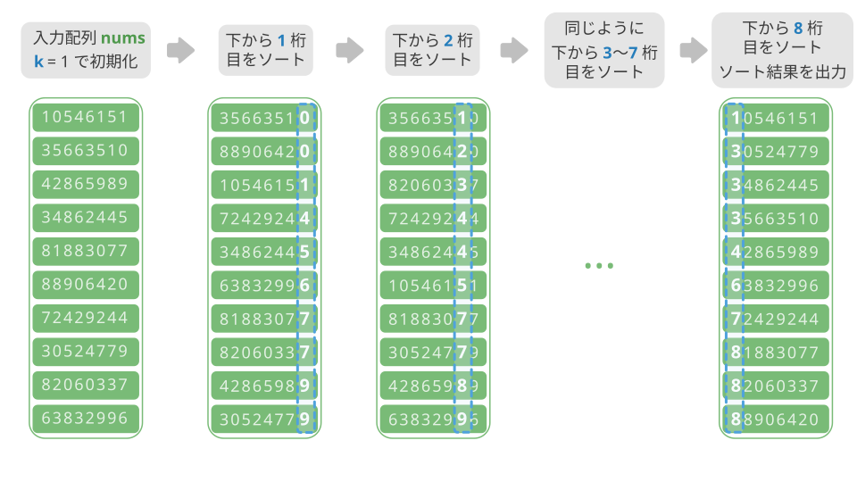

# 基数ソート

前節のカウントソートは、データ数 $n$ が多く、値の範囲 $m$ が狭い場合に適しています。$n = 10^6$ 個の学籍番号をソートしたいとします。学籍番号が $8$ 桁の数なら、値の範囲 $m = 10^8$ は非常に広く、カウントソートには大量のメモリが必要です。基数ソートならこれを避けられます。

<u>基数ソート（radix sort）</u>の基本的な考え方はカウントソートと同じで、個数を数えて並べ替えます。さらに、桁の位取りを利用し、桁ごとに順にソートして最終結果を得ます。

## アルゴリズムの手順

学籍番号の例で、最下位を $1$ 桁目、最上位を $8$ 桁目とします。下図に基数ソートの手順を示します。

1. 桁番号 $k = 1$ を初期化します。
2. 学籍番号の $k$ 桁目をカウントソートします。これで $k$ 桁目の数字が小さい順に並びます。
3. $k$ を $1$ 増やしてステップ `2.` に戻り、すべての桁のソートが終わるまで繰り返します。



実装を見てみましょう。$d$ 進数 $x$ の下から $k$ 桁目の数字 $x_k$ は、次の式で取り出せます。

$$
x_k = \lfloor\frac{x}{d^{k-1}}\rfloor \bmod d
$$

ここで $\lfloor a \rfloor$ は浮動小数点数 $a$ を負の無限大の方向に丸めること、$\bmod \: d$ は $d$ を法とする剰余を表します。学籍番号の例では $d = 10$ かつ $k \in [1, 8]$ です。

さらに、各数値の $k$ 桁目でソートできるように、カウントソートのコードを少し変更します。

```src
[file]{radix_sort}-[class]{}-[func]{radix_sort}
```

!!! question "なぜ最下位桁からソートするのか"

    何回か続けてソートすると、後の回の結果が前の回の並びに優先します。たとえば 1 回目の結果が $a < b$ で、2 回目の結果が $a > b$ なら、2 回目の結果が採用されます。数値の大小では上位桁が優先されるため、先に下位桁をソートし、次に上位桁をソートします。

## アルゴリズムの特性

カウントソートと比べ、基数ソートは値の範囲が広い場合にも適しています。**ただし、データを固定桁数で表せて、桁数が大きすぎないことが条件です**。たとえば浮動小数点数では桁数 $k$ が大きくなりすぎ、時間計算量が $O(nk) \gg O(n^2)$ になる可能性があるため、基数ソートには適していません。

- **時間計算量は $O(nk)$、非適応的なソート**。データ数を $n$、基数を $d$、最大桁数を $k$ とすると、1 桁のカウントソートには $O(n + d)$、全 $k$ 桁には $O((n + d)k)$ の時間がかかります。通常は $d$ と $k$ が比較的小さいため、時間計算量は $O(n)$ に近づきます。
- **空間計算量は $O(n + d)$、インプレースではないソート**。カウントソートと同じく、長さがそれぞれ $n$ と $d$ の配列 `res` と `counter` を使います。
- **安定ソート**。各桁のカウントソートが安定なら、基数ソートも安定です。カウントソートが不安定なら、基数ソートの結果が正しく並ぶ保証はありません。
