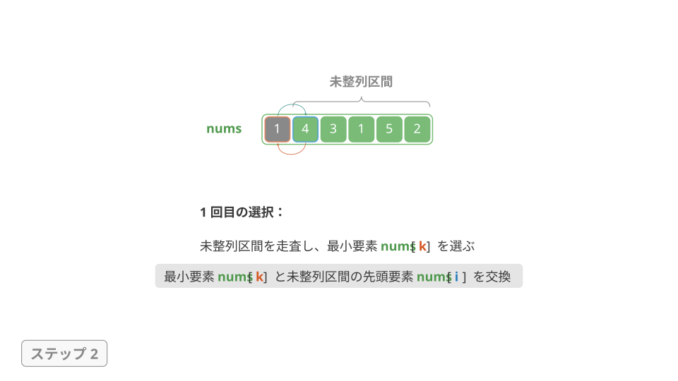
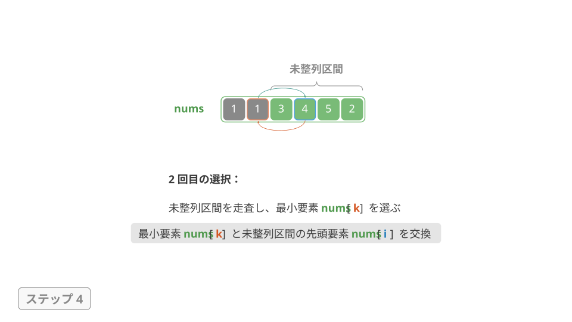
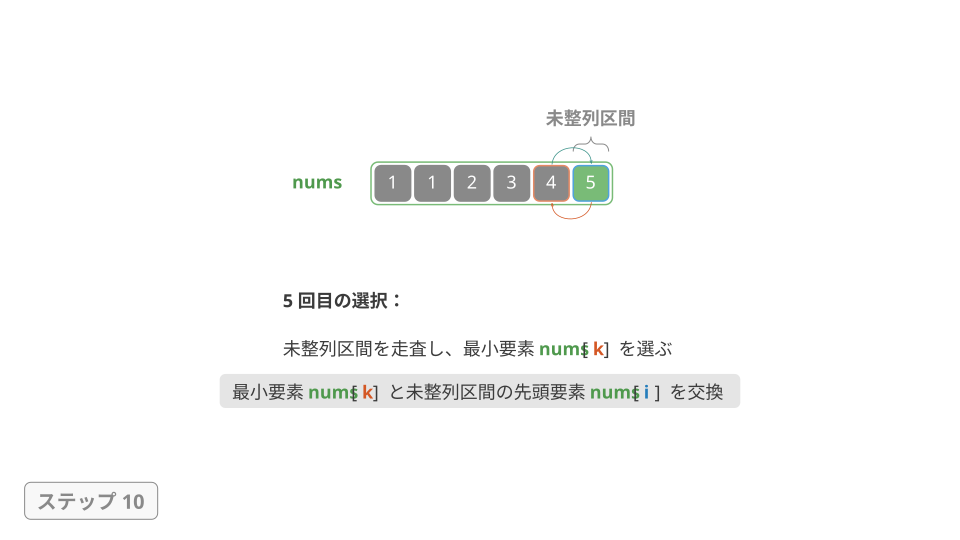

# 選択ソート

<u>選択ソート（selection sort）</u>の仕組みは簡単です。ループの各回で未整列区間の最小要素を選び、整列済み区間の末尾に加えます。

配列の長さを $n$ とします。下図に選択ソートの手順を示します。

1. 初めは全要素が未整列なので、未整列のインデックス区間は $[0, n-1]$ です。
2. 区間 $[0, n-1]$ の最小要素を選び、インデックス $0$ の要素と交換します。これで配列の先頭の 1 要素が整列します。
3. 区間 $[1, n-1]$ の最小要素を選び、インデックス $1$ の要素と交換します。これで配列の先頭の 2 要素が整列します。
4. これを繰り返します。$n - 1$ 回の選択と交換が終わると、先頭の $n - 1$ 要素が整列します。
5. 残りの 1 要素は必ず最大なので、並べ替える必要はありません。これで配列のソートは完了です。

=== "<1>"
    

=== "<2>"
    

=== "<3>"
    

=== "<4>"
    

=== "<5>"
    

=== "<6>"
    

=== "<7>"
    

=== "<8>"
    

=== "<9>"
    

=== "<10>"
    

=== "<11>"
    

コードでは、$k$ を使って未整列区間の最小要素の位置を記録します。

```src
[file]{selection_sort}-[class]{}-[func]{selection_sort}
```

## アルゴリズムの特性

- **時間計算量は $O(n^2)$、非適応的なソート**。外側のループは $n - 1$ 回で、内側のループは最初の回に $n - 1$ 回、最後の回に $1$ 回実行します。各回の実行回数は順に $n - 1$、$n - 2$、$\dots$、$2$、$1$ で、合計は $\frac{n(n - 1)}{2}$ です。
- **空間計算量は $O(1)$、インプレースソート**。ポインタ $i$ と $j$ が使う追加領域は一定です。
- **不安定なソート**。下図のように、要素 `nums[i]` が交換によって等しい要素の右側に移り、相対順序が変わることがあります。


