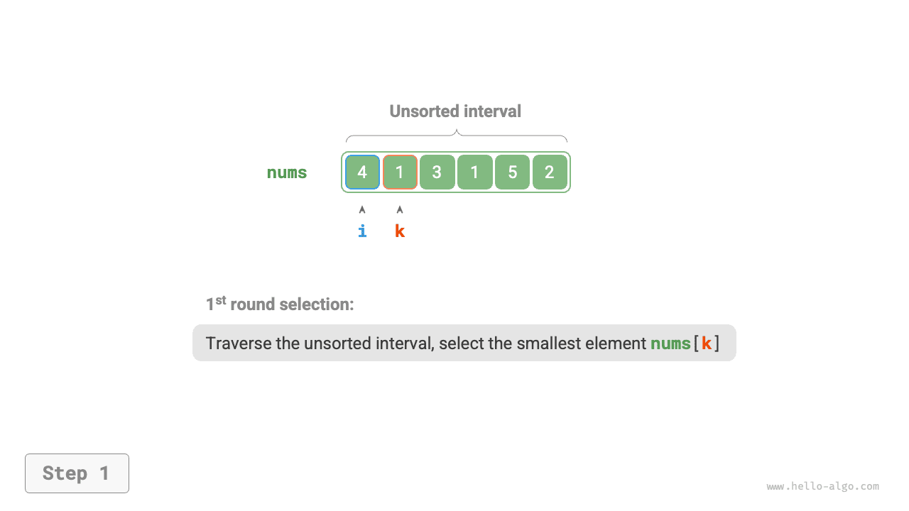
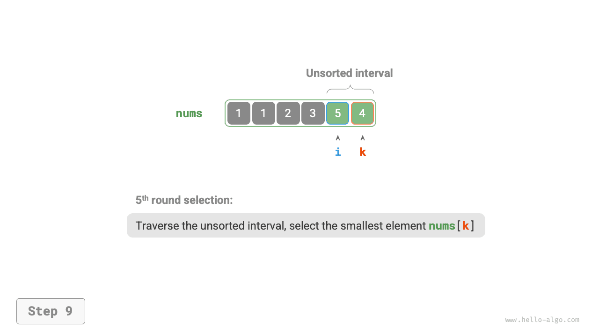
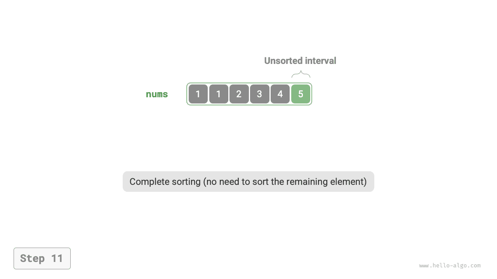

# 選択ソート

<u>選択ソート（selection sort）</u>の仕組みはとても簡単です。ループの各反復で未整列の区間から最小の要素を選び、整列済み区間の末尾に置きます。

配列の長さを $n$ とすると、選択ソートの流れは下図のとおりです。

1. 初期状態ではすべての要素が未整列で、未整列のインデックス区間は $[0, n-1]$ です。
2. 区間 $[0, n-1]$ の最小要素を選び、インデックス $0$ の要素と交換します。これで先頭の 1 要素が整列済みになります。
3. 区間 $[1, n-1]$ の最小要素を選び、インデックス $1$ の要素と交換します。これで先頭の 2 要素が整列済みになります。
4. 同様に、選択と交換を $n - 1$ 回繰り返すと、先頭の $n - 1$ 要素が整列済みになります。
5. 残った一つの要素は必ず最大要素なので、ソートは不要です。これで配列全体のソートが完了します。

=== "<1>"
    

=== "<2>"
    

=== "<3>"
    

=== "<4>"
    

=== "<5>"
    

=== "<6>"
    

=== "<7>"
    

=== "<8>"
    

=== "<9>"
    

=== "<10>"
    

=== "<11>"
    

コードでは、未整列区間の最小要素を記録するために $k$ を使います。

```src
[file]{selection_sort}-[class]{}-[func]{selection_sort}
```

## アルゴリズムの特徴

- **時間計算量は $O(n^2)$、非適応的ソート**：外側のループは $n - 1$ 回です。内側のループは最初が $n - 1$ 回、最後が $1$ 回で、順に $n - 1$、$n - 2$、$\dots$、$2$、$1$ 回実行されます。その合計は $\frac{n(n - 1)}{2}$ です。
- **空間計算量は $O(1)$、インプレースソート**：ポインタ $i$ と $j$ は定数サイズの追加領域を使います。
- **不安定ソート**：下図のように、要素 `nums[i]` が等しい要素の右側に移され、両者の相対的な順序が変わる可能性があります。


