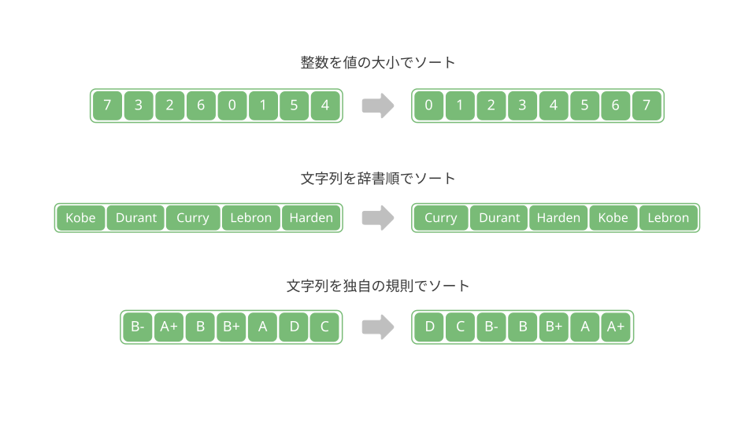

# 11.1 &nbsp; ソートアルゴリズム

<u>ソートアルゴリズム（sorting algorithm）</u>は、データの集まりを決められた順序に並べ替えるものです。整列したデータは通常、探索、分析、処理をより効率よく行えるため、ソートは広く利用されています。

図 11-1 のように、ソートするデータには整数、浮動小数点数、文字、文字列などがあります。比較の規則は用途に応じて決められます。数値の大小、文字の ASCII コード順、独自に定めた順序などが例です。

{ class="animation-figure" }

<p align="center"> 図 11-1 &nbsp; データ型と比較規則の例 </p>

## 11.1.1 &nbsp; 評価の観点

**実行効率**。ソートでは時間計算量が小さく、操作の総数も少ないこと（計算量の定数係数が小さいこと）が望まれます。特にデータ量が多いときには実行効率が重要です。

**インプレース性**。<u>インプレースソート</u>は元の配列上で直接要素を操作するため、追加の補助配列を必要とせず、メモリを節約できます。一般にデータの移動も少なく、実行速度も速くなります。

**安定性**。<u>安定ソート</u>では、ソート後も値が等しい要素同士の相対順序が変わりません。

複数のキーで順にソートするときは安定性が必要です。たとえば学生の表で、1 列目が名前、2 列目が年齢だとします。<u>不安定なソート</u>では、入力にあった順序が失われることがあります。

```shell
# 入力データは名前順に整列済み
# (name, age)
  ('A', 19)
  ('B', 18)
  ('C', 21)
  ('D', 19)
  ('E', 23)

# 不安定なソートでリストを年齢順に並べると、
# 結果では ('D', 19) と ('A', 19) の順序が入れ替わり、
# 入力にあった名前順が失われる
  ('B', 18)
  ('D', 19)
  ('A', 19)
  ('C', 21)
  ('E', 23)
```

**適応性**。<u>適応的なソート</u>は、入力にすでにある順序を利用して計算量を減らし、処理時間を短縮できます。通常、このようなアルゴリズムの最良時間計算量は平均時間計算量より小さくなります。

**比較に基づくか**。<u>比較ソート</u>は比較演算子（$<$、$=$、$>$）で要素の相対順序を決め、配列全体を整列させます。最悪時間計算量の下界は $\Omega(n \log n)$ です。一方、<u>非比較ソート</u>は比較演算子を使わず、時間計算量が $O(n)$ に達するものの、適用できる対象は比較的限られます。

## 11.1.2 &nbsp; 理想のソートアルゴリズム

**高速で、インプレースかつ安定で、適応性と汎用性も高い**。これらをすべて兼ね備えたソートアルゴリズムは、今のところ見つかっていません。したがって、ソートを選ぶときはデータの特徴と問題の要件に合わせて判断します。

これからさまざまなソートアルゴリズムを学び、こうした観点からそれぞれの長所と短所を見ていきます。
