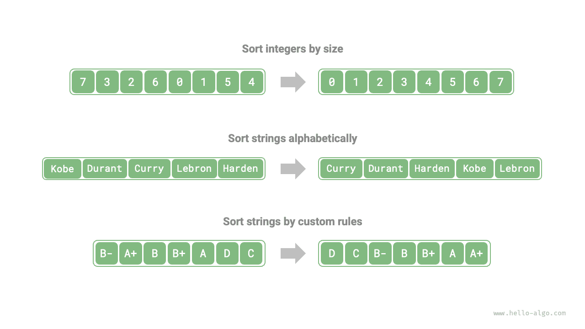

# 11.1 &nbsp; ソートアルゴリズム

<u>ソートアルゴリズム（sorting algorithm）</u>は、データの集合を特定の順序に並べるために使います。整列済みのデータは通常、より効率よく探索、分析、処理できるため、ソートには幅広い用途があります。

図 11-1 のように、ソートするデータの型には整数、浮動小数点数、文字、文字列などがあります。大小の判定規則は、数値の大小、文字の ASCII コード順、独自の規則など、必要に応じて設定できます。

{ class="animation-figure" }

<p align="center"> 図 11-1 &nbsp; データ型と判定規則の例 </p>

## 11.1.1 &nbsp; 評価の観点

**実行効率**：時間計算量ができるだけ小さく、操作の総数も少ない（時間計算量の定数項が小さい）ことが望まれます。特にデータが多い場合、実行効率は重要です。

**インプレース性**：<u>インプレースソート</u>は、その名のとおり元の配列を直接操作してソートします。追加の補助配列が不要なので、メモリを節約できます。通常はデータの移動も少なく、実行も速くなります。

**安定性**：<u>安定ソート</u>では、ソート後も等しい要素の配列内での相対的な順序が変わりません。

安定ソートは、複数の基準で段階的にソートする場合に必要です。学生の情報を格納した表があり、第 1 列が名前、第 2 列が年齢だとします。この場合、<u>不安定ソート</u>では、入力データがもともと持っていた順序が失われる可能性があります。

```shell
# 入力データは名前順にソート済み
# (name, age)
  ('A', 19)
  ('B', 18)
  ('C', 21)
  ('D', 19)
  ('E', 23)

# 不安定なソートアルゴリズムで年齢順に並べると、
# 結果では ('D', 19) と ('A', 19) の相対的な位置が変わり、
# 入力データの名前順という性質が失われる
  ('B', 18)
  ('D', 19)
  ('A', 19)
  ('C', 21)
  ('E', 23)
```

**適応性**：<u>適応的ソート</u>は、入力データがすでに持つ順序の情報を利用して計算量を減らし、時間効率を高めます。最良時間計算量は通常、平均時間計算量より優れています。

**比較に基づくかどうか**：<u>比較ソート</u>は、比較演算子（$<$、$=$、$>$）で要素間の相対的な順序を判定し、配列全体をソートします。最悪時間計算量の下界は $\Omega(n \log n)$ です。一方、<u>非比較ソート</u>は比較演算子を使わず、時間計算量が $O(n)$ にもなりますが、汎用性は比較的低くなります。

## 11.1.2 &nbsp; 理想的なソートアルゴリズム

**速く、インプレースで、安定で、適応的で、汎用性が高いこと**が理想です。しかし、これらをすべて兼ね備えたソートアルゴリズムは、これまで見つかっていません。そのため、具体的なデータの特徴と問題の要件に応じて選ぶ必要があります。

これからさまざまなソートアルゴリズムを学び、これらの観点からそれぞれの長所と短所を分析していきます。
