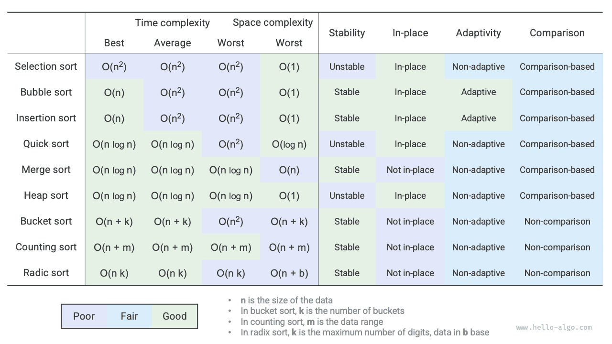

# 11.11 &nbsp; まとめ

### 1. &nbsp; 要点の振り返り

- バブルソートは隣り合う要素を交換してソートします。フラグを追加して早期終了できるようにすると、最良時間計算量を $O(n)$ に改善できます。
- 挿入ソートは、毎回、未整列区間の要素を整列済み区間の正しい位置へ挿入します。時間計算量は $O(n^2)$ ですが、基本操作が比較的少ないため、少量のデータのソートに広く使われます。
- クイックソートは番兵を用いた分割に基づきます。毎回最悪のピボットを選ぶと、時間計算量が $O(n^2)$ に悪化します。中央値やランダムな値をピボットにすると、その確率を下げられます。短い部分区間を優先して再帰的に処理すれば、再帰の深さを減らし、空間計算量を $O(\log n)$ に改善できます。
- マージソートは分割と結合の二段階からなり、分割統治法の典型です。配列のソートには補助配列が必要で空間計算量は $O(n)$ ですが、連結リストなら $O(1)$ に改善できます。
- バケットソートは、データの振り分け、バケット内のソート、結果の結合という三段階からなります。これも分割統治法を体現しており、大量のデータに適しています。均等に振り分けることが鍵です。
- カウントソートはバケットソートの特殊な場合で、出現回数を数えてソートします。データ量が多く、値の範囲が限られる場合に適し、データを正の整数に変換できることが必要です。
- 基数ソートは一桁ずつソートする方法で、データを固定桁数の数値として表せることが必要です。
- 理想的には、高効率、安定、インプレース、適応性などの利点を備えたソートが望まれます。しかし、ほかのデータ構造やアルゴリズムと同じく、すべてを満たす方法はありません。実際には、データの特徴に応じて選ぶ必要があります。
- 図 11-19 で、主なソートアルゴリズムの効率、安定性、インプレース性、適応性などを比較します。

{ class="animation-figure" }

 図 11-19 &nbsp; ソートアルゴリズムの比較 

### 2. &nbsp; Q & A

**Q**：ソートの安定性は、どのような場合に必要ですか？

実際には、オブジェクトの特定の属性でソートすることがあります。例えば、名前と身長を持つ学生を、まず名前順に並べて `(A, 180) (B, 185) (C, 170) (D, 170)` を得てから、身長順に並べたいとします。ソートが不安定だと、`(D, 170) (C, 170) (A, 180) (B, 185)` になる可能性があります。

すると D と C が入れ替わり、名前順が崩れてしまいます。これは望む結果ではありません。

**Q**：番兵を用いた分割では、「右から左へ探す」と「左から右へ探す」の順序を入れ替えられますか？

できません。左端をピボットにする場合は、必ず右から左、次に左から右の順で探します。直感に反するかもしれませんが、理由を詳しく見ましょう。

`partition()` の最後の手順では、`nums[left]` と `nums[i]` を交換します。交換後、ピボットの左の要素はすべてピボット以下（`<=`）になるため、**交換前に `nums[left] >= nums[i]` が成り立つ必要があります**。先に左から右へ探すと、ピボットより大きい要素が見つからなかった場合、**`i == j` でループを抜け、その時点で `nums[j] == nums[i] > nums[left]` の可能性があります**。すると、最後の交換でピボットより大きい要素を左端に移してしまい、分割に失敗します。

例えば、配列 `[0, 0, 0, 0, 1]` で先に左から右へ探すと、分割後は `[1, 0, 0, 0, 0]` となり、正しくありません。

さらに考えると、`nums[right]` をピボットにする場合は逆で、必ず左から右へ先に探す必要があります。

**Q**：クイックソートの再帰の深さの改善では、なぜ短い配列を選ぶと深さが $\log n$ 以下になりますか？

再帰の深さは、まだ戻っていない再帰呼び出しの数です。各分割で元の配列は二つに分かれます。改善後に再帰する部分配列の長さは、最大でも元の半分です。最悪の場合に毎回ちょうど半分でも、最終的な深さは $\log n$ です。

元のクイックソートでは、長いほうを続けて再帰する可能性があります。最悪の場合、長さが $n$、$n - 1$、$\dots$、$2$、$1$ となり、深さは $n$ です。改善によってこれを避けられます。

**Q**：要素がすべて等しいと、クイックソートは $O(n^2)$ 時間になりますか？ どう対処できますか？

はい。その場合、分割で配列をピボットより小さい部分、等しい部分、大きい部分の三つに分け、小さい部分と大きい部分だけを再帰的に処理できます。この方法なら、全要素が等しい配列は一回の分割でソートが完了します。

**Q**：バケットソートの最悪時間計算量は、なぜ $O(n^2)$ ですか？

最悪の場合、すべての要素が同じバケットに入ります。それを $O(n^2)$ のアルゴリズムでソートすると、時間計算量は $O(n^2)$ になります。
