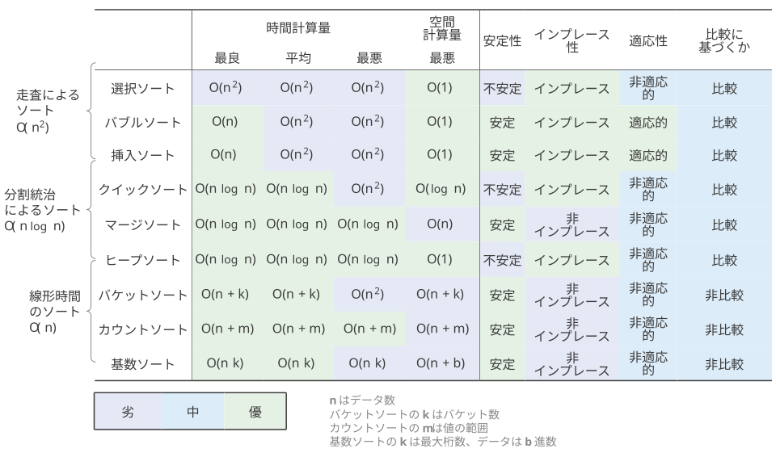

# 11.11 &nbsp; まとめ

### 1. &nbsp; 要点の振り返り

- バブルソートは隣り合う要素を交換して並べ替えます。フラグを追加して早期終了できるようにすると、最良時間計算量を $O(n)$ に改善できます。
- 挿入ソートは毎回、未整列区間の要素を整列済み区間の正しい位置に挿入して並べ替えます。時間計算量は $O(n^2)$ ですが、基本操作が比較的少ないため、少量のデータのソートによく使われます。
- クイックソートは左右からの分割を使います。毎回最悪のピボットを選ぶと時間計算量が $O(n^2)$ に悪化します。中央値や無作為に選んだ要素をピボットにすれば、その確率を下げられます。短い部分区間を優先して再帰することで深さを効果的に抑え、空間計算量を $O(\log n)$ に改善できます。
- マージソートは分割とマージの 2 段階からなる、分割統治の典型例です。配列を並べ替えるには補助配列が必要で、空間計算量は $O(n)$ です。連結リストのソートなら空間計算量を $O(1)$ に抑えられます。
- バケットソートは、バケットへの振り分け、バケット内のソート、結果の連結の 3 ステップからなります。これも分割統治の一例で、大量のデータに適しています。各バケットのデータ数をそろえることが重要です。
- カウントソートはバケットソートの特殊な場合で、各値の出現回数を数えて並べ替えます。データ量が多く、値の範囲が狭い場合に適しており、データを正の整数に変換できることが条件です。
- 基数ソートは桁ごとに並べ替える方法で、データを固定桁数の数値で表せる必要があります。
- 効率がよく、安定で、インプレースかつ適応的なソートが理想です。しかし、他のデータ構造やアルゴリズムと同じく、すべての条件を同時に満たすものはありません。実際にはデータの特性に合う方法を選びます。
- 図 11-19 では代表的なソートの効率、安定性、インプレース性、適応性などを比較しています。

{ class="animation-figure" }

 図 11-19 &nbsp; ソートアルゴリズムの比較 

### 2. &nbsp; Q & A

**Q**：ソートの安定性が必要になるのはどのような場合ですか。

実際には、オブジェクトの属性を使って並べ替えることがあります。たとえば学生が名前と身長の 2 つの属性を持ち、複数のキーで順にソートしたいとします。まず名前で並べて `(A, 180) (B, 185) (C, 170) (D, 170)` を得てから、身長で並べます。このとき不安定なソートだと、結果が `(D, 170) (C, 170) (A, 180) (B, 185)` になることがあります。

学生 D と C の位置が入れ替わっており、保ちたかった名前の順序が失われています。

**Q**：左右からの分割で、「右から左に探す」と「左から右に探す」の順番を入れ替えられますか。

いいえ。左端をピボットとするこの実装では、先に右から左へ探し、次に左から右へ探す必要があります。少し意外に感じられるかもしれません。その理由を見てみましょう。

分割を行う `partition()` での最後の手順は `nums[left]` と `nums[i]` の交換です。交換後、ピボットの左の要素はすべて「要素 `<=` ピボット」を満たすので、**交換の直前には `nums[left] >= nums[i]` が成り立つ必要があります**。先に左から右へ探すと、ピボットより大きい要素が見つからない場合に、**`i == j` でループを抜け、その時点で `nums[j] == nums[i] > nums[left]` となる可能性があります**。すると最後の交換でピボットより大きい要素が左端に移り、正しく分割できません。

たとえば配列 `[0, 0, 0, 0, 1]` で先に左から右へ探すと、分割結果は `[1, 0, 0, 0, 0]` となり、正しくありません。

さらに考えると、`nums[right]` をピボットに選ぶ場合はちょうど逆で、先に左から右へ探す必要があります。

**Q**：クイックソートで再帰の深さを最適化するとき、短い部分配列を選ぶとなぜ深さが $\log n$ 以下になるのですか。

再帰の深さは、まだ戻っていない再帰呼び出しの数です。各回の分割で配列を 2 つの部分配列に分けます。深さの最適化後は、次の再帰に渡す部分配列の長さは元の長さの半分以下です。最悪の場合でも毎回ちょうど半分になるので、再帰の深さは $\log n$ です。

元のクイックソートでは長いほうに続けて再帰することがあります。最悪の場合は長さが $n$、$n - 1$、$\dots$、$2$、$1$ と推移し、深さは $n$ になります。再帰の深さの最適化でこの状況を避けられます。

**Q**：配列の全要素が等しいとき、クイックソートの時間計算量は $O(n^2)$ ですか。この退化にはどう対処できますか。

はい。この場合は、ピボットより小さい部分、等しい部分、大きい部分の 3 つに分割する方法があります。小さい部分と大きい部分だけに再帰します。全要素が等しい入力なら、1 回の分割だけでソートが完了します。

**Q**：バケットソートの最悪時間計算量が $O(n^2)$ なのはなぜですか。

最悪の場合、全要素が 1 個のバケットに入ります。内部のソートに $O(n^2)$ のアルゴリズムを使うと、時間計算量は $O(n^2)$ になります。
