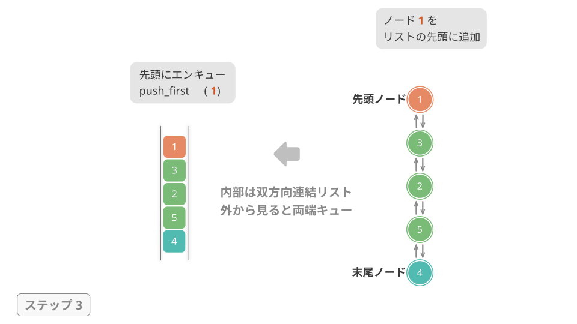
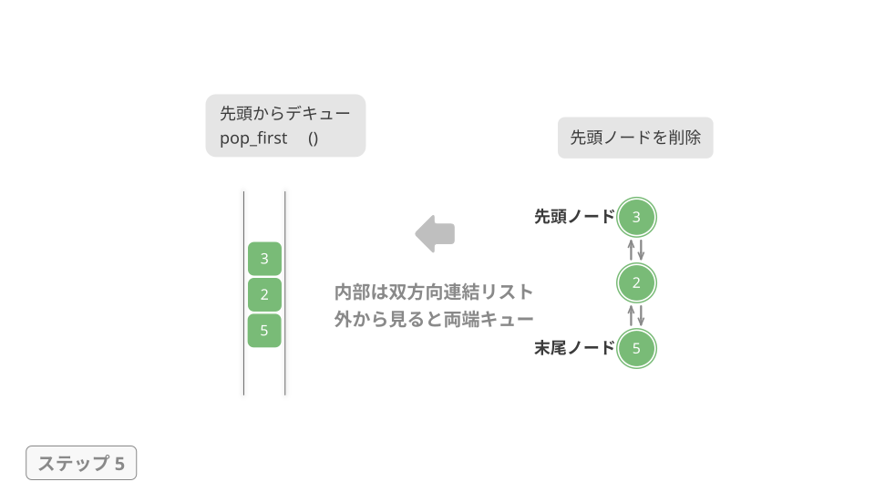
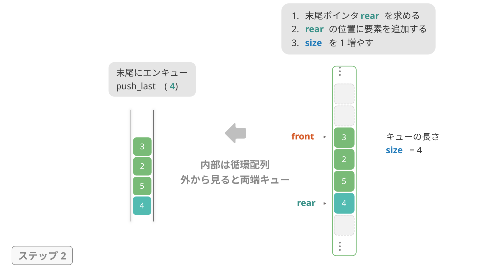
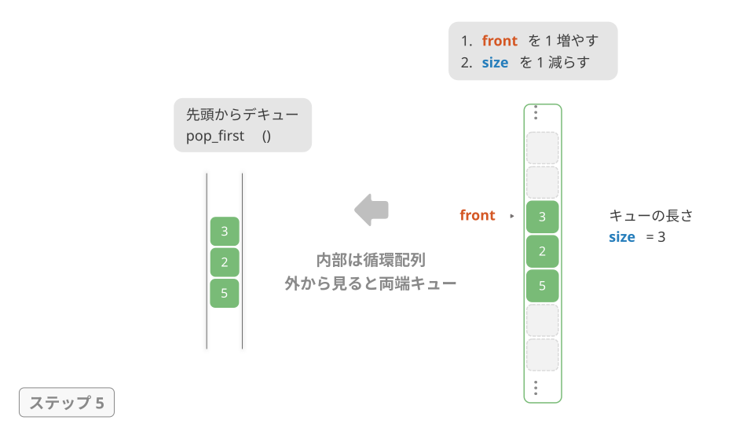

# 両端キュー

キューでは、先頭要素の削除と末尾への追加しかできません。下図の<u>両端キュー（double-ended queue）</u>は、先頭と末尾の両方で追加・削除ができ、より柔軟です。


## 両端キューの主な操作

主な操作を下表に示します。具体的なメソッド名は、使う言語によって異なります。

<p align="center"> 表 <id> &nbsp; 両端キューの操作効率 </p>

| メソッド名         | 説明             | 時間計算量 |
| -------------- | ---------------- | ---------- |
| `push_first()` | 先頭に要素を追加 | $O(1)$     |
| `push_last()`  | 末尾に要素を追加 | $O(1)$     |
| `pop_first()`  | 先頭要素を削除     | $O(1)$     |
| `pop_last()`   | 末尾要素を削除     | $O(1)$     |
| `peek_first()` | 先頭要素にアクセス     | $O(1)$     |
| `peek_last()`  | 末尾要素にアクセス     | $O(1)$     |

同様に、言語が用意する両端キュークラスをそのまま利用できます。

```snippet
deque_operations
```

??? pythontutor "実行の可視化"

    @tutor deque_operations_tutor

## 両端キューの実装 *

実装はキューと似ており、基盤となるデータ構造に連結リストか配列を選べます。

### 双方向連結リストによる実装

前節では、通常の単方向連結リストでキューを実装しました。先頭ノードの削除（デキュー）と、末尾ノードの後への追加（エンキュー）が容易だからです。

両端キューでは、先頭でも末尾でも追加と削除ができます。つまり、反対側の対称的な操作も必要です。そのため、基盤に双方向連結リストを使います。

下図のように、双方向連結リストの先頭と末尾を両端キューの先頭と末尾に対応させ、両端でノードを追加・削除できるようにします。

=== "<1>"
    

=== "<2>"
    

=== "<3>"
    

=== "<4>"
    

=== "<5>"
    

実装は次のとおりです。

```src
[file]{linkedlist_deque}-[class]{linked_list_deque}-[func]{}
```

### 配列による実装

下図のように、配列によるキューと同様、循環配列で両端キューを実装できます。

=== "<1>"
    

=== "<2>"
    

=== "<3>"
    

=== "<4>"
    

=== "<5>"
    

キューの実装に、先頭への追加と末尾からの取り出しのメソッドを加えるだけです。

```src
[file]{array_deque}-[class]{array_deque}-[func]{}
```

## 両端キューの用途

両端キューはスタックとキューの両方の論理を持つため、**両者のすべての用途を実現でき、さらに高い自由度も提供します**。

ソフトウェアの「元に戻す」は通常、変更のたびに操作をスタックへ `push` し、`pop` で取り消します。ただし、システム資源の制約から、通常は、保存できる履歴が例えば $50$ 回までに制限されます。長さが $50$ を超えたら、底、つまりキューの先頭から削除する必要があります。**スタックではできないため、両端キューに置き換えます**。「元に戻す」の中心的な論理は依然として先入れ後出しであり、両端キューは追加の処理をより柔軟に実現している点に注意してください。
