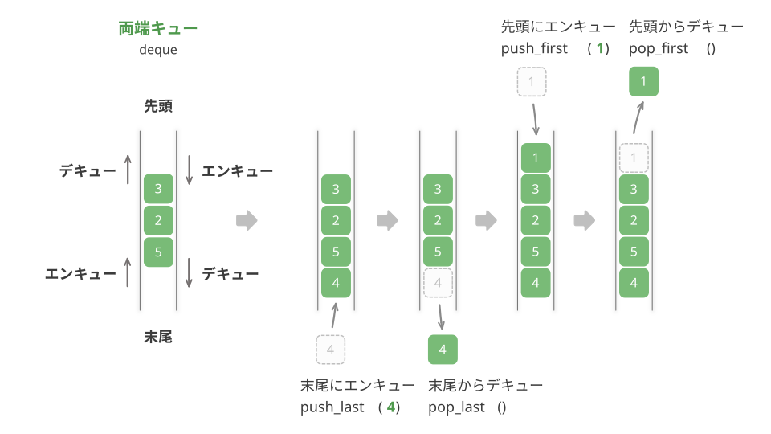
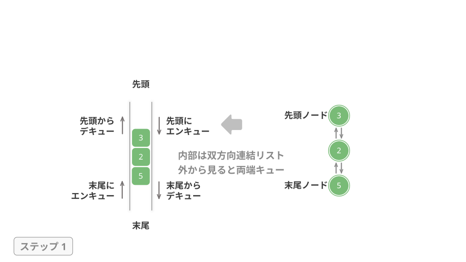
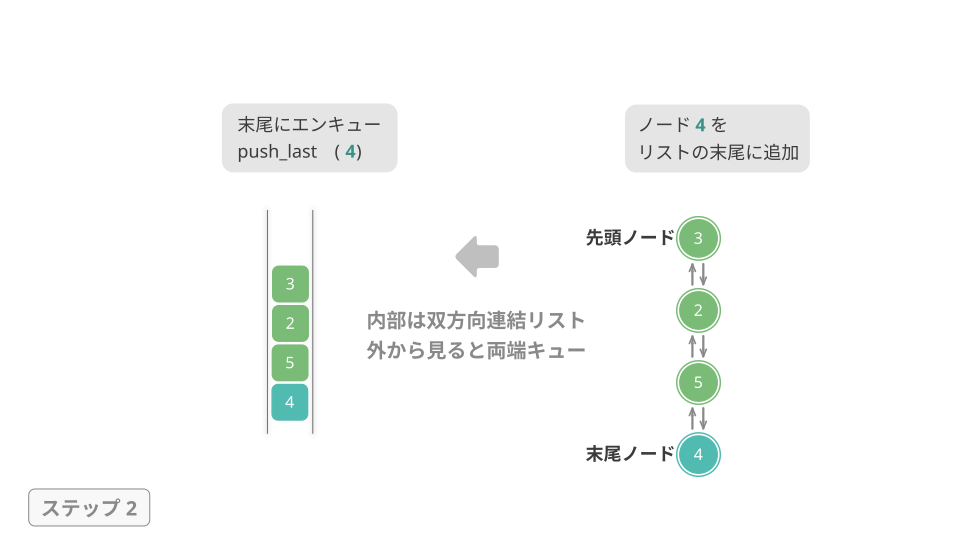
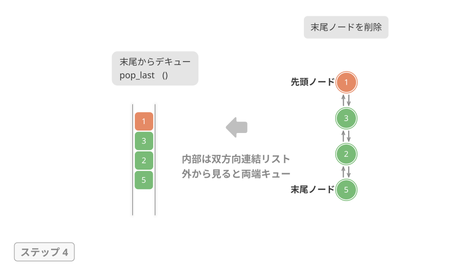
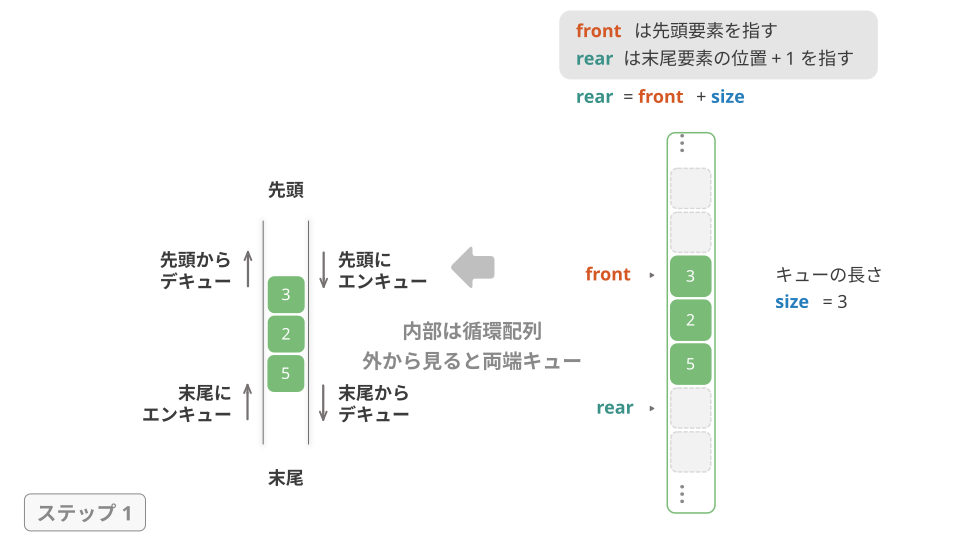
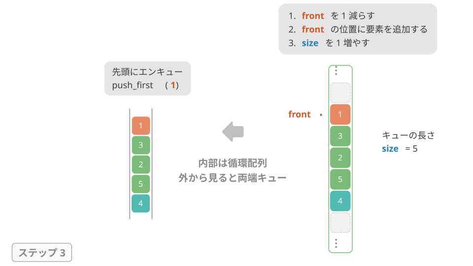
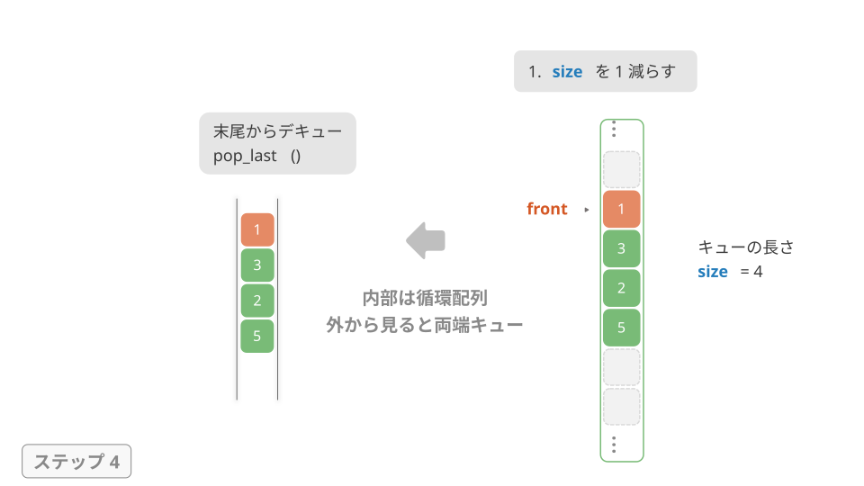

# 両端キュー

通常のキューでは、要素を削除できるのは先頭だけで、追加できるのは末尾だけです。下図の<u>両端キュー（double-ended queue）</u>はより柔軟で、先頭と末尾のどちらでも要素を追加したり削除したりできます。



## 両端キューの基本操作

両端キューでよく使う操作を次の表に示します。実際のメソッド名は使用するプログラミング言語によって異なります。

<p align="center"> 表 <id> &nbsp; 両端キューの各操作の時間計算量 </p>

| メソッド名         | 説明             | 時間計算量 |
| -------------- | ---------------- | ---------- |
| `push_first()` | 先頭に要素を追加する | $O(1)$     |
| `push_last()`  | 末尾に要素を追加する | $O(1)$     |
| `pop_first()`  | 先頭の要素を削除する     | $O(1)$     |
| `pop_last()`   | 末尾の要素を削除する     | $O(1)$     |
| `peek_first()` | 先頭の要素を参照する     | $O(1)$     |
| `peek_last()`  | 末尾の要素を参照する     | $O(1)$     |

両端キューについても、プログラミング言語が用意しているクラスをそのまま利用できます。

```snippet
deque_operations
```

??? pythontutor "実行の様子を見る"

    @tutor deque_operations_tutor

## 両端キューの実装 *

両端キューは通常のキューと同じように、内部のデータ構造に連結リストまたは配列を使って実装できます。

### 双方向連結リストによる実装

前の節では、通常の単方向連結リストでキューを実装しました。先頭ノードの削除（デキューに対応）と、末尾ノードの後ろへの新しいノードの追加（エンキューに対応）が簡単にできるからです。

両端キューでは、先頭と末尾のどちらでもエンキューとデキューができます。つまり、通常のキューの操作に加え、端を入れ替えた逆向きの操作も実装する必要があります。そこで、両端キューの内部のデータ構造に「双方向連結リスト」を使います。

下図のように、双方向連結リストの先頭ノードを両端キューの先頭、末尾ノードを末尾とみなし、どちらの端でもノードを追加、削除できるようにします。

=== "<1>"
    

=== "<2>"
    

=== "<3>"
    

=== "<4>"
    

=== "<5>"
    

実装のコードを以下に示します。

```src
[file]{linkedlist_deque}-[class]{linked_list_deque}-[func]{}
```

### 配列による実装

下図のように、配列で通常のキューを実装したときと同様に、両端キューも循環配列で実装できます。

=== "<1>"
    

=== "<2>"
    

=== "<3>"
    

=== "<4>"
    

=== "<5>"
    

通常のキューの実装に、「先頭へのエンキュー」と「末尾からのデキュー」のメソッドを追加するだけです。

```src
[file]{array_deque}-[class]{array_deque}-[func]{}
```

## 両端キューの用途

両端キューはスタックとキューの両方の動作ができます。**そのため、スタックとキューのあらゆる用途に使え、操作の自由度も高くなります**。

ソフトウェアの「元に戻す」機能には、通常スタックが使われます。変更を加えるたびに、その操作をスタックに `push` し、`pop` で操作を取り出して元に戻します。ただし、システムの資源には限りがあるため、通常は元に戻せる回数に上限を設けます（たとえば $50$ 回分だけ保存します）。スタックの長さが $50$ を超えると、スタックの底（キューの先頭）にある操作を削除する必要があります。**スタックでは底から削除できないため、ここでスタックの代わりに両端キューを使います**。「元に戻す」機能の基本は、あくまでスタックの後入れ先出しの原則です。両端キューを使うことで、こうした追加の処理を柔軟に実現できます。
