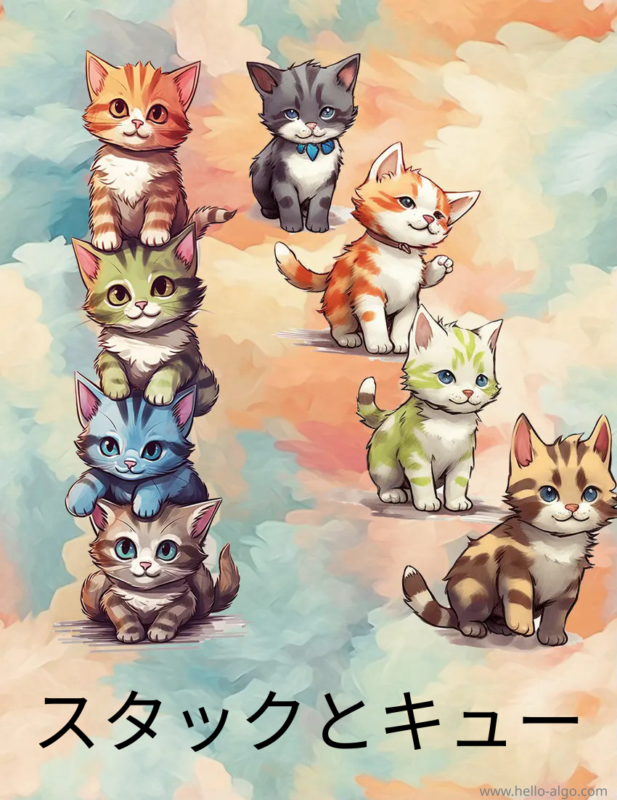

# 第 5 章 &nbsp; スタックとキュー

{ class="cover-image" }

!!! abstract "概要"

    スタックは猫たちが上へ上へと重なった姿に、キューは猫たちが一列に並んだ姿に似ています。
    
    スタックは後入れ先出し、キューは先入れ先出しの仕組みを表しています。

## この章の内容

- [5.1 &nbsp; スタック](stack.md)
- [5.2 &nbsp; キュー](queue.md)
- [5.3 &nbsp; 両端キュー](deque.md)
- [5.4 &nbsp; まとめ](summary.md)
- [5.5 &nbsp; 練習問題](exercises.md)
