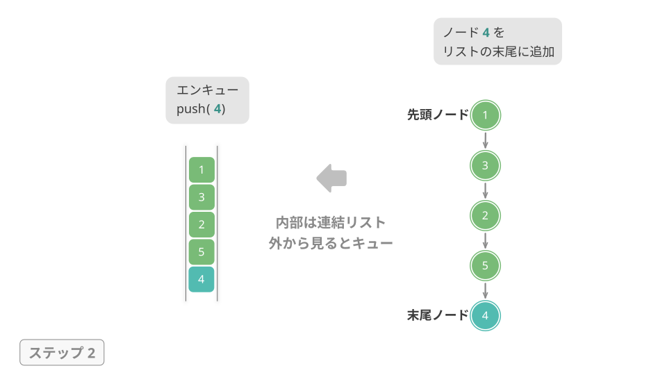
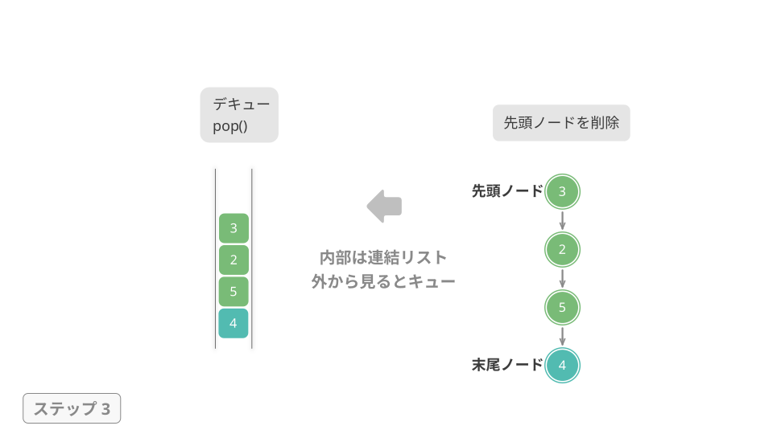
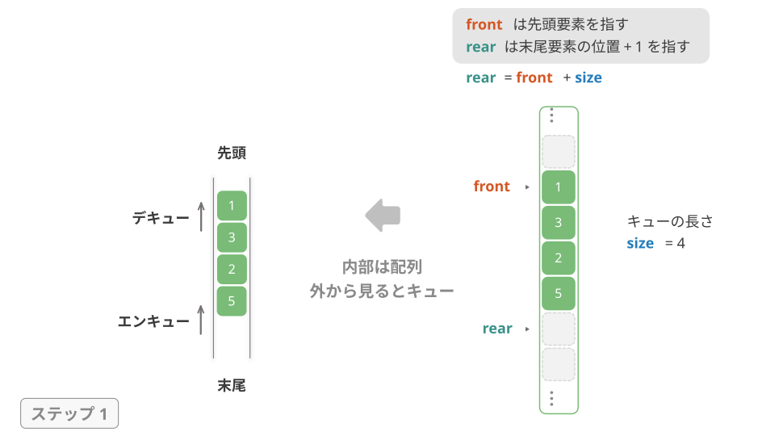

# キュー

<u>キュー（queue）</u>は先入れ先出しの規則に従う線形データ構造です。行列に並ぶ様子を模しており、新しく来た人が末尾に加わり、先頭の人から順に離れていきます。

下図のように、前側を「先頭」、後ろ側を「末尾」と呼びます。末尾に要素を加える操作を「エンキュー」、先頭要素を削除する操作を「デキュー」と呼びます。


## キューの主な操作

主な操作を下表に示します。メソッド名は言語ごとに異なる場合がありますが、ここではスタックと同じ名前を使います。

<p align="center"> 表 <id> &nbsp; キューの操作効率 </p>

| メソッド名   | 説明                         | 時間計算量 |
| -------- | ---------------------------- | ---------- |
| `push()` | エンキュー、つまり末尾への要素の追加 | $O(1)$     |
| `pop()`  | 先頭要素のデキュー                 | $O(1)$     |
| `peek()` | 先頭要素へのアクセス                 | $O(1)$     |

言語が用意するキュークラスを、そのまま利用できます。

```snippet
queue_operations
```

??? pythontutor "実行の可視化"

    @tutor queue_operations_tutor

## キューの実装

キューを実装するには、一方の端で追加し、もう一方の端で削除できるデータ構造が必要です。連結リストも配列も、この条件を満たします。

### 連結リストによる実装

下図のように、連結リストの先頭ノードと末尾ノードを、キューの先頭と末尾に対応させます。末尾では追加だけ、先頭では削除だけを行います。

=== "<1>"
    

=== "<2>"
    

=== "<3>"
    

連結リストを使うコードは次のとおりです。

```src
[file]{linkedlist_queue}-[class]{linked_list_queue}-[func]{}
```

### 配列による実装

配列の先頭要素の削除は時間計算量が $O(n)$ なので、デキューの効率が低くなります。ただし、次の工夫で避けられます。

変数 `front` で先頭要素のインデックスを示し、変数 `size` でキューの長さを記録します。`rear = front + size` と定義すると、`rear` は末尾要素の次の位置を指します。

この設計では、**要素を含む有効区間は `[front, rear - 1]`** です。各操作の実装を下図に示します。

- エンキュー：インデックス `rear` に入力要素を代入し、`size` を 1 増やします。
- デキュー：`front` を 1 増やし、`size` を 1 減らすだけです。

どちらも一度の操作で済み、時間計算量はともに $O(1)$ です。

=== "<1>"
    

=== "<2>"
    

=== "<3>"
    

一つ問題があります。追加と削除を続けると `front` と `rear` が右へ移動し、**配列の末尾に達すると、それ以上進めなくなります**。これを解決するため、配列の両端がつながった「循環配列」と見なします。

循環配列では、`front` や `rear` が末尾を越えたら先頭に戻って走査を続けます。この周期性は剰余演算で実現できます。コードは次のとおりです。

```src
[file]{array_queue}-[class]{array_queue}-[func]{}
```

この実装には、長さを変更できないという制約がまだあります。ただし、配列を動的配列に置き換え、容量拡張を導入すれば解決できます。興味があれば実装してみてください。

二つの実装の比較結果はスタックと同じなので、ここでは繰り返しません。

## キューの代表的な用途

- **淘宝の注文**。購入者が注文するとキューに追加され、システムが順に処理します。11 月 11 日のセールでは短時間に膨大な注文が発生するため、多数の同時処理がエンジニアにとって重要な課題となります。
- **さまざまな待機タスク**。プリンターの印刷待ちや飲食店の料理の提供待ちなど、到着順の処理が必要な場面で、キューは処理順を効果的に維持できます。
