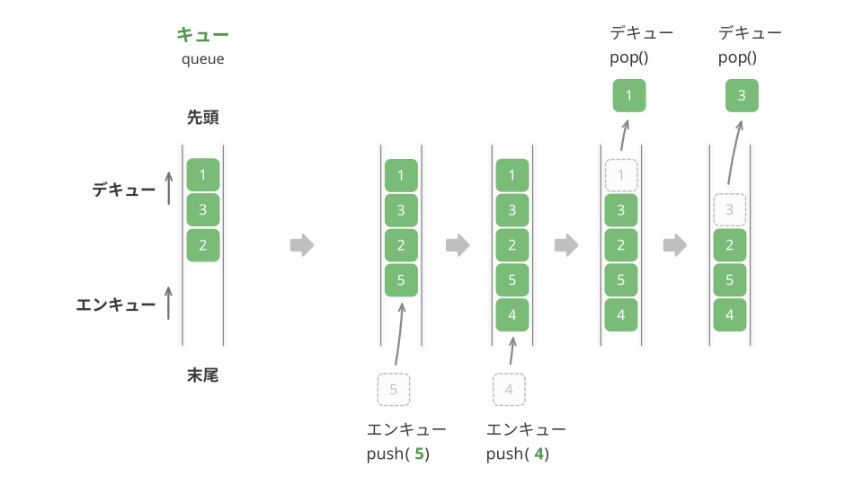
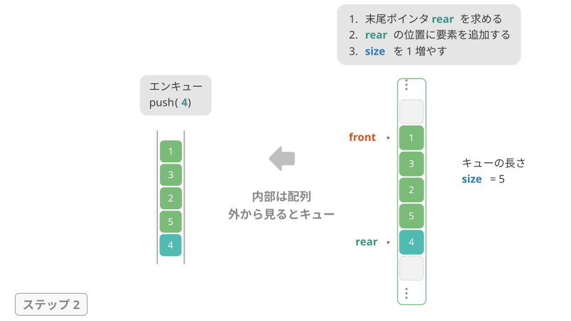

# キュー

<u>キュー（queue）</u>は、先入れ先出しの規則に従う線形データ構造です。キューという名前のとおり、人が列に並ぶ様子を表しています。新しく来た人は次々と列の最後に並び、先頭の人から順に列を離れます。

下図のように、列の前端をキューの「先頭」、後端を「末尾」と呼びます。末尾に要素を追加する操作を「エンキュー」、先頭の要素を取り除く操作を「デキュー」と呼びます。



## キューの基本操作

キューでよく使う操作を次の表に示します。メソッド名はプログラミング言語によって異なることがあります。ここでは、スタックと同じメソッド名を使います。

<p align="center"> 表 <id> &nbsp; キューの各操作の時間計算量 </p>

| メソッド名   | 説明                         | 時間計算量 |
| -------- | ---------------------------- | ---------- |
| `push()` | 要素をエンキューする（末尾に追加する） | $O(1)$     |
| `pop()`  | 先頭の要素をデキューする                 | $O(1)$     |
| `peek()` | 先頭の要素を参照する                 | $O(1)$     |

プログラミング言語が用意しているキューのクラスを、そのまま利用できます。

```snippet
queue_operations
```

??? pythontutor "実行の様子を見る"

    @tutor queue_operations_tutor

## キューの実装

キューを実装するには、一方の端で要素を追加し、もう一方の端で要素を削除できるデータ構造が必要です。連結リストと配列は、どちらもこの条件を満たします。

### 連結リストによる実装

下図のように、連結リストの「先頭ノード」をキューの「先頭」、「末尾ノード」をキューの「末尾」とみなします。末尾ではノードの追加だけを、先頭ではノードの削除だけを許します。

=== "<1>"
    

=== "<2>"
    

=== "<3>"
    

連結リストでキューを実装するコードを以下に示します。

```src
[file]{linkedlist_queue}-[class]{linked_list_queue}-[func]{}
```

### 配列による実装

配列の先頭要素を削除するには $O(n)$ の時間がかかるため、そのままではデキューの効率がよくありません。そこで、次のように工夫します。

変数 `front` に先頭要素のインデックスを、変数 `size` にキューの長さを記録します。`rear = front + size` と定義すると、この式で求めた `rear` は末尾要素の次の位置を指します。

この設計では、**配列内でキューの要素が入っている有効範囲は `[front, rear - 1]` です**。各操作の実装を下図に示します。

- エンキューでは、インデックス `rear` の位置に入力された要素を格納し、`size` を 1 増やします。
- デキューでは、`front` を 1 増やし、`size` を 1 減らすだけです。

このように、エンキューもデキューも 1 回の操作で済み、時間計算量はいずれも $O(1)$ です。

=== "<1>"
    

=== "<2>"
    

=== "<3>"
    

エンキューとデキューを繰り返すと、ある問題が見えてきます。`front` も `rear` も右に移動していき、**配列の末端に達すると、それ以上先に進めません**。この問題は、配列の先頭と末尾をつないだ「循環配列」として扱うことで解決できます。

循環配列では、`front` や `rear` が配列の末端を越えたら、すぐに先頭に戻って移動を続けるようにします。この周期的な動きは、次のコードのように剰余演算で実現できます。

```src
[file]{array_queue}-[class]{array_queue}-[func]{}
```

この実装には、配列の長さが固定されているという制約が残ります。これも、配列を動的配列に置き換え、容量を拡張できるようにすれば解決できます。興味のある方は自分で実装してみてください。

2 つの実装を比較した結果はスタックの場合と同じなので、ここでは詳しい説明を省きます。

## キューの代表的な用途

- **淘宝（タオバオ）の注文**。買い物客が注文すると、その注文はキューに追加され、システムはキューの順序に従って注文を処理します。「双十一」のセール期間には短時間に膨大な数の注文が入るため、大量の注文を同時に扱うことがエンジニアにとって大きな課題になります。
- **さまざまな処理待ちの仕事**。プリンターの印刷待ちやレストランで料理を提供する順番など、先に受け付けたものから処理したい場面では、キューを使うと処理順を保てます。
