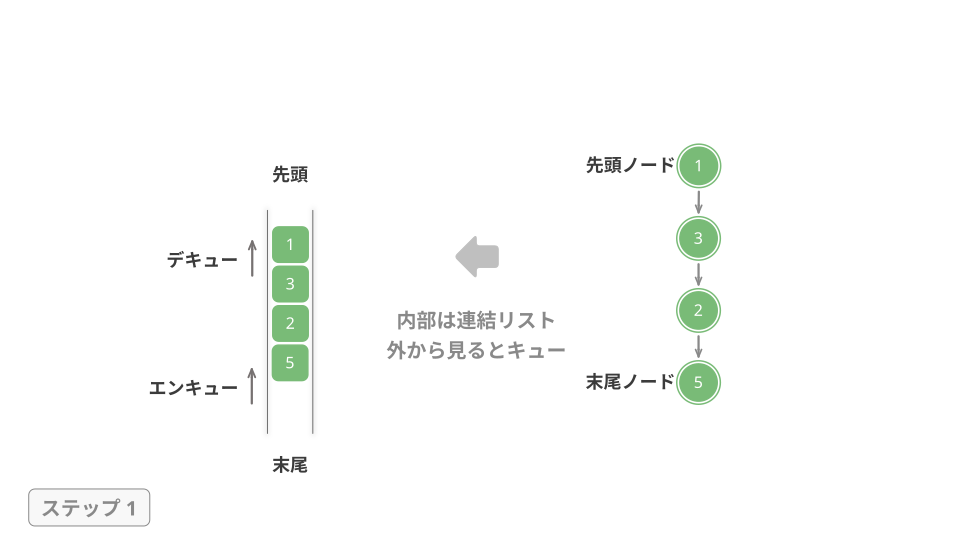
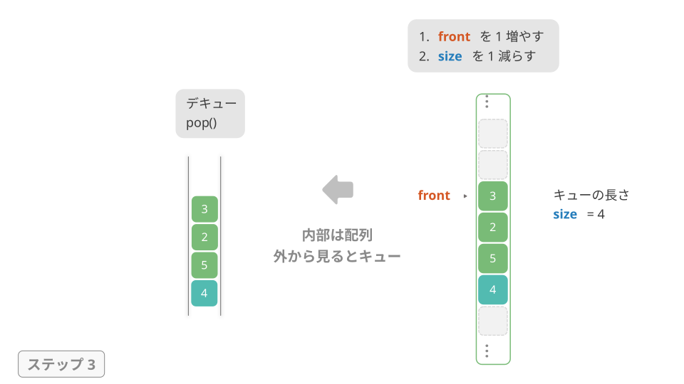

# 5.2 &nbsp; キュー

<u>キュー（queue）</u>は、先入れ先出しの規則に従う線形データ構造です。キューという名前のとおり、人が列に並ぶ様子を表しています。新しく来た人は次々と列の最後に並び、先頭の人から順に列を離れます。

図 5-4 のように、列の前端をキューの「先頭」、後端を「末尾」と呼びます。末尾に要素を追加する操作を「エンキュー」、先頭の要素を取り除く操作を「デキュー」と呼びます。

{ class="animation-figure" }

<p align="center"> 図 5-4 &nbsp; キューの先入れ先出しの規則 </p>

## 5.2.1 &nbsp; キューの基本操作

キューでよく使う操作を表 5-2 に示します。メソッド名はプログラミング言語によって異なることがあります。ここでは、スタックと同じメソッド名を使います。

<p align="center"> 表 5-2 &nbsp; キューの各操作の時間計算量 </p>

<div class="center-table" markdown>

| メソッド名   | 説明                         | 時間計算量 |
| -------- | ---------------------------- | ---------- |
| `push()` | 要素をエンキューする（末尾に追加する） | $O(1)$     |
| `pop()`  | 先頭の要素をデキューする                 | $O(1)$     |
| `peek()` | 先頭の要素を参照する                 | $O(1)$     |

</div>

プログラミング言語が用意しているキューのクラスを、そのまま利用できます。

=== "Python"

    ```python title="queue.py"
    from collections import deque

    # キューを初期化する
    # Python では一般に、両端キューのクラス deque をキューとして使う
    # queue.Queue() はキュー専用のクラスだが、使いづらいため推奨しない
    que: deque[int] = deque()

    # 要素をキューに追加する
    que.append(1)
    que.append(3)
    que.append(2)
    que.append(5)
    que.append(4)

    # キューの先頭要素を参照する
    front: int = que[0]

    # キューから要素を取り出す
    pop: int = que.popleft()

    # キューの要素数を取得する
    size: int = len(que)

    # キューが空かどうかを判定する
    is_empty: bool = len(que) == 0
    ```

=== "C++"

    ```cpp title="queue.cpp"
    /* キューを初期化する */
    queue<int> queue;

    /* 要素をキューに追加する */
    queue.push(1);
    queue.push(3);
    queue.push(2);
    queue.push(5);
    queue.push(4);

    /* キューの先頭要素を参照する */
    int front = queue.front();

    /* キューから要素を取り出す */
    queue.pop();

    /* キューの要素数を取得する */
    int size = queue.size();

    /* キューが空かどうかを判定する */
    bool empty = queue.empty();
    ```

=== "Java"

    ```java title="queue.java"
    /* キューを初期化する */
    Queue<Integer> queue = new LinkedList<>();

    /* 要素をキューに追加する */
    queue.offer(1);
    queue.offer(3);
    queue.offer(2);
    queue.offer(5);
    queue.offer(4);

    /* キューの先頭要素を参照する */
    int peek = queue.peek();

    /* キューから要素を取り出す */
    int pop = queue.poll();

    /* キューの要素数を取得する */
    int size = queue.size();

    /* キューが空かどうかを判定する */
    boolean isEmpty = queue.isEmpty();
    ```

=== "C#"

    ```csharp title="queue.cs"
    /* キューを初期化する */
    Queue<int> queue = new();

    /* 要素をキューに追加する */
    queue.Enqueue(1);
    queue.Enqueue(3);
    queue.Enqueue(2);
    queue.Enqueue(5);
    queue.Enqueue(4);

    /* キューの先頭要素を参照する */
    int peek = queue.Peek();

    /* キューから要素を取り出す */
    int pop = queue.Dequeue();

    /* キューの要素数を取得する */
    int size = queue.Count;

    /* キューが空かどうかを判定する */
    bool isEmpty = queue.Count == 0;
    ```

=== "Go"

    ```go title="queue_test.go"
    /* キューを初期化する */
    // Go では list をキューとして使う
    queue := list.New()

    /* 要素をキューに追加する */
    queue.PushBack(1)
    queue.PushBack(3)
    queue.PushBack(2)
    queue.PushBack(5)
    queue.PushBack(4)

    /* キューの先頭要素を参照する */
    peek := queue.Front()

    /* キューから要素を取り出す */
    pop := queue.Front()
    queue.Remove(pop)

    /* キューの要素数を取得する */
    size := queue.Len()

    /* キューが空かどうかを判定する */
    isEmpty := queue.Len() == 0
    ```

=== "Swift"

    ```swift title="queue.swift"
    /* キューを初期化する */
    // Swift には組み込みのキュークラスがないので、Array をキューとして使える
    var queue: [Int] = []

    /* 要素をキューに追加する */
    queue.append(1)
    queue.append(3)
    queue.append(2)
    queue.append(5)
    queue.append(4)

    /* キューの先頭要素を参照する */
    let peek = queue.first!

    /* キューから要素を取り出す */
    // Array でキューの動作を再現すると、removeFirst の時間計算量は O(n) になる
    let pop = queue.removeFirst()

    /* キューの要素数を取得する */
    let size = queue.count

    /* キューが空かどうかを判定する */
    let isEmpty = queue.isEmpty
    ```

=== "JS"

    ```javascript title="queue.js"
    /* キューを初期化する */
    // JavaScript には組み込みのキューがないので、Array をキューとして使える
    const queue = [];

    /* 要素をキューに追加する */
    queue.push(1);
    queue.push(3);
    queue.push(2);
    queue.push(5);
    queue.push(4);

    /* キューの先頭要素を参照する */
    const peek = queue[0];

    /* キューから要素を取り出す */
    // 内部では配列を使うため、shift() の時間計算量は O(n) になる
    const pop = queue.shift();

    /* キューの要素数を取得する */
    const size = queue.length;

    /* キューが空かどうかを判定する */
    const isEmpty = queue.length === 0;
    ```

=== "TS"

    ```typescript title="queue.ts"
    /* キューを初期化する */
    // TypeScript には組み込みのキューがないので、Array をキューとして使える
    const queue: number[] = [];

    /* 要素をキューに追加する */
    queue.push(1);
    queue.push(3);
    queue.push(2);
    queue.push(5);
    queue.push(4);

    /* キューの先頭要素を参照する */
    const peek = queue[0];

    /* キューから要素を取り出す */
    // 内部では配列を使うため、shift() の時間計算量は O(n) になる
    const pop = queue.shift();

    /* キューの要素数を取得する */
    const size = queue.length;

    /* キューが空かどうかを判定する */
    const isEmpty = queue.length === 0;
    ```

=== "Dart"

    ```dart title="queue.dart"
    /* キューを初期化する */
    // Dart では一般に、両端キューのクラス Queue をキューとして使う
    final Queue<int> queue = Queue();

    /* 要素をキューに追加する */
    queue.add(1);
    queue.add(3);
    queue.add(2);
    queue.add(5);
    queue.add(4);

    /* キューの先頭要素を参照する */
    final int peek = queue.first;

    /* キューから要素を取り出す */
    final int pop = queue.removeFirst();

    /* キューの要素数を取得する */
    final int size = queue.length;

    /* キューが空かどうかを判定する */
    final bool isEmpty = queue.isEmpty;
    ```

=== "Rust"

    ```rust title="queue.rs"
    // キューを初期化する
    // Rust では一般に、両端キュー VecDeque をキューとして使う
    let mut queue: VecDeque<i32> = VecDeque::new();

    // 要素をキューに追加する
    queue.push_back(1);
    queue.push_back(3);
    queue.push_back(2);
    queue.push_back(5);
    queue.push_back(4);

    // キューの先頭要素を参照する
    let peek = queue.front().unwrap();

    // キューから要素を取り出す
    let pop = queue.pop_front().unwrap();

    // キューの要素数を取得する
    let size = queue.len();

    // キューが空かどうかを判定する
    let is_empty = queue.is_empty();
    ```

=== "C"

    ```c title="queue.c"
    // C には組み込みのキューがない
    ```

=== "Kotlin"

    ```kotlin title="queue.kt"
    /* キューを初期化する */
    val queue = LinkedList<Int>()

    /* 要素をキューに追加する */
    queue.offer(1)
    queue.offer(3)
    queue.offer(2)
    queue.offer(5)
    queue.offer(4)

    /* キューの先頭要素を参照する */
    val peek = queue.peek()

    /* キューから要素を取り出す */
    val pop = queue.poll()

    /* キューの要素数を取得する */
    val size = queue.size

    /* キューが空かどうかを判定する */
    val isEmpty = queue.isEmpty()
    ```

=== "Ruby"

    ```ruby title="queue.rb"
    # キューを初期化する
    # Ruby 組み込みのキュー（Thread::Queue）には peek メソッドも要素を順にたどるメソッドもないので、Array をキューとして使える
    queue = []

    # 要素をキューに追加する
    queue.push(1)
    queue.push(3)
    queue.push(2)
    queue.push(5)
    queue.push(4)

    # キューの要素を参照する
    peek = queue.first

    # キューから要素を取り出す
    # 配列を使うため、Array#shift の時間計算量は O(n) になる点に注意
    pop = queue.shift

    # キューの要素数を取得する
    size = queue.length

    # キューが空かどうかを判定する
    is_empty = queue.empty?
    ```

??? pythontutor "実行の様子を見る"

    <div style="height: 549px; width: 100%;"><iframe class="pythontutor-iframe" title="実行の様子を見る" src="https://pythontutor.com/iframe-embed.html#code=from%20collections%20import%20deque%0A%0A%22%22%22Driver%20Code%22%22%22%0Aif%20__name__%20%3D%3D%20%22__main__%22%3A%0A%20%20%20%20%23%20%E3%82%AD%E3%83%A5%E3%83%BC%E3%82%92%E5%88%9D%E6%9C%9F%E5%8C%96%0A%20%20%20%20%23%20Python%20%E3%81%A7%E3%81%AF%E9%80%9A%E5%B8%B8%E3%80%81%E4%B8%A1%E7%AB%AF%E3%82%AD%E3%83%A5%E3%83%BC%E3%81%AE%E3%82%AF%E3%83%A9%E3%82%B9%20deque%20%E3%82%92%E3%82%AD%E3%83%A5%E3%83%BC%E3%81%A8%E3%81%97%E3%81%A6%E4%BD%BF%E3%81%86%0A%20%20%20%20%23%20queue.Queue%28%29%20%E3%81%AF%E3%82%AD%E3%83%A5%E3%83%BC%E5%B0%82%E7%94%A8%E3%81%AE%E3%82%AF%E3%83%A9%E3%82%B9%E3%81%A0%E3%81%8C%E3%80%81%E3%82%84%E3%82%84%E4%BD%BF%E3%81%84%E3%81%AB%E3%81%8F%E3%81%84%0A%20%20%20%20que%20%3D%20deque%28%29%0A%0A%20%20%20%20%23%20%E3%82%AD%E3%83%A5%E3%83%BC%E3%81%AB%E8%A6%81%E7%B4%A0%E3%82%92%E8%BF%BD%E5%8A%A0%0A%20%20%20%20que.append%281%29%0A%20%20%20%20que.append%283%29%0A%20%20%20%20que.append%282%29%0A%20%20%20%20que.append%285%29%0A%20%20%20%20que.append%284%29%0A%20%20%20%20print%28%22%E3%82%AD%E3%83%A5%E3%83%BC%20que%20%3D%22,%20que%29%0A%0A%20%20%20%20%23%20%E5%85%88%E9%A0%AD%E3%81%AE%E8%A6%81%E7%B4%A0%E3%81%AB%E3%82%A2%E3%82%AF%E3%82%BB%E3%82%B9%0A%20%20%20%20front%20%3D%20que%5B0%5D%0A%20%20%20%20print%28%22%E5%85%88%E9%A0%AD%E3%81%AE%E8%A6%81%E7%B4%A0%20front%20%3D%22,%20front%29%0A%0A%20%20%20%20%23%20%E3%82%AD%E3%83%A5%E3%83%BC%E3%81%8B%E3%82%89%E8%A6%81%E7%B4%A0%E3%82%92%E5%8F%96%E3%82%8A%E5%87%BA%E3%81%99%0A%20%20%20%20pop%20%3D%20que.popleft%28%29%0A%20%20%20%20print%28%22%E5%8F%96%E3%82%8A%E5%87%BA%E3%81%97%E3%81%9F%E8%A6%81%E7%B4%A0%20pop%20%3D%22,%20pop%29%0A%20%20%20%20print%28%22%E5%8F%96%E3%82%8A%E5%87%BA%E3%81%97%E3%81%9F%E5%BE%8C%E3%81%AE%20que%20%3D%22,%20que%29%0A%0A%20%20%20%20%23%20%E3%82%AD%E3%83%A5%E3%83%BC%E3%81%AE%E9%95%B7%E3%81%95%E3%82%92%E5%8F%96%E5%BE%97%0A%20%20%20%20size%20%3D%20len%28que%29%0A%20%20%20%20print%28%22%E3%82%AD%E3%83%A5%E3%83%BC%E3%81%AE%E9%95%B7%E3%81%95%20size%20%3D%22,%20size%29%0A%0A%20%20%20%20%23%20%E3%82%AD%E3%83%A5%E3%83%BC%E3%81%8C%E7%A9%BA%E3%81%8B%E3%81%A9%E3%81%86%E3%81%8B%E3%82%92%E5%88%A4%E5%AE%9A%0A%20%20%20%20is_empty%20%3D%20len%28que%29%20%3D%3D%200%0A%20%20%20%20print%28%22%E3%82%AD%E3%83%A5%E3%83%BC%E3%81%8C%E7%A9%BA%E3%81%8B%E3%81%A9%E3%81%86%E3%81%8B%20%3D%22,%20is_empty%29&codeDivHeight=472&codeDivWidth=350&cumulative=false&curInstr=3&heapPrimitives=nevernest&origin=opt-frontend.js&py=311&rawInputLstJSON=%5B%5D&textReferences=false"> </iframe></div>
    <div style="margin-top: 5px;"><a href="https://pythontutor.com/iframe-embed.html#code=from%20collections%20import%20deque%0A%0A%22%22%22Driver%20Code%22%22%22%0Aif%20__name__%20%3D%3D%20%22__main__%22%3A%0A%20%20%20%20%23%20%E3%82%AD%E3%83%A5%E3%83%BC%E3%82%92%E5%88%9D%E6%9C%9F%E5%8C%96%0A%20%20%20%20%23%20Python%20%E3%81%A7%E3%81%AF%E9%80%9A%E5%B8%B8%E3%80%81%E4%B8%A1%E7%AB%AF%E3%82%AD%E3%83%A5%E3%83%BC%E3%81%AE%E3%82%AF%E3%83%A9%E3%82%B9%20deque%20%E3%82%92%E3%82%AD%E3%83%A5%E3%83%BC%E3%81%A8%E3%81%97%E3%81%A6%E4%BD%BF%E3%81%86%0A%20%20%20%20%23%20queue.Queue%28%29%20%E3%81%AF%E3%82%AD%E3%83%A5%E3%83%BC%E5%B0%82%E7%94%A8%E3%81%AE%E3%82%AF%E3%83%A9%E3%82%B9%E3%81%A0%E3%81%8C%E3%80%81%E3%82%84%E3%82%84%E4%BD%BF%E3%81%84%E3%81%AB%E3%81%8F%E3%81%84%0A%20%20%20%20que%20%3D%20deque%28%29%0A%0A%20%20%20%20%23%20%E3%82%AD%E3%83%A5%E3%83%BC%E3%81%AB%E8%A6%81%E7%B4%A0%E3%82%92%E8%BF%BD%E5%8A%A0%0A%20%20%20%20que.append%281%29%0A%20%20%20%20que.append%283%29%0A%20%20%20%20que.append%282%29%0A%20%20%20%20que.append%285%29%0A%20%20%20%20que.append%284%29%0A%20%20%20%20print%28%22%E3%82%AD%E3%83%A5%E3%83%BC%20que%20%3D%22,%20que%29%0A%0A%20%20%20%20%23%20%E5%85%88%E9%A0%AD%E3%81%AE%E8%A6%81%E7%B4%A0%E3%81%AB%E3%82%A2%E3%82%AF%E3%82%BB%E3%82%B9%0A%20%20%20%20front%20%3D%20que%5B0%5D%0A%20%20%20%20print%28%22%E5%85%88%E9%A0%AD%E3%81%AE%E8%A6%81%E7%B4%A0%20front%20%3D%22,%20front%29%0A%0A%20%20%20%20%23%20%E3%82%AD%E3%83%A5%E3%83%BC%E3%81%8B%E3%82%89%E8%A6%81%E7%B4%A0%E3%82%92%E5%8F%96%E3%82%8A%E5%87%BA%E3%81%99%0A%20%20%20%20pop%20%3D%20que.popleft%28%29%0A%20%20%20%20print%28%22%E5%8F%96%E3%82%8A%E5%87%BA%E3%81%97%E3%81%9F%E8%A6%81%E7%B4%A0%20pop%20%3D%22,%20pop%29%0A%20%20%20%20print%28%22%E5%8F%96%E3%82%8A%E5%87%BA%E3%81%97%E3%81%9F%E5%BE%8C%E3%81%AE%20que%20%3D%22,%20que%29%0A%0A%20%20%20%20%23%20%E3%82%AD%E3%83%A5%E3%83%BC%E3%81%AE%E9%95%B7%E3%81%95%E3%82%92%E5%8F%96%E5%BE%97%0A%20%20%20%20size%20%3D%20len%28que%29%0A%20%20%20%20print%28%22%E3%82%AD%E3%83%A5%E3%83%BC%E3%81%AE%E9%95%B7%E3%81%95%20size%20%3D%22,%20size%29%0A%0A%20%20%20%20%23%20%E3%82%AD%E3%83%A5%E3%83%BC%E3%81%8C%E7%A9%BA%E3%81%8B%E3%81%A9%E3%81%86%E3%81%8B%E3%82%92%E5%88%A4%E5%AE%9A%0A%20%20%20%20is_empty%20%3D%20len%28que%29%20%3D%3D%200%0A%20%20%20%20print%28%22%E3%82%AD%E3%83%A5%E3%83%BC%E3%81%8C%E7%A9%BA%E3%81%8B%E3%81%A9%E3%81%86%E3%81%8B%20%3D%22,%20is_empty%29&codeDivHeight=800&codeDivWidth=600&cumulative=false&curInstr=3&heapPrimitives=nevernest&origin=opt-frontend.js&py=311&rawInputLstJSON=%5B%5D&textReferences=false" target="_blank" rel="noopener noreferrer">全画面で表示 ></a></div>

## 5.2.2 &nbsp; キューの実装

キューを実装するには、一方の端で要素を追加し、もう一方の端で要素を削除できるデータ構造が必要です。連結リストと配列は、どちらもこの条件を満たします。

### 1. &nbsp; 連結リストによる実装

図 5-5 のように、連結リストの「先頭ノード」をキューの「先頭」、「末尾ノード」をキューの「末尾」とみなします。末尾ではノードの追加だけを、先頭ではノードの削除だけを許します。

=== "<1>"
    { class="animation-figure" }

=== "<2>"
    { class="animation-figure" }

=== "<3>"
    { class="animation-figure" }

<p align="center"> 図 5-5 &nbsp; 連結リストで実装したキューのエンキューとデキュー </p>

連結リストでキューを実装するコードを以下に示します。

=== "Python"

    ```python title="linkedlist_queue.py"
    class LinkedListQueue:
        """連結リストを使ったキュー"""

        def __init__(self):
            """初期化メソッド"""
            self._front: ListNode | None = None  # 先頭ノード front
            self._rear: ListNode | None = None  # 末尾ノード rear
            self._size: int = 0

        def size(self) -> int:
            """キューの要素数を取得する"""
            return self._size

        def is_empty(self) -> bool:
            """キューが空かどうかを判定する"""
            return self._size == 0

        def push(self, num: int):
            """エンキューする"""
            # 値が num のノードを末尾ノードの後ろに追加する
            node = ListNode(num)
            # キューが空なら、先頭と末尾の両方がこのノードを指すようにする
            if self._front is None:
                self._front = node
                self._rear = node
            # キューが空でなければ、このノードを末尾ノードの後ろにつなぐ
            else:
                self._rear.next = node
                self._rear = node
            self._size += 1

        def pop(self) -> int:
            """デキューする"""
            num = self.peek()
            # 先頭ノードを削除する
            self._front = self._front.next
            self._size -= 1
            return num

        def peek(self) -> int:
            """キューの先頭要素を参照する"""
            if self.is_empty():
                raise IndexError("キューが空です")
            return self._front.val

        def to_list(self) -> list[int]:
            """表示用のリストに変換する"""
            queue = []
            temp = self._front
            while temp:
                queue.append(temp.val)
                temp = temp.next
            return queue
    ```

=== "C++"

    ```cpp title="linkedlist_queue.cpp"
    /* 連結リストを使ったキュー */
    class LinkedListQueue {
      private:
        ListNode *front, *rear; // front は先頭ノード、rear は末尾ノードを指す
        int queSize;

      public:
        LinkedListQueue() {
            front = nullptr;
            rear = nullptr;
            queSize = 0;
        }

        ~LinkedListQueue() {
            // 連結リストをたどり、各ノードを削除してメモリを解放する
            freeMemoryLinkedList(front);
        }

        /* キューの要素数を取得する */
        int size() {
            return queSize;
        }

        /* キューが空かどうかを判定する */
        bool isEmpty() {
            return queSize == 0;
        }

        /* エンキューする */
        void push(int num) {
            // 値が num のノードを末尾ノードの後ろに追加する
            ListNode *node = new ListNode(num);
            // キューが空なら、先頭と末尾の両方がこのノードを指すようにする
            if (front == nullptr) {
                front = node;
                rear = node;
            }
            // キューが空でなければ、このノードを末尾ノードの後ろにつなぐ
            else {
                rear->next = node;
                rear = node;
            }
            queSize++;
        }

        /* デキューする */
        int pop() {
            int num = peek();
            // 先頭ノードを削除する
            ListNode *tmp = front;
            front = front->next;
            // メモリを解放する
            delete tmp;
            queSize--;
            return num;
        }

        /* キューの先頭要素を参照する */
        int peek() {
            if (size() == 0)
                throw out_of_range("キューが空です");
            return front->val;
        }

        /* 連結リストを vector に変換して返す */
        vector<int> toVector() {
            ListNode *node = front;
            vector<int> res(size());
            for (int i = 0; i < res.size(); i++) {
                res[i] = node->val;
                node = node->next;
            }
            return res;
        }
    };
    ```

=== "Java"

    ```java title="linkedlist_queue.java"
    /* 連結リストを使ったキュー */
    class LinkedListQueue {
        private ListNode front, rear; // front は先頭ノード、rear は末尾ノードを指す
        private int queSize = 0;

        public LinkedListQueue() {
            front = null;
            rear = null;
        }

        /* キューの要素数を取得する */
        public int size() {
            return queSize;
        }

        /* キューが空かどうかを判定する */
        public boolean isEmpty() {
            return size() == 0;
        }

        /* エンキューする */
        public void push(int num) {
            // 値が num のノードを末尾ノードの後ろに追加する
            ListNode node = new ListNode(num);
            // キューが空なら、先頭と末尾の両方がこのノードを指すようにする
            if (front == null) {
                front = node;
                rear = node;
            // キューが空でなければ、このノードを末尾ノードの後ろにつなぐ
            } else {
                rear.next = node;
                rear = node;
            }
            queSize++;
        }

        /* デキューする */
        public int pop() {
            int num = peek();
            // 先頭ノードを削除する
            front = front.next;
            queSize--;
            return num;
        }

        /* キューの先頭要素を参照する */
        public int peek() {
            if (isEmpty())
                throw new IndexOutOfBoundsException();
            return front.val;
        }

        /* 連結リストを配列に変換して返す */
        public int[] toArray() {
            ListNode node = front;
            int[] res = new int[size()];
            for (int i = 0; i < res.length; i++) {
                res[i] = node.val;
                node = node.next;
            }
            return res;
        }
    }
    ```

=== "C#"

    ```csharp title="linkedlist_queue.cs"
    /* 連結リストを使ったキュー */
    class LinkedListQueue {
        ListNode? front, rear;  // front は先頭ノード、rear は末尾ノードを指す 
        int queSize = 0;

        public LinkedListQueue() {
            front = null;
            rear = null;
        }

        /* キューの要素数を取得する */
        public int Size() {
            return queSize;
        }

        /* キューが空かどうかを判定する */
        public bool IsEmpty() {
            return Size() == 0;
        }

        /* エンキューする */
        public void Push(int num) {
            // 値が num のノードを末尾ノードの後ろに追加する
            ListNode node = new(num);
            // キューが空なら、先頭と末尾の両方がこのノードを指すようにする
            if (front == null) {
                front = node;
                rear = node;
                // キューが空でなければ、このノードを末尾ノードの後ろにつなぐ
            } else if (rear != null) {
                rear.next = node;
                rear = node;
            }
            queSize++;
        }

        /* デキューする */
        public int Pop() {
            int num = Peek();
            // 先頭ノードを削除する
            front = front?.next;
            queSize--;
            return num;
        }

        /* キューの先頭要素を参照する */
        public int Peek() {
            if (IsEmpty())
                throw new Exception();
            return front!.val;
        }

        /* 連結リストを配列に変換して返す */
        public int[] ToArray() {
            if (front == null)
                return [];

            ListNode? node = front;
            int[] res = new int[Size()];
            for (int i = 0; i < res.Length; i++) {
                res[i] = node!.val;
                node = node.next;
            }
            return res;
        }
    }
    ```

=== "Go"

    ```go title="linkedlist_queue.go"
    /* 連結リストを使ったキュー */
    type linkedListQueue struct {
        // 標準ライブラリの list パッケージを使ってキューを実装する
        data *list.List
    }

    /* キューを初期化する */
    func newLinkedListQueue() *linkedListQueue {
        return &linkedListQueue{
            data: list.New(),
        }
    }

    /* エンキューする */
    func (s *linkedListQueue) push(value any) {
        s.data.PushBack(value)
    }

    /* デキューする */
    func (s *linkedListQueue) pop() any {
        if s.isEmpty() {
            return nil
        }
        e := s.data.Front()
        s.data.Remove(e)
        return e.Value
    }

    /* キューの先頭要素を参照する */
    func (s *linkedListQueue) peek() any {
        if s.isEmpty() {
            return nil
        }
        e := s.data.Front()
        return e.Value
    }

    /* キューの要素数を取得する */
    func (s *linkedListQueue) size() int {
        return s.data.Len()
    }

    /* キューが空かどうかを判定する */
    func (s *linkedListQueue) isEmpty() bool {
        return s.data.Len() == 0
    }

    /* 表示用にリストを取得する */
    func (s *linkedListQueue) toList() *list.List {
        return s.data
    }
    ```

=== "Swift"

    ```swift title="linkedlist_queue.swift"
    /* 連結リストを使ったキュー */
    class LinkedListQueue {
        private var front: ListNode? // 先頭ノード
        private var rear: ListNode? // 末尾ノード
        private var _size: Int

        init() {
            _size = 0
        }

        /* キューの要素数を取得する */
        func size() -> Int {
            _size
        }

        /* キューが空かどうかを判定する */
        func isEmpty() -> Bool {
            size() == 0
        }

        /* エンキューする */
        func push(num: Int) {
            // 値が num のノードを末尾ノードの後ろに追加する
            let node = ListNode(x: num)
            // キューが空なら、先頭と末尾の両方がこのノードを指すようにする
            if front == nil {
                front = node
                rear = node
            }
            // キューが空でなければ、このノードを末尾ノードの後ろにつなぐ
            else {
                rear?.next = node
                rear = node
            }
            _size += 1
        }

        /* デキューする */
        @discardableResult
        func pop() -> Int {
            let num = peek()
            // 先頭ノードを削除する
            front = front?.next
            _size -= 1
            return num
        }

        /* キューの先頭要素を参照する */
        func peek() -> Int {
            if isEmpty() {
                fatalError("キューが空です")
            }
            return front!.val
        }

        /* 連結リストを配列に変換して返す */
        func toArray() -> [Int] {
            var node = front
            var res = Array(repeating: 0, count: size())
            for i in res.indices {
                res[i] = node!.val
                node = node?.next
            }
            return res
        }
    }
    ```

=== "JS"

    ```javascript title="linkedlist_queue.js"
    /* 連結リストを使ったキュー */
    class LinkedListQueue {
        #front; // 先頭ノード #front
        #rear; // 末尾ノード #rear
        #queSize = 0;

        constructor() {
            this.#front = null;
            this.#rear = null;
        }

        /* キューの要素数を取得する */
        get size() {
            return this.#queSize;
        }

        /* キューが空かどうかを判定する */
        isEmpty() {
            return this.size === 0;
        }

        /* エンキューする */
        push(num) {
            // 値が num のノードを末尾ノードの後ろに追加する
            const node = new ListNode(num);
            // キューが空なら、先頭と末尾の両方がこのノードを指すようにする
            if (!this.#front) {
                this.#front = node;
                this.#rear = node;
                // キューが空でなければ、このノードを末尾ノードの後ろにつなぐ
            } else {
                this.#rear.next = node;
                this.#rear = node;
            }
            this.#queSize++;
        }

        /* デキューする */
        pop() {
            const num = this.peek();
            // 先頭ノードを削除する
            this.#front = this.#front.next;
            this.#queSize--;
            return num;
        }

        /* キューの先頭要素を参照する */
        peek() {
            if (this.size === 0) throw new Error('キューが空です');
            return this.#front.val;
        }

        /* 連結リストを配列に変換して返す */
        toArray() {
            let node = this.#front;
            const res = new Array(this.size);
            for (let i = 0; i < res.length; i++) {
                res[i] = node.val;
                node = node.next;
            }
            return res;
        }
    }
    ```

=== "TS"

    ```typescript title="linkedlist_queue.ts"
    /* 連結リストを使ったキュー */
    class LinkedListQueue {
        private front: ListNode | null; // 先頭ノード front
        private rear: ListNode | null; // 末尾ノード rear
        private queSize: number = 0;

        constructor() {
            this.front = null;
            this.rear = null;
        }

        /* キューの要素数を取得する */
        get size(): number {
            return this.queSize;
        }

        /* キューが空かどうかを判定する */
        isEmpty(): boolean {
            return this.size === 0;
        }

        /* エンキューする */
        push(num: number): void {
            // 値が num のノードを末尾ノードの後ろに追加する
            const node = new ListNode(num);
            // キューが空なら、先頭と末尾の両方がこのノードを指すようにする
            if (!this.front) {
                this.front = node;
                this.rear = node;
                // キューが空でなければ、このノードを末尾ノードの後ろにつなぐ
            } else {
                this.rear!.next = node;
                this.rear = node;
            }
            this.queSize++;
        }

        /* デキューする */
        pop(): number {
            const num = this.peek();
            if (!this.front) throw new Error('キューが空です');
            // 先頭ノードを削除する
            this.front = this.front.next;
            this.queSize--;
            return num;
        }

        /* キューの先頭要素を参照する */
        peek(): number {
            if (this.size === 0) throw new Error('キューが空です');
            return this.front!.val;
        }

        /* 連結リストを配列に変換して返す */
        toArray(): number[] {
            let node = this.front;
            const res = new Array<number>(this.size);
            for (let i = 0; i < res.length; i++) {
                res[i] = node!.val;
                node = node!.next;
            }
            return res;
        }
    }
    ```

=== "Dart"

    ```dart title="linkedlist_queue.dart"
    /* 連結リストを使ったキュー */
    class LinkedListQueue {
      ListNode? _front; // 先頭ノード _front
      ListNode? _rear; // 末尾ノード _rear
      int _queSize = 0; // キューの要素数

      LinkedListQueue() {
        _front = null;
        _rear = null;
      }

      /* キューの要素数を取得する */
      int size() {
        return _queSize;
      }

      /* キューが空かどうかを判定する */
      bool isEmpty() {
        return _queSize == 0;
      }

      /* エンキューする */
      void push(int _num) {
        // 値が _num のノードを末尾ノードの後ろに追加する
        final node = ListNode(_num);
        // キューが空なら、先頭と末尾の両方がこのノードを指すようにする
        if (_front == null) {
          _front = node;
          _rear = node;
        } else {
          // キューが空でなければ、このノードを末尾ノードの後ろにつなぐ
          _rear!.next = node;
          _rear = node;
        }
        _queSize++;
      }

      /* デキューする */
      int pop() {
        final int _num = peek();
        // 先頭ノードを削除する
        _front = _front!.next;
        _queSize--;
        return _num;
      }

      /* キューの先頭要素を参照する */
      int peek() {
        if (_queSize == 0) {
          throw Exception('キューが空です');
        }
        return _front!.val;
      }

      /* 連結リストを List に変換して返す */
      List<int> toArray() {
        ListNode? node = _front;
        final List<int> queue = [];
        while (node != null) {
          queue.add(node.val);
          node = node.next;
        }
        return queue;
      }
    }
    ```

=== "Rust"

    ```rust title="linkedlist_queue.rs"
    /* 連結リストを使ったキュー */
    #[allow(dead_code)]
    pub struct LinkedListQueue<T> {
        front: Option<Rc<RefCell<ListNode<T>>>>, // 先頭ノード front
        rear: Option<Rc<RefCell<ListNode<T>>>>,  // 末尾ノード rear
        que_size: usize,                         // キューの要素数
    }

    impl<T: Copy> LinkedListQueue<T> {
        pub fn new() -> Self {
            Self {
                front: None,
                rear: None,
                que_size: 0,
            }
        }

        /* キューの要素数を取得する */
        pub fn size(&self) -> usize {
            return self.que_size;
        }

        /* キューが空かどうかを判定する */
        pub fn is_empty(&self) -> bool {
            return self.que_size == 0;
        }

        /* エンキューする */
        pub fn push(&mut self, num: T) {
            // 値が num のノードを末尾ノードの後ろに追加する
            let new_rear = ListNode::new(num);
            match self.rear.take() {
                // キューが空でなければ、このノードを末尾ノードの後ろにつなぐ
                Some(old_rear) => {
                    old_rear.borrow_mut().next = Some(new_rear.clone());
                    self.rear = Some(new_rear);
                }
                // キューが空なら、先頭と末尾の両方がこのノードを指すようにする
                None => {
                    self.front = Some(new_rear.clone());
                    self.rear = Some(new_rear);
                }
            }
            self.que_size += 1;
        }

        /* デキューする */
        pub fn pop(&mut self) -> Option<T> {
            self.front.take().map(|old_front| {
                match old_front.borrow_mut().next.take() {
                    Some(new_front) => {
                        self.front = Some(new_front);
                    }
                    None => {
                        self.rear.take();
                    }
                }
                self.que_size -= 1;
                old_front.borrow().val
            })
        }

        /* 先頭ノードを参照する */
        pub fn peek(&self) -> Option<&Rc<RefCell<ListNode<T>>>> {
            self.front.as_ref()
        }

        /* 連結リストを Vec に変換して返す */
        pub fn to_array(&self, head: Option<&Rc<RefCell<ListNode<T>>>>) -> Vec<T> {
            let mut res: Vec<T> = Vec::new();

            fn recur<T: Copy>(cur: Option<&Rc<RefCell<ListNode<T>>>>, res: &mut Vec<T>) {
                if let Some(cur) = cur {
                    res.push(cur.borrow().val);
                    recur(cur.borrow().next.as_ref(), res);
                }
            }

            recur(head, &mut res);

            res
        }
    }
    ```

=== "C"

    ```c title="linkedlist_queue.c"
    /* 連結リストを使ったキュー */
    typedef struct {
        ListNode *front, *rear;
        int queSize;
    } LinkedListQueue;

    /* 生成関数 */
    LinkedListQueue *newLinkedListQueue() {
        LinkedListQueue *queue = (LinkedListQueue *)malloc(sizeof(LinkedListQueue));
        queue->front = NULL;
        queue->rear = NULL;
        queue->queSize = 0;
        return queue;
    }

    /* 解放関数 */
    void delLinkedListQueue(LinkedListQueue *queue) {
        // すべてのノードを解放する
        while (queue->front != NULL) {
            ListNode *tmp = queue->front;
            queue->front = queue->front->next;
            free(tmp);
        }
        // queue 構造体を解放する
        free(queue);
    }

    /* キューの要素数を取得する */
    int size(LinkedListQueue *queue) {
        return queue->queSize;
    }

    /* キューが空かどうかを判定する */
    bool empty(LinkedListQueue *queue) {
        return (size(queue) == 0);
    }

    /* エンキューする */
    void push(LinkedListQueue *queue, int num) {
        // node をリストの末尾に追加する
        ListNode *node = newListNode(num);
        // キューが空なら、先頭と末尾の両方がこのノードを指すようにする
        if (queue->front == NULL) {
            queue->front = node;
            queue->rear = node;
        }
        // キューが空でなければ、このノードを末尾ノードの後ろにつなぐ
        else {
            queue->rear->next = node;
            queue->rear = node;
        }
        queue->queSize++;
    }

    /* キューの先頭要素を参照する */
    int peek(LinkedListQueue *queue) {
        assert(size(queue) && queue->front);
        return queue->front->val;
    }

    /* デキューする */
    int pop(LinkedListQueue *queue) {
        int num = peek(queue);
        ListNode *tmp = queue->front;
        queue->front = queue->front->next;
        free(tmp);
        queue->queSize--;
        return num;
    }

    /* キューを表示する */
    void printLinkedListQueue(LinkedListQueue *queue) {
        int *arr = malloc(sizeof(int) * queue->queSize);
        // 連結リストのデータを配列にコピーする
        int i;
        ListNode *node;
        for (i = 0, node = queue->front; i < queue->queSize; i++) {
            arr[i] = node->val;
            node = node->next;
        }
        printArray(arr, queue->queSize);
        free(arr);
    }
    ```

=== "Kotlin"

    ```kotlin title="linkedlist_queue.kt"
    /* 連結リストを使ったキュー */
    class LinkedListQueue(
        // front は先頭ノード、rear は末尾ノードを指す
        private var front: ListNode? = null,
        private var rear: ListNode? = null,
        private var queSize: Int = 0
    ) {

        /* キューの要素数を取得する */
        fun size(): Int {
            return queSize
        }

        /* キューが空かどうかを判定する */
        fun isEmpty(): Boolean {
            return size() == 0
        }

        /* エンキューする */
        fun push(num: Int) {
            // 値が num のノードを末尾ノードの後ろに追加する
            val node = ListNode(num)
            // キューが空なら、先頭と末尾の両方がこのノードを指すようにする
            if (front == null) {
                front = node
                rear = node
                // キューが空でなければ、このノードを末尾ノードの後ろにつなぐ
            } else {
                rear?.next = node
                rear = node
            }
            queSize++
        }

        /* デキューする */
        fun pop(): Int {
            val num = peek()
            // 先頭ノードを削除する
            front = front?.next
            queSize--
            return num
        }

        /* キューの先頭要素を参照する */
        fun peek(): Int {
            if (isEmpty()) throw IndexOutOfBoundsException()
            return front!!._val
        }

        /* 連結リストを配列に変換して返す */
        fun toArray(): IntArray {
            var node = front
            val res = IntArray(size())
            for (i in res.indices) {
                res[i] = node!!._val
                node = node.next
            }
            return res
        }
    }
    ```

=== "Ruby"

    ```ruby title="linkedlist_queue.rb"
    ### 連結リストを使ったキュー ###
    class LinkedListQueue
      ### キューの要素数を取得する ###
      attr_reader :size

      ### 初期化メソッド ###
      def initialize
        @front = nil  # 先頭ノード front
        @rear = nil   # 末尾ノード rear
        @size = 0
      end

      ### キューが空かどうかを判定する ###
      def is_empty?
        @front.nil?
      end

      ### エンキューする ###
      def push(num)
        # 値が num のノードを末尾ノードの後ろに追加する
        node = ListNode.new(num)

        # キューが空なら、先頭と末尾の両方がこのノードを指すようにする
        if @front.nil?
          @front = node
          @rear = node
        # キューが空でなければ、このノードを末尾ノードの後ろにつなぐ
        else
          @rear.next = node
          @rear = node
        end

        @size += 1
      end

      ### デキューする ###
      def pop
        num = peek
        # 先頭ノードを削除する
        @front = @front.next
        @size -= 1
        num
      end

      ### キューの先頭要素を参照する ###
      def peek
        raise IndexError, 'キューが空です' if is_empty?

        @front.val
      end

      ### 連結リストを配列に変換して返す ###
      def to_array
        queue = []
        temp = @front
        while temp
          queue << temp.val
          temp = temp.next
        end
        queue
      end
    end
    ```

??? pythontutor "実行の様子を見る"

    <div style="height: 549px; width: 100%;"><iframe class="pythontutor-iframe" title="実行の様子を見る" src="https://pythontutor.com/iframe-embed.html#code=class%20ListNode%3A%0A%20%20%22%22%22%E9%80%A3%E7%B5%90%E3%83%AA%E3%82%B9%E3%83%88%E3%81%AE%E3%83%8E%E3%83%BC%E3%83%89%E3%82%AF%E3%83%A9%E3%82%B9%22%22%22%0A%20%20def%20__init__%28self,%20val%3A%20int%29%3A%0A%20%20%20%20self.val%3A%20int%20%3D%20val%20%20%23%20%E3%83%8E%E3%83%BC%E3%83%89%E3%81%AE%E5%80%A4%0A%20%20%20%20self.next%3A%20ListNode%20%7C%20None%20%3D%20None%20%20%23%20%E6%AC%A1%E3%81%AE%E3%83%8E%E3%83%BC%E3%83%89%E3%81%B8%E3%81%AE%E5%8F%82%E7%85%A7%0A%0A%0Aclass%20LinkedListQueue%3A%0A%20%20%22%22%22%E9%80%A3%E7%B5%90%E3%83%AA%E3%82%B9%E3%83%88%E3%81%AB%E3%82%88%E3%82%8B%E3%82%AD%E3%83%A5%E3%83%BC%22%22%22%0A%0A%20%20def%20__init__%28self%29%3A%0A%20%20%20%20%22%22%22%E3%82%B3%E3%83%B3%E3%82%B9%E3%83%88%E3%83%A9%E3%82%AF%E3%82%BF%22%22%22%0A%20%20%20%20self._front%3A%20ListNode%20%7C%20None%20%3D%20None%20%20%23%20%E5%85%88%E9%A0%AD%E3%83%8E%E3%83%BC%E3%83%89%20front%0A%20%20%20%20self._rear%3A%20ListNode%20%7C%20None%20%3D%20None%20%20%23%20%E6%9C%AB%E5%B0%BE%E3%83%8E%E3%83%BC%E3%83%89%20rear%0A%20%20%20%20self._size%3A%20int%20%3D%200%0A%0A%20%20def%20size%28self%29%20-%3E%20int%3A%0A%20%20%20%20%22%22%22%E8%A6%81%E7%B4%A0%E6%95%B0%E3%82%92%E8%BF%94%E3%81%99%22%22%22%0A%20%20%20%20return%20self._size%0A%0A%20%20def%20is_empty%28self%29%20-%3E%20bool%3A%0A%20%20%20%20%22%22%22%E3%82%AD%E3%83%A5%E3%83%BC%E3%81%8C%E7%A9%BA%E3%81%8B%E3%81%A9%E3%81%86%E3%81%8B%E3%82%92%E5%88%A4%E5%AE%9A%22%22%22%0A%20%20%20%20return%20not%20self._front%0A%0A%20%20def%20push%28self,%20num%3A%20int%29%3A%0A%20%20%20%20%22%22%22%E3%82%A8%E3%83%B3%E3%82%AD%E3%83%A5%E3%83%BC%22%22%22%0A%20%20%20%20%23%20%E6%9C%AB%E5%B0%BE%E3%83%8E%E3%83%BC%E3%83%89%E3%81%AE%E5%BE%8C%E3%81%AB%20num%20%E3%82%92%E8%BF%BD%E5%8A%A0%0A%20%20%20%20node%20%3D%20ListNode%28num%29%0A%20%20%20%20%23%20%E7%A9%BA%E3%81%AA%E3%82%89%20front%20%E3%81%A8%20rear%20%E3%81%AF%E3%81%A8%E3%82%82%E3%81%AB%E3%81%93%E3%81%AE%E3%83%8E%E3%83%BC%E3%83%89%E3%82%92%E6%8C%87%E3%81%99%0A%20%20%20%20if%20self._front%20is%20None%3A%0A%20%20%20%20%20%20self._front%20%3D%20node%0A%20%20%20%20%20%20self._rear%20%3D%20node%0A%20%20%20%20%23%20%E7%A9%BA%E3%81%A7%E3%81%AA%E3%81%91%E3%82%8C%E3%81%B0%E6%9C%AB%E5%B0%BE%E3%81%AB%E3%81%93%E3%81%AE%E3%83%8E%E3%83%BC%E3%83%89%E3%82%92%E3%81%A4%E3%81%AA%E3%81%90%0A%20%20%20%20else%3A%0A%20%20%20%20%20%20self._rear.next%20%3D%20node%0A%20%20%20%20%20%20self._rear%20%3D%20node%0A%20%20%20%20self._size%20%2B%3D%201%0A%0A%20%20def%20pop%28self%29%20-%3E%20int%3A%0A%20%20%20%20%22%22%22%E3%83%87%E3%82%AD%E3%83%A5%E3%83%BC%22%22%22%0A%20%20%20%20num%20%3D%20self.peek%28%29%0A%20%20%20%20%23%20%E5%85%88%E9%A0%AD%E3%83%8E%E3%83%BC%E3%83%89%E3%82%92%E5%89%8A%E9%99%A4%0A%20%20%20%20self._front%20%3D%20self._front.next%0A%20%20%20%20self._size%20-%3D%201%0A%20%20%20%20return%20num%0A%0A%20%20def%20peek%28self%29%20-%3E%20int%3A%0A%20%20%20%20%22%22%22%E5%85%88%E9%A0%AD%E8%A6%81%E7%B4%A0%E3%82%92%E5%8F%82%E7%85%A7%22%22%22%0A%20%20%20%20if%20self.is_empty%28%29%3A%0A%20%20%20%20%20%20raise%20IndexError%28%22%E3%82%AD%E3%83%A5%E3%83%BC%E3%81%AF%E7%A9%BA%E3%81%A7%E3%81%99%22%29%0A%20%20%20%20return%20self._front.val%0A%0A%20%20def%20to_list%28self%29%20-%3E%20list%5Bint%5D%3A%0A%20%20%20%20%22%22%22%E8%A1%A8%E7%A4%BA%E7%94%A8%E3%81%AE%E3%83%AA%E3%82%B9%E3%83%88%E3%81%AB%E5%A4%89%E6%8F%9B%22%22%22%0A%20%20%20%20queue%20%3D%20%5B%5D%0A%20%20%20%20temp%20%3D%20self._front%0A%20%20%20%20while%20temp%3A%0A%20%20%20%20%20%20queue.append%28temp.val%29%0A%20%20%20%20%20%20temp%20%3D%20temp.next%0A%20%20%20%20return%20queue%0A%0A%0A%22%22%22Driver%20Code%22%22%22%0Aif%20__name__%20%3D%3D%20%22__main__%22%3A%0A%20%20%23%20%E3%82%AD%E3%83%A5%E3%83%BC%E3%82%92%E5%88%9D%E6%9C%9F%E5%8C%96%0A%20%20queue%20%3D%20LinkedListQueue%28%29%0A%0A%20%20%23%20%E8%A6%81%E7%B4%A0%E3%82%92%E3%82%A8%E3%83%B3%E3%82%AD%E3%83%A5%E3%83%BC%0A%20%20queue.push%281%29%0A%20%20queue.push%283%29%0A%20%20queue.push%282%29%0A%20%20queue.push%285%29%0A%20%20queue.push%284%29%0A%20%20print%28%22%E3%82%AD%E3%83%A5%E3%83%BC%20queue%20%3D%22,%20queue.to_list%28%29%29%0A%0A%20%20%23%20%E5%85%88%E9%A0%AD%E8%A6%81%E7%B4%A0%E3%82%92%E5%8F%82%E7%85%A7%0A%20%20peek%20%3D%20queue.peek%28%29%0A%20%20print%28%22%E5%85%88%E9%A0%AD%E8%A6%81%E7%B4%A0%20front%20%3D%22,%20peek%29%0A%0A%20%20%23%20%E8%A6%81%E7%B4%A0%E3%82%92%E3%83%87%E3%82%AD%E3%83%A5%E3%83%BC%0A%20%20pop_front%20%3D%20queue.pop%28%29%0A%20%20print%28%22%E5%8F%96%E3%82%8A%E5%87%BA%E3%81%97%E3%81%9F%E8%A6%81%E7%B4%A0%20pop%20%3D%22,%20pop_front%29%0A%20%20print%28%22%E3%83%87%E3%82%AD%E3%83%A5%E3%83%BC%E5%BE%8C%E3%81%AE%20queue%20%3D%22,%20queue.to_list%28%29%29%0A%0A%20%20%23%20%E8%A6%81%E7%B4%A0%E6%95%B0%E3%82%92%E5%8F%96%E5%BE%97%0A%20%20size%20%3D%20queue.size%28%29%0A%20%20print%28%22%E8%A6%81%E7%B4%A0%E6%95%B0%20size%20%3D%22,%20size%29%0A%0A%20%20%23%20%E3%82%AD%E3%83%A5%E3%83%BC%E3%81%8C%E7%A9%BA%E3%81%8B%E3%81%A9%E3%81%86%E3%81%8B%E3%82%92%E5%88%A4%E5%AE%9A%0A%20%20is_empty%20%3D%20queue.is_empty%28%29%0A%20%20print%28%22%E3%82%AD%E3%83%A5%E3%83%BC%E3%81%8C%E7%A9%BA%E3%81%8B%20%3D%22,%20is_empty%29&codeDivHeight=472&codeDivWidth=350&cumulative=false&curInstr=4&heapPrimitives=nevernest&origin=opt-frontend.js&py=311&rawInputLstJSON=%5B%5D&textReferences=false"> </iframe></div>
    <div style="margin-top: 5px;"><a href="https://pythontutor.com/iframe-embed.html#code=class%20ListNode%3A%0A%20%20%22%22%22%E9%80%A3%E7%B5%90%E3%83%AA%E3%82%B9%E3%83%88%E3%81%AE%E3%83%8E%E3%83%BC%E3%83%89%E3%82%AF%E3%83%A9%E3%82%B9%22%22%22%0A%20%20def%20__init__%28self,%20val%3A%20int%29%3A%0A%20%20%20%20self.val%3A%20int%20%3D%20val%20%20%23%20%E3%83%8E%E3%83%BC%E3%83%89%E3%81%AE%E5%80%A4%0A%20%20%20%20self.next%3A%20ListNode%20%7C%20None%20%3D%20None%20%20%23%20%E6%AC%A1%E3%81%AE%E3%83%8E%E3%83%BC%E3%83%89%E3%81%B8%E3%81%AE%E5%8F%82%E7%85%A7%0A%0A%0Aclass%20LinkedListQueue%3A%0A%20%20%22%22%22%E9%80%A3%E7%B5%90%E3%83%AA%E3%82%B9%E3%83%88%E3%81%AB%E3%82%88%E3%82%8B%E3%82%AD%E3%83%A5%E3%83%BC%22%22%22%0A%0A%20%20def%20__init__%28self%29%3A%0A%20%20%20%20%22%22%22%E3%82%B3%E3%83%B3%E3%82%B9%E3%83%88%E3%83%A9%E3%82%AF%E3%82%BF%22%22%22%0A%20%20%20%20self._front%3A%20ListNode%20%7C%20None%20%3D%20None%20%20%23%20%E5%85%88%E9%A0%AD%E3%83%8E%E3%83%BC%E3%83%89%20front%0A%20%20%20%20self._rear%3A%20ListNode%20%7C%20None%20%3D%20None%20%20%23%20%E6%9C%AB%E5%B0%BE%E3%83%8E%E3%83%BC%E3%83%89%20rear%0A%20%20%20%20self._size%3A%20int%20%3D%200%0A%0A%20%20def%20size%28self%29%20-%3E%20int%3A%0A%20%20%20%20%22%22%22%E8%A6%81%E7%B4%A0%E6%95%B0%E3%82%92%E8%BF%94%E3%81%99%22%22%22%0A%20%20%20%20return%20self._size%0A%0A%20%20def%20is_empty%28self%29%20-%3E%20bool%3A%0A%20%20%20%20%22%22%22%E3%82%AD%E3%83%A5%E3%83%BC%E3%81%8C%E7%A9%BA%E3%81%8B%E3%81%A9%E3%81%86%E3%81%8B%E3%82%92%E5%88%A4%E5%AE%9A%22%22%22%0A%20%20%20%20return%20not%20self._front%0A%0A%20%20def%20push%28self,%20num%3A%20int%29%3A%0A%20%20%20%20%22%22%22%E3%82%A8%E3%83%B3%E3%82%AD%E3%83%A5%E3%83%BC%22%22%22%0A%20%20%20%20%23%20%E6%9C%AB%E5%B0%BE%E3%83%8E%E3%83%BC%E3%83%89%E3%81%AE%E5%BE%8C%E3%81%AB%20num%20%E3%82%92%E8%BF%BD%E5%8A%A0%0A%20%20%20%20node%20%3D%20ListNode%28num%29%0A%20%20%20%20%23%20%E7%A9%BA%E3%81%AA%E3%82%89%20front%20%E3%81%A8%20rear%20%E3%81%AF%E3%81%A8%E3%82%82%E3%81%AB%E3%81%93%E3%81%AE%E3%83%8E%E3%83%BC%E3%83%89%E3%82%92%E6%8C%87%E3%81%99%0A%20%20%20%20if%20self._front%20is%20None%3A%0A%20%20%20%20%20%20self._front%20%3D%20node%0A%20%20%20%20%20%20self._rear%20%3D%20node%0A%20%20%20%20%23%20%E7%A9%BA%E3%81%A7%E3%81%AA%E3%81%91%E3%82%8C%E3%81%B0%E6%9C%AB%E5%B0%BE%E3%81%AB%E3%81%93%E3%81%AE%E3%83%8E%E3%83%BC%E3%83%89%E3%82%92%E3%81%A4%E3%81%AA%E3%81%90%0A%20%20%20%20else%3A%0A%20%20%20%20%20%20self._rear.next%20%3D%20node%0A%20%20%20%20%20%20self._rear%20%3D%20node%0A%20%20%20%20self._size%20%2B%3D%201%0A%0A%20%20def%20pop%28self%29%20-%3E%20int%3A%0A%20%20%20%20%22%22%22%E3%83%87%E3%82%AD%E3%83%A5%E3%83%BC%22%22%22%0A%20%20%20%20num%20%3D%20self.peek%28%29%0A%20%20%20%20%23%20%E5%85%88%E9%A0%AD%E3%83%8E%E3%83%BC%E3%83%89%E3%82%92%E5%89%8A%E9%99%A4%0A%20%20%20%20self._front%20%3D%20self._front.next%0A%20%20%20%20self._size%20-%3D%201%0A%20%20%20%20return%20num%0A%0A%20%20def%20peek%28self%29%20-%3E%20int%3A%0A%20%20%20%20%22%22%22%E5%85%88%E9%A0%AD%E8%A6%81%E7%B4%A0%E3%82%92%E5%8F%82%E7%85%A7%22%22%22%0A%20%20%20%20if%20self.is_empty%28%29%3A%0A%20%20%20%20%20%20raise%20IndexError%28%22%E3%82%AD%E3%83%A5%E3%83%BC%E3%81%AF%E7%A9%BA%E3%81%A7%E3%81%99%22%29%0A%20%20%20%20return%20self._front.val%0A%0A%20%20def%20to_list%28self%29%20-%3E%20list%5Bint%5D%3A%0A%20%20%20%20%22%22%22%E8%A1%A8%E7%A4%BA%E7%94%A8%E3%81%AE%E3%83%AA%E3%82%B9%E3%83%88%E3%81%AB%E5%A4%89%E6%8F%9B%22%22%22%0A%20%20%20%20queue%20%3D%20%5B%5D%0A%20%20%20%20temp%20%3D%20self._front%0A%20%20%20%20while%20temp%3A%0A%20%20%20%20%20%20queue.append%28temp.val%29%0A%20%20%20%20%20%20temp%20%3D%20temp.next%0A%20%20%20%20return%20queue%0A%0A%0A%22%22%22Driver%20Code%22%22%22%0Aif%20__name__%20%3D%3D%20%22__main__%22%3A%0A%20%20%23%20%E3%82%AD%E3%83%A5%E3%83%BC%E3%82%92%E5%88%9D%E6%9C%9F%E5%8C%96%0A%20%20queue%20%3D%20LinkedListQueue%28%29%0A%0A%20%20%23%20%E8%A6%81%E7%B4%A0%E3%82%92%E3%82%A8%E3%83%B3%E3%82%AD%E3%83%A5%E3%83%BC%0A%20%20queue.push%281%29%0A%20%20queue.push%283%29%0A%20%20queue.push%282%29%0A%20%20queue.push%285%29%0A%20%20queue.push%284%29%0A%20%20print%28%22%E3%82%AD%E3%83%A5%E3%83%BC%20queue%20%3D%22,%20queue.to_list%28%29%29%0A%0A%20%20%23%20%E5%85%88%E9%A0%AD%E8%A6%81%E7%B4%A0%E3%82%92%E5%8F%82%E7%85%A7%0A%20%20peek%20%3D%20queue.peek%28%29%0A%20%20print%28%22%E5%85%88%E9%A0%AD%E8%A6%81%E7%B4%A0%20front%20%3D%22,%20peek%29%0A%0A%20%20%23%20%E8%A6%81%E7%B4%A0%E3%82%92%E3%83%87%E3%82%AD%E3%83%A5%E3%83%BC%0A%20%20pop_front%20%3D%20queue.pop%28%29%0A%20%20print%28%22%E5%8F%96%E3%82%8A%E5%87%BA%E3%81%97%E3%81%9F%E8%A6%81%E7%B4%A0%20pop%20%3D%22,%20pop_front%29%0A%20%20print%28%22%E3%83%87%E3%82%AD%E3%83%A5%E3%83%BC%E5%BE%8C%E3%81%AE%20queue%20%3D%22,%20queue.to_list%28%29%29%0A%0A%20%20%23%20%E8%A6%81%E7%B4%A0%E6%95%B0%E3%82%92%E5%8F%96%E5%BE%97%0A%20%20size%20%3D%20queue.size%28%29%0A%20%20print%28%22%E8%A6%81%E7%B4%A0%E6%95%B0%20size%20%3D%22,%20size%29%0A%0A%20%20%23%20%E3%82%AD%E3%83%A5%E3%83%BC%E3%81%8C%E7%A9%BA%E3%81%8B%E3%81%A9%E3%81%86%E3%81%8B%E3%82%92%E5%88%A4%E5%AE%9A%0A%20%20is_empty%20%3D%20queue.is_empty%28%29%0A%20%20print%28%22%E3%82%AD%E3%83%A5%E3%83%BC%E3%81%8C%E7%A9%BA%E3%81%8B%20%3D%22,%20is_empty%29&codeDivHeight=800&codeDivWidth=600&cumulative=false&curInstr=4&heapPrimitives=nevernest&origin=opt-frontend.js&py=311&rawInputLstJSON=%5B%5D&textReferences=false" target="_blank" rel="noopener noreferrer">全画面で表示 ></a></div>

### 2. &nbsp; 配列による実装

配列の先頭要素を削除するには $O(n)$ の時間がかかるため、そのままではデキューの効率がよくありません。そこで、次のように工夫します。

変数 `front` に先頭要素のインデックスを、変数 `size` にキューの長さを記録します。`rear = front + size` と定義すると、この式で求めた `rear` は末尾要素の次の位置を指します。

この設計では、**配列内でキューの要素が入っている有効範囲は `[front, rear - 1]` です**。各操作の実装を図 5-6 に示します。

- エンキューでは、インデックス `rear` の位置に入力された要素を格納し、`size` を 1 増やします。
- デキューでは、`front` を 1 増やし、`size` を 1 減らすだけです。

このように、エンキューもデキューも 1 回の操作で済み、時間計算量はいずれも $O(1)$ です。

=== "<1>"
    { class="animation-figure" }

=== "<2>"
    { class="animation-figure" }

=== "<3>"
    { class="animation-figure" }

<p align="center"> 図 5-6 &nbsp; 配列で実装したキューのエンキューとデキュー </p>

エンキューとデキューを繰り返すと、ある問題が見えてきます。`front` も `rear` も右に移動していき、**配列の末端に達すると、それ以上先に進めません**。この問題は、配列の先頭と末尾をつないだ「循環配列」として扱うことで解決できます。

循環配列では、`front` や `rear` が配列の末端を越えたら、すぐに先頭に戻って移動を続けるようにします。この周期的な動きは、次のコードのように剰余演算で実現できます。

=== "Python"

    ```python title="array_queue.py"
    class ArrayQueue:
        """循環配列を使ったキュー"""

        def __init__(self, size: int):
            """初期化メソッド"""
            self._nums: list[int] = [0] * size  # キューの要素を格納する配列
            self._front: int = 0  # キューの先頭要素を指すインデックス
            self._size: int = 0  # キューの要素数

        def capacity(self) -> int:
            """キューの容量を取得する"""
            return len(self._nums)

        def size(self) -> int:
            """キューの要素数を取得する"""
            return self._size

        def is_empty(self) -> bool:
            """キューが空かどうかを判定する"""
            return self._size == 0

        def push(self, num: int):
            """エンキューする"""
            if self._size == self.capacity():
                raise IndexError("キューが満杯です")
            # キューの末尾要素の次の位置を示すインデックスを求める
            # 剰余を使い、rear が配列の末尾を越えたら先頭に戻るようにする
            rear: int = (self._front + self._size) % self.capacity()
            # num をキューの末尾に追加する
            self._nums[rear] = num
            self._size += 1

        def pop(self) -> int:
            """デキューする"""
            num: int = self.peek()
            # 先頭のインデックスを 1 つ進め、配列の末尾を越えたら先頭に戻す
            self._front = (self._front + 1) % self.capacity()
            self._size -= 1
            return num

        def peek(self) -> int:
            """キューの先頭要素を参照する"""
            if self.is_empty():
                raise IndexError("キューが空です")
            return self._nums[self._front]

        def to_list(self) -> list[int]:
            """表示用のリストを返す"""
            res = [0] * self.size()
            j: int = self._front
            for i in range(self.size()):
                res[i] = self._nums[(j % self.capacity())]
                j += 1
            return res
    ```

=== "C++"

    ```cpp title="array_queue.cpp"
    /* 循環配列を使ったキュー */
    class ArrayQueue {
      private:
        int *nums;       // キューの要素を格納する配列
        int front;       // キューの先頭要素を指すインデックス
        int queSize;     // キューの要素数
        int queCapacity; // キューの容量

      public:
        ArrayQueue(int capacity) {
            // 配列を初期化する
            nums = new int[capacity];
            queCapacity = capacity;
            front = queSize = 0;
        }

        ~ArrayQueue() {
            delete[] nums;
        }

        /* キューの容量を取得する */
        int capacity() {
            return queCapacity;
        }

        /* キューの要素数を取得する */
        int size() {
            return queSize;
        }

        /* キューが空かどうかを判定する */
        bool isEmpty() {
            return size() == 0;
        }

        /* エンキューする */
        void push(int num) {
            if (queSize == queCapacity) {
                cout << "キューが満杯です" << endl;
                return;
            }
            // キューの末尾要素の次の位置を示すインデックスを求める
            // 剰余を使い、rear が配列の末尾を越えたら先頭に戻るようにする
            int rear = (front + queSize) % queCapacity;
            // num をキューの末尾に追加する
            nums[rear] = num;
            queSize++;
        }

        /* デキューする */
        int pop() {
            int num = peek();
            // 先頭のインデックスを 1 つ進め、配列の末尾を越えたら先頭に戻す
            front = (front + 1) % queCapacity;
            queSize--;
            return num;
        }

        /* キューの先頭要素を参照する */
        int peek() {
            if (isEmpty())
                throw out_of_range("キューが空です");
            return nums[front];
        }

        /* 配列を vector に変換して返す */
        vector<int> toVector() {
            // キューの要素数に当たる範囲だけを変換する
            vector<int> arr(queSize);
            for (int i = 0, j = front; i < queSize; i++, j++) {
                arr[i] = nums[j % queCapacity];
            }
            return arr;
        }
    };
    ```

=== "Java"

    ```java title="array_queue.java"
    /* 循環配列を使ったキュー */
    class ArrayQueue {
        private int[] nums; // キューの要素を格納する配列
        private int front; // キューの先頭要素を指すインデックス
        private int queSize; // キューの要素数

        public ArrayQueue(int capacity) {
            nums = new int[capacity];
            front = queSize = 0;
        }

        /* キューの容量を取得する */
        public int capacity() {
            return nums.length;
        }

        /* キューの要素数を取得する */
        public int size() {
            return queSize;
        }

        /* キューが空かどうかを判定する */
        public boolean isEmpty() {
            return queSize == 0;
        }

        /* エンキューする */
        public void push(int num) {
            if (queSize == capacity()) {
                System.out.println("キューが満杯です");
                return;
            }
            // キューの末尾要素の次の位置を示すインデックスを求める
            // 剰余を使い、rear が配列の末尾を越えたら先頭に戻るようにする
            int rear = (front + queSize) % capacity();
            // num をキューの末尾に追加する
            nums[rear] = num;
            queSize++;
        }

        /* デキューする */
        public int pop() {
            int num = peek();
            // 先頭のインデックスを 1 つ進め、配列の末尾を越えたら先頭に戻す
            front = (front + 1) % capacity();
            queSize--;
            return num;
        }

        /* キューの先頭要素を参照する */
        public int peek() {
            if (isEmpty())
                throw new IndexOutOfBoundsException();
            return nums[front];
        }

        /* 配列を返す */
        public int[] toArray() {
            // キューの要素数に当たる範囲だけを変換する
            int[] res = new int[queSize];
            for (int i = 0, j = front; i < queSize; i++, j++) {
                res[i] = nums[j % capacity()];
            }
            return res;
        }
    }
    ```

=== "C#"

    ```csharp title="array_queue.cs"
    /* 循環配列を使ったキュー */
    class ArrayQueue {
        int[] nums;  // キューの要素を格納する配列
        int front;   // キューの先頭要素を指すインデックス
        int queSize; // キューの要素数

        public ArrayQueue(int capacity) {
            nums = new int[capacity];
            front = queSize = 0;
        }

        /* キューの容量を取得する */
        int Capacity() {
            return nums.Length;
        }

        /* キューの要素数を取得する */
        public int Size() {
            return queSize;
        }

        /* キューが空かどうかを判定する */
        public bool IsEmpty() {
            return queSize == 0;
        }

        /* エンキューする */
        public void Push(int num) {
            if (queSize == Capacity()) {
                Console.WriteLine("キューが満杯です");
                return;
            }
            // キューの末尾要素の次の位置を示すインデックスを求める
            // 剰余を使い、rear が配列の末尾を越えたら先頭に戻るようにする
            int rear = (front + queSize) % Capacity();
            // num をキューの末尾に追加する
            nums[rear] = num;
            queSize++;
        }

        /* デキューする */
        public int Pop() {
            int num = Peek();
            // 先頭のインデックスを 1 つ進め、配列の末尾を越えたら先頭に戻す
            front = (front + 1) % Capacity();
            queSize--;
            return num;
        }

        /* キューの先頭要素を参照する */
        public int Peek() {
            if (IsEmpty())
                throw new Exception();
            return nums[front];
        }

        /* 配列を返す */
        public int[] ToArray() {
            // キューの要素数に当たる範囲だけを変換する
            int[] res = new int[queSize];
            for (int i = 0, j = front; i < queSize; i++, j++) {
                res[i] = nums[j % this.Capacity()];
            }
            return res;
        }
    }
    ```

=== "Go"

    ```go title="array_queue.go"
    /* 循環配列を使ったキュー */
    type arrayQueue struct {
        nums        []int // キューの要素を格納する配列
        front       int   // キューの先頭要素を指すインデックス
        queSize     int   // キューの要素数
        queCapacity int   // キューの容量（格納できる要素の最大数）
    }

    /* キューを初期化する */
    func newArrayQueue(queCapacity int) *arrayQueue {
        return &arrayQueue{
            nums:        make([]int, queCapacity),
            queCapacity: queCapacity,
            front:       0,
            queSize:     0,
        }
    }

    /* キューの要素数を取得する */
    func (q *arrayQueue) size() int {
        return q.queSize
    }

    /* キューが空かどうかを判定する */
    func (q *arrayQueue) isEmpty() bool {
        return q.queSize == 0
    }

    /* エンキューする */
    func (q *arrayQueue) push(num int) {
        // queSize == queCapacity のとき、キューは満杯である
        if q.queSize == q.queCapacity {
            return
        }
        // キューの末尾要素の次の位置を示すインデックスを求める
        // 剰余を使い、rear が配列の末尾を越えたら先頭に戻るようにする
        rear := (q.front + q.queSize) % q.queCapacity
        // num をキューの末尾に追加する
        q.nums[rear] = num
        q.queSize++
    }

    /* デキューする */
    func (q *arrayQueue) pop() any {
        num := q.peek()
        if num == nil {
            return nil
        }

        // 先頭のインデックスを 1 つ進め、配列の末尾を越えたら先頭に戻す
        q.front = (q.front + 1) % q.queCapacity
        q.queSize--
        return num
    }

    /* キューの先頭要素を参照する */
    func (q *arrayQueue) peek() any {
        if q.isEmpty() {
            return nil
        }
        return q.nums[q.front]
    }

    /* 表示用のスライスを取得する */
    func (q *arrayQueue) toSlice() []int {
        rear := (q.front + q.queSize)
        if rear >= q.queCapacity {
            rear %= q.queCapacity
            return append(q.nums[q.front:], q.nums[:rear]...)
        }
        return q.nums[q.front:rear]
    }
    ```

=== "Swift"

    ```swift title="array_queue.swift"
    /* 循環配列を使ったキュー */
    class ArrayQueue {
        private var nums: [Int] // キューの要素を格納する配列
        private var front: Int // キューの先頭要素を指すインデックス
        private var _size: Int // キューの要素数

        init(capacity: Int) {
            // 配列を初期化する
            nums = Array(repeating: 0, count: capacity)
            front = 0
            _size = 0
        }

        /* キューの容量を取得する */
        func capacity() -> Int {
            nums.count
        }

        /* キューの要素数を取得する */
        func size() -> Int {
            _size
        }

        /* キューが空かどうかを判定する */
        func isEmpty() -> Bool {
            size() == 0
        }

        /* エンキューする */
        func push(num: Int) {
            if size() == capacity() {
                print("キューが満杯です")
                return
            }
            // キューの末尾要素の次の位置を示すインデックスを求める
            // 剰余を使い、rear が配列の末尾を越えたら先頭に戻るようにする
            let rear = (front + size()) % capacity()
            // num をキューの末尾に追加する
            nums[rear] = num
            _size += 1
        }

        /* デキューする */
        @discardableResult
        func pop() -> Int {
            let num = peek()
            // 先頭のインデックスを 1 つ進め、配列の末尾を越えたら先頭に戻す
            front = (front + 1) % capacity()
            _size -= 1
            return num
        }

        /* キューの先頭要素を参照する */
        func peek() -> Int {
            if isEmpty() {
                fatalError("キューが空です")
            }
            return nums[front]
        }

        /* 配列を返す */
        func toArray() -> [Int] {
            // キューの要素数に当たる範囲だけを変換する
            (front ..< front + size()).map { nums[$0 % capacity()] }
        }
    }
    ```

=== "JS"

    ```javascript title="array_queue.js"
    /* 循環配列を使ったキュー */
    class ArrayQueue {
        #nums; // キューの要素を格納する配列
        #front = 0; // キューの先頭要素を指すインデックス
        #queSize = 0; // キューの要素数

        constructor(capacity) {
            this.#nums = new Array(capacity);
        }

        /* キューの容量を取得する */
        get capacity() {
            return this.#nums.length;
        }

        /* キューの要素数を取得する */
        get size() {
            return this.#queSize;
        }

        /* キューが空かどうかを判定する */
        isEmpty() {
            return this.#queSize === 0;
        }

        /* エンキューする */
        push(num) {
            if (this.size === this.capacity) {
                console.log('キューが満杯です');
                return;
            }
            // キューの末尾要素の次の位置を示すインデックスを求める
            // 剰余を使い、rear が配列の末尾を越えたら先頭に戻るようにする
            const rear = (this.#front + this.size) % this.capacity;
            // num をキューの末尾に追加する
            this.#nums[rear] = num;
            this.#queSize++;
        }

        /* デキューする */
        pop() {
            const num = this.peek();
            // 先頭のインデックスを 1 つ進め、配列の末尾を越えたら先頭に戻す
            this.#front = (this.#front + 1) % this.capacity;
            this.#queSize--;
            return num;
        }

        /* キューの先頭要素を参照する */
        peek() {
            if (this.isEmpty()) throw new Error('キューが空です');
            return this.#nums[this.#front];
        }

        /* 配列を返す */
        toArray() {
            // キューの要素数に当たる範囲だけを変換する
            const arr = new Array(this.size);
            for (let i = 0, j = this.#front; i < this.size; i++, j++) {
                arr[i] = this.#nums[j % this.capacity];
            }
            return arr;
        }
    }
    ```

=== "TS"

    ```typescript title="array_queue.ts"
    /* 循環配列を使ったキュー */
    class ArrayQueue {
        private nums: number[]; // キューの要素を格納する配列
        private front: number; // キューの先頭要素を指すインデックス
        private queSize: number; // キューの要素数

        constructor(capacity: number) {
            this.nums = new Array(capacity);
            this.front = this.queSize = 0;
        }

        /* キューの容量を取得する */
        get capacity(): number {
            return this.nums.length;
        }

        /* キューの要素数を取得する */
        get size(): number {
            return this.queSize;
        }

        /* キューが空かどうかを判定する */
        isEmpty(): boolean {
            return this.queSize === 0;
        }

        /* エンキューする */
        push(num: number): void {
            if (this.size === this.capacity) {
                console.log('キューが満杯です');
                return;
            }
            // キューの末尾要素の次の位置を示すインデックスを求める
            // 剰余を使い、rear が配列の末尾を越えたら先頭に戻るようにする
            const rear = (this.front + this.queSize) % this.capacity;
            // num をキューの末尾に追加する
            this.nums[rear] = num;
            this.queSize++;
        }

        /* デキューする */
        pop(): number {
            const num = this.peek();
            // 先頭のインデックスを 1 つ進め、配列の末尾を越えたら先頭に戻す
            this.front = (this.front + 1) % this.capacity;
            this.queSize--;
            return num;
        }

        /* キューの先頭要素を参照する */
        peek(): number {
            if (this.isEmpty()) throw new Error('キューが空です');
            return this.nums[this.front];
        }

        /* 配列を返す */
        toArray(): number[] {
            // キューの要素数に当たる範囲だけを変換する
            const arr = new Array(this.size);
            for (let i = 0, j = this.front; i < this.size; i++, j++) {
                arr[i] = this.nums[j % this.capacity];
            }
            return arr;
        }
    }
    ```

=== "Dart"

    ```dart title="array_queue.dart"
    /* 循環配列を使ったキュー */
    class ArrayQueue {
      late List<int> _nums; // キューの要素を格納する配列
      late int _front; // キューの先頭要素を指すインデックス
      late int _queSize; // キューの要素数

      ArrayQueue(int capacity) {
        _nums = List.filled(capacity, 0);
        _front = _queSize = 0;
      }

      /* キューの容量を取得する */
      int capaCity() {
        return _nums.length;
      }

      /* キューの要素数を取得する */
      int size() {
        return _queSize;
      }

      /* キューが空かどうかを判定する */
      bool isEmpty() {
        return _queSize == 0;
      }

      /* エンキューする */
      void push(int _num) {
        if (_queSize == capaCity()) {
          throw Exception("キューが満杯です");
        }
        // キューの末尾要素の次の位置を示すインデックスを求める
        // 剰余を使い、rear が配列の末尾を越えたら先頭に戻るようにする
        int rear = (_front + _queSize) % capaCity();
        // _num をキューの末尾に追加する
        _nums[rear] = _num;
        _queSize++;
      }

      /* デキューする */
      int pop() {
        int _num = peek();
        // 先頭のインデックスを 1 つ進め、配列の末尾を越えたら先頭に戻す
        _front = (_front + 1) % capaCity();
        _queSize--;
        return _num;
      }

      /* キューの先頭要素を参照する */
      int peek() {
        if (isEmpty()) {
          throw Exception("キューが空です");
        }
        return _nums[_front];
      }

      /* List を返す */
      List<int> toArray() {
        // キューの要素数に当たる範囲だけを変換する
        final List<int> res = List.filled(_queSize, 0);
        for (int i = 0, j = _front; i < _queSize; i++, j++) {
          res[i] = _nums[j % capaCity()];
        }
        return res;
      }
    }
    ```

=== "Rust"

    ```rust title="array_queue.rs"
    /* 循環配列を使ったキュー */
    struct ArrayQueue<T> {
        nums: Vec<T>,      // キューの要素を格納する配列
        front: i32,        // キューの先頭要素を指すインデックス
        que_size: i32,     // キューの要素数
        que_capacity: i32, // キューの容量
    }

    impl<T: Copy + Default> ArrayQueue<T> {
        /* コンストラクタ */
        fn new(capacity: i32) -> ArrayQueue<T> {
            ArrayQueue {
                nums: vec![T::default(); capacity as usize],
                front: 0,
                que_size: 0,
                que_capacity: capacity,
            }
        }

        /* キューの容量を取得する */
        fn capacity(&self) -> i32 {
            self.que_capacity
        }

        /* キューの要素数を取得する */
        fn size(&self) -> i32 {
            self.que_size
        }

        /* キューが空かどうかを判定する */
        fn is_empty(&self) -> bool {
            self.que_size == 0
        }

        /* エンキューする */
        fn push(&mut self, num: T) {
            if self.que_size == self.capacity() {
                println!("キューが満杯です");
                return;
            }
            // キューの末尾要素の次の位置を示すインデックスを求める
            // 剰余を使い、rear が配列の末尾を越えたら先頭に戻るようにする
            let rear = (self.front + self.que_size) % self.que_capacity;
            // num をキューの末尾に追加する
            self.nums[rear as usize] = num;
            self.que_size += 1;
        }

        /* デキューする */
        fn pop(&mut self) -> T {
            let num = self.peek();
            // 先頭のインデックスを 1 つ進め、配列の末尾を越えたら先頭に戻す
            self.front = (self.front + 1) % self.que_capacity;
            self.que_size -= 1;
            num
        }

        /* キューの先頭要素を参照する */
        fn peek(&self) -> T {
            if self.is_empty() {
                panic!("インデックスが範囲外です");
            }
            self.nums[self.front as usize]
        }

        /* 要素を Vec にまとめて返す */
        fn to_vector(&self) -> Vec<T> {
            let cap = self.que_capacity;
            let mut j = self.front;
            let mut arr = vec![T::default(); cap as usize];
            for i in 0..self.que_size {
                arr[i as usize] = self.nums[(j % cap) as usize];
                j += 1;
            }
            arr
        }
    }
    ```

=== "C"

    ```c title="array_queue.c"
    /* 循環配列を使ったキュー */
    typedef struct {
        int *nums;       // キューの要素を格納する配列
        int front;       // キューの先頭要素を指すインデックス
        int queSize;     // 現在のキューの要素数
        int queCapacity; // キューの容量
    } ArrayQueue;

    /* 生成関数 */
    ArrayQueue *newArrayQueue(int capacity) {
        ArrayQueue *queue = (ArrayQueue *)malloc(sizeof(ArrayQueue));
        // 配列を初期化する
        queue->queCapacity = capacity;
        queue->nums = (int *)malloc(sizeof(int) * queue->queCapacity);
        queue->front = queue->queSize = 0;
        return queue;
    }

    /* 解放関数 */
    void delArrayQueue(ArrayQueue *queue) {
        free(queue->nums);
        free(queue);
    }

    /* キューの容量を取得する */
    int capacity(ArrayQueue *queue) {
        return queue->queCapacity;
    }

    /* キューの要素数を取得する */
    int size(ArrayQueue *queue) {
        return queue->queSize;
    }

    /* キューが空かどうかを判定する */
    bool empty(ArrayQueue *queue) {
        return queue->queSize == 0;
    }

    /* キューの先頭要素を参照する */
    int peek(ArrayQueue *queue) {
        assert(size(queue) != 0);
        return queue->nums[queue->front];
    }

    /* エンキューする */
    void push(ArrayQueue *queue, int num) {
        if (size(queue) == capacity(queue)) {
            printf("キューが満杯です\r\n");
            return;
        }
        // キューの末尾要素の次の位置を示すインデックスを求める
        // 剰余を使い、rear が配列の末尾を越えたら先頭に戻るようにする
        int rear = (queue->front + queue->queSize) % queue->queCapacity;
        // num をキューの末尾に追加する
        queue->nums[rear] = num;
        queue->queSize++;
    }

    /* デキューする */
    int pop(ArrayQueue *queue) {
        int num = peek(queue);
        // 先頭のインデックスを 1 つ進め、配列の末尾を越えたら先頭に戻す
        queue->front = (queue->front + 1) % queue->queCapacity;
        queue->queSize--;
        return num;
    }

    /* 表示用の配列を返す */
    int *toArray(ArrayQueue *queue, int *queSize) {
        *queSize = queue->queSize;
        int *res = (int *)calloc(queue->queSize, sizeof(int));
        int j = queue->front;
        for (int i = 0; i < queue->queSize; i++) {
            res[i] = queue->nums[j % queue->queCapacity];
            j++;
        }
        return res;
    }
    ```

=== "Kotlin"

    ```kotlin title="array_queue.kt"
    /* 循環配列を使ったキュー */
    class ArrayQueue(capacity: Int) {
        private val nums: IntArray = IntArray(capacity) // キューの要素を格納する配列
        private var front: Int = 0 // キューの先頭要素を指すインデックス
        private var queSize: Int = 0 // キューの要素数

        /* キューの容量を取得する */
        fun capacity(): Int {
            return nums.size
        }

        /* キューの要素数を取得する */
        fun size(): Int {
            return queSize
        }

        /* キューが空かどうかを判定する */
        fun isEmpty(): Boolean {
            return queSize == 0
        }

        /* エンキューする */
        fun push(num: Int) {
            if (queSize == capacity()) {
                println("キューが満杯です")
                return
            }
            // キューの末尾要素の次の位置を示すインデックスを求める
            // 剰余を使い、rear が配列の末尾を越えたら先頭に戻るようにする
            val rear = (front + queSize) % capacity()
            // num をキューの末尾に追加する
            nums[rear] = num
            queSize++
        }

        /* デキューする */
        fun pop(): Int {
            val num = peek()
            // 先頭のインデックスを 1 つ進め、配列の末尾を越えたら先頭に戻す
            front = (front + 1) % capacity()
            queSize--
            return num
        }

        /* キューの先頭要素を参照する */
        fun peek(): Int {
            if (isEmpty()) throw IndexOutOfBoundsException()
            return nums[front]
        }

        /* 配列を返す */
        fun toArray(): IntArray {
            // キューの要素数に当たる範囲だけを変換する
            val res = IntArray(queSize)
            var i = 0
            var j = front
            while (i < queSize) {
                res[i] = nums[j % capacity()]
                i++
                j++
            }
            return res
        }
    }
    ```

=== "Ruby"

    ```ruby title="array_queue.rb"
    ### 循環配列を使ったキュー ###
    class ArrayQueue
      ### キューの要素数を取得する ###
      attr_reader :size

      ### 初期化メソッド ###
      def initialize(size)
        @nums = Array.new(size, 0) # キューの要素を格納する配列
        @front = 0 # キューの先頭要素を指すインデックス
        @size = 0 # キューの要素数
      end

      ### キューの容量を取得する ###
      def capacity
        @nums.length
      end

      ### キューが空かどうかを判定する ###
      def is_empty?
        size.zero?
      end

      ### エンキューする ###
      def push(num)
        raise IndexError, 'キューが満杯です' if size == capacity

        # キューの末尾要素の次の位置を示すインデックスを求める
        # 剰余を使い、rear が配列の末尾を越えたら先頭に戻るようにする
        rear = (@front + size) % capacity
        # num をキューの末尾に追加する
        @nums[rear] = num
        @size += 1
      end

      ### デキューする ###
      def pop
        num = peek
        # 先頭のインデックスを 1 つ進め、配列の末尾を越えたら先頭に戻す
        @front = (@front + 1) % capacity
        @size -= 1
        num
      end

      ### キューの先頭要素を参照する ###
      def peek
        raise IndexError, 'キューが空です' if is_empty?

        @nums[@front]
      end

      ### 表示用の配列を返す ###
      def to_array
        res = Array.new(size, 0)
        j = @front

        for i in 0...size
          res[i] = @nums[j % capacity]
          j += 1
        end

        res
      end
    end
    ```

??? pythontutor "実行の様子を見る"

    <div style="height: 549px; width: 100%;"><iframe class="pythontutor-iframe" title="実行の様子を見る" src="https://pythontutor.com/iframe-embed.html#code=class%20ArrayQueue%3A%0A%20%20%22%22%22%E5%BE%AA%E7%92%B0%E9%85%8D%E5%88%97%E3%81%AB%E3%82%88%E3%82%8B%E3%82%AD%E3%83%A5%E3%83%BC%22%22%22%0A%0A%20%20def%20__init__%28self,%20size%3A%20int%29%3A%0A%20%20%20%20%22%22%22%E3%82%B3%E3%83%B3%E3%82%B9%E3%83%88%E3%83%A9%E3%82%AF%E3%82%BF%22%22%22%0A%20%20%20%20self._nums%3A%20list%5Bint%5D%20%3D%20%5B0%5D%20%2A%20size%20%20%23%20%E3%82%AD%E3%83%A5%E3%83%BC%E3%81%AE%E8%A6%81%E7%B4%A0%E3%82%92%E6%A0%BC%E7%B4%8D%E3%81%99%E3%82%8B%E9%85%8D%E5%88%97%0A%20%20%20%20self._front%3A%20int%20%3D%200%20%20%23%20%E5%85%88%E9%A0%AD%E8%A6%81%E7%B4%A0%E3%82%92%E6%8C%87%E3%81%99%E3%83%9D%E3%82%A4%E3%83%B3%E3%82%BF%0A%20%20%20%20self._size%3A%20int%20%3D%200%20%20%23%20%E8%A6%81%E7%B4%A0%E6%95%B0%0A%0A%20%20def%20capacity%28self%29%20-%3E%20int%3A%0A%20%20%20%20%22%22%22%E5%AE%B9%E9%87%8F%E3%82%92%E8%BF%94%E3%81%99%22%22%22%0A%20%20%20%20return%20len%28self._nums%29%0A%0A%20%20def%20size%28self%29%20-%3E%20int%3A%0A%20%20%20%20%22%22%22%E8%A6%81%E7%B4%A0%E6%95%B0%E3%82%92%E8%BF%94%E3%81%99%22%22%22%0A%20%20%20%20return%20self._size%0A%0A%20%20def%20is_empty%28self%29%20-%3E%20bool%3A%0A%20%20%20%20%22%22%22%E3%82%AD%E3%83%A5%E3%83%BC%E3%81%8C%E7%A9%BA%E3%81%8B%E3%81%A9%E3%81%86%E3%81%8B%E3%82%92%E5%88%A4%E5%AE%9A%22%22%22%0A%20%20%20%20return%20self._size%20%3D%3D%200%0A%0A%20%20def%20push%28self,%20num%3A%20int%29%3A%0A%20%20%20%20%22%22%22%E3%82%A8%E3%83%B3%E3%82%AD%E3%83%A5%E3%83%BC%22%22%22%0A%20%20%20%20if%20self._size%20%3D%3D%20self.capacity%28%29%3A%0A%20%20%20%20%20%20raise%20IndexError%28%22%E3%82%AD%E3%83%A5%E3%83%BC%E3%81%AF%E6%BA%80%E6%9D%AF%E3%81%A7%E3%81%99%22%29%0A%20%20%20%20%23%20%E6%9C%AB%E5%B0%BE%E8%A6%81%E7%B4%A0%E3%81%AE%E6%AC%A1%E3%81%AE%E4%BD%8D%E7%BD%AE%EF%BC%88%E6%B7%BB%E5%AD%97%20%2B%201%EF%BC%89%E3%82%92%E6%8C%87%E3%81%99%20rear%20%E3%82%92%E6%B1%82%E3%82%81%E3%82%8B%0A%20%20%20%20%23%20%E5%89%B0%E4%BD%99%E3%82%92%E4%BD%BF%E3%81%84%E3%80%81rear%20%E3%81%8C%E9%85%8D%E5%88%97%E3%81%AE%E6%9C%AB%E5%B0%BE%E3%82%92%E8%B6%8A%E3%81%88%E3%81%9F%E3%82%89%E5%85%88%E9%A0%AD%E3%81%AB%E6%88%BB%E3%81%99%0A%20%20%20%20rear%3A%20int%20%3D%20%28self._front%20%2B%20self._size%29%20%25%20self.capacity%28%29%0A%20%20%20%20%23%20%E6%9C%AB%E5%B0%BE%E3%81%AB%20num%20%E3%82%92%E8%BF%BD%E5%8A%A0%0A%20%20%20%20self._nums%5Brear%5D%20%3D%20num%0A%20%20%20%20self._size%20%2B%3D%201%0A%0A%20%20def%20pop%28self%29%20-%3E%20int%3A%0A%20%20%20%20%22%22%22%E3%83%87%E3%82%AD%E3%83%A5%E3%83%BC%22%22%22%0A%20%20%20%20num%3A%20int%20%3D%20self.peek%28%29%0A%20%20%20%20%23%20%E5%85%88%E9%A0%AD%E3%83%9D%E3%82%A4%E3%83%B3%E3%82%BF%E3%82%921%E3%81%A4%E9%80%B2%E3%82%81%E3%80%81%E9%85%8D%E5%88%97%E3%81%AE%E6%9C%AB%E5%B0%BE%E3%82%92%E8%B6%8A%E3%81%88%E3%81%9F%E3%82%89%E5%85%88%E9%A0%AD%E3%81%AB%E6%88%BB%E3%81%99%0A%20%20%20%20self._front%20%3D%20%28self._front%20%2B%201%29%20%25%20self.capacity%28%29%0A%20%20%20%20self._size%20-%3D%201%0A%20%20%20%20return%20num%0A%0A%20%20def%20peek%28self%29%20-%3E%20int%3A%0A%20%20%20%20%22%22%22%E5%85%88%E9%A0%AD%E8%A6%81%E7%B4%A0%E3%82%92%E5%8F%82%E7%85%A7%22%22%22%0A%20%20%20%20if%20self.is_empty%28%29%3A%0A%20%20%20%20%20%20raise%20IndexError%28%22%E3%82%AD%E3%83%A5%E3%83%BC%E3%81%AF%E7%A9%BA%E3%81%A7%E3%81%99%22%29%0A%20%20%20%20return%20self._nums%5Bself._front%5D%0A%0A%20%20def%20to_list%28self%29%20-%3E%20list%5Bint%5D%3A%0A%20%20%20%20%22%22%22%E8%A1%A8%E7%A4%BA%E7%94%A8%E3%81%AE%E3%83%AA%E3%82%B9%E3%83%88%E3%82%92%E8%BF%94%E3%81%99%22%22%22%0A%20%20%20%20res%20%3D%20%5B0%5D%20%2A%20self.size%28%29%0A%20%20%20%20j%3A%20int%20%3D%20self._front%0A%20%20%20%20for%20i%20in%20range%28self.size%28%29%29%3A%0A%20%20%20%20%20%20res%5Bi%5D%20%3D%20self._nums%5B%28j%20%25%20self.capacity%28%29%29%5D%0A%20%20%20%20%20%20j%20%2B%3D%201%0A%20%20%20%20return%20res%0A%0A%0A%22%22%22Driver%20Code%22%22%22%0Aif%20__name__%20%3D%3D%20%22__main__%22%3A%0A%20%20%23%20%E3%82%AD%E3%83%A5%E3%83%BC%E3%82%92%E5%88%9D%E6%9C%9F%E5%8C%96%0A%20%20queue%20%3D%20ArrayQueue%2810%29%0A%0A%20%20%23%20%E8%A6%81%E7%B4%A0%E3%82%92%E3%82%A8%E3%83%B3%E3%82%AD%E3%83%A5%E3%83%BC%0A%20%20queue.push%281%29%0A%20%20queue.push%283%29%0A%20%20queue.push%282%29%0A%20%20queue.push%285%29%0A%20%20queue.push%284%29%0A%0A%20%20%23%20%E5%85%88%E9%A0%AD%E8%A6%81%E7%B4%A0%E3%82%92%E5%8F%82%E7%85%A7%0A%20%20peek%20%3D%20queue.peek%28%29%0A%20%20print%28%22%E5%85%88%E9%A0%AD%E8%A6%81%E7%B4%A0%20peek%20%3D%22,%20peek%29%0A%0A%20%20%23%20%E8%A6%81%E7%B4%A0%E3%82%92%E3%83%87%E3%82%AD%E3%83%A5%E3%83%BC%0A%20%20pop%20%3D%20queue.pop%28%29%0A%20%20print%28%22%E5%8F%96%E3%82%8A%E5%87%BA%E3%81%97%E3%81%9F%E8%A6%81%E7%B4%A0%20pop%20%3D%22,%20pop%29%0A%0A%20%20%23%20%E8%A6%81%E7%B4%A0%E6%95%B0%E3%82%92%E5%8F%96%E5%BE%97%0A%20%20size%20%3D%20queue.size%28%29%0A%20%20print%28%22%E8%A6%81%E7%B4%A0%E6%95%B0%20size%20%3D%22,%20size%29%0A%0A%20%20%23%20%E3%82%AD%E3%83%A5%E3%83%BC%E3%81%8C%E7%A9%BA%E3%81%8B%E3%81%A9%E3%81%86%E3%81%8B%E3%82%92%E5%88%A4%E5%AE%9A%0A%20%20is_empty%20%3D%20queue.is_empty%28%29%0A%20%20print%28%22%E3%82%AD%E3%83%A5%E3%83%BC%E3%81%8C%E7%A9%BA%E3%81%8B%20%3D%22,%20is_empty%29&codeDivHeight=472&codeDivWidth=350&cumulative=false&curInstr=3&heapPrimitives=nevernest&origin=opt-frontend.js&py=311&rawInputLstJSON=%5B%5D&textReferences=false"> </iframe></div>
    <div style="margin-top: 5px;"><a href="https://pythontutor.com/iframe-embed.html#code=class%20ArrayQueue%3A%0A%20%20%22%22%22%E5%BE%AA%E7%92%B0%E9%85%8D%E5%88%97%E3%81%AB%E3%82%88%E3%82%8B%E3%82%AD%E3%83%A5%E3%83%BC%22%22%22%0A%0A%20%20def%20__init__%28self,%20size%3A%20int%29%3A%0A%20%20%20%20%22%22%22%E3%82%B3%E3%83%B3%E3%82%B9%E3%83%88%E3%83%A9%E3%82%AF%E3%82%BF%22%22%22%0A%20%20%20%20self._nums%3A%20list%5Bint%5D%20%3D%20%5B0%5D%20%2A%20size%20%20%23%20%E3%82%AD%E3%83%A5%E3%83%BC%E3%81%AE%E8%A6%81%E7%B4%A0%E3%82%92%E6%A0%BC%E7%B4%8D%E3%81%99%E3%82%8B%E9%85%8D%E5%88%97%0A%20%20%20%20self._front%3A%20int%20%3D%200%20%20%23%20%E5%85%88%E9%A0%AD%E8%A6%81%E7%B4%A0%E3%82%92%E6%8C%87%E3%81%99%E3%83%9D%E3%82%A4%E3%83%B3%E3%82%BF%0A%20%20%20%20self._size%3A%20int%20%3D%200%20%20%23%20%E8%A6%81%E7%B4%A0%E6%95%B0%0A%0A%20%20def%20capacity%28self%29%20-%3E%20int%3A%0A%20%20%20%20%22%22%22%E5%AE%B9%E9%87%8F%E3%82%92%E8%BF%94%E3%81%99%22%22%22%0A%20%20%20%20return%20len%28self._nums%29%0A%0A%20%20def%20size%28self%29%20-%3E%20int%3A%0A%20%20%20%20%22%22%22%E8%A6%81%E7%B4%A0%E6%95%B0%E3%82%92%E8%BF%94%E3%81%99%22%22%22%0A%20%20%20%20return%20self._size%0A%0A%20%20def%20is_empty%28self%29%20-%3E%20bool%3A%0A%20%20%20%20%22%22%22%E3%82%AD%E3%83%A5%E3%83%BC%E3%81%8C%E7%A9%BA%E3%81%8B%E3%81%A9%E3%81%86%E3%81%8B%E3%82%92%E5%88%A4%E5%AE%9A%22%22%22%0A%20%20%20%20return%20self._size%20%3D%3D%200%0A%0A%20%20def%20push%28self,%20num%3A%20int%29%3A%0A%20%20%20%20%22%22%22%E3%82%A8%E3%83%B3%E3%82%AD%E3%83%A5%E3%83%BC%22%22%22%0A%20%20%20%20if%20self._size%20%3D%3D%20self.capacity%28%29%3A%0A%20%20%20%20%20%20raise%20IndexError%28%22%E3%82%AD%E3%83%A5%E3%83%BC%E3%81%AF%E6%BA%80%E6%9D%AF%E3%81%A7%E3%81%99%22%29%0A%20%20%20%20%23%20%E6%9C%AB%E5%B0%BE%E8%A6%81%E7%B4%A0%E3%81%AE%E6%AC%A1%E3%81%AE%E4%BD%8D%E7%BD%AE%EF%BC%88%E6%B7%BB%E5%AD%97%20%2B%201%EF%BC%89%E3%82%92%E6%8C%87%E3%81%99%20rear%20%E3%82%92%E6%B1%82%E3%82%81%E3%82%8B%0A%20%20%20%20%23%20%E5%89%B0%E4%BD%99%E3%82%92%E4%BD%BF%E3%81%84%E3%80%81rear%20%E3%81%8C%E9%85%8D%E5%88%97%E3%81%AE%E6%9C%AB%E5%B0%BE%E3%82%92%E8%B6%8A%E3%81%88%E3%81%9F%E3%82%89%E5%85%88%E9%A0%AD%E3%81%AB%E6%88%BB%E3%81%99%0A%20%20%20%20rear%3A%20int%20%3D%20%28self._front%20%2B%20self._size%29%20%25%20self.capacity%28%29%0A%20%20%20%20%23%20%E6%9C%AB%E5%B0%BE%E3%81%AB%20num%20%E3%82%92%E8%BF%BD%E5%8A%A0%0A%20%20%20%20self._nums%5Brear%5D%20%3D%20num%0A%20%20%20%20self._size%20%2B%3D%201%0A%0A%20%20def%20pop%28self%29%20-%3E%20int%3A%0A%20%20%20%20%22%22%22%E3%83%87%E3%82%AD%E3%83%A5%E3%83%BC%22%22%22%0A%20%20%20%20num%3A%20int%20%3D%20self.peek%28%29%0A%20%20%20%20%23%20%E5%85%88%E9%A0%AD%E3%83%9D%E3%82%A4%E3%83%B3%E3%82%BF%E3%82%921%E3%81%A4%E9%80%B2%E3%82%81%E3%80%81%E9%85%8D%E5%88%97%E3%81%AE%E6%9C%AB%E5%B0%BE%E3%82%92%E8%B6%8A%E3%81%88%E3%81%9F%E3%82%89%E5%85%88%E9%A0%AD%E3%81%AB%E6%88%BB%E3%81%99%0A%20%20%20%20self._front%20%3D%20%28self._front%20%2B%201%29%20%25%20self.capacity%28%29%0A%20%20%20%20self._size%20-%3D%201%0A%20%20%20%20return%20num%0A%0A%20%20def%20peek%28self%29%20-%3E%20int%3A%0A%20%20%20%20%22%22%22%E5%85%88%E9%A0%AD%E8%A6%81%E7%B4%A0%E3%82%92%E5%8F%82%E7%85%A7%22%22%22%0A%20%20%20%20if%20self.is_empty%28%29%3A%0A%20%20%20%20%20%20raise%20IndexError%28%22%E3%82%AD%E3%83%A5%E3%83%BC%E3%81%AF%E7%A9%BA%E3%81%A7%E3%81%99%22%29%0A%20%20%20%20return%20self._nums%5Bself._front%5D%0A%0A%20%20def%20to_list%28self%29%20-%3E%20list%5Bint%5D%3A%0A%20%20%20%20%22%22%22%E8%A1%A8%E7%A4%BA%E7%94%A8%E3%81%AE%E3%83%AA%E3%82%B9%E3%83%88%E3%82%92%E8%BF%94%E3%81%99%22%22%22%0A%20%20%20%20res%20%3D%20%5B0%5D%20%2A%20self.size%28%29%0A%20%20%20%20j%3A%20int%20%3D%20self._front%0A%20%20%20%20for%20i%20in%20range%28self.size%28%29%29%3A%0A%20%20%20%20%20%20res%5Bi%5D%20%3D%20self._nums%5B%28j%20%25%20self.capacity%28%29%29%5D%0A%20%20%20%20%20%20j%20%2B%3D%201%0A%20%20%20%20return%20res%0A%0A%0A%22%22%22Driver%20Code%22%22%22%0Aif%20__name__%20%3D%3D%20%22__main__%22%3A%0A%20%20%23%20%E3%82%AD%E3%83%A5%E3%83%BC%E3%82%92%E5%88%9D%E6%9C%9F%E5%8C%96%0A%20%20queue%20%3D%20ArrayQueue%2810%29%0A%0A%20%20%23%20%E8%A6%81%E7%B4%A0%E3%82%92%E3%82%A8%E3%83%B3%E3%82%AD%E3%83%A5%E3%83%BC%0A%20%20queue.push%281%29%0A%20%20queue.push%283%29%0A%20%20queue.push%282%29%0A%20%20queue.push%285%29%0A%20%20queue.push%284%29%0A%0A%20%20%23%20%E5%85%88%E9%A0%AD%E8%A6%81%E7%B4%A0%E3%82%92%E5%8F%82%E7%85%A7%0A%20%20peek%20%3D%20queue.peek%28%29%0A%20%20print%28%22%E5%85%88%E9%A0%AD%E8%A6%81%E7%B4%A0%20peek%20%3D%22,%20peek%29%0A%0A%20%20%23%20%E8%A6%81%E7%B4%A0%E3%82%92%E3%83%87%E3%82%AD%E3%83%A5%E3%83%BC%0A%20%20pop%20%3D%20queue.pop%28%29%0A%20%20print%28%22%E5%8F%96%E3%82%8A%E5%87%BA%E3%81%97%E3%81%9F%E8%A6%81%E7%B4%A0%20pop%20%3D%22,%20pop%29%0A%0A%20%20%23%20%E8%A6%81%E7%B4%A0%E6%95%B0%E3%82%92%E5%8F%96%E5%BE%97%0A%20%20size%20%3D%20queue.size%28%29%0A%20%20print%28%22%E8%A6%81%E7%B4%A0%E6%95%B0%20size%20%3D%22,%20size%29%0A%0A%20%20%23%20%E3%82%AD%E3%83%A5%E3%83%BC%E3%81%8C%E7%A9%BA%E3%81%8B%E3%81%A9%E3%81%86%E3%81%8B%E3%82%92%E5%88%A4%E5%AE%9A%0A%20%20is_empty%20%3D%20queue.is_empty%28%29%0A%20%20print%28%22%E3%82%AD%E3%83%A5%E3%83%BC%E3%81%8C%E7%A9%BA%E3%81%8B%20%3D%22,%20is_empty%29&codeDivHeight=800&codeDivWidth=600&cumulative=false&curInstr=3&heapPrimitives=nevernest&origin=opt-frontend.js&py=311&rawInputLstJSON=%5B%5D&textReferences=false" target="_blank" rel="noopener noreferrer">全画面で表示 ></a></div>

この実装には、配列の長さが固定されているという制約が残ります。これも、配列を動的配列に置き換え、容量を拡張できるようにすれば解決できます。興味のある方は自分で実装してみてください。

2 つの実装を比較した結果はスタックの場合と同じなので、ここでは詳しい説明を省きます。

## 5.2.3 &nbsp; キューの代表的な用途

- **淘宝（タオバオ）の注文**。買い物客が注文すると、その注文はキューに追加され、システムはキューの順序に従って注文を処理します。「双十一」のセール期間には短時間に膨大な数の注文が入るため、大量の注文を同時に扱うことがエンジニアにとって大きな課題になります。
- **さまざまな処理待ちの仕事**。プリンターの印刷待ちやレストランで料理を提供する順番など、先に受け付けたものから処理したい場面では、キューを使うと処理順を保てます。
