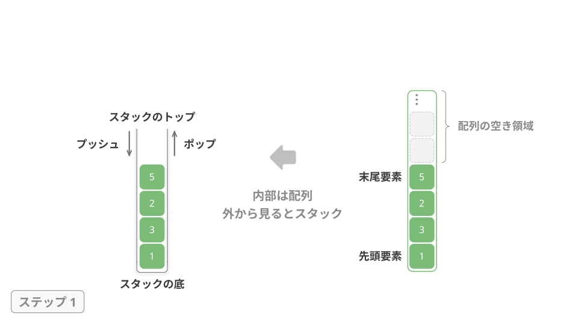

# スタック

<u>スタック（stack）</u>は、後入れ先出しの規則に従う線形データ構造です。

スタックは、テーブルの上に重ねた皿にたとえられます。一度に動かせるのが 1 枚だけなら、一番下の皿を取るには、その上にある皿を上から順にどけなければなりません。皿を整数や文字、オブジェクトなど、さまざまな型の要素に置き換えると、スタックというデータ構造になります。

下図のように、積み重ねた要素の一番上を「スタックのトップ」、一番下を「スタックの底」と呼びます。トップに要素を追加する操作を「プッシュ」、トップの要素を取り除く操作を「ポップ」と呼びます。


## スタックの基本操作

スタックでよく使う操作を次の表に示します。実際のメソッド名は使用するプログラミング言語によって異なります。ここでは、よく使われる `push()`、`pop()`、`peek()` という名前を例に取ります。

<p align="center"> 表 <id> &nbsp; スタックの各操作の時間計算量 </p>

| メソッド     | 説明                   | 時間計算量 |
| -------- | ---------------------- | ---------- |
| `push()` | 要素をプッシュする（トップに追加する） | $O(1)$     |
| `pop()`  | トップの要素をポップする           | $O(1)$     |
| `peek()` | トップの要素を参照する           | $O(1)$     |

多くの場合、プログラミング言語が用意しているスタックのクラスをそのまま利用できます。専用のクラスがない言語では、その言語の配列や連結リストをスタックとして使えます。プログラムでは、スタックに関係のない操作を使わなければよいのです。

```snippet
stack_operations
```

??? pythontutor "実行の様子を見る"

    @tutor stack_operations_tutor

## スタックの実装

スタックがどのように動くのかを詳しく知るために、スタックのクラスを自分で実装してみましょう。

スタックは後入れ先出しの原則に従うため、要素を追加したり削除したりできるのはトップだけです。一方、配列や連結リストでは、どの位置でも要素を追加、削除できます。**したがって、スタックは操作を制限した配列や連結リストとみなせます**。言い換えると、配列や連結リストの操作のうち不要なものを外部から隠せば、外から見た振る舞いをスタックの規則に合わせられます。

### 連結リストによる実装

連結リストでスタックを実装する場合は、先頭ノードをスタックのトップ、末尾ノードをスタックの底とみなせます。

下図のように、プッシュするにはリストの先頭に要素を挿入するだけです。このノードの挿入方法を「先頭挿入」と呼びます。ポップするときは、リストから先頭ノードを削除するだけです。

=== "<1>"
    

=== "<2>"
    

=== "<3>"
    

連結リストでスタックを実装するコード例を以下に示します。

```src
[file]{linkedlist_stack}-[class]{linked_list_stack}-[func]{}
```

### 配列による実装

配列でスタックを実装する場合は、配列の末尾をスタックのトップにできます。下図のように、プッシュは配列の末尾への要素の追加、ポップは末尾からの要素の削除に対応します。時間計算量はどちらも $O(1)$ です。

=== "<1>"
    

=== "<2>"
    

=== "<3>"
    

プッシュする要素が次々に増えることもあるので、動的配列を使うとよいでしょう。そうすれば、配列の容量を拡張する処理を自分で書かずに済みます。以下にコード例を示します。

```src
[file]{array_stack}-[class]{array_stack}-[func]{}
```

## 2 つの実装の比較

**利用できる操作**

どちらの実装でも、スタックの定義に含まれるすべての操作ができます。配列にはランダムアクセスもできますが、これはスタックの定義から外れるため、通常は使いません。

**実行時間の効率**

配列による実装では、プッシュとポップはいずれも、あらかじめ確保した連続したメモリ領域で行います。キャッシュの局所性が高いため、効率よく動作します。ただし、プッシュで配列の容量を超えると拡張が必要になり、その 1 回のプッシュの時間計算量は $O(n)$ になります。

連結リストは必要に応じて柔軟に伸ばせるため、配列の容量を拡張するときのような効率の低下はありません。ただし、プッシュのたびにノードのオブジェクトを初期化してポインタを更新する必要があり、その分、効率は低くなります。プッシュする要素がすでにノードのオブジェクトであれば、初期化を省いて効率を上げられます。

以上を踏まえると、`int` や `double` のような基本データ型の要素をプッシュ、ポップする場合について、次のことがいえます。

- 配列で実装したスタックでは、容量を拡張するときに効率が下がります。ただし、拡張が必要になる頻度は低いため、平均するとこちらのほうが効率よく動作します。
- 連結リストで実装したスタックのほうが、安定した性能を示します。

**メモリの利用効率**

動的配列を初期化するとき、システムが確保する「初期容量」は、実際に必要な容量を超えることがあります。また、容量は通常、一定の倍率（たとえば 2 倍）で拡張されるため、拡張後の容量も実際に必要な量を超えることがあります。そのため、**配列で実装したスタックでは、メモリ領域の一部が無駄になることがあります**。

一方、連結リストのノードにはポインタを格納する領域も必要なので、**ノード 1 個あたりが占める領域は比較的大きくなります**。

このように、どちらの実装がメモリを節約できるかは一概にはいえません。具体的な状況に応じて考える必要があります。

## スタックの代表的な用途

- **ブラウザの「戻る」と「進む」、ソフトウェアの「元に戻す」と「やり直す」**。新しいページを開くたびに、ブラウザは前のページをスタックにプッシュします。これで「戻る」を選ぶと前のページに戻れます。このとき行っているのがポップです。「戻る」と「進む」の両方を実現するには、2 つのスタックを組み合わせます。
- **プログラムのメモリ管理**。関数を呼び出すたびに、システムはスタックのトップにスタックフレームを追加し、その関数の実行状態に関する情報を記録します。再帰関数では、呼び出しを深めていく段階でプッシュが繰り返され、呼び出し元に順に戻る段階でポップが繰り返されます。
