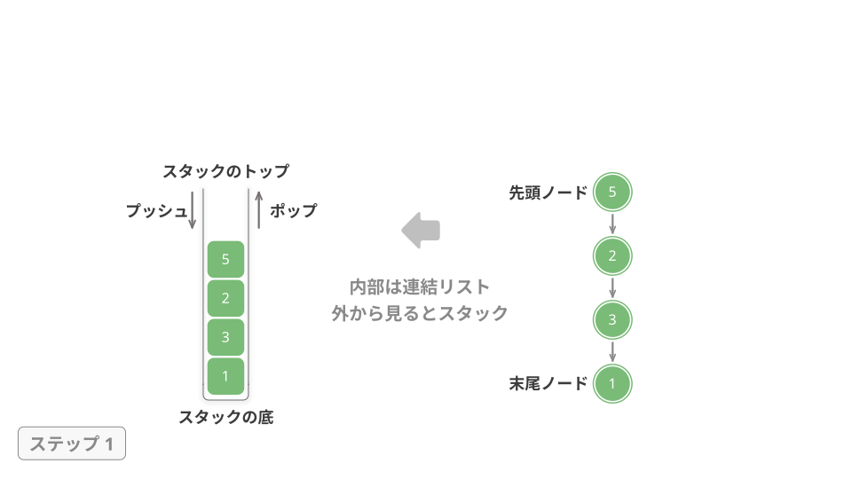
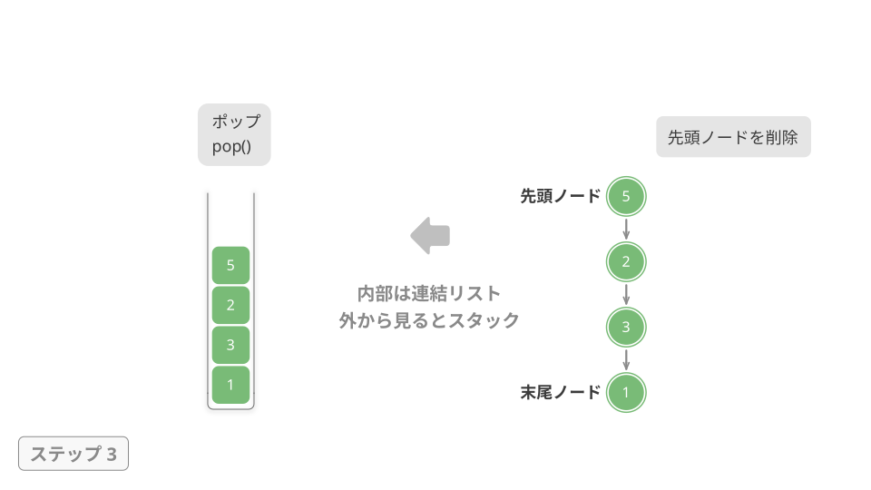
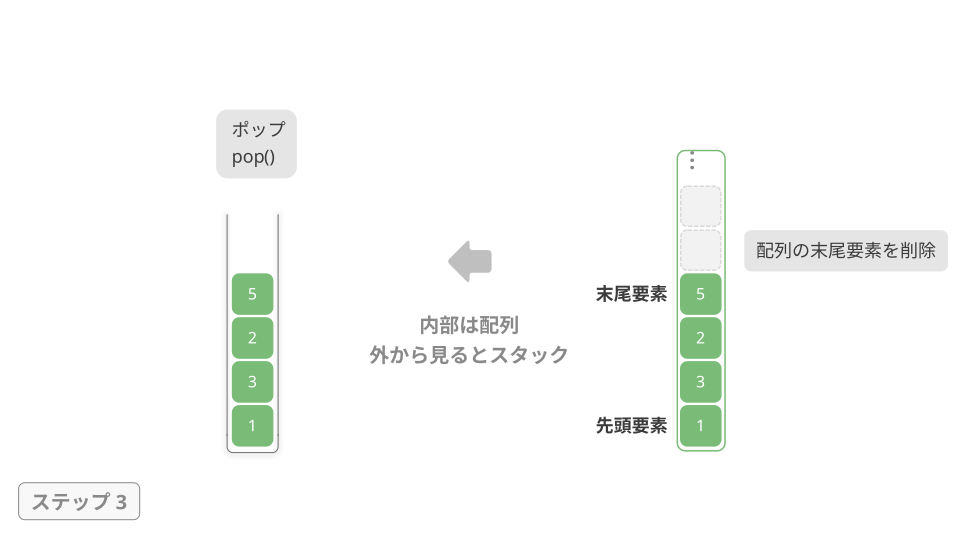

# 5.1 &nbsp; スタック

<u>スタック（stack）</u>は、後入れ先出しの規則に従う線形データ構造です。

スタックは、テーブルの上に重ねた皿にたとえられます。一度に動かせるのが 1 枚だけなら、一番下の皿を取るには、その上にある皿を上から順にどけなければなりません。皿を整数や文字、オブジェクトなど、さまざまな型の要素に置き換えると、スタックというデータ構造になります。

図 5-1 のように、積み重ねた要素の一番上を「スタックのトップ」、一番下を「スタックの底」と呼びます。トップに要素を追加する操作を「プッシュ」、トップの要素を取り除く操作を「ポップ」と呼びます。

{ class="animation-figure" }

<p align="center"> 図 5-1 &nbsp; スタックの後入れ先出しの規則 </p>

## 5.1.1 &nbsp; スタックの基本操作

スタックでよく使う操作を表 5-1 に示します。実際のメソッド名は使用するプログラミング言語によって異なります。ここでは、よく使われる `push()`、`pop()`、`peek()` という名前を例に取ります。

<p align="center"> 表 5-1 &nbsp; スタックの各操作の時間計算量 </p>

<div class="center-table" markdown>

| メソッド     | 説明                   | 時間計算量 |
| -------- | ---------------------- | ---------- |
| `push()` | 要素をプッシュする（トップに追加する） | $O(1)$     |
| `pop()`  | トップの要素をポップする           | $O(1)$     |
| `peek()` | トップの要素を参照する           | $O(1)$     |

</div>

多くの場合、プログラミング言語が用意しているスタックのクラスをそのまま利用できます。専用のクラスがない言語では、その言語の配列や連結リストをスタックとして使えます。プログラムでは、スタックに関係のない操作を使わなければよいのです。

=== "Python"

    ```python title="stack.py"
    # スタックを初期化する
    # Python には組み込みのスタッククラスがないので、list をスタックとして使える
    stack: list[int] = []

    # 要素をプッシュする
    stack.append(1)
    stack.append(3)
    stack.append(2)
    stack.append(5)
    stack.append(4)

    # スタックのトップを参照する
    peek: int = stack[-1]

    # 要素をポップする
    pop: int = stack.pop()

    # スタックの要素数を取得する
    size: int = len(stack)

    # 空かどうかを判定する
    is_empty: bool = len(stack) == 0
    ```

=== "C++"

    ```cpp title="stack.cpp"
    /* スタックを初期化する */
    stack<int> stack;

    /* 要素をプッシュする */
    stack.push(1);
    stack.push(3);
    stack.push(2);
    stack.push(5);
    stack.push(4);

    /* スタックのトップを参照する */
    int top = stack.top();

    /* 要素をポップする */
    stack.pop(); // 戻り値なし

    /* スタックの要素数を取得する */
    int size = stack.size();

    /* 空かどうかを判定する */
    bool empty = stack.empty();
    ```

=== "Java"

    ```java title="stack.java"
    /* スタックを初期化する */
    Stack<Integer> stack = new Stack<>();

    /* 要素をプッシュする */
    stack.push(1);
    stack.push(3);
    stack.push(2);
    stack.push(5);
    stack.push(4);

    /* スタックのトップを参照する */
    int peek = stack.peek();

    /* 要素をポップする */
    int pop = stack.pop();

    /* スタックの要素数を取得する */
    int size = stack.size();

    /* 空かどうかを判定する */
    boolean isEmpty = stack.isEmpty();
    ```

=== "C#"

    ```csharp title="stack.cs"
    /* スタックを初期化する */
    Stack<int> stack = new();

    /* 要素をプッシュする */
    stack.Push(1);
    stack.Push(3);
    stack.Push(2);
    stack.Push(5);
    stack.Push(4);

    /* スタックのトップを参照する */
    int peek = stack.Peek();

    /* 要素をポップする */
    int pop = stack.Pop();

    /* スタックの要素数を取得する */
    int size = stack.Count;

    /* 空かどうかを判定する */
    bool isEmpty = stack.Count == 0;
    ```

=== "Go"

    ```go title="stack_test.go"
    /* スタックを初期化する */
    // Go ではスライスをスタックとして使うのが推奨される
    var stack []int

    /* 要素をプッシュする */
    stack = append(stack, 1)
    stack = append(stack, 3)
    stack = append(stack, 2)
    stack = append(stack, 5)
    stack = append(stack, 4)

    /* スタックのトップを参照する */
    peek := stack[len(stack)-1]

    /* 要素をポップする */
    pop := stack[len(stack)-1]
    stack = stack[:len(stack)-1]

    /* スタックの要素数を取得する */
    size := len(stack)

    /* 空かどうかを判定する */
    isEmpty := len(stack) == 0
    ```

=== "Swift"

    ```swift title="stack.swift"
    /* スタックを初期化する */
    // Swift には組み込みのスタッククラスがないので、Array をスタックとして使える
    var stack: [Int] = []

    /* 要素をプッシュする */
    stack.append(1)
    stack.append(3)
    stack.append(2)
    stack.append(5)
    stack.append(4)

    /* スタックのトップを参照する */
    let peek = stack.last!

    /* 要素をポップする */
    let pop = stack.removeLast()

    /* スタックの要素数を取得する */
    let size = stack.count

    /* 空かどうかを判定する */
    let isEmpty = stack.isEmpty
    ```

=== "JS"

    ```javascript title="stack.js"
    /* スタックを初期化する */
    // JavaScript には組み込みのスタッククラスがないので、Array をスタックとして使える
    const stack = [];

    /* 要素をプッシュする */
    stack.push(1);
    stack.push(3);
    stack.push(2);
    stack.push(5);
    stack.push(4);

    /* スタックのトップを参照する */
    const peek = stack[stack.length - 1];

    /* 要素をポップする */
    const pop = stack.pop();

    /* スタックの要素数を取得する */
    const size = stack.length;

    /* 空かどうかを判定する */
    const isEmpty = stack.length === 0;
    ```

=== "TS"

    ```typescript title="stack.ts"
    /* スタックを初期化する */
    // TypeScript には組み込みのスタッククラスがないので、Array をスタックとして使える
    const stack: number[] = [];

    /* 要素をプッシュする */
    stack.push(1);
    stack.push(3);
    stack.push(2);
    stack.push(5);
    stack.push(4);

    /* スタックのトップを参照する */
    const peek = stack[stack.length - 1];

    /* 要素をポップする */
    const pop = stack.pop();

    /* スタックの要素数を取得する */
    const size = stack.length;

    /* 空かどうかを判定する */
    const isEmpty = stack.length === 0;
    ```

=== "Dart"

    ```dart title="stack.dart"
    /* スタックを初期化する */
    // Dart には組み込みのスタッククラスがないので、List をスタックとして使える
    final List<int> stack = [];

    /* 要素をプッシュする */
    stack.add(1);
    stack.add(3);
    stack.add(2);
    stack.add(5);
    stack.add(4);

    /* スタックのトップを参照する */
    final int peek = stack.last;

    /* 要素をポップする */
    final int pop = stack.removeLast();

    /* スタックの要素数を取得する */
    final int size = stack.length;

    /* 空かどうかを判定する */
    final bool isEmpty = stack.isEmpty;
    ```

=== "Rust"

    ```rust title="stack.rs"
    // スタックを初期化する
    // Rust では Vec をスタックとして使うのが推奨される
    let mut stack: Vec<i32> = Vec::new();

    // 要素をプッシュする
    stack.push(1);
    stack.push(3);
    stack.push(2);
    stack.push(5);
    stack.push(4);

    // スタックのトップを参照する
    let peek = stack.last().unwrap();

    // 要素をポップする
    let pop = stack.pop().unwrap();

    // スタックの要素数を取得する
    let size = stack.len();

    // スタックが空かどうかを判定する
    let is_empty = stack.is_empty();
    ```

=== "C"

    ```c title="stack.c"
    // C には組み込みのスタックがない
    ```

=== "Kotlin"

    ```kotlin title="stack.kt"
    /* スタックを初期化する */
    val stack = Stack<Int>()

    /* 要素をプッシュする */
    stack.push(1)
    stack.push(3)
    stack.push(2)
    stack.push(5)
    stack.push(4)

    /* スタックのトップを参照する */
    val peek = stack.peek()

    /* 要素をポップする */
    val pop = stack.pop()

    /* スタックの要素数を取得する */
    val size = stack.size

    /* 空かどうかを判定する */
    val isEmpty = stack.isEmpty()
    ```

=== "Ruby"

    ```ruby title="stack.rb"
    # スタックを初期化する
    # Ruby には組み込みのスタッククラスがないので、Array をスタックとして使える
    stack = []

    # 要素をプッシュする
    stack << 1
    stack << 3
    stack << 2
    stack << 5
    stack << 4

    # スタックのトップを参照する
    peek = stack.last

    # 要素をポップする
    pop = stack.pop

    # スタックの要素数を取得する
    size = stack.length

    # 空かどうかを判定する
    is_empty = stack.empty?
    ```

??? pythontutor "実行の様子を見る"

    <div style="height: 549px; width: 100%;"><iframe class="pythontutor-iframe" title="実行の様子を見る" src="https://pythontutor.com/iframe-embed.html#code=%22%22%22Driver%20Code%22%22%22%0Aif%20__name__%20%3D%3D%20%22__main__%22%3A%0A%20%20%20%20%23%20%E3%82%B9%E3%82%BF%E3%83%83%E3%82%AF%E3%82%92%E5%88%9D%E6%9C%9F%E5%8C%96%0A%20%20%20%20%23%20Python%20%E3%81%AB%E3%81%AF%E7%B5%84%E3%81%BF%E8%BE%BC%E3%81%BF%E3%81%AE%E3%82%B9%E3%82%BF%E3%83%83%E3%82%AF%E3%82%AF%E3%83%A9%E3%82%B9%E3%81%8C%E3%81%AA%E3%81%84%E3%80%82list%20%E3%82%92%E3%82%B9%E3%82%BF%E3%83%83%E3%82%AF%E3%81%A8%E3%81%97%E3%81%A6%E4%BD%BF%E3%81%88%E3%82%8B%0A%20%20%20%20stack%20%3D%20%5B%5D%0A%0A%20%20%20%20%23%20%E3%82%B9%E3%82%BF%E3%83%83%E3%82%AF%E3%81%AB%E8%A6%81%E7%B4%A0%E3%82%92%E3%83%97%E3%83%83%E3%82%B7%E3%83%A5%0A%20%20%20%20stack.append%281%29%0A%20%20%20%20stack.append%283%29%0A%20%20%20%20stack.append%282%29%0A%20%20%20%20stack.append%285%29%0A%20%20%20%20stack.append%284%29%0A%20%20%20%20print%28%22%E3%82%B9%E3%82%BF%E3%83%83%E3%82%AF%20stack%20%3D%22,%20stack%29%0A%0A%20%20%20%20%23%20%E4%B8%80%E7%95%AA%E4%B8%8A%E3%81%AE%E8%A6%81%E7%B4%A0%E3%81%AB%E3%82%A2%E3%82%AF%E3%82%BB%E3%82%B9%0A%20%20%20%20peek%20%3D%20stack%5B-1%5D%0A%20%20%20%20print%28%22%E4%B8%80%E7%95%AA%E4%B8%8A%E3%81%AE%E8%A6%81%E7%B4%A0%20peek%20%3D%22,%20peek%29%0A%0A%20%20%20%20%23%20%E3%82%B9%E3%82%BF%E3%83%83%E3%82%AF%E3%81%8B%E3%82%89%E8%A6%81%E7%B4%A0%E3%82%92%E3%83%9D%E3%83%83%E3%83%97%0A%20%20%20%20pop%20%3D%20stack.pop%28%29%0A%20%20%20%20print%28%22%E3%83%9D%E3%83%83%E3%83%97%E3%81%97%E3%81%9F%E8%A6%81%E7%B4%A0%20pop%20%3D%22,%20pop%29%0A%20%20%20%20print%28%22%E3%83%9D%E3%83%83%E3%83%97%E5%BE%8C%E3%81%AE%20stack%20%3D%22,%20stack%29%0A%0A%20%20%20%20%23%20%E3%82%B9%E3%82%BF%E3%83%83%E3%82%AF%E3%81%AE%E9%95%B7%E3%81%95%E3%82%92%E5%8F%96%E5%BE%97%0A%20%20%20%20size%20%3D%20len%28stack%29%0A%20%20%20%20print%28%22%E3%82%B9%E3%82%BF%E3%83%83%E3%82%AF%E3%81%AE%E9%95%B7%E3%81%95%20size%20%3D%22,%20size%29%0A%0A%20%20%20%20%23%20%E7%A9%BA%E3%81%8B%E3%81%A9%E3%81%86%E3%81%8B%E3%82%92%E5%88%A4%E5%AE%9A%0A%20%20%20%20is_empty%20%3D%20len%28stack%29%20%3D%3D%200%0A%20%20%20%20print%28%22%E3%82%B9%E3%82%BF%E3%83%83%E3%82%AF%E3%81%8C%E7%A9%BA%E3%81%8B%E3%81%A9%E3%81%86%E3%81%8B%20%3D%22,%20is_empty%29&codeDivHeight=472&codeDivWidth=350&cumulative=false&curInstr=2&heapPrimitives=nevernest&origin=opt-frontend.js&py=311&rawInputLstJSON=%5B%5D&textReferences=false"> </iframe></div>
    <div style="margin-top: 5px;"><a href="https://pythontutor.com/iframe-embed.html#code=%22%22%22Driver%20Code%22%22%22%0Aif%20__name__%20%3D%3D%20%22__main__%22%3A%0A%20%20%20%20%23%20%E3%82%B9%E3%82%BF%E3%83%83%E3%82%AF%E3%82%92%E5%88%9D%E6%9C%9F%E5%8C%96%0A%20%20%20%20%23%20Python%20%E3%81%AB%E3%81%AF%E7%B5%84%E3%81%BF%E8%BE%BC%E3%81%BF%E3%81%AE%E3%82%B9%E3%82%BF%E3%83%83%E3%82%AF%E3%82%AF%E3%83%A9%E3%82%B9%E3%81%8C%E3%81%AA%E3%81%84%E3%80%82list%20%E3%82%92%E3%82%B9%E3%82%BF%E3%83%83%E3%82%AF%E3%81%A8%E3%81%97%E3%81%A6%E4%BD%BF%E3%81%88%E3%82%8B%0A%20%20%20%20stack%20%3D%20%5B%5D%0A%0A%20%20%20%20%23%20%E3%82%B9%E3%82%BF%E3%83%83%E3%82%AF%E3%81%AB%E8%A6%81%E7%B4%A0%E3%82%92%E3%83%97%E3%83%83%E3%82%B7%E3%83%A5%0A%20%20%20%20stack.append%281%29%0A%20%20%20%20stack.append%283%29%0A%20%20%20%20stack.append%282%29%0A%20%20%20%20stack.append%285%29%0A%20%20%20%20stack.append%284%29%0A%20%20%20%20print%28%22%E3%82%B9%E3%82%BF%E3%83%83%E3%82%AF%20stack%20%3D%22,%20stack%29%0A%0A%20%20%20%20%23%20%E4%B8%80%E7%95%AA%E4%B8%8A%E3%81%AE%E8%A6%81%E7%B4%A0%E3%81%AB%E3%82%A2%E3%82%AF%E3%82%BB%E3%82%B9%0A%20%20%20%20peek%20%3D%20stack%5B-1%5D%0A%20%20%20%20print%28%22%E4%B8%80%E7%95%AA%E4%B8%8A%E3%81%AE%E8%A6%81%E7%B4%A0%20peek%20%3D%22,%20peek%29%0A%0A%20%20%20%20%23%20%E3%82%B9%E3%82%BF%E3%83%83%E3%82%AF%E3%81%8B%E3%82%89%E8%A6%81%E7%B4%A0%E3%82%92%E3%83%9D%E3%83%83%E3%83%97%0A%20%20%20%20pop%20%3D%20stack.pop%28%29%0A%20%20%20%20print%28%22%E3%83%9D%E3%83%83%E3%83%97%E3%81%97%E3%81%9F%E8%A6%81%E7%B4%A0%20pop%20%3D%22,%20pop%29%0A%20%20%20%20print%28%22%E3%83%9D%E3%83%83%E3%83%97%E5%BE%8C%E3%81%AE%20stack%20%3D%22,%20stack%29%0A%0A%20%20%20%20%23%20%E3%82%B9%E3%82%BF%E3%83%83%E3%82%AF%E3%81%AE%E9%95%B7%E3%81%95%E3%82%92%E5%8F%96%E5%BE%97%0A%20%20%20%20size%20%3D%20len%28stack%29%0A%20%20%20%20print%28%22%E3%82%B9%E3%82%BF%E3%83%83%E3%82%AF%E3%81%AE%E9%95%B7%E3%81%95%20size%20%3D%22,%20size%29%0A%0A%20%20%20%20%23%20%E7%A9%BA%E3%81%8B%E3%81%A9%E3%81%86%E3%81%8B%E3%82%92%E5%88%A4%E5%AE%9A%0A%20%20%20%20is_empty%20%3D%20len%28stack%29%20%3D%3D%200%0A%20%20%20%20print%28%22%E3%82%B9%E3%82%BF%E3%83%83%E3%82%AF%E3%81%8C%E7%A9%BA%E3%81%8B%E3%81%A9%E3%81%86%E3%81%8B%20%3D%22,%20is_empty%29&codeDivHeight=800&codeDivWidth=600&cumulative=false&curInstr=2&heapPrimitives=nevernest&origin=opt-frontend.js&py=311&rawInputLstJSON=%5B%5D&textReferences=false" target="_blank" rel="noopener noreferrer">全画面で表示 ></a></div>

## 5.1.2 &nbsp; スタックの実装

スタックがどのように動くのかを詳しく知るために、スタックのクラスを自分で実装してみましょう。

スタックは後入れ先出しの原則に従うため、要素を追加したり削除したりできるのはトップだけです。一方、配列や連結リストでは、どの位置でも要素を追加、削除できます。**したがって、スタックは操作を制限した配列や連結リストとみなせます**。言い換えると、配列や連結リストの操作のうち不要なものを外部から隠せば、外から見た振る舞いをスタックの規則に合わせられます。

### 1. &nbsp; 連結リストによる実装

連結リストでスタックを実装する場合は、先頭ノードをスタックのトップ、末尾ノードをスタックの底とみなせます。

図 5-2 のように、プッシュするにはリストの先頭に要素を挿入するだけです。このノードの挿入方法を「先頭挿入」と呼びます。ポップするときは、リストから先頭ノードを削除するだけです。

=== "<1>"
    { class="animation-figure" }

=== "<2>"
    { class="animation-figure" }

=== "<3>"
    { class="animation-figure" }

<p align="center"> 図 5-2 &nbsp; 連結リストで実装したスタックのプッシュとポップ </p>

連結リストでスタックを実装するコード例を以下に示します。

=== "Python"

    ```python title="linkedlist_stack.py"
    class LinkedListStack:
        """連結リストを使ったスタック"""

        def __init__(self):
            """初期化メソッド"""
            self._peek: ListNode | None = None
            self._size: int = 0

        def size(self) -> int:
            """スタックの要素数を取得する"""
            return self._size

        def is_empty(self) -> bool:
            """スタックが空かどうかを判定する"""
            return self._size == 0

        def push(self, val: int):
            """プッシュする"""
            node = ListNode(val)
            node.next = self._peek
            self._peek = node
            self._size += 1

        def pop(self) -> int:
            """ポップする"""
            num = self.peek()
            self._peek = self._peek.next
            self._size -= 1
            return num

        def peek(self) -> int:
            """スタックのトップを参照する"""
            if self.is_empty():
                raise IndexError("スタックが空です")
            return self._peek.val

        def to_list(self) -> list[int]:
            """表示用のリストに変換する"""
            arr = []
            node = self._peek
            while node:
                arr.append(node.val)
                node = node.next
            arr.reverse()
            return arr
    ```

=== "C++"

    ```cpp title="linkedlist_stack.cpp"
    /* 連結リストを使ったスタック */
    class LinkedListStack {
      private:
        ListNode *stackTop; // 先頭ノードをスタックのトップとする
        int stkSize;        // スタックの要素数

      public:
        LinkedListStack() {
            stackTop = nullptr;
            stkSize = 0;
        }

        ~LinkedListStack() {
            // 連結リストをたどり、各ノードを削除してメモリを解放する
            freeMemoryLinkedList(stackTop);
        }

        /* スタックの要素数を取得する */
        int size() {
            return stkSize;
        }

        /* スタックが空かどうかを判定する */
        bool isEmpty() {
            return size() == 0;
        }

        /* プッシュする */
        void push(int num) {
            ListNode *node = new ListNode(num);
            node->next = stackTop;
            stackTop = node;
            stkSize++;
        }

        /* ポップする */
        int pop() {
            int num = top();
            ListNode *tmp = stackTop;
            stackTop = stackTop->next;
            // メモリを解放する
            delete tmp;
            stkSize--;
            return num;
        }

        /* スタックのトップを参照する */
        int top() {
            if (isEmpty())
                throw out_of_range("スタックが空です");
            return stackTop->val;
        }

        /* 連結リストを vector に変換して返す */
        vector<int> toVector() {
            ListNode *node = stackTop;
            vector<int> res(size());
            for (int i = res.size() - 1; i >= 0; i--) {
                res[i] = node->val;
                node = node->next;
            }
            return res;
        }
    };
    ```

=== "Java"

    ```java title="linkedlist_stack.java"
    /* 連結リストを使ったスタック */
    class LinkedListStack {
        private ListNode stackPeek; // 先頭ノードをスタックのトップとする
        private int stkSize = 0; // スタックの要素数

        public LinkedListStack() {
            stackPeek = null;
        }

        /* スタックの要素数を取得する */
        public int size() {
            return stkSize;
        }

        /* スタックが空かどうかを判定する */
        public boolean isEmpty() {
            return size() == 0;
        }

        /* プッシュする */
        public void push(int num) {
            ListNode node = new ListNode(num);
            node.next = stackPeek;
            stackPeek = node;
            stkSize++;
        }

        /* ポップする */
        public int pop() {
            int num = peek();
            stackPeek = stackPeek.next;
            stkSize--;
            return num;
        }

        /* スタックのトップを参照する */
        public int peek() {
            if (isEmpty())
                throw new IndexOutOfBoundsException();
            return stackPeek.val;
        }

        /* 連結リストを配列に変換して返す */
        public int[] toArray() {
            ListNode node = stackPeek;
            int[] res = new int[size()];
            for (int i = res.length - 1; i >= 0; i--) {
                res[i] = node.val;
                node = node.next;
            }
            return res;
        }
    }
    ```

=== "C#"

    ```csharp title="linkedlist_stack.cs"
    /* 連結リストを使ったスタック */
    class LinkedListStack {
        ListNode? stackPeek;  // 先頭ノードをスタックのトップとする
        int stkSize = 0;   // スタックの要素数

        public LinkedListStack() {
            stackPeek = null;
        }

        /* スタックの要素数を取得する */
        public int Size() {
            return stkSize;
        }

        /* スタックが空かどうかを判定する */
        public bool IsEmpty() {
            return Size() == 0;
        }

        /* プッシュする */
        public void Push(int num) {
            ListNode node = new(num) {
                next = stackPeek
            };
            stackPeek = node;
            stkSize++;
        }

        /* ポップする */
        public int Pop() {
            int num = Peek();
            stackPeek = stackPeek!.next;
            stkSize--;
            return num;
        }

        /* スタックのトップを参照する */
        public int Peek() {
            if (IsEmpty())
                throw new Exception();
            return stackPeek!.val;
        }

        /* 連結リストを配列に変換して返す */
        public int[] ToArray() {
            if (stackPeek == null)
                return [];

            ListNode? node = stackPeek;
            int[] res = new int[Size()];
            for (int i = res.Length - 1; i >= 0; i--) {
                res[i] = node!.val;
                node = node.next;
            }
            return res;
        }
    }
    ```

=== "Go"

    ```go title="linkedlist_stack.go"
    /* 連結リストを使ったスタック */
    type linkedListStack struct {
        // 標準ライブラリの list パッケージを使ってスタックを実装する
        data *list.List
    }

    /* スタックを初期化する */
    func newLinkedListStack() *linkedListStack {
        return &linkedListStack{
            data: list.New(),
        }
    }

    /* プッシュする */
    func (s *linkedListStack) push(value int) {
        s.data.PushBack(value)
    }

    /* ポップする */
    func (s *linkedListStack) pop() any {
        if s.isEmpty() {
            return nil
        }
        e := s.data.Back()
        s.data.Remove(e)
        return e.Value
    }

    /* スタックのトップを参照する */
    func (s *linkedListStack) peek() any {
        if s.isEmpty() {
            return nil
        }
        e := s.data.Back()
        return e.Value
    }

    /* スタックの要素数を取得する */
    func (s *linkedListStack) size() int {
        return s.data.Len()
    }

    /* スタックが空かどうかを判定する */
    func (s *linkedListStack) isEmpty() bool {
        return s.data.Len() == 0
    }

    /* 表示用にリストを取得する */
    func (s *linkedListStack) toList() *list.List {
        return s.data
    }
    ```

=== "Swift"

    ```swift title="linkedlist_stack.swift"
    /* 連結リストを使ったスタック */
    class LinkedListStack {
        private var _peek: ListNode? // 先頭ノードをスタックのトップとする
        private var _size: Int // スタックの要素数

        init() {
            _size = 0
        }

        /* スタックの要素数を取得する */
        func size() -> Int {
            _size
        }

        /* スタックが空かどうかを判定する */
        func isEmpty() -> Bool {
            size() == 0
        }

        /* プッシュする */
        func push(num: Int) {
            let node = ListNode(x: num)
            node.next = _peek
            _peek = node
            _size += 1
        }

        /* ポップする */
        @discardableResult
        func pop() -> Int {
            let num = peek()
            _peek = _peek?.next
            _size -= 1
            return num
        }

        /* スタックのトップを参照する */
        func peek() -> Int {
            if isEmpty() {
                fatalError("スタックが空です")
            }
            return _peek!.val
        }

        /* 連結リストを配列に変換して返す */
        func toArray() -> [Int] {
            var node = _peek
            var res = Array(repeating: 0, count: size())
            for i in res.indices.reversed() {
                res[i] = node!.val
                node = node?.next
            }
            return res
        }
    }
    ```

=== "JS"

    ```javascript title="linkedlist_stack.js"
    /* 連結リストを使ったスタック */
    class LinkedListStack {
        #stackPeek; // 先頭ノードをスタックのトップとする
        #stkSize = 0; // スタックの要素数

        constructor() {
            this.#stackPeek = null;
        }

        /* スタックの要素数を取得する */
        get size() {
            return this.#stkSize;
        }

        /* スタックが空かどうかを判定する */
        isEmpty() {
            return this.size === 0;
        }

        /* プッシュする */
        push(num) {
            const node = new ListNode(num);
            node.next = this.#stackPeek;
            this.#stackPeek = node;
            this.#stkSize++;
        }

        /* ポップする */
        pop() {
            const num = this.peek();
            this.#stackPeek = this.#stackPeek.next;
            this.#stkSize--;
            return num;
        }

        /* スタックのトップを参照する */
        peek() {
            if (!this.#stackPeek) throw new Error('スタックが空です');
            return this.#stackPeek.val;
        }

        /* 連結リストを配列に変換して返す */
        toArray() {
            let node = this.#stackPeek;
            const res = new Array(this.size);
            for (let i = res.length - 1; i >= 0; i--) {
                res[i] = node.val;
                node = node.next;
            }
            return res;
        }
    }
    ```

=== "TS"

    ```typescript title="linkedlist_stack.ts"
    /* 連結リストを使ったスタック */
    class LinkedListStack {
        private stackPeek: ListNode | null; // 先頭ノードをスタックのトップとする
        private stkSize: number = 0; // スタックの要素数

        constructor() {
            this.stackPeek = null;
        }

        /* スタックの要素数を取得する */
        get size(): number {
            return this.stkSize;
        }

        /* スタックが空かどうかを判定する */
        isEmpty(): boolean {
            return this.size === 0;
        }

        /* プッシュする */
        push(num: number): void {
            const node = new ListNode(num);
            node.next = this.stackPeek;
            this.stackPeek = node;
            this.stkSize++;
        }

        /* ポップする */
        pop(): number {
            const num = this.peek();
            if (!this.stackPeek) throw new Error('スタックが空です');
            this.stackPeek = this.stackPeek.next;
            this.stkSize--;
            return num;
        }

        /* スタックのトップを参照する */
        peek(): number {
            if (!this.stackPeek) throw new Error('スタックが空です');
            return this.stackPeek.val;
        }

        /* 連結リストを配列に変換して返す */
        toArray(): number[] {
            let node = this.stackPeek;
            const res = new Array<number>(this.size);
            for (let i = res.length - 1; i >= 0; i--) {
                res[i] = node!.val;
                node = node!.next;
            }
            return res;
        }
    }
    ```

=== "Dart"

    ```dart title="linkedlist_stack.dart"
    /* 連結リストのクラスを使ったスタック */
    class LinkedListStack {
      ListNode? _stackPeek; // 先頭ノードをスタックのトップとする
      int _stkSize = 0; // スタックの要素数

      LinkedListStack() {
        _stackPeek = null;
      }

      /* スタックの要素数を取得する */
      int size() {
        return _stkSize;
      }

      /* スタックが空かどうかを判定する */
      bool isEmpty() {
        return _stkSize == 0;
      }

      /* プッシュする */
      void push(int _num) {
        final ListNode node = ListNode(_num);
        node.next = _stackPeek;
        _stackPeek = node;
        _stkSize++;
      }

      /* ポップする */
      int pop() {
        final int _num = peek();
        _stackPeek = _stackPeek!.next;
        _stkSize--;
        return _num;
      }

      /* スタックのトップを参照する */
      int peek() {
        if (_stackPeek == null) {
          throw Exception("スタックが空です");
        }
        return _stackPeek!.val;
      }

      /* 連結リストを List に変換して返す */
      List<int> toList() {
        ListNode? node = _stackPeek;
        List<int> list = [];
        while (node != null) {
          list.add(node.val);
          node = node.next;
        }
        list = list.reversed.toList();
        return list;
      }
    }
    ```

=== "Rust"

    ```rust title="linkedlist_stack.rs"
    /* 連結リストを使ったスタック */
    #[allow(dead_code)]
    pub struct LinkedListStack<T> {
        stack_peek: Option<Rc<RefCell<ListNode<T>>>>, // 先頭ノードをスタックのトップとする
        stk_size: usize,                              // スタックの要素数
    }

    impl<T: Copy> LinkedListStack<T> {
        pub fn new() -> Self {
            Self {
                stack_peek: None,
                stk_size: 0,
            }
        }

        /* スタックの要素数を取得する */
        pub fn size(&self) -> usize {
            return self.stk_size;
        }

        /* スタックが空かどうかを判定する */
        pub fn is_empty(&self) -> bool {
            return self.size() == 0;
        }

        /* プッシュする */
        pub fn push(&mut self, num: T) {
            let node = ListNode::new(num);
            node.borrow_mut().next = self.stack_peek.take();
            self.stack_peek = Some(node);
            self.stk_size += 1;
        }

        /* ポップする */
        pub fn pop(&mut self) -> Option<T> {
            self.stack_peek.take().map(|old_head| {
                self.stack_peek = old_head.borrow_mut().next.take();
                self.stk_size -= 1;

                old_head.borrow().val
            })
        }

        /* スタックのトップのノードを参照する */
        pub fn peek(&self) -> Option<&Rc<RefCell<ListNode<T>>>> {
            self.stack_peek.as_ref()
        }

        /* 連結リストを Vec に変換して返す */
        pub fn to_array(&self) -> Vec<T> {
            fn _to_array<T: Sized + Copy>(head: Option<&Rc<RefCell<ListNode<T>>>>) -> Vec<T> {
                if let Some(node) = head {
                    let mut nums = _to_array(node.borrow().next.as_ref());
                    nums.push(node.borrow().val);
                    return nums;
                }
                return Vec::new();
            }

            _to_array(self.peek())
        }
    }
    ```

=== "C"

    ```c title="linkedlist_stack.c"
    /* 連結リストを使ったスタック */
    typedef struct {
        ListNode *top; // 先頭ノードをスタックのトップとする
        int size;      // スタックの要素数
    } LinkedListStack;

    /* 生成関数 */
    LinkedListStack *newLinkedListStack() {
        LinkedListStack *s = malloc(sizeof(LinkedListStack));
        s->top = NULL;
        s->size = 0;
        return s;
    }

    /* 解放関数 */
    void delLinkedListStack(LinkedListStack *s) {
        while (s->top) {
            ListNode *n = s->top->next;
            free(s->top);
            s->top = n;
        }
        free(s);
    }

    /* スタックの要素数を取得する */
    int size(LinkedListStack *s) {
        return s->size;
    }

    /* スタックが空かどうかを判定する */
    bool isEmpty(LinkedListStack *s) {
        return size(s) == 0;
    }

    /* プッシュする */
    void push(LinkedListStack *s, int num) {
        ListNode *node = (ListNode *)malloc(sizeof(ListNode));
        node->next = s->top; // 新しいノードのポインタフィールドを更新する
        node->val = num;     // 新しいノードのデータフィールドを更新する
        s->top = node;       // スタックのトップを更新する
        s->size++;           // スタックの要素数を更新する
    }

    /* スタックのトップを参照する */
    int peek(LinkedListStack *s) {
        if (s->size == 0) {
            printf("スタックが空です\n");
            return INT_MAX;
        }
        return s->top->val;
    }

    /* ポップする */
    int pop(LinkedListStack *s) {
        int val = peek(s);
        ListNode *tmp = s->top;
        s->top = s->top->next;
        // メモリを解放する
        free(tmp);
        s->size--;
        return val;
    }
    ```

=== "Kotlin"

    ```kotlin title="linkedlist_stack.kt"
    /* 連結リストを使ったスタック */
    class LinkedListStack(
        private var stackPeek: ListNode? = null, // 先頭ノードをスタックのトップとする
        private var stkSize: Int = 0 // スタックの要素数
    ) {

        /* スタックの要素数を取得する */
        fun size(): Int {
            return stkSize
        }

        /* スタックが空かどうかを判定する */
        fun isEmpty(): Boolean {
            return size() == 0
        }

        /* プッシュする */
        fun push(num: Int) {
            val node = ListNode(num)
            node.next = stackPeek
            stackPeek = node
            stkSize++
        }

        /* ポップする */
        fun pop(): Int? {
            val num = peek()
            stackPeek = stackPeek?.next
            stkSize--
            return num
        }

        /* スタックのトップを参照する */
        fun peek(): Int? {
            if (isEmpty()) throw IndexOutOfBoundsException()
            return stackPeek?._val
        }

        /* 連結リストを配列に変換して返す */
        fun toArray(): IntArray {
            var node = stackPeek
            val res = IntArray(size())
            for (i in res.size - 1 downTo 0) {
                res[i] = node?._val!!
                node = node.next
            }
            return res
        }
    }
    ```

=== "Ruby"

    ```ruby title="linkedlist_stack.rb"
    ### 連結リストを使ったスタック ###
    class LinkedListStack
      attr_reader :size

      ### 初期化メソッド ###
      def initialize
        @size = 0
      end

      ### スタックが空かどうかを判定する ###
      def is_empty?
        @peek.nil?
      end

      ### プッシュする ###
      def push(val)
        node = ListNode.new(val)
        node.next = @peek
        @peek = node
        @size += 1
      end

      ### ポップする ###
      def pop
        num = peek
        @peek = @peek.next
        @size -= 1
        num
      end

      ### スタックのトップを参照する ###
      def peek
        raise IndexError, 'スタックが空です' if is_empty?

        @peek.val
      end

      ### 連結リストを配列に変換して返す ###
      def to_array
        arr = []
        node = @peek
        while node
          arr << node.val
          node = node.next
        end
        arr.reverse
      end
    end
    ```

??? pythontutor "実行の様子を見る"

    <div style="height: 549px; width: 100%;"><iframe class="pythontutor-iframe" title="実行の様子を見る" src="https://pythontutor.com/iframe-embed.html#code=class%20ListNode%3A%0A%20%20%20%20%22%22%22%E9%80%A3%E7%B5%90%E3%83%AA%E3%82%B9%E3%83%88%E3%81%AE%E3%83%8E%E3%83%BC%E3%83%89%E3%82%92%E8%A1%A8%E3%81%99%E3%82%AF%E3%83%A9%E3%82%B9%22%22%22%0A%20%20%20%20def%20__init__%28self,%20val%3A%20int%29%3A%0A%20%20%20%20%20%20%20%20self.val%3A%20int%20%3D%20val%20%20%23%20%E3%83%8E%E3%83%BC%E3%83%89%E3%81%AE%E5%80%A4%0A%20%20%20%20%20%20%20%20self.next%3A%20ListNode%20%7C%20None%20%3D%20None%20%20%23%20%E6%AC%A1%E3%81%AE%E3%83%8E%E3%83%BC%E3%83%89%E3%81%B8%E3%81%AE%E5%8F%82%E7%85%A7%0A%0A%0Aclass%20LinkedListStack%3A%0A%20%20%20%20%22%22%22%E9%80%A3%E7%B5%90%E3%83%AA%E3%82%B9%E3%83%88%E3%82%92%E4%BD%BF%E3%81%A3%E3%81%9F%E3%82%B9%E3%82%BF%E3%83%83%E3%82%AF%22%22%22%0A%0A%20%20%20%20def%20__init__%28self%29%3A%0A%20%20%20%20%20%20%20%20%22%22%22%E5%88%9D%E6%9C%9F%E5%8C%96%E3%83%A1%E3%82%BD%E3%83%83%E3%83%89%22%22%22%0A%20%20%20%20%20%20%20%20self._peek%3A%20ListNode%20%7C%20None%20%3D%20None%0A%20%20%20%20%20%20%20%20self._size%3A%20int%20%3D%200%0A%0A%20%20%20%20def%20size%28self%29%20-%3E%20int%3A%0A%20%20%20%20%20%20%20%20%22%22%22%E3%82%B9%E3%82%BF%E3%83%83%E3%82%AF%E3%81%AE%E8%A6%81%E7%B4%A0%E6%95%B0%E3%82%92%E5%8F%96%E5%BE%97%E3%81%99%E3%82%8B%22%22%22%0A%20%20%20%20%20%20%20%20return%20self._size%0A%0A%20%20%20%20def%20is_empty%28self%29%20-%3E%20bool%3A%0A%20%20%20%20%20%20%20%20%22%22%22%E3%82%B9%E3%82%BF%E3%83%83%E3%82%AF%E3%81%8C%E7%A9%BA%E3%81%8B%E3%81%A9%E3%81%86%E3%81%8B%E3%82%92%E5%88%A4%E5%AE%9A%E3%81%99%E3%82%8B%22%22%22%0A%20%20%20%20%20%20%20%20return%20not%20self._peek%0A%0A%20%20%20%20def%20push%28self,%20val%3A%20int%29%3A%0A%20%20%20%20%20%20%20%20%22%22%22%E3%83%97%E3%83%83%E3%82%B7%E3%83%A5%E3%81%99%E3%82%8B%22%22%22%0A%20%20%20%20%20%20%20%20node%20%3D%20ListNode%28val%29%0A%20%20%20%20%20%20%20%20node.next%20%3D%20self._peek%0A%20%20%20%20%20%20%20%20self._peek%20%3D%20node%0A%20%20%20%20%20%20%20%20self._size%20%2B%3D%201%0A%0A%20%20%20%20def%20pop%28self%29%20-%3E%20int%3A%0A%20%20%20%20%20%20%20%20%22%22%22%E3%83%9D%E3%83%83%E3%83%97%E3%81%99%E3%82%8B%22%22%22%0A%20%20%20%20%20%20%20%20num%20%3D%20self.peek%28%29%0A%20%20%20%20%20%20%20%20self._peek%20%3D%20self._peek.next%0A%20%20%20%20%20%20%20%20self._size%20-%3D%201%0A%20%20%20%20%20%20%20%20return%20num%0A%0A%20%20%20%20def%20peek%28self%29%20-%3E%20int%3A%0A%20%20%20%20%20%20%20%20%22%22%22%E3%82%B9%E3%82%BF%E3%83%83%E3%82%AF%E3%81%AE%E3%83%88%E3%83%83%E3%83%97%E3%82%92%E5%8F%82%E7%85%A7%E3%81%99%E3%82%8B%22%22%22%0A%20%20%20%20%20%20%20%20if%20self.is_empty%28%29%3A%0A%20%20%20%20%20%20%20%20%20%20%20%20raise%20IndexError%28%22%E3%82%B9%E3%82%BF%E3%83%83%E3%82%AF%E3%81%8C%E7%A9%BA%E3%81%A7%E3%81%99%22%29%0A%20%20%20%20%20%20%20%20return%20self._peek.val%0A%0A%20%20%20%20def%20to_list%28self%29%20-%3E%20list%5Bint%5D%3A%0A%20%20%20%20%20%20%20%20%22%22%22%E8%A1%A8%E7%A4%BA%E7%94%A8%E3%81%AE%E3%83%AA%E3%82%B9%E3%83%88%E3%81%AB%E5%A4%89%E6%8F%9B%E3%81%99%E3%82%8B%22%22%22%0A%20%20%20%20%20%20%20%20arr%20%3D%20%5B%5D%0A%20%20%20%20%20%20%20%20node%20%3D%20self._peek%0A%20%20%20%20%20%20%20%20while%20node%3A%0A%20%20%20%20%20%20%20%20%20%20%20%20arr.append%28node.val%29%0A%20%20%20%20%20%20%20%20%20%20%20%20node%20%3D%20node.next%0A%20%20%20%20%20%20%20%20arr.reverse%28%29%0A%20%20%20%20%20%20%20%20return%20arr%0A%0A%0A%22%22%22Driver%20Code%22%22%22%0Aif%20__name__%20%3D%3D%20%22__main__%22%3A%0A%20%20%20%20%23%20%E3%82%B9%E3%82%BF%E3%83%83%E3%82%AF%E3%82%92%E5%88%9D%E6%9C%9F%E5%8C%96%E3%81%99%E3%82%8B%0A%20%20%20%20stack%20%3D%20LinkedListStack%28%29%0A%0A%20%20%20%20%23%20%E8%A6%81%E7%B4%A0%E3%82%92%E3%83%97%E3%83%83%E3%82%B7%E3%83%A5%E3%81%99%E3%82%8B%0A%20%20%20%20stack.push%281%29%0A%20%20%20%20stack.push%283%29%0A%20%20%20%20stack.push%282%29%0A%20%20%20%20stack.push%285%29%0A%20%20%20%20stack.push%284%29%0A%20%20%20%20print%28%22%E3%82%B9%E3%82%BF%E3%83%83%E3%82%AF%20stack%20%3D%22,%20stack.to_list%28%29%29%0A%0A%20%20%20%20%23%20%E3%82%B9%E3%82%BF%E3%83%83%E3%82%AF%E3%81%AE%E3%83%88%E3%83%83%E3%83%97%E3%82%92%E5%8F%82%E7%85%A7%E3%81%99%E3%82%8B%0A%20%20%20%20peek%20%3D%20stack.peek%28%29%0A%20%20%20%20print%28%22%E3%82%B9%E3%82%BF%E3%83%83%E3%82%AF%E3%81%AE%E3%83%88%E3%83%83%E3%83%97%E3%81%AE%E8%A6%81%E7%B4%A0%20peek%20%3D%22,%20peek%29%0A%0A%20%20%20%20%23%20%E8%A6%81%E7%B4%A0%E3%82%92%E3%83%9D%E3%83%83%E3%83%97%E3%81%99%E3%82%8B%0A%20%20%20%20pop%20%3D%20stack.pop%28%29%0A%20%20%20%20print%28%22%E3%83%9D%E3%83%83%E3%83%97%E3%81%97%E3%81%9F%E8%A6%81%E7%B4%A0%20pop%20%3D%22,%20pop%29%0A%20%20%20%20print%28%22%E3%83%9D%E3%83%83%E3%83%97%E5%BE%8C%E3%81%AE%20stack%20%3D%22,%20stack.to_list%28%29%29%0A%0A%20%20%20%20%23%20%E3%82%B9%E3%82%BF%E3%83%83%E3%82%AF%E3%81%AE%E8%A6%81%E7%B4%A0%E6%95%B0%E3%82%92%E5%8F%96%E5%BE%97%E3%81%99%E3%82%8B%0A%20%20%20%20size%20%3D%20stack.size%28%29%0A%20%20%20%20print%28%22%E3%82%B9%E3%82%BF%E3%83%83%E3%82%AF%E3%81%AE%E8%A6%81%E7%B4%A0%E6%95%B0%20size%20%3D%22,%20size%29%0A%0A%20%20%20%20%23%20%E7%A9%BA%E3%81%8B%E3%81%A9%E3%81%86%E3%81%8B%E3%82%92%E5%88%A4%E5%AE%9A%E3%81%99%E3%82%8B%0A%20%20%20%20is_empty%20%3D%20stack.is_empty%28%29%0A%20%20%20%20print%28%22%E3%82%B9%E3%82%BF%E3%83%83%E3%82%AF%E3%81%AF%E7%A9%BA%E3%81%8B%20%3D%22,%20is_empty%29&codeDivHeight=472&codeDivWidth=350&cumulative=false&curInstr=4&heapPrimitives=nevernest&origin=opt-frontend.js&py=311&rawInputLstJSON=%5B%5D&textReferences=false"> </iframe></div>
    <div style="margin-top: 5px;"><a href="https://pythontutor.com/iframe-embed.html#code=class%20ListNode%3A%0A%20%20%20%20%22%22%22%E9%80%A3%E7%B5%90%E3%83%AA%E3%82%B9%E3%83%88%E3%81%AE%E3%83%8E%E3%83%BC%E3%83%89%E3%82%92%E8%A1%A8%E3%81%99%E3%82%AF%E3%83%A9%E3%82%B9%22%22%22%0A%20%20%20%20def%20__init__%28self,%20val%3A%20int%29%3A%0A%20%20%20%20%20%20%20%20self.val%3A%20int%20%3D%20val%20%20%23%20%E3%83%8E%E3%83%BC%E3%83%89%E3%81%AE%E5%80%A4%0A%20%20%20%20%20%20%20%20self.next%3A%20ListNode%20%7C%20None%20%3D%20None%20%20%23%20%E6%AC%A1%E3%81%AE%E3%83%8E%E3%83%BC%E3%83%89%E3%81%B8%E3%81%AE%E5%8F%82%E7%85%A7%0A%0A%0Aclass%20LinkedListStack%3A%0A%20%20%20%20%22%22%22%E9%80%A3%E7%B5%90%E3%83%AA%E3%82%B9%E3%83%88%E3%82%92%E4%BD%BF%E3%81%A3%E3%81%9F%E3%82%B9%E3%82%BF%E3%83%83%E3%82%AF%22%22%22%0A%0A%20%20%20%20def%20__init__%28self%29%3A%0A%20%20%20%20%20%20%20%20%22%22%22%E5%88%9D%E6%9C%9F%E5%8C%96%E3%83%A1%E3%82%BD%E3%83%83%E3%83%89%22%22%22%0A%20%20%20%20%20%20%20%20self._peek%3A%20ListNode%20%7C%20None%20%3D%20None%0A%20%20%20%20%20%20%20%20self._size%3A%20int%20%3D%200%0A%0A%20%20%20%20def%20size%28self%29%20-%3E%20int%3A%0A%20%20%20%20%20%20%20%20%22%22%22%E3%82%B9%E3%82%BF%E3%83%83%E3%82%AF%E3%81%AE%E8%A6%81%E7%B4%A0%E6%95%B0%E3%82%92%E5%8F%96%E5%BE%97%E3%81%99%E3%82%8B%22%22%22%0A%20%20%20%20%20%20%20%20return%20self._size%0A%0A%20%20%20%20def%20is_empty%28self%29%20-%3E%20bool%3A%0A%20%20%20%20%20%20%20%20%22%22%22%E3%82%B9%E3%82%BF%E3%83%83%E3%82%AF%E3%81%8C%E7%A9%BA%E3%81%8B%E3%81%A9%E3%81%86%E3%81%8B%E3%82%92%E5%88%A4%E5%AE%9A%E3%81%99%E3%82%8B%22%22%22%0A%20%20%20%20%20%20%20%20return%20not%20self._peek%0A%0A%20%20%20%20def%20push%28self,%20val%3A%20int%29%3A%0A%20%20%20%20%20%20%20%20%22%22%22%E3%83%97%E3%83%83%E3%82%B7%E3%83%A5%E3%81%99%E3%82%8B%22%22%22%0A%20%20%20%20%20%20%20%20node%20%3D%20ListNode%28val%29%0A%20%20%20%20%20%20%20%20node.next%20%3D%20self._peek%0A%20%20%20%20%20%20%20%20self._peek%20%3D%20node%0A%20%20%20%20%20%20%20%20self._size%20%2B%3D%201%0A%0A%20%20%20%20def%20pop%28self%29%20-%3E%20int%3A%0A%20%20%20%20%20%20%20%20%22%22%22%E3%83%9D%E3%83%83%E3%83%97%E3%81%99%E3%82%8B%22%22%22%0A%20%20%20%20%20%20%20%20num%20%3D%20self.peek%28%29%0A%20%20%20%20%20%20%20%20self._peek%20%3D%20self._peek.next%0A%20%20%20%20%20%20%20%20self._size%20-%3D%201%0A%20%20%20%20%20%20%20%20return%20num%0A%0A%20%20%20%20def%20peek%28self%29%20-%3E%20int%3A%0A%20%20%20%20%20%20%20%20%22%22%22%E3%82%B9%E3%82%BF%E3%83%83%E3%82%AF%E3%81%AE%E3%83%88%E3%83%83%E3%83%97%E3%82%92%E5%8F%82%E7%85%A7%E3%81%99%E3%82%8B%22%22%22%0A%20%20%20%20%20%20%20%20if%20self.is_empty%28%29%3A%0A%20%20%20%20%20%20%20%20%20%20%20%20raise%20IndexError%28%22%E3%82%B9%E3%82%BF%E3%83%83%E3%82%AF%E3%81%8C%E7%A9%BA%E3%81%A7%E3%81%99%22%29%0A%20%20%20%20%20%20%20%20return%20self._peek.val%0A%0A%20%20%20%20def%20to_list%28self%29%20-%3E%20list%5Bint%5D%3A%0A%20%20%20%20%20%20%20%20%22%22%22%E8%A1%A8%E7%A4%BA%E7%94%A8%E3%81%AE%E3%83%AA%E3%82%B9%E3%83%88%E3%81%AB%E5%A4%89%E6%8F%9B%E3%81%99%E3%82%8B%22%22%22%0A%20%20%20%20%20%20%20%20arr%20%3D%20%5B%5D%0A%20%20%20%20%20%20%20%20node%20%3D%20self._peek%0A%20%20%20%20%20%20%20%20while%20node%3A%0A%20%20%20%20%20%20%20%20%20%20%20%20arr.append%28node.val%29%0A%20%20%20%20%20%20%20%20%20%20%20%20node%20%3D%20node.next%0A%20%20%20%20%20%20%20%20arr.reverse%28%29%0A%20%20%20%20%20%20%20%20return%20arr%0A%0A%0A%22%22%22Driver%20Code%22%22%22%0Aif%20__name__%20%3D%3D%20%22__main__%22%3A%0A%20%20%20%20%23%20%E3%82%B9%E3%82%BF%E3%83%83%E3%82%AF%E3%82%92%E5%88%9D%E6%9C%9F%E5%8C%96%E3%81%99%E3%82%8B%0A%20%20%20%20stack%20%3D%20LinkedListStack%28%29%0A%0A%20%20%20%20%23%20%E8%A6%81%E7%B4%A0%E3%82%92%E3%83%97%E3%83%83%E3%82%B7%E3%83%A5%E3%81%99%E3%82%8B%0A%20%20%20%20stack.push%281%29%0A%20%20%20%20stack.push%283%29%0A%20%20%20%20stack.push%282%29%0A%20%20%20%20stack.push%285%29%0A%20%20%20%20stack.push%284%29%0A%20%20%20%20print%28%22%E3%82%B9%E3%82%BF%E3%83%83%E3%82%AF%20stack%20%3D%22,%20stack.to_list%28%29%29%0A%0A%20%20%20%20%23%20%E3%82%B9%E3%82%BF%E3%83%83%E3%82%AF%E3%81%AE%E3%83%88%E3%83%83%E3%83%97%E3%82%92%E5%8F%82%E7%85%A7%E3%81%99%E3%82%8B%0A%20%20%20%20peek%20%3D%20stack.peek%28%29%0A%20%20%20%20print%28%22%E3%82%B9%E3%82%BF%E3%83%83%E3%82%AF%E3%81%AE%E3%83%88%E3%83%83%E3%83%97%E3%81%AE%E8%A6%81%E7%B4%A0%20peek%20%3D%22,%20peek%29%0A%0A%20%20%20%20%23%20%E8%A6%81%E7%B4%A0%E3%82%92%E3%83%9D%E3%83%83%E3%83%97%E3%81%99%E3%82%8B%0A%20%20%20%20pop%20%3D%20stack.pop%28%29%0A%20%20%20%20print%28%22%E3%83%9D%E3%83%83%E3%83%97%E3%81%97%E3%81%9F%E8%A6%81%E7%B4%A0%20pop%20%3D%22,%20pop%29%0A%20%20%20%20print%28%22%E3%83%9D%E3%83%83%E3%83%97%E5%BE%8C%E3%81%AE%20stack%20%3D%22,%20stack.to_list%28%29%29%0A%0A%20%20%20%20%23%20%E3%82%B9%E3%82%BF%E3%83%83%E3%82%AF%E3%81%AE%E8%A6%81%E7%B4%A0%E6%95%B0%E3%82%92%E5%8F%96%E5%BE%97%E3%81%99%E3%82%8B%0A%20%20%20%20size%20%3D%20stack.size%28%29%0A%20%20%20%20print%28%22%E3%82%B9%E3%82%BF%E3%83%83%E3%82%AF%E3%81%AE%E8%A6%81%E7%B4%A0%E6%95%B0%20size%20%3D%22,%20size%29%0A%0A%20%20%20%20%23%20%E7%A9%BA%E3%81%8B%E3%81%A9%E3%81%86%E3%81%8B%E3%82%92%E5%88%A4%E5%AE%9A%E3%81%99%E3%82%8B%0A%20%20%20%20is_empty%20%3D%20stack.is_empty%28%29%0A%20%20%20%20print%28%22%E3%82%B9%E3%82%BF%E3%83%83%E3%82%AF%E3%81%AF%E7%A9%BA%E3%81%8B%20%3D%22,%20is_empty%29&codeDivHeight=800&codeDivWidth=600&cumulative=false&curInstr=4&heapPrimitives=nevernest&origin=opt-frontend.js&py=311&rawInputLstJSON=%5B%5D&textReferences=false" target="_blank" rel="noopener noreferrer">全画面で表示 ></a></div>

### 2. &nbsp; 配列による実装

配列でスタックを実装する場合は、配列の末尾をスタックのトップにできます。図 5-3 のように、プッシュは配列の末尾への要素の追加、ポップは末尾からの要素の削除に対応します。時間計算量はどちらも $O(1)$ です。

=== "<1>"
    { class="animation-figure" }

=== "<2>"
    { class="animation-figure" }

=== "<3>"
    { class="animation-figure" }

<p align="center"> 図 5-3 &nbsp; 配列で実装したスタックのプッシュとポップ </p>

プッシュする要素が次々に増えることもあるので、動的配列を使うとよいでしょう。そうすれば、配列の容量を拡張する処理を自分で書かずに済みます。以下にコード例を示します。

=== "Python"

    ```python title="array_stack.py"
    class ArrayStack:
        """配列を使ったスタック"""

        def __init__(self):
            """初期化メソッド"""
            self._stack: list[int] = []

        def size(self) -> int:
            """スタックの要素数を取得する"""
            return len(self._stack)

        def is_empty(self) -> bool:
            """スタックが空かどうかを判定する"""
            return self.size() == 0

        def push(self, item: int):
            """プッシュする"""
            self._stack.append(item)

        def pop(self) -> int:
            """ポップする"""
            if self.is_empty():
                raise IndexError("スタックが空です")
            return self._stack.pop()

        def peek(self) -> int:
            """スタックのトップを参照する"""
            if self.is_empty():
                raise IndexError("スタックが空です")
            return self._stack[-1]

        def to_list(self) -> list[int]:
            """表示用のリストを返す"""
            return self._stack
    ```

=== "C++"

    ```cpp title="array_stack.cpp"
    /* 配列を使ったスタック */
    class ArrayStack {
      private:
        vector<int> stack;

      public:
        /* スタックの要素数を取得する */
        int size() {
            return stack.size();
        }

        /* スタックが空かどうかを判定する */
        bool isEmpty() {
            return stack.size() == 0;
        }

        /* プッシュする */
        void push(int num) {
            stack.push_back(num);
        }

        /* ポップする */
        int pop() {
            int num = top();
            stack.pop_back();
            return num;
        }

        /* スタックのトップを参照する */
        int top() {
            if (isEmpty())
                throw out_of_range("スタックが空です");
            return stack.back();
        }

        /* vector を返す */
        vector<int> toVector() {
            return stack;
        }
    };
    ```

=== "Java"

    ```java title="array_stack.java"
    /* 配列を使ったスタック */
    class ArrayStack {
        private ArrayList<Integer> stack;

        public ArrayStack() {
            // リスト（動的配列）を初期化する
            stack = new ArrayList<>();
        }

        /* スタックの要素数を取得する */
        public int size() {
            return stack.size();
        }

        /* スタックが空かどうかを判定する */
        public boolean isEmpty() {
            return size() == 0;
        }

        /* プッシュする */
        public void push(int num) {
            stack.add(num);
        }

        /* ポップする */
        public int pop() {
            if (isEmpty())
                throw new IndexOutOfBoundsException();
            return stack.remove(size() - 1);
        }

        /* スタックのトップを参照する */
        public int peek() {
            if (isEmpty())
                throw new IndexOutOfBoundsException();
            return stack.get(size() - 1);
        }

        /* リストを配列に変換して返す */
        public Object[] toArray() {
            return stack.toArray();
        }
    }
    ```

=== "C#"

    ```csharp title="array_stack.cs"
    /* 配列を使ったスタック */
    class ArrayStack {
        List<int> stack;
        public ArrayStack() {
            // リスト（動的配列）を初期化する
            stack = [];
        }

        /* スタックの要素数を取得する */
        public int Size() {
            return stack.Count;
        }

        /* スタックが空かどうかを判定する */
        public bool IsEmpty() {
            return Size() == 0;
        }

        /* プッシュする */
        public void Push(int num) {
            stack.Add(num);
        }

        /* ポップする */
        public int Pop() {
            if (IsEmpty())
                throw new Exception();
            var val = Peek();
            stack.RemoveAt(Size() - 1);
            return val;
        }

        /* スタックのトップを参照する */
        public int Peek() {
            if (IsEmpty())
                throw new Exception();
            return stack[Size() - 1];
        }

        /* リストを配列に変換して返す */
        public int[] ToArray() {
            return [.. stack];
        }
    }
    ```

=== "Go"

    ```go title="array_stack.go"
    /* 配列を使ったスタック */
    type arrayStack struct {
        data []int // データ
    }

    /* スタックを初期化する */
    func newArrayStack() *arrayStack {
        return &arrayStack{
            // スタックの初期要素数を 0、容量を 16 にする
            data: make([]int, 0, 16),
        }
    }

    /* スタックの要素数 */
    func (s *arrayStack) size() int {
        return len(s.data)
    }

    /* スタックが空かどうかを判定する */
    func (s *arrayStack) isEmpty() bool {
        return s.size() == 0
    }

    /* プッシュする */
    func (s *arrayStack) push(v int) {
        // スライスの容量は自動的に拡張される
        s.data = append(s.data, v)
    }

    /* ポップする */
    func (s *arrayStack) pop() any {
        val := s.peek()
        s.data = s.data[:len(s.data)-1]
        return val
    }

    /* スタックのトップの値を取得する */
    func (s *arrayStack) peek() any {
        if s.isEmpty() {
            return nil
        }
        val := s.data[len(s.data)-1]
        return val
    }

    /* 表示用のスライスを取得する */
    func (s *arrayStack) toSlice() []int {
        return s.data
    }
    ```

=== "Swift"

    ```swift title="array_stack.swift"
    /* 配列を使ったスタック */
    class ArrayStack {
        private var stack: [Int]

        init() {
            // リスト（動的配列）を初期化する
            stack = []
        }

        /* スタックの要素数を取得する */
        func size() -> Int {
            stack.count
        }

        /* スタックが空かどうかを判定する */
        func isEmpty() -> Bool {
            stack.isEmpty
        }

        /* プッシュする */
        func push(num: Int) {
            stack.append(num)
        }

        /* ポップする */
        @discardableResult
        func pop() -> Int {
            if isEmpty() {
                fatalError("スタックが空です")
            }
            return stack.removeLast()
        }

        /* スタックのトップを参照する */
        func peek() -> Int {
            if isEmpty() {
                fatalError("スタックが空です")
            }
            return stack.last!
        }

        /* スタックの要素を配列として返す */
        func toArray() -> [Int] {
            stack
        }
    }
    ```

=== "JS"

    ```javascript title="array_stack.js"
    /* 配列を使ったスタック */
    class ArrayStack {
        #stack;
        constructor() {
            this.#stack = [];
        }

        /* スタックの要素数を取得する */
        get size() {
            return this.#stack.length;
        }

        /* スタックが空かどうかを判定する */
        isEmpty() {
            return this.#stack.length === 0;
        }

        /* プッシュする */
        push(num) {
            this.#stack.push(num);
        }

        /* ポップする */
        pop() {
            if (this.isEmpty()) throw new Error('スタックが空です');
            return this.#stack.pop();
        }

        /* スタックのトップを参照する */
        top() {
            if (this.isEmpty()) throw new Error('スタックが空です');
            return this.#stack[this.#stack.length - 1];
        }

        /* 配列を返す */
        toArray() {
            return this.#stack;
        }
    }
    ```

=== "TS"

    ```typescript title="array_stack.ts"
    /* 配列を使ったスタック */
    class ArrayStack {
        private stack: number[];
        constructor() {
            this.stack = [];
        }

        /* スタックの要素数を取得する */
        get size(): number {
            return this.stack.length;
        }

        /* スタックが空かどうかを判定する */
        isEmpty(): boolean {
            return this.stack.length === 0;
        }

        /* プッシュする */
        push(num: number): void {
            this.stack.push(num);
        }

        /* ポップする */
        pop(): number | undefined {
            if (this.isEmpty()) throw new Error('スタックが空です');
            return this.stack.pop();
        }

        /* スタックのトップを参照する */
        top(): number | undefined {
            if (this.isEmpty()) throw new Error('スタックが空です');
            return this.stack[this.stack.length - 1];
        }

        /* 配列を返す */
        toArray() {
            return this.stack;
        }
    }
    ```

=== "Dart"

    ```dart title="array_stack.dart"
    /* 配列を使ったスタック */
    class ArrayStack {
      late List<int> _stack;
      ArrayStack() {
        _stack = [];
      }

      /* スタックの要素数を取得する */
      int size() {
        return _stack.length;
      }

      /* スタックが空かどうかを判定する */
      bool isEmpty() {
        return _stack.isEmpty;
      }

      /* プッシュする */
      void push(int _num) {
        _stack.add(_num);
      }

      /* ポップする */
      int pop() {
        if (isEmpty()) {
          throw Exception("スタックが空です");
        }
        return _stack.removeLast();
      }

      /* スタックのトップを参照する */
      int peek() {
        if (isEmpty()) {
          throw Exception("スタックが空です");
        }
        return _stack.last;
      }

      /* スタックの要素を格納した List を返す */
      List<int> toArray() => _stack;
    }
    ```

=== "Rust"

    ```rust title="array_stack.rs"
    /* 配列を使ったスタック */
    struct ArrayStack<T> {
        stack: Vec<T>,
    }

    impl<T> ArrayStack<T> {
        /* スタックを初期化する */
        fn new() -> ArrayStack<T> {
            ArrayStack::<T> {
                stack: Vec::<T>::new(),
            }
        }

        /* スタックの要素数を取得する */
        fn size(&self) -> usize {
            self.stack.len()
        }

        /* スタックが空かどうかを判定する */
        fn is_empty(&self) -> bool {
            self.size() == 0
        }

        /* プッシュする */
        fn push(&mut self, num: T) {
            self.stack.push(num);
        }

        /* ポップする */
        fn pop(&mut self) -> Option<T> {
            self.stack.pop()
        }

        /* スタックのトップを参照する */
        fn peek(&self) -> Option<&T> {
            if self.is_empty() {
                panic!("スタックが空です")
            };
            self.stack.last()
        }

        /* Vec への参照（&Vec）を返す */
        fn to_array(&self) -> &Vec<T> {
            &self.stack
        }
    }
    ```

=== "C"

    ```c title="array_stack.c"
    /* 配列を使ったスタック */
    typedef struct {
        int *data;
        int size;
    } ArrayStack;

    /* 生成関数 */
    ArrayStack *newArrayStack() {
        ArrayStack *stack = malloc(sizeof(ArrayStack));
        // 容量を拡張せずに済むよう、初めから大きな容量を確保する
        stack->data = malloc(sizeof(int) * MAX_SIZE);
        stack->size = 0;
        return stack;
    }

    /* 解放関数 */
    void delArrayStack(ArrayStack *stack) {
        free(stack->data);
        free(stack);
    }

    /* スタックの要素数を取得する */
    int size(ArrayStack *stack) {
        return stack->size;
    }

    /* スタックが空かどうかを判定する */
    bool isEmpty(ArrayStack *stack) {
        return stack->size == 0;
    }

    /* プッシュする */
    void push(ArrayStack *stack, int num) {
        if (stack->size == MAX_SIZE) {
            printf("スタックが満杯です\n");
            return;
        }
        stack->data[stack->size] = num;
        stack->size++;
    }

    /* スタックのトップを参照する */
    int peek(ArrayStack *stack) {
        if (stack->size == 0) {
            printf("スタックが空です\n");
            return INT_MAX;
        }
        return stack->data[stack->size - 1];
    }

    /* ポップする */
    int pop(ArrayStack *stack) {
        int val = peek(stack);
        stack->size--;
        return val;
    }
    ```

=== "Kotlin"

    ```kotlin title="array_stack.kt"
    /* 配列を使ったスタック */
    class ArrayStack {
        // リスト（動的配列）を初期化する
        private val stack = mutableListOf<Int>()

        /* スタックの要素数を取得する */
        fun size(): Int {
            return stack.size
        }

        /* スタックが空かどうかを判定する */
        fun isEmpty(): Boolean {
            return size() == 0
        }

        /* プッシュする */
        fun push(num: Int) {
            stack.add(num)
        }

        /* ポップする */
        fun pop(): Int {
            if (isEmpty()) throw IndexOutOfBoundsException()
            return stack.removeAt(size() - 1)
        }

        /* スタックのトップを参照する */
        fun peek(): Int {
            if (isEmpty()) throw IndexOutOfBoundsException()
            return stack[size() - 1]
        }

        /* リストを配列に変換して返す */
        fun toArray(): Array<Any> {
            return stack.toTypedArray()
        }
    }
    ```

=== "Ruby"

    ```ruby title="array_stack.rb"
    ### 配列を使ったスタック ###
    class ArrayStack
      ### 初期化メソッド ###
      def initialize
        @stack = []
      end

      ### スタックの要素数を取得する ###
      def size
        @stack.length
      end

      ### スタックが空かどうかを判定する ###
      def is_empty?
        @stack.empty?
      end

      ### プッシュする ###
      def push(item)
        @stack << item
      end

      ### ポップする ###
      def pop
        raise IndexError, 'スタックが空です' if is_empty?

        @stack.pop
      end

      ### スタックのトップを参照する ###
      def peek
        raise IndexError, 'スタックが空です' if is_empty?

        @stack.last
      end

      ### 表示用の配列を返す ###
      def to_array
        @stack
      end
    end
    ```

??? pythontutor "実行の様子を見る"

    <div style="height: 549px; width: 100%;"><iframe class="pythontutor-iframe" title="実行の様子を見る" src="https://pythontutor.com/iframe-embed.html#code=class%20ArrayStack%3A%0A%20%20%20%20%22%22%22%E9%85%8D%E5%88%97%E3%82%92%E4%BD%BF%E3%81%A3%E3%81%9F%E3%82%B9%E3%82%BF%E3%83%83%E3%82%AF%22%22%22%0A%0A%20%20%20%20def%20__init__%28self%29%3A%0A%20%20%20%20%20%20%20%20%22%22%22%E5%88%9D%E6%9C%9F%E5%8C%96%E3%83%A1%E3%82%BD%E3%83%83%E3%83%89%22%22%22%0A%20%20%20%20%20%20%20%20self._stack%3A%20list%5Bint%5D%20%3D%20%5B%5D%0A%0A%20%20%20%20def%20size%28self%29%20-%3E%20int%3A%0A%20%20%20%20%20%20%20%20%22%22%22%E3%82%B9%E3%82%BF%E3%83%83%E3%82%AF%E3%81%AE%E8%A6%81%E7%B4%A0%E6%95%B0%E3%82%92%E5%8F%96%E5%BE%97%E3%81%99%E3%82%8B%22%22%22%0A%20%20%20%20%20%20%20%20return%20len%28self._stack%29%0A%0A%20%20%20%20def%20is_empty%28self%29%20-%3E%20bool%3A%0A%20%20%20%20%20%20%20%20%22%22%22%E3%82%B9%E3%82%BF%E3%83%83%E3%82%AF%E3%81%8C%E7%A9%BA%E3%81%8B%E3%81%A9%E3%81%86%E3%81%8B%E3%82%92%E5%88%A4%E5%AE%9A%E3%81%99%E3%82%8B%22%22%22%0A%20%20%20%20%20%20%20%20return%20self._stack%20%3D%3D%20%5B%5D%0A%0A%20%20%20%20def%20push%28self,%20item%3A%20int%29%3A%0A%20%20%20%20%20%20%20%20%22%22%22%E3%83%97%E3%83%83%E3%82%B7%E3%83%A5%E3%81%99%E3%82%8B%22%22%22%0A%20%20%20%20%20%20%20%20self._stack.append%28item%29%0A%0A%20%20%20%20def%20pop%28self%29%20-%3E%20int%3A%0A%20%20%20%20%20%20%20%20%22%22%22%E3%83%9D%E3%83%83%E3%83%97%E3%81%99%E3%82%8B%22%22%22%0A%20%20%20%20%20%20%20%20if%20self.is_empty%28%29%3A%0A%20%20%20%20%20%20%20%20%20%20%20%20raise%20IndexError%28%22%E3%82%B9%E3%82%BF%E3%83%83%E3%82%AF%E3%81%8C%E7%A9%BA%E3%81%A7%E3%81%99%22%29%0A%20%20%20%20%20%20%20%20return%20self._stack.pop%28%29%0A%0A%20%20%20%20def%20peek%28self%29%20-%3E%20int%3A%0A%20%20%20%20%20%20%20%20%22%22%22%E3%82%B9%E3%82%BF%E3%83%83%E3%82%AF%E3%81%AE%E3%83%88%E3%83%83%E3%83%97%E3%82%92%E5%8F%82%E7%85%A7%E3%81%99%E3%82%8B%22%22%22%0A%20%20%20%20%20%20%20%20if%20self.is_empty%28%29%3A%0A%20%20%20%20%20%20%20%20%20%20%20%20raise%20IndexError%28%22%E3%82%B9%E3%82%BF%E3%83%83%E3%82%AF%E3%81%8C%E7%A9%BA%E3%81%A7%E3%81%99%22%29%0A%20%20%20%20%20%20%20%20return%20self._stack%5B-1%5D%0A%0A%20%20%20%20def%20to_list%28self%29%20-%3E%20list%5Bint%5D%3A%0A%20%20%20%20%20%20%20%20%22%22%22%E8%A1%A8%E7%A4%BA%E7%94%A8%E3%81%AE%E3%83%AA%E3%82%B9%E3%83%88%E3%82%92%E8%BF%94%E3%81%99%22%22%22%0A%20%20%20%20%20%20%20%20return%20self._stack%0A%0A%0A%22%22%22Driver%20Code%22%22%22%0Aif%20__name__%20%3D%3D%20%22__main__%22%3A%0A%20%20%20%20%23%20%E3%82%B9%E3%82%BF%E3%83%83%E3%82%AF%E3%82%92%E5%88%9D%E6%9C%9F%E5%8C%96%E3%81%99%E3%82%8B%0A%20%20%20%20stack%20%3D%20ArrayStack%28%29%0A%0A%20%20%20%20%23%20%E8%A6%81%E7%B4%A0%E3%82%92%E3%83%97%E3%83%83%E3%82%B7%E3%83%A5%E3%81%99%E3%82%8B%0A%20%20%20%20stack.push%281%29%0A%20%20%20%20stack.push%283%29%0A%20%20%20%20stack.push%282%29%0A%20%20%20%20stack.push%285%29%0A%20%20%20%20stack.push%284%29%0A%20%20%20%20print%28%22%E3%82%B9%E3%82%BF%E3%83%83%E3%82%AF%20stack%20%3D%22,%20stack.to_list%28%29%29%0A%0A%20%20%20%20%23%20%E3%82%B9%E3%82%BF%E3%83%83%E3%82%AF%E3%81%AE%E3%83%88%E3%83%83%E3%83%97%E3%82%92%E5%8F%82%E7%85%A7%E3%81%99%E3%82%8B%0A%20%20%20%20peek%20%3D%20stack.peek%28%29%0A%20%20%20%20print%28%22%E3%82%B9%E3%82%BF%E3%83%83%E3%82%AF%E3%81%AE%E3%83%88%E3%83%83%E3%83%97%E3%81%AE%E8%A6%81%E7%B4%A0%20peek%20%3D%22,%20peek%29%0A%0A%20%20%20%20%23%20%E8%A6%81%E7%B4%A0%E3%82%92%E3%83%9D%E3%83%83%E3%83%97%E3%81%99%E3%82%8B%0A%20%20%20%20pop%20%3D%20stack.pop%28%29%0A%20%20%20%20print%28%22%E3%83%9D%E3%83%83%E3%83%97%E3%81%97%E3%81%9F%E8%A6%81%E7%B4%A0%20pop%20%3D%22,%20pop%29%0A%20%20%20%20print%28%22%E3%83%9D%E3%83%83%E3%83%97%E5%BE%8C%E3%81%AE%20stack%20%3D%22,%20stack.to_list%28%29%29%0A%0A%20%20%20%20%23%20%E3%82%B9%E3%82%BF%E3%83%83%E3%82%AF%E3%81%AE%E8%A6%81%E7%B4%A0%E6%95%B0%E3%82%92%E5%8F%96%E5%BE%97%E3%81%99%E3%82%8B%0A%20%20%20%20size%20%3D%20stack.size%28%29%0A%20%20%20%20print%28%22%E3%82%B9%E3%82%BF%E3%83%83%E3%82%AF%E3%81%AE%E8%A6%81%E7%B4%A0%E6%95%B0%20size%20%3D%22,%20size%29%0A%0A%20%20%20%20%23%20%E7%A9%BA%E3%81%8B%E3%81%A9%E3%81%86%E3%81%8B%E3%82%92%E5%88%A4%E5%AE%9A%E3%81%99%E3%82%8B%0A%20%20%20%20is_empty%20%3D%20stack.is_empty%28%29%0A%20%20%20%20print%28%22%E3%82%B9%E3%82%BF%E3%83%83%E3%82%AF%E3%81%AF%E7%A9%BA%E3%81%8B%20%3D%22,%20is_empty%29&codeDivHeight=472&codeDivWidth=350&cumulative=false&curInstr=3&heapPrimitives=nevernest&origin=opt-frontend.js&py=311&rawInputLstJSON=%5B%5D&textReferences=false"> </iframe></div>
    <div style="margin-top: 5px;"><a href="https://pythontutor.com/iframe-embed.html#code=class%20ArrayStack%3A%0A%20%20%20%20%22%22%22%E9%85%8D%E5%88%97%E3%82%92%E4%BD%BF%E3%81%A3%E3%81%9F%E3%82%B9%E3%82%BF%E3%83%83%E3%82%AF%22%22%22%0A%0A%20%20%20%20def%20__init__%28self%29%3A%0A%20%20%20%20%20%20%20%20%22%22%22%E5%88%9D%E6%9C%9F%E5%8C%96%E3%83%A1%E3%82%BD%E3%83%83%E3%83%89%22%22%22%0A%20%20%20%20%20%20%20%20self._stack%3A%20list%5Bint%5D%20%3D%20%5B%5D%0A%0A%20%20%20%20def%20size%28self%29%20-%3E%20int%3A%0A%20%20%20%20%20%20%20%20%22%22%22%E3%82%B9%E3%82%BF%E3%83%83%E3%82%AF%E3%81%AE%E8%A6%81%E7%B4%A0%E6%95%B0%E3%82%92%E5%8F%96%E5%BE%97%E3%81%99%E3%82%8B%22%22%22%0A%20%20%20%20%20%20%20%20return%20len%28self._stack%29%0A%0A%20%20%20%20def%20is_empty%28self%29%20-%3E%20bool%3A%0A%20%20%20%20%20%20%20%20%22%22%22%E3%82%B9%E3%82%BF%E3%83%83%E3%82%AF%E3%81%8C%E7%A9%BA%E3%81%8B%E3%81%A9%E3%81%86%E3%81%8B%E3%82%92%E5%88%A4%E5%AE%9A%E3%81%99%E3%82%8B%22%22%22%0A%20%20%20%20%20%20%20%20return%20self._stack%20%3D%3D%20%5B%5D%0A%0A%20%20%20%20def%20push%28self,%20item%3A%20int%29%3A%0A%20%20%20%20%20%20%20%20%22%22%22%E3%83%97%E3%83%83%E3%82%B7%E3%83%A5%E3%81%99%E3%82%8B%22%22%22%0A%20%20%20%20%20%20%20%20self._stack.append%28item%29%0A%0A%20%20%20%20def%20pop%28self%29%20-%3E%20int%3A%0A%20%20%20%20%20%20%20%20%22%22%22%E3%83%9D%E3%83%83%E3%83%97%E3%81%99%E3%82%8B%22%22%22%0A%20%20%20%20%20%20%20%20if%20self.is_empty%28%29%3A%0A%20%20%20%20%20%20%20%20%20%20%20%20raise%20IndexError%28%22%E3%82%B9%E3%82%BF%E3%83%83%E3%82%AF%E3%81%8C%E7%A9%BA%E3%81%A7%E3%81%99%22%29%0A%20%20%20%20%20%20%20%20return%20self._stack.pop%28%29%0A%0A%20%20%20%20def%20peek%28self%29%20-%3E%20int%3A%0A%20%20%20%20%20%20%20%20%22%22%22%E3%82%B9%E3%82%BF%E3%83%83%E3%82%AF%E3%81%AE%E3%83%88%E3%83%83%E3%83%97%E3%82%92%E5%8F%82%E7%85%A7%E3%81%99%E3%82%8B%22%22%22%0A%20%20%20%20%20%20%20%20if%20self.is_empty%28%29%3A%0A%20%20%20%20%20%20%20%20%20%20%20%20raise%20IndexError%28%22%E3%82%B9%E3%82%BF%E3%83%83%E3%82%AF%E3%81%8C%E7%A9%BA%E3%81%A7%E3%81%99%22%29%0A%20%20%20%20%20%20%20%20return%20self._stack%5B-1%5D%0A%0A%20%20%20%20def%20to_list%28self%29%20-%3E%20list%5Bint%5D%3A%0A%20%20%20%20%20%20%20%20%22%22%22%E8%A1%A8%E7%A4%BA%E7%94%A8%E3%81%AE%E3%83%AA%E3%82%B9%E3%83%88%E3%82%92%E8%BF%94%E3%81%99%22%22%22%0A%20%20%20%20%20%20%20%20return%20self._stack%0A%0A%0A%22%22%22Driver%20Code%22%22%22%0Aif%20__name__%20%3D%3D%20%22__main__%22%3A%0A%20%20%20%20%23%20%E3%82%B9%E3%82%BF%E3%83%83%E3%82%AF%E3%82%92%E5%88%9D%E6%9C%9F%E5%8C%96%E3%81%99%E3%82%8B%0A%20%20%20%20stack%20%3D%20ArrayStack%28%29%0A%0A%20%20%20%20%23%20%E8%A6%81%E7%B4%A0%E3%82%92%E3%83%97%E3%83%83%E3%82%B7%E3%83%A5%E3%81%99%E3%82%8B%0A%20%20%20%20stack.push%281%29%0A%20%20%20%20stack.push%283%29%0A%20%20%20%20stack.push%282%29%0A%20%20%20%20stack.push%285%29%0A%20%20%20%20stack.push%284%29%0A%20%20%20%20print%28%22%E3%82%B9%E3%82%BF%E3%83%83%E3%82%AF%20stack%20%3D%22,%20stack.to_list%28%29%29%0A%0A%20%20%20%20%23%20%E3%82%B9%E3%82%BF%E3%83%83%E3%82%AF%E3%81%AE%E3%83%88%E3%83%83%E3%83%97%E3%82%92%E5%8F%82%E7%85%A7%E3%81%99%E3%82%8B%0A%20%20%20%20peek%20%3D%20stack.peek%28%29%0A%20%20%20%20print%28%22%E3%82%B9%E3%82%BF%E3%83%83%E3%82%AF%E3%81%AE%E3%83%88%E3%83%83%E3%83%97%E3%81%AE%E8%A6%81%E7%B4%A0%20peek%20%3D%22,%20peek%29%0A%0A%20%20%20%20%23%20%E8%A6%81%E7%B4%A0%E3%82%92%E3%83%9D%E3%83%83%E3%83%97%E3%81%99%E3%82%8B%0A%20%20%20%20pop%20%3D%20stack.pop%28%29%0A%20%20%20%20print%28%22%E3%83%9D%E3%83%83%E3%83%97%E3%81%97%E3%81%9F%E8%A6%81%E7%B4%A0%20pop%20%3D%22,%20pop%29%0A%20%20%20%20print%28%22%E3%83%9D%E3%83%83%E3%83%97%E5%BE%8C%E3%81%AE%20stack%20%3D%22,%20stack.to_list%28%29%29%0A%0A%20%20%20%20%23%20%E3%82%B9%E3%82%BF%E3%83%83%E3%82%AF%E3%81%AE%E8%A6%81%E7%B4%A0%E6%95%B0%E3%82%92%E5%8F%96%E5%BE%97%E3%81%99%E3%82%8B%0A%20%20%20%20size%20%3D%20stack.size%28%29%0A%20%20%20%20print%28%22%E3%82%B9%E3%82%BF%E3%83%83%E3%82%AF%E3%81%AE%E8%A6%81%E7%B4%A0%E6%95%B0%20size%20%3D%22,%20size%29%0A%0A%20%20%20%20%23%20%E7%A9%BA%E3%81%8B%E3%81%A9%E3%81%86%E3%81%8B%E3%82%92%E5%88%A4%E5%AE%9A%E3%81%99%E3%82%8B%0A%20%20%20%20is_empty%20%3D%20stack.is_empty%28%29%0A%20%20%20%20print%28%22%E3%82%B9%E3%82%BF%E3%83%83%E3%82%AF%E3%81%AF%E7%A9%BA%E3%81%8B%20%3D%22,%20is_empty%29&codeDivHeight=800&codeDivWidth=600&cumulative=false&curInstr=3&heapPrimitives=nevernest&origin=opt-frontend.js&py=311&rawInputLstJSON=%5B%5D&textReferences=false" target="_blank" rel="noopener noreferrer">全画面で表示 ></a></div>

## 5.1.3 &nbsp; 2 つの実装の比較

**利用できる操作**

どちらの実装でも、スタックの定義に含まれるすべての操作ができます。配列にはランダムアクセスもできますが、これはスタックの定義から外れるため、通常は使いません。

**実行時間の効率**

配列による実装では、プッシュとポップはいずれも、あらかじめ確保した連続したメモリ領域で行います。キャッシュの局所性が高いため、効率よく動作します。ただし、プッシュで配列の容量を超えると拡張が必要になり、その 1 回のプッシュの時間計算量は $O(n)$ になります。

連結リストは必要に応じて柔軟に伸ばせるため、配列の容量を拡張するときのような効率の低下はありません。ただし、プッシュのたびにノードのオブジェクトを初期化してポインタを更新する必要があり、その分、効率は低くなります。プッシュする要素がすでにノードのオブジェクトであれば、初期化を省いて効率を上げられます。

以上を踏まえると、`int` や `double` のような基本データ型の要素をプッシュ、ポップする場合について、次のことがいえます。

- 配列で実装したスタックでは、容量を拡張するときに効率が下がります。ただし、拡張が必要になる頻度は低いため、平均するとこちらのほうが効率よく動作します。
- 連結リストで実装したスタックのほうが、安定した性能を示します。

**メモリの利用効率**

動的配列を初期化するとき、システムが確保する「初期容量」は、実際に必要な容量を超えることがあります。また、容量は通常、一定の倍率（たとえば 2 倍）で拡張されるため、拡張後の容量も実際に必要な量を超えることがあります。そのため、**配列で実装したスタックでは、メモリ領域の一部が無駄になることがあります**。

一方、連結リストのノードにはポインタを格納する領域も必要なので、**ノード 1 個あたりが占める領域は比較的大きくなります**。

このように、どちらの実装がメモリを節約できるかは一概にはいえません。具体的な状況に応じて考える必要があります。

## 5.1.4 &nbsp; スタックの代表的な用途

- **ブラウザの「戻る」と「進む」、ソフトウェアの「元に戻す」と「やり直す」**。新しいページを開くたびに、ブラウザは前のページをスタックにプッシュします。これで「戻る」を選ぶと前のページに戻れます。このとき行っているのがポップです。「戻る」と「進む」の両方を実現するには、2 つのスタックを組み合わせます。
- **プログラムのメモリ管理**。関数を呼び出すたびに、システムはスタックのトップにスタックフレームを追加し、その関数の実行状態に関する情報を記録します。再帰関数では、呼び出しを深めていく段階でプッシュが繰り返され、呼び出し元に順に戻る段階でポップが繰り返されます。
