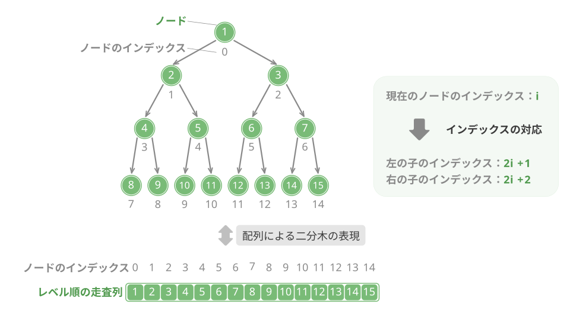
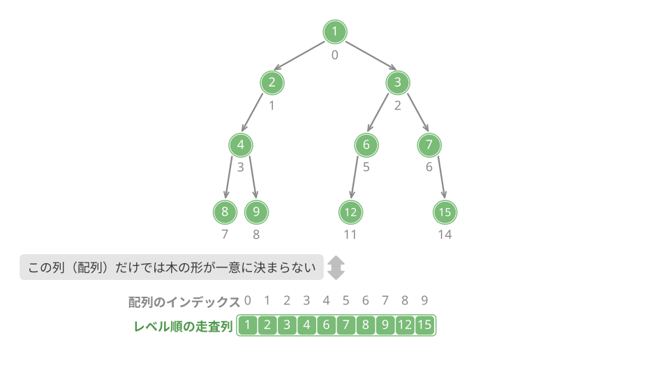
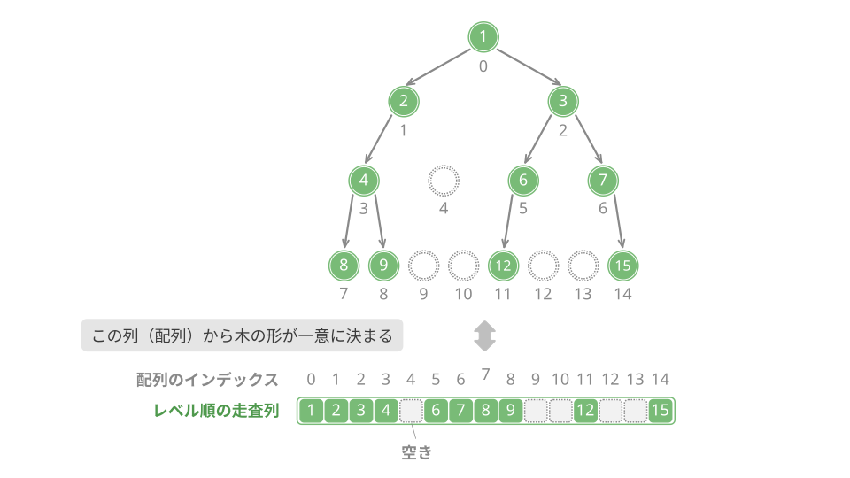
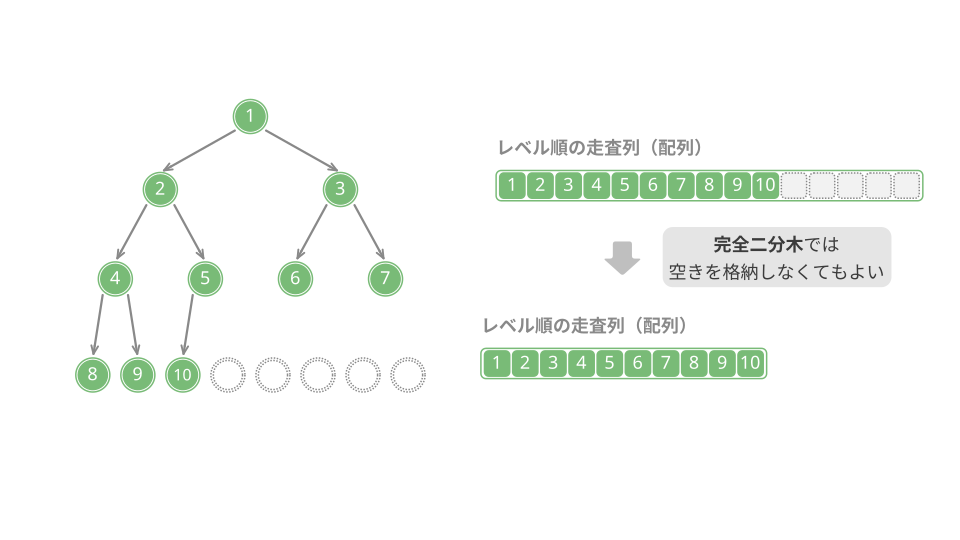

# 二分木の配列表現

連結表現では、二分木の記憶単位はノード `TreeNode` で、ノード同士はポインタでつながっています。前節では、この表現を用いた二分木の基本操作を紹介しました。

では、二分木を配列で表すこともできるでしょうか。答えは「はい」です。

## 完璧二分木の表現

まず簡単な例を考えましょう。完璧二分木のすべてのノードをレベル順に配列に格納すると、各ノードに配列のインデックスが一つずつ対応します。

レベル順走査の性質から、親と子のインデックスの対応を表す式を導けます。**あるノードのインデックスが $i$ なら、左の子のインデックスは $2i + 1$、右の子のインデックスは $2i + 2$ です**。下図に各ノードのインデックスの対応を示します。



**この式は、連結表現におけるノードへの参照（ポインタ）と同じ役割を果たします**。配列内のどのノードからでも、式を使って左右の子にアクセスできます。

## 任意の二分木の表現

完璧二分木は特別な例です。一般の二分木では、途中の層に多くの `None` があります。レベル順の走査列にはこれらの `None` が含まれないため、列だけから `None` の個数や位置を割り出すことはできません。**つまり、同じレベル順の走査列に複数の木の形が対応し得ます**。

下図のように、完璧二分木でない木では、先ほどの配列表現はうまくいきません。



この問題を解決するには、**レベル順の走査列にすべての `None` を明示する**方法があります。こうすれば、下図のようにレベル順の列から二分木が一意に定まります。コード例を示します。

```snippet
tree_array_representation
```



特に、**完全二分木は配列表現に適しています**。定義を振り返ると、完全二分木で `None` が現れるのは最下層の右端だけです。**したがって、すべての `None` はレベル順の走査列の末尾に集まります**。

このため、完全二分木を配列で表す際には、`None` をすべて省略できて便利です。下図に例を示します。



次のコードは、配列を使った二分木の実装です。以下の操作に対応しています。

- 指定したノードの値、左右の子、親を取得します。
- 行きがけ順、通りがけ順、帰りがけ順、レベル順の走査列を取得します。

```src
[file]{array_binary_tree}-[class]{array_binary_tree}-[func]{}
```

## 利点と制約

二分木の配列表現には、主に次の利点があります。

- 配列は連続したメモリ領域に格納されるのでキャッシュを活用しやすく、アクセスや走査が高速です。
- ポインタを格納する必要がなく、メモリを節約できます。
- ノードにランダムアクセスできます。

一方、配列表現には次のような制約もあります。

- 配列には連続したメモリ領域が必要なため、データ量が非常に大きい木の格納には適しません。
- ノードの追加や削除には配列への挿入や配列からの削除が必要で、効率がよくありません。
- 二分木に `None` が多いと、配列のうち実際のノードのデータが占める割合が小さくなり、メモリの利用効率が下がります。
