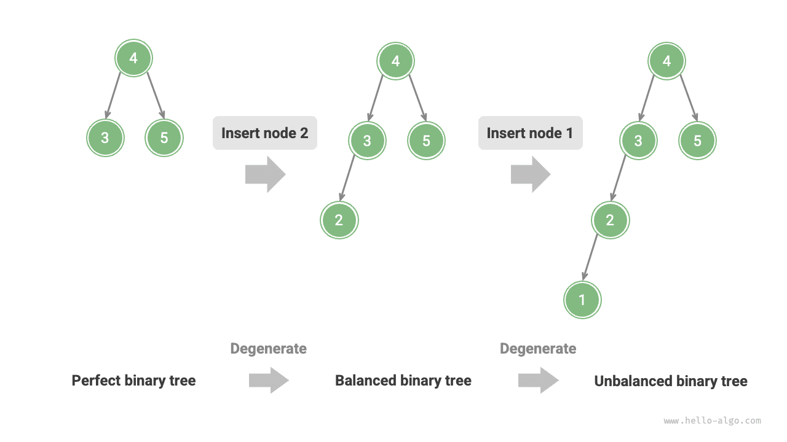
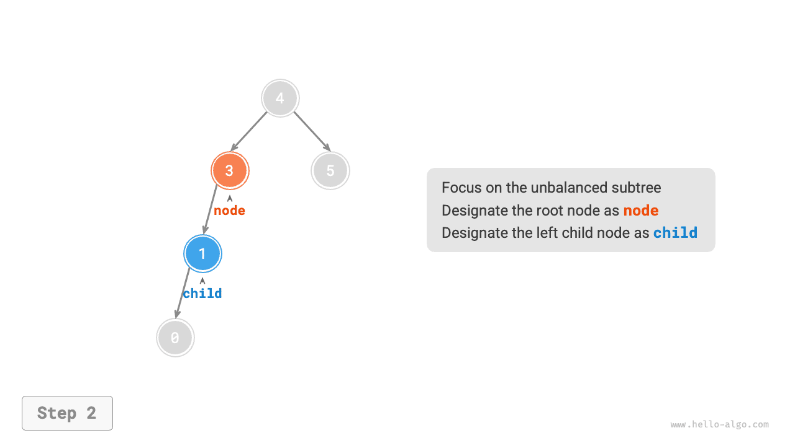

# AVL 木 *

「二分探索木」の節で述べたように、挿入と削除を繰り返すと、二分探索木は連結リストに退化する可能性があります。その場合、すべての操作の時間計算量が $O(\log n)$ から $O(n)$ に悪化します。

下図の二分探索木は、二回の削除だけで連結リストに退化します。


また、下図のパーフェクト二分木に二つのノードを挿入すると、木が大きく左へ偏り、探索の時間計算量も悪化します。



1962 年、G. M. Adelson-Velsky と E. M. Landis は論文「An algorithm for the organization of information」で<u>AVL 木</u>を提案しました。論文では、追加や削除を続けても退化せず、各操作の時間計算量を $O(\log n)$ に保つ一連の操作を詳しく述べています。つまり、追加、削除、照会、更新が頻繁な場面でも、常に効率的に操作できるため、高い実用性があります。

## AVL 木の主な用語

AVL 木は二分探索木であると同時に平衡二分木でもあり、両者の性質をすべて満たします。そのため、<u>平衡二分探索木（balanced binary search tree）</u>の一種です。

### ノードの高さ

AVL 木の操作ではノードの高さが必要なので、ノードクラスに変数 `height` を追加します。

=== "Python"

    ```python title=""
    class TreeNode:
        """AVL 木のノードクラス"""
        def __init__(self, val: int):
            self.val: int = val                 # ノードの値
            self.height: int = 0                # ノードの高さ
            self.left: TreeNode | None = None   # 左の子への参照
            self.right: TreeNode | None = None  # 右の子への参照
    ```

=== "C++"

    ```cpp title=""
    /* AVL 木のノードクラス */
    struct TreeNode {
        int val{};          // ノードの値
        int height = 0;     // ノードの高さ
        TreeNode *left{};   // 左の子
        TreeNode *right{};  // 右の子
        TreeNode() = default;
        explicit TreeNode(int x) : val(x){}
    };
    ```

=== "Java"

    ```java title=""
    /* AVL 木のノードクラス */
    class TreeNode {
        public int val;        // ノードの値
        public int height;     // ノードの高さ
        public TreeNode left;  // 左の子
        public TreeNode right; // 右の子
        public TreeNode(int x) { val = x; }
    }
    ```

=== "C#"

    ```csharp title=""
    /* AVL 木のノードクラス */
    class TreeNode(int? x) {
        public int? val = x;    // ノードの値
        public int height;      // ノードの高さ
        public TreeNode? left;  // 左の子への参照
        public TreeNode? right; // 右の子への参照
    }
    ```

=== "Go"

    ```go title=""
    /* AVL 木のノード構造体 */
    type TreeNode struct {
        Val    int       // ノードの値
        Height int       // ノードの高さ
        Left   *TreeNode // 左の子への参照
        Right  *TreeNode // 右の子への参照
    }
    ```

=== "Swift"

    ```swift title=""
    /* AVL 木のノードクラス */
    class TreeNode {
        var val: Int // ノードの値
        var height: Int // ノードの高さ
        var left: TreeNode? // 左の子
        var right: TreeNode? // 右の子

        init(x: Int) {
            val = x
            height = 0
        }
    }
    ```

=== "JS"

    ```javascript title=""
    /* AVL 木のノードクラス */
    class TreeNode {
        val; // ノードの値
        height; //ノードの高さ
        left; // 左の子へのポインタ
        right; // 右の子へのポインタ
        constructor(val, left, right, height) {
            this.val = val === undefined ? 0 : val;
            this.height = height === undefined ? 0 : height;
            this.left = left === undefined ? null : left;
            this.right = right === undefined ? null : right;
        }
    }
    ```

=== "TS"

    ```typescript title=""
    /* AVL 木のノードクラス */
    class TreeNode {
        val: number;            // ノードの値
        height: number;         // ノードの高さ
        left: TreeNode | null;  // 左の子へのポインタ
        right: TreeNode | null; // 右の子へのポインタ
        constructor(val?: number, height?: number, left?: TreeNode | null, right?: TreeNode | null) {
            this.val = val === undefined ? 0 : val;
            this.height = height === undefined ? 0 : height;
            this.left = left === undefined ? null : left;
            this.right = right === undefined ? null : right;
        }
    }
    ```

=== "Dart"

    ```dart title=""
    /* AVL 木のノードクラス */
    class TreeNode {
      int val;         // ノードの値
      int height;      // ノードの高さ
      TreeNode? left;  // 左の子
      TreeNode? right; // 右の子
      TreeNode(this.val, [this.height = 0, this.left, this.right]);
    }
    ```

=== "Rust"

    ```rust title=""
    use std::rc::Rc;
    use std::cell::RefCell;

    /* AVL 木のノード構造体 */
    struct TreeNode {
        val: i32,                               // ノードの値
        height: i32,                            // ノードの高さ
        left: Option<Rc<RefCell<TreeNode>>>,    // 左の子
        right: Option<Rc<RefCell<TreeNode>>>,   // 右の子
    }

    impl TreeNode {
        /* コンストラクタ */
        fn new(val: i32) -> Rc<RefCell<Self>> {
            Rc::new(RefCell::new(Self {
                val,
                height: 0,
                left: None,
                right: None
            }))
        }
    }
    ```

=== "C"

    ```c title=""
    /* AVL 木のノード構造体 */
    typedef struct TreeNode {
        int val;
        int height;
        struct TreeNode *left;
        struct TreeNode *right;
    } TreeNode;

    /* コンストラクタ */
    TreeNode *newTreeNode(int val) {
        TreeNode *node;

        node = (TreeNode *)malloc(sizeof(TreeNode));
        node->val = val;
        node->height = 0;
        node->left = NULL;
        node->right = NULL;
        return node;
    }
    ```

=== "Kotlin"

    ```kotlin title=""
    /* AVL 木のノードクラス */
    class TreeNode(val _val: Int) {  // ノードの値
        var height: Int = 0          // ノードの高さ
        var left: TreeNode? = null   // 左の子
        var right: TreeNode? = null  // 右の子
    }
    ```

=== "Ruby"

    ```ruby title=""
    ### AVL 木のノードクラス ###
    class TreeNode
      attr_accessor :val    # ノードの値
      attr_accessor :height # ノードの高さ
      attr_accessor :left   # 左の子への参照
      attr_accessor :right  # 右の子への参照

      def initialize(val)
        @val = val
        @height = 0
      end
    end
    ```

「ノードの高さ」は、そのノードから最も遠い葉までの距離、つまり通る辺の数です。葉の高さは $0$、空のノードの高さは $-1$ であることに、特に注意してください。高さの取得と更新を行う二つの補助関数を作ります。

```src
[file]{avl_tree}-[class]{avl_tree}-[func]{update_height}
```

### ノードの平衡係数

<u>平衡係数（balance factor）</u>は、左の部分木の高さから右の部分木の高さを引いた値です。空のノードの平衡係数は $0$ とします。取得処理も関数にまとめておくと、後で使いやすくなります。

```src
[file]{avl_tree}-[class]{avl_tree}-[func]{balance_factor}
```

!!! tip

    平衡係数を $f$ とすると、AVL 木のすべてのノードで $-1 \le f \le 1$ が成り立ちます。

## AVL 木の回転

AVL 木の特徴は「回転」です。通りがけ順の列を変えずに、不均衡なノードの平衡を取り戻せます。つまり、**回転は二分探索木の性質を保ちつつ、木を再び平衡二分木にできます**。

平衡係数の絶対値が $> 1$ のノードを「不均衡なノード」と呼びます。状態に応じて、右回転、左回転、右回転してから左回転、左回転してから右回転の四種類を使います。順に詳しく説明します。

### 右回転

下図では、ノードの下の数値が平衡係数です。下から上へ見ると、最初の不均衡なノードは「ノード 3」です。そこを根とする部分木に注目し、そのノードを `node`、左の子を `child` として右回転します。すると、二分探索木の性質を保ったまま、部分木が平衡に戻ります。

=== "<1>"
    

=== "<2>"
    

=== "<3>"
    

=== "<4>"
    

下図のように、`child` に右の子 `grand_child` がある場合は、それを `node` の左の子にする手順を追加します。


「右へ回転する」は見た目の表現であり、実際にはノードのポインタを変更して実現します。コードは次のとおりです。

```src
[file]{avl_tree}-[class]{avl_tree}-[func]{right_rotate}
```

### 左回転

これに対し、先ほどの不均衡な木を鏡に映した形では、下図の左回転が必要です。


同様に、下図のように `child` に左の子 `grand_child` がある場合は、それを `node` の右の子にする手順を追加します。


**右回転と左回転は論理的に鏡映対称で、対処する不均衡の形も対称です**。この対称性から、右回転のコードの `left` をすべて `right` に、`right` をすべて `left` に置き換えると、左回転のコードになります。

```src
[file]{avl_tree}-[class]{avl_tree}-[func]{left_rotate}
```

### 左回転してから右回転

下図の不均衡なノード 3 は、左回転か右回転の一方だけでは平衡に戻りません。まず `child` を左回転し、次に `node` を右回転する必要があります。


### 右回転してから左回転

下図のように、先ほどの木を鏡に映した形では、まず `child` を右回転し、次に `node` を左回転します。


### 回転の選択

下図の四つの不均衡は、これまでの例にそれぞれ対応します。必要な操作は順に、右回転、左回転してから右回転、右回転してから左回転、左回転です。


下表のように、不均衡なノードの平衡係数と、高い側の子の平衡係数の符号から、上図のどの場合かを判定します。

<p align="center"> 表 <id> &nbsp; 四つの回転の選択条件 </p>

| 不均衡なノードの平衡係数 | 子の平衡係数 | 選ぶ回転方法 |
| ------------------ | ---------------- | ---------------- |
| $> 1$ （左に偏る木）   | $\geq 0$         | 右回転             |
| $> 1$ （左に偏る木）   | $<0$             | 左回転してから右回転     |
| $< -1$ （右に偏る木）  | $\leq 0$         | 左回転             |
| $< -1$ （右に偏る木）  | $>0$             | 右回転してから左回転     |

使いやすいように、回転処理を一つの関数にまとめます。**この関数でさまざまな不均衡に応じた回転を行い、平衡を取り戻せます**。コードは次のとおりです。

```src
[file]{avl_tree}-[class]{avl_tree}-[func]{rotate}
```

## AVL 木の主な操作

### ノードの挿入

基本的には二分探索木の挿入と似ています。違いは、挿入後、そのノードから根までの経路上に不均衡なノードが生じる可能性があることです。したがって、**挿入したノードを起点に下から上へ回転を行い、すべての不均衡を解消する必要があります**。コードは次のとおりです。

```src
[file]{avl_tree}-[class]{avl_tree}-[func]{insert_helper}
```

### ノードの削除

同様に、二分探索木の削除に加えて、下から上へ回転を行い、すべての不均衡を解消する必要があります。コードは次のとおりです。

```src
[file]{avl_tree}-[class]{avl_tree}-[func]{remove_helper}
```

### ノードの探索

探索は二分探索木と同じなので、ここでは繰り返しません。

## AVL 木の代表的な用途

- 大規模なデータの組織化と格納に使い、探索が多く追加・削除が少ない場面に適しています。
- データベースのインデックスシステムを構築するために使います。
- 赤黒木も代表的な平衡二分探索木です。AVL 木より平衡条件が緩く、挿入・削除に必要な回転が少ないため、追加・削除の平均的な効率が高くなります。
