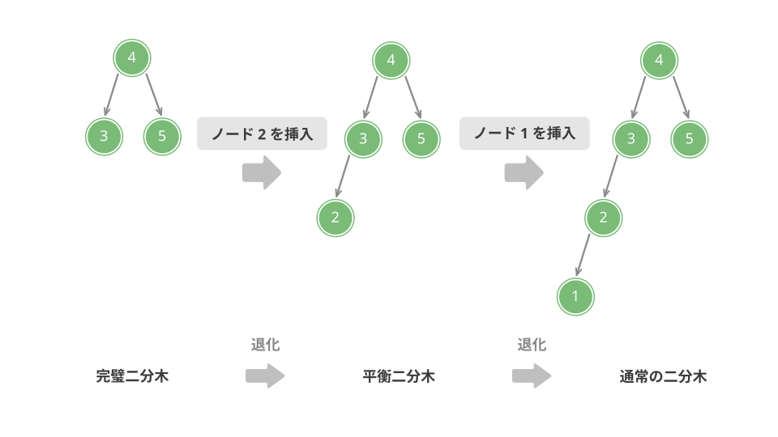
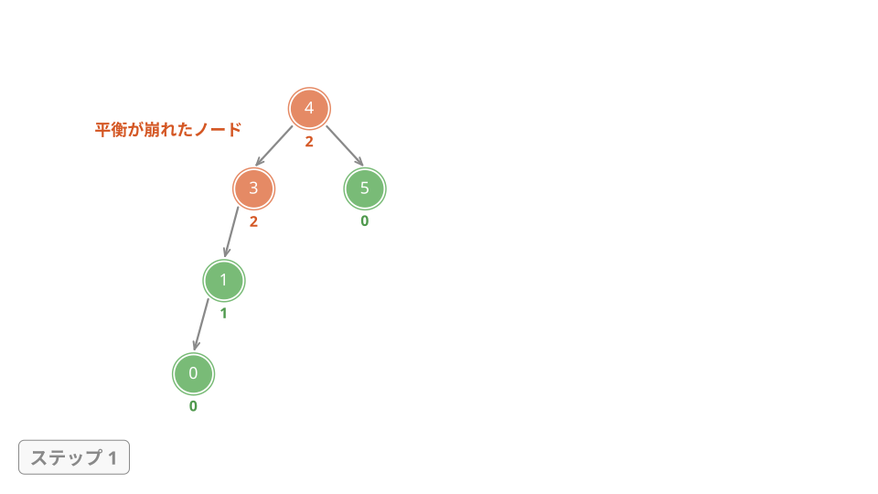
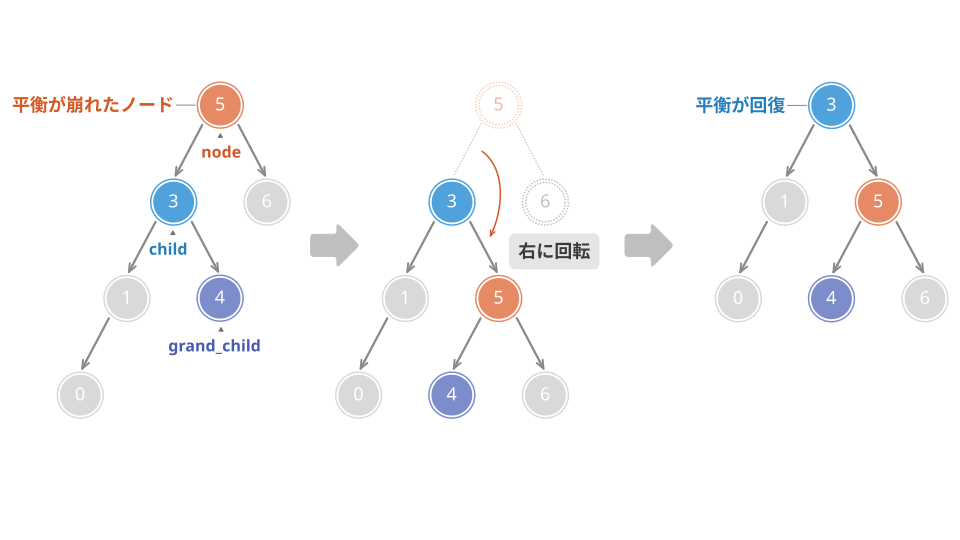
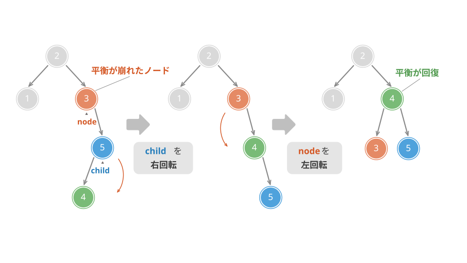
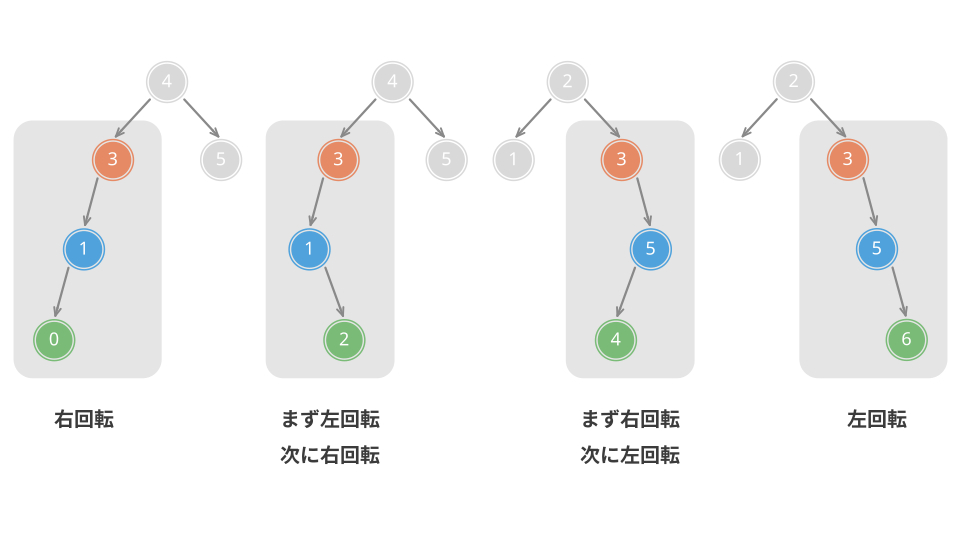

# AVL 木 *

「二分探索木」の節で見たように、挿入や削除を繰り返すと、二分探索木は連結リストに退化することがあります。その場合、各操作の時間計算量は $O(\log n)$ から $O(n)$ に悪化します。

下図の二分探索木では、ノードを 2 回削除するだけで連結リストに退化します。


もう一つの例を見ましょう。下図の完璧二分木にノードを 2 個挿入すると、木は大きく左に傾き、探索の時間計算量も悪化します。



1962 年、G. M. Adelson-Velsky と E. M. Landis は論文「An algorithm for the organization of information」で <u>AVL 木</u>を提案しました。論文では、ノードの追加と削除を繰り返しても AVL 木が退化せず、各操作の時間計算量を $O(\log n)$ に保つための一連の操作を詳しく述べています。つまり、挿入・削除・探索・更新が頻繁に必要な場面でも、一貫して効率よくデータを扱えるため、AVL 木は実用上も価値があります。

## AVL 木の用語

AVL 木は二分探索木であると同時に平衡二分木でもあり、両方の性質をすべて満たします。このような木を<u>平衡二分探索木（balanced binary search tree）</u>と呼びます。

### ノードの高さ

AVL 木の操作ではノードの高さを取得する必要があるので、ノードのクラスに変数 `height` を追加します。

```snippet
avl_tree_node
```

ノードの高さとは、そのノードから最も遠い葉までの距離、すなわち経路上の辺の本数です。葉の高さは $0$、空のノードの高さは $-1$ であることに注意してください。ノードの高さを取得する関数と、更新する関数を用意します。

```src
[file]{avl_tree}-[class]{avl_tree}-[func]{update_height}
```

### ノードの平衡係数

ノードの<u>平衡係数（balance factor）</u>は、左部分木の高さから右部分木の高さを引いた値です。空のノードの平衡係数は $0$ と定めます。後で使いやすいように、平衡係数の取得も関数にまとめます。

```src
[file]{avl_tree}-[class]{avl_tree}-[func]{balance_factor}
```

!!! tip

    平衡係数を $f$ とすると、AVL 木のどのノードでも $-1 \le f \le 1$ が成り立ちます。

## AVL 木の回転

AVL 木の特徴は「回転」という操作です。二分木の通りがけ順の列を変えずに、平衡が崩れたノードを平衡に戻せます。つまり、**回転によって二分探索木の性質を保ったまま、木を再び平衡二分木にできます**。

平衡係数の絶対値が $> 1$ となるノードを「平衡が崩れたノード」と呼びます。崩れ方に応じて、右回転、左回転、右回転してから左回転、左回転してから右回転の 4 通りを使い分けます。それぞれ詳しく見ていきましょう。

### 右回転

下図の各ノードの下にある数は平衡係数です。下から上に見ると、最初に平衡が崩れているのはノード 3 です。これを根とする部分木に注目し、その根を `node`、左の子を `child` として右回転します。回転が終わると、部分木は平衡に戻り、二分探索木の性質も保たれます。

=== "<1>"
    

=== "<2>"
    

=== "<3>"
    

=== "<4>"
    

下図のように `child` に右の子（`grand_child` とします）がある場合、右回転にもう一つ操作を加え、`grand_child` を `node` の左の子にします。



「右に回転する」というのは見た目を表した言い方です。実際には、次のコードのようにノードのポインタを書き換えて実現します。

```src
[file]{avl_tree}-[class]{avl_tree}-[func]{right_rotate}
```

### 左回転

先ほどの不平衡な二分木を左右反転した場合には、下図のように左回転が必要です。


同様に、下図のように `child` に左の子（`grand_child` とします）がある場合、左回転にもう一つ操作を加え、`grand_child` を `node` の右の子にします。


**右回転と左回転の処理は左右対称で、それぞれが修正する不平衡な形も左右対称です**。この対称性を利用し、右回転のコードで `left` をすべて `right` に、元の `right` をすべて `left` に置き換えると、左回転のコードが得られます。

```src
[file]{avl_tree}-[class]{avl_tree}-[func]{left_rotate}
```

### 左回転してから右回転

下図のノード 3 では、左回転と右回転のどちらか一方だけでは部分木の平衡は回復しません。まず `child` を左回転し、次に `node` を右回転します。


### 右回転してから左回転

先ほどの不平衡な二分木を左右反転した下図では、まず `child` を右回転し、次に `node` を左回転します。



### 回転の選び方

下図の 4 種類の不平衡はこれまでの例に対応します。左から順に、右回転、左回転してから右回転、右回転してから左回転、左回転が必要です。



下表のように、平衡が崩れたノードの平衡係数と、高い側の子の平衡係数の符号から、上図のどの場合に当たるかを判定できます。

<p align="center"> 表 <id> &nbsp; 4 種類の回転を選ぶ条件 </p>

| 平衡が崩れたノードの平衡係数 | 子の平衡係数 | 選ぶ回転 |
| ------------------ | ---------------- | ---------------- |
| $> 1$（左に偏った木）   | $\geq 0$         | 右回転             |
| $> 1$（左に偏った木）   | $<0$             | 左回転してから右回転     |
| $< -1$（右に偏った木）  | $\leq 0$         | 左回転             |
| $< -1$（右に偏った木）  | $>0$             | 右回転してから左回転     |

使いやすいように回転を一つの関数にまとめます。**この関数があれば、どの形の不平衡にも適切な回転を行い、そのノードを平衡に戻せます**。コードは次のとおりです。

```src
[file]{avl_tree}-[class]{avl_tree}-[func]{rotate}
```

## AVL 木の基本操作

### ノードの挿入

AVL 木への挿入は、基本的に二分探索木への挿入と同じです。唯一の違いは、挿入したノードから根までの経路上に、平衡が崩れたノードがいくつも生じ得ることです。そこで、**挿入したノードから上へとたどって回転を行い、平衡が崩れたすべてのノードを平衡に戻します**。コードは次のとおりです。

```src
[file]{avl_tree}-[class]{avl_tree}-[func]{insert_helper}
```

### ノードの削除

同様に、二分探索木のノードを削除する処理に加え、下から上に回転を行い、平衡が崩れたすべてのノードを平衡に戻します。コードは次のとおりです。

```src
[file]{avl_tree}-[class]{avl_tree}-[func]{remove_helper}
```

### ノードの探索

AVL 木のノードの探索は二分探索木の場合と同じなので、ここでは説明を省きます。

## AVL 木の代表的な用途

- 大量のデータを整理して格納します。探索の頻度が高く、挿入や削除の頻度が低い場面に適しています。
- データベースのインデックスの構築に使われます。
- 赤黒木も、よく使われる平衡二分探索木です。AVL 木よりも平衡条件が緩く、ノードの挿入や削除に必要な回転が少ないため、平均すると挿入や削除の効率が高くなります。
