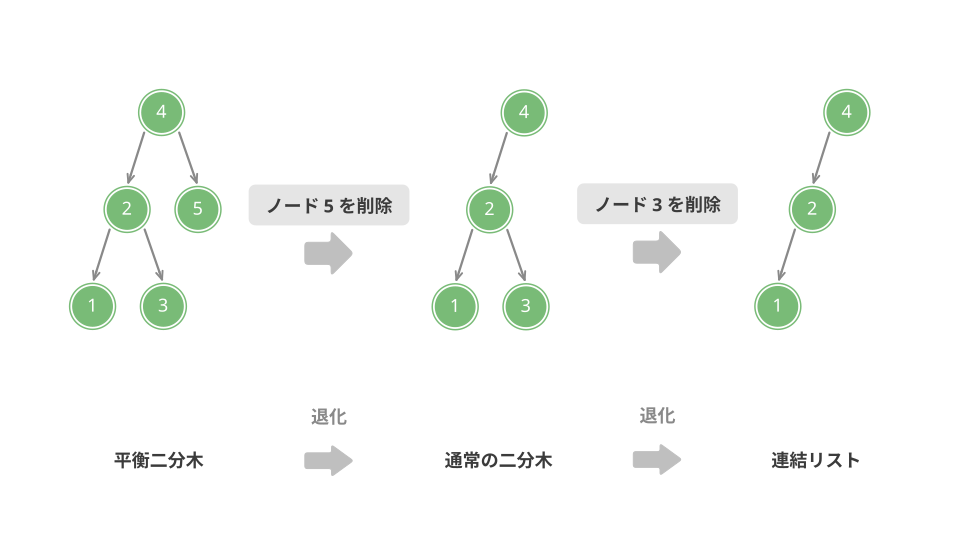
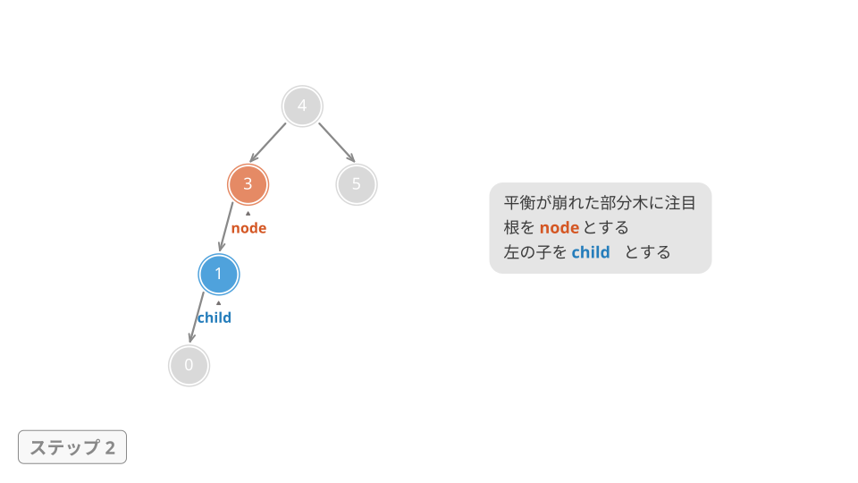
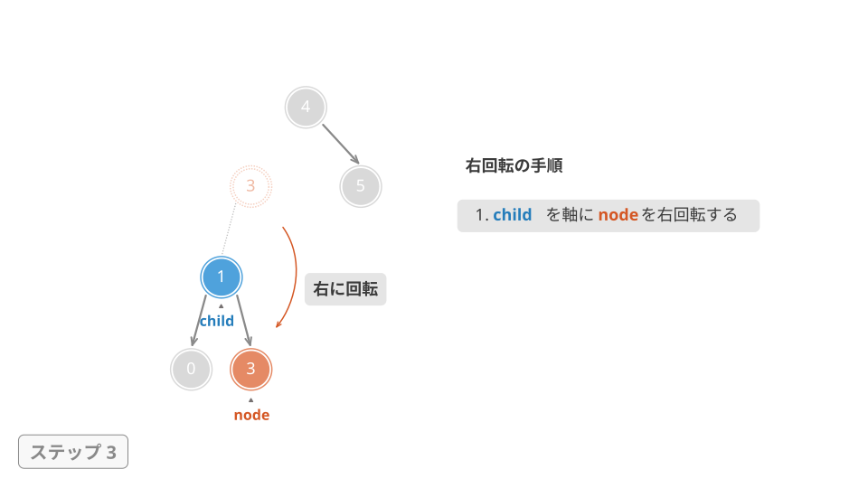
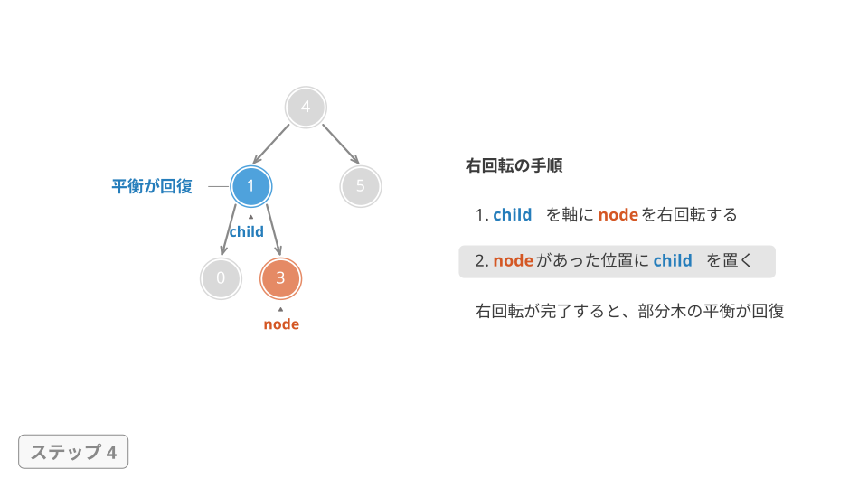
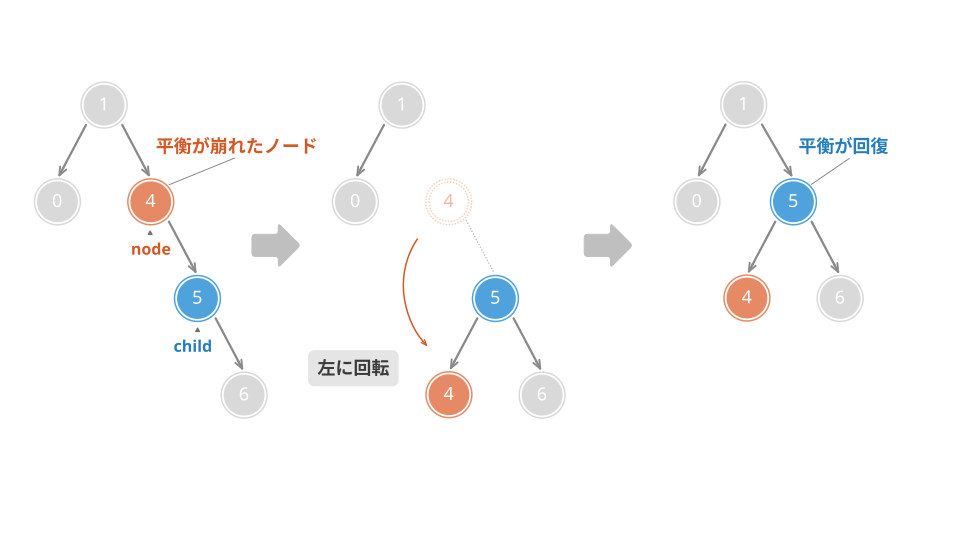
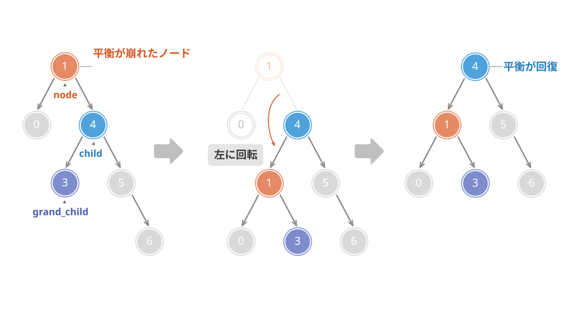
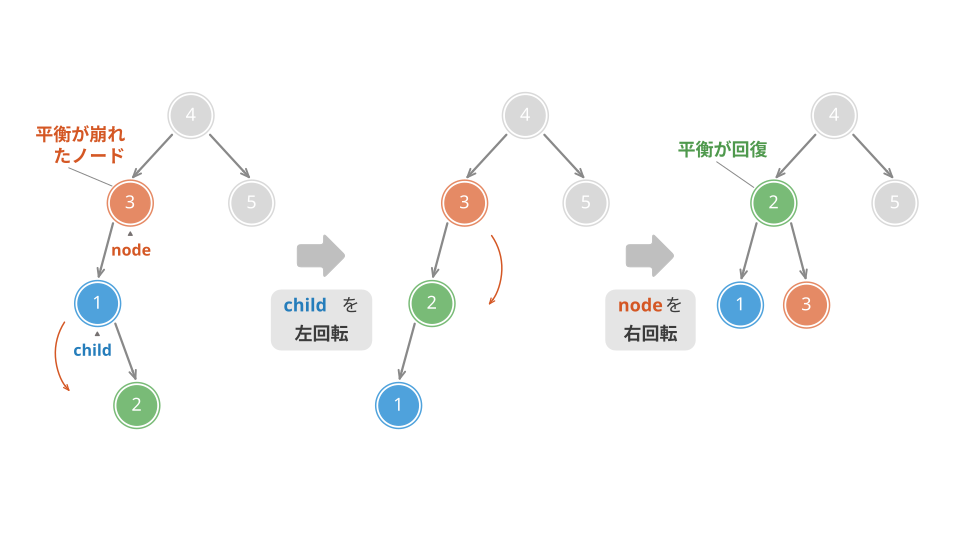

# 7.5 &nbsp; AVL 木 *

「二分探索木」の節で見たように、挿入や削除を繰り返すと、二分探索木は連結リストに退化することがあります。その場合、各操作の時間計算量は $O(\log n)$ から $O(n)$ に悪化します。

図 7-24 の二分探索木では、ノードを 2 回削除するだけで連結リストに退化します。

{ class="animation-figure" }

<p align="center"> 図 7-24 &nbsp; ノードの削除による AVL 木の退化 </p>

もう一つの例を見ましょう。図 7-25 の完璧二分木にノードを 2 個挿入すると、木は大きく左に傾き、探索の時間計算量も悪化します。

{ class="animation-figure" }

<p align="center"> 図 7-25 &nbsp; ノードの挿入による AVL 木の退化 </p>

1962 年、G. M. Adelson-Velsky と E. M. Landis は論文「An algorithm for the organization of information」で <u>AVL 木</u>を提案しました。論文では、ノードの追加と削除を繰り返しても AVL 木が退化せず、各操作の時間計算量を $O(\log n)$ に保つための一連の操作を詳しく述べています。つまり、挿入・削除・探索・更新が頻繁に必要な場面でも、一貫して効率よくデータを扱えるため、AVL 木は実用上も価値があります。

## 7.5.1 &nbsp; AVL 木の用語

AVL 木は二分探索木であると同時に平衡二分木でもあり、両方の性質をすべて満たします。このような木を<u>平衡二分探索木（balanced binary search tree）</u>と呼びます。

### 1. &nbsp; ノードの高さ

AVL 木の操作ではノードの高さを取得する必要があるので、ノードのクラスに変数 `height` を追加します。

=== "Python"

    ```python title=""
    class TreeNode:
        """AVL 木のノードのクラス"""
        def __init__(self, val: int):
            self.val: int = val                 # ノードの値
            self.height: int = 0                # ノードの高さ
            self.left: TreeNode | None = None   # 左の子への参照
            self.right: TreeNode | None = None  # 右の子への参照
    ```

=== "C++"

    ```cpp title=""
    /* AVL 木のノードのクラス */
    struct TreeNode {
        int val{};          // ノードの値
        int height = 0;     // ノードの高さ
        TreeNode *left{};   // 左の子
        TreeNode *right{};  // 右の子
        TreeNode() = default;
        explicit TreeNode(int x) : val(x){}
    };
    ```

=== "Java"

    ```java title=""
    /* AVL 木のノードのクラス */
    class TreeNode {
        public int val;        // ノードの値
        public int height;     // ノードの高さ
        public TreeNode left;  // 左の子
        public TreeNode right; // 右の子
        public TreeNode(int x) { val = x; }
    }
    ```

=== "C#"

    ```csharp title=""
    /* AVL 木のノードのクラス */
    class TreeNode(int? x) {
        public int? val = x;    // ノードの値
        public int height;      // ノードの高さ
        public TreeNode? left;  // 左の子への参照
        public TreeNode? right; // 右の子への参照
    }
    ```

=== "Go"

    ```go title=""
    /* AVL 木のノードの構造体 */
    type TreeNode struct {
        Val    int       // ノードの値
        Height int       // ノードの高さ
        Left   *TreeNode // 左の子への参照
        Right  *TreeNode // 右の子への参照
    }
    ```

=== "Swift"

    ```swift title=""
    /* AVL 木のノードのクラス */
    class TreeNode {
        var val: Int // ノードの値
        var height: Int // ノードの高さ
        var left: TreeNode? // 左の子
        var right: TreeNode? // 右の子

        init(x: Int) {
            val = x
            height = 0
        }
    }
    ```

=== "JS"

    ```javascript title=""
    /* AVL 木のノードのクラス */
    class TreeNode {
        val; // ノードの値
        height; //ノードの高さ
        left; // 左の子へのポインタ
        right; // 右の子へのポインタ
        constructor(val, left, right, height) {
            this.val = val === undefined ? 0 : val;
            this.height = height === undefined ? 0 : height;
            this.left = left === undefined ? null : left;
            this.right = right === undefined ? null : right;
        }
    }
    ```

=== "TS"

    ```typescript title=""
    /* AVL 木のノードのクラス */
    class TreeNode {
        val: number;            // ノードの値
        height: number;         // ノードの高さ
        left: TreeNode | null;  // 左の子へのポインタ
        right: TreeNode | null; // 右の子へのポインタ
        constructor(val?: number, height?: number, left?: TreeNode | null, right?: TreeNode | null) {
            this.val = val === undefined ? 0 : val;
            this.height = height === undefined ? 0 : height;
            this.left = left === undefined ? null : left;
            this.right = right === undefined ? null : right;
        }
    }
    ```

=== "Dart"

    ```dart title=""
    /* AVL 木のノードのクラス */
    class TreeNode {
      int val;         // ノードの値
      int height;      // ノードの高さ
      TreeNode? left;  // 左の子
      TreeNode? right; // 右の子
      TreeNode(this.val, [this.height = 0, this.left, this.right]);
    }
    ```

=== "Rust"

    ```rust title=""
    use std::rc::Rc;
    use std::cell::RefCell;

    /* AVL 木のノードの構造体 */
    struct TreeNode {
        val: i32,                               // ノードの値
        height: i32,                            // ノードの高さ
        left: Option<Rc<RefCell<TreeNode>>>,    // 左の子
        right: Option<Rc<RefCell<TreeNode>>>,   // 右の子
    }

    impl TreeNode {
        /* コンストラクタ */
        fn new(val: i32) -> Rc<RefCell<Self>> {
            Rc::new(RefCell::new(Self {
                val,
                height: 0,
                left: None,
                right: None
            }))
        }
    }
    ```

=== "C"

    ```c title=""
    /* AVL 木のノードの構造体 */
    typedef struct TreeNode {
        int val;
        int height;
        struct TreeNode *left;
        struct TreeNode *right;
    } TreeNode;

    /* コンストラクタ */
    TreeNode *newTreeNode(int val) {
        TreeNode *node;

        node = (TreeNode *)malloc(sizeof(TreeNode));
        node->val = val;
        node->height = 0;
        node->left = NULL;
        node->right = NULL;
        return node;
    }
    ```

=== "Kotlin"

    ```kotlin title=""
    /* AVL 木のノードのクラス */
    class TreeNode(val _val: Int) {  // ノードの値
        var height: Int = 0          // ノードの高さ
        var left: TreeNode? = null   // 左の子
        var right: TreeNode? = null  // 右の子
    }
    ```

=== "Ruby"

    ```ruby title=""
    ### AVL 木のノードのクラス ###
    class TreeNode
      attr_accessor :val    # ノードの値
      attr_accessor :height # ノードの高さ
      attr_accessor :left   # 左の子への参照
      attr_accessor :right  # 右の子への参照

      def initialize(val)
        @val = val
        @height = 0
      end
    end
    ```

ノードの高さとは、そのノードから最も遠い葉までの距離、すなわち経路上の辺の本数です。葉の高さは $0$、空のノードの高さは $-1$ であることに注意してください。ノードの高さを取得する関数と、更新する関数を用意します。

=== "Python"

    ```python title="avl_tree.py"
    def height(self, node: TreeNode | None) -> int:
        """ノードの高さを取得する"""
        # 空のノードの高さは -1、葉の高さは 0
        if node is not None:
            return node.height
        return -1

    def update_height(self, node: TreeNode | None):
        """ノードの高さを更新する"""
        # ノードの高さは、左右の部分木の高さの最大値 + 1
        node.height = max([self.height(node.left), self.height(node.right)]) + 1
    ```

=== "C++"

    ```cpp title="avl_tree.cpp"
    /* ノードの高さを取得する */
    int height(TreeNode *node) {
        // 空のノードの高さは -1、葉の高さは 0
        return node == nullptr ? -1 : node->height;
    }

    /* ノードの高さを更新する */
    void updateHeight(TreeNode *node) {
        // ノードの高さは、左右の部分木の高さの最大値 + 1
        node->height = max(height(node->left), height(node->right)) + 1;
    }
    ```

=== "Java"

    ```java title="avl_tree.java"
    /* ノードの高さを取得する */
    int height(TreeNode node) {
        // 空のノードの高さは -1、葉の高さは 0
        return node == null ? -1 : node.height;
    }

    /* ノードの高さを更新する */
    void updateHeight(TreeNode node) {
        // ノードの高さは、左右の部分木の高さの最大値 + 1
        node.height = Math.max(height(node.left), height(node.right)) + 1;
    }
    ```

=== "C#"

    ```csharp title="avl_tree.cs"
    /* ノードの高さを取得する */
    int Height(TreeNode? node) {
        // 空のノードの高さは -1、葉の高さは 0
        return node == null ? -1 : node.height;
    }

    /* ノードの高さを更新する */
    void UpdateHeight(TreeNode node) {
        // ノードの高さは、左右の部分木の高さの最大値 + 1
        node.height = Math.Max(Height(node.left), Height(node.right)) + 1;
    }
    ```

=== "Go"

    ```go title="avl_tree.go"
    /* ノードの高さを取得する */
    func (t *aVLTree) height(node *TreeNode) int {
        // 空のノードの高さは -1、葉の高さは 0
        if node != nil {
            return node.Height
        }
        return -1
    }

    /* ノードの高さを更新する */
    func (t *aVLTree) updateHeight(node *TreeNode) {
        lh := t.height(node.Left)
        rh := t.height(node.Right)
        // ノードの高さは、左右の部分木の高さの最大値 + 1
        if lh > rh {
            node.Height = lh + 1
        } else {
            node.Height = rh + 1
        }
    }
    ```

=== "Swift"

    ```swift title="avl_tree.swift"
    /* ノードの高さを取得する */
    func height(node: TreeNode?) -> Int {
        // 空のノードの高さは -1、葉の高さは 0
        node?.height ?? -1
    }

    /* ノードの高さを更新する */
    func updateHeight(node: TreeNode?) {
        // ノードの高さは、左右の部分木の高さの最大値 + 1
        node?.height = max(height(node: node?.left), height(node: node?.right)) + 1
    }
    ```

=== "JS"

    ```javascript title="avl_tree.js"
    /* ノードの高さを取得する */
    height(node) {
        // 空のノードの高さは -1、葉の高さは 0
        return node === null ? -1 : node.height;
    }

    /* ノードの高さを更新する */
    #updateHeight(node) {
        // ノードの高さは、左右の部分木の高さの最大値 + 1
        node.height =
            Math.max(this.height(node.left), this.height(node.right)) + 1;
    }
    ```

=== "TS"

    ```typescript title="avl_tree.ts"
    /* ノードの高さを取得する */
    height(node: TreeNode): number {
        // 空のノードの高さは -1、葉の高さは 0
        return node === null ? -1 : node.height;
    }

    /* ノードの高さを更新する */
    updateHeight(node: TreeNode): void {
        // ノードの高さは、左右の部分木の高さの最大値 + 1
        node.height =
            Math.max(this.height(node.left), this.height(node.right)) + 1;
    }
    ```

=== "Dart"

    ```dart title="avl_tree.dart"
    /* ノードの高さを取得する */
    int height(TreeNode? node) {
      // 空のノードの高さは -1、葉の高さは 0
      return node == null ? -1 : node.height;
    }

    /* ノードの高さを更新する */
    void updateHeight(TreeNode? node) {
      // ノードの高さは、左右の部分木の高さの最大値 + 1
      node!.height = max(height(node.left), height(node.right)) + 1;
    }
    ```

=== "Rust"

    ```rust title="avl_tree.rs"
    /* ノードの高さを取得する */
    fn height(node: OptionTreeNodeRc) -> i32 {
        // 空のノードの高さは -1、葉の高さは 0
        match node {
            Some(node) => node.borrow().height,
            None => -1,
        }
    }

    /* ノードの高さを更新する */
    fn update_height(node: OptionTreeNodeRc) {
        if let Some(node) = node {
            let left = node.borrow().left.clone();
            let right = node.borrow().right.clone();
            // ノードの高さは、左右の部分木の高さの最大値 + 1
            node.borrow_mut().height = std::cmp::max(Self::height(left), Self::height(right)) + 1;
        }
    }
    ```

=== "C"

    ```c title="avl_tree.c"
    /* ノードの高さを取得する */
    int height(TreeNode *node) {
        // 空のノードの高さは -1、葉の高さは 0
        if (node != NULL) {
            return node->height;
        }
        return -1;
    }

    /* ノードの高さを更新する */
    void updateHeight(TreeNode *node) {
        int lh = height(node->left);
        int rh = height(node->right);
        // ノードの高さは、左右の部分木の高さの最大値 + 1
        if (lh > rh) {
            node->height = lh + 1;
        } else {
            node->height = rh + 1;
        }
    }
    ```

=== "Kotlin"

    ```kotlin title="avl_tree.kt"
    /* ノードの高さを取得する */
    fun height(node: TreeNode?): Int {
        // 空のノードの高さは -1、葉の高さは 0
        return node?.height ?: -1
    }

    /* ノードの高さを更新する */
    fun updateHeight(node: TreeNode?) {
        // ノードの高さは、左右の部分木の高さの最大値 + 1
        node?.height = max(height(node?.left), height(node?.right)) + 1
    }
    ```

=== "Ruby"

    ```ruby title="avl_tree.rb"
    ### ノードの高さを取得する ###
    def height(node)
      # 空のノードの高さは -1、葉の高さは 0
      return node.height unless node.nil?

      -1
    end

    ### ノードの高さを更新する ###
    def update_height(node)
      # ノードの高さは、左右の部分木の高さの最大値 + 1
      node.height = [height(node.left), height(node.right)].max + 1
    end
    ```

### 2. &nbsp; ノードの平衡係数

ノードの<u>平衡係数（balance factor）</u>は、左部分木の高さから右部分木の高さを引いた値です。空のノードの平衡係数は $0$ と定めます。後で使いやすいように、平衡係数の取得も関数にまとめます。

=== "Python"

    ```python title="avl_tree.py"
    def balance_factor(self, node: TreeNode | None) -> int:
        """平衡係数を取得する"""
        # 空のノードの平衡係数は 0
        if node is None:
            return 0
        # ノードの平衡係数 = 左部分木の高さ - 右部分木の高さ
        return self.height(node.left) - self.height(node.right)
    ```

=== "C++"

    ```cpp title="avl_tree.cpp"
    /* 平衡係数を取得する */
    int balanceFactor(TreeNode *node) {
        // 空のノードの平衡係数は 0
        if (node == nullptr)
            return 0;
        // ノードの平衡係数 = 左部分木の高さ - 右部分木の高さ
        return height(node->left) - height(node->right);
    }
    ```

=== "Java"

    ```java title="avl_tree.java"
    /* 平衡係数を取得する */
    int balanceFactor(TreeNode node) {
        // 空のノードの平衡係数は 0
        if (node == null)
            return 0;
        // ノードの平衡係数 = 左部分木の高さ - 右部分木の高さ
        return height(node.left) - height(node.right);
    }
    ```

=== "C#"

    ```csharp title="avl_tree.cs"
    /* 平衡係数を取得する */
    int BalanceFactor(TreeNode? node) {
        // 空のノードの平衡係数は 0
        if (node == null) return 0;
        // ノードの平衡係数 = 左部分木の高さ - 右部分木の高さ
        return Height(node.left) - Height(node.right);
    }
    ```

=== "Go"

    ```go title="avl_tree.go"
    /* 平衡係数を取得する */
    func (t *aVLTree) balanceFactor(node *TreeNode) int {
        // 空のノードの平衡係数は 0
        if node == nil {
            return 0
        }
        // ノードの平衡係数 = 左部分木の高さ - 右部分木の高さ
        return t.height(node.Left) - t.height(node.Right)
    }
    ```

=== "Swift"

    ```swift title="avl_tree.swift"
    /* 平衡係数を取得する */
    func balanceFactor(node: TreeNode?) -> Int {
        // 空のノードの平衡係数は 0
        guard let node = node else { return 0 }
        // ノードの平衡係数 = 左部分木の高さ - 右部分木の高さ
        return height(node: node.left) - height(node: node.right)
    }
    ```

=== "JS"

    ```javascript title="avl_tree.js"
    /* 平衡係数を取得する */
    balanceFactor(node) {
        // 空のノードの平衡係数は 0
        if (node === null) return 0;
        // ノードの平衡係数 = 左部分木の高さ - 右部分木の高さ
        return this.height(node.left) - this.height(node.right);
    }
    ```

=== "TS"

    ```typescript title="avl_tree.ts"
    /* 平衡係数を取得する */
    balanceFactor(node: TreeNode): number {
        // 空のノードの平衡係数は 0
        if (node === null) return 0;
        // ノードの平衡係数 = 左部分木の高さ - 右部分木の高さ
        return this.height(node.left) - this.height(node.right);
    }
    ```

=== "Dart"

    ```dart title="avl_tree.dart"
    /* 平衡係数を取得する */
    int balanceFactor(TreeNode? node) {
      // 空のノードの平衡係数は 0
      if (node == null) return 0;
      // ノードの平衡係数 = 左部分木の高さ - 右部分木の高さ
      return height(node.left) - height(node.right);
    }
    ```

=== "Rust"

    ```rust title="avl_tree.rs"
    /* 平衡係数を取得する */
    fn balance_factor(node: OptionTreeNodeRc) -> i32 {
        match node {
            // 空のノードの平衡係数は 0
            None => 0,
            // ノードの平衡係数 = 左部分木の高さ - 右部分木の高さ
            Some(node) => {
                Self::height(node.borrow().left.clone()) - Self::height(node.borrow().right.clone())
            }
        }
    }
    ```

=== "C"

    ```c title="avl_tree.c"
    /* 平衡係数を取得する */
    int balanceFactor(TreeNode *node) {
        // 空のノードの平衡係数は 0
        if (node == NULL) {
            return 0;
        }
        // ノードの平衡係数 = 左部分木の高さ - 右部分木の高さ
        return height(node->left) - height(node->right);
    }
    ```

=== "Kotlin"

    ```kotlin title="avl_tree.kt"
    /* 平衡係数を取得する */
    fun balanceFactor(node: TreeNode?): Int {
        // 空のノードの平衡係数は 0
        if (node == null) return 0
        // ノードの平衡係数 = 左部分木の高さ - 右部分木の高さ
        return height(node.left) - height(node.right)
    }
    ```

=== "Ruby"

    ```ruby title="avl_tree.rb"
    ### 平衡係数を取得する ###
    def balance_factor(node)
      # 空のノードの平衡係数は 0
      return 0 if node.nil?

      # ノードの平衡係数 = 左部分木の高さ - 右部分木の高さ
      height(node.left) - height(node.right)
    end
    ```

!!! tip "ヒント"

    平衡係数を $f$ とすると、AVL 木のどのノードでも $-1 \le f \le 1$ が成り立ちます。

## 7.5.2 &nbsp; AVL 木の回転

AVL 木の特徴は「回転」という操作です。二分木の通りがけ順の列を変えずに、平衡が崩れたノードを平衡に戻せます。つまり、**回転によって二分探索木の性質を保ったまま、木を再び平衡二分木にできます**。

平衡係数の絶対値が $> 1$ となるノードを「平衡が崩れたノード」と呼びます。崩れ方に応じて、右回転、左回転、右回転してから左回転、左回転してから右回転の 4 通りを使い分けます。それぞれ詳しく見ていきましょう。

### 1. &nbsp; 右回転

図 7-26 の各ノードの下にある数は平衡係数です。下から上に見ると、最初に平衡が崩れているのはノード 3 です。これを根とする部分木に注目し、その根を `node`、左の子を `child` として右回転します。回転が終わると、部分木は平衡に戻り、二分探索木の性質も保たれます。

=== "<1>"
    { class="animation-figure" }

=== "<2>"
    { class="animation-figure" }

=== "<3>"
    { class="animation-figure" }

=== "<4>"
    { class="animation-figure" }

<p align="center"> 図 7-26 &nbsp; 右回転の手順 </p>

図 7-27 のように `child` に右の子（`grand_child` とします）がある場合、右回転にもう一つ操作を加え、`grand_child` を `node` の左の子にします。

{ class="animation-figure" }

<p align="center"> 図 7-27 &nbsp; grand_child がある場合の右回転 </p>

「右に回転する」というのは見た目を表した言い方です。実際には、次のコードのようにノードのポインタを書き換えて実現します。

=== "Python"

    ```python title="avl_tree.py"
    def right_rotate(self, node: TreeNode | None) -> TreeNode | None:
        """右回転"""
        child = node.left
        grand_child = child.right
        # child を軸に node を右回転する
        child.right = node
        node.left = grand_child
        # ノードの高さを更新する
        self.update_height(node)
        self.update_height(child)
        # 回転後の部分木の根を返す
        return child
    ```

=== "C++"

    ```cpp title="avl_tree.cpp"
    /* 右回転 */
    TreeNode *rightRotate(TreeNode *node) {
        TreeNode *child = node->left;
        TreeNode *grandChild = child->right;
        // child を軸に node を右回転する
        child->right = node;
        node->left = grandChild;
        // ノードの高さを更新する
        updateHeight(node);
        updateHeight(child);
        // 回転後の部分木の根を返す
        return child;
    }
    ```

=== "Java"

    ```java title="avl_tree.java"
    /* 右回転 */
    TreeNode rightRotate(TreeNode node) {
        TreeNode child = node.left;
        TreeNode grandChild = child.right;
        // child を軸に node を右回転する
        child.right = node;
        node.left = grandChild;
        // ノードの高さを更新する
        updateHeight(node);
        updateHeight(child);
        // 回転後の部分木の根を返す
        return child;
    }
    ```

=== "C#"

    ```csharp title="avl_tree.cs"
    /* 右回転 */
    TreeNode? RightRotate(TreeNode? node) {
        TreeNode? child = node?.left;
        TreeNode? grandChild = child?.right;
        // child を軸に node を右回転する
        child.right = node;
        node.left = grandChild;
        // ノードの高さを更新する
        UpdateHeight(node);
        UpdateHeight(child);
        // 回転後の部分木の根を返す
        return child;
    }
    ```

=== "Go"

    ```go title="avl_tree.go"
    /* 右回転 */
    func (t *aVLTree) rightRotate(node *TreeNode) *TreeNode {
        child := node.Left
        grandChild := child.Right
        // child を軸に node を右回転する
        child.Right = node
        node.Left = grandChild
        // ノードの高さを更新する
        t.updateHeight(node)
        t.updateHeight(child)
        // 回転後の部分木の根を返す
        return child
    }
    ```

=== "Swift"

    ```swift title="avl_tree.swift"
    /* 右回転 */
    func rightRotate(node: TreeNode?) -> TreeNode? {
        let child = node?.left
        let grandChild = child?.right
        // child を軸に node を右回転する
        child?.right = node
        node?.left = grandChild
        // ノードの高さを更新する
        updateHeight(node: node)
        updateHeight(node: child)
        // 回転後の部分木の根を返す
        return child
    }
    ```

=== "JS"

    ```javascript title="avl_tree.js"
    /* 右回転 */
    #rightRotate(node) {
        const child = node.left;
        const grandChild = child.right;
        // child を軸に node を右回転する
        child.right = node;
        node.left = grandChild;
        // ノードの高さを更新する
        this.#updateHeight(node);
        this.#updateHeight(child);
        // 回転後の部分木の根を返す
        return child;
    }
    ```

=== "TS"

    ```typescript title="avl_tree.ts"
    /* 右回転 */
    rightRotate(node: TreeNode): TreeNode {
        const child = node.left;
        const grandChild = child.right;
        // child を軸に node を右回転する
        child.right = node;
        node.left = grandChild;
        // ノードの高さを更新する
        this.updateHeight(node);
        this.updateHeight(child);
        // 回転後の部分木の根を返す
        return child;
    }
    ```

=== "Dart"

    ```dart title="avl_tree.dart"
    /* 右回転 */
    TreeNode? rightRotate(TreeNode? node) {
      TreeNode? child = node!.left;
      TreeNode? grandChild = child!.right;
      // child を軸に node を右回転する
      child.right = node;
      node.left = grandChild;
      // ノードの高さを更新する
      updateHeight(node);
      updateHeight(child);
      // 回転後の部分木の根を返す
      return child;
    }
    ```

=== "Rust"

    ```rust title="avl_tree.rs"
    /* 右回転 */
    fn right_rotate(node: OptionTreeNodeRc) -> OptionTreeNodeRc {
        match node {
            Some(node) => {
                let child = node.borrow().left.clone().unwrap();
                let grand_child = child.borrow().right.clone();
                // child を軸に node を右回転する
                child.borrow_mut().right = Some(node.clone());
                node.borrow_mut().left = grand_child;
                // ノードの高さを更新する
                Self::update_height(Some(node));
                Self::update_height(Some(child.clone()));
                // 回転後の部分木の根を返す
                Some(child)
            }
            None => None,
        }
    }
    ```

=== "C"

    ```c title="avl_tree.c"
    /* 右回転 */
    TreeNode *rightRotate(TreeNode *node) {
        TreeNode *child, *grandChild;
        child = node->left;
        grandChild = child->right;
        // child を軸に node を右回転する
        child->right = node;
        node->left = grandChild;
        // ノードの高さを更新する
        updateHeight(node);
        updateHeight(child);
        // 回転後の部分木の根を返す
        return child;
    }
    ```

=== "Kotlin"

    ```kotlin title="avl_tree.kt"
    /* 右回転 */
    fun rightRotate(node: TreeNode?): TreeNode {
        val child = node!!.left
        val grandChild = child!!.right
        // child を軸に node を右回転する
        child.right = node
        node.left = grandChild
        // ノードの高さを更新する
        updateHeight(node)
        updateHeight(child)
        // 回転後の部分木の根を返す
        return child
    }
    ```

=== "Ruby"

    ```ruby title="avl_tree.rb"
    ### 右回転 ###
    def right_rotate(node)
      child = node.left
      grand_child = child.right
      # child を軸に node を右回転する
      child.right = node
      node.left = grand_child
      # ノードの高さを更新する
      update_height(node)
      update_height(child)
      # 回転後の部分木の根を返す
      child
    end
    ```

### 2. &nbsp; 左回転

先ほどの不平衡な二分木を左右反転した場合には、図 7-28 のように左回転が必要です。

{ class="animation-figure" }

<p align="center"> 図 7-28 &nbsp; 左回転 </p>

同様に、図 7-29 のように `child` に左の子（`grand_child` とします）がある場合、左回転にもう一つ操作を加え、`grand_child` を `node` の右の子にします。

{ class="animation-figure" }

<p align="center"> 図 7-29 &nbsp; grand_child がある場合の左回転 </p>

**右回転と左回転の処理は左右対称で、それぞれが修正する不平衡な形も左右対称です**。この対称性を利用し、右回転のコードで `left` をすべて `right` に、元の `right` をすべて `left` に置き換えると、左回転のコードが得られます。

=== "Python"

    ```python title="avl_tree.py"
    def left_rotate(self, node: TreeNode | None) -> TreeNode | None:
        """左回転"""
        child = node.right
        grand_child = child.left
        # child を軸に node を左回転する
        child.left = node
        node.right = grand_child
        # ノードの高さを更新する
        self.update_height(node)
        self.update_height(child)
        # 回転後の部分木の根を返す
        return child
    ```

=== "C++"

    ```cpp title="avl_tree.cpp"
    /* 左回転 */
    TreeNode *leftRotate(TreeNode *node) {
        TreeNode *child = node->right;
        TreeNode *grandChild = child->left;
        // child を軸に node を左回転する
        child->left = node;
        node->right = grandChild;
        // ノードの高さを更新する
        updateHeight(node);
        updateHeight(child);
        // 回転後の部分木の根を返す
        return child;
    }
    ```

=== "Java"

    ```java title="avl_tree.java"
    /* 左回転 */
    TreeNode leftRotate(TreeNode node) {
        TreeNode child = node.right;
        TreeNode grandChild = child.left;
        // child を軸に node を左回転する
        child.left = node;
        node.right = grandChild;
        // ノードの高さを更新する
        updateHeight(node);
        updateHeight(child);
        // 回転後の部分木の根を返す
        return child;
    }
    ```

=== "C#"

    ```csharp title="avl_tree.cs"
    /* 左回転 */
    TreeNode? LeftRotate(TreeNode? node) {
        TreeNode? child = node?.right;
        TreeNode? grandChild = child?.left;
        // child を軸に node を左回転する
        child.left = node;
        node.right = grandChild;
        // ノードの高さを更新する
        UpdateHeight(node);
        UpdateHeight(child);
        // 回転後の部分木の根を返す
        return child;
    }
    ```

=== "Go"

    ```go title="avl_tree.go"
    /* 左回転 */
    func (t *aVLTree) leftRotate(node *TreeNode) *TreeNode {
        child := node.Right
        grandChild := child.Left
        // child を軸に node を左回転する
        child.Left = node
        node.Right = grandChild
        // ノードの高さを更新する
        t.updateHeight(node)
        t.updateHeight(child)
        // 回転後の部分木の根を返す
        return child
    }
    ```

=== "Swift"

    ```swift title="avl_tree.swift"
    /* 左回転 */
    func leftRotate(node: TreeNode?) -> TreeNode? {
        let child = node?.right
        let grandChild = child?.left
        // child を軸に node を左回転する
        child?.left = node
        node?.right = grandChild
        // ノードの高さを更新する
        updateHeight(node: node)
        updateHeight(node: child)
        // 回転後の部分木の根を返す
        return child
    }
    ```

=== "JS"

    ```javascript title="avl_tree.js"
    /* 左回転 */
    #leftRotate(node) {
        const child = node.right;
        const grandChild = child.left;
        // child を軸に node を左回転する
        child.left = node;
        node.right = grandChild;
        // ノードの高さを更新する
        this.#updateHeight(node);
        this.#updateHeight(child);
        // 回転後の部分木の根を返す
        return child;
    }
    ```

=== "TS"

    ```typescript title="avl_tree.ts"
    /* 左回転 */
    leftRotate(node: TreeNode): TreeNode {
        const child = node.right;
        const grandChild = child.left;
        // child を軸に node を左回転する
        child.left = node;
        node.right = grandChild;
        // ノードの高さを更新する
        this.updateHeight(node);
        this.updateHeight(child);
        // 回転後の部分木の根を返す
        return child;
    }
    ```

=== "Dart"

    ```dart title="avl_tree.dart"
    /* 左回転 */
    TreeNode? leftRotate(TreeNode? node) {
      TreeNode? child = node!.right;
      TreeNode? grandChild = child!.left;
      // child を軸に node を左回転する
      child.left = node;
      node.right = grandChild;
      // ノードの高さを更新する
      updateHeight(node);
      updateHeight(child);
      // 回転後の部分木の根を返す
      return child;
    }
    ```

=== "Rust"

    ```rust title="avl_tree.rs"
    /* 左回転 */
    fn left_rotate(node: OptionTreeNodeRc) -> OptionTreeNodeRc {
        match node {
            Some(node) => {
                let child = node.borrow().right.clone().unwrap();
                let grand_child = child.borrow().left.clone();
                // child を軸に node を左回転する
                child.borrow_mut().left = Some(node.clone());
                node.borrow_mut().right = grand_child;
                // ノードの高さを更新する
                Self::update_height(Some(node));
                Self::update_height(Some(child.clone()));
                // 回転後の部分木の根を返す
                Some(child)
            }
            None => None,
        }
    }
    ```

=== "C"

    ```c title="avl_tree.c"
    /* 左回転 */
    TreeNode *leftRotate(TreeNode *node) {
        TreeNode *child, *grandChild;
        child = node->right;
        grandChild = child->left;
        // child を軸に node を左回転する
        child->left = node;
        node->right = grandChild;
        // ノードの高さを更新する
        updateHeight(node);
        updateHeight(child);
        // 回転後の部分木の根を返す
        return child;
    }
    ```

=== "Kotlin"

    ```kotlin title="avl_tree.kt"
    /* 左回転 */
    fun leftRotate(node: TreeNode?): TreeNode {
        val child = node!!.right
        val grandChild = child!!.left
        // child を軸に node を左回転する
        child.left = node
        node.right = grandChild
        // ノードの高さを更新する
        updateHeight(node)
        updateHeight(child)
        // 回転後の部分木の根を返す
        return child
    }
    ```

=== "Ruby"

    ```ruby title="avl_tree.rb"
    ### 左回転 ###
    def left_rotate(node)
      child = node.right
      grand_child = child.left
      # child を軸に node を左回転する
      child.left = node
      node.right = grand_child
      # ノードの高さを更新する
      update_height(node)
      update_height(child)
      # 回転後の部分木の根を返す
      child
    end
    ```

### 3. &nbsp; 左回転してから右回転

図 7-30 のノード 3 では、左回転と右回転のどちらか一方だけでは部分木の平衡は回復しません。まず `child` を左回転し、次に `node` を右回転します。

{ class="animation-figure" }

<p align="center"> 図 7-30 &nbsp; 左回転してから右回転 </p>

### 4. &nbsp; 右回転してから左回転

先ほどの不平衡な二分木を左右反転した図 7-31 では、まず `child` を右回転し、次に `node` を左回転します。

{ class="animation-figure" }

<p align="center"> 図 7-31 &nbsp; 右回転してから左回転 </p>

### 5. &nbsp; 回転の選び方

図 7-32 の 4 種類の不平衡はこれまでの例に対応します。左から順に、右回転、左回転してから右回転、右回転してから左回転、左回転が必要です。

{ class="animation-figure" }

<p align="center"> 図 7-32 &nbsp; AVL 木の回転の 4 つの場合 </p>

下表のように、平衡が崩れたノードの平衡係数と、高い側の子の平衡係数の符号から、図 7-32 のどの場合に当たるかを判定できます。

<p align="center"> 表 7-3 &nbsp; 4 種類の回転を選ぶ条件 </p>

<div class="center-table" markdown>

| 平衡が崩れたノードの平衡係数 | 子の平衡係数 | 選ぶ回転 |
| ------------------ | ---------------- | ---------------- |
| $> 1$（左に偏った木）   | $\geq 0$         | 右回転             |
| $> 1$（左に偏った木）   | $<0$             | 左回転してから右回転     |
| $< -1$（右に偏った木）  | $\leq 0$         | 左回転             |
| $< -1$（右に偏った木）  | $>0$             | 右回転してから左回転     |

</div>

使いやすいように回転を一つの関数にまとめます。**この関数があれば、どの形の不平衡にも適切な回転を行い、そのノードを平衡に戻せます**。コードは次のとおりです。

=== "Python"

    ```python title="avl_tree.py"
    def rotate(self, node: TreeNode | None) -> TreeNode | None:
        """回転して部分木の平衡を回復する"""
        # ノード node の平衡係数を取得する
        balance_factor = self.balance_factor(node)
        # 左に偏った木
        if balance_factor > 1:
            if self.balance_factor(node.left) >= 0:
                # 右回転
                return self.right_rotate(node)
            else:
                # 左回転してから右回転
                node.left = self.left_rotate(node.left)
                return self.right_rotate(node)
        # 右に偏った木
        elif balance_factor < -1:
            if self.balance_factor(node.right) <= 0:
                # 左回転
                return self.left_rotate(node)
            else:
                # 右回転してから左回転
                node.right = self.right_rotate(node.right)
                return self.left_rotate(node)
        # 平衡なので回転せずに戻る
        return node
    ```

=== "C++"

    ```cpp title="avl_tree.cpp"
    /* 回転して部分木の平衡を回復する */
    TreeNode *rotate(TreeNode *node) {
        // ノード node の平衡係数を取得する
        int _balanceFactor = balanceFactor(node);
        // 左に偏った木
        if (_balanceFactor > 1) {
            if (balanceFactor(node->left) >= 0) {
                // 右回転
                return rightRotate(node);
            } else {
                // 左回転してから右回転
                node->left = leftRotate(node->left);
                return rightRotate(node);
            }
        }
        // 右に偏った木
        if (_balanceFactor < -1) {
            if (balanceFactor(node->right) <= 0) {
                // 左回転
                return leftRotate(node);
            } else {
                // 右回転してから左回転
                node->right = rightRotate(node->right);
                return leftRotate(node);
            }
        }
        // 平衡なので回転せずに戻る
        return node;
    }
    ```

=== "Java"

    ```java title="avl_tree.java"
    /* 回転して部分木の平衡を回復する */
    TreeNode rotate(TreeNode node) {
        // ノード node の平衡係数を取得する
        int balanceFactor = balanceFactor(node);
        // 左に偏った木
        if (balanceFactor > 1) {
            if (balanceFactor(node.left) >= 0) {
                // 右回転
                return rightRotate(node);
            } else {
                // 左回転してから右回転
                node.left = leftRotate(node.left);
                return rightRotate(node);
            }
        }
        // 右に偏った木
        if (balanceFactor < -1) {
            if (balanceFactor(node.right) <= 0) {
                // 左回転
                return leftRotate(node);
            } else {
                // 右回転してから左回転
                node.right = rightRotate(node.right);
                return leftRotate(node);
            }
        }
        // 平衡なので回転せずに戻る
        return node;
    }
    ```

=== "C#"

    ```csharp title="avl_tree.cs"
    /* 回転して部分木の平衡を回復する */
    TreeNode? Rotate(TreeNode? node) {
        // ノード node の平衡係数を取得する
        int balanceFactorInt = BalanceFactor(node);
        // 左に偏った木
        if (balanceFactorInt > 1) {
            if (BalanceFactor(node?.left) >= 0) {
                // 右回転
                return RightRotate(node);
            } else {
                // 左回転してから右回転
                node!.left = LeftRotate(node!.left);
                return RightRotate(node);
            }
        }
        // 右に偏った木
        if (balanceFactorInt < -1) {
            if (BalanceFactor(node?.right) <= 0) {
                // 左回転
                return LeftRotate(node);
            } else {
                // 右回転してから左回転
                node!.right = RightRotate(node!.right);
                return LeftRotate(node);
            }
        }
        // 平衡なので回転せずに戻る
        return node;
    }
    ```

=== "Go"

    ```go title="avl_tree.go"
    /* 回転して部分木の平衡を回復する */
    func (t *aVLTree) rotate(node *TreeNode) *TreeNode {
        // ノード node の平衡係数を取得する
        // Go では短い変数名が推奨される。ここで bf は t.balanceFactor を指す
        bf := t.balanceFactor(node)
        // 左に偏った木
        if bf > 1 {
            if t.balanceFactor(node.Left) >= 0 {
                // 右回転
                return t.rightRotate(node)
            } else {
                // 左回転してから右回転
                node.Left = t.leftRotate(node.Left)
                return t.rightRotate(node)
            }
        }
        // 右に偏った木
        if bf < -1 {
            if t.balanceFactor(node.Right) <= 0 {
                // 左回転
                return t.leftRotate(node)
            } else {
                // 右回転してから左回転
                node.Right = t.rightRotate(node.Right)
                return t.leftRotate(node)
            }
        }
        // 平衡なので回転せずに戻る
        return node
    }
    ```

=== "Swift"

    ```swift title="avl_tree.swift"
    /* 回転して部分木の平衡を回復する */
    func rotate(node: TreeNode?) -> TreeNode? {
        // ノード node の平衡係数を取得する
        let balanceFactor = balanceFactor(node: node)
        // 左に偏った木
        if balanceFactor > 1 {
            if self.balanceFactor(node: node?.left) >= 0 {
                // 右回転
                return rightRotate(node: node)
            } else {
                // 左回転してから右回転
                node?.left = leftRotate(node: node?.left)
                return rightRotate(node: node)
            }
        }
        // 右に偏った木
        if balanceFactor < -1 {
            if self.balanceFactor(node: node?.right) <= 0 {
                // 左回転
                return leftRotate(node: node)
            } else {
                // 右回転してから左回転
                node?.right = rightRotate(node: node?.right)
                return leftRotate(node: node)
            }
        }
        // 平衡なので回転せずに戻る
        return node
    }
    ```

=== "JS"

    ```javascript title="avl_tree.js"
    /* 回転して部分木の平衡を回復する */
    #rotate(node) {
        // ノード node の平衡係数を取得する
        const balanceFactor = this.balanceFactor(node);
        // 左に偏った木
        if (balanceFactor > 1) {
            if (this.balanceFactor(node.left) >= 0) {
                // 右回転
                return this.#rightRotate(node);
            } else {
                // 左回転してから右回転
                node.left = this.#leftRotate(node.left);
                return this.#rightRotate(node);
            }
        }
        // 右に偏った木
        if (balanceFactor < -1) {
            if (this.balanceFactor(node.right) <= 0) {
                // 左回転
                return this.#leftRotate(node);
            } else {
                // 右回転してから左回転
                node.right = this.#rightRotate(node.right);
                return this.#leftRotate(node);
            }
        }
        // 平衡なので回転せずに戻る
        return node;
    }
    ```

=== "TS"

    ```typescript title="avl_tree.ts"
    /* 回転して部分木の平衡を回復する */
    rotate(node: TreeNode): TreeNode {
        // ノード node の平衡係数を取得する
        const balanceFactor = this.balanceFactor(node);
        // 左に偏った木
        if (balanceFactor > 1) {
            if (this.balanceFactor(node.left) >= 0) {
                // 右回転
                return this.rightRotate(node);
            } else {
                // 左回転してから右回転
                node.left = this.leftRotate(node.left);
                return this.rightRotate(node);
            }
        }
        // 右に偏った木
        if (balanceFactor < -1) {
            if (this.balanceFactor(node.right) <= 0) {
                // 左回転
                return this.leftRotate(node);
            } else {
                // 右回転してから左回転
                node.right = this.rightRotate(node.right);
                return this.leftRotate(node);
            }
        }
        // 平衡なので回転せずに戻る
        return node;
    }
    ```

=== "Dart"

    ```dart title="avl_tree.dart"
    /* 回転して部分木の平衡を回復する */
    TreeNode? rotate(TreeNode? node) {
      // ノード node の平衡係数を取得する
      int factor = balanceFactor(node);
      // 左に偏った木
      if (factor > 1) {
        if (balanceFactor(node!.left) >= 0) {
          // 右回転
          return rightRotate(node);
        } else {
          // 左回転してから右回転
          node.left = leftRotate(node.left);
          return rightRotate(node);
        }
      }
      // 右に偏った木
      if (factor < -1) {
        if (balanceFactor(node!.right) <= 0) {
          // 左回転
          return leftRotate(node);
        } else {
          // 右回転してから左回転
          node.right = rightRotate(node.right);
          return leftRotate(node);
        }
      }
      // 平衡なので回転せずに戻る
      return node;
    }
    ```

=== "Rust"

    ```rust title="avl_tree.rs"
    /* 回転して部分木の平衡を回復する */
    fn rotate(node: OptionTreeNodeRc) -> OptionTreeNodeRc {
        // ノード node の平衡係数を取得する
        let balance_factor = Self::balance_factor(node.clone());
        // 左に偏った木
        if balance_factor > 1 {
            let node = node.unwrap();
            if Self::balance_factor(node.borrow().left.clone()) >= 0 {
                // 右回転
                Self::right_rotate(Some(node))
            } else {
                // 左回転してから右回転
                let left = node.borrow().left.clone();
                node.borrow_mut().left = Self::left_rotate(left);
                Self::right_rotate(Some(node))
            }
        }
        // 右に偏った木
        else if balance_factor < -1 {
            let node = node.unwrap();
            if Self::balance_factor(node.borrow().right.clone()) <= 0 {
                // 左回転
                Self::left_rotate(Some(node))
            } else {
                // 右回転してから左回転
                let right = node.borrow().right.clone();
                node.borrow_mut().right = Self::right_rotate(right);
                Self::left_rotate(Some(node))
            }
        } else {
            // 平衡なので回転せずに戻る
            node
        }
    }
    ```

=== "C"

    ```c title="avl_tree.c"
    /* 回転して部分木の平衡を回復する */
    TreeNode *rotate(TreeNode *node) {
        // ノード node の平衡係数を取得する
        int bf = balanceFactor(node);
        // 左に偏った木
        if (bf > 1) {
            if (balanceFactor(node->left) >= 0) {
                // 右回転
                return rightRotate(node);
            } else {
                // 左回転してから右回転
                node->left = leftRotate(node->left);
                return rightRotate(node);
            }
        }
        // 右に偏った木
        if (bf < -1) {
            if (balanceFactor(node->right) <= 0) {
                // 左回転
                return leftRotate(node);
            } else {
                // 右回転してから左回転
                node->right = rightRotate(node->right);
                return leftRotate(node);
            }
        }
        // 平衡なので回転せずに戻る
        return node;
    }
    ```

=== "Kotlin"

    ```kotlin title="avl_tree.kt"
    /* 回転して部分木の平衡を回復する */
    fun rotate(node: TreeNode): TreeNode {
        // ノード node の平衡係数を取得する
        val balanceFactor = balanceFactor(node)
        // 左に偏った木
        if (balanceFactor > 1) {
            if (balanceFactor(node.left) >= 0) {
                // 右回転
                return rightRotate(node)
            } else {
                // 左回転してから右回転
                node.left = leftRotate(node.left)
                return rightRotate(node)
            }
        }
        // 右に偏った木
        if (balanceFactor < -1) {
            if (balanceFactor(node.right) <= 0) {
                // 左回転
                return leftRotate(node)
            } else {
                // 右回転してから左回転
                node.right = rightRotate(node.right)
                return leftRotate(node)
            }
        }
        // 平衡なので回転せずに戻る
        return node
    }
    ```

=== "Ruby"

    ```ruby title="avl_tree.rb"
    ### 回転して部分木の平衡を回復する ###
    def rotate(node)
      # ノード node の平衡係数を取得する
      balance_factor = balance_factor(node)
      # 左に偏った木
      if balance_factor > 1
        if balance_factor(node.left) >= 0
          # 右回転
          return right_rotate(node)
        else
          # 左回転してから右回転
          node.left = left_rotate(node.left)
          return right_rotate(node)
        end
      # 右に偏った木
      elsif balance_factor < -1
        if balance_factor(node.right) <= 0
          # 左回転
          return left_rotate(node)
        else
          # 右回転してから左回転
          node.right = right_rotate(node.right)
          return left_rotate(node)
        end
      end
      # 平衡なので回転せずに戻る
      node
    end
    ```

## 7.5.3 &nbsp; AVL 木の基本操作

### 1. &nbsp; ノードの挿入

AVL 木への挿入は、基本的に二分探索木への挿入と同じです。唯一の違いは、挿入したノードから根までの経路上に、平衡が崩れたノードがいくつも生じ得ることです。そこで、**挿入したノードから上へとたどって回転を行い、平衡が崩れたすべてのノードを平衡に戻します**。コードは次のとおりです。

=== "Python"

    ```python title="avl_tree.py"
    def insert(self, val):
        """ノードを挿入する"""
        self._root = self.insert_helper(self._root, val)

    def insert_helper(self, node: TreeNode | None, val: int) -> TreeNode:
        """再帰によるノードの挿入（補助メソッド）"""
        if node is None:
            return TreeNode(val)
        # 1. 挿入位置を探してノードを挿入する
        if val < node.val:
            node.left = self.insert_helper(node.left, val)
        elif val > node.val:
            node.right = self.insert_helper(node.right, val)
        else:
            # 値が重複する場合は挿入せずに戻る
            return node
        # ノードの高さを更新する
        self.update_height(node)
        # 2. 回転して部分木の平衡を回復する
        return self.rotate(node)
    ```

=== "C++"

    ```cpp title="avl_tree.cpp"
    /* ノードを挿入する */
    void insert(int val) {
        root = insertHelper(root, val);
    }

    /* 再帰によるノードの挿入（補助メソッド） */
    TreeNode *insertHelper(TreeNode *node, int val) {
        if (node == nullptr)
            return new TreeNode(val);
        /* 1. 挿入位置を探してノードを挿入する */
        if (val < node->val)
            node->left = insertHelper(node->left, val);
        else if (val > node->val)
            node->right = insertHelper(node->right, val);
        else
            return node;    // 値が重複する場合は挿入せずに戻る
        updateHeight(node); // ノードの高さを更新する
        /* 2. 回転して部分木の平衡を回復する */
        node = rotate(node);
        // 部分木の根を返す
        return node;
    }
    ```

=== "Java"

    ```java title="avl_tree.java"
    /* ノードを挿入する */
    void insert(int val) {
        root = insertHelper(root, val);
    }

    /* 再帰によるノードの挿入（補助メソッド） */
    TreeNode insertHelper(TreeNode node, int val) {
        if (node == null)
            return new TreeNode(val);
        /* 1. 挿入位置を探してノードを挿入する */
        if (val < node.val)
            node.left = insertHelper(node.left, val);
        else if (val > node.val)
            node.right = insertHelper(node.right, val);
        else
            return node; // 値が重複する場合は挿入せずに戻る
        updateHeight(node); // ノードの高さを更新する
        /* 2. 回転して部分木の平衡を回復する */
        node = rotate(node);
        // 部分木の根を返す
        return node;
    }
    ```

=== "C#"

    ```csharp title="avl_tree.cs"
    /* ノードを挿入する */
    void Insert(int val) {
        root = InsertHelper(root, val);
    }

    /* 再帰によるノードの挿入（補助メソッド） */
    TreeNode? InsertHelper(TreeNode? node, int val) {
        if (node == null) return new TreeNode(val);
        /* 1. 挿入位置を探してノードを挿入する */
        if (val < node.val)
            node.left = InsertHelper(node.left, val);
        else if (val > node.val)
            node.right = InsertHelper(node.right, val);
        else
            return node;     // 値が重複する場合は挿入せずに戻る
        UpdateHeight(node);  // ノードの高さを更新する
        /* 2. 回転して部分木の平衡を回復する */
        node = Rotate(node);
        // 部分木の根を返す
        return node;
    }
    ```

=== "Go"

    ```go title="avl_tree.go"
    /* ノードを挿入する */
    func (t *aVLTree) insert(val int) {
        t.root = t.insertHelper(t.root, val)
    }

    /* 再帰によるノードの挿入（補助関数） */
    func (t *aVLTree) insertHelper(node *TreeNode, val int) *TreeNode {
        if node == nil {
            return NewTreeNode(val)
        }
        /* 1. 挿入位置を探してノードを挿入する */
        if val < node.Val.(int) {
            node.Left = t.insertHelper(node.Left, val)
        } else if val > node.Val.(int) {
            node.Right = t.insertHelper(node.Right, val)
        } else {
            // 値が重複する場合は挿入せずに戻る
            return node
        }
        // ノードの高さを更新する
        t.updateHeight(node)
        /* 2. 回転して部分木の平衡を回復する */
        node = t.rotate(node)
        // 部分木の根を返す
        return node
    }
    ```

=== "Swift"

    ```swift title="avl_tree.swift"
    /* ノードを挿入する */
    func insert(val: Int) {
        root = insertHelper(node: root, val: val)
    }

    /* 再帰によるノードの挿入（補助メソッド） */
    func insertHelper(node: TreeNode?, val: Int) -> TreeNode? {
        var node = node
        if node == nil {
            return TreeNode(x: val)
        }
        /* 1. 挿入位置を探してノードを挿入する */
        if val < node!.val {
            node?.left = insertHelper(node: node?.left, val: val)
        } else if val > node!.val {
            node?.right = insertHelper(node: node?.right, val: val)
        } else {
            return node // 値が重複する場合は挿入せずに戻る
        }
        updateHeight(node: node) // ノードの高さを更新する
        /* 2. 回転して部分木の平衡を回復する */
        node = rotate(node: node)
        // 部分木の根を返す
        return node
    }
    ```

=== "JS"

    ```javascript title="avl_tree.js"
    /* ノードを挿入する */
    insert(val) {
        this.root = this.#insertHelper(this.root, val);
    }

    /* 再帰によるノードの挿入（補助メソッド） */
    #insertHelper(node, val) {
        if (node === null) return new TreeNode(val);
        /* 1. 挿入位置を探してノードを挿入する */
        if (val < node.val) node.left = this.#insertHelper(node.left, val);
        else if (val > node.val)
            node.right = this.#insertHelper(node.right, val);
        else return node; // 値が重複する場合は挿入せずに戻る
        this.#updateHeight(node); // ノードの高さを更新する
        /* 2. 回転して部分木の平衡を回復する */
        node = this.#rotate(node);
        // 部分木の根を返す
        return node;
    }
    ```

=== "TS"

    ```typescript title="avl_tree.ts"
    /* ノードを挿入する */
    insert(val: number): void {
        this.root = this.insertHelper(this.root, val);
    }

    /* 再帰によるノードの挿入（補助メソッド） */
    insertHelper(node: TreeNode, val: number): TreeNode {
        if (node === null) return new TreeNode(val);
        /* 1. 挿入位置を探してノードを挿入する */
        if (val < node.val) {
            node.left = this.insertHelper(node.left, val);
        } else if (val > node.val) {
            node.right = this.insertHelper(node.right, val);
        } else {
            return node; // 値が重複する場合は挿入せずに戻る
        }
        this.updateHeight(node); // ノードの高さを更新する
        /* 2. 回転して部分木の平衡を回復する */
        node = this.rotate(node);
        // 部分木の根を返す
        return node;
    }
    ```

=== "Dart"

    ```dart title="avl_tree.dart"
    /* ノードを挿入する */
    void insert(int val) {
      root = insertHelper(root, val);
    }

    /* 再帰によるノードの挿入（補助メソッド） */
    TreeNode? insertHelper(TreeNode? node, int val) {
      if (node == null) return TreeNode(val);
      /* 1. 挿入位置を探してノードを挿入する */
      if (val < node.val)
        node.left = insertHelper(node.left, val);
      else if (val > node.val)
        node.right = insertHelper(node.right, val);
      else
        return node; // 値が重複する場合は挿入せずに戻る
      updateHeight(node); // ノードの高さを更新する
      /* 2. 回転して部分木の平衡を回復する */
      node = rotate(node);
      // 部分木の根を返す
      return node;
    }
    ```

=== "Rust"

    ```rust title="avl_tree.rs"
    /* ノードを挿入する */
    fn insert(&mut self, val: i32) {
        self.root = Self::insert_helper(self.root.clone(), val);
    }

    /* 再帰によるノードの挿入（補助メソッド） */
    fn insert_helper(node: OptionTreeNodeRc, val: i32) -> OptionTreeNodeRc {
        match node {
            Some(mut node) => {
                /* 1. 挿入位置を探してノードを挿入する */
                match {
                    let node_val = node.borrow().val;
                    node_val
                }
                .cmp(&val)
                {
                    Ordering::Greater => {
                        let left = node.borrow().left.clone();
                        node.borrow_mut().left = Self::insert_helper(left, val);
                    }
                    Ordering::Less => {
                        let right = node.borrow().right.clone();
                        node.borrow_mut().right = Self::insert_helper(right, val);
                    }
                    Ordering::Equal => {
                        return Some(node); // 値が重複する場合は挿入せずに戻る
                    }
                }
                Self::update_height(Some(node.clone())); // ノードの高さを更新する

                /* 2. 回転して部分木の平衡を回復する */
                node = Self::rotate(Some(node)).unwrap();
                // 部分木の根を返す
                Some(node)
            }
            None => Some(TreeNode::new(val)),
        }
    }
    ```

=== "C"

    ```c title="avl_tree.c"
    /* ノードを挿入する */
    void insert(AVLTree *tree, int val) {
        tree->root = insertHelper(tree->root, val);
    }

    /* 再帰によるノードの挿入（補助関数） */
    TreeNode *insertHelper(TreeNode *node, int val) {
        if (node == NULL) {
            return newTreeNode(val);
        }
        /* 1. 挿入位置を探してノードを挿入する */
        if (val < node->val) {
            node->left = insertHelper(node->left, val);
        } else if (val > node->val) {
            node->right = insertHelper(node->right, val);
        } else {
            // 値が重複する場合は挿入せずに戻る
            return node;
        }
        // ノードの高さを更新する
        updateHeight(node);
        /* 2. 回転して部分木の平衡を回復する */
        node = rotate(node);
        // 部分木の根を返す
        return node;
    }
    ```

=== "Kotlin"

    ```kotlin title="avl_tree.kt"
    /* ノードを挿入する */
    fun insert(_val: Int) {
        root = insertHelper(root, _val)
    }

    /* 再帰によるノードの挿入（補助メソッド） */
    fun insertHelper(n: TreeNode?, _val: Int): TreeNode {
        if (n == null)
            return TreeNode(_val)
        var node = n
        /* 1. 挿入位置を探してノードを挿入する */
        if (_val < node._val)
            node.left = insertHelper(node.left, _val)
        else if (_val > node._val)
            node.right = insertHelper(node.right, _val)
        else
            return node // 値が重複する場合は挿入せずに戻る
        updateHeight(node) // ノードの高さを更新する
        /* 2. 回転して部分木の平衡を回復する */
        node = rotate(node)
        // 部分木の根を返す
        return node
    }
    ```

=== "Ruby"

    ```ruby title="avl_tree.rb"
    ### ノードを挿入する ###
    def insert(val)
      @root = insert_helper(@root, val)
    end

    ### 再帰によるノードの挿入（補助メソッド）###
    def insert_helper(node, val)
      return TreeNode.new(val) if node.nil?
      # 1. 挿入位置を探してノードを挿入する
      if val < node.val
        node.left = insert_helper(node.left, val)
      elsif val > node.val
        node.right = insert_helper(node.right, val)
      else
        # 値が重複する場合は挿入せずに戻る
        return node
      end
      # ノードの高さを更新する
      update_height(node)
      # 2. 回転して部分木の平衡を回復する
      rotate(node)
    end
    ```

### 2. &nbsp; ノードの削除

同様に、二分探索木のノードを削除する処理に加え、下から上に回転を行い、平衡が崩れたすべてのノードを平衡に戻します。コードは次のとおりです。

=== "Python"

    ```python title="avl_tree.py"
    def remove(self, val: int):
        """ノードを削除する"""
        self._root = self.remove_helper(self._root, val)

    def remove_helper(self, node: TreeNode | None, val: int) -> TreeNode | None:
        """再帰によるノードの削除（補助メソッド）"""
        if node is None:
            return None
        # 1. ノードを探して削除する
        if val < node.val:
            node.left = self.remove_helper(node.left, val)
        elif val > node.val:
            node.right = self.remove_helper(node.right, val)
        else:
            if node.left is None or node.right is None:
                child = node.left or node.right
                # 子が 0 個なら node を削除して戻る
                if child is None:
                    return None
                # 子が 1 個なら node を削除する
                else:
                    node = child
            else:
                # 子が 2 個なら通りがけ順で次のノードを削除し、その値で現在のノードの値を置き換える
                temp = node.right
                while temp.left is not None:
                    temp = temp.left
                node.right = self.remove_helper(node.right, temp.val)
                node.val = temp.val
        # ノードの高さを更新する
        self.update_height(node)
        # 2. 回転して部分木の平衡を回復する
        return self.rotate(node)
    ```

=== "C++"

    ```cpp title="avl_tree.cpp"
    /* ノードを削除する */
    void remove(int val) {
        root = removeHelper(root, val);
    }

    /* 再帰によるノードの削除（補助メソッド） */
    TreeNode *removeHelper(TreeNode *node, int val) {
        if (node == nullptr)
            return nullptr;
        /* 1. ノードを探して削除する */
        if (val < node->val)
            node->left = removeHelper(node->left, val);
        else if (val > node->val)
            node->right = removeHelper(node->right, val);
        else {
            if (node->left == nullptr || node->right == nullptr) {
                TreeNode *child = node->left != nullptr ? node->left : node->right;
                // 子が 0 個なら node を削除して戻る
                if (child == nullptr) {
                    delete node;
                    return nullptr;
                }
                // 子が 1 個なら node を削除する
                else {
                    delete node;
                    node = child;
                }
            } else {
                // 子が 2 個なら通りがけ順で次のノードを削除し、その値で現在のノードの値を置き換える
                TreeNode *temp = node->right;
                while (temp->left != nullptr) {
                    temp = temp->left;
                }
                int tempVal = temp->val;
                node->right = removeHelper(node->right, temp->val);
                node->val = tempVal;
            }
        }
        updateHeight(node); // ノードの高さを更新する
        /* 2. 回転して部分木の平衡を回復する */
        node = rotate(node);
        // 部分木の根を返す
        return node;
    }
    ```

=== "Java"

    ```java title="avl_tree.java"
    /* ノードを削除する */
    void remove(int val) {
        root = removeHelper(root, val);
    }

    /* 再帰によるノードの削除（補助メソッド） */
    TreeNode removeHelper(TreeNode node, int val) {
        if (node == null)
            return null;
        /* 1. ノードを探して削除する */
        if (val < node.val)
            node.left = removeHelper(node.left, val);
        else if (val > node.val)
            node.right = removeHelper(node.right, val);
        else {
            if (node.left == null || node.right == null) {
                TreeNode child = node.left != null ? node.left : node.right;
                // 子が 0 個なら node を削除して戻る
                if (child == null)
                    return null;
                // 子が 1 個なら node を削除する
                else
                    node = child;
            } else {
                // 子が 2 個なら通りがけ順で次のノードを削除し、その値で現在のノードの値を置き換える
                TreeNode temp = node.right;
                while (temp.left != null) {
                    temp = temp.left;
                }
                node.right = removeHelper(node.right, temp.val);
                node.val = temp.val;
            }
        }
        updateHeight(node); // ノードの高さを更新する
        /* 2. 回転して部分木の平衡を回復する */
        node = rotate(node);
        // 部分木の根を返す
        return node;
    }
    ```

=== "C#"

    ```csharp title="avl_tree.cs"
    /* ノードを削除する */
    void Remove(int val) {
        root = RemoveHelper(root, val);
    }

    /* 再帰によるノードの削除（補助メソッド） */
    TreeNode? RemoveHelper(TreeNode? node, int val) {
        if (node == null) return null;
        /* 1. ノードを探して削除する */
        if (val < node.val)
            node.left = RemoveHelper(node.left, val);
        else if (val > node.val)
            node.right = RemoveHelper(node.right, val);
        else {
            if (node.left == null || node.right == null) {
                TreeNode? child = node.left ?? node.right;
                // 子が 0 個なら node を削除して戻る
                if (child == null)
                    return null;
                // 子が 1 個なら node を削除する
                else
                    node = child;
            } else {
                // 子が 2 個なら通りがけ順で次のノードを削除し、その値で現在のノードの値を置き換える
                TreeNode? temp = node.right;
                while (temp.left != null) {
                    temp = temp.left;
                }
                node.right = RemoveHelper(node.right, temp.val!.Value);
                node.val = temp.val;
            }
        }
        UpdateHeight(node);  // ノードの高さを更新する
        /* 2. 回転して部分木の平衡を回復する */
        node = Rotate(node);
        // 部分木の根を返す
        return node;
    }
    ```

=== "Go"

    ```go title="avl_tree.go"
    /* ノードを削除する */
    func (t *aVLTree) remove(val int) {
        t.root = t.removeHelper(t.root, val)
    }

    /* 再帰によるノードの削除（補助関数） */
    func (t *aVLTree) removeHelper(node *TreeNode, val int) *TreeNode {
        if node == nil {
            return nil
        }
        /* 1. ノードを探して削除する */
        if val < node.Val.(int) {
            node.Left = t.removeHelper(node.Left, val)
        } else if val > node.Val.(int) {
            node.Right = t.removeHelper(node.Right, val)
        } else {
            if node.Left == nil || node.Right == nil {
                child := node.Left
                if node.Right != nil {
                    child = node.Right
                }
                if child == nil {
                    // 子が 0 個なら node を削除して戻る
                    return nil
                } else {
                    // 子が 1 個なら node を削除する
                    node = child
                }
            } else {
                // 子が 2 個なら通りがけ順で次のノードを削除し、その値で現在のノードの値を置き換える
                temp := node.Right
                for temp.Left != nil {
                    temp = temp.Left
                }
                node.Right = t.removeHelper(node.Right, temp.Val.(int))
                node.Val = temp.Val
            }
        }
        // ノードの高さを更新する
        t.updateHeight(node)
        /* 2. 回転して部分木の平衡を回復する */
        node = t.rotate(node)
        // 部分木の根を返す
        return node
    }
    ```

=== "Swift"

    ```swift title="avl_tree.swift"
    /* ノードを削除する */
    func remove(val: Int) {
        root = removeHelper(node: root, val: val)
    }

    /* 再帰によるノードの削除（補助メソッド） */
    func removeHelper(node: TreeNode?, val: Int) -> TreeNode? {
        var node = node
        if node == nil {
            return nil
        }
        /* 1. ノードを探して削除する */
        if val < node!.val {
            node?.left = removeHelper(node: node?.left, val: val)
        } else if val > node!.val {
            node?.right = removeHelper(node: node?.right, val: val)
        } else {
            if node?.left == nil || node?.right == nil {
                let child = node?.left ?? node?.right
                // 子が 0 個なら node を削除して戻る
                if child == nil {
                    return nil
                }
                // 子が 1 個なら node を削除する
                else {
                    node = child
                }
            } else {
                // 子が 2 個なら通りがけ順で次のノードを削除し、その値で現在のノードの値を置き換える
                var temp = node?.right
                while temp?.left != nil {
                    temp = temp?.left
                }
                node?.right = removeHelper(node: node?.right, val: temp!.val)
                node?.val = temp!.val
            }
        }
        updateHeight(node: node) // ノードの高さを更新する
        /* 2. 回転して部分木の平衡を回復する */
        node = rotate(node: node)
        // 部分木の根を返す
        return node
    }
    ```

=== "JS"

    ```javascript title="avl_tree.js"
    /* ノードを削除する */
    remove(val) {
        this.root = this.#removeHelper(this.root, val);
    }

    /* 再帰によるノードの削除（補助メソッド） */
    #removeHelper(node, val) {
        if (node === null) return null;
        /* 1. ノードを探して削除する */
        if (val < node.val) node.left = this.#removeHelper(node.left, val);
        else if (val > node.val)
            node.right = this.#removeHelper(node.right, val);
        else {
            if (node.left === null || node.right === null) {
                const child = node.left !== null ? node.left : node.right;
                // 子が 0 個なら node を削除して戻る
                if (child === null) return null;
                // 子が 1 個なら node を削除する
                else node = child;
            } else {
                // 子が 2 個なら通りがけ順で次のノードを削除し、その値で現在のノードの値を置き換える
                let temp = node.right;
                while (temp.left !== null) {
                    temp = temp.left;
                }
                node.right = this.#removeHelper(node.right, temp.val);
                node.val = temp.val;
            }
        }
        this.#updateHeight(node); // ノードの高さを更新する
        /* 2. 回転して部分木の平衡を回復する */
        node = this.#rotate(node);
        // 部分木の根を返す
        return node;
    }
    ```

=== "TS"

    ```typescript title="avl_tree.ts"
    /* ノードを削除する */
    remove(val: number): void {
        this.root = this.removeHelper(this.root, val);
    }

    /* 再帰によるノードの削除（補助メソッド） */
    removeHelper(node: TreeNode, val: number): TreeNode {
        if (node === null) return null;
        /* 1. ノードを探して削除する */
        if (val < node.val) {
            node.left = this.removeHelper(node.left, val);
        } else if (val > node.val) {
            node.right = this.removeHelper(node.right, val);
        } else {
            if (node.left === null || node.right === null) {
                const child = node.left !== null ? node.left : node.right;
                // 子が 0 個なら node を削除して戻る
                if (child === null) {
                    return null;
                } else {
                    // 子が 1 個なら node を削除する
                    node = child;
                }
            } else {
                // 子が 2 個なら通りがけ順で次のノードを削除し、その値で現在のノードの値を置き換える
                let temp = node.right;
                while (temp.left !== null) {
                    temp = temp.left;
                }
                node.right = this.removeHelper(node.right, temp.val);
                node.val = temp.val;
            }
        }
        this.updateHeight(node); // ノードの高さを更新する
        /* 2. 回転して部分木の平衡を回復する */
        node = this.rotate(node);
        // 部分木の根を返す
        return node;
    }
    ```

=== "Dart"

    ```dart title="avl_tree.dart"
    /* ノードを削除する */
    void remove(int val) {
      root = removeHelper(root, val);
    }

    /* 再帰によるノードの削除（補助メソッド） */
    TreeNode? removeHelper(TreeNode? node, int val) {
      if (node == null) return null;
      /* 1. ノードを探して削除する */
      if (val < node.val)
        node.left = removeHelper(node.left, val);
      else if (val > node.val)
        node.right = removeHelper(node.right, val);
      else {
        if (node.left == null || node.right == null) {
          TreeNode? child = node.left ?? node.right;
          // 子が 0 個なら node を削除して戻る
          if (child == null)
            return null;
          // 子が 1 個なら node を削除する
          else
            node = child;
        } else {
          // 子が 2 個なら通りがけ順で次のノードを削除し、その値で現在のノードの値を置き換える
          TreeNode? temp = node.right;
          while (temp!.left != null) {
            temp = temp.left;
          }
          node.right = removeHelper(node.right, temp.val);
          node.val = temp.val;
        }
      }
      updateHeight(node); // ノードの高さを更新する
      /* 2. 回転して部分木の平衡を回復する */
      node = rotate(node);
      // 部分木の根を返す
      return node;
    }
    ```

=== "Rust"

    ```rust title="avl_tree.rs"
    /* ノードを削除する */
    fn remove(&self, val: i32) {
        Self::remove_helper(self.root.clone(), val);
    }

    /* 再帰によるノードの削除（補助メソッド） */
    fn remove_helper(node: OptionTreeNodeRc, val: i32) -> OptionTreeNodeRc {
        match node {
            Some(mut node) => {
                /* 1. ノードを探して削除する */
                if val < node.borrow().val {
                    let left = node.borrow().left.clone();
                    node.borrow_mut().left = Self::remove_helper(left, val);
                } else if val > node.borrow().val {
                    let right = node.borrow().right.clone();
                    node.borrow_mut().right = Self::remove_helper(right, val);
                } else if node.borrow().left.is_none() || node.borrow().right.is_none() {
                    let child = if node.borrow().left.is_some() {
                        node.borrow().left.clone()
                    } else {
                        node.borrow().right.clone()
                    };
                    match child {
                        // 子が 0 個なら node を削除して戻る
                        None => {
                            return None;
                        }
                        // 子が 1 個なら node を削除する
                        Some(child) => node = child,
                    }
                } else {
                    // 子が 2 個なら通りがけ順で次のノードを削除し、その値で現在のノードの値を置き換える
                    let mut temp = node.borrow().right.clone().unwrap();
                    loop {
                        let temp_left = temp.borrow().left.clone();
                        if temp_left.is_none() {
                            break;
                        }
                        temp = temp_left.unwrap();
                    }
                    let right = node.borrow().right.clone();
                    node.borrow_mut().right = Self::remove_helper(right, temp.borrow().val);
                    node.borrow_mut().val = temp.borrow().val;
                }
                Self::update_height(Some(node.clone())); // ノードの高さを更新する

                /* 2. 回転して部分木の平衡を回復する */
                node = Self::rotate(Some(node)).unwrap();
                // 部分木の根を返す
                Some(node)
            }
            None => None,
        }
    }
    ```

=== "C"

    ```c title="avl_tree.c"
    /* ノードを削除する */
    // stdio.h をインクルードしているため、ここでは remove という名前は使えない
    void removeItem(AVLTree *tree, int val) {
        TreeNode *root = removeHelper(tree->root, val);
    }

    /* 再帰によるノードの削除（補助関数） */
    TreeNode *removeHelper(TreeNode *node, int val) {
        TreeNode *child, *grandChild;
        if (node == NULL) {
            return NULL;
        }
        /* 1. ノードを探して削除する */
        if (val < node->val) {
            node->left = removeHelper(node->left, val);
        } else if (val > node->val) {
            node->right = removeHelper(node->right, val);
        } else {
            if (node->left == NULL || node->right == NULL) {
                child = node->left;
                if (node->right != NULL) {
                    child = node->right;
                }
                // 子が 0 個なら node を削除して戻る
                if (child == NULL) {
                    return NULL;
                } else {
                    // 子が 1 個なら node を削除する
                    node = child;
                }
            } else {
                // 子が 2 個なら通りがけ順で次のノードを削除し、その値で現在のノードの値を置き換える
                TreeNode *temp = node->right;
                while (temp->left != NULL) {
                    temp = temp->left;
                }
                int tempVal = temp->val;
                node->right = removeHelper(node->right, temp->val);
                node->val = tempVal;
            }
        }
        // ノードの高さを更新する
        updateHeight(node);
        /* 2. 回転して部分木の平衡を回復する */
        node = rotate(node);
        // 部分木の根を返す
        return node;
    }
    ```

=== "Kotlin"

    ```kotlin title="avl_tree.kt"
    /* ノードを削除する */
    fun remove(_val: Int) {
        root = removeHelper(root, _val)
    }

    /* 再帰によるノードの削除（補助メソッド） */
    fun removeHelper(n: TreeNode?, _val: Int): TreeNode? {
        var node = n ?: return null
        /* 1. ノードを探して削除する */
        if (_val < node._val)
            node.left = removeHelper(node.left, _val)
        else if (_val > node._val)
            node.right = removeHelper(node.right, _val)
        else {
            if (node.left == null || node.right == null) {
                val child = if (node.left != null)
                    node.left
                else
                    node.right
                // 子が 0 個なら node を削除して戻る
                if (child == null)
                    return null
                // 子が 1 個なら node を削除する
                else
                    node = child
            } else {
                // 子が 2 個なら通りがけ順で次のノードを削除し、その値で現在のノードの値を置き換える
                var temp = node.right
                while (temp!!.left != null) {
                    temp = temp.left
                }
                node.right = removeHelper(node.right, temp._val)
                node._val = temp._val
            }
        }
        updateHeight(node) // ノードの高さを更新する
        /* 2. 回転して部分木の平衡を回復する */
        node = rotate(node)
        // 部分木の根を返す
        return node
    }
    ```

=== "Ruby"

    ```ruby title="avl_tree.rb"
    ### ノードを削除する ###
    def remove(val)
      @root = remove_helper(@root, val)
    end

    ### 再帰によるノードの削除（補助メソッド）###
    def remove_helper(node, val)
      return if node.nil?
      # 1. ノードを探して削除する
      if val < node.val
        node.left = remove_helper(node.left, val)
      elsif val > node.val
        node.right = remove_helper(node.right, val)
      else
        if node.left.nil? || node.right.nil?
          child = node.left || node.right
          # 子が 0 個なら node を削除して戻る
          return if child.nil?
          # 子が 1 個なら node を削除する
          node = child
        else
          # 子が 2 個なら通りがけ順で次のノードを削除し、その値で現在のノードの値を置き換える
          temp = node.right
          while !temp.left.nil?
            temp = temp.left
          end
          node.right = remove_helper(node.right, temp.val)
          node.val = temp.val
        end
      end
      # ノードの高さを更新する
      update_height(node)
      # 2. 回転して部分木の平衡を回復する
      rotate(node)
    end
    ```

### 3. &nbsp; ノードの探索

AVL 木のノードの探索は二分探索木の場合と同じなので、ここでは説明を省きます。

## 7.5.4 &nbsp; AVL 木の代表的な用途

- 大量のデータを整理して格納します。探索の頻度が高く、挿入や削除の頻度が低い場面に適しています。
- データベースのインデックスの構築に使われます。
- 赤黒木も、よく使われる平衡二分探索木です。AVL 木よりも平衡条件が緩く、ノードの挿入や削除に必要な回転が少ないため、平均すると挿入や削除の効率が高くなります。
