# 二分探索木

下図のように、<u>二分探索木（binary search tree）</u>は次の条件を満たします。

1. 根について、左部分木のすべてのノードの値 $<$ 根の値 $<$ 右部分木のすべてのノードの値、という関係が成り立ちます。
2. 任意のノードの左右の部分木も二分探索木です。つまり、そこでも条件 `1.` が成り立ちます。

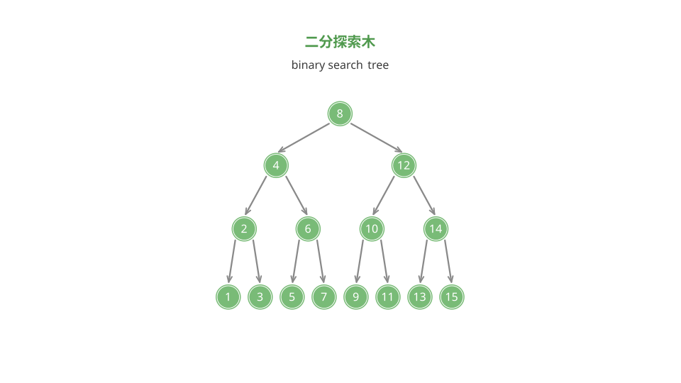

## 二分探索木の操作

二分探索木をクラス `BinarySearchTree` にまとめ、木の根を指すメンバー変数 `root` を宣言します。

### ノードの探索

探したい値 `num` が与えられたときは、二分探索木の性質を利用できます。下図のように、現在のノードを表す `cur` を宣言し、根 `root` から出発して、ノードの値 `cur.val` と `num` の大小を繰り返し比較します。

- `cur.val < num` なら、目的のノードは `cur` の右部分木にあるので、`cur = cur.right` を実行します。
- `cur.val > num` なら、目的のノードは `cur` の左部分木にあるので、`cur = cur.left` を実行します。
- `cur.val = num` なら、目的のノードが見つかったので、ループを抜けてそのノードを返します。

=== "<1>"
    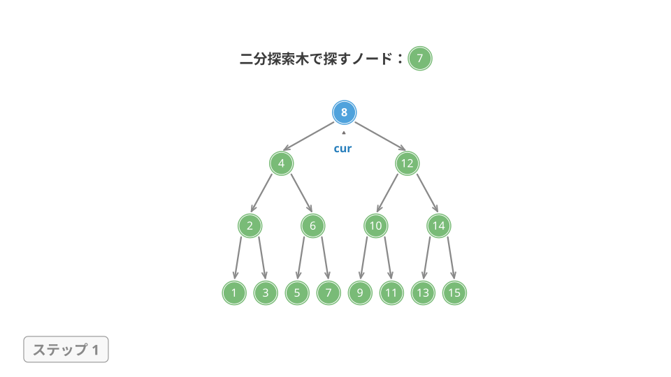

=== "<2>"
    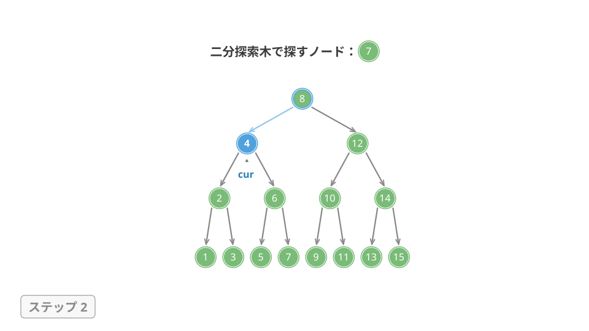

=== "<3>"
    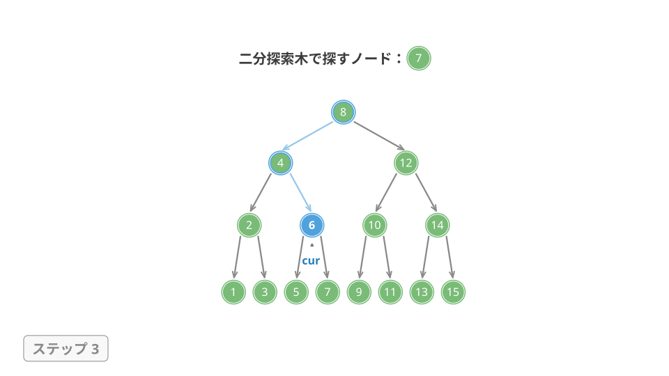

=== "<4>"
    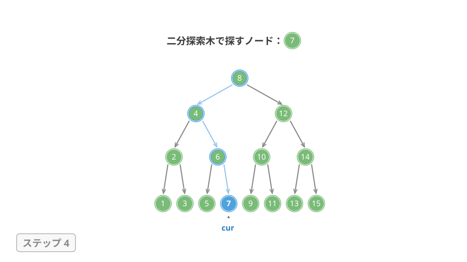

二分探索木の探索は二分探索と同じ原理で動き、どちらも各回で候補の半分を除外します。ループの回数は最大でも木の高さで、木が平衡なら時間計算量は $O(\log n)$ です。コード例を示します。

```src
[file]{binary_search_tree}-[class]{binary_search_tree}-[func]{search}
```

### ノードの挿入

挿入する要素 `num` が与えられたとき、二分探索木の「左部分木 < 根 < 右部分木」という性質を保つため、下図の手順で挿入します。

1. **挿入位置を探します**。探索と同様に根から始め、現在のノードの値と `num` の大小関係に応じて下へ進みます。葉を越えたら（`None` に達したら）ループを抜けます。
2. **見つけた位置にノードを挿入します**。ノード `num` を初期化し、`None` の位置に置きます。

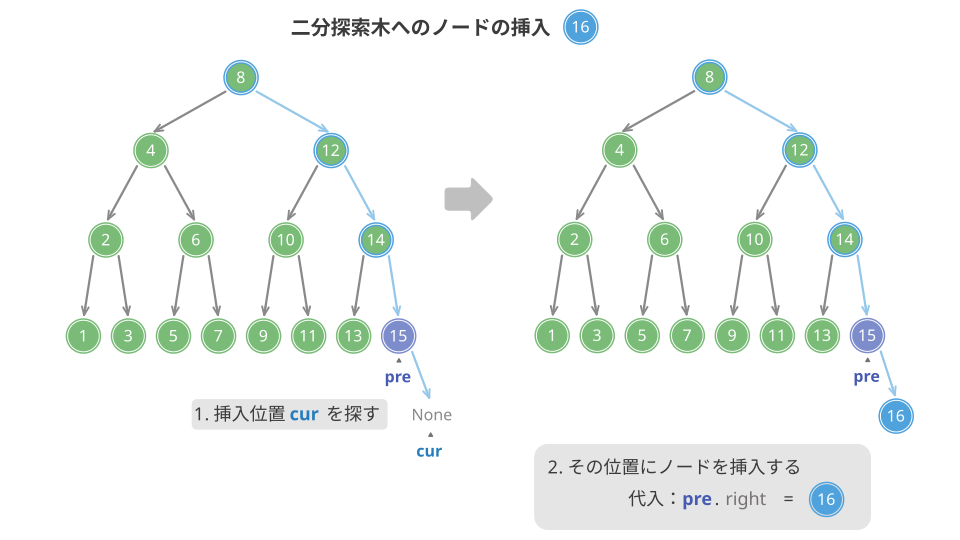

実装では次の 2 点に注意します。

- 定義上、二分探索木では値の重複を認めません。挿入する値がすでに木にある場合は、挿入せずにそのまま戻ります。
- 挿入には、前のループで訪れたノードを `pre` に保存しておく必要があります。こうすると、`None` に達した時点で親がわかり、新しいノードを挿入できます。

```src
[file]{binary_search_tree}-[class]{binary_search_tree}-[func]{insert}
```

探索と同様、挿入にかかる時間は $O(\log n)$ です。

### ノードの削除

まず二分木から目的のノードを探し、それを削除します。挿入と同様、削除後も二分探索木の「左部分木 < 根 < 右部分木」という性質を保たなければなりません。そこで、対象の子の数が 0 個、1 個、2 個の 3 通りに分け、それぞれに応じた削除を行います。

下図のように、削除対象の次数が $0$ なら、そのノードは葉なので直接削除できます。

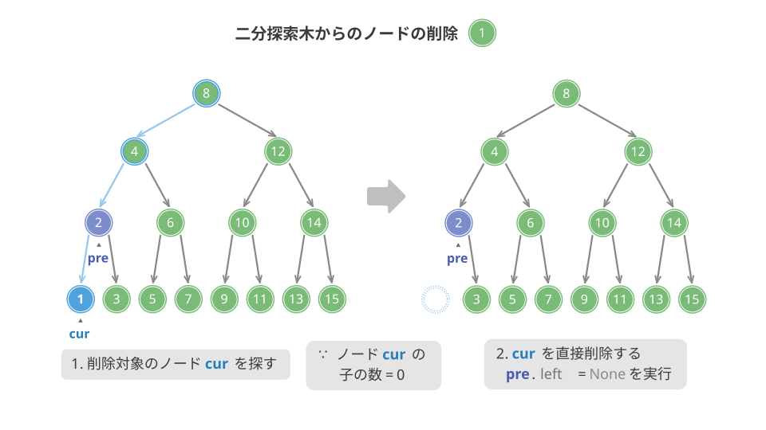

下図のように、削除対象の次数が $1$ なら、そのノードを唯一の子で置き換えます。

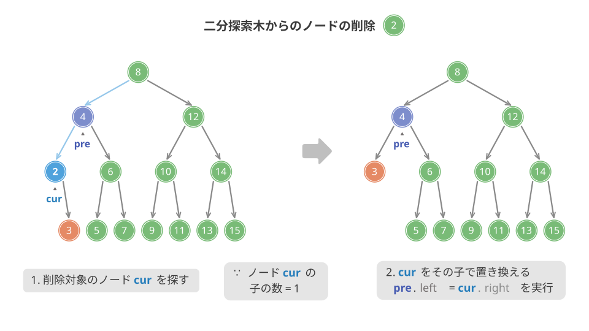

削除対象の次数が $2$ なら、そのまま削除することはできず、別のノードで置き換える必要があります。二分探索木の「左部分木 $<$ 根 $<$ 右部分木」という性質を保つため、**右部分木の最小のノードか、左部分木の最大のノードを使えます**。

右部分木の最小のノード（通りがけ順で次のノード）を選ぶと、削除手順は下図のようになります。

1. 通りがけ順の列で削除対象の次に来るノードを見つけ、`tmp` とします。
2. `tmp` の値で削除対象の値を上書きし、木からノード `tmp` を再帰的に削除します。

=== "<1>"
    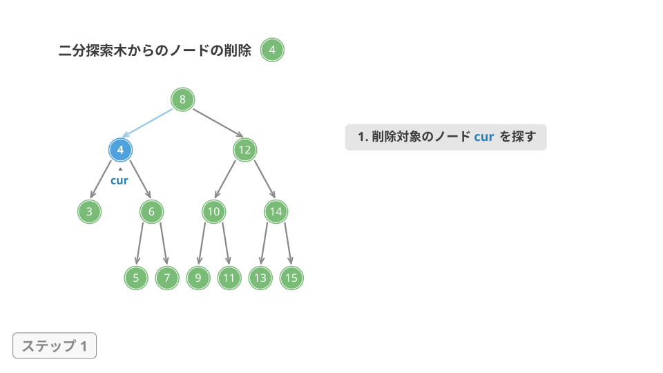

=== "<2>"
    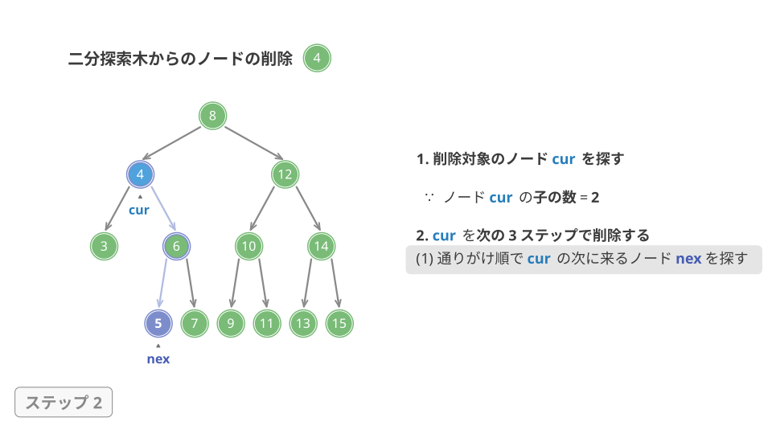

=== "<3>"
    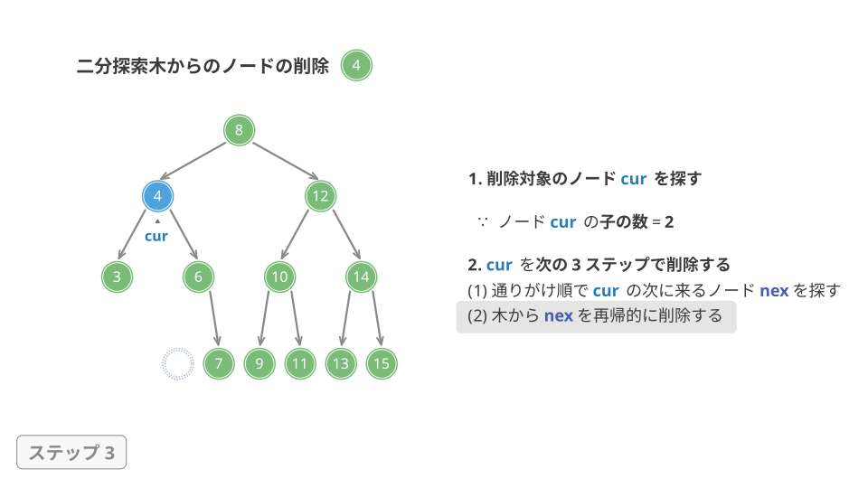

=== "<4>"
    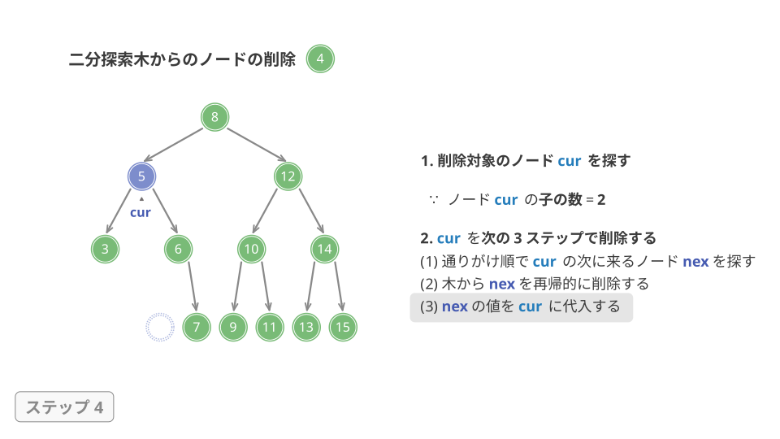

削除の時間計算量も $O(\log n)$ です。このうち、削除対象の探索に $O(\log n)$、通りがけ順の後続ノードの取得に $O(\log n)$ の時間がかかります。コード例を示します。

```src
[file]{binary_search_tree}-[class]{binary_search_tree}-[func]{remove}
```

### 通りがけ順に走査すると昇順になる

下図のように、二分木の通りがけ順走査では「左 $\rightarrow$ 根 $\rightarrow$ 右」の順にたどります。一方、二分探索木では「左の子 $<$ 根 $<$ 右の子」という大小関係が成り立ちます。

つまり、二分探索木の通りがけ順走査では、まだ訪問していないノードのうち値が最も小さいものを順に訪問します。ここから、**二分探索木を通りがけ順に走査すると値が昇順に並ぶ**という重要な性質が得られます。

この性質を利用すると、二分探索木から整列済みのデータを $O(n)$ の時間で取り出せます。追加のソートが不要で効率的です。

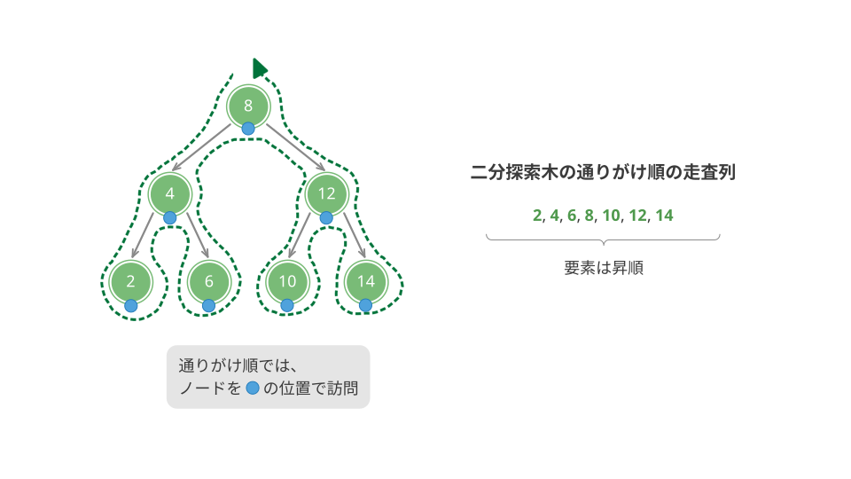

## 二分探索木の効率

あるデータを配列または二分探索木に格納する場合を考えます。下表を見ると、二分探索木の各操作の時間計算量は対数オーダーで、安定して効率よく処理できます。配列のほうが効率的なのは、データの追加が多く、探索と削除が少ない場合だけです。

<p align="center"> 表 <id> &nbsp; 配列と探索木の効率の比較 </p>

|          | 未整列の配列 | 二分探索木  |
| -------- | -------- | ----------- |
| 要素の探索 | $O(n)$   | $O(\log n)$ |
| 要素の挿入 | $O(1)$   | $O(\log n)$ |
| 要素の削除 | $O(n)$   | $O(\log n)$ |

理想的な場合、二分探索木は平衡で、どのノードも $\log n$ 回のループで見つけられます。

しかし、挿入と削除を繰り返すと、二分探索木は下図のような連結リストに退化することがあります。このとき、各操作の時間計算量も $O(n)$ に悪化します。

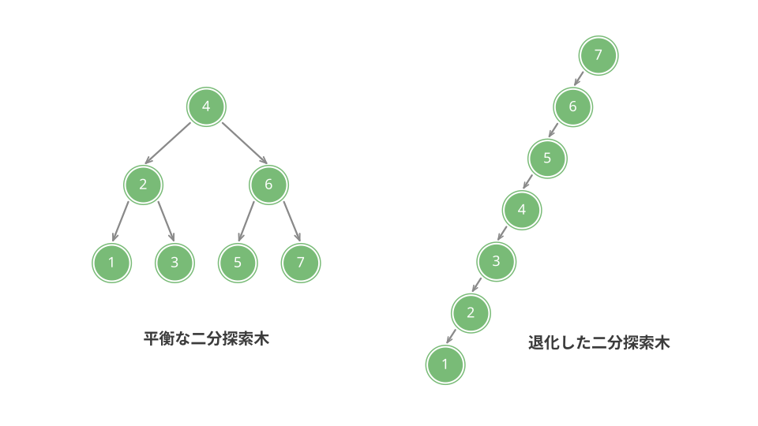

## 二分探索木の代表的な用途

- システムの多段インデックスとして使い、探索・挿入・削除を効率よく行います。
- 一部の探索アルゴリズムの基礎となるデータ構造として使います。
- データストリームを格納し、整列状態を保つために使います。
