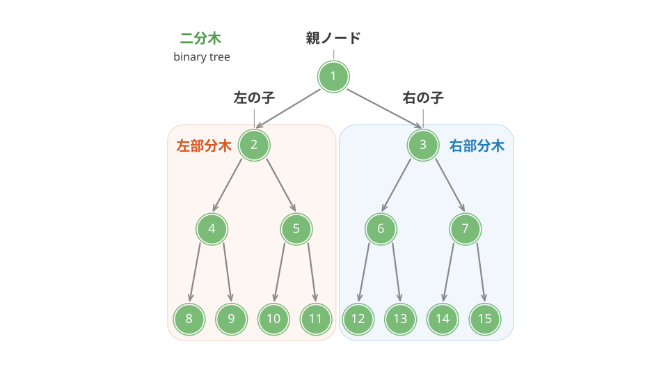
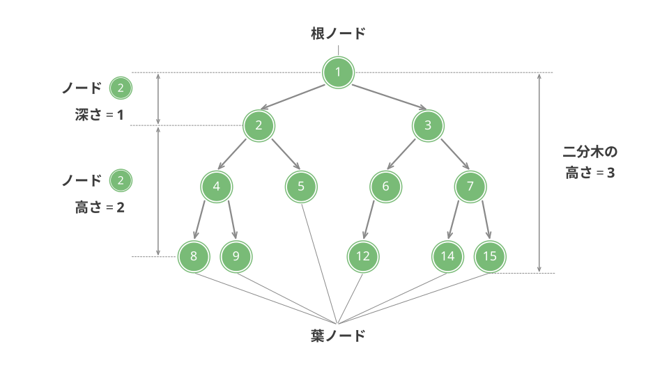
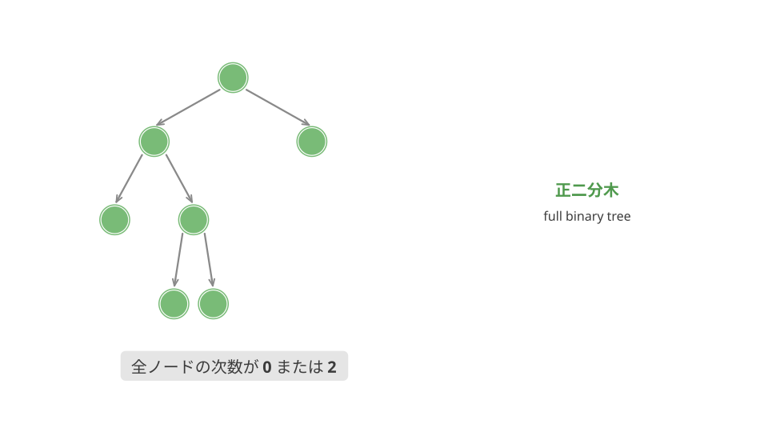

# 二分木

<u>二分木（binary tree）</u>は、「祖先」と「子孫」の派生関係を表す非線形のデータ構造です。一つを二つに分ける分割統治の考え方を反映しています。連結リストと同様に、二分木の基本単位はノードです。各ノードは、値と、左右それぞれの子への参照を持ちます。

```snippet
tree_node_class
```

各ノードには 2 つの参照（ポインタ）があり、それぞれ<u>左の子（left-child node）</u>と<u>右の子（right-child node）</u>を指します。このノードは、これらの子の<u>親ノード（parent node）</u>と呼ばれます。あるノードの左の子とその下のすべてのノードからなる木を、そのノードの<u>左部分木（left subtree）</u>と呼びます。<u>右部分木（right subtree）</u>も同様です。

**二分木では、葉以外のすべてのノードが子を持ち、空でない部分木を持ちます**。下図のノード 2 を親とすると、左の子はノード 4、右の子はノード 5 です。左部分木は 4 とその下のすべてのノードからなる木、右部分木は 5 とその下のすべてのノードからなる木です。



## 二分木の用語

二分木でよく使う用語を下図に示します。

- <u>根ノード（root node）</u>は二分木の最上層にあるノードで、親を持ちません。
- <u>葉ノード（leaf node）</u>は子を持たないノードで、2 つのポインタはいずれも `None` を指します。
- <u>辺（edge）</u>は 2 つのノードを結ぶ線で、ノードへの参照（ポインタ）に対応します。
- ノードの<u>レベル（level）</u>は、根を 1 として下へ進むごとに増えます。
- ノードの<u>次数（degree）</u>は、そのノードが持つ子の数です。二分木で取り得る値は 0、1、2 です。
- 二分木の<u>高さ（height）</u>は、根から最も遠い葉までの経路に含まれる辺の本数です。
- ノードの<u>深さ（depth）</u>は、根からそのノードまでの経路に含まれる辺の本数です。
- ノードの<u>高さ（height）</u>は、そのノードから最も遠い葉までの経路に含まれる辺の本数です。



!!! tip

    通常、高さと深さは経路に含まれる辺の本数で定義しますが、問題や教科書によっては経路上のノードの個数で定義することもあります。その場合、高さと深さはここでの定義よりそれぞれ 1 大きくなります。

## 二分木の基本操作

### 二分木の初期化

連結リストと同様に、まずノードを初期化し、次に参照（ポインタ）を設定します。

```snippet
init_binary_tree
```

??? pythontutor "実行の様子を見る"

    @tutor init_binary_tree_tutor

### ノードの挿入と削除

連結リストと同様に、二分木でもポインタをつなぎ替えてノードを挿入・削除できます。下図に例を示します。


```snippet
insert_remove_node
```

??? pythontutor "実行の様子を見る"

    @tutor insert_remove_node_tutor

!!! tip

    ノードを挿入すると木の元の論理構造が変わることがあります。また、通常、ノードの削除はそのノードとその下の部分木をすべて取り除くことを意味します。そのため、二分木で目的に沿った挿入や削除を実現するには、ふつう複数の操作を組み合わせます。

## 代表的な二分木の種類

### 完璧二分木

下図のように、<u>完璧二分木（perfect binary tree）</u>ではすべての層が完全に埋まっています。葉の次数は $0$、それ以外のすべてのノードの次数は $2$ です。高さが $h$ のとき、ノードの総数は $2^{h+1} - 1$ です。これは典型的な指数関係で、自然界でよく見られる細胞分裂にも通じます。

!!! tip

    中国語圏では、完璧二分木を<u>満二分木（满二叉树）</u>と呼ぶことがよくあります。


### 完全二分木

下図のように、<u>完全二分木（complete binary tree）</u>で空きが許されるのは最下層だけで、その層のノードは左から右に隙間なく並ぶ必要があります。完璧二分木も完全二分木に含まれます。


### 正二分木

下図のように、<u>正二分木（full binary tree）</u>では、葉以外のすべてのノードが 2 つの子を持ちます。



### 平衡二分木

下図のように、<u>平衡二分木（balanced binary tree）</u>では、どのノードでも左右の部分木の高さの差の絶対値が 1 を超えません。


## 二分木の退化

下図は二分木の理想的な構造と退化した構造を示します。すべての層が埋まると完璧二分木になり、すべてのノードが片側に偏ると連結リストに退化します。

- 完璧二分木は理想的な場合で、二分木による分割統治の利点を十分に生かせます。
- もう一方の極端な場合が連結リストで、各操作が線形時間の処理となり、時間計算量は $O(n)$ に悪化します。


下表のように、最良の構造と最悪の構造では、二分木の葉の数、ノードの総数、高さなどが最大または最小になります。

<p align="center"> 表 <id> &nbsp; 二分木の最良の構造と最悪の構造 </p>

|                             | 完璧二分木         | 連結リスト    |
| --------------------------- | ------------------ | ------- |
| 第 $i$ 層のノード数         | $2^{i-1}$          | $1$     |
| 高さ $h$ の木の葉の数 | $2^h$              | $1$     |
| 高さ $h$ の木のノード総数   | $2^{h+1} - 1$      | $h + 1$ |
| ノード総数が $n$ の木の高さ   | $\log_2 (n+1) - 1$ | $n - 1$ |
