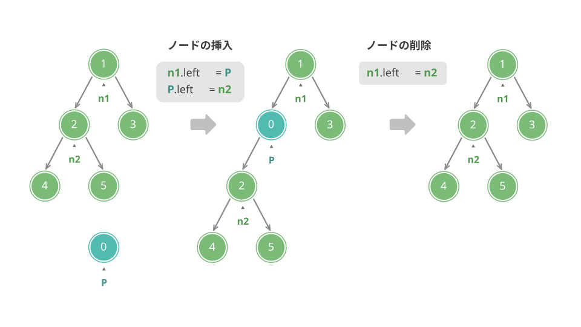
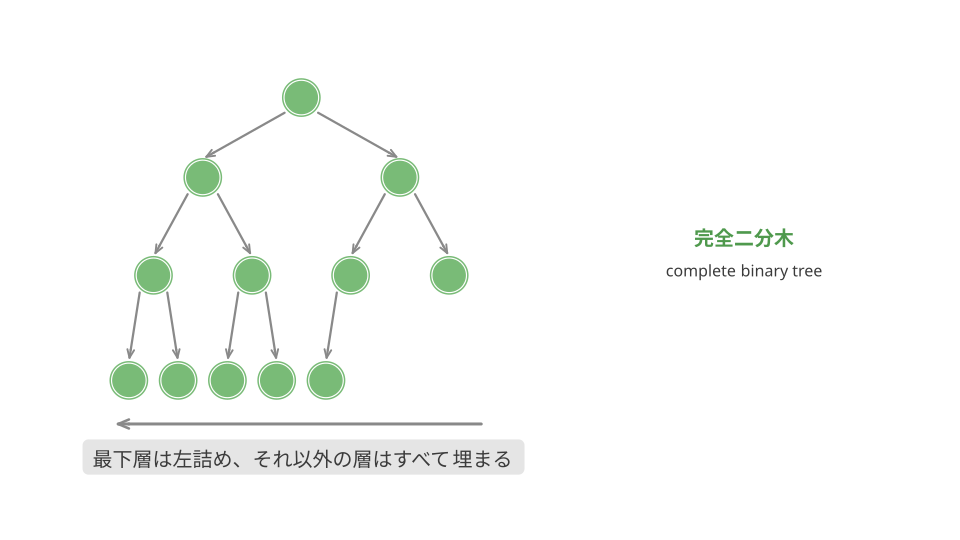
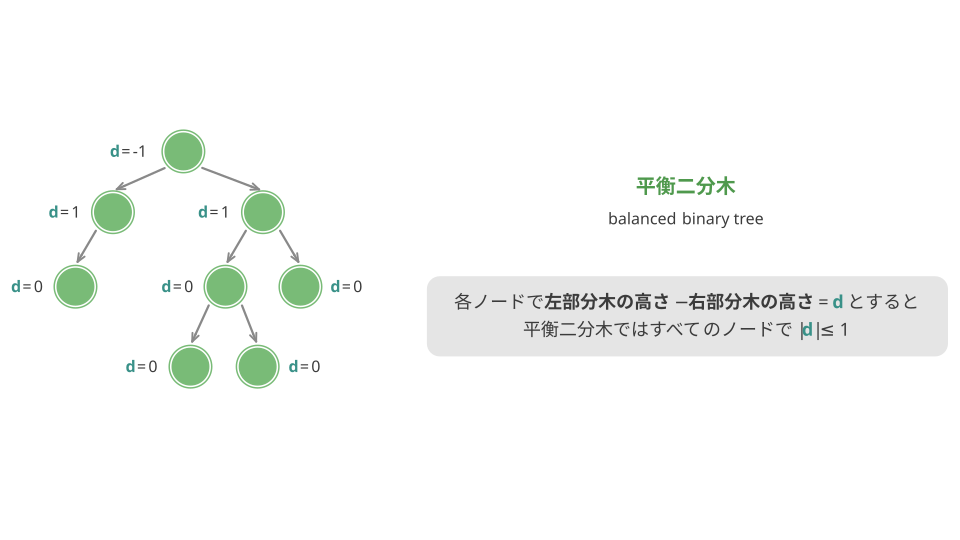
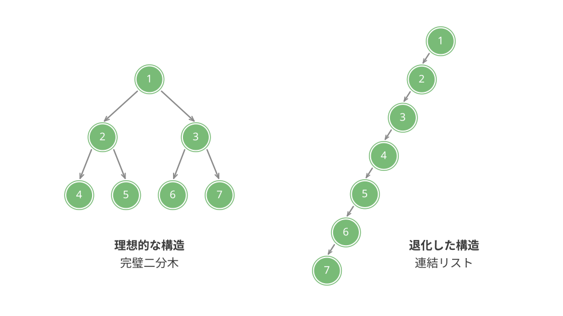

# 二分木

<u>二分木（binary tree）</u>は、「祖先」と「子孫」の派生関係を表す非線形データ構造で、「一つを二つに分ける」という分割統治の論理を体現しています。連結リストと同様、基本単位はノードで、各ノードには値、左の子への参照、右の子への参照が含まれます。

```snippet
tree_node_class
```

各ノードは二つの参照（ポインタ）を持ち、それぞれ<u>左の子ノード（left-child node）</u>と<u>右の子ノード（right-child node）</u>を指します。そのノードは、二つの子の<u>親ノード（parent node）</u>と呼ばれます。あるノードの左の子とその下のノードが作る木を<u>左部分木（left subtree）</u>と呼び、同様に<u>右部分木（right subtree）</u>も定義できます。

**二分木では、葉以外のすべてのノードが、子ノードと空でない部分木を持ちます**。下図で「ノード 2」を親とすると、左右の子は「ノード 4」と「ノード 5」です。左部分木はノード 4 とその下のノードが作る木、右部分木はノード 5 とその下のノードが作る木です。


## 二分木の主な用語

主な用語を下図に示します。

- <u>根ノード（root node）</u>：最上層にある、親を持たないノードです。
- <u>葉ノード（leaf node）</u>：子を持たず、二つのポインタがどちらも `None` を指すノードです。
- <u>辺（edge）</u>：二つのノードを結ぶ線で、ノードの参照（ポインタ）です。
- ノードの<u>レベル（level）</u>：上から下へ増え、根のレベルは 1 です。
- ノードの<u>次数（degree）</u>：子ノードの数です。二分木では 0、1、2 のいずれかです。
- 二分木の<u>高さ（height）</u>：根から最も遠い葉までに通る辺の数です。
- ノードの<u>深さ（depth）</u>：根からそのノードまでに通る辺の数です。
- ノードの<u>高さ（height）</u>：そのノードから最も遠い葉と、そのノードとの間にある辺の数です。


!!! tip

    通常、高さと深さは通る辺の数で定義しますが、問題や教科書によっては通るノードの数で定義する場合もあります。その場合は、高さと深さの両方に 1 を加えます。

## 二分木の基本操作

### 二分木の初期化

連結リストと同じく、まずノードを初期化し、次に参照（ポインタ）をつなぎます。

```snippet
init_binary_tree
```

??? pythontutor "実行の可視化"

    @tutor init_binary_tree_tutor

### ノードの挿入と削除

連結リストと同様に、ポインタを変更してノードを挿入・削除できます。下図に例を示します。



```snippet
insert_remove_node
```

??? pythontutor "実行の可視化"

    @tutor insert_remove_node_tutor

!!! tip

    挿入は元の論理構造を変える可能性があり、削除は通常、そのノードとすべての部分木の削除を意味します。そのため、実際に意味のある操作を実現するには、複数の操作を組み合わせて挿入や削除を行うのが一般的です。

## 主な二分木の種類

### パーフェクト二分木

下図の<u>パーフェクト二分木（perfect binary tree）</u>は、すべてのレベルが完全に埋まっています。葉の次数は $0$、ほかのすべてのノードの次数は $2$ です。高さが $h$ なら、総ノード数は $2^{h+1} - 1$ という典型的な指数関係になり、自然界の細胞分裂に似た様子を示します。

!!! tip

    中国語圏では、パーフェクト二分木は<u>「满二叉树」</u>ともよく呼ばれます。


### 完全二分木

下図の<u>完全二分木（complete binary tree）</u>では、最下層だけが完全に埋まっていなくてもよく、その層のノードは左から右へ連続して埋まっている必要があります。パーフェクト二分木も、完全二分木の一種です。



### 全二分木

下図の<u>全二分木（full binary tree）</u>では、葉以外のすべてのノードが二つの子を持ちます。


### 平衡二分木

下図の<u>平衡二分木（balanced binary tree）</u>では、どのノードでも左右の部分木の高さの差の絶対値が 1 以下です。



## 二分木の退化

下図は理想的な構造と退化した構造です。各層が埋まるとパーフェクト二分木になり、すべてのノードが一方に偏ると連結リストに退化します。

- パーフェクト二分木は理想的な場合で、分割統治の利点を十分に発揮できます。
- 連結リストはもう一方の極端な場合で、各操作が線形になり、時間計算量は $O(n)$ に悪化します。



下表のように、最良と最悪の構造では、葉の数、総ノード数、高さなどが最大値または最小値になります。

<p align="center"> 表 <id> &nbsp; 二分木の最良と最悪の構造 </p>

|                             | パーフェクト二分木         | 連結リスト    |
| --------------------------- | ------------------ | ------- |
| 第 $i$ レベルのノード数         | $2^{i-1}$          | $1$     |
| 高さ $h$ の木の葉ノード数 | $2^h$              | $1$     |
| 高さ $h$ の木の総ノード数   | $2^{h+1} - 1$      | $h + 1$ |
| 総ノード数 $n$ の木の高さ   | $\log_2 (n+1) - 1$ | $n - 1$ |
