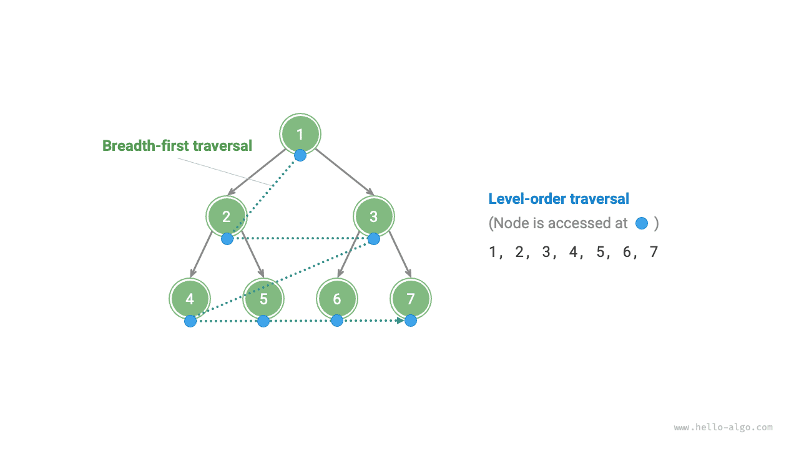
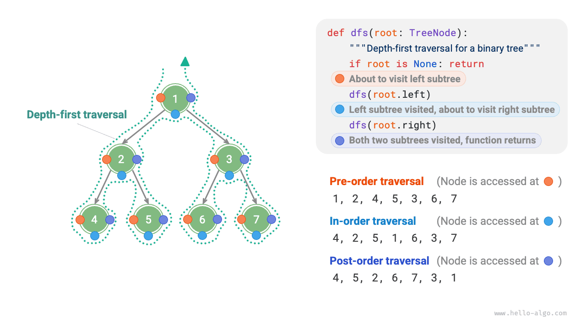
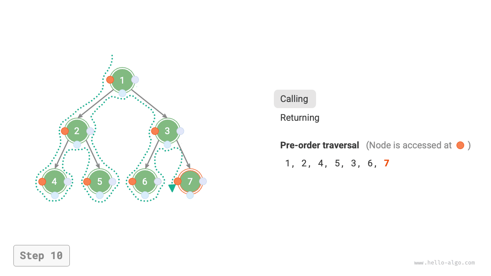
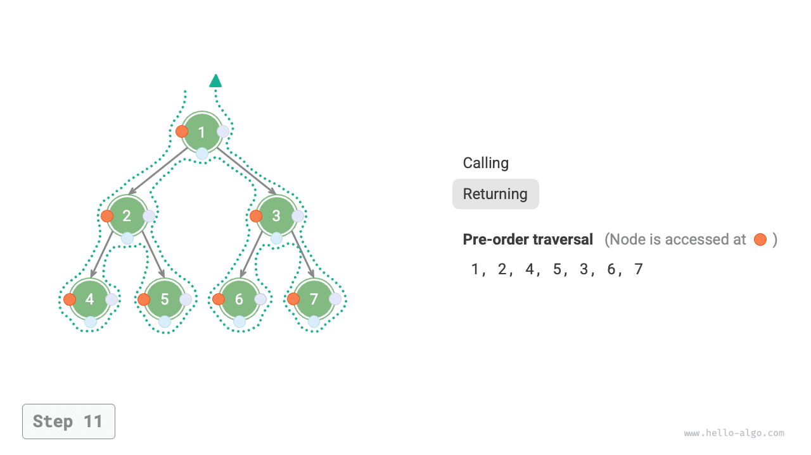

# 二分木の走査

物理的な構造として、木は連結リストに基づくデータ構造なので、ポインタでノードを一つずつ訪問します。ただし、木は非線形なので、連結リストの走査より複雑で、探索アルゴリズムを使う必要があります。

主な方法には、レベル順、行きがけ順、通りがけ順、帰りがけ順などがあります。

## レベル順走査

下図の<u>レベル順走査（level-order traversal）</u>は、上から下へ層ごとに進み、各層では左から右へノードを訪問します。

これは本質的に<u>幅優先走査（breadth-first traversal）</u>であり、<u>幅優先探索（breadth-first search, BFS）</u>とも呼びます。一周ずつ外へ広がるように、層ごとに走査する方法です。



### コードの実装

幅優先走査は通常、キューで実装します。キューの「先入れ先出し」と、幅優先走査の「層ごとに進む」という規則は、同じ考え方に基づいています。実装は次のとおりです。

```src
[file]{binary_tree_bfs}-[class]{}-[func]{level_order}
```

### 計算量の解析

- **時間計算量は $O(n)$**：全ノードを一回ずつ訪問するため、$O(n)$ 時間です。$n$ はノード数です。
- **空間計算量は $O(n)$**：最悪の場合、つまりパーフェクト二分木では、最下層の走査直前に最大 $(n + 1) / 2$ 個のノードが同時にキューに入り、$O(n)$ の領域を使います。

## 行きがけ順・通りがけ順・帰りがけ順走査

これに対し、行きがけ順、通りがけ順、帰りがけ順は、いずれも<u>深さ優先走査（depth-first traversal）</u>です。<u>深さ優先探索（depth-first search, DFS）</u>とも呼び、行き止まりまで進んでから戻り、探索を続ける方法です。

下図は二分木の深さ優先走査の仕組みです。**木全体の外周を一周歩くようなものです**。各ノードで三つの位置を通り、それぞれが行きがけ順、通りがけ順、帰りがけ順に対応します。



### コードの実装

深さ優先探索は通常、再帰で実装します。

```src
[file]{binary_tree_dfs}-[class]{}-[func]{post_order}
```

!!! tip

    反復でも実装できます。興味があれば調べてみてください。

下図は行きがけ順走査の再帰過程です。「呼び出し」と「戻り」という、逆方向の二つの部分に分けられます。

1. 「呼び出し」では新しいメソッドの実行を始め、次のノードを訪問します。
2. 「戻り」は関数から戻ることで、現在のノードの訪問が終わったことを表します。

=== "<1>"
    

=== "<2>"
    

=== "<3>"
    

=== "<4>"
    

=== "<5>"
    

=== "<6>"
    

=== "<7>"
    

=== "<8>"
    

=== "<9>"
    

=== "<10>"
    

=== "<11>"
    

### 計算量の解析

- **時間計算量は $O(n)$**：全ノードを一回ずつ訪問するため、$O(n)$ 時間です。
- **空間計算量は $O(n)$**：最悪の場合、木が連結リストに退化すると再帰の深さが $n$ となり、スタックフレームに $O(n)$ の領域を使います。
