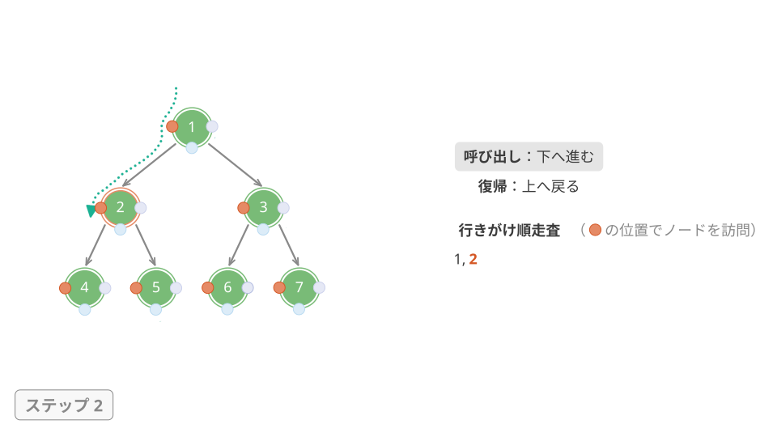
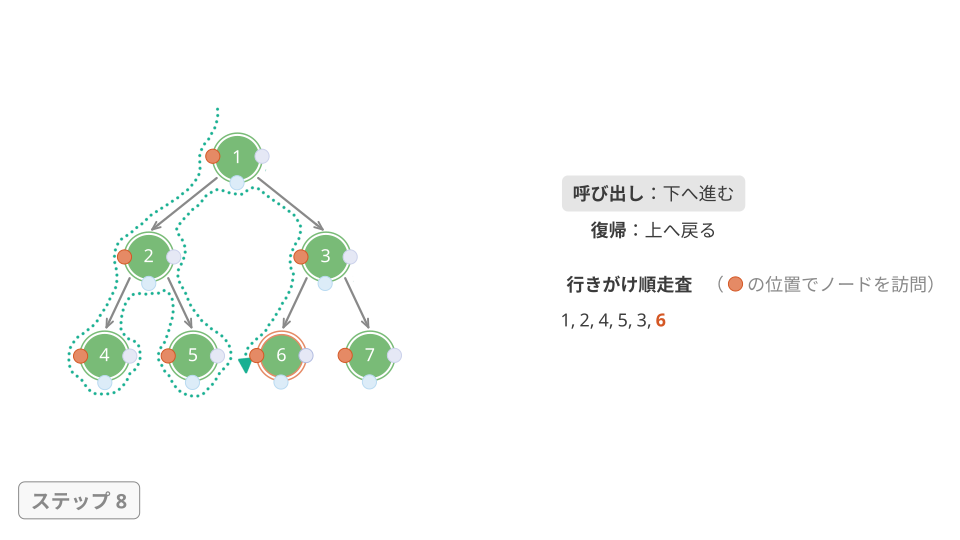
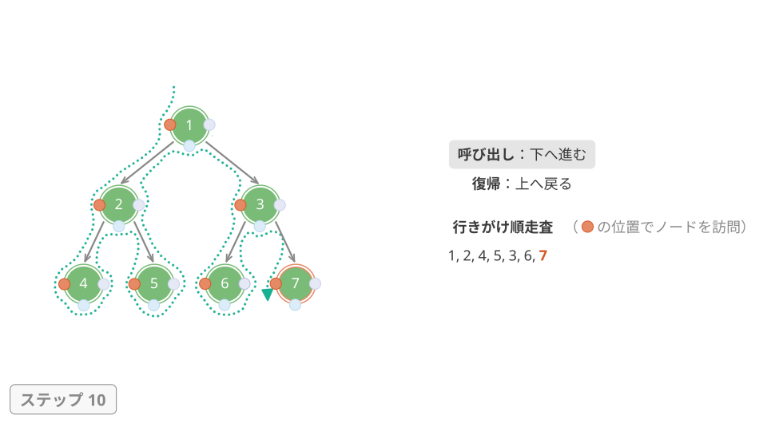
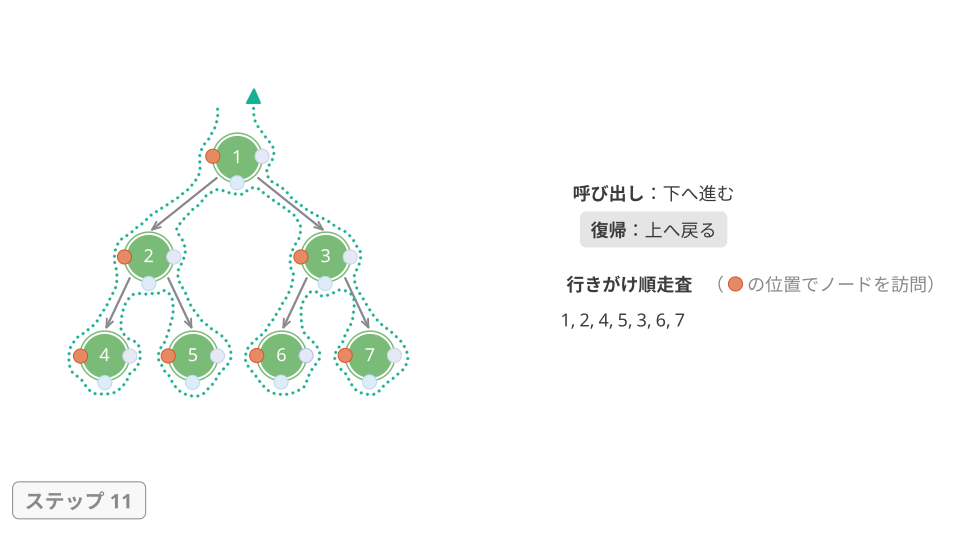

# 7.2 &nbsp; 二分木の走査

物理的な構造に着目すると、ここで扱う木は連結リストに基づくデータ構造なので、ポインタをたどってノードを一つずつ訪問します。ただし、木は非線形のデータ構造です。そのため、木の走査は連結リストの走査より複雑で、探索アルゴリズムを使って実現します。

二分木でよく使う走査には、レベル順、行きがけ順、通りがけ順、帰りがけ順などがあります。

## 7.2.1 &nbsp; レベル順走査

図 7-9 のように、<u>レベル順走査（level-order traversal）</u>では二分木を上の層から下の層へ順にたどり、各層では左から右へノードを訪問します。

レベル順走査は<u>幅優先走査（breadth-first traversal）</u>の一種です。<u>幅優先探索（breadth-first search, BFS）</u>とも呼ばれ、輪を一つずつ外へ広げるように層ごとに進みます。

{ class="animation-figure" }

<p align="center"> 図 7-9 &nbsp; 二分木のレベル順走査 </p>

### 1. &nbsp; コードによる実装

幅優先走査は通常、キューを使って実装します。キューは先に入れたものから取り出す「先入れ先出し」であり、この仕組みが幅優先走査の「一層ずつ進む」という規則に合っています。実装は次のとおりです。

=== "Python"

    ```python title="binary_tree_bfs.py"
    def level_order(root: TreeNode | None) -> list[int]:
        """レベル順走査"""
        # キューを初期化して根を入れる
        queue: deque[TreeNode] = deque()
        queue.append(root)
        # 走査順を記録するリストを初期化する
        res = []
        while queue:
            node: TreeNode = queue.popleft()  # キューの先頭から取り出す
            res.append(node.val)  # ノードの値を記録する
            if node.left is not None:
                queue.append(node.left)  # 左の子をキューに入れる
            if node.right is not None:
                queue.append(node.right)  # 右の子をキューに入れる
        return res
    ```

=== "C++"

    ```cpp title="binary_tree_bfs.cpp"
    /* レベル順走査 */
    vector<int> levelOrder(TreeNode *root) {
        // キューを初期化して根を入れる
        queue<TreeNode *> queue;
        queue.push(root);
        // 走査順を記録するリストを初期化する
        vector<int> vec;
        while (!queue.empty()) {
            TreeNode *node = queue.front();
            queue.pop();              // キューの先頭から取り出す
            vec.push_back(node->val); // ノードの値を記録する
            if (node->left != nullptr)
                queue.push(node->left); // 左の子をキューに入れる
            if (node->right != nullptr)
                queue.push(node->right); // 右の子をキューに入れる
        }
        return vec;
    }
    ```

=== "Java"

    ```java title="binary_tree_bfs.java"
    /* レベル順走査 */
    List<Integer> levelOrder(TreeNode root) {
        // キューを初期化して根を入れる
        Queue<TreeNode> queue = new LinkedList<>();
        queue.add(root);
        // 走査順を記録するリストを初期化する
        List<Integer> list = new ArrayList<>();
        while (!queue.isEmpty()) {
            TreeNode node = queue.poll(); // キューの先頭から取り出す
            list.add(node.val);           // ノードの値を記録する
            if (node.left != null)
                queue.offer(node.left);   // 左の子をキューに入れる
            if (node.right != null)
                queue.offer(node.right);  // 右の子をキューに入れる
        }
        return list;
    }
    ```

=== "C#"

    ```csharp title="binary_tree_bfs.cs"
    /* レベル順走査 */
    List<int> LevelOrder(TreeNode root) {
        // キューを初期化して根を入れる
        Queue<TreeNode> queue = new();
        queue.Enqueue(root);
        // 走査順を記録するリストを初期化する
        List<int> list = [];
        while (queue.Count != 0) {
            TreeNode node = queue.Dequeue(); // キューの先頭から取り出す
            list.Add(node.val!.Value);       // ノードの値を記録する
            if (node.left != null)
                queue.Enqueue(node.left);    // 左の子をキューに入れる
            if (node.right != null)
                queue.Enqueue(node.right);   // 右の子をキューに入れる
        }
        return list;
    }
    ```

=== "Go"

    ```go title="binary_tree_bfs.go"
    /* レベル順走査 */
    func levelOrder(root *TreeNode) []any {
        // キューを初期化して根を入れる
        queue := list.New()
        queue.PushBack(root)
        // 走査順を記録するスライスを初期化する
        nums := make([]any, 0)
        for queue.Len() > 0 {
            // キューの先頭から取り出す
            node := queue.Remove(queue.Front()).(*TreeNode)
            // ノードの値を記録する
            nums = append(nums, node.Val)
            if node.Left != nil {
                // 左の子をキューに入れる
                queue.PushBack(node.Left)
            }
            if node.Right != nil {
                // 右の子をキューに入れる
                queue.PushBack(node.Right)
            }
        }
        return nums
    }
    ```

=== "Swift"

    ```swift title="binary_tree_bfs.swift"
    /* レベル順走査 */
    func levelOrder(root: TreeNode) -> [Int] {
        // キューを初期化して根を入れる
        var queue: [TreeNode] = [root]
        // 走査順を記録するリストを初期化する
        var list: [Int] = []
        while !queue.isEmpty {
            let node = queue.removeFirst() // キューの先頭から取り出す
            list.append(node.val) // ノードの値を記録する
            if let left = node.left {
                queue.append(left) // 左の子をキューに入れる
            }
            if let right = node.right {
                queue.append(right) // 右の子をキューに入れる
            }
        }
        return list
    }
    ```

=== "JS"

    ```javascript title="binary_tree_bfs.js"
    /* レベル順走査 */
    function levelOrder(root) {
        // キューを初期化して根を入れる
        const queue = [root];
        // 走査順を記録するリストを初期化する
        const list = [];
        while (queue.length) {
            let node = queue.shift(); // キューの先頭から取り出す
            list.push(node.val); // ノードの値を記録する
            if (node.left) queue.push(node.left); // 左の子をキューに入れる
            if (node.right) queue.push(node.right); // 右の子をキューに入れる
        }
        return list;
    }
    ```

=== "TS"

    ```typescript title="binary_tree_bfs.ts"
    /* レベル順走査 */
    function levelOrder(root: TreeNode | null): number[] {
        // キューを初期化して根を入れる
        const queue = [root];
        // 走査順を記録するリストを初期化する
        const list: number[] = [];
        while (queue.length) {
            let node = queue.shift() as TreeNode; // キューの先頭から取り出す
            list.push(node.val); // ノードの値を記録する
            if (node.left) {
                queue.push(node.left); // 左の子をキューに入れる
            }
            if (node.right) {
                queue.push(node.right); // 右の子をキューに入れる
            }
        }
        return list;
    }
    ```

=== "Dart"

    ```dart title="binary_tree_bfs.dart"
    /* レベル順走査 */
    List<int> levelOrder(TreeNode? root) {
      // キューを初期化して根を入れる
      Queue<TreeNode?> queue = Queue();
      queue.add(root);
      // 走査順を記録するリストを初期化する
      List<int> res = [];
      while (queue.isNotEmpty) {
        TreeNode? node = queue.removeFirst(); // キューの先頭から取り出す
        res.add(node!.val); // ノードの値を記録する
        if (node.left != null) queue.add(node.left); // 左の子をキューに入れる
        if (node.right != null) queue.add(node.right); // 右の子をキューに入れる
      }
      return res;
    }
    ```

=== "Rust"

    ```rust title="binary_tree_bfs.rs"
    /* レベル順走査 */
    fn level_order(root: &Rc<RefCell<TreeNode>>) -> Vec<i32> {
        // キューを初期化して根を入れる
        let mut que = VecDeque::new();
        que.push_back(root.clone());
        // 走査順を記録するリストを初期化する
        let mut vec = Vec::new();

        while let Some(node) = que.pop_front() {
            // キューの先頭から取り出す
            vec.push(node.borrow().val); // ノードの値を記録する
            if let Some(left) = node.borrow().left.as_ref() {
                que.push_back(left.clone()); // 左の子をキューに入れる
            }
            if let Some(right) = node.borrow().right.as_ref() {
                que.push_back(right.clone()); // 右の子をキューに入れる
            };
        }
        vec
    }
    ```

=== "C"

    ```c title="binary_tree_bfs.c"
    /* レベル順走査 */
    int *levelOrder(TreeNode *root, int *size) {
        /* 補助キュー */
        int front, rear;
        int index, *arr;
        TreeNode *node;
        TreeNode **queue;

        /* 補助キュー */
        queue = (TreeNode **)malloc(sizeof(TreeNode *) * MAX_SIZE);
        // キューのポインタ
        front = 0, rear = 0;
        // 根をキューに入れる
        queue[rear++] = root;
        // 走査順を記録するリストを初期化する
        /* 補助配列 */
        arr = (int *)malloc(sizeof(int) * MAX_SIZE);
        // 配列のポインタ
        index = 0;
        while (front < rear) {
            // キューの先頭から取り出す
            node = queue[front++];
            // ノードの値を記録する
            arr[index++] = node->val;
            if (node->left != NULL) {
                // 左の子をキューに入れる
                queue[rear++] = node->left;
            }
            if (node->right != NULL) {
                // 右の子をキューに入れる
                queue[rear++] = node->right;
            }
        }
        // 配列の長さを更新する
        *size = index;
        arr = realloc(arr, sizeof(int) * (*size));

        // 補助配列のメモリを解放する
        free(queue);
        return arr;
    }
    ```

=== "Kotlin"

    ```kotlin title="binary_tree_bfs.kt"
    /* レベル順走査 */
    fun levelOrder(root: TreeNode?): MutableList<Int> {
        // キューを初期化して根を入れる
        val queue = LinkedList<TreeNode?>()
        queue.add(root)
        // 走査順を記録するリストを初期化する
        val list = mutableListOf<Int>()
        while (queue.isNotEmpty()) {
            val node = queue.poll()      // キューの先頭から取り出す
            list.add(node?._val!!)       // ノードの値を記録する
            if (node.left != null)
                queue.offer(node.left)   // 左の子をキューに入れる
            if (node.right != null)
                queue.offer(node.right)  // 右の子をキューに入れる
        }
        return list
    }
    ```

=== "Ruby"

    ```ruby title="binary_tree_bfs.rb"
    ### レベル順走査 ###
    def level_order(root)
      # キューを初期化して根を入れる
      queue = [root]
      # 走査順を記録するリストを初期化する
      res = []
      while !queue.empty?
        node = queue.shift # キューの先頭から取り出す
        res << node.val # ノードの値を記録する
        queue << node.left unless node.left.nil? # 左の子をキューに入れる
        queue << node.right unless node.right.nil? # 右の子をキューに入れる
      end
      res
    end
    ```

??? pythontutor "実行の様子を見る"

    <div style="height: 549px; width: 100%;"><iframe class="pythontutor-iframe" title="実行の様子を見る" src="https://pythontutor.com/iframe-embed.html#code=from%20collections%20import%20deque%0A%0Aclass%20TreeNode%3A%0A%20%20%20%20%22%22%22%E4%BA%8C%E5%88%86%E6%9C%A8%E3%81%AE%E3%83%8E%E3%83%BC%E3%83%89%E3%81%AE%E3%82%AF%E3%83%A9%E3%82%B9%22%22%22%0A%20%20%20%20def%20__init__%28self,%20val%3A%20int%29%3A%0A%20%20%20%20%20%20%20%20self.val%3A%20int%20%3D%20val%20%20%20%20%20%20%20%20%20%20%20%20%20%20%20%20%23%20%E3%83%8E%E3%83%BC%E3%83%89%E3%81%AE%E5%80%A4%0A%20%20%20%20%20%20%20%20self.left%3A%20TreeNode%20%7C%20None%20%3D%20None%20%20%23%20%E5%B7%A6%E3%81%AE%E5%AD%90%E3%81%B8%E3%81%AE%E5%8F%82%E7%85%A7%0A%20%20%20%20%20%20%20%20self.right%3A%20TreeNode%20%7C%20None%20%3D%20None%20%23%20%E5%8F%B3%E3%81%AE%E5%AD%90%E3%81%B8%E3%81%AE%E5%8F%82%E7%85%A7%0A%0Adef%20list_to_tree_dfs%28arr%3A%20list%5Bint%5D,%20i%3A%20int%29%20-%3E%20TreeNode%20%7C%20None%3A%0A%20%20%20%20%22%22%22%E3%83%AA%E3%82%B9%E3%83%88%E3%81%8B%E3%82%89%E5%86%8D%E5%B8%B0%E7%9A%84%E3%81%AB%E4%BA%8C%E5%88%86%E6%9C%A8%E3%82%92%E5%BE%A9%E5%85%83%E3%81%99%E3%82%8B%22%22%22%0A%20%20%20%20%23%20%E3%82%A4%E3%83%B3%E3%83%87%E3%83%83%E3%82%AF%E3%82%B9%E3%81%8C%E9%85%8D%E5%88%97%E3%81%AE%E7%AF%84%E5%9B%B2%E5%A4%96%E3%81%8B%E3%80%81%E8%A6%81%E7%B4%A0%E3%81%8C%20None%20%E3%81%AA%E3%82%89%20None%20%E3%82%92%E8%BF%94%E3%81%99%0A%20%20%20%20if%20i%20%3C%200%20or%20i%20%3E%3D%20len%28arr%29%20or%20arr%5Bi%5D%20is%20None%3A%0A%20%20%20%20%20%20%20%20return%20None%0A%20%20%20%20%23%20%E7%8F%BE%E5%9C%A8%E3%81%AE%E3%83%8E%E3%83%BC%E3%83%89%E3%82%92%E4%BD%9C%E3%82%8B%0A%20%20%20%20root%20%3D%20TreeNode%28arr%5Bi%5D%29%0A%20%20%20%20%23%20%E5%B7%A6%E5%8F%B3%E3%81%AE%E9%83%A8%E5%88%86%E6%9C%A8%E3%82%92%E5%86%8D%E5%B8%B0%E7%9A%84%E3%81%AB%E4%BD%9C%E3%82%8B%0A%20%20%20%20root.left%20%3D%20list_to_tree_dfs%28arr,%202%20%2A%20i%20%2B%201%29%0A%20%20%20%20root.right%20%3D%20list_to_tree_dfs%28arr,%202%20%2A%20i%20%2B%202%29%0A%20%20%20%20return%20root%0A%0Adef%20list_to_tree%28arr%3A%20list%5Bint%5D%29%20-%3E%20TreeNode%20%7C%20None%3A%0A%20%20%20%20%22%22%22%E3%83%AA%E3%82%B9%E3%83%88%E3%81%8B%E3%82%89%E4%BA%8C%E5%88%86%E6%9C%A8%E3%82%92%E5%BE%A9%E5%85%83%E3%81%99%E3%82%8B%22%22%22%0A%20%20%20%20return%20list_to_tree_dfs%28arr,%200%29%0A%0A%0Adef%20level_order%28root%3A%20TreeNode%20%7C%20None%29%20-%3E%20list%5Bint%5D%3A%0A%20%20%20%20%22%22%22%E3%83%AC%E3%83%99%E3%83%AB%E9%A0%86%E8%B5%B0%E6%9F%BB%22%22%22%0A%20%20%20%20%23%20%E3%82%AD%E3%83%A5%E3%83%BC%E3%82%92%E5%88%9D%E6%9C%9F%E5%8C%96%E3%81%97%E3%81%A6%E6%A0%B9%E3%82%92%E5%85%A5%E3%82%8C%E3%82%8B%0A%20%20%20%20queue%3A%20deque%5BTreeNode%5D%20%3D%20deque%28%29%0A%20%20%20%20queue.append%28root%29%0A%20%20%20%20%23%20%E8%B5%B0%E6%9F%BB%E9%A0%86%E3%82%92%E8%A8%98%E9%8C%B2%E3%81%99%E3%82%8B%E3%83%AA%E3%82%B9%E3%83%88%E3%82%92%E5%88%9D%E6%9C%9F%E5%8C%96%E3%81%99%E3%82%8B%0A%20%20%20%20res%20%3D%20%5B%5D%0A%20%20%20%20while%20queue%3A%0A%20%20%20%20%20%20%20%20node%3A%20TreeNode%20%3D%20queue.popleft%28%29%20%20%23%20%E3%82%AD%E3%83%A5%E3%83%BC%E3%81%AE%E5%85%88%E9%A0%AD%E3%81%8B%E3%82%89%E5%8F%96%E3%82%8A%E5%87%BA%E3%81%99%0A%20%20%20%20%20%20%20%20res.append%28node.val%29%20%20%23%20%E3%83%8E%E3%83%BC%E3%83%89%E3%81%AE%E5%80%A4%E3%82%92%E8%A8%98%E9%8C%B2%E3%81%99%E3%82%8B%0A%20%20%20%20%20%20%20%20if%20node.left%20is%20not%20None%3A%0A%20%20%20%20%20%20%20%20%20%20%20%20queue.append%28node.left%29%20%20%23%20%E5%B7%A6%E3%81%AE%E5%AD%90%E3%82%92%E3%82%AD%E3%83%A5%E3%83%BC%E3%81%AB%E5%85%A5%E3%82%8C%E3%82%8B%0A%20%20%20%20%20%20%20%20if%20node.right%20is%20not%20None%3A%0A%20%20%20%20%20%20%20%20%20%20%20%20queue.append%28node.right%29%20%20%23%20%E5%8F%B3%E3%81%AE%E5%AD%90%E3%82%92%E3%82%AD%E3%83%A5%E3%83%BC%E3%81%AB%E5%85%A5%E3%82%8C%E3%82%8B%0A%20%20%20%20return%20res%0A%0A%22%22%22Driver%20Code%22%22%22%0Aif%20__name__%20%3D%3D%20%22__main__%22%3A%0A%20%20%20%20%23%20%E4%BA%8C%E5%88%86%E6%9C%A8%E3%82%92%E5%88%9D%E6%9C%9F%E5%8C%96%E3%81%99%E3%82%8B%0A%20%20%20%20%23%20%E3%81%93%E3%81%93%E3%81%A7%E3%81%AF%E9%85%8D%E5%88%97%E3%81%8B%E3%82%89%E7%9B%B4%E6%8E%A5%E4%BA%8C%E5%88%86%E6%9C%A8%E3%82%92%E4%BD%9C%E3%82%8B%E9%96%A2%E6%95%B0%E3%82%92%E4%BD%BF%E3%81%86%0A%20%20%20%20root%20%3D%20list_to_tree%28arr%3D%5B1,%202,%203,%204,%205,%206,%207%5D%29%0A%0A%20%20%20%20%23%20%E3%83%AC%E3%83%99%E3%83%AB%E9%A0%86%E8%B5%B0%E6%9F%BB%0A%20%20%20%20res%20%3D%20level_order%28root%29%0A%20%20%20%20print%28%22%5Cn%E3%83%AC%E3%83%99%E3%83%AB%E9%A0%86%E3%81%AB%E5%87%BA%E5%8A%9B%E3%81%97%E3%81%9F%E3%83%8E%E3%83%BC%E3%83%89%E3%81%AE%E5%88%97%20%3D%20%22,%20res%29&codeDivHeight=472&codeDivWidth=350&cumulative=false&curInstr=127&heapPrimitives=nevernest&origin=opt-frontend.js&py=311&rawInputLstJSON=%5B%5D&textReferences=false"> </iframe></div>
    <div style="margin-top: 5px;"><a href="https://pythontutor.com/iframe-embed.html#code=from%20collections%20import%20deque%0A%0Aclass%20TreeNode%3A%0A%20%20%20%20%22%22%22%E4%BA%8C%E5%88%86%E6%9C%A8%E3%81%AE%E3%83%8E%E3%83%BC%E3%83%89%E3%81%AE%E3%82%AF%E3%83%A9%E3%82%B9%22%22%22%0A%20%20%20%20def%20__init__%28self,%20val%3A%20int%29%3A%0A%20%20%20%20%20%20%20%20self.val%3A%20int%20%3D%20val%20%20%20%20%20%20%20%20%20%20%20%20%20%20%20%20%23%20%E3%83%8E%E3%83%BC%E3%83%89%E3%81%AE%E5%80%A4%0A%20%20%20%20%20%20%20%20self.left%3A%20TreeNode%20%7C%20None%20%3D%20None%20%20%23%20%E5%B7%A6%E3%81%AE%E5%AD%90%E3%81%B8%E3%81%AE%E5%8F%82%E7%85%A7%0A%20%20%20%20%20%20%20%20self.right%3A%20TreeNode%20%7C%20None%20%3D%20None%20%23%20%E5%8F%B3%E3%81%AE%E5%AD%90%E3%81%B8%E3%81%AE%E5%8F%82%E7%85%A7%0A%0Adef%20list_to_tree_dfs%28arr%3A%20list%5Bint%5D,%20i%3A%20int%29%20-%3E%20TreeNode%20%7C%20None%3A%0A%20%20%20%20%22%22%22%E3%83%AA%E3%82%B9%E3%83%88%E3%81%8B%E3%82%89%E5%86%8D%E5%B8%B0%E7%9A%84%E3%81%AB%E4%BA%8C%E5%88%86%E6%9C%A8%E3%82%92%E5%BE%A9%E5%85%83%E3%81%99%E3%82%8B%22%22%22%0A%20%20%20%20%23%20%E3%82%A4%E3%83%B3%E3%83%87%E3%83%83%E3%82%AF%E3%82%B9%E3%81%8C%E9%85%8D%E5%88%97%E3%81%AE%E7%AF%84%E5%9B%B2%E5%A4%96%E3%81%8B%E3%80%81%E8%A6%81%E7%B4%A0%E3%81%8C%20None%20%E3%81%AA%E3%82%89%20None%20%E3%82%92%E8%BF%94%E3%81%99%0A%20%20%20%20if%20i%20%3C%200%20or%20i%20%3E%3D%20len%28arr%29%20or%20arr%5Bi%5D%20is%20None%3A%0A%20%20%20%20%20%20%20%20return%20None%0A%20%20%20%20%23%20%E7%8F%BE%E5%9C%A8%E3%81%AE%E3%83%8E%E3%83%BC%E3%83%89%E3%82%92%E4%BD%9C%E3%82%8B%0A%20%20%20%20root%20%3D%20TreeNode%28arr%5Bi%5D%29%0A%20%20%20%20%23%20%E5%B7%A6%E5%8F%B3%E3%81%AE%E9%83%A8%E5%88%86%E6%9C%A8%E3%82%92%E5%86%8D%E5%B8%B0%E7%9A%84%E3%81%AB%E4%BD%9C%E3%82%8B%0A%20%20%20%20root.left%20%3D%20list_to_tree_dfs%28arr,%202%20%2A%20i%20%2B%201%29%0A%20%20%20%20root.right%20%3D%20list_to_tree_dfs%28arr,%202%20%2A%20i%20%2B%202%29%0A%20%20%20%20return%20root%0A%0Adef%20list_to_tree%28arr%3A%20list%5Bint%5D%29%20-%3E%20TreeNode%20%7C%20None%3A%0A%20%20%20%20%22%22%22%E3%83%AA%E3%82%B9%E3%83%88%E3%81%8B%E3%82%89%E4%BA%8C%E5%88%86%E6%9C%A8%E3%82%92%E5%BE%A9%E5%85%83%E3%81%99%E3%82%8B%22%22%22%0A%20%20%20%20return%20list_to_tree_dfs%28arr,%200%29%0A%0A%0Adef%20level_order%28root%3A%20TreeNode%20%7C%20None%29%20-%3E%20list%5Bint%5D%3A%0A%20%20%20%20%22%22%22%E3%83%AC%E3%83%99%E3%83%AB%E9%A0%86%E8%B5%B0%E6%9F%BB%22%22%22%0A%20%20%20%20%23%20%E3%82%AD%E3%83%A5%E3%83%BC%E3%82%92%E5%88%9D%E6%9C%9F%E5%8C%96%E3%81%97%E3%81%A6%E6%A0%B9%E3%82%92%E5%85%A5%E3%82%8C%E3%82%8B%0A%20%20%20%20queue%3A%20deque%5BTreeNode%5D%20%3D%20deque%28%29%0A%20%20%20%20queue.append%28root%29%0A%20%20%20%20%23%20%E8%B5%B0%E6%9F%BB%E9%A0%86%E3%82%92%E8%A8%98%E9%8C%B2%E3%81%99%E3%82%8B%E3%83%AA%E3%82%B9%E3%83%88%E3%82%92%E5%88%9D%E6%9C%9F%E5%8C%96%E3%81%99%E3%82%8B%0A%20%20%20%20res%20%3D%20%5B%5D%0A%20%20%20%20while%20queue%3A%0A%20%20%20%20%20%20%20%20node%3A%20TreeNode%20%3D%20queue.popleft%28%29%20%20%23%20%E3%82%AD%E3%83%A5%E3%83%BC%E3%81%AE%E5%85%88%E9%A0%AD%E3%81%8B%E3%82%89%E5%8F%96%E3%82%8A%E5%87%BA%E3%81%99%0A%20%20%20%20%20%20%20%20res.append%28node.val%29%20%20%23%20%E3%83%8E%E3%83%BC%E3%83%89%E3%81%AE%E5%80%A4%E3%82%92%E8%A8%98%E9%8C%B2%E3%81%99%E3%82%8B%0A%20%20%20%20%20%20%20%20if%20node.left%20is%20not%20None%3A%0A%20%20%20%20%20%20%20%20%20%20%20%20queue.append%28node.left%29%20%20%23%20%E5%B7%A6%E3%81%AE%E5%AD%90%E3%82%92%E3%82%AD%E3%83%A5%E3%83%BC%E3%81%AB%E5%85%A5%E3%82%8C%E3%82%8B%0A%20%20%20%20%20%20%20%20if%20node.right%20is%20not%20None%3A%0A%20%20%20%20%20%20%20%20%20%20%20%20queue.append%28node.right%29%20%20%23%20%E5%8F%B3%E3%81%AE%E5%AD%90%E3%82%92%E3%82%AD%E3%83%A5%E3%83%BC%E3%81%AB%E5%85%A5%E3%82%8C%E3%82%8B%0A%20%20%20%20return%20res%0A%0A%22%22%22Driver%20Code%22%22%22%0Aif%20__name__%20%3D%3D%20%22__main__%22%3A%0A%20%20%20%20%23%20%E4%BA%8C%E5%88%86%E6%9C%A8%E3%82%92%E5%88%9D%E6%9C%9F%E5%8C%96%E3%81%99%E3%82%8B%0A%20%20%20%20%23%20%E3%81%93%E3%81%93%E3%81%A7%E3%81%AF%E9%85%8D%E5%88%97%E3%81%8B%E3%82%89%E7%9B%B4%E6%8E%A5%E4%BA%8C%E5%88%86%E6%9C%A8%E3%82%92%E4%BD%9C%E3%82%8B%E9%96%A2%E6%95%B0%E3%82%92%E4%BD%BF%E3%81%86%0A%20%20%20%20root%20%3D%20list_to_tree%28arr%3D%5B1,%202,%203,%204,%205,%206,%207%5D%29%0A%0A%20%20%20%20%23%20%E3%83%AC%E3%83%99%E3%83%AB%E9%A0%86%E8%B5%B0%E6%9F%BB%0A%20%20%20%20res%20%3D%20level_order%28root%29%0A%20%20%20%20print%28%22%5Cn%E3%83%AC%E3%83%99%E3%83%AB%E9%A0%86%E3%81%AB%E5%87%BA%E5%8A%9B%E3%81%97%E3%81%9F%E3%83%8E%E3%83%BC%E3%83%89%E3%81%AE%E5%88%97%20%3D%20%22,%20res%29&codeDivHeight=800&codeDivWidth=600&cumulative=false&curInstr=127&heapPrimitives=nevernest&origin=opt-frontend.js&py=311&rawInputLstJSON=%5B%5D&textReferences=false" target="_blank" rel="noopener noreferrer">全画面で表示 ></a></div>

### 2. &nbsp; 計算量の分析

- **時間計算量は $O(n)$ です**。すべてのノードを 1 回ずつ訪問するため、時間は $O(n)$ です。ここで $n$ はノード数です。
- **空間計算量は $O(n)$ です**。最悪の場合、すなわち完璧二分木では、最下層を走査する直前に最大 $(n + 1) / 2$ 個のノードが同時にキューに入り、$O(n)$ の領域を使います。

## 7.2.2 &nbsp; 行きがけ順、通りがけ順、帰りがけ順の走査

一方、行きがけ順、通りがけ順、帰りがけ順はいずれも<u>深さ優先走査（depth-first traversal）</u>に属し、<u>深さ優先探索（depth-first search, DFS）</u>とも呼ばれます。一つの経路を行き止まりまで進み、そこから戻って続ける走査です。

図 7-10 は、二分木を深さ優先で走査する仕組みを示しています。**深さ優先走査は、二分木全体の外周を一周するようなものです**。各ノードの周りで 3 つの位置を通り、それぞれ行きがけ順、通りがけ順、帰りがけ順に対応します。

{ class="animation-figure" }

<p align="center"> 図 7-10 &nbsp; 二分探索木の行きがけ順、通りがけ順、帰りがけ順走査 </p>

### 1. &nbsp; コードによる実装

深さ優先探索は通常、次のように再帰で実装します。

=== "Python"

    ```python title="binary_tree_dfs.py"
    def pre_order(root: TreeNode | None):
        """行きがけ順走査"""
        if root is None:
            return
        # 訪問順：根 -> 左部分木 -> 右部分木
        res.append(root.val)
        pre_order(root=root.left)
        pre_order(root=root.right)

    def in_order(root: TreeNode | None):
        """通りがけ順走査"""
        if root is None:
            return
        # 訪問順：左部分木 -> 根 -> 右部分木
        in_order(root=root.left)
        res.append(root.val)
        in_order(root=root.right)

    def post_order(root: TreeNode | None):
        """帰りがけ順走査"""
        if root is None:
            return
        # 訪問順：左部分木 -> 右部分木 -> 根
        post_order(root=root.left)
        post_order(root=root.right)
        res.append(root.val)
    ```

=== "C++"

    ```cpp title="binary_tree_dfs.cpp"
    /* 行きがけ順走査 */
    void preOrder(TreeNode *root) {
        if (root == nullptr)
            return;
        // 訪問順：根 -> 左部分木 -> 右部分木
        vec.push_back(root->val);
        preOrder(root->left);
        preOrder(root->right);
    }

    /* 通りがけ順走査 */
    void inOrder(TreeNode *root) {
        if (root == nullptr)
            return;
        // 訪問順：左部分木 -> 根 -> 右部分木
        inOrder(root->left);
        vec.push_back(root->val);
        inOrder(root->right);
    }

    /* 帰りがけ順走査 */
    void postOrder(TreeNode *root) {
        if (root == nullptr)
            return;
        // 訪問順：左部分木 -> 右部分木 -> 根
        postOrder(root->left);
        postOrder(root->right);
        vec.push_back(root->val);
    }
    ```

=== "Java"

    ```java title="binary_tree_dfs.java"
    /* 行きがけ順走査 */
    void preOrder(TreeNode root) {
        if (root == null)
            return;
        // 訪問順：根 -> 左部分木 -> 右部分木
        list.add(root.val);
        preOrder(root.left);
        preOrder(root.right);
    }

    /* 通りがけ順走査 */
    void inOrder(TreeNode root) {
        if (root == null)
            return;
        // 訪問順：左部分木 -> 根 -> 右部分木
        inOrder(root.left);
        list.add(root.val);
        inOrder(root.right);
    }

    /* 帰りがけ順走査 */
    void postOrder(TreeNode root) {
        if (root == null)
            return;
        // 訪問順：左部分木 -> 右部分木 -> 根
        postOrder(root.left);
        postOrder(root.right);
        list.add(root.val);
    }
    ```

=== "C#"

    ```csharp title="binary_tree_dfs.cs"
    /* 行きがけ順走査 */
    void PreOrder(TreeNode? root) {
        if (root == null) return;
        // 訪問順：根 -> 左部分木 -> 右部分木
        list.Add(root.val!.Value);
        PreOrder(root.left);
        PreOrder(root.right);
    }

    /* 通りがけ順走査 */
    void InOrder(TreeNode? root) {
        if (root == null) return;
        // 訪問順：左部分木 -> 根 -> 右部分木
        InOrder(root.left);
        list.Add(root.val!.Value);
        InOrder(root.right);
    }

    /* 帰りがけ順走査 */
    void PostOrder(TreeNode? root) {
        if (root == null) return;
        // 訪問順：左部分木 -> 右部分木 -> 根
        PostOrder(root.left);
        PostOrder(root.right);
        list.Add(root.val!.Value);
    }
    ```

=== "Go"

    ```go title="binary_tree_dfs.go"
    /* 行きがけ順走査 */
    func preOrder(node *TreeNode) {
        if node == nil {
            return
        }
        // 訪問順：根 -> 左部分木 -> 右部分木
        nums = append(nums, node.Val)
        preOrder(node.Left)
        preOrder(node.Right)
    }

    /* 通りがけ順走査 */
    func inOrder(node *TreeNode) {
        if node == nil {
            return
        }
        // 訪問順：左部分木 -> 根 -> 右部分木
        inOrder(node.Left)
        nums = append(nums, node.Val)
        inOrder(node.Right)
    }

    /* 帰りがけ順走査 */
    func postOrder(node *TreeNode) {
        if node == nil {
            return
        }
        // 訪問順：左部分木 -> 右部分木 -> 根
        postOrder(node.Left)
        postOrder(node.Right)
        nums = append(nums, node.Val)
    }
    ```

=== "Swift"

    ```swift title="binary_tree_dfs.swift"
    /* 行きがけ順走査 */
    func preOrder(root: TreeNode?) {
        guard let root = root else {
            return
        }
        // 訪問順：根 -> 左部分木 -> 右部分木
        list.append(root.val)
        preOrder(root: root.left)
        preOrder(root: root.right)
    }

    /* 通りがけ順走査 */
    func inOrder(root: TreeNode?) {
        guard let root = root else {
            return
        }
        // 訪問順：左部分木 -> 根 -> 右部分木
        inOrder(root: root.left)
        list.append(root.val)
        inOrder(root: root.right)
    }

    /* 帰りがけ順走査 */
    func postOrder(root: TreeNode?) {
        guard let root = root else {
            return
        }
        // 訪問順：左部分木 -> 右部分木 -> 根
        postOrder(root: root.left)
        postOrder(root: root.right)
        list.append(root.val)
    }
    ```

=== "JS"

    ```javascript title="binary_tree_dfs.js"
    /* 行きがけ順走査 */
    function preOrder(root) {
        if (root === null) return;
        // 訪問順：根 -> 左部分木 -> 右部分木
        list.push(root.val);
        preOrder(root.left);
        preOrder(root.right);
    }

    /* 通りがけ順走査 */
    function inOrder(root) {
        if (root === null) return;
        // 訪問順：左部分木 -> 根 -> 右部分木
        inOrder(root.left);
        list.push(root.val);
        inOrder(root.right);
    }

    /* 帰りがけ順走査 */
    function postOrder(root) {
        if (root === null) return;
        // 訪問順：左部分木 -> 右部分木 -> 根
        postOrder(root.left);
        postOrder(root.right);
        list.push(root.val);
    }
    ```

=== "TS"

    ```typescript title="binary_tree_dfs.ts"
    /* 行きがけ順走査 */
    function preOrder(root: TreeNode | null): void {
        if (root === null) {
            return;
        }
        // 訪問順：根 -> 左部分木 -> 右部分木
        list.push(root.val);
        preOrder(root.left);
        preOrder(root.right);
    }

    /* 通りがけ順走査 */
    function inOrder(root: TreeNode | null): void {
        if (root === null) {
            return;
        }
        // 訪問順：左部分木 -> 根 -> 右部分木
        inOrder(root.left);
        list.push(root.val);
        inOrder(root.right);
    }

    /* 帰りがけ順走査 */
    function postOrder(root: TreeNode | null): void {
        if (root === null) {
            return;
        }
        // 訪問順：左部分木 -> 右部分木 -> 根
        postOrder(root.left);
        postOrder(root.right);
        list.push(root.val);
    }
    ```

=== "Dart"

    ```dart title="binary_tree_dfs.dart"
    /* 行きがけ順走査 */
    void preOrder(TreeNode? node) {
      if (node == null) return;
      // 訪問順：根 -> 左部分木 -> 右部分木
      list.add(node.val);
      preOrder(node.left);
      preOrder(node.right);
    }

    /* 通りがけ順走査 */
    void inOrder(TreeNode? node) {
      if (node == null) return;
      // 訪問順：左部分木 -> 根 -> 右部分木
      inOrder(node.left);
      list.add(node.val);
      inOrder(node.right);
    }

    /* 帰りがけ順走査 */
    void postOrder(TreeNode? node) {
      if (node == null) return;
      // 訪問順：左部分木 -> 右部分木 -> 根
      postOrder(node.left);
      postOrder(node.right);
      list.add(node.val);
    }
    ```

=== "Rust"

    ```rust title="binary_tree_dfs.rs"
    /* 行きがけ順走査 */
    fn pre_order(root: Option<&Rc<RefCell<TreeNode>>>) -> Vec<i32> {
        let mut result = vec![];

        fn dfs(root: Option<&Rc<RefCell<TreeNode>>>, res: &mut Vec<i32>) {
            if let Some(node) = root {
                // 訪問順：根 -> 左部分木 -> 右部分木
                let node = node.borrow();
                res.push(node.val);
                dfs(node.left.as_ref(), res);
                dfs(node.right.as_ref(), res);
            }
        }
        dfs(root, &mut result);

        result
    }

    /* 通りがけ順走査 */
    fn in_order(root: Option<&Rc<RefCell<TreeNode>>>) -> Vec<i32> {
        let mut result = vec![];

        fn dfs(root: Option<&Rc<RefCell<TreeNode>>>, res: &mut Vec<i32>) {
            if let Some(node) = root {
                // 訪問順：左部分木 -> 根 -> 右部分木
                let node = node.borrow();
                dfs(node.left.as_ref(), res);
                res.push(node.val);
                dfs(node.right.as_ref(), res);
            }
        }
        dfs(root, &mut result);

        result
    }

    /* 帰りがけ順走査 */
    fn post_order(root: Option<&Rc<RefCell<TreeNode>>>) -> Vec<i32> {
        let mut result = vec![];

        fn dfs(root: Option<&Rc<RefCell<TreeNode>>>, res: &mut Vec<i32>) {
            if let Some(node) = root {
                // 訪問順：左部分木 -> 右部分木 -> 根
                let node = node.borrow();
                dfs(node.left.as_ref(), res);
                dfs(node.right.as_ref(), res);
                res.push(node.val);
            }
        }

        dfs(root, &mut result);

        result
    }
    ```

=== "C"

    ```c title="binary_tree_dfs.c"
    /* 行きがけ順走査 */
    void preOrder(TreeNode *root, int *size) {
        if (root == NULL)
            return;
        // 訪問順：根 -> 左部分木 -> 右部分木
        arr[(*size)++] = root->val;
        preOrder(root->left, size);
        preOrder(root->right, size);
    }

    /* 通りがけ順走査 */
    void inOrder(TreeNode *root, int *size) {
        if (root == NULL)
            return;
        // 訪問順：左部分木 -> 根 -> 右部分木
        inOrder(root->left, size);
        arr[(*size)++] = root->val;
        inOrder(root->right, size);
    }

    /* 帰りがけ順走査 */
    void postOrder(TreeNode *root, int *size) {
        if (root == NULL)
            return;
        // 訪問順：左部分木 -> 右部分木 -> 根
        postOrder(root->left, size);
        postOrder(root->right, size);
        arr[(*size)++] = root->val;
    }
    ```

=== "Kotlin"

    ```kotlin title="binary_tree_dfs.kt"
    /* 行きがけ順走査 */
    fun preOrder(root: TreeNode?) {
        if (root == null) return
        // 訪問順：根 -> 左部分木 -> 右部分木
        list.add(root._val)
        preOrder(root.left)
        preOrder(root.right)
    }

    /* 通りがけ順走査 */
    fun inOrder(root: TreeNode?) {
        if (root == null) return
        // 訪問順：左部分木 -> 根 -> 右部分木
        inOrder(root.left)
        list.add(root._val)
        inOrder(root.right)
    }

    /* 帰りがけ順走査 */
    fun postOrder(root: TreeNode?) {
        if (root == null) return
        // 訪問順：左部分木 -> 右部分木 -> 根
        postOrder(root.left)
        postOrder(root.right)
        list.add(root._val)
    }
    ```

=== "Ruby"

    ```ruby title="binary_tree_dfs.rb"
    ### 行きがけ順走査 ###
    def pre_order(root)
      return if root.nil?

      # 訪問順：根 -> 左部分木 -> 右部分木
      $res << root.val
      pre_order(root.left)
      pre_order(root.right)
    end

    ### 通りがけ順走査 ###
    def in_order(root)
      return if root.nil?

      # 訪問順：左部分木 -> 根 -> 右部分木
      in_order(root.left)
      $res << root.val
      in_order(root.right)
    end

    ### 帰りがけ順走査 ###
    def post_order(root)
      return if root.nil?

      # 訪問順：左部分木 -> 右部分木 -> 根
      post_order(root.left)
      post_order(root.right)
      $res << root.val
    end
    ```

??? pythontutor "実行の様子を見る"

    <div style="height: 549px; width: 100%;"><iframe class="pythontutor-iframe" title="実行の様子を見る" src="https://pythontutor.com/iframe-embed.html#code=class%20TreeNode%3A%0A%20%20%20%20%22%22%22%E4%BA%8C%E5%88%86%E6%9C%A8%E3%81%AE%E3%83%8E%E3%83%BC%E3%83%89%E3%81%AE%E3%82%AF%E3%83%A9%E3%82%B9%22%22%22%0A%20%20%20%20def%20__init__%28self,%20val%3A%20int%29%3A%0A%20%20%20%20%20%20%20%20self.val%3A%20int%20%3D%20val%20%20%20%20%20%20%20%20%20%20%20%20%20%20%20%20%23%20%E3%83%8E%E3%83%BC%E3%83%89%E3%81%AE%E5%80%A4%0A%20%20%20%20%20%20%20%20self.left%3A%20TreeNode%20%7C%20None%20%3D%20None%20%20%23%20%E5%B7%A6%E3%81%AE%E5%AD%90%E3%81%B8%E3%81%AE%E5%8F%82%E7%85%A7%0A%20%20%20%20%20%20%20%20self.right%3A%20TreeNode%20%7C%20None%20%3D%20None%20%23%20%E5%8F%B3%E3%81%AE%E5%AD%90%E3%81%B8%E3%81%AE%E5%8F%82%E7%85%A7%0A%0Adef%20list_to_tree_dfs%28arr%3A%20list%5Bint%5D,%20i%3A%20int%29%20-%3E%20TreeNode%20%7C%20None%3A%0A%20%20%20%20%22%22%22%E3%83%AA%E3%82%B9%E3%83%88%E3%81%8B%E3%82%89%E5%86%8D%E5%B8%B0%E7%9A%84%E3%81%AB%E4%BA%8C%E5%88%86%E6%9C%A8%E3%82%92%E5%BE%A9%E5%85%83%E3%81%99%E3%82%8B%22%22%22%0A%20%20%20%20%23%20%E3%82%A4%E3%83%B3%E3%83%87%E3%83%83%E3%82%AF%E3%82%B9%E3%81%8C%E9%85%8D%E5%88%97%E3%81%AE%E7%AF%84%E5%9B%B2%E5%A4%96%E3%81%8B%E3%80%81%E8%A6%81%E7%B4%A0%E3%81%8C%20None%20%E3%81%AA%E3%82%89%20None%20%E3%82%92%E8%BF%94%E3%81%99%0A%20%20%20%20if%20i%20%3C%200%20or%20i%20%3E%3D%20len%28arr%29%20or%20arr%5Bi%5D%20is%20None%3A%0A%20%20%20%20%20%20%20%20return%20None%0A%20%20%20%20%23%20%E7%8F%BE%E5%9C%A8%E3%81%AE%E3%83%8E%E3%83%BC%E3%83%89%E3%82%92%E4%BD%9C%E3%82%8B%0A%20%20%20%20root%20%3D%20TreeNode%28arr%5Bi%5D%29%0A%20%20%20%20%23%20%E5%B7%A6%E5%8F%B3%E3%81%AE%E9%83%A8%E5%88%86%E6%9C%A8%E3%82%92%E5%86%8D%E5%B8%B0%E7%9A%84%E3%81%AB%E4%BD%9C%E3%82%8B%0A%20%20%20%20root.left%20%3D%20list_to_tree_dfs%28arr,%202%20%2A%20i%20%2B%201%29%0A%20%20%20%20root.right%20%3D%20list_to_tree_dfs%28arr,%202%20%2A%20i%20%2B%202%29%0A%20%20%20%20return%20root%0A%0Adef%20list_to_tree%28arr%3A%20list%5Bint%5D%29%20-%3E%20TreeNode%20%7C%20None%3A%0A%20%20%20%20%22%22%22%E3%83%AA%E3%82%B9%E3%83%88%E3%81%8B%E3%82%89%E4%BA%8C%E5%88%86%E6%9C%A8%E3%82%92%E5%BE%A9%E5%85%83%E3%81%99%E3%82%8B%22%22%22%0A%20%20%20%20return%20list_to_tree_dfs%28arr,%200%29%0A%0A%0Adef%20pre_order%28root%3A%20TreeNode%20%7C%20None%29%3A%0A%20%20%20%20%22%22%22%E8%A1%8C%E3%81%8D%E3%81%8C%E3%81%91%E9%A0%86%E8%B5%B0%E6%9F%BB%22%22%22%0A%20%20%20%20if%20root%20is%20None%3A%0A%20%20%20%20%20%20%20%20return%0A%20%20%20%20%23%20%E8%A8%AA%E5%95%8F%E9%A0%86%EF%BC%9A%E6%A0%B9%20-%3E%20%E5%B7%A6%E9%83%A8%E5%88%86%E6%9C%A8%20-%3E%20%E5%8F%B3%E9%83%A8%E5%88%86%E6%9C%A8%0A%20%20%20%20res.append%28root.val%29%0A%20%20%20%20pre_order%28root%3Droot.left%29%0A%20%20%20%20pre_order%28root%3Droot.right%29%0A%0Adef%20in_order%28root%3A%20TreeNode%20%7C%20None%29%3A%0A%20%20%20%20%22%22%22%E9%80%9A%E3%82%8A%E3%81%8C%E3%81%91%E9%A0%86%E8%B5%B0%E6%9F%BB%22%22%22%0A%20%20%20%20if%20root%20is%20None%3A%0A%20%20%20%20%20%20%20%20return%0A%20%20%20%20%23%20%E8%A8%AA%E5%95%8F%E9%A0%86%EF%BC%9A%E5%B7%A6%E9%83%A8%E5%88%86%E6%9C%A8%20-%3E%20%E6%A0%B9%20-%3E%20%E5%8F%B3%E9%83%A8%E5%88%86%E6%9C%A8%0A%20%20%20%20in_order%28root%3Droot.left%29%0A%20%20%20%20res.append%28root.val%29%0A%20%20%20%20in_order%28root%3Droot.right%29%0A%0Adef%20post_order%28root%3A%20TreeNode%20%7C%20None%29%3A%0A%20%20%20%20%22%22%22%E5%B8%B0%E3%82%8A%E3%81%8C%E3%81%91%E9%A0%86%E8%B5%B0%E6%9F%BB%22%22%22%0A%20%20%20%20if%20root%20is%20None%3A%0A%20%20%20%20%20%20%20%20return%0A%20%20%20%20%23%20%E8%A8%AA%E5%95%8F%E9%A0%86%EF%BC%9A%E5%B7%A6%E9%83%A8%E5%88%86%E6%9C%A8%20-%3E%20%E5%8F%B3%E9%83%A8%E5%88%86%E6%9C%A8%20-%3E%20%E6%A0%B9%0A%20%20%20%20post_order%28root%3Droot.left%29%0A%20%20%20%20post_order%28root%3Droot.right%29%0A%20%20%20%20res.append%28root.val%29%0A%0A%22%22%22Driver%20Code%22%22%22%0Aif%20__name__%20%3D%3D%20%22__main__%22%3A%0A%20%20%20%20%23%20%E4%BA%8C%E5%88%86%E6%9C%A8%E3%82%92%E5%88%9D%E6%9C%9F%E5%8C%96%E3%81%99%E3%82%8B%0A%20%20%20%20%23%20%E3%81%93%E3%81%93%E3%81%A7%E3%81%AF%E9%85%8D%E5%88%97%E3%81%8B%E3%82%89%E7%9B%B4%E6%8E%A5%E4%BA%8C%E5%88%86%E6%9C%A8%E3%82%92%E4%BD%9C%E3%82%8B%E9%96%A2%E6%95%B0%E3%82%92%E4%BD%BF%E3%81%86%0A%20%20%20%20root%20%3D%20list_to_tree%28arr%3D%5B1,%202,%203,%204,%205,%206,%207%5D%29%0A%0A%20%20%20%20%23%20%E8%A1%8C%E3%81%8D%E3%81%8C%E3%81%91%E9%A0%86%E8%B5%B0%E6%9F%BB%0A%20%20%20%20res%20%3D%20%5B%5D%0A%20%20%20%20pre_order%28root%29%0A%20%20%20%20print%28%22%5Cn%E8%A1%8C%E3%81%8D%E3%81%8C%E3%81%91%E9%A0%86%E3%81%AB%E5%87%BA%E5%8A%9B%E3%81%97%E3%81%9F%E3%83%8E%E3%83%BC%E3%83%89%E3%81%AE%E5%88%97%20%3D%20%22,%20res%29%0A%0A%20%20%20%20%23%20%E9%80%9A%E3%82%8A%E3%81%8C%E3%81%91%E9%A0%86%E8%B5%B0%E6%9F%BB%0A%20%20%20%20res.clear%28%29%0A%20%20%20%20in_order%28root%29%0A%20%20%20%20print%28%22%5Cn%E9%80%9A%E3%82%8A%E3%81%8C%E3%81%91%E9%A0%86%E3%81%AB%E5%87%BA%E5%8A%9B%E3%81%97%E3%81%9F%E3%83%8E%E3%83%BC%E3%83%89%E3%81%AE%E5%88%97%20%3D%20%22,%20res%29%0A%0A%20%20%20%20%23%20%E5%B8%B0%E3%82%8A%E3%81%8C%E3%81%91%E9%A0%86%E8%B5%B0%E6%9F%BB%0A%20%20%20%20res.clear%28%29%0A%20%20%20%20post_order%28root%29%0A%20%20%20%20print%28%22%5Cn%E5%B8%B0%E3%82%8A%E3%81%8C%E3%81%91%E9%A0%86%E3%81%AB%E5%87%BA%E5%8A%9B%E3%81%97%E3%81%9F%E3%83%8E%E3%83%BC%E3%83%89%E3%81%AE%E5%88%97%20%3D%20%22,%20res%29&codeDivHeight=472&codeDivWidth=350&cumulative=false&curInstr=129&heapPrimitives=nevernest&origin=opt-frontend.js&py=311&rawInputLstJSON=%5B%5D&textReferences=false"> </iframe></div>
    <div style="margin-top: 5px;"><a href="https://pythontutor.com/iframe-embed.html#code=class%20TreeNode%3A%0A%20%20%20%20%22%22%22%E4%BA%8C%E5%88%86%E6%9C%A8%E3%81%AE%E3%83%8E%E3%83%BC%E3%83%89%E3%81%AE%E3%82%AF%E3%83%A9%E3%82%B9%22%22%22%0A%20%20%20%20def%20__init__%28self,%20val%3A%20int%29%3A%0A%20%20%20%20%20%20%20%20self.val%3A%20int%20%3D%20val%20%20%20%20%20%20%20%20%20%20%20%20%20%20%20%20%23%20%E3%83%8E%E3%83%BC%E3%83%89%E3%81%AE%E5%80%A4%0A%20%20%20%20%20%20%20%20self.left%3A%20TreeNode%20%7C%20None%20%3D%20None%20%20%23%20%E5%B7%A6%E3%81%AE%E5%AD%90%E3%81%B8%E3%81%AE%E5%8F%82%E7%85%A7%0A%20%20%20%20%20%20%20%20self.right%3A%20TreeNode%20%7C%20None%20%3D%20None%20%23%20%E5%8F%B3%E3%81%AE%E5%AD%90%E3%81%B8%E3%81%AE%E5%8F%82%E7%85%A7%0A%0Adef%20list_to_tree_dfs%28arr%3A%20list%5Bint%5D,%20i%3A%20int%29%20-%3E%20TreeNode%20%7C%20None%3A%0A%20%20%20%20%22%22%22%E3%83%AA%E3%82%B9%E3%83%88%E3%81%8B%E3%82%89%E5%86%8D%E5%B8%B0%E7%9A%84%E3%81%AB%E4%BA%8C%E5%88%86%E6%9C%A8%E3%82%92%E5%BE%A9%E5%85%83%E3%81%99%E3%82%8B%22%22%22%0A%20%20%20%20%23%20%E3%82%A4%E3%83%B3%E3%83%87%E3%83%83%E3%82%AF%E3%82%B9%E3%81%8C%E9%85%8D%E5%88%97%E3%81%AE%E7%AF%84%E5%9B%B2%E5%A4%96%E3%81%8B%E3%80%81%E8%A6%81%E7%B4%A0%E3%81%8C%20None%20%E3%81%AA%E3%82%89%20None%20%E3%82%92%E8%BF%94%E3%81%99%0A%20%20%20%20if%20i%20%3C%200%20or%20i%20%3E%3D%20len%28arr%29%20or%20arr%5Bi%5D%20is%20None%3A%0A%20%20%20%20%20%20%20%20return%20None%0A%20%20%20%20%23%20%E7%8F%BE%E5%9C%A8%E3%81%AE%E3%83%8E%E3%83%BC%E3%83%89%E3%82%92%E4%BD%9C%E3%82%8B%0A%20%20%20%20root%20%3D%20TreeNode%28arr%5Bi%5D%29%0A%20%20%20%20%23%20%E5%B7%A6%E5%8F%B3%E3%81%AE%E9%83%A8%E5%88%86%E6%9C%A8%E3%82%92%E5%86%8D%E5%B8%B0%E7%9A%84%E3%81%AB%E4%BD%9C%E3%82%8B%0A%20%20%20%20root.left%20%3D%20list_to_tree_dfs%28arr,%202%20%2A%20i%20%2B%201%29%0A%20%20%20%20root.right%20%3D%20list_to_tree_dfs%28arr,%202%20%2A%20i%20%2B%202%29%0A%20%20%20%20return%20root%0A%0Adef%20list_to_tree%28arr%3A%20list%5Bint%5D%29%20-%3E%20TreeNode%20%7C%20None%3A%0A%20%20%20%20%22%22%22%E3%83%AA%E3%82%B9%E3%83%88%E3%81%8B%E3%82%89%E4%BA%8C%E5%88%86%E6%9C%A8%E3%82%92%E5%BE%A9%E5%85%83%E3%81%99%E3%82%8B%22%22%22%0A%20%20%20%20return%20list_to_tree_dfs%28arr,%200%29%0A%0A%0Adef%20pre_order%28root%3A%20TreeNode%20%7C%20None%29%3A%0A%20%20%20%20%22%22%22%E8%A1%8C%E3%81%8D%E3%81%8C%E3%81%91%E9%A0%86%E8%B5%B0%E6%9F%BB%22%22%22%0A%20%20%20%20if%20root%20is%20None%3A%0A%20%20%20%20%20%20%20%20return%0A%20%20%20%20%23%20%E8%A8%AA%E5%95%8F%E9%A0%86%EF%BC%9A%E6%A0%B9%20-%3E%20%E5%B7%A6%E9%83%A8%E5%88%86%E6%9C%A8%20-%3E%20%E5%8F%B3%E9%83%A8%E5%88%86%E6%9C%A8%0A%20%20%20%20res.append%28root.val%29%0A%20%20%20%20pre_order%28root%3Droot.left%29%0A%20%20%20%20pre_order%28root%3Droot.right%29%0A%0Adef%20in_order%28root%3A%20TreeNode%20%7C%20None%29%3A%0A%20%20%20%20%22%22%22%E9%80%9A%E3%82%8A%E3%81%8C%E3%81%91%E9%A0%86%E8%B5%B0%E6%9F%BB%22%22%22%0A%20%20%20%20if%20root%20is%20None%3A%0A%20%20%20%20%20%20%20%20return%0A%20%20%20%20%23%20%E8%A8%AA%E5%95%8F%E9%A0%86%EF%BC%9A%E5%B7%A6%E9%83%A8%E5%88%86%E6%9C%A8%20-%3E%20%E6%A0%B9%20-%3E%20%E5%8F%B3%E9%83%A8%E5%88%86%E6%9C%A8%0A%20%20%20%20in_order%28root%3Droot.left%29%0A%20%20%20%20res.append%28root.val%29%0A%20%20%20%20in_order%28root%3Droot.right%29%0A%0Adef%20post_order%28root%3A%20TreeNode%20%7C%20None%29%3A%0A%20%20%20%20%22%22%22%E5%B8%B0%E3%82%8A%E3%81%8C%E3%81%91%E9%A0%86%E8%B5%B0%E6%9F%BB%22%22%22%0A%20%20%20%20if%20root%20is%20None%3A%0A%20%20%20%20%20%20%20%20return%0A%20%20%20%20%23%20%E8%A8%AA%E5%95%8F%E9%A0%86%EF%BC%9A%E5%B7%A6%E9%83%A8%E5%88%86%E6%9C%A8%20-%3E%20%E5%8F%B3%E9%83%A8%E5%88%86%E6%9C%A8%20-%3E%20%E6%A0%B9%0A%20%20%20%20post_order%28root%3Droot.left%29%0A%20%20%20%20post_order%28root%3Droot.right%29%0A%20%20%20%20res.append%28root.val%29%0A%0A%22%22%22Driver%20Code%22%22%22%0Aif%20__name__%20%3D%3D%20%22__main__%22%3A%0A%20%20%20%20%23%20%E4%BA%8C%E5%88%86%E6%9C%A8%E3%82%92%E5%88%9D%E6%9C%9F%E5%8C%96%E3%81%99%E3%82%8B%0A%20%20%20%20%23%20%E3%81%93%E3%81%93%E3%81%A7%E3%81%AF%E9%85%8D%E5%88%97%E3%81%8B%E3%82%89%E7%9B%B4%E6%8E%A5%E4%BA%8C%E5%88%86%E6%9C%A8%E3%82%92%E4%BD%9C%E3%82%8B%E9%96%A2%E6%95%B0%E3%82%92%E4%BD%BF%E3%81%86%0A%20%20%20%20root%20%3D%20list_to_tree%28arr%3D%5B1,%202,%203,%204,%205,%206,%207%5D%29%0A%0A%20%20%20%20%23%20%E8%A1%8C%E3%81%8D%E3%81%8C%E3%81%91%E9%A0%86%E8%B5%B0%E6%9F%BB%0A%20%20%20%20res%20%3D%20%5B%5D%0A%20%20%20%20pre_order%28root%29%0A%20%20%20%20print%28%22%5Cn%E8%A1%8C%E3%81%8D%E3%81%8C%E3%81%91%E9%A0%86%E3%81%AB%E5%87%BA%E5%8A%9B%E3%81%97%E3%81%9F%E3%83%8E%E3%83%BC%E3%83%89%E3%81%AE%E5%88%97%20%3D%20%22,%20res%29%0A%0A%20%20%20%20%23%20%E9%80%9A%E3%82%8A%E3%81%8C%E3%81%91%E9%A0%86%E8%B5%B0%E6%9F%BB%0A%20%20%20%20res.clear%28%29%0A%20%20%20%20in_order%28root%29%0A%20%20%20%20print%28%22%5Cn%E9%80%9A%E3%82%8A%E3%81%8C%E3%81%91%E9%A0%86%E3%81%AB%E5%87%BA%E5%8A%9B%E3%81%97%E3%81%9F%E3%83%8E%E3%83%BC%E3%83%89%E3%81%AE%E5%88%97%20%3D%20%22,%20res%29%0A%0A%20%20%20%20%23%20%E5%B8%B0%E3%82%8A%E3%81%8C%E3%81%91%E9%A0%86%E8%B5%B0%E6%9F%BB%0A%20%20%20%20res.clear%28%29%0A%20%20%20%20post_order%28root%29%0A%20%20%20%20print%28%22%5Cn%E5%B8%B0%E3%82%8A%E3%81%8C%E3%81%91%E9%A0%86%E3%81%AB%E5%87%BA%E5%8A%9B%E3%81%97%E3%81%9F%E3%83%8E%E3%83%BC%E3%83%89%E3%81%AE%E5%88%97%20%3D%20%22,%20res%29&codeDivHeight=800&codeDivWidth=600&cumulative=false&curInstr=129&heapPrimitives=nevernest&origin=opt-frontend.js&py=311&rawInputLstJSON=%5B%5D&textReferences=false" target="_blank" rel="noopener noreferrer">全画面で表示 ></a></div>

!!! tip "ヒント"

    深さ優先探索は反復でも実装できます。興味がある方は調べてみてください。

図 7-11 に、二分木を行きがけ順に走査する再帰の流れを示します。再帰には、呼び出し先へ進む動きと、そこから戻る動きの 2 つがあります。

1. 「進む」とは新たにメソッドを呼び出すことで、プログラムは次のノードを訪問します。
2. 「戻る」とは関数が呼び出し元に戻ることで、現在のノードの処理が終わったことを示します。

=== "<1>"
    { class="animation-figure" }

=== "<2>"
    { class="animation-figure" }

=== "<3>"
    { class="animation-figure" }

=== "<4>"
    { class="animation-figure" }

=== "<5>"
    { class="animation-figure" }

=== "<6>"
    { class="animation-figure" }

=== "<7>"
    { class="animation-figure" }

=== "<8>"
    { class="animation-figure" }

=== "<9>"
    { class="animation-figure" }

=== "<10>"
    { class="animation-figure" }

=== "<11>"
    { class="animation-figure" }

<p align="center"> 図 7-11 &nbsp; 行きがけ順走査の再帰の流れ </p>

### 2. &nbsp; 計算量の分析

- **時間計算量は $O(n)$ です**。すべてのノードを 1 回ずつ訪問するので、$O(n)$ の時間がかかります。
- **空間計算量は $O(n)$ です**。最悪の場合、すなわち木が連結リストに退化した場合、再帰の深さは $n$ に達し、システムはスタックフレームに $O(n)$ の領域を使います。
