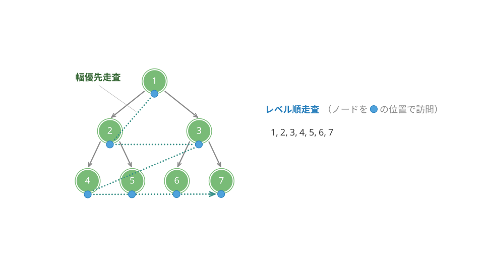
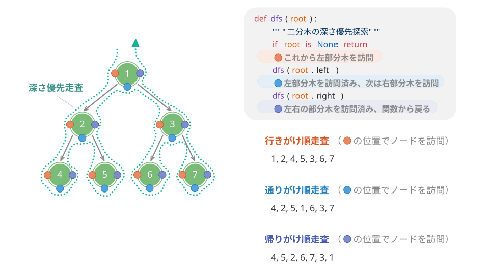
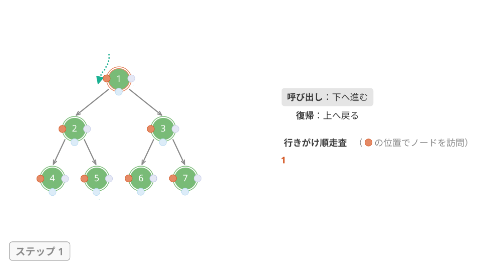
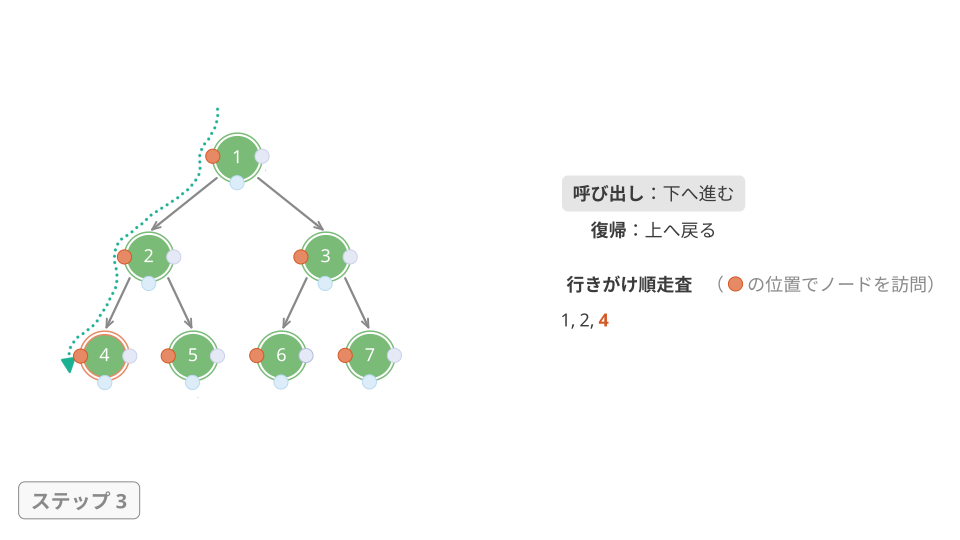
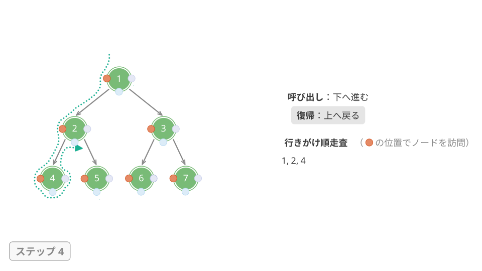
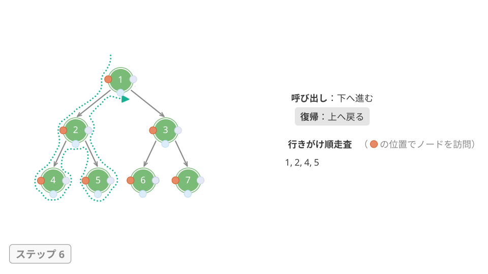
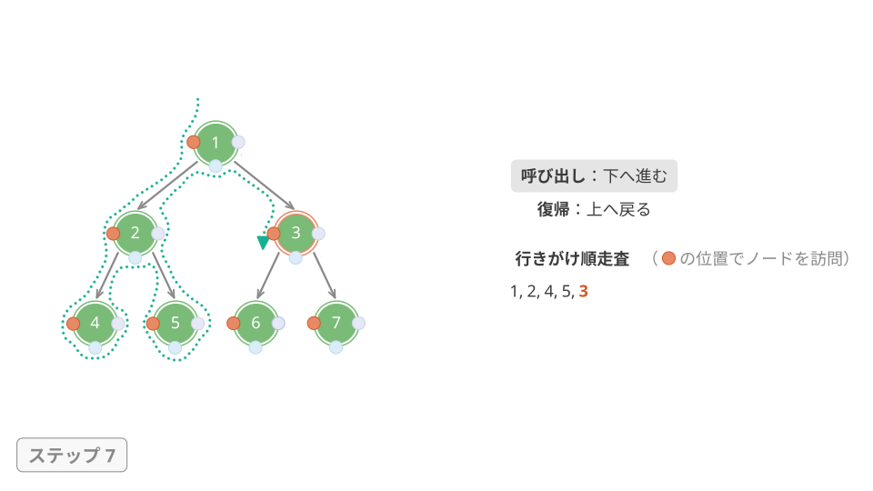
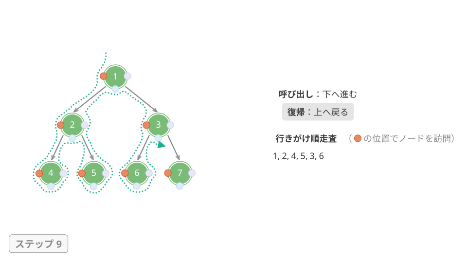

# 二分木の走査

物理的な構造に着目すると、ここで扱う木は連結リストに基づくデータ構造なので、ポインタをたどってノードを一つずつ訪問します。ただし、木は非線形のデータ構造です。そのため、木の走査は連結リストの走査より複雑で、探索アルゴリズムを使って実現します。

二分木でよく使う走査には、レベル順、行きがけ順、通りがけ順、帰りがけ順などがあります。

## レベル順走査

下図のように、<u>レベル順走査（level-order traversal）</u>では二分木を上の層から下の層へ順にたどり、各層では左から右へノードを訪問します。

レベル順走査は<u>幅優先走査（breadth-first traversal）</u>の一種です。<u>幅優先探索（breadth-first search, BFS）</u>とも呼ばれ、輪を一つずつ外へ広げるように層ごとに進みます。



### コードによる実装

幅優先走査は通常、キューを使って実装します。キューは先に入れたものから取り出す「先入れ先出し」であり、この仕組みが幅優先走査の「一層ずつ進む」という規則に合っています。実装は次のとおりです。

```src
[file]{binary_tree_bfs}-[class]{}-[func]{level_order}
```

### 計算量の分析

- **時間計算量は $O(n)$ です**。すべてのノードを 1 回ずつ訪問するため、時間は $O(n)$ です。ここで $n$ はノード数です。
- **空間計算量は $O(n)$ です**。最悪の場合、すなわち完璧二分木では、最下層を走査する直前に最大 $(n + 1) / 2$ 個のノードが同時にキューに入り、$O(n)$ の領域を使います。

## 行きがけ順、通りがけ順、帰りがけ順の走査

一方、行きがけ順、通りがけ順、帰りがけ順はいずれも<u>深さ優先走査（depth-first traversal）</u>に属し、<u>深さ優先探索（depth-first search, DFS）</u>とも呼ばれます。一つの経路を行き止まりまで進み、そこから戻って続ける走査です。

下図は、二分木を深さ優先で走査する仕組みを示しています。**深さ優先走査は、二分木全体の外周を一周するようなものです**。各ノードの周りで 3 つの位置を通り、それぞれ行きがけ順、通りがけ順、帰りがけ順に対応します。



### コードによる実装

深さ優先探索は通常、次のように再帰で実装します。

```src
[file]{binary_tree_dfs}-[class]{}-[func]{post_order}
```

!!! tip

    深さ優先探索は反復でも実装できます。興味がある方は調べてみてください。

下図に、二分木を行きがけ順に走査する再帰の流れを示します。再帰には、呼び出し先へ進む動きと、そこから戻る動きの 2 つがあります。

1. 「進む」とは新たにメソッドを呼び出すことで、プログラムは次のノードを訪問します。
2. 「戻る」とは関数が呼び出し元に戻ることで、現在のノードの処理が終わったことを示します。

=== "<1>"
    

=== "<2>"
    

=== "<3>"
    

=== "<4>"
    

=== "<5>"
    

=== "<6>"
    

=== "<7>"
    

=== "<8>"
    

=== "<9>"
    

=== "<10>"
    

=== "<11>"
    

### 計算量の分析

- **時間計算量は $O(n)$ です**。すべてのノードを 1 回ずつ訪問するので、$O(n)$ の時間がかかります。
- **空間計算量は $O(n)$ です**。最悪の場合、すなわち木が連結リストに退化した場合、再帰の深さは $n$ に達し、システムはスタックフレームに $O(n)$ の領域を使います。
