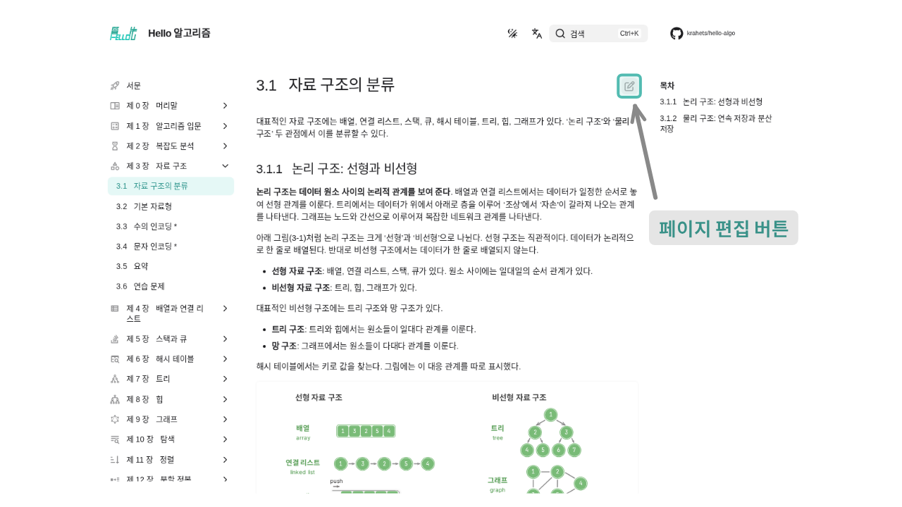

# 책 집필에 참여하기

저자가 미처 살피지 못해 책에 빠진 내용이나 오류가 있는 점은 독자 여러분의 양해를 구한다. 오탈자, 끊어진 링크, 누락된 내용, 여러 뜻으로 읽히는 표현, 이해하기 어려운 설명, 자연스럽지 않은 글의 구성 등을 발견했다면 수정에 힘을 보태 주기 바란다. 그래야 독자들에게 더 좋은 학습 자료를 제공할 수 있다.

오픈 소스 커뮤니티를 위해 기꺼이 힘을 보태 준 모든 [기여자](https://github.com/krahets/hello-algo/graphs/contributors)에게 감사를 표하고자 이들의 GitHub ID를 이 책의 저장소와 웹판 및 PDF판의 첫 페이지에 소개한다.

!!! success "오픈 소스의 매력"

    종이책은 다음 인쇄까지 시간이 오래 걸리는 경우가 많아 내용을 갱신하기가 쉽지 않다.
    
    이 책은 오픈 소스로 만들어져 며칠, 때로는 몇 시간 만에도 내용을 갱신할 수 있다.

### 본문이나 코드 간단히 수정하기

아래 그림처럼 각 페이지의 오른쪽 위에 편집 아이콘이 있다. 다음 순서로 본문이나 코드를 수정할 수 있다.

1. 편집 아이콘을 클릭한다. 저장소를 포크해야 한다는 메시지가 나오면 포크에 동의한다.
2. Markdown 원본 파일을 수정하고 내용이 정확한지 확인한다. 서식은 가능한 한 기존 형식에 맞춘다.
3. 페이지 아래쪽에 변경 내용을 설명하고 “Propose file change” 버튼을 클릭한다. 다음 화면에서 “Create pull request” 버튼을 클릭하면 풀 리퀘스트를 보낼 수 있다.

그림은 직접 수정할 수 없으므로 새 [이슈](https://github.com/krahets/hello-algo/issues)를 열거나 댓글을 남겨 문제를 설명해 주기 바란다. 문제가 있는 그림은 최대한 빨리 다시 그려 교체하겠다.

### 새 내용 작성하기

코드를 다른 프로그래밍 언어로 옮기거나 본문 내용을 보강하는 등 이 오픈 소스 프로젝트에 참여하고 싶다면 다음 절차에 따라 풀 리퀘스트를 보낸다.

1. GitHub에 로그인해 이 책의 [코드 저장소](https://github.com/krahets/hello-algo)를 개인 계정으로 포크한다.
2. 포크한 저장소 페이지로 이동한 뒤 `git clone` 명령으로 저장소를 로컬에 복제한다.
3. 로컬에서 내용을 작성하고 전체 테스트를 실행해 코드가 올바르게 동작하는지 확인한다.
4. 로컬에서 변경한 내용을 커밋한 뒤 원격 저장소에 푸시한다.
5. 저장소 페이지를 새로 고친 뒤 “Create pull request” 버튼을 클릭해 풀 리퀘스트를 보낸다.
