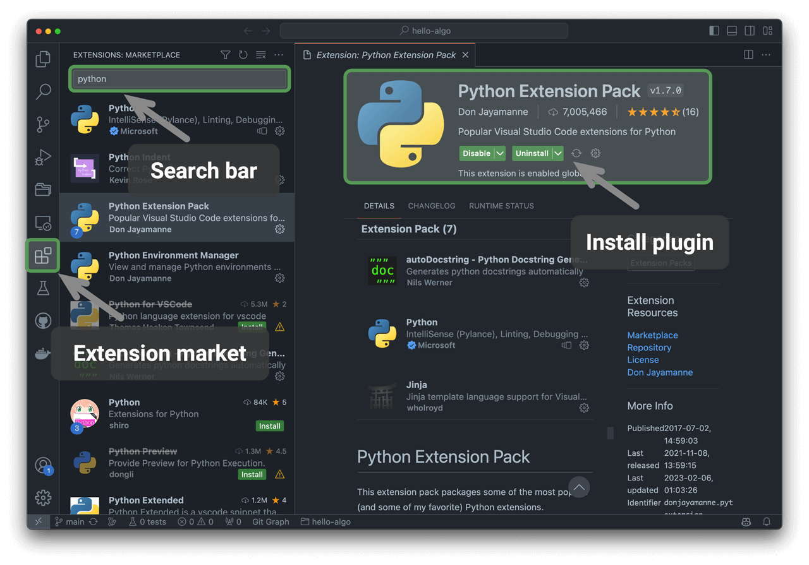

# 프로그래밍 환경 설치

## IDE 설치

로컬 통합 개발 환경(IDE)으로는 가벼운 오픈 소스 도구인 VS Code를 권장한다. [VS Code 공식 웹사이트](https://code.visualstudio.com/)에서 운영체제에 맞는 버전을 내려받아 설치한다.

VS Code는 풍부한 확장 생태계를 갖추고 있어 대부분의 프로그래밍 언어를 실행하고 디버깅할 수 있다. Python을 예로 들면, ‘Python Extension Pack’을 설치한 뒤 Python 코드를 디버깅할 수 있다. 설치 과정은 아래 그림과 같다.

## 언어 실행 환경 설치

### Python 환경

1. [Miniconda3](https://docs.conda.io/en/latest/miniconda.html)를 내려받아 설치한다. Python 3.10 이상이 필요하다.
2. VS Code 확장 마켓플레이스에서 `python`을 검색하여 Python Extension Pack을 설치한다.
3. (선택 사항) 명령줄에 `pip install black`을 입력하여 코드 포매터를 설치한다.

### C/C++ 환경

1. Windows에서는 [MinGW](https://sourceforge.net/projects/mingw-w64/files/)를 설치해야 한다([설정 안내](https://blog.csdn.net/qq_33698226/article/details/129031241)). macOS에는 Clang이 기본으로 포함되어 있어 별도로 설치할 필요가 없다.
2. VS Code 확장 마켓플레이스에서 `c++`를 검색하여 C/C++ Extension Pack을 설치한다.
3. (선택 사항) Settings 페이지에서 코드 서식 옵션인 `Clang_format_fallback Style`을 검색하고 `{ BasedOnStyle: Microsoft, BreakBeforeBraces: Attach }`로 설정한다.

### Java 환경

1. [OpenJDK](https://jdk.java.net/18/)를 내려받아 설치한다(JDK 9보다 높은 버전이어야 한다).
2. VS Code 확장 마켓플레이스에서 `java`를 검색하여 Extension Pack for Java를 설치한다.

### C# 환경

1. [.NET 8.0](https://dotnet.microsoft.com/ko-kr/download)을 내려받아 설치한다.
2. VS Code 확장 마켓플레이스에서 `C# Dev Kit`을 검색하여 C# Dev Kit을 설치한다([설정 안내](https://code.visualstudio.com/docs/csharp/get-started)).
3. Visual Studio를 사용해도 된다([설치 안내](https://learn.microsoft.com/ko-kr/visualstudio/install/install-visual-studio?view=vs-2022)).

### Go 환경

1. [go](https://go.dev/dl/)를 내려받아 설치한다.
2. VS Code 확장 마켓플레이스에서 `go`를 검색하여 Go를 설치한다.
3. `Ctrl + Shift + P`를 눌러 명령 팔레트를 열고 go를 입력한다. `Go: Install/Update Tools`를 선택한 뒤 모든 항목을 체크하여 설치한다.

### Swift 환경

1. [Swift](https://www.swift.org/download/)를 내려받아 설치한다.
2. VS Code 확장 마켓플레이스에서 `swift`를 검색하여 [Swift for Visual Studio Code](https://marketplace.visualstudio.com/items?itemName=sswg.swift-lang)를 설치한다.

### JavaScript 환경

1. [Node.js](https://nodejs.org/ko/)를 내려받아 설치한다.
2. (선택 사항) VS Code 확장 마켓플레이스에서 `Prettier`를 검색하여 코드 포매터를 설치한다.

### TypeScript 환경

1. JavaScript 환경과 같은 순서로 설치한다.
2. [TypeScript Execute (tsx)](https://github.com/privatenumber/tsx?tab=readme-ov-file#global-installation)를 설치한다.
3. VS Code 확장 마켓플레이스에서 `typescript`를 검색하여 [Pretty TypeScript Errors](https://marketplace.visualstudio.com/items?itemName=yoavbls.pretty-ts-errors)를 설치한다.

### Dart 환경

1. [Dart](https://dart.dev/get-dart)를 내려받아 설치한다.
2. VS Code 확장 마켓플레이스에서 `dart`를 검색하여 [Dart](https://marketplace.visualstudio.com/items?itemName=Dart-Code.dart-code)를 설치한다.

### Rust 환경

1. [Rust](https://www.rust-lang.org/tools/install)를 내려받아 설치한다.
2. VS Code 확장 마켓플레이스에서 `rust`를 검색하여 [rust-analyzer](https://marketplace.visualstudio.com/items?itemName=rust-lang.rust-analyzer)를 설치한다.
