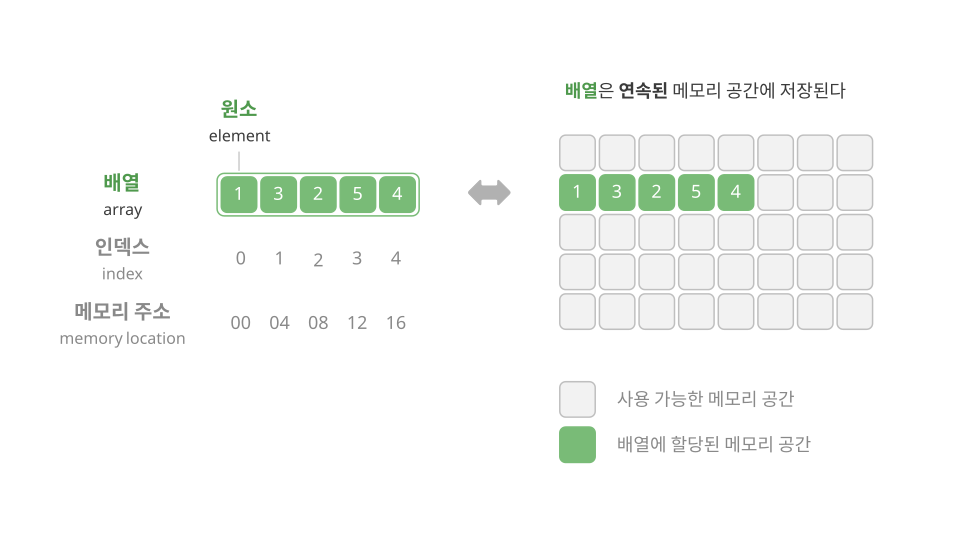
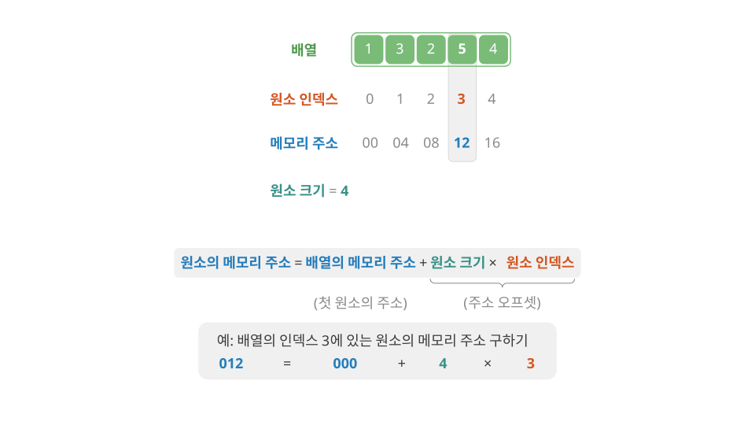
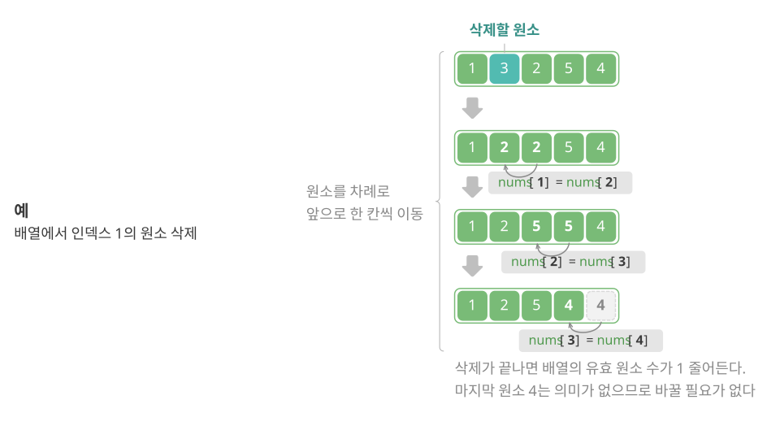

# 배열

<u>배열(array)</u>은 같은 자료형의 원소를 연속된 메모리 공간에 저장하는 선형 자료 구조다. 배열에서 원소가 있는 위치를 해당 원소의 <u>인덱스(index)</u>라고 한다. 아래 그림은 배열의 주요 개념과 저장 방식을 보여 준다.



## 배열의 기본 연산

### 배열 초기화

필요에 따라 초깃값을 지정하지 않거나 지정하는 두 가지 초기화 방식을 사용할 수 있다. 초깃값을 지정하지 않으면 대부분의 프로그래밍 언어는 배열 원소를 $0$으로 초기화한다.

```snippet
init_array
```

??? pythontutor "코드 시각화"

    @tutor init_array_tutor

### 원소 접근

배열 원소는 연속된 메모리 공간에 저장되므로 메모리 주소를 매우 쉽게 계산할 수 있다. 배열의 메모리 주소(첫 원소의 메모리 주소)와 원소의 인덱스가 주어지면, 아래 그림의 식으로 해당 원소의 메모리 주소를 구하여 직접 접근할 수 있다.



위 그림에서 배열의 첫 원소 인덱스는 $0$이다. $1$부터 세는 편이 더 자연스러워 보이므로 직관에 어긋날 수 있다. 그러나 주소 계산식의 관점에서 **인덱스는 본질적으로 메모리 주소의 오프셋이다**. 첫 원소의 주소 오프셋은 $0$이므로 인덱스가 $0$인 것은 합리적이다.

배열의 원소 접근은 매우 효율적이며, 어떤 원소든 $O(1)$ 시간에 임의 접근할 수 있다.

```src
[file]{array}-[class]{}-[func]{random_access}
```

### 원소 삽입

배열 원소는 메모리에서 ‘빈틈없이 붙어 있어’ 사이에 다른 데이터를 넣을 공간이 없다. 아래 그림과 같이 배열 중간에 원소를 삽입하려면 해당 위치 이후의 모든 원소를 한 칸씩 뒤로 옮긴 다음, 그 인덱스에 새 원소를 대입해야 한다.


배열의 길이는 고정되어 있으므로 원소를 하나 삽입하면 반드시 마지막 원소가 ‘사라진다’는 점에 주의하자. 이 문제의 해결책은 ‘리스트’ 절에서 다룬다.

```src
[file]{array}-[class]{}-[func]{insert}
```

### 원소 삭제

마찬가지로 아래 그림과 같이 인덱스 $i$의 원소를 삭제하려면 인덱스 $i$ 뒤의 원소를 모두 한 칸씩 앞으로 옮겨야 한다.



삭제가 끝난 뒤 원래의 마지막 원소는 ‘의미 없는’ 값이 되므로 따로 수정할 필요가 없다.

```src
[file]{array}-[class]{}-[func]{remove}
```

배열의 삽입과 삭제 연산에는 다음과 같은 단점이 있다.

- **높은 시간 복잡도**: 삽입과 삭제의 평균 시간 복잡도는 모두 $O(n)$이며, $n$은 배열 길이다.
- **원소 손실**: 배열의 길이는 바꿀 수 없으므로 삽입 후 길이 범위를 벗어나는 원소가 사라진다.
- **메모리 낭비**: 긴 배열을 초기화하고 앞부분만 사용하면 삽입 시 사라지는 마지막 원소는 모두 ‘의미 없는’ 값이 된다. 하지만 이 방식은 메모리 공간 일부를 낭비한다.

### 배열 순회

대부분의 프로그래밍 언어에서는 인덱스로 배열을 순회할 수도 있고, 배열의 각 원소를 직접 얻으며 순회할 수도 있다.

```src
[file]{array}-[class]{}-[func]{traverse}
```

### 원소 탐색

배열에서 특정 원소를 찾으려면 배열을 순회하면서 매번 값이 일치하는지 확인하고, 일치하면 해당 인덱스를 출력한다.

배열은 선형 자료 구조이므로 이 탐색 연산을 ‘선형 탐색’이라고 한다.

```src
[file]{array}-[class]{}-[func]{find}
```

### 배열 용량 확장

복잡한 시스템 환경에서는 배열 바로 뒤의 메모리 공간을 사용할 수 있다고 보장하기 어려우므로, 배열 용량을 안전하게 늘릴 수 없다. 따라서 대부분의 프로그래밍 언어에서 **배열 길이는 바꿀 수 없다**.

배열 용량을 늘리려면 더 큰 배열을 새로 만들고 기존 원소를 차례로 복사해야 한다. 이는 $O(n)$ 연산으로, 배열이 매우 크면 시간이 많이 든다. 코드는 다음과 같다.

```src
[file]{array}-[class]{}-[func]{extend}
```

## 배열의 장점과 한계

배열은 연속된 메모리 공간에 저장되고 원소의 자료형이 모두 같다. 이러한 풍부한 사전 정보를 활용하면 시스템은 자료 구조의 연산 효율을 최적화할 수 있다.

- **높은 공간 효율**: 연속된 메모리 블록을 데이터에 할당하므로 추가적인 구조 비용이 없다.
- **임의 접근 지원**: 어떤 원소든 $O(1)$ 시간에 접근할 수 있다.
- **캐시 지역성**: 배열 원소에 접근할 때 컴퓨터는 그 원소뿐 아니라 주변 데이터도 캐시에 저장한다. 이를 통해 이후 연산의 실행 속도를 높일 수 있다.

연속 공간 저장은 양날의 검으로, 다음과 같은 한계가 있다.

- **낮은 삽입 및 삭제 효율**: 원소가 많으면 삽입이나 삭제 시 많은 원소를 이동해야 한다.
- **고정된 길이**: 초기화한 뒤에는 길이가 고정된다. 용량을 늘리려면 모든 데이터를 새 배열로 복사해야 하므로 비용이 크다.
- **공간 낭비**: 실제 필요한 크기보다 크게 할당하면 남는 공간이 낭비된다.

## 배열의 대표적인 활용

배열은 기본적이면서도 흔히 쓰이는 자료 구조다. 다양한 알고리즘에 자주 사용되며 복잡한 자료 구조를 구현하는 데도 쓰인다.

- **임의 접근**: 일부 표본을 무작위로 추출하려면 데이터를 배열에 저장하고 무작위 수열을 생성하여 인덱스에 따라 표본을 뽑을 수 있다.
- **정렬과 탐색**: 배열은 정렬 및 탐색 알고리즘에서 가장 많이 쓰이는 자료 구조다. 퀵 정렬, 병합 정렬, 이진 탐색 등은 주로 배열에서 수행된다.
- **조회 테이블**: 원소나 대응 관계를 빠르게 찾고 싶을 때 배열을 조회 테이블로 사용할 수 있다. 예를 들어 문자와 ASCII 코드의 대응을 구현하려면 문자의 ASCII 코드 값을 인덱스로 삼고, 해당 원소를 배열의 대응 위치에 저장하면 된다.
- **머신 러닝**: 신경망에서는 벡터, 행렬, 텐서 사이의 선형 대수 연산을 많이 사용하며, 이 데이터들은 모두 배열 형태로 구성된다. 배열은 신경망 프로그래밍에서 가장 많이 쓰는 자료 구조다.
- **자료 구조 구현**: 배열로 스택, 큐, 해시 테이블, 힙, 그래프 등을 구현할 수 있다. 예를 들어 그래프의 인접 행렬 표현은 실제로 이차원 배열이다.
