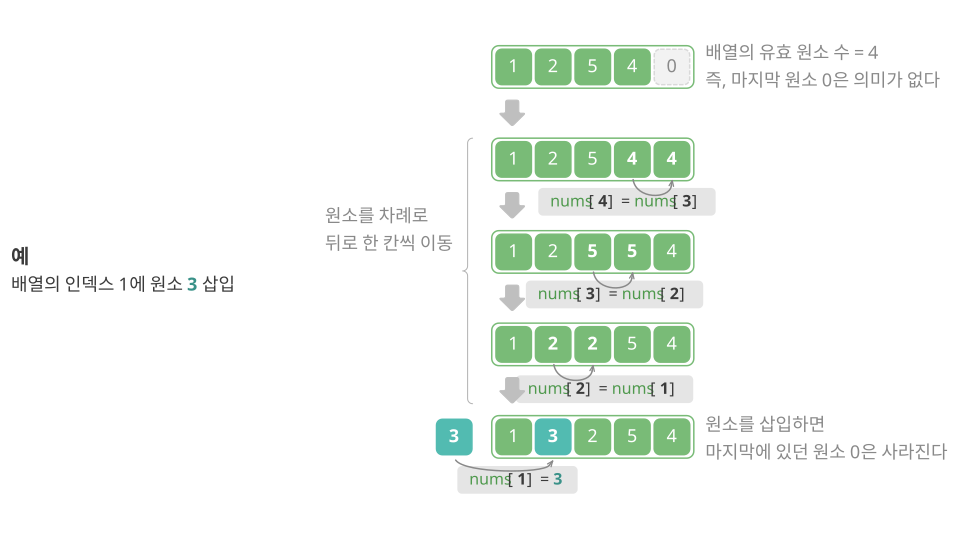

# 배열

<u>배열(array)</u>은 같은 자료형의 원소를 연속된 메모리 공간에 저장하는 선형 자료 구조이다. 배열에서 원소가 놓인 위치를 그 원소의 <u>인덱스(index)</u>라고 한다. 아래 그림은 배열의 주요 개념과 저장 방식을 보여 준다.


## 배열의 기본 연산

### 배열 초기화

필요에 따라 배열을 초기화할 때 초깃값을 지정할 수도 있고 생략할 수도 있다. 초깃값을 지정하지 않으면 대부분의 프로그래밍 언어는 배열 원소를 $0$으로 초기화한다.

```snippet
init_array
```

??? pythontutor "실행 과정 시각화"

    @tutor init_array_tutor

### 원소 접근

배열 원소는 연속된 메모리 공간에 저장되므로 각 원소의 메모리 주소를 쉽게 계산할 수 있다. 배열의 메모리 주소(첫 원소의 메모리 주소)와 원소의 인덱스가 주어지면 아래 그림의 공식으로 해당 원소의 메모리 주소를 구해 바로 접근할 수 있다.


위 그림에서 배열의 첫 원소의 인덱스는 $0$이다. 보통은 $1$부터 세는 것이 더 자연스러워 어색하게 느껴질 수 있다. 하지만 주소 계산 공식에서 보면 **인덱스는 본질적으로 메모리 주소의 오프셋을 나타낸다**. 첫 원소의 주소 오프셋은 $0$이므로 인덱스가 $0$인 것은 자연스럽다.

배열 원소에 접근하는 연산은 매우 효율적이다. 배열의 어느 원소에든 $O(1)$ 시간에 임의 접근할 수 있다.

```src
[file]{array}-[class]{}-[func]{random_access}
```

### 원소 삽입

배열 원소들은 메모리에 빈틈없이 붙어 있어 그사이에 다른 데이터를 넣을 공간이 없다. 아래 그림처럼 배열 중간에 원소를 삽입하려면 삽입 위치의 원소부터 뒤에 있는 원소까지 모두 한 칸씩 뒤로 옮긴 다음 해당 인덱스에 새 값을 대입해야 한다.



배열 길이는 고정되어 있으므로 원소를 삽입하면 배열 끝의 원소 하나를 반드시 ‘잃게’ 된다. 이 문제의 해결 방법은 ‘리스트’ 절에서 살펴본다.

```src
[file]{array}-[class]{}-[func]{insert}
```

### 원소 삭제

마찬가지로 아래 그림처럼 인덱스 $i$의 원소를 삭제하려면 인덱스 $i$ 다음의 원소를 모두 한 칸씩 앞으로 옮겨야 한다.


삭제가 끝나면 기존의 마지막 원소는 의미가 없어지므로 굳이 그 값을 바꿀 필요가 없다.

```src
[file]{array}-[class]{}-[func]{remove}
```

정리하면 배열의 삽입과 삭제 연산에는 다음과 같은 단점이 있다.

- **높은 시간 복잡도**: 배열에서 삽입과 삭제의 평균 시간 복잡도는 모두 $O(n)$이다. 여기서 $n$은 배열 길이이다.
- **원소 손실**: 배열 길이는 바뀌지 않으므로 삽입 후 배열의 범위 밖으로 밀려난 원소는 사라진다.
- **메모리 낭비**: 긴 배열을 만들어 앞부분만 사용하면 삽입할 때 밀려나는 맨 끝의 원소는 모두 의미 없는 값이다. 하지만 이렇게 하면 메모리 일부를 낭비한다.

### 배열 순회

대부분의 프로그래밍 언어에서는 인덱스로 배열을 순회할 수도 있고, 배열의 원소를 하나씩 직접 꺼내며 순회할 수도 있다.

```src
[file]{array}-[class]{}-[func]{traverse}
```

### 원소 찾기

배열에서 특정 원소를 찾으려면 배열을 순회하며 매번 원솟값이 일치하는지 확인하고, 일치하면 해당 인덱스를 출력한다.

배열은 선형 자료 구조이므로 이와 같은 탐색을 ‘선형 탐색’이라고 한다.

```src
[file]{array}-[class]{}-[func]{find}
```

### 배열 용량 늘리기

복잡한 시스템 환경에서는 배열 바로 다음의 메모리 공간을 사용할 수 있다고 보장하기 어려워 배열 용량을 안전하게 늘릴 수 없다. 따라서 대부분의 프로그래밍 언어에서 **배열의 길이는 바꿀 수 없다**.

배열 용량을 늘리려면 더 큰 배열을 새로 만든 뒤 원래 배열의 원소를 차례로 복사해야 한다. 이는 $O(n)$ 연산이므로 배열이 매우 크면 시간이 많이 걸린다. 코드는 다음과 같다.

```src
[file]{array}-[class]{}-[func]{extend}
```

## 배열의 장점과 한계

배열은 연속된 메모리 공간에 저장되고 원소의 자료형도 모두 같다. 시스템은 이처럼 미리 알 수 있는 정보를 활용해 자료 구조의 연산 효율을 높인다.

- **높은 공간 효율**: 배열은 데이터에 연속된 메모리 블록을 할당하므로 별도의 구조를 유지하는 비용이 들지 않는다.
- **임의 접근 지원**: 배열의 어느 원소든 $O(1)$ 시간에 접근할 수 있다.
- **캐시 지역성**: 컴퓨터는 배열 원소에 접근할 때 해당 원소를 불러오면서 주변 데이터도 캐시에 저장한다. 덕분에 이후 연산을 더 빠르게 실행할 수 있다.

연속된 공간에 저장하는 방식은 양날의 검이다. 다음과 같은 한계도 있다.

- **낮은 삽입 및 삭제 효율**: 배열에 원소가 많으면 삽입하거나 삭제할 때 많은 원소를 옮겨야 한다.
- **고정된 길이**: 배열은 초기화한 뒤에는 길이가 고정된다. 용량을 늘리려면 모든 데이터를 새 배열에 복사해야 하므로 비용이 크다.
- **공간 낭비**: 실제로 필요한 것보다 큰 배열을 할당하면 남는 공간이 낭비된다.

## 배열의 대표적인 활용 사례

배열은 기초적이고 흔히 쓰이는 자료 구조이다. 여러 알고리즘에서 자주 사용하며, 다양한 복합 자료 구조를 구현하는 데도 활용한다.

- **무작위 표본 추출**: 표본을 무작위로 뽑으려면 데이터를 배열에 저장한 뒤 난수열을 생성하고 그 값을 인덱스로 사용해 표본을 추출할 수 있다.
- **정렬과 탐색**: 배열은 정렬 및 탐색 알고리즘에 가장 흔히 쓰이는 자료 구조이다. 퀵 정렬, 병합 정렬, 이진 탐색 등은 주로 배열에서 수행한다.
- **조회 테이블**: 원소나 그 대응 관계를 빨리 찾으려면 배열을 조회 테이블로 쓸 수 있다. 예를 들어 문자와 ASCII 코드의 대응 관계를 구현하려면 문자의 ASCII 코드값을 인덱스로 삼고 해당 원소를 배열의 그 위치에 저장한다.
- **기계 학습**: 신경망에서는 벡터, 행렬, 텐서 사이의 선형대수 연산을 많이 수행한다. 이 데이터들은 모두 배열 형태로 구성된다. 배열은 신경망 프로그래밍에서 가장 흔히 쓰는 자료 구조이다.
- **자료 구조 구현**: 배열로 스택, 큐, 해시 테이블, 힙, 그래프 등을 구현할 수 있다. 예를 들어 그래프를 나타내는 인접 행렬은 사실 이차원 배열이다.
