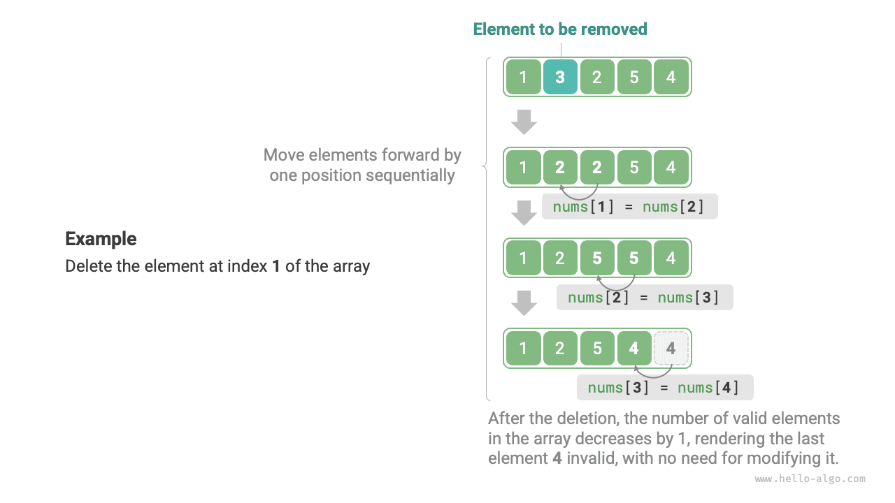

# 4.1 &nbsp; 배열

<u>배열(array)</u>은 같은 자료형의 원소를 연속된 메모리 공간에 저장하는 선형 자료 구조다. 배열에서 원소가 있는 위치를 해당 원소의 <u>인덱스(index)</u>라고 한다. 아래 그림(4-1)은 배열의 주요 개념과 저장 방식을 보여 준다.

{ class="animation-figure" }

<p align="center"> 그림 4-1 &nbsp; 배열의 정의와 저장 방식 </p>

## 4.1.1 &nbsp; 배열의 기본 연산

### 1. &nbsp; 배열 초기화

필요에 따라 초깃값을 지정하지 않거나 지정하는 두 가지 초기화 방식을 사용할 수 있다. 초깃값을 지정하지 않으면 대부분의 프로그래밍 언어는 배열 원소를 $0$으로 초기화한다.

=== "Python"

    ```python title="array.py"
    # 배열 초기화
    arr: list[int] = [0] * 5  # [ 0, 0, 0, 0, 0 ]
    nums: list[int] = [1, 3, 2, 5, 4]
    ```

=== "C++"

    ```cpp title="array.cpp"
    /* 배열 초기화 */
    // 스택에 저장
    int arr[5] = {};
    int nums[5] = { 1, 3, 2, 5, 4 };
    // 힙에 저장(공간을 직접 해제해야 함)
    int* arr1 = new int[5] {};
    int* nums1 = new int[5] { 1, 3, 2, 5, 4 };
    ```

=== "Java"

    ```java title="array.java"
    /* 배열 초기화 */
    int[] arr = new int[5]; // { 0, 0, 0, 0, 0 }
    int[] nums = { 1, 3, 2, 5, 4 };
    ```

=== "C#"

    ```csharp title="array.cs"
    /* 배열 초기화 */
    int[] arr = new int[5]; // [ 0, 0, 0, 0, 0 ]
    int[] nums = [1, 3, 2, 5, 4];
    ```

=== "Go"

    ```go title="array.go"
    /* 배열 초기화 */
    var arr [5]int
    // Go에서 길이를 지정하면([5]int) 배열이고, 지정하지 않으면([]int) 슬라이스다
    // Go 배열의 길이는 컴파일 시 결정되도록 설계되었으므로 상수로만 길이를 지정할 수 있다
    // 용량 확장 메서드 extend()를 쉽게 구현하기 위해 아래에서는 슬라이스(Slice)를 배열(Array)로 간주한다
    nums := []int{1, 3, 2, 5, 4}
    ```

=== "Swift"

    ```swift title="array.swift"
    /* 배열 초기화 */
    let arr = Array(repeating: 0, count: 5) // [0, 0, 0, 0, 0]
    let nums = [1, 3, 2, 5, 4]
    ```

=== "JS"

    ```javascript title="array.js"
    /* 배열 초기화 */
    var arr = new Array(5).fill(0);
    var nums = [1, 3, 2, 5, 4];
    ```

=== "TS"

    ```typescript title="array.ts"
    /* 배열 초기화 */
    let arr: number[] = new Array(5).fill(0);
    let nums: number[] = [1, 3, 2, 5, 4];
    ```

=== "Dart"

    ```dart title="array.dart"
    /* 배열 초기화 */
    List<int> arr = List.filled(5, 0); // [0, 0, 0, 0, 0]
    List<int> nums = [1, 3, 2, 5, 4];
    ```

=== "Rust"

    ```rust title="array.rs"
    /* 배열 초기화 */
    let arr: [i32; 5] = [0; 5]; // [0, 0, 0, 0, 0]
    let slice: &[i32] = &[0; 5];
    // Rust에서 길이를 지정하면([i32; 5]) 배열이고, 지정하지 않으면(&[i32]) 슬라이스다
    // Rust 배열의 길이는 컴파일 시 결정되도록 설계되었으므로 상수로만 길이를 지정할 수 있다
    // Vector는 Rust에서 일반적으로 동적 배열로 사용하는 자료형이다
    // 용량 확장 메서드 extend()를 쉽게 구현하기 위해 아래에서는 vector를 배열(array)로 간주한다
    let nums: Vec<i32> = vec![1, 3, 2, 5, 4];
    ```

=== "C"

    ```c title="array.c"
    /* 배열 초기화 */
    int arr[5] = { 0 }; // { 0, 0, 0, 0, 0 }
    int nums[5] = { 1, 3, 2, 5, 4 };
    ```

=== "Kotlin"

    ```kotlin title="array.kt"
    /* 배열 초기화 */
    var arr = IntArray(5) // { 0, 0, 0, 0, 0 }
    var nums = intArrayOf(1, 3, 2, 5, 4)
    ```

=== "Ruby"

    ```ruby title="array.rb"
    # 배열 초기화
    arr = Array.new(5, 0)
    nums = [1, 3, 2, 5, 4]
    ```

??? pythontutor "코드 시각화"

    <div style="height: 243px; width: 100%;"><iframe class="pythontutor-iframe" title="코드 시각화" src="https://pythontutor.com/iframe-embed.html#code=%23%20%EB%B0%B0%EC%97%B4%20%EC%B4%88%EA%B8%B0%ED%99%94%0Aarr%20%3D%20%5B0%5D%20%2A%205%20%20%23%20%5B%200%2C%200%2C%200%2C%200%2C%200%20%5D%0Anums%20%3D%20%5B1%2C%203%2C%202%2C%205%2C%204%5D&codeDivHeight=472&codeDivWidth=350&cumulative=false&curInstr=0&heapPrimitives=nevernest&origin=opt-frontend.js&py=311&rawInputLstJSON=%5B%5D&textReferences=false"> </iframe></div>
    <div style="margin-top: 5px;"><a href="https://pythontutor.com/iframe-embed.html#code=%23%20%EB%B0%B0%EC%97%B4%20%EC%B4%88%EA%B8%B0%ED%99%94%0Aarr%20%3D%20%5B0%5D%20%2A%205%20%20%23%20%5B%200%2C%200%2C%200%2C%200%2C%200%20%5D%0Anums%20%3D%20%5B1%2C%203%2C%202%2C%205%2C%204%5D&codeDivHeight=800&codeDivWidth=600&cumulative=false&curInstr=0&heapPrimitives=nevernest&origin=opt-frontend.js&py=311&rawInputLstJSON=%5B%5D&textReferences=false" target="_blank" rel="noopener noreferrer">전체 화면 ></a></div>

### 2. &nbsp; 원소 접근

배열 원소는 연속된 메모리 공간에 저장되므로 메모리 주소를 매우 쉽게 계산할 수 있다. 배열의 메모리 주소(첫 원소의 메모리 주소)와 원소의 인덱스가 주어지면, 아래 그림(4-2)의 식으로 해당 원소의 메모리 주소를 구하여 직접 접근할 수 있다.

{ class="animation-figure" }

<p align="center"> 그림 4-2 &nbsp; 배열 원소의 메모리 주소 계산 </p>

위 그림(4-2)에서 배열의 첫 원소 인덱스는 $0$이다. $1$부터 세는 편이 더 자연스러워 보이므로 직관에 어긋날 수 있다. 그러나 주소 계산식의 관점에서 **인덱스는 본질적으로 메모리 주소의 오프셋이다**. 첫 원소의 주소 오프셋은 $0$이므로 인덱스가 $0$인 것은 합리적이다.

배열의 원소 접근은 매우 효율적이며, 어떤 원소든 $O(1)$ 시간에 임의 접근할 수 있다.

=== "Python"

    ```python title="array.py"
    def random_access(nums: list[int]) -> int:
        """원소에 임의 접근"""
        # 구간 [0, len(nums)-1]에서 숫자 하나를 무작위로 뽑는다
        random_index = random.randint(0, len(nums) - 1)
        # 무작위 원소를 가져와 반환한다
        random_num = nums[random_index]
        return random_num
    ```

=== "C++"

    ```cpp title="array.cpp"
    /* 원소에 임의 접근 */
    int randomAccess(int *nums, int size) {
        // 구간 [0, size)에서 무작위로 수 하나 선택
        int randomIndex = rand() % size;
        // 무작위 원소를 가져와 반환한다
        int randomNum = nums[randomIndex];
        return randomNum;
    }
    ```

=== "Java"

    ```java title="array.java"
    /* 원소에 임의 접근 */
    int randomAccess(int[] nums) {
        // 구간 [0, nums.length)에서 숫자 하나를 무작위로 뽑는다
        int randomIndex = ThreadLocalRandom.current().nextInt(0, nums.length);
        // 무작위 원소를 가져와 반환한다
        int randomNum = nums[randomIndex];
        return randomNum;
    }
    ```

=== "C#"

    ```csharp title="array.cs"
    /* 원소에 임의 접근 */
    int RandomAccess(int[] nums) {
        Random random = new();
        // 구간 [0, nums.Length)에서 무작위로 수 하나 선택
        int randomIndex = random.Next(nums.Length);
        // 무작위 원소를 가져와 반환한다
        int randomNum = nums[randomIndex];
        return randomNum;
    }
    ```

=== "Go"

    ```go title="array.go"
    /* 원소에 임의 접근 */
    func randomAccess(nums []int) (randomNum int) {
        // 구간 [0, nums.length)에서 숫자 하나를 무작위로 뽑는다
        randomIndex := rand.Intn(len(nums))
        // 무작위 원소를 가져와 반환한다
        randomNum = nums[randomIndex]
        return
    }
    ```

=== "Swift"

    ```swift title="array.swift"
    /* 원소에 임의 접근 */
    func randomAccess(nums: [Int]) -> Int {
        // 구간 [0, nums.count)에서 숫자 하나를 무작위로 뽑는다
        let randomIndex = nums.indices.randomElement()!
        // 무작위 원소를 가져와 반환한다
        let randomNum = nums[randomIndex]
        return randomNum
    }
    ```

=== "JS"

    ```javascript title="array.js"
    /* 원소에 임의 접근 */
    function randomAccess(nums) {
        // 구간 [0, nums.length)에서 숫자 하나를 무작위로 뽑는다
        const random_index = Math.floor(Math.random() * nums.length);
        // 무작위 원소를 가져와 반환한다
        const random_num = nums[random_index];
        return random_num;
    }
    ```

=== "TS"

    ```typescript title="array.ts"
    /* 원소에 임의 접근 */
    function randomAccess(nums: number[]): number {
        // 구간 [0, nums.length)에서 숫자 하나를 무작위로 뽑는다
        const random_index = Math.floor(Math.random() * nums.length);
        // 무작위 원소를 가져와 반환한다
        const random_num = nums[random_index];
        return random_num;
    }
    ```

=== "Dart"

    ```dart title="array.dart"
    /* 원소에 임의 접근 */
    int randomAccess(List<int> nums) {
      // 구간 [0, nums.length)에서 숫자 하나를 무작위로 뽑는다
      int randomIndex = Random().nextInt(nums.length);
      // 무작위 원소를 가져와 반환한다
      int randomNum = nums[randomIndex];
      return randomNum;
    }
    ```

=== "Rust"

    ```rust title="array.rs"
    /* 원소에 임의 접근 */
    fn random_access(nums: &[i32]) -> i32 {
        // 구간 [0, nums.len())에서 숫자 하나를 무작위로 뽑는다
        let random_index = rand::thread_rng().gen_range(0..nums.len());
        // 무작위 원소를 가져와 반환한다
        let random_num = nums[random_index];
        random_num
    }
    ```

=== "C"

    ```c title="array.c"
    /* 원소에 임의 접근 */
    int randomAccess(int *nums, int size) {
        // 구간 [0, size)에서 무작위로 수 하나 선택
        int randomIndex = rand() % size;
        // 무작위 원소를 가져와 반환한다
        int randomNum = nums[randomIndex];
        return randomNum;
    }
    ```

=== "Kotlin"

    ```kotlin title="array.kt"
    /* 원소에 임의 접근 */
    fun randomAccess(nums: IntArray): Int {
        // 구간 [0, nums.size)에서 숫자 하나를 무작위로 뽑는다
        val randomIndex = ThreadLocalRandom.current().nextInt(0, nums.size)
        // 무작위 원소를 가져와 반환한다
        val randomNum = nums[randomIndex]
        return randomNum
    }
    ```

=== "Ruby"

    ```ruby title="array.rb"
    ### 원소에 임의 접근 ###
    def random_access(nums)
      # 구간 [0, nums.length)에서 숫자 하나를 무작위로 뽑는다
      random_index = Random.rand(0...nums.length)

      # 무작위 원소를 가져와 반환한다
      nums[random_index]
    end
    ```

??? pythontutor "코드 시각화"

    <div style="height: 531px; width: 100%;"><iframe class="pythontutor-iframe" title="코드 시각화" src="https://pythontutor.com/iframe-embed.html#code=import%20random%0A%0Adef%20random_access%28nums%3A%20list%5Bint%5D%29%20-%3E%20int%3A%0A%20%20%20%20%22%22%22%EC%9B%90%EC%86%8C%EC%97%90%20%EC%9E%84%EC%9D%98%20%EC%A0%91%EA%B7%BC%22%22%22%0A%20%20%20%20%23%20%EA%B5%AC%EA%B0%84%20%5B0,%20len%28nums%29-1%5D%EC%97%90%EC%84%9C%20%EC%88%AB%EC%9E%90%20%ED%95%98%EB%82%98%EB%A5%BC%20%EB%AC%B4%EC%9E%91%EC%9C%84%EB%A1%9C%20%EB%BD%91%EB%8A%94%EB%8B%A4%0A%20%20%20%20random_index%20%3D%20random.randint%280,%20len%28nums%29%20-%201%29%0A%20%20%20%20%23%20%EB%AC%B4%EC%9E%91%EC%9C%84%20%EC%9B%90%EC%86%8C%EB%A5%BC%20%EA%B0%80%EC%A0%B8%EC%99%80%20%EB%B0%98%ED%99%98%ED%95%9C%EB%8B%A4%0A%20%20%20%20random_num%20%3D%20nums%5Brandom_index%5D%0A%20%20%20%20return%20random_num%0A%0A%22%22%22%EC%8B%A4%ED%96%89%20%EC%BD%94%EB%93%9C%22%22%22%0Aif%20__name__%20%3D%3D%20%22__main__%22%3A%0A%20%20%20%20%23%20%EB%B0%B0%EC%97%B4%20%EC%B4%88%EA%B8%B0%ED%99%94%0A%20%20%20%20nums%20%3D%20%5B1,%203,%202,%205,%204%5D%0A%20%20%20%20print%28%22%EB%B0%B0%EC%97%B4%20nums%20%3D%22,%20nums%29%0A%0A%20%20%20%20%23%20%EC%9E%84%EC%9D%98%20%EC%A0%91%EA%B7%BC%0A%20%20%20%20random_num%3A%20int%20%3D%20random_access%28nums%29%0A%20%20%20%20print%28%22nums%EC%97%90%EC%84%9C%20%EB%AC%B4%EC%9E%91%EC%9C%84%EB%A1%9C%20%EA%B0%80%EC%A0%B8%EC%98%A8%20%EC%9B%90%EC%86%8C%22,%20random_num%29%0A&codeDivHeight=472&codeDivWidth=350&cumulative=false&curInstr=7&heapPrimitives=nevernest&origin=opt-frontend.js&py=311&rawInputLstJSON=%5B%5D&textReferences=false"> </iframe></div>
    <div style="margin-top: 5px;"><a href="https://pythontutor.com/iframe-embed.html#code=import%20random%0A%0Adef%20random_access%28nums%3A%20list%5Bint%5D%29%20-%3E%20int%3A%0A%20%20%20%20%22%22%22%EC%9B%90%EC%86%8C%EC%97%90%20%EC%9E%84%EC%9D%98%20%EC%A0%91%EA%B7%BC%22%22%22%0A%20%20%20%20%23%20%EA%B5%AC%EA%B0%84%20%5B0,%20len%28nums%29-1%5D%EC%97%90%EC%84%9C%20%EC%88%AB%EC%9E%90%20%ED%95%98%EB%82%98%EB%A5%BC%20%EB%AC%B4%EC%9E%91%EC%9C%84%EB%A1%9C%20%EB%BD%91%EB%8A%94%EB%8B%A4%0A%20%20%20%20random_index%20%3D%20random.randint%280,%20len%28nums%29%20-%201%29%0A%20%20%20%20%23%20%EB%AC%B4%EC%9E%91%EC%9C%84%20%EC%9B%90%EC%86%8C%EB%A5%BC%20%EA%B0%80%EC%A0%B8%EC%99%80%20%EB%B0%98%ED%99%98%ED%95%9C%EB%8B%A4%0A%20%20%20%20random_num%20%3D%20nums%5Brandom_index%5D%0A%20%20%20%20return%20random_num%0A%0A%22%22%22%EC%8B%A4%ED%96%89%20%EC%BD%94%EB%93%9C%22%22%22%0Aif%20__name__%20%3D%3D%20%22__main__%22%3A%0A%20%20%20%20%23%20%EB%B0%B0%EC%97%B4%20%EC%B4%88%EA%B8%B0%ED%99%94%0A%20%20%20%20nums%20%3D%20%5B1,%203,%202,%205,%204%5D%0A%20%20%20%20print%28%22%EB%B0%B0%EC%97%B4%20nums%20%3D%22,%20nums%29%0A%0A%20%20%20%20%23%20%EC%9E%84%EC%9D%98%20%EC%A0%91%EA%B7%BC%0A%20%20%20%20random_num%3A%20int%20%3D%20random_access%28nums%29%0A%20%20%20%20print%28%22nums%EC%97%90%EC%84%9C%20%EB%AC%B4%EC%9E%91%EC%9C%84%EB%A1%9C%20%EA%B0%80%EC%A0%B8%EC%98%A8%20%EC%9B%90%EC%86%8C%22,%20random_num%29%0A&codeDivHeight=800&codeDivWidth=600&cumulative=false&curInstr=7&heapPrimitives=nevernest&origin=opt-frontend.js&py=311&rawInputLstJSON=%5B%5D&textReferences=false" target="_blank" rel="noopener noreferrer">전체 화면 ></a></div>

### 3. &nbsp; 원소 삽입

배열 원소는 메모리에서 ‘빈틈없이 붙어 있어’ 사이에 다른 데이터를 넣을 공간이 없다. 아래 그림(4-3)과 같이 배열 중간에 원소를 삽입하려면 해당 위치 이후의 모든 원소를 한 칸씩 뒤로 옮긴 다음, 그 인덱스에 새 원소를 대입해야 한다.

{ class="animation-figure" }

<p align="center"> 그림 4-3 &nbsp; 배열에 원소를 삽입하는 예 </p>

배열의 길이는 고정되어 있으므로 원소를 하나 삽입하면 반드시 마지막 원소가 ‘사라진다’는 점에 주의하자. 이 문제의 해결책은 ‘리스트’ 절에서 다룬다.

=== "Python"

    ```python title="array.py"
    def insert(nums: list[int], num: int, index: int):
        """배열의 인덱스 index에 원소 num 삽입"""
        # 인덱스 index와 그 뒤에 있는 모든 원소를 한 칸씩 뒤로 이동한다
        for i in range(len(nums) - 1, index, -1):
            nums[i] = nums[i - 1]
        # index 위치의 원소에 num을 대입한다
        nums[index] = num
    ```

=== "C++"

    ```cpp title="array.cpp"
    /* 배열의 인덱스 index에 원소 num 삽입 */
    void insert(int *nums, int size, int num, int index) {
        // 인덱스 index와 그 뒤에 있는 모든 원소를 한 칸씩 뒤로 이동한다
        for (int i = size - 1; i > index; i--) {
            nums[i] = nums[i - 1];
        }
        // index 위치의 원소에 num을 대입한다
        nums[index] = num;
    }
    ```

=== "Java"

    ```java title="array.java"
    /* 배열의 인덱스 index에 원소 num 삽입 */
    void insert(int[] nums, int num, int index) {
        // 인덱스 index와 그 뒤에 있는 모든 원소를 한 칸씩 뒤로 이동한다
        for (int i = nums.length - 1; i > index; i--) {
            nums[i] = nums[i - 1];
        }
        // index 위치의 원소에 num을 대입한다
        nums[index] = num;
    }
    ```

=== "C#"

    ```csharp title="array.cs"
    /* 배열의 인덱스 index에 원소 num 삽입 */
    void Insert(int[] nums, int num, int index) {
        // 인덱스 index와 그 뒤에 있는 모든 원소를 한 칸씩 뒤로 이동한다
        for (int i = nums.Length - 1; i > index; i--) {
            nums[i] = nums[i - 1];
        }
        // index 위치의 원소에 num을 대입한다
        nums[index] = num;
    }
    ```

=== "Go"

    ```go title="array.go"
    /* 배열의 인덱스 index에 원소 num 삽입 */
    func insert(nums []int, num int, index int) {
        // 인덱스 index와 그 뒤에 있는 모든 원소를 한 칸씩 뒤로 이동한다
        for i := len(nums) - 1; i > index; i-- {
            nums[i] = nums[i-1]
        }
        // index 위치의 원소에 num을 대입한다
        nums[index] = num
    }
    ```

=== "Swift"

    ```swift title="array.swift"
    /* 배열의 인덱스 index에 원소 num 삽입 */
    func insert(nums: inout [Int], num: Int, index: Int) {
        // 인덱스 index와 그 뒤에 있는 모든 원소를 한 칸씩 뒤로 이동한다
        for i in stride(from: nums.count - 1, to: index, by: -1) {
            nums[i] = nums[i - 1]
        }
        // index 위치의 원소에 num을 대입한다
        nums[index] = num
    }
    ```

=== "JS"

    ```javascript title="array.js"
    /* 배열의 인덱스 index에 원소 num 삽입 */
    function insert(nums, num, index) {
        // 인덱스 index와 그 뒤에 있는 모든 원소를 한 칸씩 뒤로 이동한다
        for (let i = nums.length - 1; i > index; i--) {
            nums[i] = nums[i - 1];
        }
        // index 위치의 원소에 num을 대입한다
        nums[index] = num;
    }
    ```

=== "TS"

    ```typescript title="array.ts"
    /* 배열의 인덱스 index에 원소 num 삽입 */
    function insert(nums: number[], num: number, index: number): void {
        // 인덱스 index와 그 뒤에 있는 모든 원소를 한 칸씩 뒤로 이동한다
        for (let i = nums.length - 1; i > index; i--) {
            nums[i] = nums[i - 1];
        }
        // index 위치의 원소에 num을 대입한다
        nums[index] = num;
    }
    ```

=== "Dart"

    ```dart title="array.dart"
    /* 배열의 인덱스 index에 원소 _num 삽입 */
    void insert(List<int> nums, int _num, int index) {
      // 인덱스 index와 그 뒤에 있는 모든 원소를 한 칸씩 뒤로 이동한다
      for (var i = nums.length - 1; i > index; i--) {
        nums[i] = nums[i - 1];
      }
      // 인덱스 index의 원소에 _num을 대입한다
      nums[index] = _num;
    }
    ```

=== "Rust"

    ```rust title="array.rs"
    /* 배열의 인덱스 index에 원소 num 삽입 */
    fn insert(nums: &mut [i32], num: i32, index: usize) {
        // 인덱스 index와 그 뒤에 있는 모든 원소를 한 칸씩 뒤로 이동한다
        for i in (index + 1..nums.len()).rev() {
            nums[i] = nums[i - 1];
        }
        // index 위치의 원소에 num을 대입한다
        nums[index] = num;
    }
    ```

=== "C"

    ```c title="array.c"
    /* 배열의 인덱스 index에 원소 num 삽입 */
    void insert(int *nums, int size, int num, int index) {
        // 인덱스 index와 그 뒤에 있는 모든 원소를 한 칸씩 뒤로 이동한다
        for (int i = size - 1; i > index; i--) {
            nums[i] = nums[i - 1];
        }
        // index 위치의 원소에 num을 대입한다
        nums[index] = num;
    }
    ```

=== "Kotlin"

    ```kotlin title="array.kt"
    /* 배열의 인덱스 index에 원소 num 삽입 */
    fun insert(nums: IntArray, num: Int, index: Int) {
        // 인덱스 index와 그 뒤에 있는 모든 원소를 한 칸씩 뒤로 이동한다
        for (i in nums.size - 1 downTo index + 1) {
            nums[i] = nums[i - 1]
        }
        // index 위치의 원소에 num을 대입한다
        nums[index] = num
    }
    ```

=== "Ruby"

    ```ruby title="array.rb"
    ### 배열의 인덱스 index에 원소 num 삽입 ###
    def insert(nums, num, index)
      # 인덱스 index와 그 뒤에 있는 모든 원소를 한 칸씩 뒤로 이동한다
      for i in (nums.length - 1).downto(index + 1)
        nums[i] = nums[i - 1]
      end

      # index 위치의 원소에 num을 대입한다
      nums[index] = num
    end
    ```

??? pythontutor "코드 시각화"

    <div style="height: 495px; width: 100%;"><iframe class="pythontutor-iframe" title="코드 시각화" src="https://pythontutor.com/iframe-embed.html#code=def%20insert%28nums%3A%20list%5Bint%5D,%20num%3A%20int,%20index%3A%20int%29%3A%0A%20%20%20%20%22%22%22%EB%B0%B0%EC%97%B4%EC%9D%98%20%EC%9D%B8%EB%8D%B1%EC%8A%A4%20index%EC%97%90%20%EC%9B%90%EC%86%8C%20num%20%EC%82%BD%EC%9E%85%22%22%22%0A%20%20%20%20%23%20%EC%9D%B8%EB%8D%B1%EC%8A%A4%20index%EC%99%80%20%EA%B7%B8%20%EB%92%A4%EC%97%90%20%EC%9E%88%EB%8A%94%20%EB%AA%A8%EB%93%A0%20%EC%9B%90%EC%86%8C%EB%A5%BC%20%ED%95%9C%20%EC%B9%B8%EC%94%A9%20%EB%92%A4%EB%A1%9C%20%EC%9D%B4%EB%8F%99%ED%95%9C%EB%8B%A4%0A%20%20%20%20for%20i%20in%20range%28len%28nums%29%20-%201,%20index,%20-1%29%3A%0A%20%20%20%20%20%20%20%20nums%5Bi%5D%20%3D%20nums%5Bi%20-%201%5D%0A%20%20%20%20%23%20index%20%EC%9C%84%EC%B9%98%EC%9D%98%20%EC%9B%90%EC%86%8C%EC%97%90%20num%EC%9D%84%20%EB%8C%80%EC%9E%85%ED%95%9C%EB%8B%A4%0A%20%20%20%20nums%5Bindex%5D%20%3D%20num%0A%0A%22%22%22%EC%8B%A4%ED%96%89%20%EC%BD%94%EB%93%9C%22%22%22%0Aif%20__name__%20%3D%3D%20%22__main__%22%3A%0A%20%20%20%20%23%20%EB%B0%B0%EC%97%B4%20%EC%B4%88%EA%B8%B0%ED%99%94%0A%20%20%20%20nums%20%3D%20%5B1,%203,%202,%205,%204%5D%0A%20%20%20%20print%28%22%EB%B0%B0%EC%97%B4%20nums%20%3D%22,%20nums%29%0A%0A%20%20%20%20%23%20%EC%9B%90%EC%86%8C%20%EC%82%BD%EC%9E%85%0A%20%20%20%20insert%28nums,%206,%203%29%0A%20%20%20%20print%28%22%EC%9D%B8%EB%8D%B1%EC%8A%A4%203%EC%97%90%20%EC%88%AB%EC%9E%90%206%EC%9D%84%20%EC%82%BD%EC%9E%85%ED%95%9C%20%ED%9B%84%20nums%20%3D%22,%20nums%29&codeDivHeight=472&codeDivWidth=350&cumulative=false&curInstr=6&heapPrimitives=nevernest&origin=opt-frontend.js&py=311&rawInputLstJSON=%5B%5D&textReferences=false"> </iframe></div>
    <div style="margin-top: 5px;"><a href="https://pythontutor.com/iframe-embed.html#code=def%20insert%28nums%3A%20list%5Bint%5D,%20num%3A%20int,%20index%3A%20int%29%3A%0A%20%20%20%20%22%22%22%EB%B0%B0%EC%97%B4%EC%9D%98%20%EC%9D%B8%EB%8D%B1%EC%8A%A4%20index%EC%97%90%20%EC%9B%90%EC%86%8C%20num%20%EC%82%BD%EC%9E%85%22%22%22%0A%20%20%20%20%23%20%EC%9D%B8%EB%8D%B1%EC%8A%A4%20index%EC%99%80%20%EA%B7%B8%20%EB%92%A4%EC%97%90%20%EC%9E%88%EB%8A%94%20%EB%AA%A8%EB%93%A0%20%EC%9B%90%EC%86%8C%EB%A5%BC%20%ED%95%9C%20%EC%B9%B8%EC%94%A9%20%EB%92%A4%EB%A1%9C%20%EC%9D%B4%EB%8F%99%ED%95%9C%EB%8B%A4%0A%20%20%20%20for%20i%20in%20range%28len%28nums%29%20-%201,%20index,%20-1%29%3A%0A%20%20%20%20%20%20%20%20nums%5Bi%5D%20%3D%20nums%5Bi%20-%201%5D%0A%20%20%20%20%23%20index%20%EC%9C%84%EC%B9%98%EC%9D%98%20%EC%9B%90%EC%86%8C%EC%97%90%20num%EC%9D%84%20%EB%8C%80%EC%9E%85%ED%95%9C%EB%8B%A4%0A%20%20%20%20nums%5Bindex%5D%20%3D%20num%0A%0A%22%22%22%EC%8B%A4%ED%96%89%20%EC%BD%94%EB%93%9C%22%22%22%0Aif%20__name__%20%3D%3D%20%22__main__%22%3A%0A%20%20%20%20%23%20%EB%B0%B0%EC%97%B4%20%EC%B4%88%EA%B8%B0%ED%99%94%0A%20%20%20%20nums%20%3D%20%5B1,%203,%202,%205,%204%5D%0A%20%20%20%20print%28%22%EB%B0%B0%EC%97%B4%20nums%20%3D%22,%20nums%29%0A%0A%20%20%20%20%23%20%EC%9B%90%EC%86%8C%20%EC%82%BD%EC%9E%85%0A%20%20%20%20insert%28nums,%206,%203%29%0A%20%20%20%20print%28%22%EC%9D%B8%EB%8D%B1%EC%8A%A4%203%EC%97%90%20%EC%88%AB%EC%9E%90%206%EC%9D%84%20%EC%82%BD%EC%9E%85%ED%95%9C%20%ED%9B%84%20nums%20%3D%22,%20nums%29&codeDivHeight=800&codeDivWidth=600&cumulative=false&curInstr=6&heapPrimitives=nevernest&origin=opt-frontend.js&py=311&rawInputLstJSON=%5B%5D&textReferences=false" target="_blank" rel="noopener noreferrer">전체 화면 ></a></div>

### 4. &nbsp; 원소 삭제

마찬가지로 아래 그림(4-4)과 같이 인덱스 $i$의 원소를 삭제하려면 인덱스 $i$ 뒤의 원소를 모두 한 칸씩 앞으로 옮겨야 한다.

{ class="animation-figure" }

<p align="center"> 그림 4-4 &nbsp; 배열에서 원소를 삭제하는 예 </p>

삭제가 끝난 뒤 원래의 마지막 원소는 ‘의미 없는’ 값이 되므로 따로 수정할 필요가 없다.

=== "Python"

    ```python title="array.py"
    def remove(nums: list[int], index: int):
        """인덱스 index에 있는 원소 삭제"""
        # 인덱스 index 뒤에 있는 모든 원소를 한 칸씩 앞으로 이동한다
        for i in range(index, len(nums) - 1):
            nums[i] = nums[i + 1]
    ```

=== "C++"

    ```cpp title="array.cpp"
    /* 인덱스 index에 있는 원소 삭제 */
    void remove(int *nums, int size, int index) {
        // 인덱스 index 뒤에 있는 모든 원소를 한 칸씩 앞으로 이동한다
        for (int i = index; i < size - 1; i++) {
            nums[i] = nums[i + 1];
        }
    }
    ```

=== "Java"

    ```java title="array.java"
    /* 인덱스 index에 있는 원소 삭제 */
    void remove(int[] nums, int index) {
        // 인덱스 index 뒤에 있는 모든 원소를 한 칸씩 앞으로 이동한다
        for (int i = index; i < nums.length - 1; i++) {
            nums[i] = nums[i + 1];
        }
    }
    ```

=== "C#"

    ```csharp title="array.cs"
    /* 인덱스 index에 있는 원소 삭제 */
    void Remove(int[] nums, int index) {
        // 인덱스 index 뒤에 있는 모든 원소를 한 칸씩 앞으로 이동한다
        for (int i = index; i < nums.Length - 1; i++) {
            nums[i] = nums[i + 1];
        }
    }
    ```

=== "Go"

    ```go title="array.go"
    /* 인덱스 index에 있는 원소 삭제 */
    func remove(nums []int, index int) {
        // 인덱스 index 뒤에 있는 모든 원소를 한 칸씩 앞으로 이동한다
        for i := index; i < len(nums)-1; i++ {
            nums[i] = nums[i+1]
        }
    }
    ```

=== "Swift"

    ```swift title="array.swift"
    /* 인덱스 index에 있는 원소 삭제 */
    func remove(nums: inout [Int], index: Int) {
        // 인덱스 index 뒤에 있는 모든 원소를 한 칸씩 앞으로 이동한다
        for i in nums.indices.dropFirst(index).dropLast() {
            nums[i] = nums[i + 1]
        }
    }
    ```

=== "JS"

    ```javascript title="array.js"
    /* 인덱스 index에 있는 원소 삭제 */
    function remove(nums, index) {
        // 인덱스 index 뒤에 있는 모든 원소를 한 칸씩 앞으로 이동한다
        for (let i = index; i < nums.length - 1; i++) {
            nums[i] = nums[i + 1];
        }
    }
    ```

=== "TS"

    ```typescript title="array.ts"
    /* 인덱스 index에 있는 원소 삭제 */
    function remove(nums: number[], index: number): void {
        // 인덱스 index 뒤에 있는 모든 원소를 한 칸씩 앞으로 이동한다
        for (let i = index; i < nums.length - 1; i++) {
            nums[i] = nums[i + 1];
        }
    }
    ```

=== "Dart"

    ```dart title="array.dart"
    /* 인덱스 index에 있는 원소 삭제 */
    void remove(List<int> nums, int index) {
      // 인덱스 index 뒤에 있는 모든 원소를 한 칸씩 앞으로 이동한다
      for (var i = index; i < nums.length - 1; i++) {
        nums[i] = nums[i + 1];
      }
    }
    ```

=== "Rust"

    ```rust title="array.rs"
    /* 인덱스 index에 있는 원소 삭제 */
    fn remove(nums: &mut [i32], index: usize) {
        // 인덱스 index 뒤에 있는 모든 원소를 한 칸씩 앞으로 이동한다
        for i in index..nums.len() - 1 {
            nums[i] = nums[i + 1];
        }
    }
    ```

=== "C"

    ```c title="array.c"
    /* 인덱스 index에 있는 원소 삭제 */
    // 주의: stdio.h가 remove라는 이름을 사용한다
    void removeItem(int *nums, int size, int index) {
        // 인덱스 index 뒤에 있는 모든 원소를 한 칸씩 앞으로 이동한다
        for (int i = index; i < size - 1; i++) {
            nums[i] = nums[i + 1];
        }
    }
    ```

=== "Kotlin"

    ```kotlin title="array.kt"
    /* 인덱스 index에 있는 원소 삭제 */
    fun remove(nums: IntArray, index: Int) {
        // 인덱스 index 뒤에 있는 모든 원소를 한 칸씩 앞으로 이동한다
        for (i in index..<nums.size - 1) {
            nums[i] = nums[i + 1]
        }
    }
    ```

=== "Ruby"

    ```ruby title="array.rb"
    ### 인덱스 index에 있는 원소 삭제 ###
    def remove(nums, index)
      # 인덱스 index 뒤에 있는 모든 원소를 한 칸씩 앞으로 이동한다
      for i in index...(nums.length - 1)
        nums[i] = nums[i + 1]
      end
    end
    ```

??? pythontutor "코드 시각화"

    <div style="height: 459px; width: 100%;"><iframe class="pythontutor-iframe" title="코드 시각화" src="https://pythontutor.com/iframe-embed.html#code=def%20remove%28nums%3A%20list%5Bint%5D,%20index%3A%20int%29%3A%0A%20%20%20%20%22%22%22%EC%9D%B8%EB%8D%B1%EC%8A%A4%20index%EC%97%90%20%EC%9E%88%EB%8A%94%20%EC%9B%90%EC%86%8C%20%EC%82%AD%EC%A0%9C%22%22%22%0A%20%20%20%20%23%20%EC%9D%B8%EB%8D%B1%EC%8A%A4%20index%20%EB%92%A4%EC%97%90%20%EC%9E%88%EB%8A%94%20%EB%AA%A8%EB%93%A0%20%EC%9B%90%EC%86%8C%EB%A5%BC%20%ED%95%9C%20%EC%B9%B8%EC%94%A9%20%EC%95%9E%EC%9C%BC%EB%A1%9C%20%EC%9D%B4%EB%8F%99%ED%95%9C%EB%8B%A4%0A%20%20%20%20for%20i%20in%20range%28index,%20len%28nums%29%20-%201%29%3A%0A%20%20%20%20%20%20%20%20nums%5Bi%5D%20%3D%20nums%5Bi%20%2B%201%5D%0A%0A%22%22%22%EC%8B%A4%ED%96%89%20%EC%BD%94%EB%93%9C%22%22%22%0Aif%20__name__%20%3D%3D%20%22__main__%22%3A%0A%20%20%20%20%23%20%EB%B0%B0%EC%97%B4%20%EC%B4%88%EA%B8%B0%ED%99%94%0A%20%20%20%20nums%20%3D%20%5B1,%203,%202,%205,%204%5D%0A%20%20%20%20print%28%22%EB%B0%B0%EC%97%B4%20nums%20%3D%22,%20nums%29%0A%0A%20%20%20%20%23%20%EC%9B%90%EC%86%8C%20%EC%82%AD%EC%A0%9C%0A%20%20%20%20remove%28nums,%202%29%0A%20%20%20%20print%28%22%EC%9D%B8%EB%8D%B1%EC%8A%A4%202%EC%9D%98%20%EC%9B%90%EC%86%8C%EB%A5%BC%20%EC%82%AD%EC%A0%9C%ED%95%9C%20%ED%9B%84%20nums%20%3D%22,%20nums%29&codeDivHeight=472&codeDivWidth=350&cumulative=false&curInstr=6&heapPrimitives=nevernest&origin=opt-frontend.js&py=311&rawInputLstJSON=%5B%5D&textReferences=false"> </iframe></div>
    <div style="margin-top: 5px;"><a href="https://pythontutor.com/iframe-embed.html#code=def%20remove%28nums%3A%20list%5Bint%5D,%20index%3A%20int%29%3A%0A%20%20%20%20%22%22%22%EC%9D%B8%EB%8D%B1%EC%8A%A4%20index%EC%97%90%20%EC%9E%88%EB%8A%94%20%EC%9B%90%EC%86%8C%20%EC%82%AD%EC%A0%9C%22%22%22%0A%20%20%20%20%23%20%EC%9D%B8%EB%8D%B1%EC%8A%A4%20index%20%EB%92%A4%EC%97%90%20%EC%9E%88%EB%8A%94%20%EB%AA%A8%EB%93%A0%20%EC%9B%90%EC%86%8C%EB%A5%BC%20%ED%95%9C%20%EC%B9%B8%EC%94%A9%20%EC%95%9E%EC%9C%BC%EB%A1%9C%20%EC%9D%B4%EB%8F%99%ED%95%9C%EB%8B%A4%0A%20%20%20%20for%20i%20in%20range%28index,%20len%28nums%29%20-%201%29%3A%0A%20%20%20%20%20%20%20%20nums%5Bi%5D%20%3D%20nums%5Bi%20%2B%201%5D%0A%0A%22%22%22%EC%8B%A4%ED%96%89%20%EC%BD%94%EB%93%9C%22%22%22%0Aif%20__name__%20%3D%3D%20%22__main__%22%3A%0A%20%20%20%20%23%20%EB%B0%B0%EC%97%B4%20%EC%B4%88%EA%B8%B0%ED%99%94%0A%20%20%20%20nums%20%3D%20%5B1,%203,%202,%205,%204%5D%0A%20%20%20%20print%28%22%EB%B0%B0%EC%97%B4%20nums%20%3D%22,%20nums%29%0A%0A%20%20%20%20%23%20%EC%9B%90%EC%86%8C%20%EC%82%AD%EC%A0%9C%0A%20%20%20%20remove%28nums,%202%29%0A%20%20%20%20print%28%22%EC%9D%B8%EB%8D%B1%EC%8A%A4%202%EC%9D%98%20%EC%9B%90%EC%86%8C%EB%A5%BC%20%EC%82%AD%EC%A0%9C%ED%95%9C%20%ED%9B%84%20nums%20%3D%22,%20nums%29&codeDivHeight=800&codeDivWidth=600&cumulative=false&curInstr=6&heapPrimitives=nevernest&origin=opt-frontend.js&py=311&rawInputLstJSON=%5B%5D&textReferences=false" target="_blank" rel="noopener noreferrer">전체 화면 ></a></div>

배열의 삽입과 삭제 연산에는 다음과 같은 단점이 있다.

- **높은 시간 복잡도**: 삽입과 삭제의 평균 시간 복잡도는 모두 $O(n)$이며, $n$은 배열 길이다.
- **원소 손실**: 배열의 길이는 바꿀 수 없으므로 삽입 후 길이 범위를 벗어나는 원소가 사라진다.
- **메모리 낭비**: 긴 배열을 초기화하고 앞부분만 사용하면 삽입 시 사라지는 마지막 원소는 모두 ‘의미 없는’ 값이 된다. 하지만 이 방식은 메모리 공간 일부를 낭비한다.

### 5. &nbsp; 배열 순회

대부분의 프로그래밍 언어에서는 인덱스로 배열을 순회할 수도 있고, 배열의 각 원소를 직접 얻으며 순회할 수도 있다.

=== "Python"

    ```python title="array.py"
    def traverse(nums: list[int]):
        """배열 순회"""
        count = 0
        # 인덱스를 통해 배열을 순회한다
        for i in range(len(nums)):
            count += nums[i]
        # 배열의 원소를 직접 순회한다
        for num in nums:
            count += num
        # 데이터의 인덱스와 원소를 함께 순회한다
        for i, num in enumerate(nums):
            count += nums[i]
            count += num
    ```

=== "C++"

    ```cpp title="array.cpp"
    /* 배열 순회 */
    void traverse(int *nums, int size) {
        int count = 0;
        // 인덱스를 통해 배열을 순회한다
        for (int i = 0; i < size; i++) {
            count += nums[i];
        }
    }
    ```

=== "Java"

    ```java title="array.java"
    /* 배열 순회 */
    void traverse(int[] nums) {
        int count = 0;
        // 인덱스를 통해 배열을 순회한다
        for (int i = 0; i < nums.length; i++) {
            count += nums[i];
        }
        // 배열의 원소를 직접 순회한다
        for (int num : nums) {
            count += num;
        }
    }
    ```

=== "C#"

    ```csharp title="array.cs"
    /* 배열 순회 */
    void Traverse(int[] nums) {
        int count = 0;
        // 인덱스를 통해 배열을 순회한다
        for (int i = 0; i < nums.Length; i++) {
            count += nums[i];
        }
        // 배열의 원소를 직접 순회한다
        foreach (int num in nums) {
            count += num;
        }
    }
    ```

=== "Go"

    ```go title="array.go"
    /* 배열 순회 */
    func traverse(nums []int) {
        count := 0
        // 인덱스를 통해 배열을 순회한다
        for i := 0; i < len(nums); i++ {
            count += nums[i]
        }
        count = 0
        // 배열의 원소를 직접 순회한다
        for _, num := range nums {
            count += num
        }
        // 데이터의 인덱스와 원소를 함께 순회한다
        for i, num := range nums {
            count += nums[i]
            count += num
        }
    }
    ```

=== "Swift"

    ```swift title="array.swift"
    /* 배열 순회 */
    func traverse(nums: [Int]) {
        var count = 0
        // 인덱스를 통해 배열을 순회한다
        for i in nums.indices {
            count += nums[i]
        }
        // 배열의 원소를 직접 순회한다
        for num in nums {
            count += num
        }
        // 데이터의 인덱스와 원소를 함께 순회한다
        for (i, num) in nums.enumerated() {
            count += nums[i]
            count += num
        }
    }
    ```

=== "JS"

    ```javascript title="array.js"
    /* 배열 순회 */
    function traverse(nums) {
        let count = 0;
        // 인덱스를 통해 배열을 순회한다
        for (let i = 0; i < nums.length; i++) {
            count += nums[i];
        }
        // 배열의 원소를 직접 순회한다
        for (const num of nums) {
            count += num;
        }
    }
    ```

=== "TS"

    ```typescript title="array.ts"
    /* 배열 순회 */
    function traverse(nums: number[]): void {
        let count = 0;
        // 인덱스를 통해 배열을 순회한다
        for (let i = 0; i < nums.length; i++) {
            count += nums[i];
        }
        // 배열의 원소를 직접 순회한다
        for (const num of nums) {
            count += num;
        }
    }
    ```

=== "Dart"

    ```dart title="array.dart"
    /* 배열 원소 순회 */
    void traverse(List<int> nums) {
      int count = 0;
      // 인덱스를 통해 배열을 순회한다
      for (var i = 0; i < nums.length; i++) {
        count += nums[i];
      }
      // 배열의 원소를 직접 순회한다
      for (int _num in nums) {
        count += _num;
      }
      // forEach 메서드로 배열을 순회한다
      nums.forEach((_num) {
        count += _num;
      });
    }
    ```

=== "Rust"

    ```rust title="array.rs"
    /* 배열 순회 */
    fn traverse(nums: &[i32]) {
        let mut _count = 0;
        // 인덱스를 통해 배열을 순회한다
        for i in 0..nums.len() {
            _count += nums[i];
        }
        // 배열의 원소를 직접 순회한다
        _count = 0;
        for &num in nums {
            _count += num;
        }
    }
    ```

=== "C"

    ```c title="array.c"
    /* 배열 순회 */
    void traverse(int *nums, int size) {
        int count = 0;
        // 인덱스를 통해 배열을 순회한다
        for (int i = 0; i < size; i++) {
            count += nums[i];
        }
    }
    ```

=== "Kotlin"

    ```kotlin title="array.kt"
    /* 배열 순회 */
    fun traverse(nums: IntArray) {
        var count = 0
        // 인덱스를 통해 배열을 순회한다
        for (i in nums.indices) {
            count += nums[i]
        }
        // 배열의 원소를 직접 순회한다
        for (j in nums) {
            count += j
        }
    }
    ```

=== "Ruby"

    ```ruby title="array.rb"
    ### 배열 순회 ###
    def traverse(nums)
      count = 0

      # 인덱스를 통해 배열을 순회한다
      for i in 0...nums.length
        count += nums[i]
      end

      # 배열의 원소를 직접 순회한다
      for num in nums
        count += num
      end
    end
    ```

??? pythontutor "코드 시각화"

    <div style="height: 549px; width: 100%;"><iframe class="pythontutor-iframe" title="코드 시각화" src="https://pythontutor.com/iframe-embed.html#code=def%20traverse%28nums%3A%20list%5Bint%5D%29%3A%0A%20%20%20%20%22%22%22%EB%B0%B0%EC%97%B4%20%EC%88%9C%ED%9A%8C%22%22%22%0A%20%20%20%20count%20%3D%200%0A%20%20%20%20%23%20%EC%9D%B8%EB%8D%B1%EC%8A%A4%EB%A5%BC%20%ED%86%B5%ED%95%B4%20%EB%B0%B0%EC%97%B4%EC%9D%84%20%EC%88%9C%ED%9A%8C%ED%95%9C%EB%8B%A4%0A%20%20%20%20for%20i%20in%20range%28len%28nums%29%29%3A%0A%20%20%20%20%20%20%20%20count%20%2B%3D%20nums%5Bi%5D%0A%20%20%20%20%23%20%EB%B0%B0%EC%97%B4%EC%9D%98%20%EC%9B%90%EC%86%8C%EB%A5%BC%20%EC%A7%81%EC%A0%91%20%EC%88%9C%ED%9A%8C%ED%95%9C%EB%8B%A4%0A%20%20%20%20for%20num%20in%20nums%3A%0A%20%20%20%20%20%20%20%20count%20%2B%3D%20num%0A%20%20%20%20%23%20%EB%8D%B0%EC%9D%B4%ED%84%B0%EC%9D%98%20%EC%9D%B8%EB%8D%B1%EC%8A%A4%EC%99%80%20%EC%9B%90%EC%86%8C%EB%A5%BC%20%ED%95%A8%EA%BB%98%20%EC%88%9C%ED%9A%8C%ED%95%9C%EB%8B%A4%0A%20%20%20%20for%20i,%20num%20in%20enumerate%28nums%29%3A%0A%20%20%20%20%20%20%20%20count%20%2B%3D%20nums%5Bi%5D%0A%20%20%20%20%20%20%20%20count%20%2B%3D%20num%0A%0A%22%22%22%EC%8B%A4%ED%96%89%20%EC%BD%94%EB%93%9C%22%22%22%0Aif%20__name__%20%3D%3D%20%22__main__%22%3A%0A%20%20%20%20%23%20%EB%B0%B0%EC%97%B4%20%EC%B4%88%EA%B8%B0%ED%99%94%0A%20%20%20%20nums%20%3D%20%5B1,%203,%202,%205,%204%5D%0A%20%20%20%20print%28%22%EB%B0%B0%EC%97%B4%20nums%20%3D%22,%20nums%29%0A%0A%20%20%20%20%23%20%EB%B0%B0%EC%97%B4%20%EC%88%9C%ED%9A%8C%0A%20%20%20%20traverse%28nums%29&codeDivHeight=472&codeDivWidth=350&cumulative=false&curInstr=6&heapPrimitives=nevernest&origin=opt-frontend.js&py=311&rawInputLstJSON=%5B%5D&textReferences=false"> </iframe></div>
    <div style="margin-top: 5px;"><a href="https://pythontutor.com/iframe-embed.html#code=def%20traverse%28nums%3A%20list%5Bint%5D%29%3A%0A%20%20%20%20%22%22%22%EB%B0%B0%EC%97%B4%20%EC%88%9C%ED%9A%8C%22%22%22%0A%20%20%20%20count%20%3D%200%0A%20%20%20%20%23%20%EC%9D%B8%EB%8D%B1%EC%8A%A4%EB%A5%BC%20%ED%86%B5%ED%95%B4%20%EB%B0%B0%EC%97%B4%EC%9D%84%20%EC%88%9C%ED%9A%8C%ED%95%9C%EB%8B%A4%0A%20%20%20%20for%20i%20in%20range%28len%28nums%29%29%3A%0A%20%20%20%20%20%20%20%20count%20%2B%3D%20nums%5Bi%5D%0A%20%20%20%20%23%20%EB%B0%B0%EC%97%B4%EC%9D%98%20%EC%9B%90%EC%86%8C%EB%A5%BC%20%EC%A7%81%EC%A0%91%20%EC%88%9C%ED%9A%8C%ED%95%9C%EB%8B%A4%0A%20%20%20%20for%20num%20in%20nums%3A%0A%20%20%20%20%20%20%20%20count%20%2B%3D%20num%0A%20%20%20%20%23%20%EB%8D%B0%EC%9D%B4%ED%84%B0%EC%9D%98%20%EC%9D%B8%EB%8D%B1%EC%8A%A4%EC%99%80%20%EC%9B%90%EC%86%8C%EB%A5%BC%20%ED%95%A8%EA%BB%98%20%EC%88%9C%ED%9A%8C%ED%95%9C%EB%8B%A4%0A%20%20%20%20for%20i,%20num%20in%20enumerate%28nums%29%3A%0A%20%20%20%20%20%20%20%20count%20%2B%3D%20nums%5Bi%5D%0A%20%20%20%20%20%20%20%20count%20%2B%3D%20num%0A%0A%22%22%22%EC%8B%A4%ED%96%89%20%EC%BD%94%EB%93%9C%22%22%22%0Aif%20__name__%20%3D%3D%20%22__main__%22%3A%0A%20%20%20%20%23%20%EB%B0%B0%EC%97%B4%20%EC%B4%88%EA%B8%B0%ED%99%94%0A%20%20%20%20nums%20%3D%20%5B1,%203,%202,%205,%204%5D%0A%20%20%20%20print%28%22%EB%B0%B0%EC%97%B4%20nums%20%3D%22,%20nums%29%0A%0A%20%20%20%20%23%20%EB%B0%B0%EC%97%B4%20%EC%88%9C%ED%9A%8C%0A%20%20%20%20traverse%28nums%29&codeDivHeight=800&codeDivWidth=600&cumulative=false&curInstr=6&heapPrimitives=nevernest&origin=opt-frontend.js&py=311&rawInputLstJSON=%5B%5D&textReferences=false" target="_blank" rel="noopener noreferrer">전체 화면 ></a></div>

### 6. &nbsp; 원소 탐색

배열에서 특정 원소를 찾으려면 배열을 순회하면서 매번 값이 일치하는지 확인하고, 일치하면 해당 인덱스를 출력한다.

배열은 선형 자료 구조이므로 이 탐색 연산을 ‘선형 탐색’이라고 한다.

=== "Python"

    ```python title="array.py"
    def find(nums: list[int], target: int) -> int:
        """배열에서 지정한 원소 탐색"""
        for i in range(len(nums)):
            if nums[i] == target:
                return i
        return -1
    ```

=== "C++"

    ```cpp title="array.cpp"
    /* 배열에서 지정한 원소 탐색 */
    int find(int *nums, int size, int target) {
        for (int i = 0; i < size; i++) {
            if (nums[i] == target)
                return i;
        }
        return -1;
    }
    ```

=== "Java"

    ```java title="array.java"
    /* 배열에서 지정한 원소 탐색 */
    int find(int[] nums, int target) {
        for (int i = 0; i < nums.length; i++) {
            if (nums[i] == target)
                return i;
        }
        return -1;
    }
    ```

=== "C#"

    ```csharp title="array.cs"
    /* 배열에서 지정한 원소 탐색 */
    int Find(int[] nums, int target) {
        for (int i = 0; i < nums.Length; i++) {
            if (nums[i] == target)
                return i;
        }
        return -1;
    }
    ```

=== "Go"

    ```go title="array.go"
    /* 배열에서 지정한 원소 탐색 */
    func find(nums []int, target int) (index int) {
        index = -1
        for i := 0; i < len(nums); i++ {
            if nums[i] == target {
                index = i
                break
            }
        }
        return
    }
    ```

=== "Swift"

    ```swift title="array.swift"
    /* 배열에서 지정한 원소 탐색 */
    func find(nums: [Int], target: Int) -> Int {
        for i in nums.indices {
            if nums[i] == target {
                return i
            }
        }
        return -1
    }
    ```

=== "JS"

    ```javascript title="array.js"
    /* 배열에서 지정한 원소 탐색 */
    function find(nums, target) {
        for (let i = 0; i < nums.length; i++) {
            if (nums[i] === target) return i;
        }
        return -1;
    }
    ```

=== "TS"

    ```typescript title="array.ts"
    /* 배열에서 지정한 원소 탐색 */
    function find(nums: number[], target: number): number {
        for (let i = 0; i < nums.length; i++) {
            if (nums[i] === target) {
                return i;
            }
        }
        return -1;
    }
    ```

=== "Dart"

    ```dart title="array.dart"
    /* 배열에서 지정한 원소 탐색 */
    int find(List<int> nums, int target) {
      for (var i = 0; i < nums.length; i++) {
        if (nums[i] == target) return i;
      }
      return -1;
    }
    ```

=== "Rust"

    ```rust title="array.rs"
    /* 배열에서 지정한 원소 탐색 */
    fn find(nums: &[i32], target: i32) -> Option<usize> {
        for i in 0..nums.len() {
            if nums[i] == target {
                return Some(i);
            }
        }
        None
    }
    ```

=== "C"

    ```c title="array.c"
    /* 배열에서 지정한 원소 탐색 */
    int find(int *nums, int size, int target) {
        for (int i = 0; i < size; i++) {
            if (nums[i] == target)
                return i;
        }
        return -1;
    }
    ```

=== "Kotlin"

    ```kotlin title="array.kt"
    /* 배열에서 지정한 원소 탐색 */
    fun find(nums: IntArray, target: Int): Int {
        for (i in nums.indices) {
            if (nums[i] == target)
                return i
        }
        return -1
    }
    ```

=== "Ruby"

    ```ruby title="array.rb"
    ### 배열에서 지정한 원소 탐색 ###
    def find(nums, target)
      for i in 0...nums.length
        return i if nums[i] == target
      end

      -1
    end
    ```

??? pythontutor "코드 시각화"

    <div style="height: 477px; width: 100%;"><iframe class="pythontutor-iframe" title="코드 시각화" src="https://pythontutor.com/iframe-embed.html#code=def%20find%28nums%3A%20list%5Bint%5D,%20target%3A%20int%29%20-%3E%20int%3A%0A%20%20%20%20%22%22%22%EB%B0%B0%EC%97%B4%EC%97%90%EC%84%9C%20%EC%A7%80%EC%A0%95%ED%95%9C%20%EC%9B%90%EC%86%8C%20%ED%83%90%EC%83%89%22%22%22%0A%20%20%20%20for%20i%20in%20range%28len%28nums%29%29%3A%0A%20%20%20%20%20%20%20%20if%20nums%5Bi%5D%20%3D%3D%20target%3A%0A%20%20%20%20%20%20%20%20%20%20%20%20return%20i%0A%20%20%20%20return%20-1%0A%0A%22%22%22%EC%8B%A4%ED%96%89%20%EC%BD%94%EB%93%9C%22%22%22%0Aif%20__name__%20%3D%3D%20%22__main__%22%3A%0A%20%20%20%20%23%20%EB%B0%B0%EC%97%B4%20%EC%B4%88%EA%B8%B0%ED%99%94%0A%20%20%20%20nums%20%3D%20%5B1,%203,%202,%205,%204%5D%0A%20%20%20%20print%28%22%EB%B0%B0%EC%97%B4%20nums%20%3D%22,%20nums%29%0A%0A%20%20%20%20%23%20%EC%9B%90%EC%86%8C%20%ED%83%90%EC%83%89%0A%20%20%20%20index%3A%20int%20%3D%20find%28nums,%203%29%0A%20%20%20%20print%28%22nums%EC%97%90%EC%84%9C%20%EC%9B%90%EC%86%8C%203%EC%9D%84%20%ED%83%90%EC%83%89%ED%95%98%EC%97%AC%20%EC%96%BB%EC%9D%80%20%EC%9D%B8%EB%8D%B1%EC%8A%A4%20%3D%22,%20index%29&codeDivHeight=472&codeDivWidth=350&cumulative=false&curInstr=6&heapPrimitives=nevernest&origin=opt-frontend.js&py=311&rawInputLstJSON=%5B%5D&textReferences=false"> </iframe></div>
    <div style="margin-top: 5px;"><a href="https://pythontutor.com/iframe-embed.html#code=def%20find%28nums%3A%20list%5Bint%5D,%20target%3A%20int%29%20-%3E%20int%3A%0A%20%20%20%20%22%22%22%EB%B0%B0%EC%97%B4%EC%97%90%EC%84%9C%20%EC%A7%80%EC%A0%95%ED%95%9C%20%EC%9B%90%EC%86%8C%20%ED%83%90%EC%83%89%22%22%22%0A%20%20%20%20for%20i%20in%20range%28len%28nums%29%29%3A%0A%20%20%20%20%20%20%20%20if%20nums%5Bi%5D%20%3D%3D%20target%3A%0A%20%20%20%20%20%20%20%20%20%20%20%20return%20i%0A%20%20%20%20return%20-1%0A%0A%22%22%22%EC%8B%A4%ED%96%89%20%EC%BD%94%EB%93%9C%22%22%22%0Aif%20__name__%20%3D%3D%20%22__main__%22%3A%0A%20%20%20%20%23%20%EB%B0%B0%EC%97%B4%20%EC%B4%88%EA%B8%B0%ED%99%94%0A%20%20%20%20nums%20%3D%20%5B1,%203,%202,%205,%204%5D%0A%20%20%20%20print%28%22%EB%B0%B0%EC%97%B4%20nums%20%3D%22,%20nums%29%0A%0A%20%20%20%20%23%20%EC%9B%90%EC%86%8C%20%ED%83%90%EC%83%89%0A%20%20%20%20index%3A%20int%20%3D%20find%28nums,%203%29%0A%20%20%20%20print%28%22nums%EC%97%90%EC%84%9C%20%EC%9B%90%EC%86%8C%203%EC%9D%84%20%ED%83%90%EC%83%89%ED%95%98%EC%97%AC%20%EC%96%BB%EC%9D%80%20%EC%9D%B8%EB%8D%B1%EC%8A%A4%20%3D%22,%20index%29&codeDivHeight=800&codeDivWidth=600&cumulative=false&curInstr=6&heapPrimitives=nevernest&origin=opt-frontend.js&py=311&rawInputLstJSON=%5B%5D&textReferences=false" target="_blank" rel="noopener noreferrer">전체 화면 ></a></div>

### 7. &nbsp; 배열 용량 확장

복잡한 시스템 환경에서는 배열 바로 뒤의 메모리 공간을 사용할 수 있다고 보장하기 어려우므로, 배열 용량을 안전하게 늘릴 수 없다. 따라서 대부분의 프로그래밍 언어에서 **배열 길이는 바꿀 수 없다**.

배열 용량을 늘리려면 더 큰 배열을 새로 만들고 기존 원소를 차례로 복사해야 한다. 이는 $O(n)$ 연산으로, 배열이 매우 크면 시간이 많이 든다. 코드는 다음과 같다.

=== "Python"

    ```python title="array.py"
    def extend(nums: list[int], enlarge: int) -> list[int]:
        """배열 길이 확장"""
        # 길이를 확장한 배열을 초기화한다
        res = [0] * (len(nums) + enlarge)
        # 원래 배열의 모든 원소를 새 배열에 복사한다
        for i in range(len(nums)):
            res[i] = nums[i]
        # 확장한 새 배열을 반환한다
        return res
    ```

=== "C++"

    ```cpp title="array.cpp"
    /* 배열 길이 확장 */
    int *extend(int *nums, int size, int enlarge) {
        // 길이를 확장한 배열을 초기화한다
        int *res = new int[size + enlarge];
        // 원래 배열의 모든 원소를 새 배열에 복사한다
        for (int i = 0; i < size; i++) {
            res[i] = nums[i];
        }
        // 메모리 해제
        delete[] nums;
        // 확장한 새 배열을 반환한다
        return res;
    }
    ```

=== "Java"

    ```java title="array.java"
    /* 배열 길이 확장 */
    int[] extend(int[] nums, int enlarge) {
        // 길이를 확장한 배열을 초기화한다
        int[] res = new int[nums.length + enlarge];
        // 원래 배열의 모든 원소를 새 배열에 복사한다
        for (int i = 0; i < nums.length; i++) {
            res[i] = nums[i];
        }
        // 확장한 새 배열을 반환한다
        return res;
    }
    ```

=== "C#"

    ```csharp title="array.cs"
    /* 배열 길이 확장 */
    int[] Extend(int[] nums, int enlarge) {
        // 길이를 확장한 배열을 초기화한다
        int[] res = new int[nums.Length + enlarge];
        // 원래 배열의 모든 원소를 새 배열에 복사한다
        for (int i = 0; i < nums.Length; i++) {
            res[i] = nums[i];
        }
        // 확장한 새 배열을 반환한다
        return res;
    }
    ```

=== "Go"

    ```go title="array.go"
    /* 배열 길이 확장 */
    func extend(nums []int, enlarge int) []int {
        // 길이를 확장한 배열을 초기화한다
        res := make([]int, len(nums)+enlarge)
        // 원래 배열의 모든 원소를 새 배열에 복사한다
        for i, num := range nums {
            res[i] = num
        }
        // 확장한 새 배열을 반환한다
        return res
    }
    ```

=== "Swift"

    ```swift title="array.swift"
    /* 배열 길이 확장 */
    func extend(nums: [Int], enlarge: Int) -> [Int] {
        // 길이를 확장한 배열을 초기화한다
        var res = Array(repeating: 0, count: nums.count + enlarge)
        // 원래 배열의 모든 원소를 새 배열에 복사한다
        for i in nums.indices {
            res[i] = nums[i]
        }
        // 확장한 새 배열을 반환한다
        return res
    }
    ```

=== "JS"

    ```javascript title="array.js"
    /* 배열 길이 확장 */
    // JavaScript의 Array는 동적 배열이므로 직접 확장할 수 있다
    // 학습의 편의를 위해 이 함수에서는 Array를 길이가 고정된 배열로 취급한다
    function extend(nums, enlarge) {
        // 길이를 확장한 배열을 초기화한다
        const res = new Array(nums.length + enlarge).fill(0);
        // 원래 배열의 모든 원소를 새 배열에 복사한다
        for (let i = 0; i < nums.length; i++) {
            res[i] = nums[i];
        }
        // 확장한 새 배열을 반환한다
        return res;
    }
    ```

=== "TS"

    ```typescript title="array.ts"
    /* 배열 길이 확장 */
    // TypeScript의 Array는 동적 배열이므로 직접 확장할 수 있다
    // 학습의 편의를 위해 이 함수에서는 Array를 길이가 고정된 배열로 취급한다
    function extend(nums: number[], enlarge: number): number[] {
        // 길이를 확장한 배열을 초기화한다
        const res = new Array(nums.length + enlarge).fill(0);
        // 원래 배열의 모든 원소를 새 배열에 복사한다
        for (let i = 0; i < nums.length; i++) {
            res[i] = nums[i];
        }
        // 확장한 새 배열을 반환한다
        return res;
    }
    ```

=== "Dart"

    ```dart title="array.dart"
    /* 배열 길이 확장 */
    List<int> extend(List<int> nums, int enlarge) {
      // 길이를 확장한 배열을 초기화한다
      List<int> res = List.filled(nums.length + enlarge, 0);
      // 원래 배열의 모든 원소를 새 배열에 복사한다
      for (var i = 0; i < nums.length; i++) {
        res[i] = nums[i];
      }
      // 확장한 새 배열을 반환한다
      return res;
    }
    ```

=== "Rust"

    ```rust title="array.rs"
    /* 배열 길이 확장 */
    fn extend(nums: &[i32], enlarge: usize) -> Vec<i32> {
        // 길이를 확장한 배열을 초기화한다
        let mut res: Vec<i32> = vec![0; nums.len() + enlarge];
        // 원래 배열의 모든 원소를 새 배열로 복사한다
        res[0..nums.len()].copy_from_slice(nums);

        // 확장한 새 배열을 반환한다
        res
    }
    ```

=== "C"

    ```c title="array.c"
    /* 배열 길이 확장 */
    int *extend(int *nums, int size, int enlarge) {
        // 길이를 확장한 배열을 초기화한다
        int *res = (int *)malloc(sizeof(int) * (size + enlarge));
        // 원래 배열의 모든 원소를 새 배열에 복사한다
        for (int i = 0; i < size; i++) {
            res[i] = nums[i];
        }
        // 확장한 공간 초기화
        for (int i = size; i < size + enlarge; i++) {
            res[i] = 0;
        }
        // 확장한 새 배열을 반환한다
        return res;
    }
    ```

=== "Kotlin"

    ```kotlin title="array.kt"
    /* 배열 길이 확장 */
    fun extend(nums: IntArray, enlarge: Int): IntArray {
        // 길이를 확장한 배열을 초기화한다
        val res = IntArray(nums.size + enlarge)
        // 원래 배열의 모든 원소를 새 배열에 복사한다
        for (i in nums.indices) {
            res[i] = nums[i]
        }
        // 확장한 새 배열을 반환한다
        return res
    }
    ```

=== "Ruby"

    ```ruby title="array.rb"
    ### 배열 길이 확장 ###
    # Ruby의 Array는 동적 배열이므로 직접 확장할 수 있다
    # 학습의 편의를 위해 이 함수에서는 Array를 길이가 고정된 배열로 취급한다
    def extend(nums, enlarge)
      # 길이를 확장한 배열을 초기화한다
      res = Array.new(nums.length + enlarge, 0)

      # 원래 배열의 모든 원소를 새 배열에 복사한다
      for i in 0...nums.length
        res[i] = nums[i]
      end

      # 확장한 새 배열을 반환한다
      res
    end
    ```

??? pythontutor "코드 시각화"

    <div style="height: 549px; width: 100%;"><iframe class="pythontutor-iframe" title="코드 시각화" src="https://pythontutor.com/iframe-embed.html#code=%23%20Python%EC%9D%98%20list%EB%8A%94%20%EB%8F%99%EC%A0%81%20%EB%B0%B0%EC%97%B4%EC%9D%B4%EB%AF%80%EB%A1%9C%20%EC%A7%81%EC%A0%91%20%ED%99%95%EC%9E%A5%ED%95%A0%20%EC%88%98%20%EC%9E%88%EB%8B%A4%0A%23%20%ED%95%99%EC%8A%B5%EC%9D%98%20%ED%8E%B8%EC%9D%98%EB%A5%BC%20%EC%9C%84%ED%95%B4%20%EC%9D%B4%20%ED%95%A8%EC%88%98%EC%97%90%EC%84%9C%EB%8A%94%20list%EB%A5%BC%20%EA%B8%B8%EC%9D%B4%EA%B0%80%20%EA%B3%A0%EC%A0%95%EB%90%9C%20%EB%B0%B0%EC%97%B4%EB%A1%9C%20%EC%B7%A8%EA%B8%89%ED%95%9C%EB%8B%A4%0Adef%20extend%28nums%3A%20list%5Bint%5D,%20enlarge%3A%20int%29%20-%3E%20list%5Bint%5D%3A%0A%20%20%20%20%22%22%22%EB%B0%B0%EC%97%B4%20%EA%B8%B8%EC%9D%B4%20%ED%99%95%EC%9E%A5%22%22%22%0A%20%20%20%20%23%20%EA%B8%B8%EC%9D%B4%EB%A5%BC%20%ED%99%95%EC%9E%A5%ED%95%9C%20%EB%B0%B0%EC%97%B4%EC%9D%84%20%EC%B4%88%EA%B8%B0%ED%99%94%ED%95%9C%EB%8B%A4%0A%20%20%20%20res%20%3D%20%5B0%5D%20%2A%20%28len%28nums%29%20%2B%20enlarge%29%0A%20%20%20%20%23%20%EC%9B%90%EB%9E%98%20%EB%B0%B0%EC%97%B4%EC%9D%98%20%EB%AA%A8%EB%93%A0%20%EC%9B%90%EC%86%8C%EB%A5%BC%20%EC%83%88%20%EB%B0%B0%EC%97%B4%EC%97%90%20%EB%B3%B5%EC%82%AC%ED%95%9C%EB%8B%A4%0A%20%20%20%20for%20i%20in%20range%28len%28nums%29%29%3A%0A%20%20%20%20%20%20%20%20res%5Bi%5D%20%3D%20nums%5Bi%5D%0A%20%20%20%20%23%20%ED%99%95%EC%9E%A5%ED%95%9C%20%EC%83%88%20%EB%B0%B0%EC%97%B4%EC%9D%84%20%EB%B0%98%ED%99%98%ED%95%9C%EB%8B%A4%0A%20%20%20%20return%20res%0A%0A%22%22%22%EC%8B%A4%ED%96%89%20%EC%BD%94%EB%93%9C%22%22%22%0Aif%20__name__%20%3D%3D%20%22__main__%22%3A%0A%20%20%20%20%23%20%EB%B0%B0%EC%97%B4%20%EC%B4%88%EA%B8%B0%ED%99%94%0A%20%20%20%20nums%20%3D%20%5B1,%203,%202,%205,%204%5D%0A%20%20%20%20print%28%22%EB%B0%B0%EC%97%B4%20nums%20%3D%22,%20nums%29%0A%0A%20%20%20%20%23%20%EA%B8%B8%EC%9D%B4%20%ED%99%95%EC%9E%A5%0A%20%20%20%20nums%20%3D%20extend%28nums,%203%29%0A%20%20%20%20print%28%22%EB%B0%B0%EC%97%B4%20%EA%B8%B8%EC%9D%B4%EB%A5%BC%208%EB%A1%9C%20%ED%99%95%EC%9E%A5%ED%95%9C%20%ED%9B%84%20nums%20%3D%22,%20nums%29&codeDivHeight=472&codeDivWidth=350&cumulative=false&curInstr=6&heapPrimitives=nevernest&origin=opt-frontend.js&py=311&rawInputLstJSON=%5B%5D&textReferences=false"> </iframe></div>
    <div style="margin-top: 5px;"><a href="https://pythontutor.com/iframe-embed.html#code=%23%20Python%EC%9D%98%20list%EB%8A%94%20%EB%8F%99%EC%A0%81%20%EB%B0%B0%EC%97%B4%EC%9D%B4%EB%AF%80%EB%A1%9C%20%EC%A7%81%EC%A0%91%20%ED%99%95%EC%9E%A5%ED%95%A0%20%EC%88%98%20%EC%9E%88%EB%8B%A4%0A%23%20%ED%95%99%EC%8A%B5%EC%9D%98%20%ED%8E%B8%EC%9D%98%EB%A5%BC%20%EC%9C%84%ED%95%B4%20%EC%9D%B4%20%ED%95%A8%EC%88%98%EC%97%90%EC%84%9C%EB%8A%94%20list%EB%A5%BC%20%EA%B8%B8%EC%9D%B4%EA%B0%80%20%EA%B3%A0%EC%A0%95%EB%90%9C%20%EB%B0%B0%EC%97%B4%EB%A1%9C%20%EC%B7%A8%EA%B8%89%ED%95%9C%EB%8B%A4%0Adef%20extend%28nums%3A%20list%5Bint%5D,%20enlarge%3A%20int%29%20-%3E%20list%5Bint%5D%3A%0A%20%20%20%20%22%22%22%EB%B0%B0%EC%97%B4%20%EA%B8%B8%EC%9D%B4%20%ED%99%95%EC%9E%A5%22%22%22%0A%20%20%20%20%23%20%EA%B8%B8%EC%9D%B4%EB%A5%BC%20%ED%99%95%EC%9E%A5%ED%95%9C%20%EB%B0%B0%EC%97%B4%EC%9D%84%20%EC%B4%88%EA%B8%B0%ED%99%94%ED%95%9C%EB%8B%A4%0A%20%20%20%20res%20%3D%20%5B0%5D%20%2A%20%28len%28nums%29%20%2B%20enlarge%29%0A%20%20%20%20%23%20%EC%9B%90%EB%9E%98%20%EB%B0%B0%EC%97%B4%EC%9D%98%20%EB%AA%A8%EB%93%A0%20%EC%9B%90%EC%86%8C%EB%A5%BC%20%EC%83%88%20%EB%B0%B0%EC%97%B4%EC%97%90%20%EB%B3%B5%EC%82%AC%ED%95%9C%EB%8B%A4%0A%20%20%20%20for%20i%20in%20range%28len%28nums%29%29%3A%0A%20%20%20%20%20%20%20%20res%5Bi%5D%20%3D%20nums%5Bi%5D%0A%20%20%20%20%23%20%ED%99%95%EC%9E%A5%ED%95%9C%20%EC%83%88%20%EB%B0%B0%EC%97%B4%EC%9D%84%20%EB%B0%98%ED%99%98%ED%95%9C%EB%8B%A4%0A%20%20%20%20return%20res%0A%0A%22%22%22%EC%8B%A4%ED%96%89%20%EC%BD%94%EB%93%9C%22%22%22%0Aif%20__name__%20%3D%3D%20%22__main__%22%3A%0A%20%20%20%20%23%20%EB%B0%B0%EC%97%B4%20%EC%B4%88%EA%B8%B0%ED%99%94%0A%20%20%20%20nums%20%3D%20%5B1,%203,%202,%205,%204%5D%0A%20%20%20%20print%28%22%EB%B0%B0%EC%97%B4%20nums%20%3D%22,%20nums%29%0A%0A%20%20%20%20%23%20%EA%B8%B8%EC%9D%B4%20%ED%99%95%EC%9E%A5%0A%20%20%20%20nums%20%3D%20extend%28nums,%203%29%0A%20%20%20%20print%28%22%EB%B0%B0%EC%97%B4%20%EA%B8%B8%EC%9D%B4%EB%A5%BC%208%EB%A1%9C%20%ED%99%95%EC%9E%A5%ED%95%9C%20%ED%9B%84%20nums%20%3D%22,%20nums%29&codeDivHeight=800&codeDivWidth=600&cumulative=false&curInstr=6&heapPrimitives=nevernest&origin=opt-frontend.js&py=311&rawInputLstJSON=%5B%5D&textReferences=false" target="_blank" rel="noopener noreferrer">전체 화면 ></a></div>

## 4.1.2 &nbsp; 배열의 장점과 한계

배열은 연속된 메모리 공간에 저장되고 원소의 자료형이 모두 같다. 이러한 풍부한 사전 정보를 활용하면 시스템은 자료 구조의 연산 효율을 최적화할 수 있다.

- **높은 공간 효율**: 연속된 메모리 블록을 데이터에 할당하므로 추가적인 구조 비용이 없다.
- **임의 접근 지원**: 어떤 원소든 $O(1)$ 시간에 접근할 수 있다.
- **캐시 지역성**: 배열 원소에 접근할 때 컴퓨터는 그 원소뿐 아니라 주변 데이터도 캐시에 저장한다. 이를 통해 이후 연산의 실행 속도를 높일 수 있다.

연속 공간 저장은 양날의 검으로, 다음과 같은 한계가 있다.

- **낮은 삽입 및 삭제 효율**: 원소가 많으면 삽입이나 삭제 시 많은 원소를 이동해야 한다.
- **고정된 길이**: 초기화한 뒤에는 길이가 고정된다. 용량을 늘리려면 모든 데이터를 새 배열로 복사해야 하므로 비용이 크다.
- **공간 낭비**: 실제 필요한 크기보다 크게 할당하면 남는 공간이 낭비된다.

## 4.1.3 &nbsp; 배열의 대표적인 활용

배열은 기본적이면서도 흔히 쓰이는 자료 구조다. 다양한 알고리즘에 자주 사용되며 복잡한 자료 구조를 구현하는 데도 쓰인다.

- **임의 접근**: 일부 표본을 무작위로 추출하려면 데이터를 배열에 저장하고 무작위 수열을 생성하여 인덱스에 따라 표본을 뽑을 수 있다.
- **정렬과 탐색**: 배열은 정렬 및 탐색 알고리즘에서 가장 많이 쓰이는 자료 구조다. 퀵 정렬, 병합 정렬, 이진 탐색 등은 주로 배열에서 수행된다.
- **조회 테이블**: 원소나 대응 관계를 빠르게 찾고 싶을 때 배열을 조회 테이블로 사용할 수 있다. 예를 들어 문자와 ASCII 코드의 대응을 구현하려면 문자의 ASCII 코드 값을 인덱스로 삼고, 해당 원소를 배열의 대응 위치에 저장하면 된다.
- **머신 러닝**: 신경망에서는 벡터, 행렬, 텐서 사이의 선형 대수 연산을 많이 사용하며, 이 데이터들은 모두 배열 형태로 구성된다. 배열은 신경망 프로그래밍에서 가장 많이 쓰는 자료 구조다.
- **자료 구조 구현**: 배열로 스택, 큐, 해시 테이블, 힙, 그래프 등을 구현할 수 있다. 예를 들어 그래프의 인접 행렬 표현은 실제로 이차원 배열이다.
