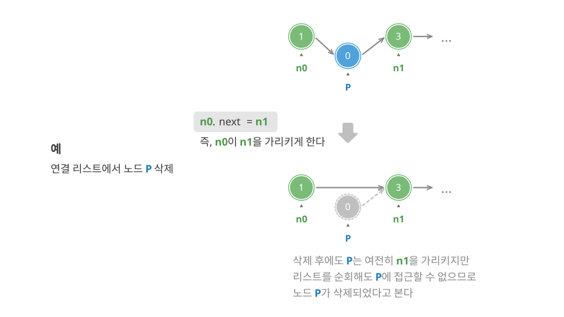

# 연결 리스트

메모리 공간은 모든 프로그램이 함께 사용하는 자원이다. 복잡한 시스템 실행 환경에서는 빈 메모리 공간이 곳곳에 흩어져 있을 수 있다. 배열을 저장할 메모리는 연속적이어야 하므로, 배열이 매우 크면 그만큼 큰 연속 공간을 확보하지 못할 수도 있다. 이때 연결 리스트의 유연성이 장점으로 드러난다.

<u>연결 리스트(linked list)</u>는 각 원소가 노드 객체이며, 노드들이 ‘참조’로 연결된 선형 자료 구조다. 참조는 다음 노드의 메모리 주소를 기록하므로, 이를 통해 현재 노드에서 다음 노드에 접근할 수 있다.

이러한 설계 덕분에 각 노드는 메모리 곳곳에 분산되어 저장될 수 있으며, 메모리 주소가 연속적일 필요가 없다.


위 그림에서 연결 리스트를 구성하는 단위는 <u>노드(node)</u> 객체다. 각 노드는 노드의 ‘값’과 다음 노드를 가리키는 ‘참조’라는 두 데이터를 포함한다.

- 연결 리스트의 첫 노드를 ‘머리 노드’, 마지막 노드를 ‘꼬리 노드’라고 한다.
- 꼬리 노드는 ‘없음’을 가리키며, Java, C++, Python에서는 이를 각각 `null`, `nullptr`, `None`으로 표기한다.
- C, C++, Go, Rust처럼 포인터를 지원하는 언어에서는 위의 ‘참조’를 ‘포인터’로 바꾸어 이해하면 된다.

다음 코드와 같이 연결 리스트 노드 `ListNode`는 값 외에도 참조(포인터)를 하나 더 저장해야 한다. 따라서 같은 양의 데이터를 저장할 때 **연결 리스트는 배열보다 메모리 공간을 더 많이 차지한다**.

```snippet
list_node_class
```

## 연결 리스트의 기본 연산

### 연결 리스트 초기화

연결 리스트를 만드는 과정은 두 단계다. 먼저 각 노드 객체를 초기화한 다음, 노드 사이의 참조 관계를 설정한다. 초기화가 끝나면 머리 노드부터 시작하여 `next` 참조를 따라 모든 노드에 차례로 접근할 수 있다.

```snippet
init_linked_list
```

??? pythontutor "코드 시각화"

    @tutor init_linked_list_tutor

배열은 전체가 하나의 변수다. 예를 들어 배열 `nums`에는 `nums[0]`, `nums[1]` 등의 원소가 들어 있다. 반면 연결 리스트는 독립된 여러 노드 객체로 이루어진다. **보통 머리 노드로 연결 리스트 전체를 지칭한다**. 예를 들어 위 코드의 연결 리스트는 연결 리스트 `n0`라고 부를 수 있다.

### 노드 삽입

연결 리스트에 노드를 삽입하기는 매우 쉽다. 아래 그림과 같이 인접한 노드 `n0`와 `n1` 사이에 새 노드 `P`를 삽입하려면 **노드 참조(포인터) 두 개만 바꾸면 된다**. 시간 복잡도는 $O(1)$이다.

반면 배열의 원소 삽입은 시간 복잡도가 $O(n)$이므로 데이터가 많을 때 효율이 낮다.


```src
[file]{linked_list}-[class]{}-[func]{insert}
```

### 노드 삭제

아래 그림과 같이 연결 리스트의 노드 삭제도 매우 간단하다. **노드 하나의 참조(포인터)만 바꾸면 된다**.

삭제 후에도 노드 `P`는 여전히 `n1`을 가리키지만, 연결 리스트를 순회해서는 더 이상 `P`에 접근할 수 없다. 따라서 `P`는 이미 이 연결 리스트에 속하지 않는다.



```src
[file]{linked_list}-[class]{}-[func]{remove}
```

### 노드 접근

**연결 리스트의 노드 접근 효율은 낮다**. 앞 절에서 설명했듯 배열은 어떤 원소든 $O(1)$ 시간에 접근할 수 있다. 그러나 연결 리스트에서는 머리 노드부터 하나씩 뒤로 순회하여 목표 노드를 찾아야 한다. 즉, $i$번째 노드에 접근하려면 $i - 1$번 반복해야 하므로 시간 복잡도는 $O(n)$이다.

```src
[file]{linked_list}-[class]{}-[func]{access}
```

### 노드 탐색

연결 리스트를 순회하여 값이 `target`인 노드를 찾고, 그 노드의 인덱스를 출력한다. 이 과정도 선형 탐색에 해당한다. 코드는 다음과 같다.

```src
[file]{linked_list}-[class]{}-[func]{find}
```

## 배열 vs. 연결 리스트

아래 표는 배열과 연결 리스트의 특징과 연산 효율을 비교한다. 둘은 서로 반대되는 저장 전략을 사용하므로 성질과 연산 효율도 대조적이다.

<p align="center"> 표 <id> &nbsp; 배열과 연결 리스트의 효율 비교 </p>

|          | 배열                           | 연결 리스트           |
| -------- | ------------------------------ | -------------- |
| 저장 방식 | 연속된 메모리 공간                   | 분산된 메모리 공간   |
| 용량 확장 | 길이를 바꿀 수 없음                     | 유연하게 확장 가능     |
| 메모리 효율 | 원소의 메모리 사용량은 적지만 공간을 낭비할 수 있음 | 원소의 메모리 사용량이 많음 |
| 원소 접근 | $O(1)$                         | $O(n)$         |
| 원소 추가 | $O(n)$                         | $O(1)$         |
| 원소 삭제 | $O(n)$                         | $O(1)$         |

## 대표적인 연결 리스트 종류

아래 그림과 같이 대표적인 연결 리스트에는 세 종류가 있다.

- **단일 연결 리스트**: 앞에서 소개한 일반적인 연결 리스트다. 각 노드는 값과 다음 노드를 가리키는 참조라는 두 데이터를 포함한다. 첫 노드는 머리 노드, 마지막 노드는 꼬리 노드이며, 꼬리 노드는 `None`을 가리킨다.
- **원형 연결 리스트**: 단일 연결 리스트의 꼬리 노드가 머리 노드를 가리키도록 앞뒤를 이으면 원형 연결 리스트가 된다. 원형 연결 리스트에서는 어느 노드든 머리 노드로 볼 수 있다.
- **이중 연결 리스트**: 단일 연결 리스트와 달리 양방향 참조를 기록한다. 각 노드는 후속 노드(다음 노드)와 선행 노드(이전 노드)를 가리키는 참조(포인터)를 모두 포함한다. 양방향으로 순회할 수 있어 단일 연결 리스트보다 유연하지만, 그만큼 메모리 공간도 더 많이 차지한다.

```snippet
doubly_list_node_class
```


## 연결 리스트의 대표적인 활용

단일 연결 리스트는 보통 스택, 큐, 해시 테이블, 그래프 등의 자료 구조를 구현하는 데 사용된다.

- **스택과 큐**: 삽입과 삭제를 모두 연결 리스트의 같은 끝에서 수행하면 후입선출 특성이 나타나 스택에 해당한다. 한쪽 끝에서 삽입하고 반대쪽 끝에서 삭제하면 선입선출 특성이 나타나 큐에 해당한다.
- **해시 테이블**: 체이닝은 해시 충돌을 해결하는 대표적인 방법 중 하나로, 충돌하는 모든 원소를 하나의 연결 리스트에 넣는다.
- **그래프**: 인접 리스트는 그래프를 표현하는 흔한 방법이다. 각 정점에 연결 리스트 하나를 연결하고, 그 리스트의 각 원소로 해당 정점과 연결된 다른 정점을 나타낸다.

이중 연결 리스트는 이전 원소와 다음 원소를 빠르게 찾아야 하는 상황에 자주 사용된다.

- **고급 자료 구조**: 레드-블랙 트리나 B 트리에서는 노드의 부모 노드에 접근해야 한다. 이중 연결 리스트처럼 노드에 부모를 가리키는 참조를 저장하여 구현할 수 있다.
- **브라우저 방문 기록**: 사용자가 웹 브라우저의 앞으로 또는 뒤로 버튼을 누르면 이전이나 다음에 방문했던 페이지를 알아야 한다. 이중 연결 리스트를 사용하면 이러한 연산이 간단해진다.
- **LRU 알고리즘**: 캐시 교체 알고리즘인 LRU에서는 가장 오랫동안 사용하지 않은 데이터를 빠르게 찾고 노드도 빠르게 추가하고 삭제해야 한다. 이때 이중 연결 리스트가 매우 적합하다.

원형 연결 리스트는 운영체제의 자원 스케줄링처럼 주기적인 연산이 필요한 상황에 자주 사용된다.

- **라운드 로빈 스케줄링 알고리즘**: 운영체제의 대표적인 CPU 스케줄링 알고리즘으로, 여러 프로세스를 순환한다. 각 프로세스에 타임 슬라이스를 할당하고, 시간이 다 되면 CPU가 다음 프로세스로 전환한다. 이러한 순환은 원형 연결 리스트로 구현할 수 있다.
- **데이터 버퍼**: 일부 데이터 버퍼도 원형 연결 리스트로 구현할 수 있다. 예를 들어 오디오나 동영상 플레이어에서 데이터 스트림을 여러 버퍼 블록으로 나누어 원형 연결 리스트에 넣으면 끊김 없이 재생할 수 있다.
