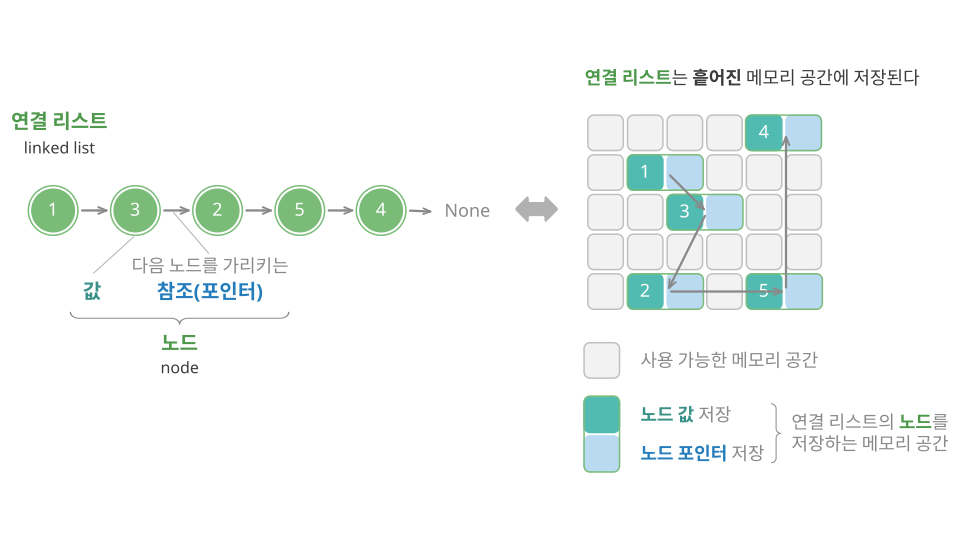
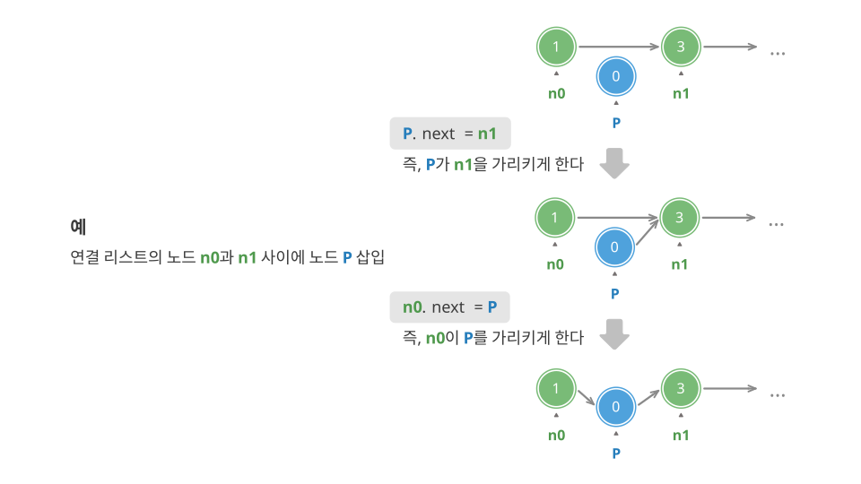
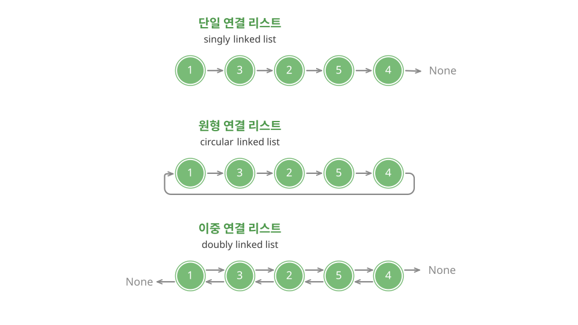

# 연결 리스트

메모리는 모든 프로그램이 함께 사용하는 자원이다. 복잡한 시스템에서는 빈 공간이 메모리 곳곳에 흩어질 수 있다. 배열은 연속된 메모리 공간에 저장해야 하는데, 배열이 매우 크면 그만큼 큰 연속 공간을 확보하지 못할 수도 있다. 이럴 때 연결 리스트의 유연성이 장점으로 드러난다.

<u>연결 리스트(linked list)</u>는 각 원소가 노드 객체이고 노드들이 ‘참조’로 연결된 선형 자료 구조이다. 참조에는 다음 노드의 메모리 주소가 기록되어 있어 현재 노드에서 다음 노드에 접근할 수 있다.

이런 설계 덕분에 연결 리스트의 노드는 메모리 곳곳에 흩어져 있어도 된다. 메모리 주소가 연속될 필요가 없다.



위 그림에서 보듯 연결 리스트를 구성하는 단위는 <u>노드(node)</u> 객체이다. 각 노드는 노드의 ‘값’과 다음 노드를 가리키는 ‘참조’라는 두 데이터를 담는다.

- 연결 리스트의 첫 노드를 ‘머리 노드’, 마지막 노드를 ‘꼬리 노드’라고 한다.
- 꼬리 노드는 아무것도 가리키지 않는다. 이를 Java, C++, Python에서는 각각 `null`, `nullptr`, `None`으로 표기한다.
- C, C++, Go, Rust 등 포인터를 지원하는 언어에서는 앞에서 말한 ‘참조’ 자리에 ‘포인터’를 쓴다.

아래 코드에서 보듯 연결 리스트 노드 `ListNode`는 값 외에도 참조(포인터) 하나를 더 저장해야 한다. 따라서 데이터양이 같을 때 **연결 리스트는 배열보다 메모리 공간을 더 많이 차지한다**.

```snippet
list_node_class
```

## 연결 리스트의 기본 연산

### 연결 리스트 초기화

연결 리스트를 만드는 과정은 두 단계로 나뉜다. 먼저 각 노드 객체를 초기화하고, 이어서 노드 사이의 참조를 연결한다. 초기화가 끝나면 머리 노드에서 출발해 `next` 참조를 따라 모든 노드를 차례로 방문할 수 있다.

```snippet
init_linked_list
```

??? pythontutor "실행 과정 시각화"

    @tutor init_linked_list_tutor

배열은 전체가 하나의 변수이다. 예를 들어 배열 `nums`에는 `nums[0]`, `nums[1]` 등의 원소가 들어 있다. 반면 연결 리스트는 독립된 여러 노드 객체로 구성된다. **보통 머리 노드로 연결 리스트 전체를 지칭한다**. 예를 들어 위 코드의 리스트를 연결 리스트 `n0`이라고 부를 수 있다.

### 노드 삽입

연결 리스트에는 노드를 쉽게 삽입할 수 있다. 아래 그림처럼 서로 이웃한 노드 `n0`과 `n1` 사이에 새 노드 `P`를 삽입하려면 **노드 참조(포인터) 두 개만 바꾸면 된다**. 시간 복잡도는 $O(1)$이다.

이에 비해 배열에 원소를 삽입하는 시간 복잡도는 $O(n)$이므로 데이터양이 많으면 효율이 낮다.



```src
[file]{linked_list}-[class]{}-[func]{insert}
```

### 노드 삭제

아래 그림처럼 연결 리스트에서 노드를 삭제하는 것도 간단하다. **노드 하나의 참조(포인터)만 바꾸면 된다**.

삭제 후에도 노드 `P`는 여전히 `n1`을 가리킨다. 하지만 리스트를 순회해도 더는 `P`에 접근할 수 없으므로 `P`는 이제 이 리스트에 속하지 않는다.


```src
[file]{linked_list}-[class]{}-[func]{remove}
```

### 노드 접근

**연결 리스트에서 특정 노드에 접근하는 효율은 낮다**. 앞 절에서 보았듯 배열에서는 어떤 원소든 $O(1)$ 시간에 접근할 수 있다. 연결 리스트에서는 머리 노드에서 출발해 목표 노드를 찾을 때까지 하나씩 뒤로 이동해야 한다. 즉 $i$번째 노드에 접근하려면 $i - 1$번 반복해야 하며 시간 복잡도는 $O(n)$이다.

```src
[file]{linked_list}-[class]{}-[func]{access}
```

### 노드 찾기

연결 리스트를 순회하며 값이 `target`인 노드를 찾아 그 노드의 인덱스를 출력한다. 이 과정도 선형 탐색이다. 코드는 다음과 같다.

```src
[file]{linked_list}-[class]{}-[func]{find}
```

## 배열과 연결 리스트의 비교

다음 표는 배열과 연결 리스트의 특성과 연산 효율을 비교한다. 정반대의 저장 방식을 사용하기 때문에 성질과 연산 효율에서도 대조적인 특징이 나타난다.

<p align="center"> 표 <id> &nbsp; 배열과 연결 리스트의 효율 비교 </p>

|          | 배열                           | 연결 리스트           |
| -------- | ------------------------------ | -------------- |
| 저장 방식 | 연속된 메모리 공간                   | 흩어진 메모리 공간   |
| 용량 확장 | 길이 고정                     | 유연하게 확장 가능     |
| 메모리 효율 | 원소당 메모리 사용량은 적지만 공간을 낭비할 수 있음 | 원소당 메모리 사용량이 많음 |
| 원소 접근 | $O(1)$                         | $O(n)$         |
| 원소 추가 | $O(n)$                         | $O(1)$         |
| 원소 삭제 | $O(n)$                         | $O(1)$         |

## 대표적인 연결 리스트 유형

아래 그림은 대표적인 연결 리스트 세 종류를 보여 준다.

- **단일 연결 리스트**: 앞에서 소개한 일반적인 연결 리스트이다. 각 노드에는 값과 다음 노드를 가리키는 참조가 들어 있다. 첫 노드는 머리 노드, 마지막 노드는 꼬리 노드라고 부르며, 꼬리 노드는 빈 참조 `None`을 가리킨다.
- **원형 연결 리스트**: 단일 연결 리스트에서 꼬리 노드가 머리 노드를 가리키게 해 양 끝을 이으면 원형 연결 리스트가 된다. 어느 노드든 머리 노드로 삼을 수 있다.
- **이중 연결 리스트**: 단일 연결 리스트와 달리 두 방향의 참조를 기록한다. 노드 정의에는 후속 노드(다음 노드)와 선행 노드(이전 노드)를 가리키는 참조(포인터)가 모두 들어 있다. 단일 연결 리스트보다 유연해 양방향으로 순회할 수 있지만 그만큼 메모리 공간을 더 차지한다.

```snippet
doubly_list_node_class
```



## 연결 리스트의 대표적인 활용 사례

단일 연결 리스트는 스택, 큐, 해시 테이블, 그래프 등의 자료 구조를 구현하는 데 자주 쓰인다.

- **스택과 큐**: 연결 리스트의 한쪽 끝에서 삽입과 삭제를 모두 하면 먼저 들어온 원소가 나중에 나가는 스택이 된다. 한쪽 끝에서 삽입하고 반대쪽 끝에서 삭제하면 먼저 들어온 원소가 먼저 나가는 큐가 된다.
- **해시 테이블**: 체이닝은 해시 충돌을 해결하는 대표적인 방법 중 하나이다. 이 방식에서는 충돌한 원소를 모두 하나의 연결 리스트에 넣는다.
- **그래프**: 인접 리스트는 그래프를 나타내는 대표적인 방법이다. 각 정점에 연결 리스트 하나를 대응시키고, 리스트의 각 원소로 그 정점과 연결된 다른 정점을 나타낸다.

이중 연결 리스트는 이전 원소와 다음 원소를 빠르게 찾아야 할 때 자주 쓴다.

- **고급 자료 구조**: 예를 들어 레드 블랙 트리나 B 트리에서는 노드의 부모에 접근해야 한다. 이중 연결 리스트와 비슷하게 각 노드에 부모를 가리키는 참조를 저장하면 된다.
- **브라우저 방문 기록**: 웹 브라우저에서 사용자가 앞으로 가기 또는 뒤로 가기 버튼을 누르면 브라우저는 방문 기록의 다음 페이지나 이전 페이지를 알아야 한다. 이중 연결 리스트의 특성을 이용하면 간단하게 처리할 수 있다.
- **LRU 알고리즘**: 캐시에서 가장 오랫동안 사용하지 않은 데이터를 내보내는 LRU 알고리즘은 해당 데이터를 빨리 찾아야 하고 노드도 빠르게 추가하거나 삭제할 수 있어야 한다. 이중 연결 리스트가 이에 잘 맞는다.

원형 연결 리스트는 운영체제의 자원 스케줄링처럼 주기적으로 반복하는 작업에 자주 쓰인다.

- **라운드 로빈 스케줄링 알고리즘**: 운영체제에서 흔히 쓰이는 CPU 스케줄링 알고리즘으로, 여러 프로세스를 순환한다. 각 프로세스에 일정한 실행 시간인 타임 슬라이스를 할당하고, 이 시간이 다 되면 CPU는 다음 프로세스로 전환한다. 이러한 순환을 원형 연결 리스트로 구현할 수 있다.
- **데이터 버퍼**: 일부 데이터 버퍼도 원형 연결 리스트로 구현할 수 있다. 예를 들어 오디오나 비디오 플레이어에서는 끊김 없이 재생하기 위해 데이터 스트림을 여러 버퍼 블록으로 나눠 원형 연결 리스트에 넣기도 한다.
