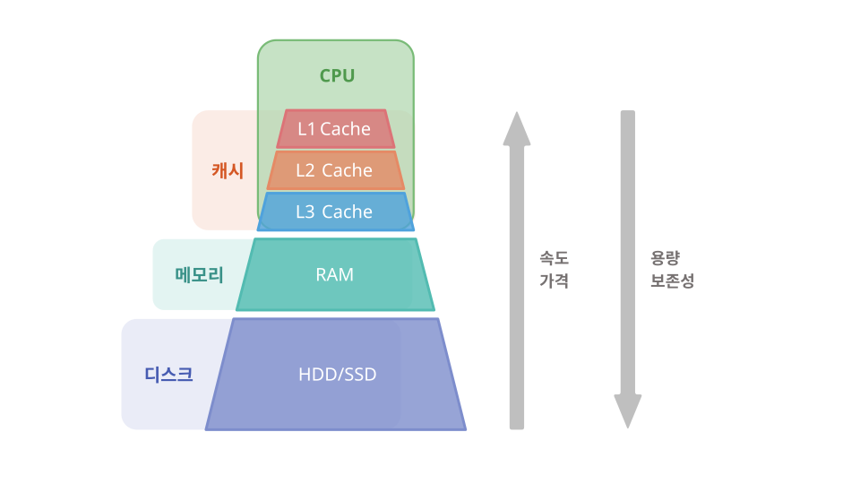
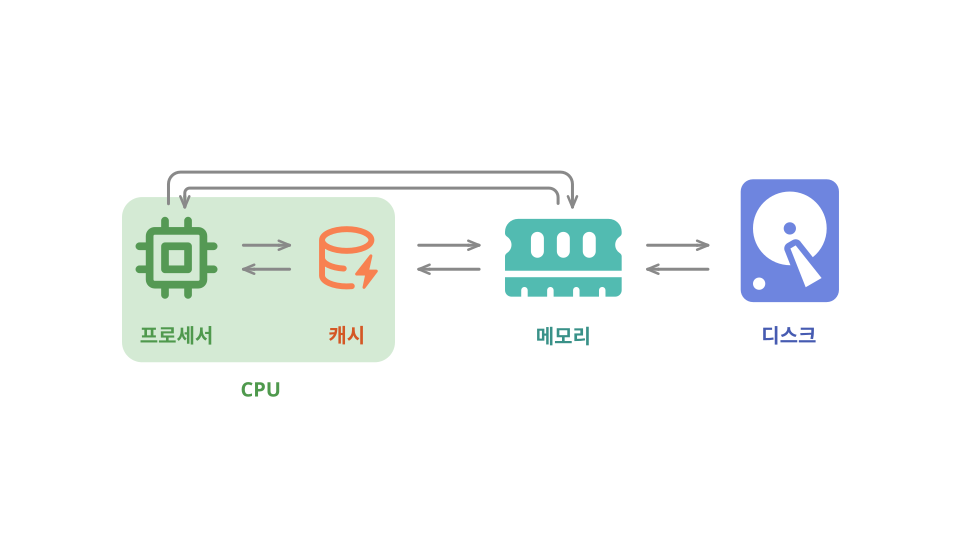

# 4.4 &nbsp; 메모리와 캐시 *

이 장의 앞 두 절에서는 기초적이면서 중요한 두 자료 구조인 배열과 연결 리스트를 살펴보았다. 각각 ‘연속 저장’과 ‘분산 저장’이라는 물리 구조를 대표한다.

실제로 **물리 구조는 프로그램이 메모리와 캐시를 얼마나 효율적으로 쓰는지를 크게 좌우하며**, 이는 알고리즘을 구현한 프로그램의 전체 성능에 영향을 준다.

## 4.4.1 &nbsp; 컴퓨터의 저장 장치

컴퓨터의 저장 장치에는 <u>디스크(hard disk)</u>, <u>메모리(random-access memory, RAM)</u>, <u>캐시(cache memory)</u>의 세 종류가 있다. 다음 표(4-2)는 컴퓨터 시스템에서 각각이 맡는 역할과 성능 특성을 보여 준다.

 표 4-2 &nbsp; 컴퓨터의 저장 장치 

|                | 디스크                                     | 메모리                                   | 캐시                                              |
| -------------- | ---------------------------------------- | -------------------------------------- | ------------------------------------------------- |
| 용도           | 운영체제, 프로그램, 파일 등의 데이터를 장기간 보관 | 실행 중인 프로그램과 처리 중인 데이터를 임시 저장 | 자주 접근하는 데이터와 명령어를 저장해 CPU의 메모리 접근 횟수를 줄임 |
| 휘발성         | 전원이 꺼져도 데이터가 남음                       | 전원이 꺼지면 데이터가 사라짐                       | 전원이 꺼지면 데이터가 사라짐                                  |
| 용량           | 큼, TB 단위                            | 작음, GB 단위                          | 매우 작음, MB 단위                                   |
| 속도           | 느림, 수백~수천 MB/s                    | 빠름, 수십 GB/s                        | 매우 빠름, 수십~수백 GB/s                           |
| 가격(위안화) | 저렴함, GB당 수 자오~수 위안                  | 비쌈, GB당 수십~수백 위안                | 매우 비쌈, CPU 가격에 포함                           |

컴퓨터의 저장 시스템을 아래 그림(4-9)과 같은 피라미드로 생각해 보자. 꼭대기에 가까울수록 저장 장치의 속도는 빠르고 용량은 작으며 비용은 높다. 여러 층으로 설계한 것은 우연이 아니라 컴퓨터 과학자와 엔지니어가 깊이 고민한 결과이다.

- **메모리로 디스크를 대체하기는 어렵다**. 우선 메모리는 전원이 꺼지면 데이터가 사라져 장기 보관에 적합하지 않다. 또한 메모리는 디스크보다 비용이 수십 배나 높아 소비자 시장에서 디스크를 대체할 만큼 보급되기 어렵다.
- **대용량과 고속을 캐시 하나로 모두 달성하기는 어렵다**. L1, L2, L3로 갈수록 캐시 용량이 커지면서 물리적인 크기도 커지고 CPU 코어와의 거리도 멀어진다. 그만큼 데이터 전송 시간이 길어지고 원소 접근 지연도 커진다. 현재 기술에서는 여러 계층의 캐시 구조가 용량과 속도, 비용 사이의 균형을 가장 잘 맞춘다.

{ class="animation-figure" }

 그림 4-9 &nbsp; 컴퓨터의 저장 시스템 

!!! tip

    컴퓨터의 저장 계층은 속도와 용량, 비용 사이의 정교한 균형을 보여 준다. 이런 절충은 모든 산업 분야에 널리 나타난다. 서로 다른 이점과 제약 사이에서 최선의 균형을 찾아야 한다.

정리하면 **디스크는 대량의 데이터를 오래 보관하고, 메모리는 프로그램 실행 중에 처리하는 데이터를 잠시 저장하며, 캐시는 자주 접근하는 데이터와 명령어를 저장한다**. 덕분에 프로그램을 효율적으로 실행할 수 있다. 세 장치가 협력해 컴퓨터 시스템을 효율적으로 작동시킨다.

아래 그림(4-10)처럼 프로그램이 실행되면 CPU가 계산에 사용할 데이터를 디스크에서 메모리로 읽어 들인다. 캐시는 CPU의 일부로 볼 수 있다. **필요할 데이터를 예측해 메모리에서 불러옴으로써** CPU가 데이터를 빠르게 읽게 한다. 그 결과 프로그램 실행 효율이 크게 높아지고 느린 메모리에 덜 의존하게 된다.

{ class="animation-figure" }

 그림 4-10 &nbsp; 디스크, 메모리, 캐시 사이의 데이터 흐름 

## 4.4.2 &nbsp; 자료 구조의 메모리 효율

메모리 공간 활용 면에서 배열과 연결 리스트는 각각 장점과 한계가 있다.

한편으로 **메모리 용량은 한정되어 있고 같은 메모리 블록을 여러 프로그램이 함께 사용할 수 없으므로**, 자료 구조는 공간을 최대한 효율적으로 써야 한다. 배열은 원소를 빈틈없이 배치하며 연결 리스트의 노드 사이를 잇는 참조(포인터)를 따로 저장하지 않아 공간 효율이 높다. 하지만 충분한 크기의 연속 공간을 한꺼번에 할당해야 해 메모리를 낭비할 수 있고, 확장할 때도 시간과 공간이 추가로 든다. 반면 연결 리스트는 노드 단위로 메모리를 동적으로 할당하고 회수할 수 있어 더 유연하다.

다른 한편으로 프로그램이 실행되는 동안 **메모리 할당과 해제를 반복하면 빈 공간의 단편화가 점점 심해져** 메모리 이용 효율이 떨어진다. 연속 저장하는 배열은 비교적 단편화를 일으키기 어렵다. 반면 연결 리스트는 원소가 흩어져 있어 삽입과 삭제를 자주 하면 메모리 단편화가 생기기 쉽다.

## 4.4.3 &nbsp; 자료 구조의 캐시 효율

캐시는 메모리보다 용량이 훨씬 작지만 속도가 훨씬 빨라 프로그램 실행 속도에 결정적인 역할을 한다. 캐시에는 자주 접근하는 데이터의 일부만 담을 수 있다. CPU가 접근하려는 데이터가 캐시에 없으면 <u>캐시 미스(cache miss)</u>가 발생한다. 이때 CPU는 더 느린 메모리에서 필요한 데이터를 불러와야 한다.

따라서 **캐시 미스가 적을수록 CPU가 데이터를 읽고 쓰는 효율이 높아지고** 프로그램 성능도 좋아진다. CPU가 캐시에서 데이터를 가져오는 데 성공한 비율을 <u>캐시 적중률(cache hit rate)</u>이라고 한다. 캐시 효율을 측정하는 데 흔히 사용하는 지표이다.

캐시는 효율을 최대한 높이기 위해 다음과 같은 방식으로 데이터를 불러온다.

- **캐시 라인**: 캐시는 데이터를 한 바이트씩 저장하고 불러오는 대신 캐시 라인 단위로 처리한다. 한 바이트씩 전송하는 것보다 캐시 라인 단위로 전송하는 편이 더 효율적이다.
- **프리페치**: 프로세서는 순차 접근이나 일정한 간격을 두고 건너뛰는 접근 같은 패턴을 예측한다. 그 패턴에 따라 데이터를 미리 캐시에 불러와 적중률을 높인다.
- **공간 지역성**: 어떤 데이터에 접근하면 가까운 시점에 그 주변 데이터에도 접근할 가능성이 있다. 따라서 캐시는 데이터를 불러올 때 주변 데이터도 함께 불러와 적중률을 높인다.
- **시간 지역성**: 한 번 접근한 데이터는 머지않아 다시 접근할 가능성이 높다. 캐시는 이 원리를 활용해 최근에 접근한 데이터를 보관함으로써 적중률을 높인다.

실제로 **배열과 연결 리스트는 캐시를 활용하는 효율이 다르다**. 차이는 주로 다음과 같은 점에서 나타난다.

- **차지하는 공간**: 연결 리스트의 원소는 배열 원소보다 많은 공간을 차지하므로 캐시에 담을 수 있는 유효 데이터양이 적다.
- **캐시 라인**: 연결 리스트의 데이터는 메모리 곳곳에 흩어져 있는데 캐시는 라인 단위로 불러온다. 따라서 필요 없는 데이터까지 불러오는 비율이 높다.
- **프리페치**: 배열의 데이터 접근 패턴은 연결 리스트보다 예측하기 쉽다. 즉 시스템이 다음에 불러올 데이터를 더 쉽게 알아맞힐 수 있다.
- **공간 지역성**: 배열은 한곳에 모인 메모리 공간에 저장되므로 불러온 데이터 주변의 데이터에도 곧 접근할 가능성이 높다.

대체로 **배열은 캐시 적중률이 더 높아 보통 연결 리스트보다 연산 효율이 높다**. 그래서 알고리즘 문제를 풀 때는 배열로 구현한 자료 구조를 선호하는 경우가 많다.

다만 **캐시 효율이 높다고 해서 배열이 모든 상황에서 연결 리스트보다 나은 것은 아니다**. 실제로 어떤 자료 구조를 사용할지는 구체적인 요구에 따라 결정해야 한다. 예를 들어 배열과 연결 리스트 모두 다음 장에서 자세히 알아볼 ‘스택’을 구현할 수 있지만 적합한 상황은 다르다.

- 알고리즘 문제에서는 배열로 구현한 스택을 선호하는 편이다. 연산 효율이 더 높고 임의 접근도 가능하다. 그 대가로 배열에 일정한 메모리 공간을 미리 할당하기만 하면 된다.
- 데이터양이 매우 많고 변동이 심해 예상 스택 크기를 가늠하기 어렵다면 연결 리스트로 구현한 스택이 더 적합하다. 많은 데이터를 메모리 여러 곳에 나눠 저장할 수 있고 배열 확장에 드는 추가 비용도 피할 수 있다.
