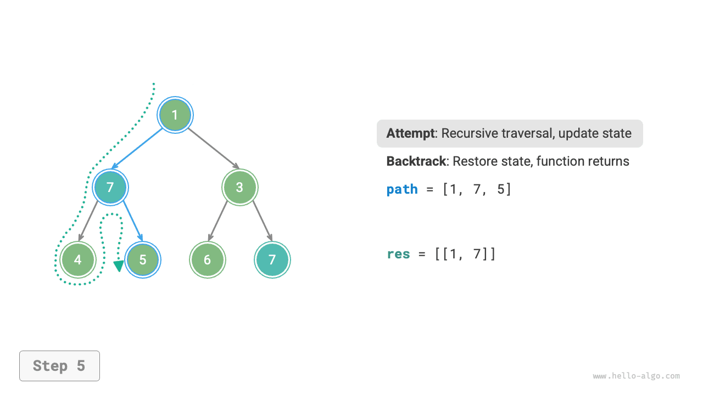
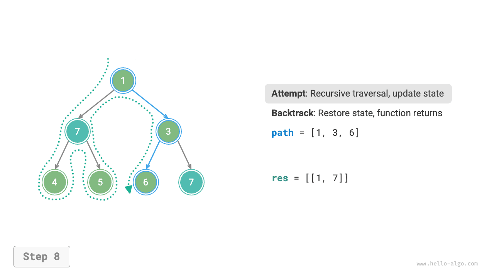
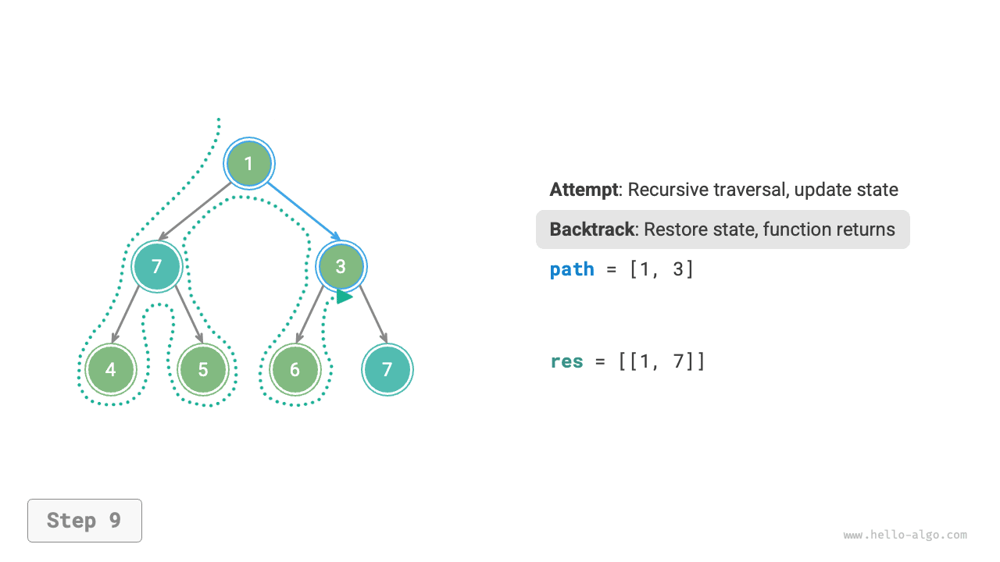
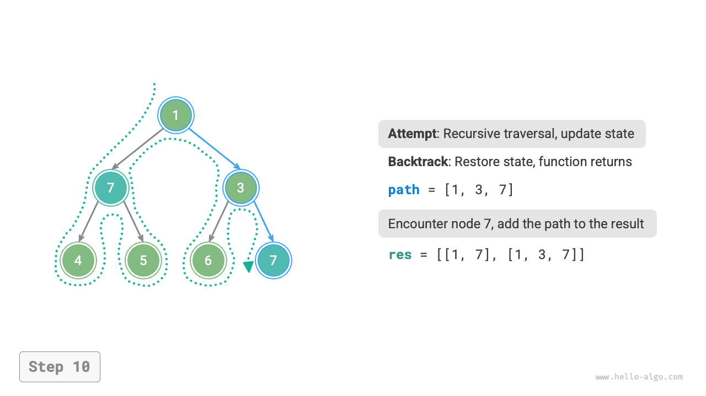

# 백트래킹 알고리즘

<u>백트래킹 알고리즘(backtracking algorithm)</u>은 모든 경우를 열거하여 문제를 푸는 방법이다. 초기 상태에서 출발하여 가능한 모든 해결 방법을 완전 탐색하고, 올바른 해를 만나면 기록한다. 해를 찾거나 가능한 선택을 모두 시도해도 찾을 수 없을 때까지 진행하는 것이 핵심이다.

백트래킹은 보통 '깊이 우선 탐색'으로 해 공간을 순회한다. '이진 트리' 장에서 전위, 중위, 후위 순회가 모두 깊이 우선 탐색이라고 설명했다. 이제 전위 순회를 이용한 백트래킹 문제를 만들어 작동 원리를 차근차근 알아보자.

!!! question "예제 1"

    이진 트리가 주어졌을 때 값이 $7$인 모든 노드를 찾아 기록하고, 노드 리스트를 반환하라.

이 문제에서는 트리를 전위 순회하며 현재 노드의 값이 $7$인지 확인하고, 맞으면 해당 노드의 값을 결과 리스트 `res`에 추가한다. 과정은 아래 그림과 코드에 나타나 있다.

```src
[file]{preorder_traversal_i_compact}-[class]{}-[func]{pre_order}
```


## 시도와 되돌리기

**백트래킹이라고 부르는 이유는 해 공간을 탐색할 때 '시도'와 '되돌리기' 전략을 사용하기 때문이다**. 탐색 중 더 진행할 수 없거나 조건을 만족하는 해를 얻을 수 없는 상태를 만나면, 직전 선택을 취소하고 이전 상태로 돌아가 다른 선택을 시도한다.

예제 1에서는 각 노드의 방문이 한 번의 '시도'이며, 리프 노드를 지나거나 부모 노드로 돌아가는 `return`이 '되돌리기'에 해당한다.

**되돌리기에는 함수 반환만 포함되는 것이 아니다**. 이를 설명하기 위해 예제 1을 조금 확장해 보자.

!!! question "예제 2"

    이진 트리에서 값이 $7$인 모든 노드를 찾아 **루트 노드에서 각 노드까지의 경로를 반환하라**.

예제 1의 코드에 리스트 `path`를 추가하여 방문한 노드의 경로를 기록해야 한다. 값이 $7$인 노드를 방문하면 `path`를 복사하여 결과 리스트 `res`에 추가한다. 순회를 마치면 `res`에 모든 해가 저장된다. 코드는 다음과 같다.

```src
[file]{preorder_traversal_ii_compact}-[class]{}-[func]{pre_order}
```

매번 '시도'할 때는 현재 노드를 `path`에 추가하여 경로를 기록한다. '되돌리기' 전에는 이 노드를 `path`에서 꺼내어 **이번 시도 이전의 상태를 복원해야 한다**.

아래 그림의 과정을 보면 **시도와 되돌리기를 각각 '전진'과 '취소'로 이해할 수 있으며**, 두 연산은 서로 반대 방향이다.

=== "<1>"
    

=== "<2>"
    

=== "<3>"
    

=== "<4>"
    

=== "<5>"
    

=== "<6>"
    

=== "<7>"
    

=== "<8>"
    

=== "<9>"
    

=== "<10>"
    

=== "<11>"
    

## 가지치기

복잡한 백트래킹 문제에는 보통 하나 이상의 제약 조건이 있으며, **이 제약 조건을 '가지치기'에 활용할 수 있다**.

!!! question "예제 3"

    이진 트리에서 값이 $7$인 모든 노드를 찾아 루트 노드에서 각 노드까지의 경로를 반환하라. **단, 경로에 값이 $3$인 노드가 포함되면 안 된다**.

이 제약을 만족하려면 **가지치기 연산을 추가해야 한다**. 탐색 중 값이 $3$인 노드를 만나면 더 탐색하지 않고 조기에 반환한다. 코드는 다음과 같다.

```src
[file]{preorder_traversal_iii_compact}-[class]{}-[func]{pre_order}
```

'가지치기'는 매우 직관적인 이름이다. 아래 그림과 같이 탐색 중 **제약 조건을 만족하지 않는 탐색 가지를 '잘라 내어'** 의미 없는 시도를 많이 피하고 탐색 효율을 높인다.


## 기본 틀 코드

이제 백트래킹의 '시도, 되돌리기, 가지치기'라는 기본 틀을 추출하여 코드의 범용성을 높여 보자.

아래 기본 틀 코드에서 `state`는 문제의 현재 상태를, `choices`는 그 상태에서 가능한 선택들을 나타낸다.

=== "Python"

    ```python title=""
    def backtrack(state: State, choices: list[choice], res: list[state]):
        """백트래킹 알고리즘의 기본 틀"""
        # 해인지 확인
        if is_solution(state):
            # 해 기록
            record_solution(state, res)
            # 더 이상 탐색하지 않는다
            return
        # 모든 선택지 순회
        for choice in choices:
            # 가지치기: 선택이 유효한지 확인
            if is_valid(state, choice):
                # 시도: 선택하고 상태 갱신
                make_choice(state, choice)
                backtrack(state, choices, res)
                # 되돌리기: 선택을 취소하고 이전 상태 복원
                undo_choice(state, choice)
    ```

=== "C++"

    ```cpp title=""
    /* 백트래킹 알고리즘의 기본 틀 */
    void backtrack(State *state, vector<Choice *> &choices, vector<State *> &res) {
        // 해인지 확인
        if (isSolution(state)) {
            // 해 기록
            recordSolution(state, res);
            // 더 이상 탐색하지 않는다
            return;
        }
        // 모든 선택지 순회
        for (Choice choice : choices) {
            // 가지치기: 선택이 유효한지 확인
            if (isValid(state, choice)) {
                // 시도: 선택하고 상태 갱신
                makeChoice(state, choice);
                backtrack(state, choices, res);
                // 되돌리기: 선택을 취소하고 이전 상태 복원
                undoChoice(state, choice);
            }
        }
    }
    ```

=== "Java"

    ```java title=""
    /* 백트래킹 알고리즘의 기본 틀 */
    void backtrack(State state, List<Choice> choices, List<State> res) {
        // 해인지 확인
        if (isSolution(state)) {
            // 해 기록
            recordSolution(state, res);
            // 더 이상 탐색하지 않는다
            return;
        }
        // 모든 선택지 순회
        for (Choice choice : choices) {
            // 가지치기: 선택이 유효한지 확인
            if (isValid(state, choice)) {
                // 시도: 선택하고 상태 갱신
                makeChoice(state, choice);
                backtrack(state, choices, res);
                // 되돌리기: 선택을 취소하고 이전 상태 복원
                undoChoice(state, choice);
            }
        }
    }
    ```

=== "C#"

    ```csharp title=""
    /* 백트래킹 알고리즘의 기본 틀 */
    void Backtrack(State state, List<Choice> choices, List<State> res) {
        // 해인지 확인
        if (IsSolution(state)) {
            // 해 기록
            RecordSolution(state, res);
            // 더 이상 탐색하지 않는다
            return;
        }
        // 모든 선택지 순회
        foreach (Choice choice in choices) {
            // 가지치기: 선택이 유효한지 확인
            if (IsValid(state, choice)) {
                // 시도: 선택하고 상태 갱신
                MakeChoice(state, choice);
                Backtrack(state, choices, res);
                // 되돌리기: 선택을 취소하고 이전 상태 복원
                UndoChoice(state, choice);
            }
        }
    }
    ```

=== "Go"

    ```go title=""
    /* 백트래킹 알고리즘의 기본 틀 */
    func backtrack(state *State, choices []Choice, res *[]State) {
        // 해인지 확인
        if isSolution(state) {
            // 해 기록
            recordSolution(state, res)
            // 더 이상 탐색하지 않는다
            return
        }
        // 모든 선택지 순회
        for _, choice := range choices {
            // 가지치기: 선택이 유효한지 확인
            if isValid(state, choice) {
                // 시도: 선택하고 상태 갱신
                makeChoice(state, choice)
                backtrack(state, choices, res)
                // 되돌리기: 선택을 취소하고 이전 상태 복원
                undoChoice(state, choice)
            }
        }
    }
    ```

=== "Swift"

    ```swift title=""
    /* 백트래킹 알고리즘의 기본 틀 */
    func backtrack(state: inout State, choices: [Choice], res: inout [State]) {
        // 해인지 확인
        if isSolution(state: state) {
            // 해 기록
            recordSolution(state: state, res: &res)
            // 더 이상 탐색하지 않는다
            return
        }
        // 모든 선택지 순회
        for choice in choices {
            // 가지치기: 선택이 유효한지 확인
            if isValid(state: state, choice: choice) {
                // 시도: 선택하고 상태 갱신
                makeChoice(state: &state, choice: choice)
                backtrack(state: &state, choices: choices, res: &res)
                // 되돌리기: 선택을 취소하고 이전 상태 복원
                undoChoice(state: &state, choice: choice)
            }
        }
    }
    ```

=== "JS"

    ```javascript title=""
    /* 백트래킹 알고리즘의 기본 틀 */
    function backtrack(state, choices, res) {
        // 해인지 확인
        if (isSolution(state)) {
            // 해 기록
            recordSolution(state, res);
            // 더 이상 탐색하지 않는다
            return;
        }
        // 모든 선택지 순회
        for (let choice of choices) {
            // 가지치기: 선택이 유효한지 확인
            if (isValid(state, choice)) {
                // 시도: 선택하고 상태 갱신
                makeChoice(state, choice);
                backtrack(state, choices, res);
                // 되돌리기: 선택을 취소하고 이전 상태 복원
                undoChoice(state, choice);
            }
        }
    }
    ```

=== "TS"

    ```typescript title=""
    /* 백트래킹 알고리즘의 기본 틀 */
    function backtrack(state: State, choices: Choice[], res: State[]): void {
        // 해인지 확인
        if (isSolution(state)) {
            // 해 기록
            recordSolution(state, res);
            // 더 이상 탐색하지 않는다
            return;
        }
        // 모든 선택지 순회
        for (let choice of choices) {
            // 가지치기: 선택이 유효한지 확인
            if (isValid(state, choice)) {
                // 시도: 선택하고 상태 갱신
                makeChoice(state, choice);
                backtrack(state, choices, res);
                // 되돌리기: 선택을 취소하고 이전 상태 복원
                undoChoice(state, choice);
            }
        }
    }
    ```

=== "Dart"

    ```dart title=""
    /* 백트래킹 알고리즘의 기본 틀 */
    void backtrack(State state, List<Choice>, List<State> res) {
      // 해인지 확인
      if (isSolution(state)) {
        // 해 기록
        recordSolution(state, res);
        // 더 이상 탐색하지 않는다
        return;
      }
      // 모든 선택지 순회
      for (Choice choice in choices) {
        // 가지치기: 선택이 유효한지 확인
        if (isValid(state, choice)) {
          // 시도: 선택하고 상태 갱신
          makeChoice(state, choice);
          backtrack(state, choices, res);
          // 되돌리기: 선택을 취소하고 이전 상태 복원
          undoChoice(state, choice);
        }
      }
    }
    ```

=== "Rust"

    ```rust title=""
    /* 백트래킹 알고리즘의 기본 틀 */
    fn backtrack(state: &mut State, choices: &Vec<Choice>, res: &mut Vec<State>) {
        // 해인지 확인
        if is_solution(state) {
            // 해 기록
            record_solution(state, res);
            // 더 이상 탐색하지 않는다
            return;
        }
        // 모든 선택지 순회
        for choice in choices {
            // 가지치기: 선택이 유효한지 확인
            if is_valid(state, choice) {
                // 시도: 선택하고 상태 갱신
                make_choice(state, choice);
                backtrack(state, choices, res);
                // 되돌리기: 선택을 취소하고 이전 상태 복원
                undo_choice(state, choice);
            }
        }
    }
    ```

=== "C"

    ```c title=""
    /* 백트래킹 알고리즘의 기본 틀 */
    void backtrack(State *state, Choice *choices, int numChoices, State *res, int numRes) {
        // 해인지 확인
        if (isSolution(state)) {
            // 해 기록
            recordSolution(state, res, numRes);
            // 더 이상 탐색하지 않는다
            return;
        }
        // 모든 선택지 순회
        for (int i = 0; i < numChoices; i++) {
            // 가지치기: 선택이 유효한지 확인
            if (isValid(state, &choices[i])) {
                // 시도: 선택하고 상태 갱신
                makeChoice(state, &choices[i]);
                backtrack(state, choices, numChoices, res, numRes);
                // 되돌리기: 선택을 취소하고 이전 상태 복원
                undoChoice(state, &choices[i]);
            }
        }
    }
    ```

=== "Kotlin"

    ```kotlin title=""
    /* 백트래킹 알고리즘의 기본 틀 */
    fun backtrack(state: State?, choices: List<Choice?>, res: List<State?>?) {
        // 해인지 확인
        if (isSolution(state)) {
            // 해 기록
            recordSolution(state, res)
            // 더 이상 탐색하지 않는다
            return
        }
        // 모든 선택지 순회
        for (choice in choices) {
            // 가지치기: 선택이 유효한지 확인
            if (isValid(state, choice)) {
                // 시도: 선택하고 상태 갱신
                makeChoice(state, choice)
                backtrack(state, choices, res)
                // 되돌리기: 선택을 취소하고 이전 상태 복원
                undoChoice(state, choice)
            }
        }
    }
    ```

=== "Ruby"

    ```ruby title=""
    ### 백트래킹 알고리즘의 기본 틀 ###
    def backtrack(state, choices, res)
        # 해인지 확인
        if is_solution?(state)
            # 해 기록
            record_solution(state, res)
            return
        end

        # 모든 선택지 순회
        for choice in choices
            # 가지치기: 선택이 유효한지 확인
            if is_valid?(state, choice)
                # 시도: 선택하고 상태 갱신
                make_choice(state, choice)
                backtrack(state, choices, res)
                # 되돌리기: 선택을 취소하고 이전 상태 복원
                undo_choice(state, choice)
            end
        end
    end
    ```

이제 기본 틀 코드로 예제 3을 해결해 보자. 상태 `state`는 노드 순회 경로, 선택지 `choices`는 현재 노드의 왼쪽과 오른쪽 자식 노드, 결과 `res`는 경로들의 리스트다.

```src
[file]{preorder_traversal_iii_template}-[class]{}-[func]{backtrack}
```

문제의 요구에 따르면 값이 $7$인 노드를 찾은 뒤에도 탐색을 계속해야 한다. **따라서 해를 기록한 뒤의 `return` 문을 삭제해야 한다**. 아래 그림은 `return` 문을 유지하거나 삭제했을 때의 탐색 과정을 비교한다.


전위 순회 기반 코드에 비해 백트래킹 기본 틀을 사용한 코드는 다소 장황하지만 범용성이 더 좋다. 실제로 **많은 백트래킹 문제를 이 틀 안에서 해결할 수 있다**. 구체적인 문제에 맞게 `state`와 `choices`를 정의하고, 틀 안의 각 메서드만 구현하면 된다.

## 주요 용어

알고리즘 문제를 더 명확히 분석하기 위해 백트래킹에서 자주 쓰는 용어를 정리하고, 예제 3에 대응하는 사례를 아래 표에 나타냈다.

<p align="center"> 표 <id> &nbsp; 백트래킹 알고리즘의 주요 용어 </p>

| 용어 | 정의 | 예제 3 |
| ---------------------- | -------------------------------------------------------------------------- | -------------------------------------------------------------------- |
| 해(solution) | 문제의 특정 조건을 만족하는 답으로, 하나 또는 여러 개일 수 있다 | 루트 노드에서 노드 $7$까지 제약 조건을 만족하는 모든 경로 |
| 제약 조건(constraint) | 해의 유효성을 제한하는 조건으로, 보통 가지치기에 사용한다 | 경로에 노드 $3$이 포함되지 않는다 |
| 상태(state) | 이미 내린 선택을 포함하여 특정 시점의 문제 상황을 나타낸다 | 현재까지 방문한 노드의 경로, 즉 노드 리스트 `path` |
| 시도(attempt) | 가능한 선택으로 해 공간을 탐색하는 과정으로, 선택, 상태 갱신, 해인지 확인하는 작업을 포함한다 | 왼쪽(오른쪽) 자식 노드를 재귀적으로 방문하고 `path`에 추가한 뒤 값이 $7$인지 확인한다 |
| 되돌리기(backtracking) | 제약 조건을 만족하지 않는 상태를 만나면 이전 선택을 취소하고 직전 상태로 돌아간다 | 리프 노드를 지나거나 노드 방문을 마치거나 값이 $3$인 노드를 만나면 탐색을 멈추고 함수가 반환된다 |
| 가지치기(pruning) | 문제의 특성과 제약 조건에 따라 의미 없는 탐색 경로를 피하여 효율을 높이는 방법이다 | 값이 $3$인 노드를 만나면 탐색을 더 진행하지 않는다 |

!!! tip "참고"

    문제, 해, 상태 등의 개념은 분할 정복, 백트래킹, 동적 계획법, 탐욕 알고리즘 등에서 공통으로 사용된다.

## 장점과 한계

백트래킹은 본질적으로 깊이 우선 탐색 알고리즘으로, 조건을 만족하는 해를 찾을 때까지 가능한 모든 해결 방법을 시도한다. 모든 가능한 해를 찾을 수 있으며, 적절히 가지치기하면 매우 효율적이라는 장점이 있다.

하지만 규모가 크거나 복잡한 문제에서는 **백트래킹의 실행 효율을 받아들이기 어려울 수 있다**.

- **시간**: 상태 공간의 모든 가능성을 순회해야 하는 경우가 많아 시간 복잡도가 지수 또는 팩토리얼 수준에 이를 수 있다.
- **공간**: 재귀 호출 중 현재 상태(경로, 가지치기용 보조 변수 등)를 저장해야 하므로 깊이가 크면 공간 요구량도 매우 커질 수 있다.

그렇더라도 **일부 탐색 문제와 제약 만족 문제에서는 백트래킹이 여전히 최선의 해결 방법이다**. 어떤 선택이 유효한 해를 만들지 예측할 수 없으므로 가능한 모든 선택을 순회해야 하기 때문이다. 이때는 **효율을 어떻게 최적화하느냐가 핵심**이며, 대표적인 방법은 두 가지다.

- **가지치기**: 해가 나올 수 없는 경로를 탐색하지 않아 시간과 공간을 절약한다.
- **휴리스틱 탐색**: 탐색에 전략이나 추정값을 도입하여 유효한 해가 나올 가능성이 높은 경로를 먼저 탐색한다.

## 대표적인 백트래킹 문제

백트래킹은 많은 탐색 문제, 제약 만족 문제, 조합 최적화 문제를 해결하는 데 사용할 수 있다.

**탐색 문제**: 특정 조건을 만족하는 해결 방법을 찾는 것이 목표다.

- 모든 순열 문제: 집합이 주어졌을 때 가능한 모든 배열 순서를 구한다.
- 부분 집합 합 문제: 집합과 목표 합이 주어졌을 때 원소의 합이 목표 합인 모든 부분 집합을 찾는다.
- 하노이의 탑 문제: 기둥 세 개와 크기가 다른 원판들이 주어졌을 때 모든 원판을 한 기둥에서 다른 기둥으로 옮긴다. 한 번에 하나만 옮길 수 있고 큰 원판을 작은 원판 위에 놓으면 안 된다.

**제약 만족 문제**: 모든 제약 조건을 만족하는 해를 찾는 것이 목표다.

- $n$-퀸: $n \times n$ 체스판에 퀸 $n$ 개를 서로 공격하지 않도록 놓는다.
- 스도쿠: $9 \times 9$ 격자에 $1$ ~ $9$를 넣되, 각 행과 열 및 각 $3 \times 3$ 부분 격자에서 숫자가 중복되지 않게 한다.
- 그래프 색칠 문제: 무방향 그래프의 각 정점을 가능한 한 적은 색으로 칠하되, 인접한 정점은 서로 다른 색을 갖게 한다.

**조합 최적화 문제**: 조합 공간에서 특정 조건을 만족하는 최적해를 찾는 것이 목표다.

- 0-1 배낭 문제: 가치와 무게가 있는 물건들과 배낭이 주어졌을 때, 용량 제한 안에서 총가치가 최대가 되도록 물건을 고른다.
- 외판원 문제: 그래프의 한 점에서 출발하여 다른 모든 점을 정확히 한 번 방문한 뒤 출발점으로 돌아오는 최단 경로를 구한다.
- 최대 클리크 문제: 무방향 그래프에서 가장 큰 완전 부분 그래프, 즉 임의의 두 정점 사이에 간선이 있는 부분 그래프를 찾는다.

많은 조합 최적화 문제에서 백트래킹이 최적의 해결 방법은 아니라는 점에 주의하자.

- 0-1 배낭 문제는 더 높은 시간 효율을 위해 보통 동적 계획법으로 해결한다.
- 외판원 문제는 유명한 NP-Hard 문제이며, 유전 알고리즘과 개미 군집 알고리즘 등이 자주 쓰인다.
- 최대 클리크 문제는 그래프 이론의 대표적인 문제로, 탐욕 알고리즘 같은 휴리스틱 알고리즘을 사용할 수 있다.
