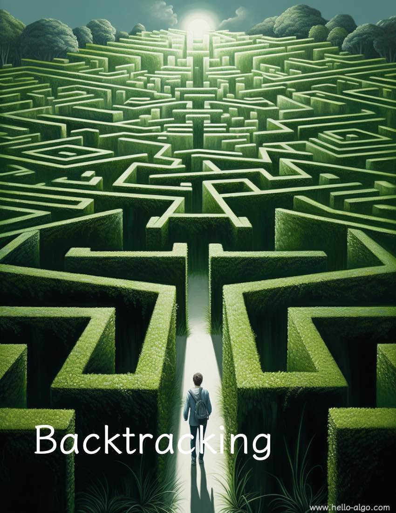

# 제 13 장 &nbsp; 백트래킹

{ class="cover-image" }

!!! abstract "이 장을 시작하며"

    우리는 미로 속 탐험가처럼 앞으로 나아가는 길에서 어려움을 만날 수 있다.
    
    백트래킹의 힘은 다시 출발하고 끊임없이 시도하여, 마침내 빛으로 향하는 출구를 찾게 해 준다.

## 이 장의 내용

- [13.1 &nbsp; 백트래킹 알고리즘](backtracking_algorithm.md)
- [13.2 &nbsp; 모든 순열 문제](permutations_problem.md)
- [13.3 &nbsp; 부분 집합 합 문제](subset_sum_problem.md)
- [13.4 &nbsp; n-퀸 문제](n_queens_problem.md)
- [13.5 &nbsp; 요약](summary.md)
- [13.6 &nbsp; 연습 문제](exercises.md)
