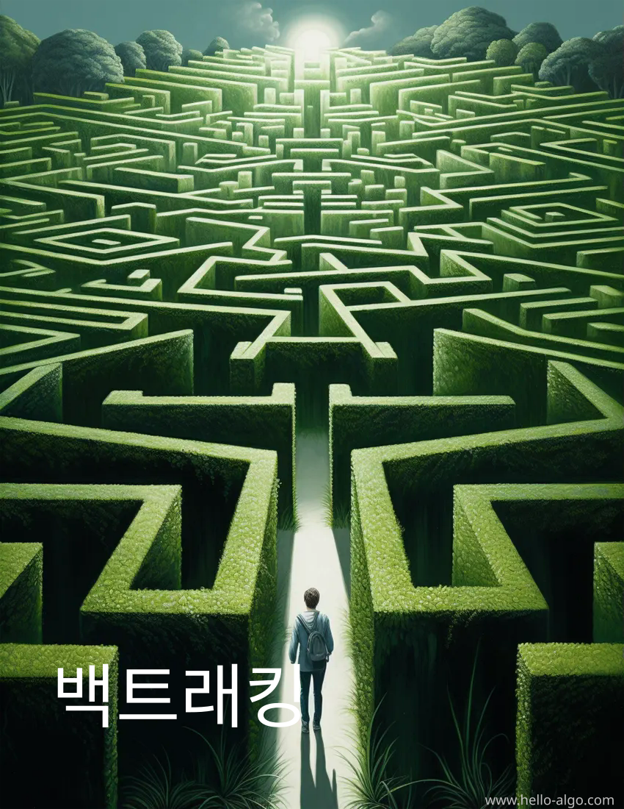

# 제 13 장 &nbsp; 백트래킹

{ class="cover-image" }

!!! abstract

    우리는 미로를 탐험하듯 길을 나아가다 난관을 만나기도 한다.
    
    백트래킹을 하면 되돌아가 다시 시도할 수 있다. 그렇게 거듭 길을 찾다 보면 마침내 빛이 드는 출구에 닿는다.

## 이 장의 내용

- [13.1 &nbsp; 백트래킹 알고리즘](backtracking_algorithm.md)
- [13.2 &nbsp; 순열 문제](permutations_problem.md)
- [13.3 &nbsp; 부분집합의 합 문제](subset_sum_problem.md)
- [13.4 &nbsp; N-퀸 문제](n_queens_problem.md)
- [13.5 &nbsp; 요약](summary.md)
- [13.6 &nbsp; 연습 문제](exercises.md)
