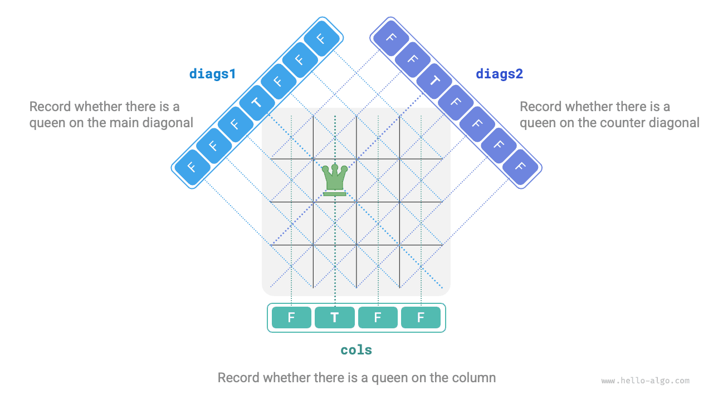

# 13.4 &nbsp; n-퀸 문제

!!! question "문제"

    체스 규칙에서 퀸은 같은 행, 열 또는 대각선에 있는 말을 공격할 수 있다. 퀸 $n$ 개와 $n \times n$ 크기의 체스판이 주어졌을 때, 퀸들이 서로 공격할 수 없도록 배치하는 방법을 찾아라.

아래 그림(13-15)과 같이 $n = 4$이면 해는 두 개다. 백트래킹 관점에서 $n \times n$ 체스판의 $n^2$ 개 칸은 모든 선택지 `choices`를 제공한다. 퀸을 하나씩 놓는 동안 체스판은 계속 바뀌며, 각 시점의 체스판이 상태 `state`다.

{ class="animation-figure" }

<p align="center"> 그림 13-15 &nbsp; 4-퀸 문제의 해 </p>

아래 그림(13-16)은 세 가지 제약 조건을 보여 준다. **여러 퀸이 같은 행, 같은 열, 같은 대각선에 있으면 안 된다**. 대각선은 주대각선 방향 `\`과 부대각선 방향 `/`의 두 종류로 나뉜다.

{ class="animation-figure" }

<p align="center"> 그림 13-16 &nbsp; n-퀸 문제의 제약 조건 </p>

### 1. &nbsp; 한 행씩 배치하는 전략

퀸 수와 체스판의 행 수가 모두 $n$이므로 **각 행에는 퀸을 정확히 하나씩 놓아야 한다**는 사실을 쉽게 도출할 수 있다.

따라서 첫 행부터 마지막 행까지 매 행에 퀸 하나씩 놓는 전략을 사용할 수 있다.

아래 그림(13-17)은 4-퀸 문제에서 한 행씩 배치하는 과정이다. 공간 제약 때문에 첫 행의 탐색 가지 중 하나만 펼쳤으며, 열과 대각선 제약을 만족하지 않는 배치는 모두 가지치기했다.

{ class="animation-figure" }

<p align="center"> 그림 13-17 &nbsp; 한 행씩 배치하는 전략 </p>

본질적으로 **행별 배치 전략 자체가 가지치기 역할을 한다**. 같은 행에 여러 퀸이 놓이는 모든 탐색 가지를 피하기 때문이다.

### 2. &nbsp; 열과 대각선 가지치기

열 제약을 만족하기 위해 길이 $n$의 불리언 배열 `cols`에 각 열의 퀸 존재 여부를 기록할 수 있다. 배치를 결정하기 전에 `cols`로 이미 퀸이 있는 열을 가지치기하고, 백트래킹 중 `cols`의 상태를 동적으로 갱신한다.

!!! tip "참고"

    행렬의 시작점은 왼쪽 위이며, 행 인덱스는 아래로 갈수록, 열 인덱스는 오른쪽으로 갈수록 커진다.

대각선 제약은 어떻게 처리할까? 한 칸의 행과 열 인덱스를 $(row, col)$이라고 하자. 주대각선 방향의 대각선 하나를 고르면, 그 위의 모든 칸에서 행 인덱스와 열 인덱스의 차가 같다. **즉, 같은 주대각선 방향 대각선에서는 $row - col$이 일정하다**.

따라서 두 칸이 $row_1 - col_1 = row_2 - col_2$를 만족하면 반드시 같은 주대각선 방향 대각선에 있다. 이 규칙을 이용하여 아래 그림(13-18)의 배열 `diags1`에 각 대각선의 퀸 존재 여부를 기록할 수 있다.

마찬가지로 **같은 부대각선 방향 대각선의 모든 칸에서는 $row + col$이 일정하다**. 배열 `diags2`를 이용하여 이 방향의 제약도 처리할 수 있다.

{ class="animation-figure" }

<p align="center"> 그림 13-18 &nbsp; 열 제약과 대각선 제약 처리 </p>

### 3. &nbsp; 코드 구현

$n$ 차 정방행렬에서 $row - col$의 범위는 $[-n + 1, n - 1]$, $row + col$의 범위는 $[0, 2n - 2]$이다. 따라서 두 방향의 대각선 수는 각각 $2n - 1$ 개이며, 배열 `diags1`과 `diags2`의 길이도 모두 $2n - 1$이다.

=== "Python"

    ```python title="n_queens.py"
    def backtrack(
        row: int,
        n: int,
        state: list[list[str]],
        res: list[list[list[str]]],
        cols: list[bool],
        diags1: list[bool],
        diags2: list[bool],
    ):
        """백트래킹 알고리즘: n-퀸"""
        # 모든 행에 배치했으면 해를 기록한다
        if row == n:
            res.append([list(row) for row in state])
            return
        # 모든 열을 순회한다
        for col in range(n):
            # 해당 칸이 속한 주대각선과 부대각선을 계산한다
            diag1 = row - col + n - 1
            diag2 = row + col
            # 가지치기: 해당 칸이 속한 열, 주대각선, 부대각선에 퀸이 있으면 안 된다
            if not cols[col] and not diags1[diag1] and not diags2[diag2]:
                # 시도: 해당 칸에 퀸을 놓는다
                state[row][col] = "Q"
                cols[col] = diags1[diag1] = diags2[diag2] = True
                # 다음 행에 배치한다
                backtrack(row + 1, n, state, res, cols, diags1, diags2)
                # 되돌리기: 해당 칸을 빈칸으로 되돌린다
                state[row][col] = "#"
                cols[col] = diags1[diag1] = diags2[diag2] = False

    def n_queens(n: int) -> list[list[list[str]]]:
        """n-퀸 문제 풀기"""
        # n*n 크기의 체스판을 초기화한다. 'Q'는 퀸, '#'은 빈칸을 나타낸다
        state = [["#" for _ in range(n)] for _ in range(n)]
        cols = [False] * n  # 열에 퀸이 있는지 기록한다
        diags1 = [False] * (2 * n - 1)  # 주대각선에 퀸이 있는지 기록한다
        diags2 = [False] * (2 * n - 1)  # 부대각선에 퀸이 있는지 기록한다
        res = []
        backtrack(0, n, state, res, cols, diags1, diags2)

        return res
    ```

=== "C++"

    ```cpp title="n_queens.cpp"
    /* 백트래킹 알고리즘: n-퀸 */
    void backtrack(int row, int n, vector<vector<string>> &state, vector<vector<vector<string>>> &res, vector<bool> &cols,
                   vector<bool> &diags1, vector<bool> &diags2) {
        // 모든 행에 배치했으면 해를 기록한다
        if (row == n) {
            res.push_back(state);
            return;
        }
        // 모든 열을 순회한다
        for (int col = 0; col < n; col++) {
            // 해당 칸이 속한 주대각선과 부대각선을 계산한다
            int diag1 = row - col + n - 1;
            int diag2 = row + col;
            // 가지치기: 해당 칸이 속한 열, 주대각선, 부대각선에 퀸이 있으면 안 된다
            if (!cols[col] && !diags1[diag1] && !diags2[diag2]) {
                // 시도: 해당 칸에 퀸을 놓는다
                state[row][col] = "Q";
                cols[col] = diags1[diag1] = diags2[diag2] = true;
                // 다음 행에 배치한다
                backtrack(row + 1, n, state, res, cols, diags1, diags2);
                // 되돌리기: 해당 칸을 빈칸으로 되돌린다
                state[row][col] = "#";
                cols[col] = diags1[diag1] = diags2[diag2] = false;
            }
        }
    }

    /* n-퀸 문제 풀기 */
    vector<vector<vector<string>>> nQueens(int n) {
        // n*n 크기의 체스판을 초기화한다. 'Q'는 퀸, '#'은 빈칸을 나타낸다
        vector<vector<string>> state(n, vector<string>(n, "#"));
        vector<bool> cols(n, false);           // 열에 퀸이 있는지 기록한다
        vector<bool> diags1(2 * n - 1, false); // 주대각선에 퀸이 있는지 기록한다
        vector<bool> diags2(2 * n - 1, false); // 부대각선에 퀸이 있는지 기록한다
        vector<vector<vector<string>>> res;

        backtrack(0, n, state, res, cols, diags1, diags2);

        return res;
    }
    ```

=== "Java"

    ```java title="n_queens.java"
    /* 백트래킹 알고리즘: n-퀸 */
    void backtrack(int row, int n, List<List<String>> state, List<List<List<String>>> res,
            boolean[] cols, boolean[] diags1, boolean[] diags2) {
        // 모든 행에 배치했으면 해를 기록한다
        if (row == n) {
            List<List<String>> copyState = new ArrayList<>();
            for (List<String> sRow : state) {
                copyState.add(new ArrayList<>(sRow));
            }
            res.add(copyState);
            return;
        }
        // 모든 열을 순회한다
        for (int col = 0; col < n; col++) {
            // 해당 칸이 속한 주대각선과 부대각선을 계산한다
            int diag1 = row - col + n - 1;
            int diag2 = row + col;
            // 가지치기: 해당 칸이 속한 열, 주대각선, 부대각선에 퀸이 있으면 안 된다
            if (!cols[col] && !diags1[diag1] && !diags2[diag2]) {
                // 시도: 해당 칸에 퀸을 놓는다
                state.get(row).set(col, "Q");
                cols[col] = diags1[diag1] = diags2[diag2] = true;
                // 다음 행에 배치한다
                backtrack(row + 1, n, state, res, cols, diags1, diags2);
                // 되돌리기: 해당 칸을 빈칸으로 되돌린다
                state.get(row).set(col, "#");
                cols[col] = diags1[diag1] = diags2[diag2] = false;
            }
        }
    }

    /* n-퀸 문제 풀기 */
    List<List<List<String>>> nQueens(int n) {
        // n*n 크기의 체스판을 초기화한다. 'Q'는 퀸, '#'은 빈칸을 나타낸다
        List<List<String>> state = new ArrayList<>();
        for (int i = 0; i < n; i++) {
            List<String> row = new ArrayList<>();
            for (int j = 0; j < n; j++) {
                row.add("#");
            }
            state.add(row);
        }
        boolean[] cols = new boolean[n]; // 열에 퀸이 있는지 기록한다
        boolean[] diags1 = new boolean[2 * n - 1]; // 주대각선에 퀸이 있는지 기록한다
        boolean[] diags2 = new boolean[2 * n - 1]; // 부대각선에 퀸이 있는지 기록한다
        List<List<List<String>>> res = new ArrayList<>();

        backtrack(0, n, state, res, cols, diags1, diags2);

        return res;
    }
    ```

=== "C#"

    ```csharp title="n_queens.cs"
    /* 백트래킹 알고리즘: n-퀸 */
    void Backtrack(int row, int n, List<List<string>> state, List<List<List<string>>> res,
            bool[] cols, bool[] diags1, bool[] diags2) {
        // 모든 행에 배치했으면 해를 기록한다
        if (row == n) {
            List<List<string>> copyState = [];
            foreach (List<string> sRow in state) {
                copyState.Add(new List<string>(sRow));
            }
            res.Add(copyState);
            return;
        }
        // 모든 열을 순회한다
        for (int col = 0; col < n; col++) {
            // 해당 칸이 속한 주대각선과 부대각선을 계산한다
            int diag1 = row - col + n - 1;
            int diag2 = row + col;
            // 가지치기: 해당 칸이 속한 열, 주대각선, 부대각선에 퀸이 있으면 안 된다
            if (!cols[col] && !diags1[diag1] && !diags2[diag2]) {
                // 시도: 해당 칸에 퀸을 놓는다
                state[row][col] = "Q";
                cols[col] = diags1[diag1] = diags2[diag2] = true;
                // 다음 행에 배치한다
                Backtrack(row + 1, n, state, res, cols, diags1, diags2);
                // 되돌리기: 해당 칸을 빈칸으로 되돌린다
                state[row][col] = "#";
                cols[col] = diags1[diag1] = diags2[diag2] = false;
            }
        }
    }

    /* n-퀸 문제 풀기 */
    List<List<List<string>>> NQueens(int n) {
        // n*n 크기의 체스판을 초기화한다. 'Q'는 퀸, '#'은 빈칸을 나타낸다
        List<List<string>> state = [];
        for (int i = 0; i < n; i++) {
            List<string> row = [];
            for (int j = 0; j < n; j++) {
                row.Add("#");
            }
            state.Add(row);
        }
        bool[] cols = new bool[n]; // 열에 퀸이 있는지 기록한다
        bool[] diags1 = new bool[2 * n - 1]; // 주대각선에 퀸이 있는지 기록한다
        bool[] diags2 = new bool[2 * n - 1]; // 부대각선에 퀸이 있는지 기록한다
        List<List<List<string>>> res = [];

        Backtrack(0, n, state, res, cols, diags1, diags2);

        return res;
    }
    ```

=== "Go"

    ```go title="n_queens.go"
    /* 백트래킹 알고리즘: n-퀸 */
    func backtrack(row, n int, state *[][]string, res *[][][]string, cols, diags1, diags2 *[]bool) {
        // 모든 행에 배치했으면 해를 기록한다
        if row == n {
            newState := make([][]string, len(*state))
            for i, _ := range newState {
                newState[i] = make([]string, len((*state)[0]))
                copy(newState[i], (*state)[i])

            }
            *res = append(*res, newState)
            return
        }
        // 모든 열을 순회한다
        for col := 0; col < n; col++ {
            // 해당 칸이 속한 주대각선과 부대각선을 계산한다
            diag1 := row - col + n - 1
            diag2 := row + col
            // 가지치기: 해당 칸이 속한 열, 주대각선, 부대각선에 퀸이 있으면 안 된다
            if !(*cols)[col] && !(*diags1)[diag1] && !(*diags2)[diag2] {
                // 시도: 해당 칸에 퀸을 놓는다
                (*state)[row][col] = "Q"
                (*cols)[col], (*diags1)[diag1], (*diags2)[diag2] = true, true, true
                // 다음 행에 배치한다
                backtrack(row+1, n, state, res, cols, diags1, diags2)
                // 되돌리기: 해당 칸을 빈칸으로 되돌린다
                (*state)[row][col] = "#"
                (*cols)[col], (*diags1)[diag1], (*diags2)[diag2] = false, false, false
            }
        }
    }

    /* n-퀸 문제 풀기 */
    func nQueens(n int) [][][]string {
        // n*n 크기의 체스판을 초기화한다. 'Q'는 퀸, '#'은 빈칸을 나타낸다
        state := make([][]string, n)
        for i := 0; i < n; i++ {
            row := make([]string, n)
            for i := 0; i < n; i++ {
                row[i] = "#"
            }
            state[i] = row
        }
        // 열에 퀸이 있는지 기록한다
        cols := make([]bool, n)
        diags1 := make([]bool, 2*n-1)
        diags2 := make([]bool, 2*n-1)
        res := make([][][]string, 0)
        backtrack(0, n, &state, &res, &cols, &diags1, &diags2)
        return res
    }
    ```

=== "Swift"

    ```swift title="n_queens.swift"
    /* 백트래킹 알고리즘: n-퀸 */
    func backtrack(row: Int, n: Int, state: inout [[String]], res: inout [[[String]]], cols: inout [Bool], diags1: inout [Bool], diags2: inout [Bool]) {
        // 모든 행에 배치했으면 해를 기록한다
        if row == n {
            res.append(state)
            return
        }
        // 모든 열을 순회한다
        for col in 0 ..< n {
            // 해당 칸이 속한 주대각선과 부대각선을 계산한다
            let diag1 = row - col + n - 1
            let diag2 = row + col
            // 가지치기: 해당 칸이 속한 열, 주대각선, 부대각선에 퀸이 있으면 안 된다
            if !cols[col] && !diags1[diag1] && !diags2[diag2] {
                // 시도: 해당 칸에 퀸을 놓는다
                state[row][col] = "Q"
                cols[col] = true
                diags1[diag1] = true
                diags2[diag2] = true
                // 다음 행에 배치한다
                backtrack(row: row + 1, n: n, state: &state, res: &res, cols: &cols, diags1: &diags1, diags2: &diags2)
                // 되돌리기: 해당 칸을 빈칸으로 되돌린다
                state[row][col] = "#"
                cols[col] = false
                diags1[diag1] = false
                diags2[diag2] = false
            }
        }
    }

    /* n-퀸 문제 풀기 */
    func nQueens(n: Int) -> [[[String]]] {
        // n*n 크기의 체스판을 초기화한다. 'Q'는 퀸, '#'은 빈칸을 나타낸다
        var state = Array(repeating: Array(repeating: "#", count: n), count: n)
        var cols = Array(repeating: false, count: n) // 열에 퀸이 있는지 기록한다
        var diags1 = Array(repeating: false, count: 2 * n - 1) // 주대각선에 퀸이 있는지 기록한다
        var diags2 = Array(repeating: false, count: 2 * n - 1) // 부대각선에 퀸이 있는지 기록한다
        var res: [[[String]]] = []

        backtrack(row: 0, n: n, state: &state, res: &res, cols: &cols, diags1: &diags1, diags2: &diags2)

        return res
    }
    ```

=== "JS"

    ```javascript title="n_queens.js"
    /* 백트래킹 알고리즘: n-퀸 */
    function backtrack(row, n, state, res, cols, diags1, diags2) {
        // 모든 행에 배치했으면 해를 기록한다
        if (row === n) {
            res.push(state.map((row) => row.slice()));
            return;
        }
        // 모든 열을 순회한다
        for (let col = 0; col < n; col++) {
            // 해당 칸이 속한 주대각선과 부대각선을 계산한다
            const diag1 = row - col + n - 1;
            const diag2 = row + col;
            // 가지치기: 해당 칸이 속한 열, 주대각선, 부대각선에 퀸이 있으면 안 된다
            if (!cols[col] && !diags1[diag1] && !diags2[diag2]) {
                // 시도: 해당 칸에 퀸을 놓는다
                state[row][col] = 'Q';
                cols[col] = diags1[diag1] = diags2[diag2] = true;
                // 다음 행에 배치한다
                backtrack(row + 1, n, state, res, cols, diags1, diags2);
                // 되돌리기: 해당 칸을 빈칸으로 되돌린다
                state[row][col] = '#';
                cols[col] = diags1[diag1] = diags2[diag2] = false;
            }
        }
    }

    /* n-퀸 문제 풀기 */
    function nQueens(n) {
        // n*n 크기의 체스판을 초기화한다. 'Q'는 퀸, '#'은 빈칸을 나타낸다
        const state = Array.from({ length: n }, () => Array(n).fill('#'));
        const cols = Array(n).fill(false); // 열에 퀸이 있는지 기록한다
        const diags1 = Array(2 * n - 1).fill(false); // 주대각선에 퀸이 있는지 기록한다
        const diags2 = Array(2 * n - 1).fill(false); // 부대각선에 퀸이 있는지 기록한다
        const res = [];

        backtrack(0, n, state, res, cols, diags1, diags2);
        return res;
    }
    ```

=== "TS"

    ```typescript title="n_queens.ts"
    /* 백트래킹 알고리즘: n-퀸 */
    function backtrack(
        row: number,
        n: number,
        state: string[][],
        res: string[][][],
        cols: boolean[],
        diags1: boolean[],
        diags2: boolean[]
    ): void {
        // 모든 행에 배치했으면 해를 기록한다
        if (row === n) {
            res.push(state.map((row) => row.slice()));
            return;
        }
        // 모든 열을 순회한다
        for (let col = 0; col < n; col++) {
            // 해당 칸이 속한 주대각선과 부대각선을 계산한다
            const diag1 = row - col + n - 1;
            const diag2 = row + col;
            // 가지치기: 해당 칸이 속한 열, 주대각선, 부대각선에 퀸이 있으면 안 된다
            if (!cols[col] && !diags1[diag1] && !diags2[diag2]) {
                // 시도: 해당 칸에 퀸을 놓는다
                state[row][col] = 'Q';
                cols[col] = diags1[diag1] = diags2[diag2] = true;
                // 다음 행에 배치한다
                backtrack(row + 1, n, state, res, cols, diags1, diags2);
                // 되돌리기: 해당 칸을 빈칸으로 되돌린다
                state[row][col] = '#';
                cols[col] = diags1[diag1] = diags2[diag2] = false;
            }
        }
    }

    /* n-퀸 문제 풀기 */
    function nQueens(n: number): string[][][] {
        // n*n 크기의 체스판을 초기화한다. 'Q'는 퀸, '#'은 빈칸을 나타낸다
        const state = Array.from({ length: n }, () => Array(n).fill('#'));
        const cols = Array(n).fill(false); // 열에 퀸이 있는지 기록한다
        const diags1 = Array(2 * n - 1).fill(false); // 주대각선에 퀸이 있는지 기록한다
        const diags2 = Array(2 * n - 1).fill(false); // 부대각선에 퀸이 있는지 기록한다
        const res: string[][][] = [];

        backtrack(0, n, state, res, cols, diags1, diags2);
        return res;
    }
    ```

=== "Dart"

    ```dart title="n_queens.dart"
    /* 백트래킹 알고리즘: n-퀸 */
    void backtrack(
      int row,
      int n,
      List<List<String>> state,
      List<List<List<String>>> res,
      List<bool> cols,
      List<bool> diags1,
      List<bool> diags2,
    ) {
      // 모든 행에 배치했으면 해를 기록한다
      if (row == n) {
        List<List<String>> copyState = [];
        for (List<String> sRow in state) {
          copyState.add(List.from(sRow));
        }
        res.add(copyState);
        return;
      }
      // 모든 열을 순회한다
      for (int col = 0; col < n; col++) {
        // 해당 칸이 속한 주대각선과 부대각선을 계산한다
        int diag1 = row - col + n - 1;
        int diag2 = row + col;
        // 가지치기: 해당 칸이 속한 열, 주대각선, 부대각선에 퀸이 있으면 안 된다
        if (!cols[col] && !diags1[diag1] && !diags2[diag2]) {
          // 시도: 해당 칸에 퀸을 놓는다
          state[row][col] = "Q";
          cols[col] = true;
          diags1[diag1] = true;
          diags2[diag2] = true;
          // 다음 행에 배치한다
          backtrack(row + 1, n, state, res, cols, diags1, diags2);
          // 되돌리기: 해당 칸을 빈칸으로 되돌린다
          state[row][col] = "#";
          cols[col] = false;
          diags1[diag1] = false;
          diags2[diag2] = false;
        }
      }
    }

    /* n-퀸 문제 풀기 */
    List<List<List<String>>> nQueens(int n) {
      // n*n 크기의 체스판을 초기화한다. 'Q'는 퀸, '#'은 빈칸을 나타낸다
      List<List<String>> state = List.generate(n, (index) => List.filled(n, "#"));
      List<bool> cols = List.filled(n, false); // 열에 퀸이 있는지 기록한다
      List<bool> diags1 = List.filled(2 * n - 1, false); // 주대각선에 퀸이 있는지 기록한다
      List<bool> diags2 = List.filled(2 * n - 1, false); // 부대각선에 퀸이 있는지 기록한다
      List<List<List<String>>> res = [];

      backtrack(0, n, state, res, cols, diags1, diags2);

      return res;
    }
    ```

=== "Rust"

    ```rust title="n_queens.rs"
    /* 백트래킹 알고리즘: n-퀸 */
    fn backtrack(
        row: usize,
        n: usize,
        state: &mut Vec<Vec<String>>,
        res: &mut Vec<Vec<Vec<String>>>,
        cols: &mut [bool],
        diags1: &mut [bool],
        diags2: &mut [bool],
    ) {
        // 모든 행에 배치했으면 해를 기록한다
        if row == n {
            res.push(state.clone());
            return;
        }
        // 모든 열을 순회한다
        for col in 0..n {
            // 해당 칸이 속한 주대각선과 부대각선을 계산한다
            let diag1 = row + n - 1 - col;
            let diag2 = row + col;
            // 가지치기: 해당 칸이 속한 열, 주대각선, 부대각선에 퀸이 있으면 안 된다
            if !cols[col] && !diags1[diag1] && !diags2[diag2] {
                // 시도: 해당 칸에 퀸을 놓는다
                state[row][col] = "Q".into();
                (cols[col], diags1[diag1], diags2[diag2]) = (true, true, true);
                // 다음 행에 배치한다
                backtrack(row + 1, n, state, res, cols, diags1, diags2);
                // 되돌리기: 해당 칸을 빈칸으로 되돌린다
                state[row][col] = "#".into();
                (cols[col], diags1[diag1], diags2[diag2]) = (false, false, false);
            }
        }
    }

    /* n-퀸 문제 풀기 */
    fn n_queens(n: usize) -> Vec<Vec<Vec<String>>> {
        // n*n 크기의 체스판을 초기화한다. 'Q'는 퀸, '#'은 빈칸을 나타낸다
        let mut state: Vec<Vec<String>> = vec![vec!["#".to_string(); n]; n];
        let mut cols = vec![false; n]; // 열에 퀸이 있는지 기록한다
        let mut diags1 = vec![false; 2 * n - 1]; // 주대각선에 퀸이 있는지 기록한다
        let mut diags2 = vec![false; 2 * n - 1]; // 부대각선에 퀸이 있는지 기록한다
        let mut res: Vec<Vec<Vec<String>>> = Vec::new();

        backtrack(
            0,
            n,
            &mut state,
            &mut res,
            &mut cols,
            &mut diags1,
            &mut diags2,
        );

        res
    }
    ```

=== "C"

    ```c title="n_queens.c"
    /* 백트래킹 알고리즘: n-퀸 */
    void backtrack(int row, int n, char state[MAX_SIZE][MAX_SIZE], char ***res, int *resSize, bool cols[MAX_SIZE],
                   bool diags1[2 * MAX_SIZE - 1], bool diags2[2 * MAX_SIZE - 1]) {
        // 모든 행에 배치했으면 해를 기록한다
        if (row == n) {
            res[*resSize] = (char **)malloc(sizeof(char *) * n);
            for (int i = 0; i < n; ++i) {
                res[*resSize][i] = (char *)malloc(sizeof(char) * (n + 1));
                strcpy(res[*resSize][i], state[i]);
            }
            (*resSize)++;
            return;
        }
        // 모든 열을 순회한다
        for (int col = 0; col < n; col++) {
            // 해당 칸이 속한 주대각선과 부대각선을 계산한다
            int diag1 = row - col + n - 1;
            int diag2 = row + col;
            // 가지치기: 해당 칸이 속한 열, 주대각선, 부대각선에 퀸이 있으면 안 된다
            if (!cols[col] && !diags1[diag1] && !diags2[diag2]) {
                // 시도: 해당 칸에 퀸을 놓는다
                state[row][col] = 'Q';
                cols[col] = diags1[diag1] = diags2[diag2] = true;
                // 다음 행에 배치한다
                backtrack(row + 1, n, state, res, resSize, cols, diags1, diags2);
                // 되돌리기: 해당 칸을 빈칸으로 되돌린다
                state[row][col] = '#';
                cols[col] = diags1[diag1] = diags2[diag2] = false;
            }
        }
    }

    /* n-퀸 문제 풀기 */
    char ***nQueens(int n, int *returnSize) {
        char state[MAX_SIZE][MAX_SIZE];
        // n*n 크기의 체스판을 초기화한다. 'Q'는 퀸, '#'은 빈칸을 나타낸다
        for (int i = 0; i < n; ++i) {
            for (int j = 0; j < n; ++j) {
                state[i][j] = '#';
            }
            state[i][n] = '\0';
        }
        bool cols[MAX_SIZE] = {false};           // 열에 퀸이 있는지 기록한다
        bool diags1[2 * MAX_SIZE - 1] = {false}; // 주대각선에 퀸이 있는지 기록한다
        bool diags2[2 * MAX_SIZE - 1] = {false}; // 부대각선에 퀸이 있는지 기록한다

        char ***res = (char ***)malloc(sizeof(char **) * MAX_SIZE);
        *returnSize = 0;
        backtrack(0, n, state, res, returnSize, cols, diags1, diags2);
        return res;
    }
    ```

=== "Kotlin"

    ```kotlin title="n_queens.kt"
    /* 백트래킹 알고리즘: n-퀸 */
    fun backtrack(
        row: Int,
        n: Int,
        state: MutableList<MutableList<String>>,
        res: MutableList<MutableList<MutableList<String>>?>,
        cols: BooleanArray,
        diags1: BooleanArray,
        diags2: BooleanArray
    ) {
        // 모든 행에 배치했으면 해를 기록한다
        if (row == n) {
            val copyState = mutableListOf<MutableList<String>>()
            for (sRow in state) {
                copyState.add(sRow.toMutableList())
            }
            res.add(copyState)
            return
        }
        // 모든 열을 순회한다
        for (col in 0..<n) {
            // 해당 칸이 속한 주대각선과 부대각선을 계산한다
            val diag1 = row - col + n - 1
            val diag2 = row + col
            // 가지치기: 해당 칸이 속한 열, 주대각선, 부대각선에 퀸이 있으면 안 된다
            if (!cols[col] && !diags1[diag1] && !diags2[diag2]) {
                // 시도: 해당 칸에 퀸을 놓는다
                state[row][col] = "Q"
                diags2[diag2] = true
                diags1[diag1] = diags2[diag2]
                cols[col] = diags1[diag1]
                // 다음 행에 배치한다
                backtrack(row + 1, n, state, res, cols, diags1, diags2)
                // 되돌리기: 해당 칸을 빈칸으로 되돌린다
                state[row][col] = "#"
                diags2[diag2] = false
                diags1[diag1] = diags2[diag2]
                cols[col] = diags1[diag1]
            }
        }
    }

    /* n-퀸 문제 풀기 */
    fun nQueens(n: Int): MutableList<MutableList<MutableList<String>>?> {
        // n*n 크기의 체스판을 초기화한다. 'Q'는 퀸, '#'은 빈칸을 나타낸다
        val state = mutableListOf<MutableList<String>>()
        for (i in 0..<n) {
            val row = mutableListOf<String>()
            for (j in 0..<n) {
                row.add("#")
            }
            state.add(row)
        }
        val cols = BooleanArray(n) // 열에 퀸이 있는지 기록한다
        val diags1 = BooleanArray(2 * n - 1) // 주대각선에 퀸이 있는지 기록한다
        val diags2 = BooleanArray(2 * n - 1) // 부대각선에 퀸이 있는지 기록한다
        val res = mutableListOf<MutableList<MutableList<String>>?>()

        backtrack(0, n, state, res, cols, diags1, diags2)

        return res
    }
    ```

=== "Ruby"

    ```ruby title="n_queens.rb"
    ### 백트래킹 알고리즘: n-퀸 ###
    def backtrack(row, n, state, res, cols, diags1, diags2)
      # 모든 행에 배치했으면 해를 기록한다
      if row == n
        res << state.map { |row| row.dup }
        return
      end

      # 모든 열을 순회한다
      for col in 0...n
        # 해당 칸이 속한 주대각선과 부대각선을 계산한다
        diag1 = row - col + n - 1
        diag2 = row + col
        # 가지치기: 해당 칸이 속한 열, 주대각선, 부대각선에 퀸이 있으면 안 된다
        if !cols[col] && !diags1[diag1] && !diags2[diag2]
          # 시도: 해당 칸에 퀸을 놓는다
          state[row][col] = "Q"
          cols[col] = diags1[diag1] = diags2[diag2] = true
          # 다음 행에 배치한다
          backtrack(row + 1, n, state, res, cols, diags1, diags2)
          # 되돌리기: 해당 칸을 빈칸으로 되돌린다
          state[row][col] = "#"
          cols[col] = diags1[diag1] = diags2[diag2] = false
        end
      end
    end

    ### n-퀸 문제 풀기 ###
    def n_queens(n)
      # n*n 크기의 체스판을 초기화한다. 'Q'는 퀸, '#'은 빈칸을 나타낸다
      state = Array.new(n) { Array.new(n, "#") }
      cols = Array.new(n, false) # 열에 퀸이 있는지 기록한다
      diags1 = Array.new(2 * n - 1, false) # 주대각선에 퀸이 있는지 기록한다
      diags2 = Array.new(2 * n - 1, false) # 부대각선에 퀸이 있는지 기록한다
      res = []
      backtrack(0, n, state, res, cols, diags1, diags2)

      res
    end
    ```

??? pythontutor "코드 시각화"

    <div style="height: 549px; width: 100%;"><iframe class="pythontutor-iframe" title="코드 시각화" src="https://pythontutor.com/iframe-embed.html#code=def%20backtrack%28%0A%20%20%20%20row%3A%20int,%0A%20%20%20%20n%3A%20int,%0A%20%20%20%20state%3A%20list%5Blist%5Bstr%5D%5D,%0A%20%20%20%20res%3A%20list%5Blist%5Blist%5Bstr%5D%5D%5D,%0A%20%20%20%20cols%3A%20list%5Bbool%5D,%0A%20%20%20%20diags1%3A%20list%5Bbool%5D,%0A%20%20%20%20diags2%3A%20list%5Bbool%5D,%0A%29%3A%0A%20%20%20%20%22%22%22%EB%B0%B1%ED%8A%B8%EB%9E%98%ED%82%B9%20%EC%95%8C%EA%B3%A0%EB%A6%AC%EC%A6%98%3A%20N-%ED%80%B8%22%22%22%0A%20%20%20%20%23%20%EB%AA%A8%EB%93%A0%20%ED%96%89%EC%97%90%20%EB%B0%B0%EC%B9%98%ED%96%88%EC%9C%BC%EB%A9%B4%20%ED%95%B4%EB%A5%BC%20%EA%B8%B0%EB%A1%9D%ED%95%9C%EB%8B%A4%0A%20%20%20%20if%20row%20%3D%3D%20n%3A%0A%20%20%20%20%20%20%20%20res.append%28%5Blist%28row%29%20for%20row%20in%20state%5D%29%0A%20%20%20%20%20%20%20%20return%0A%20%20%20%20%23%20%EB%AA%A8%EB%93%A0%20%EC%97%B4%EC%9D%84%20%EC%88%9C%ED%9A%8C%ED%95%9C%EB%8B%A4%0A%20%20%20%20for%20col%20in%20range%28n%29%3A%0A%20%20%20%20%20%20%20%20%23%20%ED%95%B4%EB%8B%B9%20%EC%B9%B8%EC%9D%B4%20%EC%86%8D%ED%95%9C%20%EC%A3%BC%EB%8C%80%EA%B0%81%EC%84%A0%EA%B3%BC%20%EB%B6%80%EB%8C%80%EA%B0%81%EC%84%A0%EC%9D%84%20%EA%B3%84%EC%82%B0%ED%95%9C%EB%8B%A4%0A%20%20%20%20%20%20%20%20diag1%20%3D%20row%20-%20col%20%2B%20n%20-%201%0A%20%20%20%20%20%20%20%20diag2%20%3D%20row%20%2B%20col%0A%20%20%20%20%20%20%20%20%23%20%EA%B0%80%EC%A7%80%EC%B9%98%EA%B8%B0%3A%20%ED%95%B4%EB%8B%B9%20%EC%B9%B8%EC%9D%B4%20%EC%86%8D%ED%95%9C%20%EC%97%B4,%20%EC%A3%BC%EB%8C%80%EA%B0%81%EC%84%A0,%20%EB%B6%80%EB%8C%80%EA%B0%81%EC%84%A0%EC%97%90%20%ED%80%B8%EC%9D%B4%20%EC%9E%88%EC%9C%BC%EB%A9%B4%20%EC%95%88%20%EB%90%9C%EB%8B%A4%0A%20%20%20%20%20%20%20%20if%20not%20cols%5Bcol%5D%20and%20not%20diags1%5Bdiag1%5D%20and%20not%20diags2%5Bdiag2%5D%3A%0A%20%20%20%20%20%20%20%20%20%20%20%20%23%20%EC%8B%9C%EB%8F%84%3A%20%ED%95%B4%EB%8B%B9%20%EC%B9%B8%EC%97%90%20%ED%80%B8%EC%9D%84%20%EB%86%93%EB%8A%94%EB%8B%A4%0A%20%20%20%20%20%20%20%20%20%20%20%20state%5Brow%5D%5Bcol%5D%20%3D%20%22Q%22%0A%20%20%20%20%20%20%20%20%20%20%20%20cols%5Bcol%5D%20%3D%20diags1%5Bdiag1%5D%20%3D%20diags2%5Bdiag2%5D%20%3D%20True%0A%20%20%20%20%20%20%20%20%20%20%20%20%23%20%EB%8B%A4%EC%9D%8C%20%ED%96%89%EC%97%90%20%EB%B0%B0%EC%B9%98%ED%95%9C%EB%8B%A4%0A%20%20%20%20%20%20%20%20%20%20%20%20backtrack%28row%20%2B%201,%20n,%20state,%20res,%20cols,%20diags1,%20diags2%29%0A%20%20%20%20%20%20%20%20%20%20%20%20%23%20%EB%90%98%EB%8F%8C%EB%A6%AC%EA%B8%B0%3A%20%ED%95%B4%EB%8B%B9%20%EC%B9%B8%EC%9D%84%20%EB%B9%88%EC%B9%B8%EC%9C%BC%EB%A1%9C%20%EB%90%98%EB%8F%8C%EB%A6%B0%EB%8B%A4%0A%20%20%20%20%20%20%20%20%20%20%20%20state%5Brow%5D%5Bcol%5D%20%3D%20%22%23%22%0A%20%20%20%20%20%20%20%20%20%20%20%20cols%5Bcol%5D%20%3D%20diags1%5Bdiag1%5D%20%3D%20diags2%5Bdiag2%5D%20%3D%20False%0A%0A%0Adef%20n_queens%28n%3A%20int%29%20-%3E%20list%5Blist%5Blist%5Bstr%5D%5D%5D%3A%0A%20%20%20%20%22%22%22N-%ED%80%B8%20%EB%AC%B8%EC%A0%9C%20%ED%92%80%EA%B8%B0%22%22%22%0A%20%20%20%20%23%20n%2An%20%ED%81%AC%EA%B8%B0%EC%9D%98%20%EC%B2%B4%EC%8A%A4%ED%8C%90%EC%9D%84%20%EC%B4%88%EA%B8%B0%ED%99%94%ED%95%9C%EB%8B%A4.%20%27Q%27%EB%8A%94%20%ED%80%B8,%20%27%23%27%EC%9D%80%20%EB%B9%88%EC%B9%B8%EC%9D%84%20%EB%82%98%ED%83%80%EB%82%B8%EB%8B%A4%0A%20%20%20%20state%20%3D%20%5B%5B%22%23%22%20for%20_%20in%20range%28n%29%5D%20for%20_%20in%20range%28n%29%5D%0A%20%20%20%20cols%20%3D%20%5BFalse%5D%20%2A%20n%20%20%23%20%EC%97%B4%EC%97%90%20%ED%80%B8%EC%9D%B4%20%EC%9E%88%EB%8A%94%EC%A7%80%20%EA%B8%B0%EB%A1%9D%ED%95%9C%EB%8B%A4%0A%20%20%20%20diags1%20%3D%20%5BFalse%5D%20%2A%20%282%20%2A%20n%20-%201%29%20%20%23%20%EC%A3%BC%EB%8C%80%EA%B0%81%EC%84%A0%EC%97%90%20%ED%80%B8%EC%9D%B4%20%EC%9E%88%EB%8A%94%EC%A7%80%20%EA%B8%B0%EB%A1%9D%ED%95%9C%EB%8B%A4%0A%20%20%20%20diags2%20%3D%20%5BFalse%5D%20%2A%20%282%20%2A%20n%20-%201%29%20%20%23%20%EB%B6%80%EB%8C%80%EA%B0%81%EC%84%A0%EC%97%90%20%ED%80%B8%EC%9D%B4%20%EC%9E%88%EB%8A%94%EC%A7%80%20%EA%B8%B0%EB%A1%9D%ED%95%9C%EB%8B%A4%0A%20%20%20%20res%20%3D%20%5B%5D%0A%20%20%20%20backtrack%280,%20n,%20state,%20res,%20cols,%20diags1,%20diags2%29%0A%0A%20%20%20%20return%20res%0A%0A%0A%22%22%22%EC%8B%A4%ED%96%89%20%EC%BD%94%EB%93%9C%22%22%22%0Aif%20__name__%20%3D%3D%20%22__main__%22%3A%0A%20%20%20%20n%20%3D%204%0A%20%20%20%20res%20%3D%20n_queens%28n%29%0A%0A%20%20%20%20print%28f%22%EC%9E%85%EB%A0%A5%ED%95%9C%20%EC%B2%B4%EC%8A%A4%ED%8C%90%EC%9D%98%20%EA%B0%80%EB%A1%9C%EC%99%80%20%EC%84%B8%EB%A1%9C%20%EA%B8%B8%EC%9D%B4%3A%20%7Bn%7D%22%29%0A%20%20%20%20print%28f%22%ED%80%B8%EC%9D%84%20%EB%B0%B0%EC%B9%98%ED%95%98%EB%8A%94%20%EB%B0%A9%EB%B2%95%EC%9D%80%20%EC%B4%9D%20%7Blen%28res%29%7D%EA%B0%80%EC%A7%80%EC%9D%B4%EB%8B%A4%22%29%0A%20%20%20%20for%20state%20in%20res%3A%0A%20%20%20%20%20%20%20%20print%28%22--------------------%22%29%0A%20%20%20%20%20%20%20%20for%20row%20in%20state%3A%0A%20%20%20%20%20%20%20%20%20%20%20%20print%28row%29&codeDivHeight=472&codeDivWidth=350&cumulative=false&curInstr=61&heapPrimitives=nevernest&origin=opt-frontend.js&py=311&rawInputLstJSON=%5B%5D&textReferences=false"> </iframe></div>
    <div style="margin-top: 5px;"><a href="https://pythontutor.com/iframe-embed.html#code=def%20backtrack%28%0A%20%20%20%20row%3A%20int,%0A%20%20%20%20n%3A%20int,%0A%20%20%20%20state%3A%20list%5Blist%5Bstr%5D%5D,%0A%20%20%20%20res%3A%20list%5Blist%5Blist%5Bstr%5D%5D%5D,%0A%20%20%20%20cols%3A%20list%5Bbool%5D,%0A%20%20%20%20diags1%3A%20list%5Bbool%5D,%0A%20%20%20%20diags2%3A%20list%5Bbool%5D,%0A%29%3A%0A%20%20%20%20%22%22%22%EB%B0%B1%ED%8A%B8%EB%9E%98%ED%82%B9%20%EC%95%8C%EA%B3%A0%EB%A6%AC%EC%A6%98%3A%20N-%ED%80%B8%22%22%22%0A%20%20%20%20%23%20%EB%AA%A8%EB%93%A0%20%ED%96%89%EC%97%90%20%EB%B0%B0%EC%B9%98%ED%96%88%EC%9C%BC%EB%A9%B4%20%ED%95%B4%EB%A5%BC%20%EA%B8%B0%EB%A1%9D%ED%95%9C%EB%8B%A4%0A%20%20%20%20if%20row%20%3D%3D%20n%3A%0A%20%20%20%20%20%20%20%20res.append%28%5Blist%28row%29%20for%20row%20in%20state%5D%29%0A%20%20%20%20%20%20%20%20return%0A%20%20%20%20%23%20%EB%AA%A8%EB%93%A0%20%EC%97%B4%EC%9D%84%20%EC%88%9C%ED%9A%8C%ED%95%9C%EB%8B%A4%0A%20%20%20%20for%20col%20in%20range%28n%29%3A%0A%20%20%20%20%20%20%20%20%23%20%ED%95%B4%EB%8B%B9%20%EC%B9%B8%EC%9D%B4%20%EC%86%8D%ED%95%9C%20%EC%A3%BC%EB%8C%80%EA%B0%81%EC%84%A0%EA%B3%BC%20%EB%B6%80%EB%8C%80%EA%B0%81%EC%84%A0%EC%9D%84%20%EA%B3%84%EC%82%B0%ED%95%9C%EB%8B%A4%0A%20%20%20%20%20%20%20%20diag1%20%3D%20row%20-%20col%20%2B%20n%20-%201%0A%20%20%20%20%20%20%20%20diag2%20%3D%20row%20%2B%20col%0A%20%20%20%20%20%20%20%20%23%20%EA%B0%80%EC%A7%80%EC%B9%98%EA%B8%B0%3A%20%ED%95%B4%EB%8B%B9%20%EC%B9%B8%EC%9D%B4%20%EC%86%8D%ED%95%9C%20%EC%97%B4,%20%EC%A3%BC%EB%8C%80%EA%B0%81%EC%84%A0,%20%EB%B6%80%EB%8C%80%EA%B0%81%EC%84%A0%EC%97%90%20%ED%80%B8%EC%9D%B4%20%EC%9E%88%EC%9C%BC%EB%A9%B4%20%EC%95%88%20%EB%90%9C%EB%8B%A4%0A%20%20%20%20%20%20%20%20if%20not%20cols%5Bcol%5D%20and%20not%20diags1%5Bdiag1%5D%20and%20not%20diags2%5Bdiag2%5D%3A%0A%20%20%20%20%20%20%20%20%20%20%20%20%23%20%EC%8B%9C%EB%8F%84%3A%20%ED%95%B4%EB%8B%B9%20%EC%B9%B8%EC%97%90%20%ED%80%B8%EC%9D%84%20%EB%86%93%EB%8A%94%EB%8B%A4%0A%20%20%20%20%20%20%20%20%20%20%20%20state%5Brow%5D%5Bcol%5D%20%3D%20%22Q%22%0A%20%20%20%20%20%20%20%20%20%20%20%20cols%5Bcol%5D%20%3D%20diags1%5Bdiag1%5D%20%3D%20diags2%5Bdiag2%5D%20%3D%20True%0A%20%20%20%20%20%20%20%20%20%20%20%20%23%20%EB%8B%A4%EC%9D%8C%20%ED%96%89%EC%97%90%20%EB%B0%B0%EC%B9%98%ED%95%9C%EB%8B%A4%0A%20%20%20%20%20%20%20%20%20%20%20%20backtrack%28row%20%2B%201,%20n,%20state,%20res,%20cols,%20diags1,%20diags2%29%0A%20%20%20%20%20%20%20%20%20%20%20%20%23%20%EB%90%98%EB%8F%8C%EB%A6%AC%EA%B8%B0%3A%20%ED%95%B4%EB%8B%B9%20%EC%B9%B8%EC%9D%84%20%EB%B9%88%EC%B9%B8%EC%9C%BC%EB%A1%9C%20%EB%90%98%EB%8F%8C%EB%A6%B0%EB%8B%A4%0A%20%20%20%20%20%20%20%20%20%20%20%20state%5Brow%5D%5Bcol%5D%20%3D%20%22%23%22%0A%20%20%20%20%20%20%20%20%20%20%20%20cols%5Bcol%5D%20%3D%20diags1%5Bdiag1%5D%20%3D%20diags2%5Bdiag2%5D%20%3D%20False%0A%0A%0Adef%20n_queens%28n%3A%20int%29%20-%3E%20list%5Blist%5Blist%5Bstr%5D%5D%5D%3A%0A%20%20%20%20%22%22%22N-%ED%80%B8%20%EB%AC%B8%EC%A0%9C%20%ED%92%80%EA%B8%B0%22%22%22%0A%20%20%20%20%23%20n%2An%20%ED%81%AC%EA%B8%B0%EC%9D%98%20%EC%B2%B4%EC%8A%A4%ED%8C%90%EC%9D%84%20%EC%B4%88%EA%B8%B0%ED%99%94%ED%95%9C%EB%8B%A4.%20%27Q%27%EB%8A%94%20%ED%80%B8,%20%27%23%27%EC%9D%80%20%EB%B9%88%EC%B9%B8%EC%9D%84%20%EB%82%98%ED%83%80%EB%82%B8%EB%8B%A4%0A%20%20%20%20state%20%3D%20%5B%5B%22%23%22%20for%20_%20in%20range%28n%29%5D%20for%20_%20in%20range%28n%29%5D%0A%20%20%20%20cols%20%3D%20%5BFalse%5D%20%2A%20n%20%20%23%20%EC%97%B4%EC%97%90%20%ED%80%B8%EC%9D%B4%20%EC%9E%88%EB%8A%94%EC%A7%80%20%EA%B8%B0%EB%A1%9D%ED%95%9C%EB%8B%A4%0A%20%20%20%20diags1%20%3D%20%5BFalse%5D%20%2A%20%282%20%2A%20n%20-%201%29%20%20%23%20%EC%A3%BC%EB%8C%80%EA%B0%81%EC%84%A0%EC%97%90%20%ED%80%B8%EC%9D%B4%20%EC%9E%88%EB%8A%94%EC%A7%80%20%EA%B8%B0%EB%A1%9D%ED%95%9C%EB%8B%A4%0A%20%20%20%20diags2%20%3D%20%5BFalse%5D%20%2A%20%282%20%2A%20n%20-%201%29%20%20%23%20%EB%B6%80%EB%8C%80%EA%B0%81%EC%84%A0%EC%97%90%20%ED%80%B8%EC%9D%B4%20%EC%9E%88%EB%8A%94%EC%A7%80%20%EA%B8%B0%EB%A1%9D%ED%95%9C%EB%8B%A4%0A%20%20%20%20res%20%3D%20%5B%5D%0A%20%20%20%20backtrack%280,%20n,%20state,%20res,%20cols,%20diags1,%20diags2%29%0A%0A%20%20%20%20return%20res%0A%0A%0A%22%22%22%EC%8B%A4%ED%96%89%20%EC%BD%94%EB%93%9C%22%22%22%0Aif%20__name__%20%3D%3D%20%22__main__%22%3A%0A%20%20%20%20n%20%3D%204%0A%20%20%20%20res%20%3D%20n_queens%28n%29%0A%0A%20%20%20%20print%28f%22%EC%9E%85%EB%A0%A5%ED%95%9C%20%EC%B2%B4%EC%8A%A4%ED%8C%90%EC%9D%98%20%EA%B0%80%EB%A1%9C%EC%99%80%20%EC%84%B8%EB%A1%9C%20%EA%B8%B8%EC%9D%B4%3A%20%7Bn%7D%22%29%0A%20%20%20%20print%28f%22%ED%80%B8%EC%9D%84%20%EB%B0%B0%EC%B9%98%ED%95%98%EB%8A%94%20%EB%B0%A9%EB%B2%95%EC%9D%80%20%EC%B4%9D%20%7Blen%28res%29%7D%EA%B0%80%EC%A7%80%EC%9D%B4%EB%8B%A4%22%29%0A%20%20%20%20for%20state%20in%20res%3A%0A%20%20%20%20%20%20%20%20print%28%22--------------------%22%29%0A%20%20%20%20%20%20%20%20for%20row%20in%20state%3A%0A%20%20%20%20%20%20%20%20%20%20%20%20print%28row%29&codeDivHeight=800&codeDivWidth=600&cumulative=false&curInstr=61&heapPrimitives=nevernest&origin=opt-frontend.js&py=311&rawInputLstJSON=%5B%5D&textReferences=false" target="_blank" rel="noopener noreferrer">전체 화면 ></a></div>

행별로 $n$ 번 배치할 때 열 제약을 고려하면 첫 행부터 마지막 행까지 선택지 수가 $n$, $n-1$, $\dots$, $2$, $1$이므로 $O(n!)$ 시간이 걸린다. 해를 기록할 때 행렬 `state`를 복사하여 `res`에 추가해야 하며, 복사에는 $O(n^2)$ 시간이 든다. 따라서 **전체 시간 복잡도는 $O(n! \cdot n^2)$이다**. 실제로는 대각선 제약에 따른 가지치기도 탐색 공간을 크게 줄이므로 위 복잡도보다 탐색 효율이 좋은 경우가 많다.

배열 `state`는 $O(n^2)$ 공간을, `cols`, `diags1`, `diags2`는 각각 $O(n)$ 공간을 사용한다. 최대 재귀 깊이가 $n$이므로 스택 프레임 공간은 $O(n)$이다. 따라서 **공간 복잡도는 $O(n^2)$이다**.
