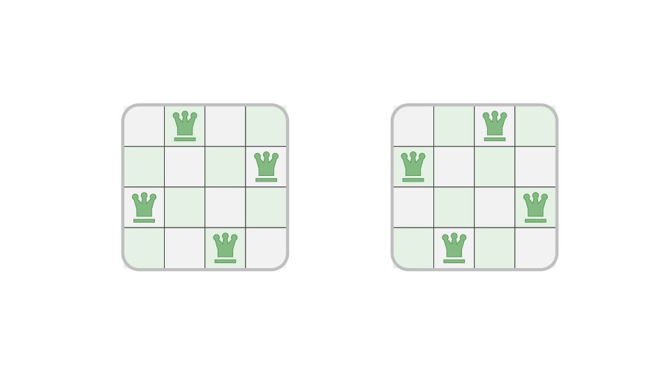
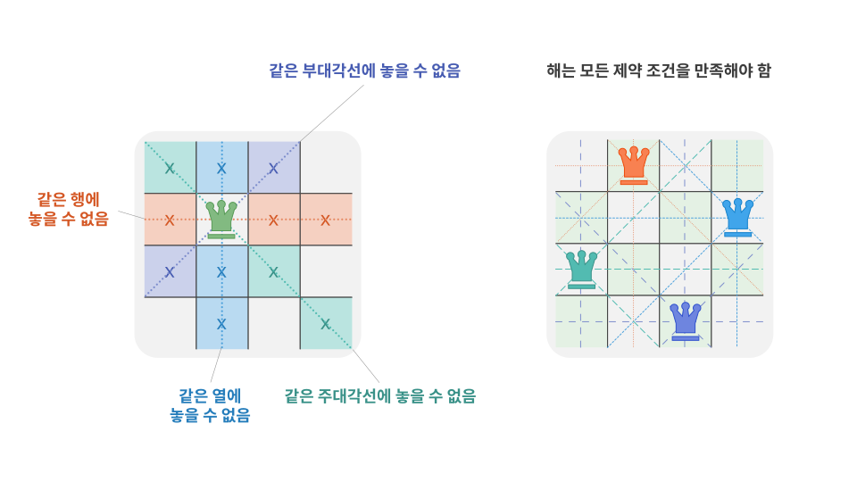

# n-퀸 문제

!!! question

    체스에서 퀸은 같은 행, 열 또는 대각선에 있는 기물을 공격할 수 있다. 퀸 $n$개와 $n \times n$ 체스판이 주어질 때 어느 두 퀸도 서로 공격할 수 없는 배치를 찾아라.

아래 그림처럼 $n = 4$일 때 해는 두 개이다. 백트래킹의 관점에서 보면 $n \times n$ 체스판의 $n^2$개 칸이 전체 선택지 `choices`를 이룬다. 퀸을 하나씩 놓을 때마다 체스판이 달라지며, 매 순간의 체스판이 곧 상태 `state`이다.



이 문제에는 아래 그림처럼 세 가지 제약 조건이 있다. **두 퀸이 같은 행, 같은 열 또는 같은 대각선에 있어서는 안 된다**. 대각선에는 주대각선 `\`와 부대각선 `/` 두 종류가 있다.



### 행마다 퀸을 놓는 전략

퀸의 개수와 체스판의 행 수가 모두 $n$이므로 **각 행에는 퀸을 정확히 하나씩 놓아야 한다**.

따라서 첫 행부터 마지막 행까지 각 행에 퀸을 하나씩 놓는 전략을 쓸 수 있다.

아래 그림은 4-퀸 문제에서 행마다 퀸을 놓는 과정이다. 지면 관계상 첫 행의 선택지 중 한 가지만 펼쳐 보였다. 열이나 대각선 제약을 어기는 배치는 모두 가지치기했다.


**행마다 하나씩 놓는 전략 자체가 가지치기 역할을 한다**. 같은 행에 퀸을 둘 이상 놓는 모든 가지를 처음부터 피하기 때문이다.

### 열과 대각선을 기준으로 가지치기

열 제약을 처리하기 위해 길이가 $n$인 불리언 배열 `cols`에 각 열에 퀸이 있는지 기록한다. 퀸을 놓을 때마다 먼저 `cols`를 확인해 이미 퀸이 있는 열을 건너뛰고, 백트래킹 과정에서 `cols`의 상태를 갱신한다.

!!! tip

    행렬의 시작점은 왼쪽 위이다. 행 인덱스는 아래로 갈수록, 열 인덱스는 오른쪽으로 갈수록 커진다.

대각선 제약은 어떻게 처리할까? 한 칸의 행과 열 인덱스를 $(row, col)$이라 하자. 어느 주대각선을 택하든 그 위의 모든 칸에서 행 인덱스와 열 인덱스의 차가 같다. 즉, **같은 주대각선에서는 $row - col$이 일정하다**.

따라서 두 칸이 $row_1 - col_1 = row_2 - col_2$를 만족하면 반드시 같은 주대각선에 있다. 이 성질을 이용해 아래 그림처럼 배열 `diags1`에 각 주대각선에 퀸이 있는지 기록할 수 있다.

마찬가지로 **같은 부대각선에 속한 칸에서는 $row + col$이 일정하다**. 따라서 배열 `diags2`를 이용해 부대각선 제약도 처리할 수 있다.


### 코드 구현

한 변의 길이가 $n$인 정사각 행렬에서 $row - col$의 범위는 $[-n + 1, n - 1]$이고 $row + col$의 범위는 $[0, 2n - 2]$이다. 따라서 주대각선과 부대각선은 각각 $2n - 1$개이고, 배열 `diags1`과 `diags2`의 길이는 모두 $2n - 1$이다.

```src
[file]{n_queens}-[class]{}-[func]{n_queens}
```

행마다 하나씩 $n$번 놓는다. 열 제약을 고려하면 첫 행부터 마지막 행까지 선택지는 각각 $n$, $n-1$, $\dots$, $2$, $1$개이므로 $O(n!)$ 시간이 걸린다. 해를 기록할 때는 행렬 `state`를 복사해 `res`에 추가하며 복사에 $O(n^2)$ 시간이 든다. 따라서 **전체 시간 복잡도는 $O(n! \cdot n^2)$이다**. 실제로는 대각선 제약에 따른 가지치기로 탐색 공간이 크게 줄어들어 이 복잡도에서 예상하는 것보다 빠른 경우가 많다.

배열 `state`는 $O(n^2)$ 공간을 사용하고 배열 `cols`, `diags1`, `diags2`는 각각 $O(n)$ 공간을 사용한다. 최대 재귀 깊이는 $n$이므로 스택 프레임에 $O(n)$ 공간이 든다. 따라서 **공간 복잡도는 $O(n^2)$이다**.
